## 08 壁挂式 Google 日历 Raspberry Pi

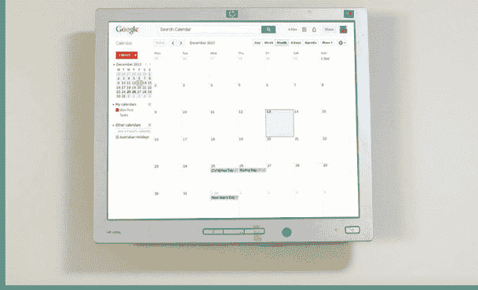

### ALEX PINE

Alex Pine 是来自南澳大利亚阿德莱德的 IT 服务工程师。他的项目已被观看超过 800,000 次。 magpi.cc/1Y94RtZ

这个流行的项目将旧 HDMI 显示器变成壁挂式显示屏，显示 Google 日历的信息。Raspberry Pi 放置在显示器的背面，并用支架安装在墙上。

> 电子邮件是现代的诅咒，但实践收件箱零可以带来很多缓解

来自邮件过载。Raspberry Pi LED 的明亮灯光提醒你收件箱中有需要处理的电子邮件。这是一个超级简单的项目——只有一个 LED 和大约十行代码——但一旦配置好，它会逼迫你清理电子邮件账户。

最后，如果你真的需要组织帮助，为什么不把你的 Raspberry Pi 变成语音激活的数字助理呢？我们喜欢 Jan Wante 的 Raspberry Personal Assistant。他把 1950 年代的

Bakelite Televox 对讲机变成了一个语音控制的数字助理（想象一下 Siri 在旧美国收音机内部）。内部是带有 USB 音频声卡的 Raspberry Pi，运行 Steven Hickson 的 Voice Command 软件（magpi.cc/1Y95Pqc）。

你无疑会从建造这些项目中的任何一个学到新东西，而学习新东西是你无论如何都能做出的最好的新年决心。无论你选择在 2016 年建造哪个项目，请确保玩得开心。

## 09
## INBOX ZERO TAUNTER

### MICHAEL MITCHELL
Michael Mitchell 住在佛罗里达州塔拉哈西并运营着 MitchTech 网站。他为 Raspberry Pi、Arduino、Android 和 Ubuntu 创建项目。 magpi.cc/aY953cF

收件箱零挑衅者是一个简单的项目，使用连接到 Raspberry Pi 的 LED。Python 脚本用于检测 Gmail 收件箱中的电子邮件并点亮 LED。

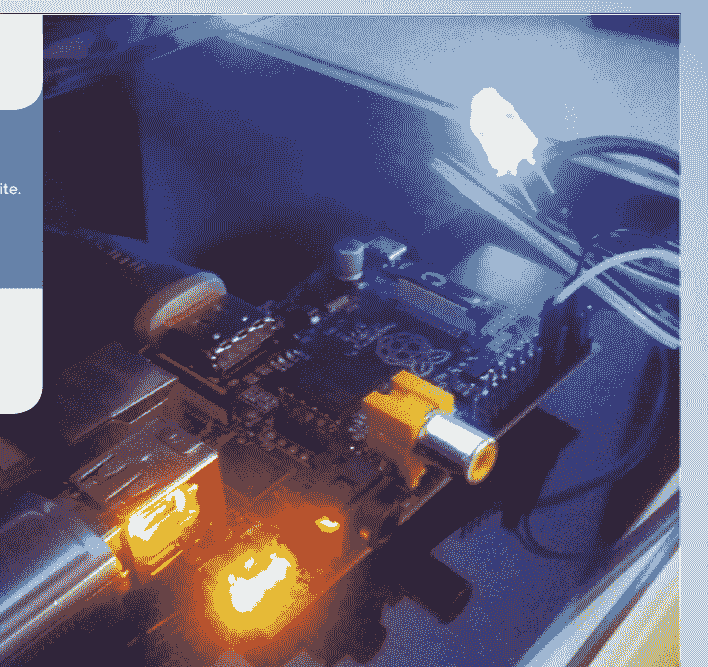
## 10
## RASPBERRY PERSONAL ASSISTANT
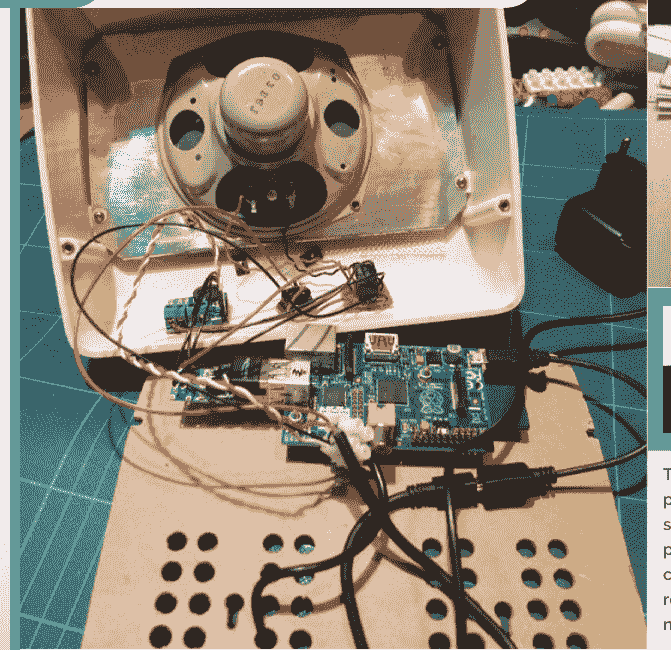
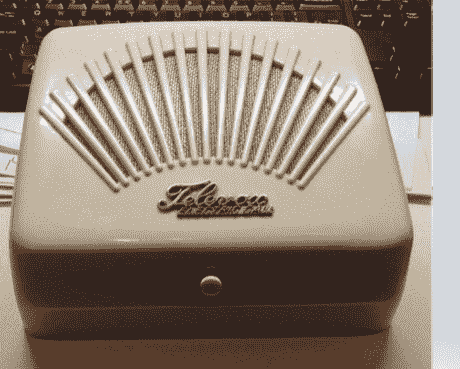

### JAN WANTE
Jan Wante 是来自荷兰的创客。他是 J³ Associates 的成员，该组织运营着一个项目制作实验室。 j3associates.be

Raspberry Personal Assistant 项目将 1950 年代的 Bakelite 扬声器改造成语音激活的个人助理。像 Siri 一样，它可以被编程来回答关于天气和新闻的请求，或接收留言。

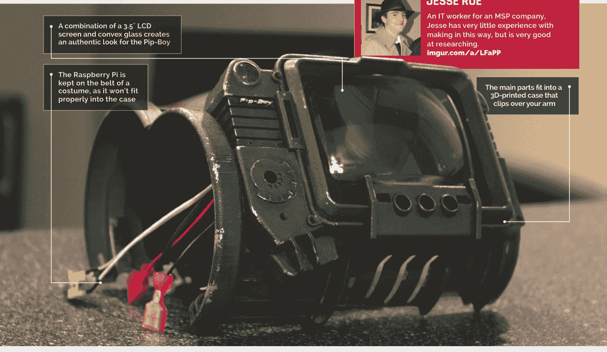

### JESSE ROE
作为一家 MSP 公司的 IT 工作人员，Jesse 在这种制作方式上经验很少，但研究能力很强。
imgur.com/a/LFaPP

3.5 英寸 LCD 屏幕与凸面玻璃的组合为 Pip-Boy 营造出逼真的外观

Raspberry Pi 被放在服装的腰带上，因为它无法正确放入机箱中

主要部件装入一个 3D 打印的机箱，该机箱可夹在手臂上

### Quick Facts
- Jesse 在 2014 年 10 月至圣诞节期间完成了该项目
- 仍有一些按钮需要添加，但它在功能上已完成
- 《Fallout 3》和《New Vegas》是他最喜欢的 Fallout 游戏
- Jesse 现在想用 Pis 制作一个机器人坦克军队
- 机箱的铸件来自 Nakamura Shop，RasPipBoy UI 由 Neal Corbett 制作

## RASPBERRY PIP-BOY 3000A
用定制的手腕佩戴电脑在放射性荒原或镇上阴郁的一天中生存

Fallout 电子游戏中的 Pip-Boy 如今已成为相当具有标志性的装备。虚构的手腕电脑的功能可能不如该系列在 1990 年代首发时那样令人惊叹，但复古未来主义的外观使其在流行文化的某些角落得以保留。如今，随着 Fallout 系列兴趣的重新燃起、创客的兴起以及角色扮演的爆炸式流行，时不时会有一个新的自制 Pip-Boy 在网上出现并小范围走红。即使即将发布 Fallout 4 的特别版附带官方 Pip-Boy，人们仍在制作自己的版本，比如 Jesse Roe。“该项目是尝试制作一个完全功能性的 Pip-Boy 3000A。不是把手机塞进去的东西，而是一个真正工作的设备，”Jesse 告诉我们，指的是需要智能手机的官方 Pip-Boy。Jesse 从未为他的 Raspberry Pi 找到完美用途，于是决定将其用于为朋友制作的这个项目。使用他自己修改的 3D 打印机箱，制作并不简单。

“我总共大约花了 70 小时在这上面，其中很多只是研究，”Jesse 解释了他的制作过程。“关于如何制作 Pip-Boy、从哪里获取铸件、材料等，有很多资料。主要要获取的是 Pip-Boy 铸件本身，我从 Shapeways 上的 Nakamura Shop 订购了它。“一旦到手，我们将其打磨并用模型漆涂上底色，颜色更深的绿色。”

## USE A CUSTOM PIP-BOY
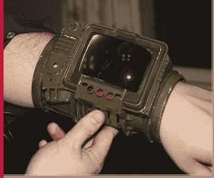
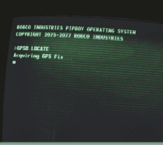
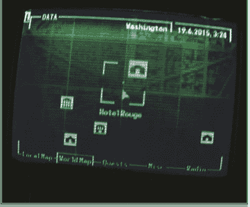
### >STEP-01
### Set it up
你需要穿上完整的避难所服装并配有腰带来容纳 Raspberry Pi，以便将 Pip-Boy 屏幕插入其中，并将 Pi 连接到电源。

### >STEP-02
### Boot it up
你可以在扮演角色并前往展会现场展示你完全功能正常的 Pip-Boy 时，欣赏自定义启动信息。

### >STEP-03
### Show it off
自定义界面，可从 bitbucket.org/selectnone/raspipboy 获取，具有许多可向感兴趣的人展示的功能：GPS、VATS 模拟器和 Wi-Fi 信号强度监视器。

我们用划痕和其他磨损对其进行了细化，使其看起来像使用过的型号。我知道整套服装需要分开。太多人离拥有一个可工作的 Pip-Boy 很近，却在说无法将所有东西装进去时卡住了！我拿了一件机械师连体服，并在背面加上了 101 标志以及其他细节……我还使用了旧的军用剩余腰带，上面有很多隔间作为服装的一部分，并在服装上开了一个孔，以便所有布线都可以从腰带经过后背通向 Pip-Boy。

构建中最困难且几乎是最后的部分是屏幕。我最终使用了一块来自 Adafruit 的 3.5 英寸 TFT。顶部边框的下垂方式以及安装屏幕的方式意味着要将其放在覆盖所有内容的东西上，以便边框后面的唇部。然后之后，我必须在屏幕顶部放一块玻璃并将其非常轻微地（但不要太轻）粘在屏幕周围。任何错误你都必须更换新屏幕，因为要么你会将其粘得偏离中心，要么你会粘太多。

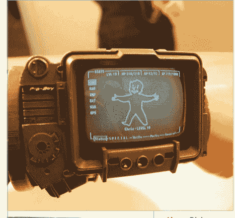
> 我总共大约花了 70 小时在这上面，其中很多只是研究

“接下来是让 Pip-Boy 在启动时进入略微调整过的‘操作系统’，这相当简单。我最终编辑了代码，使‘BIOS’等有不同的启动信息，以使其更完整，但我没有过多地修改软件。

由于 Jesse 之前没有做过太多编程，修改和设置对他来说有点棘手，但正如你所见，最后他还是完成了项目并带着一台漂亮的 Raspberry Pi 驱动的手腕电脑四处走动。

上方 旋钮即将推出，但界面完美再现了《Fallout 3》的 Pip-Boy
左侧 方便的军用腰带让 Jesse 能够将电子设备隐藏在服装中

### MYRIJAM STOETZER
Myrijam Stoetzer 是来自德国杜伊斯堡的 14 岁创客。她一直参加 Jugend forscht，这是一项面向年轻人的德国科学竞赛。
magpi.cc/2dTGODs

红外眼传感器检测用户瞳孔的运动

挡风玻璃雨刷电机连接到一个小型的 3D 打印轮。该轮驱动主轮椅轮

方向会被大声说出并使用面板确认

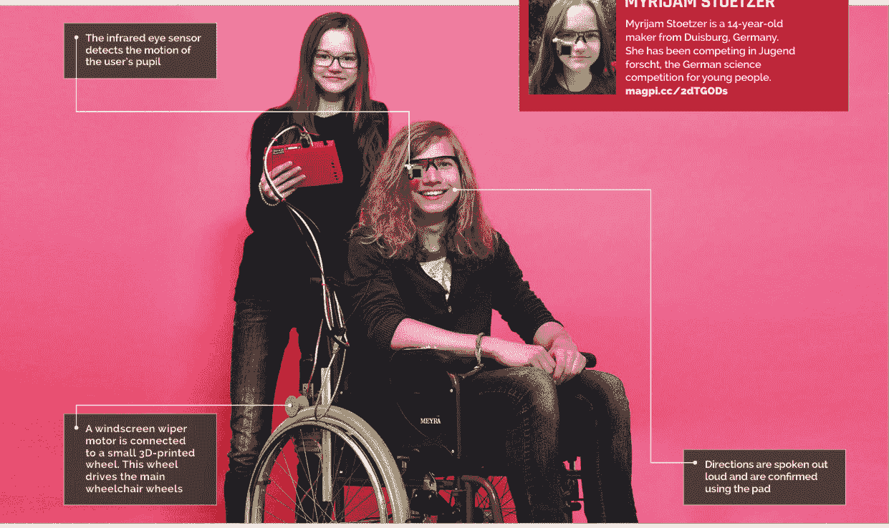
## EYE-CONTROLLED WHEELCHAIR
Myrijam Stoetzer 和 Paul Foltin 用 3D 打印零件、雨刷电机和改装过的网络摄像头制作了一辆令人难以置信的眼控轮椅。Lucy Hattersley 了解了所有情况...

### Quick Facts
- 整个项目大约花费了 10-12 个月完成
- 文件已在 CC BY NC 许可下发布
- 最初使用的是 Odroid 而不是 Raspberry Pi
- 一个机器人被用来测试软件
- 该系统可用于任何非动力轮椅

来自德国杜伊斯堡的 Myrijam Stoetzer 和 Paul Foltin 制作了这辆奇妙的眼控轮椅。我们与 Myrijam 聊了聊它。“我们这么做是因为眼动追踪非常有趣，”Myrijam 说，“然后我们想到也许可以操控某物。”“在寻找构建眼动追踪器的不同方法时，我们偶然发现了涂鸦艺术家 Tony Quan 的 Eyewriter 项目（eyewriter.org）。”

Tony 患有 ALS（肌萎缩侧索硬化症）只能移动眼睛。“Tony 在朋友们用眼动追踪器帮助他重新绘画和作画之前被孤立了七年，”Myrijam 告诉我们。“我们想帮助像他这样的人重新行动，因为想象自己无法再移动是如此可怕。”

安装在安全眼镜的框架上。“我们用一块模拟胶片替换了红外阻挡滤光片，该胶片几乎阻挡除红外光以外的所有光，”Myrijam 解释说，“[然后]我们用两个红外 SMD LED 替换了白光 LED。这样，眼睛将被红外光照亮，瞳孔会将其反射回来。”摄像头安装在定制的 3D 打印外壳内，并附着在安全眼镜框架上。

### Tracking eyes
眼动追踪器是改装用于红外光的网络摄像头，并且

## 眼动追踪轮椅

### STEP-01
红外摄像机

眼动追踪器由一台改装用于红外（IR）光的网络摄像头组成。IR 滤光片被移除，并使用薄膜阻挡除红外光以外的所有光线。红外 LED 取代了标准 LED。3D 打印外壳用于将设备安装在安全眼镜上。

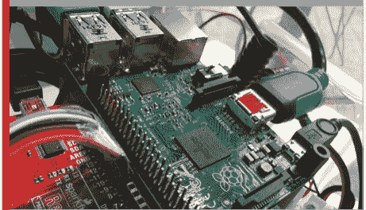

### STEP-02
瞳孔检测

Raspberry Pi 2 以每秒 10-12 帧的速度从红外摄像头拍摄用户眼睛的图像。对每张图像应用一系列滤镜，增加对比度，使瞳孔更容易识别。OpenCV 软件用于映射瞳孔的坐标。

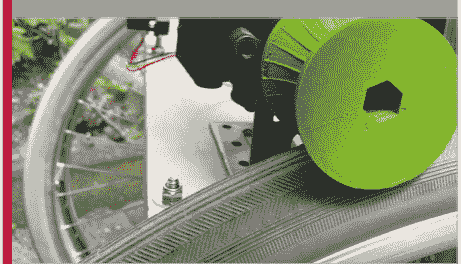

### STEP-03
电机控制

轮椅由从挡风玻璃雨刷单元拆下的电机控制。这些电机通过定制的 3D 打印轮廓直接连接到轮椅上的车轮（该轮廓设计为与椅子的车轮相匹配）。

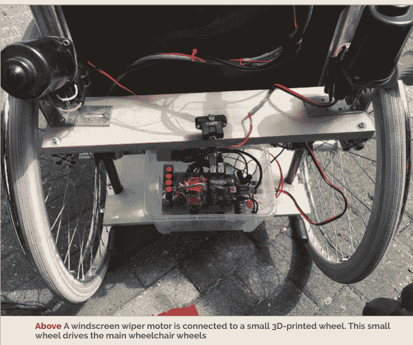

上图 一台挡风玻璃雨刷电机连接到一个小型 3D 打印车轮。该小型车轮驱动主轮椅车轮

“摄像头拍摄眼睛，软件提取瞳孔的位置并检查它是否在对应四种运动的四个区域范围内，”Myrijam 说。
在当前版本中，命令通过语音合成读给用户，并需要确认。然后根据方向打开电机。当轮椅移动时，红外测距仪检查路径中的障碍物。

车轮由从废品场抢救来的挡风玻璃雨刷电机提供动力。“我们希望保持它可以让每个人都自行重建，”Myrijam 告诉我们。这些电机通过一个定制的 3D 打印车轮连接到轮椅车轮，该车轮轮廓设计为贴合轮胎。

> 我们最大的成就是让追踪器找到瞳孔的坐标

### 由 Raspberry Pi 驱动

Raspberry Pi 用于从网络摄像头捕获图像，而 OpenCV (opencv.org) 用于图像处理。“软件以每秒 10–12 fps 的速度从网络摄像头捕获图像，”Myrijam 说。图像先转换为灰度，然后模糊并转换为黑白。“OpenCV 提供了一个很棒的滤镜，可以计算给定形状的重心，”她解释道。“我们使用此功能来获取已过滤出的瞳孔的坐标：这是最大的突破。”

这是一个具有挑战性的项目：“编写代码非常困难，因为这是我们第一次离开乐高 Mindstorms，”Myrijam 说。“我们最大的成就是让追踪器找到瞳孔的坐标。在那之后，我们知道这是可能的。我学会了做 3D 设计、3D 打印、Linux、Python 和图像处理。看到可以将计算机视觉集成到项目中并与物理计算相结合，真是太棒了。”

## 约克黑客空间

位于约克市中心的硬件黑客，制作协作项目和数字艺术装置，并将创客技能带给更广泛的社区。
magpi.cc/2dTHsRB

警报信息如 'Set multitronic filter to magenta alert!' 会在每个太空学员的控制台上弹出

Raspberry Pi 板控制游戏并计分，尽管所有可怜的船员不可避免地会迎来一个不幸的结局

MQTT 通过本地局域网向控制台发送指令 - 通常不是需要调整控制的那个控制台！

### SPACEHACK

与不幸的实习船员一起加入星际飞船 Guppy 号，随着事情开始变得一团糟，混乱的乐趣随之而来

### 快速事实

- 控制台一仍然保留着原始的意大利面式布线
- SpaceHack 已在约 15 场创客活动中亮相
- 在毛巾日，它变成了无限或然率驱动
- 所使用的激光切割机住在 Rob Whitfield 的卧室里！
- SpaceHack 使用与 Facebook Messenger 相同的通信协议

右图 SpaceHack 的复古未来主义外观在曼彻斯特科学工业博物馆的 MakeFest 环境中似乎是自然契合

还有什么其他快节奏的、基于 Pi 的控制台游戏能让你大喊 'Set multitronic filter to magenta alert!' 让路人感到困惑？过去一年左右，约克黑客空间在创客活动中吸引了大量关注，实现了他们为参观者展台创造难忘体验的目标。

是 Bob Stone 建议制作 Henry Smith 的 Spaceteam 的实体版本，这是一款 'cooperative shouting game for phones and tablets'，但赋予了黑客空间的决定性转折，其复古未来主义的太空船外观，以及自制硬件和软件，'它会在房间内自行宣传，因为在人群中大喊无意义的话语并带有紧迫感和恐慌往往会吸引注意力。'

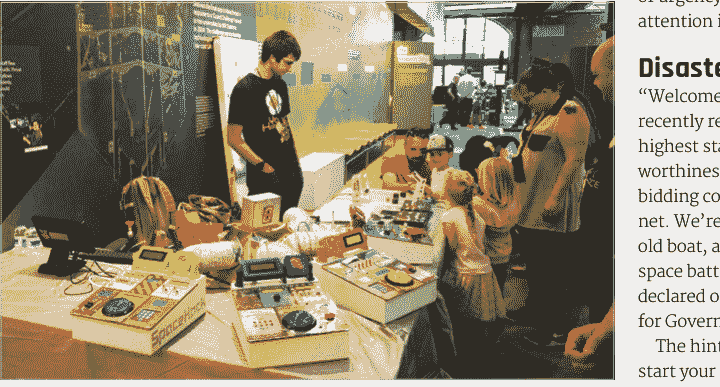

### 灾难模拟器

> 'Welcome aboard the USS Guppy, recently refurbished to the very highest standards of modern space-worthiness by some new lowest-bidding contractors we found on the net. We're proud that this venerable old boat, a veteran of many a heroic space battle, has once again been declared officially 'Good enough for Government work.' '
> 在你开始 'routine pass out by an asteroid belt orbiting an unstable Red Giant star near the edge of the Forbidden Zone, to investigate some unusual radiation signatures.' 之前，提示已经全部给出。

## 控制台游戏的制作

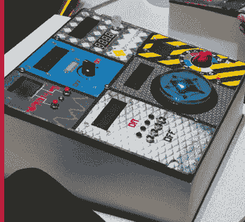

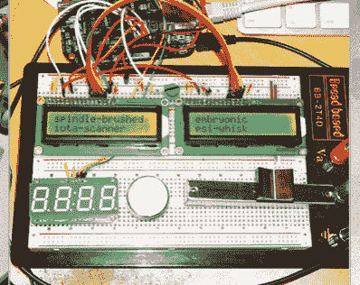

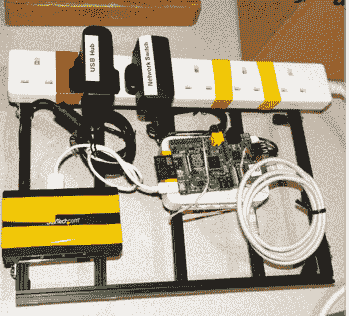

### STEP-01
控制台外壳

重型木工支撑着激光切割的胶合板顶面、由 Inkscape 设计的复古未来主义控制图形，以及一块相当厚的丙烯酸顶面，以承受困惑的太空学员的沉重使用。

### STEP-02
控制台内部

BeagleBone Black 是一个相当笨拙的控制台，从控制器接收指令，在 LCD 上显示通过 MQTT 发送的指令，并报告控制值。

### STEP-03
Pi 控制器

单块 B+ Pi 板为整个游戏提供动力，生成文本、音效，并托管游戏的 MQTT 代理。网络交换机通过看起来很科幻的管道将 Pi 连接到控制台。

> Welcome aboard the recently refurbished USS Guppy, once again declared officially ‘Good enough for Government work’

SpaceHack 的控制面板已被重新配置，随着太空任务开始出现问题，船载计算机发出的紧急指令——显示在控制台的 LCD 上——似乎不适用于该控制台的开关、旋钮和按钮。避免灾难的唯一方法是喊出指令，以便在其他三个控制台之一的同事太空学员可以寻找正确的开关来拨动、旋钮来转动或按钮来按下。

### 在 Jam 中

灾难能被阻止多久？每当约克团队在活动中带来 SpaceHack 时，总是不缺少志愿者来找出答案。如果你关注在线创客活动，你会看到有利的评论。在 MOSI MakeFest 发现几张熟悉的面孔正在玩 SpaceHack 后，我们问他们对体验的看法。

“我认为玩它非常有趣且极具吸引力。

故意令人困惑的指令增加了疯狂的闹剧，对我来说让人想起电视《The Generation Game》挑战，参赛者在看似简单的活动中苦苦挣扎，”Raspberry Jam 的 Alan O’Donohue 告诉我们。Claire Garside 邀请约克团队参加利兹 Raspberry Jam，并对 SpaceHack 激发人们以有趣的方式关注 STEM 的能力充满热情：“无论是我自己接受挑战，还是观察它吸引的各种参赛者，SpaceHack 总是通过 Pi 游戏为每个人激发热情和兴奋。是的，我是认真的！”

如果你想有机会大喊“Plug in the centrifugal F-screen!”，那么请留意 10 月 26 日德比创客集市上的 SpaceHack——如果你想自己制作，完整的细节

硬件（包括激光切割和 3D 打印）、控制台软件和 Raspberry Pi 控制器软件的说明已发布在 magpi.cc/2dTHzwu。

“Increase the omnicrontensor shell! Set multironic filter to magenta alert!”

下方 家族自然会被吸引到最恰当地描述为‘协作式喊叫游戏’的东西

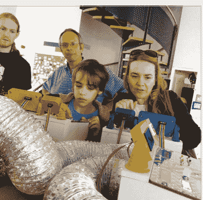

## FABSCAN PI

Mario Lukas 使用 Raspberry Pi 和现成的组件构建 3D 扫描仪。他向 Lucy Hattersley 讲述了制作方法

### 快速事实
- 所有零件总成本不到 100 美元
- 商用扫描仪的价格约为 3,000 美元
- FabScan 软件可创建 PLY 和 STL 文件
- 网格文件可用于 3D 打印物体
- Mario 正在尝试双激光和绿色激光

现代生活中很少有比 3D 扫描一个物体然后使用 3D 打印机制作复制品更有趣的事情。但 3D 扫描仪购买起来仍然非常昂贵。FabScan 是由 René Bohne 和 Mario Lukas 开发的开源 DIY 3D 激光扫描仪。最初，FabScan 连接到外部计算机，但 Mario 和 René 最近创建了 Raspberry Pi 版本，将所有所需组件都容纳在一个盒子内。这种由 Raspberry Pi 驱动的版本意味着你可以用不到 100 美元（£65）构建一台完整的 3D 扫描仪。

FabScan 项目有着悠久的历史。它始于 2011 年 RWTH University 在亚琛（德国）Francis Engelman 的学士论文。2014 年，开发工作由 Mario 和 René 接手。“没有 Raspberry Pi 的 FabScan 是一款开源的 DIY 3D 激光扫描仪，”Mario 说。“几个月后我意识到人们在各种操作系统和硬件设置上让 FabScan 软件运行有困难。”“FabScan 使用激光切割的胶合板外壳，”Mario 继续说道。

中间有一个步进电机连接到转盘。机箱内部有一个 5mW 红色激光和 Logitech C270 网络摄像头。激光和网络摄像头安装在机箱的前部。一个带有 FabScan 扩展板的 Arduino 控制步进电机和激光。你将物体放在转盘上，使激光横扫其表面。随着转盘旋转，网络摄像头监测激光的移动并创建点云数据。该数据被转换为 3D 网格，此文件可以导出并在 3D 软件中使用。“自从我将 Raspberry Pi 引入 FabScan 项目以来，网络摄像头已被 Pi Camera Module 取代，”Mario 告诉我们。“我们也在开发 FabScan Pi HAT 以取代 Arduino 和 FabScan Shield。”

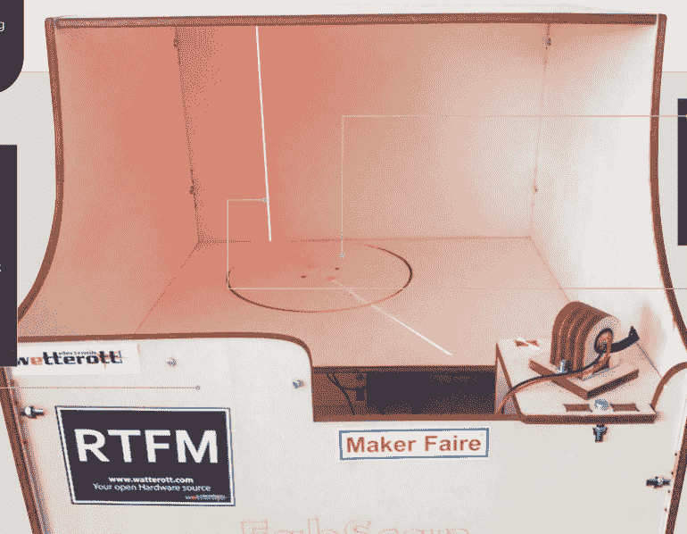

Raspberry Pi 安装在盒子内部并运行网页界面。你可以远程连接到后者以开始扫描过程

木质外壳包含一个电动转盘，可旋转被扫描的物体。它目前由 Arduino 控制，尽管正在开发定制的 Pi HAT

一个 5mW 红色激光固定在 FabScan 的角落。它将一条线直接投射到转盘上。Pi Camera Module 用于在物体旋转时监测激光

MARIO LUKAS
Mario Lukas 是来自德国亚琛的硬件黑客、计算机科学家和技术 tinkerer。
mariolukas.de

## 它是如何工作的？

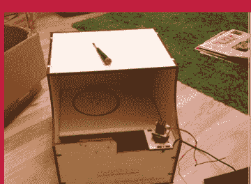

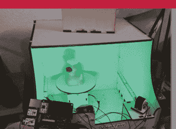

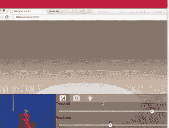

### STEP-01 盒体结构

FabScan 盒由木质零件激光切割而成。由 Arduino 控制的步进电机用于控制木质转盘。激光安装在角落并沿对角线在转盘上发出一条线。

### STEP-02 Raspberry Pi

Raspberry Pi 运行扫描软件，并使用 Raspberry Pi Camera Module 代替网络摄像头。使用 Pi 使 FabScan 成为一台自包含的 3D 扫描仪。

### STEP-03 扫描鸭子

一个物体（在本例中为橡胶鸭）放在转盘上。使用网页软件连接到 Pi 驱动的 FabScan。随着鸭子旋转，摄像头监测激光并用它来创建扫描。

你可以使用木板自己制作 FabScan 外壳，完整的物料清单可在 magpi.cc/2dTI8WT 找到。或者，也可以从德国分销商 Watterott（magpi.cc/2dTjSi）订购 FabScan Cube Kit v2 + Electronics 捆绑包，价格为 €105（£77）。

“任何想制作 FabScan Pi 的人应该订购零件并制作它，”Mario 坚持说。“我们正试图让事情尽可能简单，而将 Raspberry Pi 引入 FabScan 项目是提高可用性的一个好方法。”

“大部分工作是为 FabScan 编写新软件，”Mario 继续说道。“该软件为扫描提供基于 JavaScript 的网页启用用户界面。用户可以在浏览器中调用本地 FabScan，用户界面就会显示出来。”

“在软件开发过程中，我扫描了很多不同的橡胶鸭、其他塑料动物、石膏（巴黎石膏）制作的人物，以及我在工作室里随处可见的东西。”

“扫描后，你将获得与扫描物体一模一样大小的三维模型，”Mario 解释道。“当前的 FabScan Pi 软件可以将模型导出为 STL 文件格式，这是 3D 打印机主要使用的格式。”

推动 FabScan 项目向前发展是一项挑战，但 Mario 和 René 仍然毫不畏惧。

“目前，FabScan 项目分散在整个网络上，”Mario 解释道。“在接下来的几周里，我将尝试创建一个网站，让所有相关的讨论都汇聚在一起。”

“目前我正在为 Raspbian 编写一些 DEB 包，以尽可能简化安装过程，”Mario 透露。“下一步是发布一个预装 FabScan Pi 软件的 Raspbian 镜像。我还有一个庞大的待办事项清单，其中包含 FabScan 社区提到的新功能。”

> 将 Raspberry Pi 引入 FabScan 项目是提高可用性的一个好方法

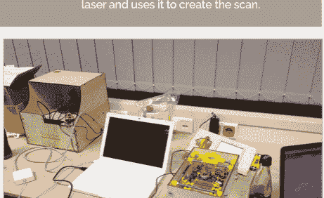

上方 Raspberry Pi 2 具有足够的性能，可让 FabScan 在不连接另一台计算机的情况下工作

上方 FabScan 软件用于从扫描检测到的点云数据创建 3D 网格

## 项目
展示

## LINUS FORSLID

一位目前在斯德哥尔摩大学学习计算机游戏设计的瑞典学生，Linus 对电子项目感兴趣。
youtu.be/-q-D6V8eFZo

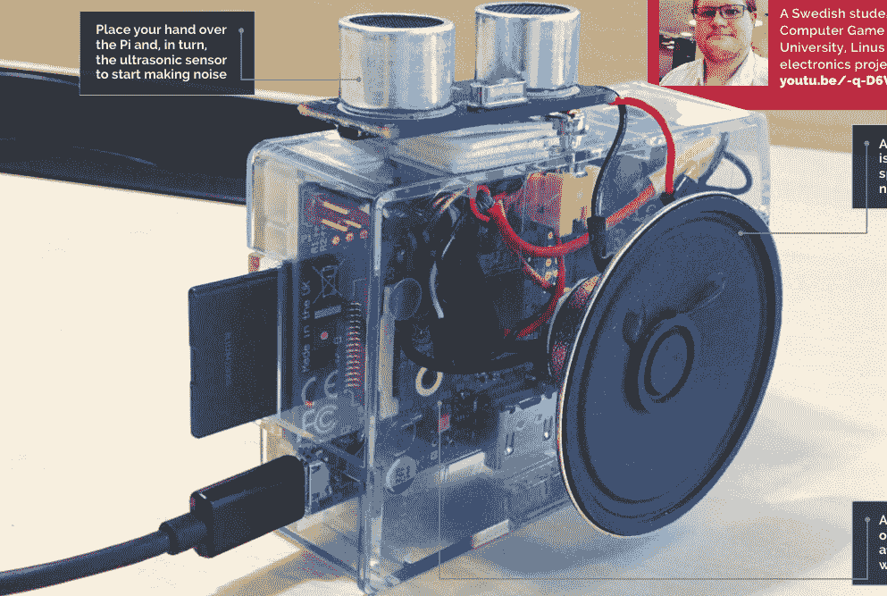

将手放在 Pi 上，然后放在超声波传感器上开始发声

所有声音输出都由这台旧 PC 扬声器完成，它不需要额外电源

据说在最初的 Model B 上使用一段时间后会出现一点延迟，但在 Pi 2 上会好得多

### 快速事实
- Linus 曾将他的 Raspberry Pi 用作 HTPC
- 这是他此类电子项目的首次尝试
- 制作只花了一个晚上，微调花了两个小时
- 它是用电工胶带粘起来的，这是不推荐的
- Linus 希望添加光导以提高精度

## 超声波 Theremin

一种富有创意的 Raspberry Pi 用法，使用了你在工作坊里可能随处可见的组件

在《The MagPi》这里，我们喜欢跳出思维定式。Raspberry Pi 如此多才多艺且开放，你可以用它做很多事情，也许其他人根本想不到。所以这里有一个好问题：用 Raspberry Pi、一些扬声器和用于机器人的超声波测距传感器，你会做什么？Linus Forslid 决定制作一种 theremin。“Theremin 是一种测量附近物体距离并将其转化为声音的设备，这样当你移动手时就可以产生音乐，”Linus 解释道。但它并不完全像普通的 theremin。“与经典 theremin 不同，我的项目使用超声波传感器而不是用天线测量电场，而且目前我的项目只有一个传感器，所以你只能控制它产生的音调。最终，我计划再添加一个，这样节拍也可以手动控制。”Theremin 被用于为经典科幻电影创作诡异、 creepy 的音乐。由于这一点及其不寻常的操作方式，theremin 吸引了许多音乐家和极客，包括 Linus：“我从第一天听说它时就一直想要一个 theremin。它就是这么酷。事实证明，真正的 theremin 并不是便宜或容易制作的，但这个项目很容易完成，而且我几乎所有组件都在家，所以成本也很低。我决定使用 PC 扬声器而不是 Pi 自带的音频插孔和外部扬声器，主要是因为我可以，而且它不需要额外的电源。”

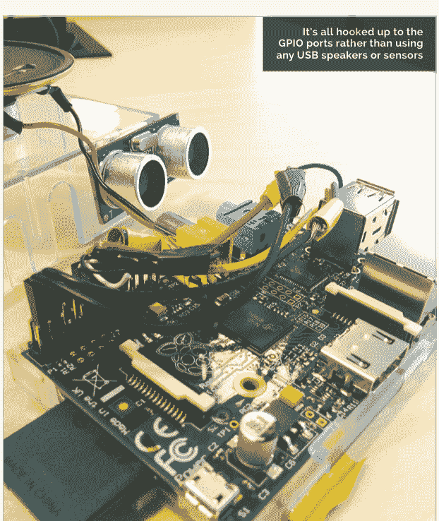

全部都连接到 GPIO 端口，而不是使用任何 USB 扬声器或传感器

> 我从第一次听说它起就一直想要一个特雷门琴。它就是这么酷的东西

硬件是一回事，但将其转化为声音，难道在代码上做一点工作才能使其运行吗？“不，我想不是。” Linus 为该项目改编了一些现有的代码。“控制特雷门琴的脚本是用 C 编写的，使用 wiringPi，花了大概一个小时才使其工作。之后我又花了几个小时只是调整数字来尝试不同的声音并找到我喜欢的声音。我不会说它很复杂，即使调音花了一些时间。” 那么整个过程看似简单，即使它并不是典型的 Pi 项目。 然而也有一些注意事项，Linus 的 Pi 驱动特雷门琴可以做一些改进，正如他解释的那样：“操作起来出奇地困难，因为你需要非常稳定的手和良好的瞄准才能获得想要的确切音调……我计划添加另一个传感器来控制声音的节拍。现在，它完全由脚本设定，这意味着它基本上是静态的。通过让用户控制节拍，我希望它实际上能作为一种乐器使用。”

## 创建音乐

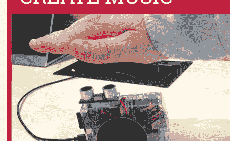

### >步骤-01
挥动手

超声波传感器能够相当精确地测量其范围内最近表面的距离。你的手充当这个表面，上下移动会造成测量距离的差异。

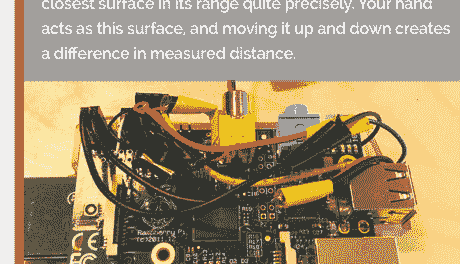

### >步骤-02
转换数据

测得的距离被转换为一个数字，提供给脚本。范围在零到 120 厘米之间，因此系统可以发出多种声音。

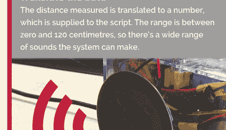

### >步骤-03
发出声音

该值通过脚本转换为输出信号，然后通过扬声器播放。它几乎实时变化，因此移动手会显著改变旋律。

## SUNG-TAEK KIM

Sung-Taek Kim 是一名大数据工程师，热衷于以有趣且独特的方式解决问题。他目前专注于打造出色的开发者体验。
magpi.cc/2dTJHUR

六块 Raspberry Pi 板被安置在外壳内部

使用以太网路由器将设备连接在一起

其中一台 Raspberry Pi 单元是主设备；它控制其他 Pi 板

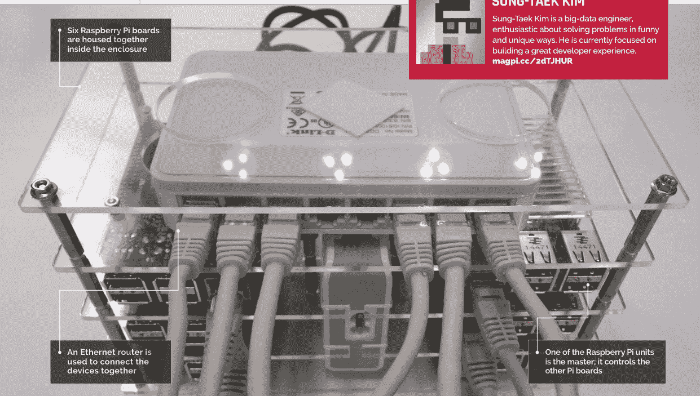

## PI SPARK 大数据集群

一位数据科学家向我们展示如何将六台 Raspberry Pi 连接起来构建超级计算机并进行大数据实验

### 快速事实

- 除 Pis 外，零件仅花费约 60 美元
- 外壳需要 106 颗螺丝
- Raspberry Pi 集群也被称为 'Bramble'
- GCHQ 拥有最大的 Pi Bramble：66 块板
- 中国的 Tianhe-2 是最大的超级计算机：3,120,000 个核心

Raspberry Pi 很适合学习计算机科学，但有一个领域是热门新闻却需要大型计算机，那就是‘大数据’。大数据软件通常在网络计算机集群上运行，共同完成所需的大量工作。这种集群特性使得学习大数据变得棘手，因为你需要多台联网的计算机来练习。来自韩国的软件工程师 Sung-Taek Kim 决定 Raspberry Pi 非常适合这项任务。“Raspberry Pi 是一个很好的教育平台，可以学习大数据软件的工作原理，”他告诉我们。“它[相对]缓慢且低功率，[所以]当你的数据处理方法按计划执行时，你会有亲身体验。”

事实上，Raspberry Pi 的轻量性能在学习大数据技术时反而成为优势。“一旦你错过一个小细节，”Sung-Taek 解释说，“你会感觉操作过程变慢了。”“通过[网络]发送数据需要时间，”他补充道。“集群中的所有 CPU 都在竞争内存或磁盘[空间]等资源，并且一两个节点可能会突然拒绝工作，就像[在]谷歌级数据中心集群中一样。”他解释说，Pi 集群的相对缓慢实际上是一个优势，使你能够为此类事件做好准备。

Sung-Taek 的集群基于六块 Raspberry Pi 2 板，通过 D-Link 8 端口千兆桌面交换机使用以太网电缆连接。“理论上，你只需要一台 Raspberry Pi，”Sung-Taek 说，“因为 Spark 利用了主从方案的[特性]。准备一台 Raspberry Pi 作为从机，你的笔记本作为主机。连接两台 Raspberry Pi 设备，你就拥有了一个 Spark 集群。”

## 构建 PI SPARK 集群

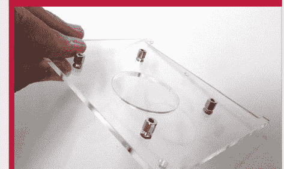

### >步骤-01
制作外壳
板子的原理图可以在 Sung-Taek 的网站上找到。你可以使用木材、合成材料或亚克力板来切割形状，只要每块厚度不超过 3 毫米且足够坚固以支撑 USB 充电器即可。

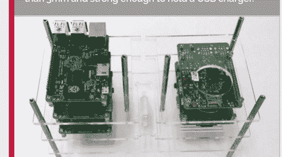

### >步骤-02
集群组装
Raspberry Pis 使用 M2.5 螺丝固定在板上。然后使用 5 毫米立柱螺丝和六角螺母将板子拧在一起。

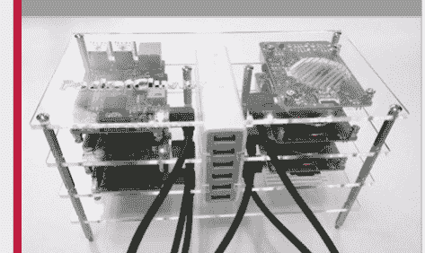

### >步骤-03
连接
六端口路由器被固定在板子的中间。每个 Raspberry Pi 通过以太网连接到路由器。请注意，外壳为每个 Raspberry Pi 留下了足够的电源插座空间。

Sung-Taek 建议该项目使用三到八块 Raspberry Pi 板。“一旦你拥有超过十台 Raspberry Pi，”他说，“找到合适的电源、安排网络和电源线会很头疼。”

最困难的部分似乎是制作外壳。Sung-Taek 在 GitHub 上托管原理图（magpi.cc/2dTln4z），但准确性至关重要。他警告说，即使切割模板偏移半毫米，也可能导致其中一个亚克力层失效。

as well.” Java 也是必备的，所列软件包包括 NumPy、Scipy 和 Scikit-Learn。除此之外，你将学习 MapReduce 编程模型，在那里你会遇到 Hadoop 和 Spark。

然而，这些都是值得学习的技能：大数据是计算机科学的前沿领域，是一个有趣的研究和工作领域。“Raspberry Pi 集群让你能够为可能发生在生产环境中的事件做好准备，”Sung-Taek 说。“此外，集群让你能够轻松找到可以应用优化工作的地方，因为其硬件资源确实有限。”

> 一旦你拥有超过十台 Raspberry Pi，找到合适的电源就会很头疼

除 Raspberry Pi 单元外，该项目并不昂贵。电源、网络交换机、电缆、螺丝和外壳总共花费约 60 美元。完整的材料清单可通过 Sung-Taek 撰写的 Make: 文章（bit.ly/1J2jpDf）获得。

软件需求相当高。“Python 是必备的，”他说，“为了充分利用 Spark 集群提供的功能，学习 Scala”

“你可能需要仔细规划并从少量节点开始，”他建议。“注意每一步的细节，并确保你的计划与规格相符。一旦你成功构建了[a cluster]，就做一个更大的。避免代价高昂错误的最佳策略之一就是遵循并观察他人所做的事情。”

下面 六台 Raspberry Pi 设备用于构建超级计算机

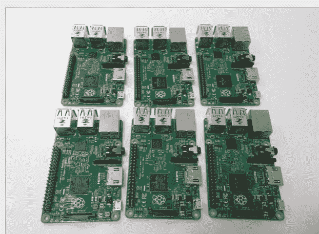

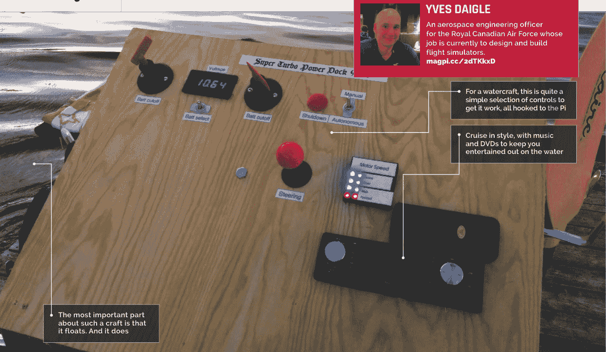

## YVES DAIGLE

皇家加拿大空军的航空航天工程军官，目前的工作是设计和建造飞行模拟器。
magpi.cc/2dTKkxD

对于一种水上交通工具来说，这是一个相当简单的控制选择，让它工作，所有都连接到 Pi

优雅巡航，音乐和 DVD 让您在水上娱乐

这种船只最重要的部分是它能浮起来。而它确实能浮起来

## RAFTBERRY

用这艘 Raspberry Pi 驱动的筏子，时尚地与你的排球 BFF 一起逃离荒岛，或只是和朋友们在湖上悠闲航行

### 快速事实

- raftBerry 已规划约两年
- Yves 自大学以来就没编程了
- raftBerry 配备了所有必需的航海安全设备
- Yves 想添加疯狂的灯光和 'look to steer' 系统
- 在军队中，Yves 使用了 22 台 Raspberry Pis

野餐很有趣。你从橱柜后面拿出一个冷藏袋，里面装着一些从冰格里半被遗忘的冰块，并尽可能多地装入三明治、香肠卷和汽水罐。抓了一些家人或朋友后，你找到一个好地方在户外进食。很棒，除了蚂蚁不可避免的入侵，但仍然很棒。如果能把蚂蚁排除在外呢？你可以，如果你 somehow 能在湖中央野餐。认识 Yves Daigle 和他的 raftBerry 项目……“这个想法是创建一个完全自主的电动浮动码头，由 Raspberry Pi 控制，带我们绕湖行驶，”Yves 告诉我们。正如 Yves 和一些朋友在浮动码头上享用餐点的照片所示，这个想法已经实现。作为在加拿大空军服役的航空航天工程师，Yves 习惯于创建复杂的设备，所以这个副项目并不简单也就不足为奇了：“控制系统有两个可通过控制台上的开关选择的模式：手动或自主。码头使用两个静态电机进行推进，这些电机还可以通过差速推力来转向码头。”“Pi 通过 GPIO 从街机摇杆、紧急关闭按钮和模式选择开关读取输入。每个电机都由五个汽车继电器独立控制，其中三个用于设定速度，其余两个用于 H 桥配置以设定电机的正向或反向。GPIO 输出引脚控制一个小型八通道继电器板，进而控制这十个汽车继电器。整个系统，从电机到控制面板，都设计为每次出行后使用手推车从码头上拆下。”他开始认真工作后一个月就完成了整个项目，还包括 DVD 播放器、桌子、座位和露营炉。更像是野餐，而更像是一个漂浮的营地。

## 自动驾驶 Mr Daigle

>STEP-01
规划路线
自动模式应通过让你先在 Google Maps 中创建自定义地图，然后将地图导出为 raftBerry 可用的 .kml 文件来实现。

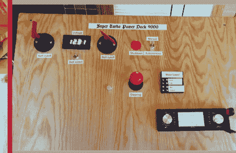

>STEP-02
开始导航
raftBerry 使用 GPS 数据将你的位置与第一个航点进行比较，并生成移动到该航点的方法。这每秒更新一次。

>STEP-03
享受旅程
raftBerry 会等到你距离航点十米以内后才计算前往下一个航点的路线。不过请留意路径上的任何障碍！

凭借一点小小的黑客技巧，人人都能享受漂浮野餐

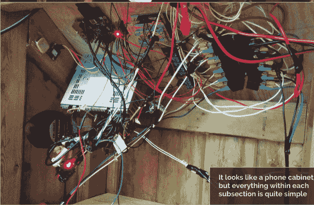

它看起来像电话柜，但每个子部分内部都相当简单

“手动模式运行完美无缺，”Yves 解释道。
“继电器确实会变得相当热，而且全速似乎没有原控制头时那么强劲。我怀疑继电器接近最大负载并导致了一些电压下降。我计划购买更大型的继电器。电机可能有点功率不足。”
自动模式目前还不太正常工作，但 Yves 正在努力改进。除了在家中和水上交通工具上使用 Raspberry Pi，他在工作中也使用它们：“我们目前有 22 台执行各种任务。我发现 Pi 比商业替代品成本效益高出几个数量级。节省纳税人的钱是我非常认真对待的事情。”
如果你想看看部分制作过程以及 raftBerry 的实际运行情况，可以在 YouTube 上查看它的视频：
youtu.be/FZvU3U1wZWo

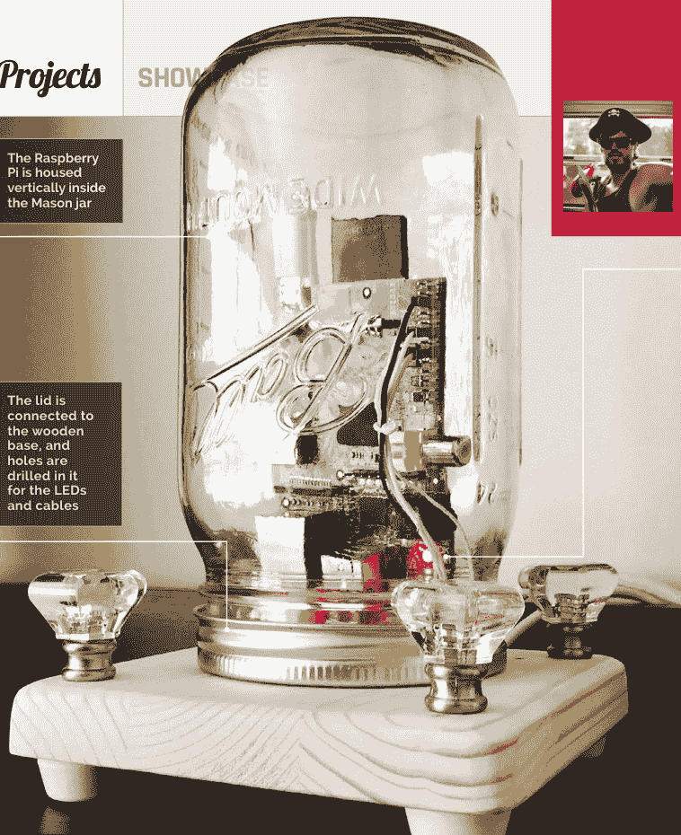

## MATT REED

Matt Reed 住在田纳西州纳什维尔，是 RedPepper 的创意技术人员。 mcreed.com

Raspberry Pi 垂直安装在梅森罐内部

盖子连接到木质底座，并在其上钻孔以容纳 LED 和电缆

LED 灯光与 BitTorrent 同步活动同步闪烁，在 Pi 备份文件时产生红色发光效果

### 快速事实

- 梅森罐由铁匠 John L Mason 于 1858 年发明
- 你可以在英国的 Kilner 购买梅森罐 – kilnerjar.co.uk
- 不要超频 Raspberry Pi，否则可能会过热
- 唯一的存储限制是你连接到 Raspberry Pi 的设备
- Matt 使用 Node.js 使 LED 灯光与 BitTorrent 同步

## 梅森罐保存

Matt Reed 将家庭照片备份在梅森罐中。他告诉 Lucy Hattersley 如何时尚地保存数字记忆

Matt Reed，这位来自西弗吉尼亚州的专业网页开发者和创客，创建了这个令人惊叹的项目。由 Raspberry Pi 驱动的 Mason Jar Preserve 是我们见过的最时尚的备份解决方案。此时，《The MagPi》的非美国读者可能会想知道梅森罐到底是什么。“它们是工业级玻璃罐，带可密封盖，最初在家中用于冬季保存食物，”Matt 说。“梅森罐让夏季收获的食物能保存全年。谁不想在二月吃到美味的炸秋葵呢？“在我曾曾祖母的地下室里，有整排整排各种尺寸的罐子，装满了从腌甜菜到你能想到的各种果酱。”

但与保存美味食物不同，Matt 的梅森罐保存的是 Matt 的家庭回忆。

### 罐装一台 Raspberry Pi

这个想法在工作中萌生于 Matt：“我周围放着几个不同尺寸的梅森罐。有一天我只是拿起最大的一罐，把 Pi 滑了进去。它很合适，甚至还有一点空余！”制作 Mason Jar Preserve 相当直接：“我用锯子把底座切成方形，用砂纸打磨圆角，用钻头制作 LED、以太网和电源孔。去 Home Depot 几次买古董抽屉拉手、一些橡胶脚垫、支架和螺丝，就完成了。”

## 保存你的 Pi

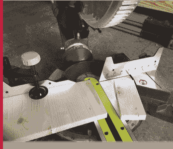

### STEP-01
制作底座

Raspberry Pi 可放入梅森罐内，但需要保持直立。为此，Matt 切割了一个六英寸的底座。然后他将其打磨成圆角，让人联想到 Apple TV。

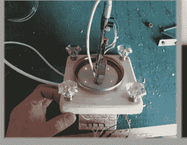

### STEP-02
给它盖上盖子

梅森罐的盖子中央钻有一个孔。用螺母和垫圈将其固定。然后再钻四个孔来容纳 LED 灯。电源和以太网电缆穿过另一个孔。

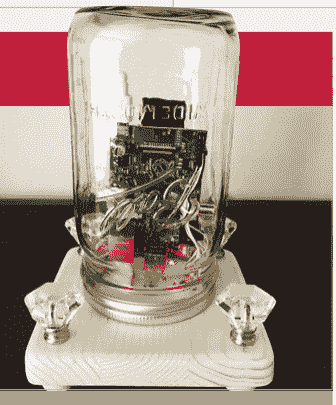

### STEP-03
组装

安装并设置 BitTorrent 软件以备份其他本地计算机上的文件夹。最后，将梅森罐拧在盖子上方，并由 LED 照亮。

Matt 的 Mason Jar Preserve 通过以太网连接，但你也可以使用 WiFi。“我仍然好奇玻璃会对信号产生多大影响，”他告诉我们。“最终我选择以太网是因为传输速度、可用性、简单性和可靠性。另外，因为我 USB WiFi 适配器用完了。像，零个。”

### 由 BitTorrent 驱动

Matt 使用 BitTorrent 创建备份软件。“它类似于 Dropbox，”他说，“但不是通过云中的集中服务器，而是通过 BitTorrent 协议将你自己的两台或更多设备直接连接在一起。就像 Dropbox 一样，连接的 BitTorrent 同步机器都会同步其系统上的指定文件夹。所以基本上，它是免费的，存储仅限于连接的存储。”

与 BitTorrent 文件共享不同，Matt 的系统完全是私有的。“每当你创建一个同步文件夹时，它会得到一个唯一的字母和数字字符串，”Matt 解释道。“这个密钥在 BitTorrent 同步协议上唯一标识它。密钥可以为你提供给它的人提供读写访问或只读访问。你通常希望将其安全保存。如果我公开分享该密钥，那么我就会拥有一个类似大家所熟知和喜爱的 BitTorrent 的公共文件共享种子。”

Matt 使用他的 Mason Jar Preserve 备份家庭照片和视频。“我真的只想要对孩子出生、婚纱照和各种家庭相关媒体等事物再多一层冗余备份。它使用 Raspberry Pi 的 SD 卡进行存储。因此，你放入 Pi 中的 SD 卡越大，就能存储越多。”

我们认为最终结果辉煌。当 Mason Jar Preserve 正在同步时，它使用 Node.js 脚本、BitTorrent Sync API 和 GPIO 引脚来动画化 LED。空闲时，它们会发出红色光芒。“我想让它看起来像罐子里装满了红色覆盆子果酱，”Matt 说。“尤其是在夜晚看起来很棒。”

一些来自 Home Depot 的家具配件被用来装饰设计

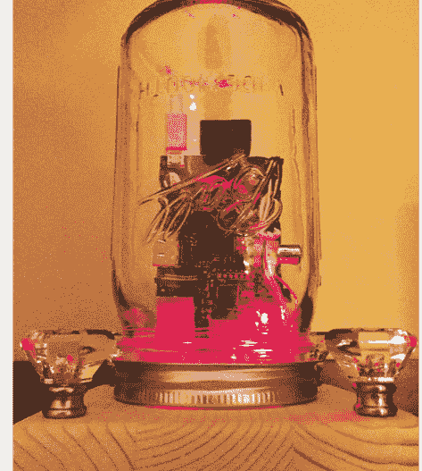

梅森罐在光线较暗且 LED 照亮时看起来特别好

## SUPER GAMEGIRL

想要更好的掌上游戏机？答案可能是自己用 Raspberry Pi 和 3D 打印机制作一个

**CHRIS DUERDEN**
一名拥有新鲜法律学位的机械工程师，拥有大量电子项目和系统的经验。
imgur.com/a/8uO6E

如果你厌倦了 Super Mario Maker 中的糟糕 Super Mario Bros 3 关卡，试试在这块 3.5' 屏幕上玩原版以及其他许多游戏

按键足够多，可以玩到 PlayStation 为止的所有主要家用游戏机

新旧结合：GBA 音量控制和用于加载 ROM 的 USB 输入

### 快速事实

- 这是 Chris 的第一个 Raspberry Pi 项目
- 音量轮来自 Game Boy Advance
- Chris 为这个项目创建了定制 PCB
- 不幸的是，它运行 Nintendo 64 游戏效果不佳
- Chris 在上面最喜欢玩的游戏是 Super Mario Bros 3

过去几期中，我们报道了各种类型的复古游戏项目：翻新的 SNES、3D 打印的 NES、运行游戏的 Power Glove 等等。虽然这些都是非常酷的项目，你知道什么更酷吗？一台便携式复古游戏机！过去，这个位置通常由非常可破解的索尼 PSP 占据，但 Chris Duerden 决定走一条更具自制路线的道路，通过使用与这些其他复古游戏项目相同的 Raspberry Pi 从零开始制作自己的机器。

“我的项目是一款由 Raspberry Pi 2 驱动的类似 Game Boy 的东西，”Chris 告诉我们。“它运行 RetroPie，所以可以玩很多不同系统的游戏。目标是拥有足够的按钮来支持 PlayStation 游戏，拥有 3.5” 屏幕，并且在比原版 Game Boy 更小的尺寸下拥有七小时的游戏续航时间！”
七小时的要求是为了让它能够在长途飞机旅行中幸存下来，而现代掌上设备却无法做到这一点。“我喜欢复古游戏，想在旅行时做点什么，”Chris 解释道。“我不想随身携带一箱游戏卡带或 AA 电池，也希望它一应俱全，任何玩它的人都很容易使用。”
这个想法是在他了解 RetroPie 后萌生的，他开始摆弄 Raspberry Pi。整个东西都是定制的，从 Raspberry Pi 2 和 3D 打印外壳开始。外壳以 Game Boy 为基础灵感，增加了更多正面按钮以及肩部按钮，以适应 PlayStation（和其他主机）游戏。有一块 3.5” 屏幕、6000mAh 便携电池、功放、扬声器、插孔、LED 和各种按钮和

## 机械流程

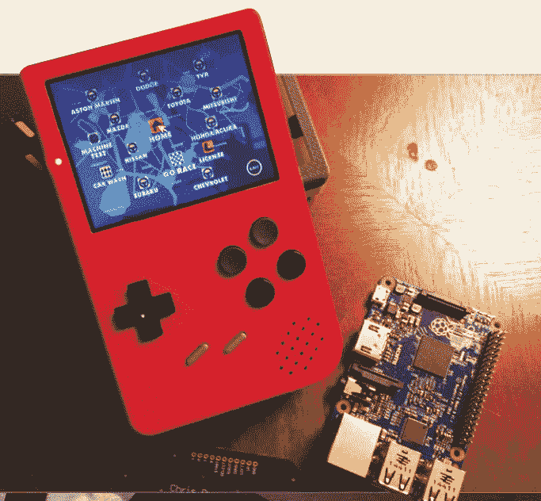

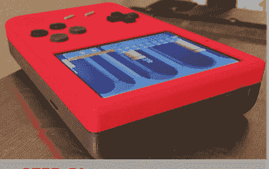

### >STEP-01
待机

电源开关由一个 ATtiny 芯片控制，该芯片保持睡眠模式，直到电源打开，然后唤醒它以开始为屏幕供电。

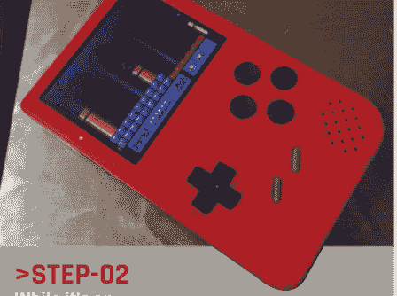

### >STEP-02
开机时

Raspberry Pi 上有一段代码让 ATtiny 知道它已开机，并直接启动到 RetroPie。电源开关开始关机程序。

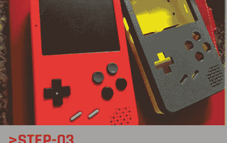

### >STEP-03
关机

当 ATtiny 被告知 Pi 正在关机时，它会关闭屏幕并接地电源，在返回睡眠模式之前关闭稳压器。

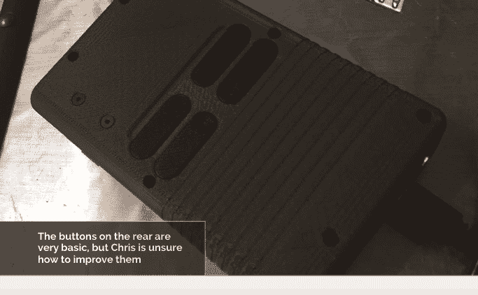

背面的按钮非常基础，但 Chris 不确定如何改进它们

> 续航时间足够进行七小时游戏，同时体积小于原版 Game Boy！

开关取自 NES 和几台 Game Boy。
“让所有东西都装下并协同工作很复杂，” Chris 承认。
“我用 SolidWorks 设计了外壳，用 Python 为 Pi 编写程序，用 C 编程 AVR，设计了定制电路板，做了大量面包板实验，还联系 Adafruit 了解他们的产品能做什么、不能做什么等等。但相对来说建造起来很容易。”

结果对 Chris 来说足够好，有电源开关，游戏可从侧面的 USB 端口加载，并且可以通过机箱底部的 micro-USB 线缆为电池充电。
现在，Chris 正在为他的女朋友制作第二个，并最终会写一份完整的制作指南，包括电路板的稍改进方案。很快你就能让长途旅行更有趣。

## MAC MINI PI

无可否认这是最小、最可爱的经典 Mac 风格项目，Mac Mini Pi 实际上远不止是 Raspberry Pi 的一个漂亮外壳...

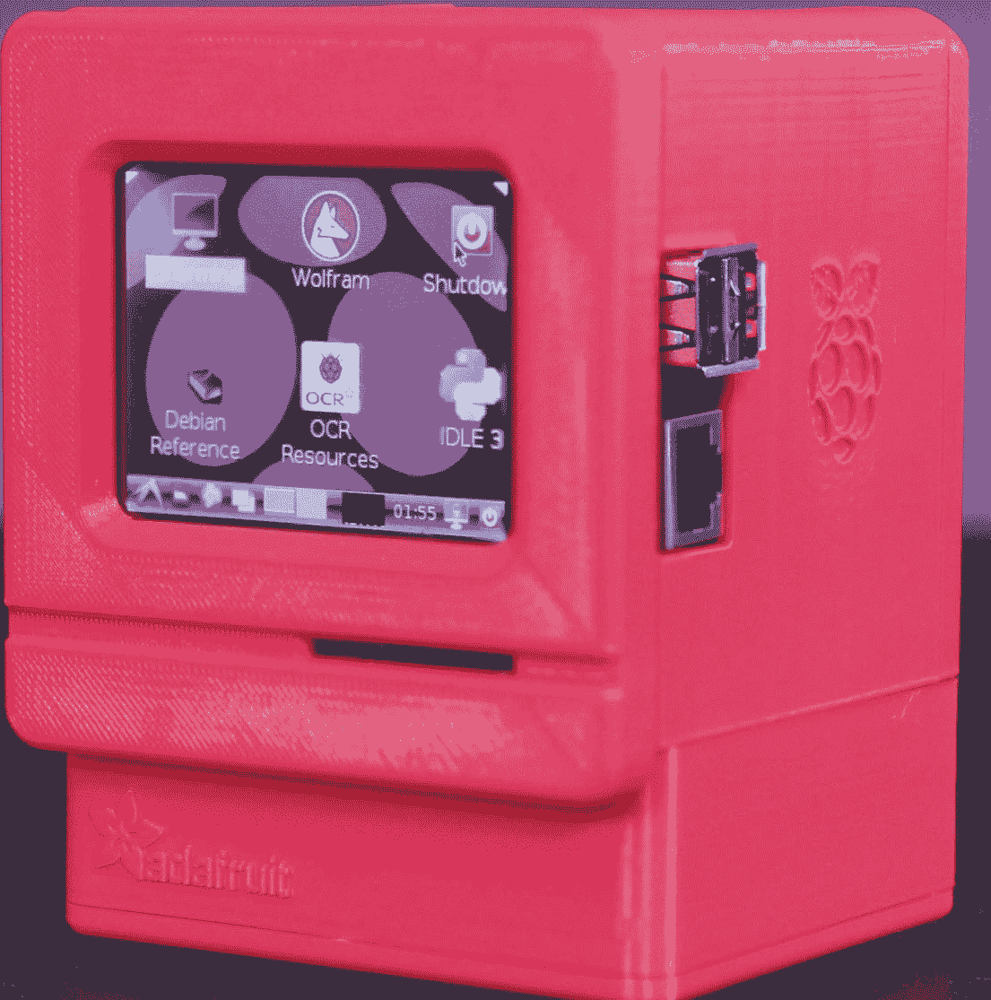

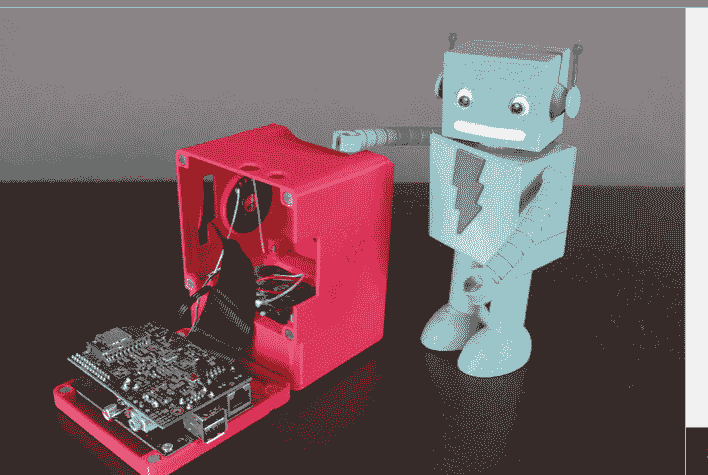

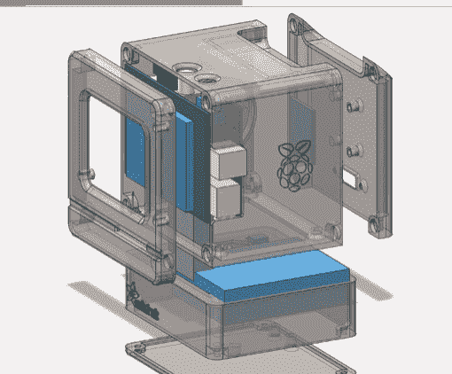

上方 Mac Classic 风格机箱本身的 CAD 设计。你可以将设计发送给 3D 打印服务，或到当地的创客空间打印

### A
Adafruit 在打造令人印象深刻的 Raspberry Pi 项目方面颇有心得，而 Ruiz 兄弟的 Mac Mini Pi——最初受 RetroMacCast 的 John Badger 启发——当然也不例外。除了设计毫不掩饰地可爱，这个迷你 Mac 远不止是 Raspberry Pi 的一个花哨外壳——它是一个完全功能的模拟器，让你可以重温 Mac OS 7 的辉煌岁月（或首次体验）。用于模拟的软件是 Mini vMac 的一种变体（magpi.cc/2dq3foj），它完美模拟了运行 Motorola 680x0 微处理器的早期 Mac。软件也能愉快地与 Raspbian 一起运行。

Adafruit.com 的指南包含了你自己构建项目所需的一切，包括详细说明和 3D 打印所需的文件（如果你没有自己的打印机，可以使用 3D 打印服务）。在内部，项目使用标准 Raspberry Pi Model B、320×240 3.2″ PiTFT 屏幕、3.7V 锂离子电池和一个简单的音频放大器等。一些基本的焊接技能是必须的，你可以预计在构建本身上花费整个周末（它很繁琐！）。

你可以在以下地址查看这个令人惊叹的项目的全部内容：magpi.cc/2dq4eox

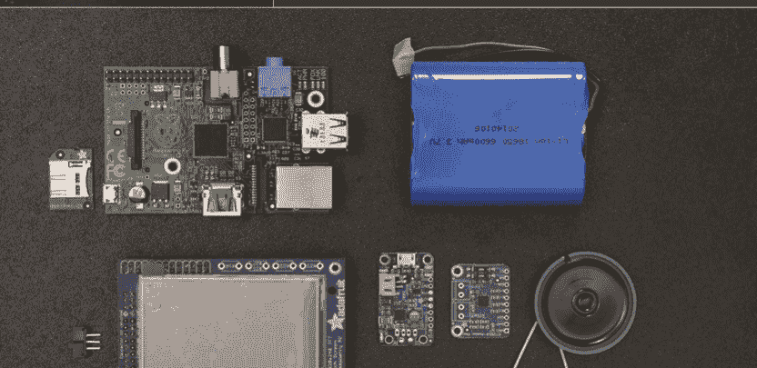

上方 不出所料，你需要的所有组件都很容易从 adafruit.com 买到。在 3D 打印之前花费大约在 80 美元左右

上方 电子部分搞定后，组装机箱相当繁琐—— definitely 需要一双稳手

## MARK BUTTLE

Mark 是来自 Shropshire 的软件工程师，对木工和电子产品充满热情——在这个项目中将两者结合。bit.ly/3hZFumu

### 快速事实
- 该项目始于同事的挑战
- 这是 Mark 的第一个 Pi 项目
- 控制器线缆以航空连接器结束
- 电源来自 LED 照明套件
- 缓冲器防止漏电流触发限位继电器

## 由 Pi 驱动的 CNC 机器

如何将对精美木工的热情与对电子产品的兴趣结合起来？Mark Buttle 用一台由 Pi 驱动的 CNC 机器做到了...

英格兰最寒冷潮湿的地区之一 Rural Shropshire 居住着许多创客和不懈的[content]
## 机械流程

### >STEP-01
待机

电源开关由一个 ATtiny 芯片控制，该芯片保持睡眠模式，直到电源打开，然后唤醒它以开始为屏幕供电。

### >STEP-02
开机时

Raspberry Pi 上有一段代码让 ATtiny 知道它已开机，并直接启动到 RetroPie。电源开关开始关机程序。

### >STEP-03
关机

当 ATtiny 被告知 Pi 正在关机时，它会关闭屏幕并接地电源，在返回睡眠模式之前关闭稳压器。

背面的按钮非常基础，但 Chris 不确定如何改进它们

> 续航时间足够进行七小时游戏，同时体积小于原版 Game Boy！

开关取自 NES 和几台 Game Boy。
“让所有东西都装下并协同工作很复杂，” Chris 承认。
“我用 SolidWorks 设计了外壳，用 Python 为 Pi 编写程序，用 C 编程 AVR，设计了定制电路板，做了大量面包板实验，还联系 Adafruit 了解他们的产品能做什么、不能做什么等等。但相对来说建造起来很容易。”

结果对 Chris 来说足够好，有电源开关，游戏可从侧面的 USB 端口加载，并且可以通过机箱底部的 micro-USB 线缆为电池充电。
现在，Chris 正在为他的女朋友制作第二个，并最终会写一份完整的制作指南，包括电路板的稍改进方案。很快你就能让长途旅行更有趣。

## MAC MINI PI

无可否认这是最小、最可爱的经典 Mac 风格项目，Mac Mini Pi 实际上远不止是 Raspberry Pi 的一个漂亮外壳...

上方 Mac Classic 风格机箱本身的 CAD 设计。你可以将设计发送给 3D 打印服务，或到当地的创客空间打印

### A
Adafruit 在打造令人印象深刻的 Raspberry Pi 项目方面颇有心得，而 Ruiz 兄弟的 Mac Mini Pi——最初受 RetroMacCast 的 John Badger 启发——当然也不例外。除了设计毫不掩饰地可爱，这个迷你 Mac 远不止是 Raspberry Pi 的一个花哨外壳——它是一个完全功能的模拟器，让你可以重温 Mac OS 7 的辉煌岁月（或首次体验）。用于模拟的软件是 Mini vMac 的一种变体（magpi.cc/2dq3foj），它完美模拟了运行 Motorola 680x0 微处理器的早期 Mac。软件也能愉快地与 Raspbian 一起运行。

Adafruit.com 的指南包含了你自己构建项目所需的一切，包括详细说明和 3D 打印所需的文件（如果你没有自己的打印机，可以使用 3D 打印服务）。在内部，项目使用标准 Raspberry Pi Model B、320×240 3.2″ PiTFT 屏幕、3.7V 锂离子电池和一个简单的音频放大器等。一些基本的焊接技能是必须的，你可以预计在构建本身上花费整个周末（它很繁琐！）。

你可以在以下地址查看这个令人惊叹的项目的全部内容：magpi.cc/2dq4eox

上方 不出所料，你需要的所有组件都很容易从 adafruit.com 买到。在 3D 打印之前花费大约在 80 美元左右

上方 电子部分搞定后，组装机箱相当繁琐——它 definitely 需要一双稳手

## MARK BUTTLE

Mark 是来自 Shropshire 的软件工程师，对木工和电子产品充满热情——在这个项目中将两者结合。bit.ly/3hZFumu

### 快速事实
- 该项目始于同事的挑战
- 这是 Mark 的第一个 Pi 项目
- 控制器线缆以航空连接器结束
- 电源来自 LED 照明套件
- 缓冲器防止漏电流触发限位继电器

## 由 Pi 驱动的 CNC 机器

如何将对精美木工的热情与对电子产品的兴趣结合起来？Mark Buttle 用一台由 Pi 驱动的 CNC 机器做到了...

英格兰最寒冷潮湿的地区之一 Rural Shropshire 居住着许多创客和不懈的捣鼓者，有充足的时间待在创客棚里，让灵感酝酿成长。事实上，该郡有着创客和思想家的历史，是查尔斯·达尔文的出生地，也是 Ironbridge 工业摇篮的所在地。Mark Buttle 是一位热爱木工的工程师。他的家中摆满了精心手工制作的家具，以及像伪装成传统红色电话亭的冰箱冷柜之类的古怪物品（当然，也有计划制作一个熟悉的蓝色警察电话亭）。但 Mark 白天是软件工程师，也对电子产品感兴趣，因此很乐意将技术与传统工艺技能结合起来。Mark 最初为同事买了 Arduino 作为生日礼物，受其可能性吸引后也为自己买了一块。同事提出挑战，看谁能想出更有趣的项目，Mark 开始研究为木工建造计算机数控（CNC）机器。不久就显而易见，Arduino 虽然理想用于控制步进电机，但需要额外帮助，而 Mark 显然没有时间自己编写所有软件。网上研究发现了 Grbl——运行在 Arduino 上的开源控制器代码——以及为 Raspberry Pi 编写的 Zapmaker 控制器软件。“我已经想要一台 Pi 很久了，”Mark 告诉我们。“这是我用它做的第一件事。它将我对电子产品和木工的热情结合在一起。”

## RASPBERRY PI CNC 实际操作

控制器箱内的 LCD 屏幕向 Mark 显示机器的当前位置，以及切割的整体进度

一台 Pi 2 运行开源 Zapmaker 软件向控制器板发送 G-code

Arduino 控制器运行 Grbl 软件通过电机驱动器将 G-code 转换为对三个步进电机的指令

### 构建
“我用海洋胶合板手工制作了完整的 CNC，并安装了一台 DeWalt 雕刻机进行切割，”Mark 透露，“使用 Raspberry Pi 2 作为控制器，运行名为 CNC Zapmaker 的软件，将 G-code 指令传递给 Arduino Uno。这运行一个版本的 Grbl 控制器，其上连接了 CNC 盾牌，驱动三个 X Y Z 步进电机。”“这只是个概述，”Mark 承认。“控制器和机器花了大约两个月建造：主要是晚上。”在这段时间里，Mark 还必须建造切割机的物理装置——一个长 1000mm、宽 500mm、高 700mm 的框架，带有夹紧木材的轨道、用于在每个轴上驱动步进电机的梯形条，以及大量线缆。

在当前设置下，电机每转 200 步，可实现运动的精确控制。一转移动切割工具 2mm，因此一步仅为 10 微米！——以一 thou（英寸的千分之一）为工程精密公差的传统度量，约等于 25 微米，这对于木工来说极其精确。理论上重新齿轮步进电机可以再次提高精度，但如此精细的细节会被木材纹理的大小所掩盖。步进电机——中国产每个约 £12——具有 107oz 的保持扭矩；加上 Mark 使用梯形杆和重型固定杆，而非预算 CNC 自建常用的丝杠和抽屉导轨，我们拥有了一台结构坚固、经久耐用的机器。然而，包括所有电子元件和其他硬件，建造价格约为 £400。十年前，你会找到类似

### >STEP-01
### 在绘图板前
第一步是在你选择的 CAD 软件中完成设计，然后让它生成所需的 G-code。FreeCAD 用户需要 CAM 插件或 HeeksCNC。

### >STEP-02
### Grbl
Mark 使用 AutoCAD，这使他能够选择使用的刀具，以及规划切割路径。最近开源的 Blender CAM 是此项的一个可能替代方案。

### >STEP-03
### MagPi 邂逅木材
Pi 创建 Arduino 使用的 Grbl 代码，Arduino 处理将路由器放置在正确位置，将我们的 3D 设计变成雕刻或雕刻的木件。

框架将所有部件连接在一起

商业机器价格高达五位数——这对创客来说是伟大的时代。事实上，一些过时的商业 CNC 机器正被那些没有时间遵循 Mark 完全 DIY 路线的制造者改装，自制控制器。

## 控制

在控制器中，触摸屏与运行 Zapmaker 软件的 Pi 2 上的 CNC 控制器接口：屏幕上，控制软件灰色、令人愉悦的工业风格面板与用作外壳的电气箱相得益彰。Pi 通过 Arduino Uno 板通信，该板使用 Grbl 控制步进电机。Arduino 上的 Grbl 处理相当复杂——你可以发送一条单行命令，例如“在这里画一个此直径的圆”，它会为你计算切割路径。

电源是来自某些 LED 灯的重型 24V 单元。12V 和 5V 降压变压器为 LCD 屏幕、树莓派、步进电机、Arduino 和扩展板供电。控制电机的扩展板会变得非常热，因此使用一个小型风扇对其进行冷却。

火眼金睛的读者会注意到 Arduino 与控制器扩展板之间的额外板——这是在早期原型不断关机的情况下安装的缓冲板。“有人说你需要在 Arduino 和 CNC 控制器板之间加一个滤波器，”Mark 说。滤波板阻止电流从电机泄漏到限位开关的继电器并关闭设备。这解决了问题：“我现在检查了限位开关上的电压降；它保持在恒定的 5 伏。”

## 开始切割

使用前，需要 G 代码来提供切割坐标。图片中的标志被转换为黑白图像，然后转换为矢量——同时优化切割路径和正确的切割头。许多 CNC 制造者使用 FreeCAD，但需要某种 CAM 插件来生成 G 代码和切割路径。

G 代码只是坐标的行。CAD/CAM 软件的任务是生成它，以及最合理的切割路径——这是 CNC 机器版的计算机著名旅行商问题，用于在多个目的地之间找到最佳路线。

## 搭建 Pi CNC 机器

### STEP-01 步进电机
步进电机——将梯形导杆每次 2mm 的旋转分为 200 步——将 DeWalt 电动工具定位在 X、Y 和 Z 平面，精度为 10 微米。

### STEP-02 框架内
手工切割自 18mm（¾”）船用胶合板，框架牢固地固定梯形导杆、步进电机和电动工具，并通过内置轨道中的夹具将工件固定在原位。

### STEP-03 Arduino
Arduino Uno 运行 Grbl 软件以接受 G 代码中的切割指令并将其转换为电脉冲，以控制步进电机并精确地在三个平面上定位电动工具。

Mark 是 AutoCAD 的长期用户。虽然对于只为 CNC 机器购买的人来说它价格昂贵，但如果你已经是用户，它能轻松提供你所需的一切：“在我的 Mac 上，我设计任何形状或雕刻并将 2D 或 3D 模型转换为 G 代码，然后通过 Wi-Fi 或 USB 闪存盘将其传输到树莓派。使用触摸屏，我启动控制器，它就开始工作了。”

每个梯形导向杆的末端还设有触发开关，以防电动工具被发送到杆的末端时停止。这些开关在缓冲板添加到 Arduino 之前正被电流泄漏触发。

控制器盒在屏幕旁有四个按钮：开关、panic!、重启和紧急停止。它可以切割 60mm 深的木材。作为完全切割的替代方案，你可以可选地设置控制器留下搭扣，以便更容易地从工作台上一起取出工件。

> 它将我对电子和木工的热情结合在一起

嗯，还不完全是：安全功能是任何 CNC 机器必不可少的一部分。在将切割工具与木块对齐、用轨道中的固定螺栓锁住木材并手动校正高度后，必须在控制器上点击安全按钮。机器底座前面还有一个紧急停止按钮。任何动力切割工具都必须设计成能够快速停止，以防出现问题。

看看照片中《The MagPi》标志（以及 Mark 的 YouTube 频道 – bit.ly/1hZFUmu），你可能会看到侧面的沟槽，与不同的切割深度相对应。这是在三次进给中切割的，大约需要五分钟，以适应铣刀的质量，该铣刀仅花费 £1.20。如果使用更好的刀具，标志可以在一次进给中完成，耗时不到一分半钟。

## 下一步？

Mark 告诉我们他大部分 CNC 机器的设计都是临时进行的：“我手工切割框架，一边进行一边测试尺寸。”这显然与他通常的工作方式形成对比。“通常我喜欢从一开始就仔细规划好一切。”

如果他想再造一台，“现在我可以做一个模板，让它切割出自己的新版本。”未来的计划可能包括 Zapmaker 的替代品：“我希望它能做其他事情。我只是喜欢按自己的方式尝试。”也有可能为不同的刀头使用类似的机械和控制装置：可能为 3D 打印机供电，或将蓝光激光器改装为切割器（当然要适当屏蔽）。

“我喜欢建造，”Mark 说，这似乎很好地概括了许多创客运动参与者的心态。看到 Mark 的一些其他作品——从可转换为索尼 PS3 赛车控制器的橡木抽屉，到著名的电话亭冰箱——我们确信接下来的任何项目都将是有趣的，同时也是极其精良的工程。

### STEP-04 Pi 上
Zapmaker 的 Grbl 控制器软件最初为配备 256MB RAM 的 Pentium III 优化，很容易过渡到 Pi Model B，几乎没有给 Mark CNC 控制器盒中的 Pi 2 带来负担。

### STEP-05 Raspbian
Zapmaker 的 CNC 软件运行在标准的 Raspbian 系统上，zapmaker.org 网站为树莓派奇妙世界的新手提供了完整的说明，以及 Grbl 信息。

### STEP-06 Grbl 控制器
把所有东西组合起来，屏幕会显示要进行的切割，等待你在安全固定好木块后按下开始按钮。

## 弗吉尼亚理工大学

SeeMore 由弗吉尼亚理工大学的艺术学院和计算机科学系合作创建，分别由 Sam Blanchard 和 Kirk Cameron 领导的团队负责。

seemoreproject.com

一件壮观的雕塑，SeeMore 也是一个由 256 台 Raspberry Pi Model B+ 组成的并行计算机

每台 Pi 都连接到一个伺服电机，该电机根据其工作负载按比例向外移动其臂，从而移动面板

每个塑料面板上都蚀刻有安装在其上的 Pi 的 IP 地址

关节臂采用双连杆设计，创造出流畅的“波形”运动

## SEEMORE

## 由 Pi 驱动的并行计算雕塑

由 256 台树莓派集群驱动，弗吉尼亚理工大学令人惊叹的动感雕塑直观展示了并行处理的工作原理

## 快速事实

- SeeMore 的建造使用了 580lb（263kg）的高密度塑料
- 它包含 1,280 个运动部件和 7,312 件硬件
- 框架使用了 1,320ft（402m）的挤压铝材
- SeeMore 的建造涉及 60 小时的 CNC 加工和 80 小时的志愿者组装
- 布线大约需要一天半，使用 1,536ft（468m）的 USB 电缆和 2,200ft（670m）的以太网电缆

高九英尺半的 SeeMore 雕塑兼超计算机突然嗡嗡启动，其绿色半透明面板在螺旋表面上流畅地向外滑动，形成迷人的波浪，提供了正在进行的计算的物理表现。宛如科幻电影中的事物，SeeMore 由 256 台 Raspberry Pi Model B+ 网络驱动；一台安装在每个塑料

面板上，其关节臂在该 Pi 积极进行并行计算任务时向外摆动。SeeMore 的想法起源于 2013 年，当时弗吉尼亚理工大学（vt.edu）计算机科学教授 Kirk Cameron 在实验室工作一个 32 节点的树莓派集群。为了帮助更多人理解并行计算的概念，他联系了他的同事雕塑助理教授 Sam Blanchard，

来帮助为此目的创建一个互动艺术装置。由于 Sam 的主要兴趣领域在于机器人创作，他立即建议制作一个对计算机内部发生的事情做出反应的动感雕塑。“LCD 很酷，”Sam 解释道，“但通过向他们展示一些正在移动的东西……并在空间中存在的东西，你可以真正引起人们的 visceral 反应。”Sam 告诉我们，SeeMore 的圆柱形设计部分

## 构建动能雕塑

### >步骤-01

### 定制零件

机制的组件全部由 Sam 使用 PartWorks CAD 定制设计，然后用 ShopBot CNC 机器从亚克力板切割而成。在这张照片中，Sam 正在为雕塑的金属框架制作支撑支架。

### >步骤-02

### 活动臂

由多个组件组装而成，SeeMore 全尺寸版本需要 256 个活动臂。每个都具有双连杆结构，使触发时固定 Pi 的塑料面板产生流畅、弯曲的运动。

### >步骤-03

### 弯曲金属

由于团队找不到有人能弯曲 T 型槽铝材来制作 SeeMore 框架的弧形，他们为一台弯曲机专门制作了一些滚轮，正如这里由弗吉尼亚理工大学雕塑系学生 Robert Redfearn 所使用。

受 1970 年代中期至后期经典的 Cray-1 超级计算机启发，那是一个计算机远非无聊黑盒子的时代。“它们具有物理存在感，几乎就像雕塑或家具一样，”Sam 说。的确，Cray-1 甚至周围有一个长凳，这样办公室里的人可以坐下喝咖啡！虽然 SeeMore 没有座位设施，但其占地面积与 Cray-1 成比例，虽然它几乎大两倍，而且还有沙漏形状。此外，早期的设计决策是刻意暴露 SeeMore 的所有内部构造，包括共计 2,736 英尺（834 米）的布线，与 Cray-1 方式相同。“我非常欣赏那种形式的是它具有内部空间和外部立面，所以它在透明度方面非常出色，你不仅可以字面意义上透视它，还可以绕着它走，看到[所有的电线和内部构造]，”Sam 透露。

## 平行计算的力量

这种设计透明度与项目的[content]
## 构建动能雕塑

### >步骤-01

### 定制零件

机制的组件全部由 Sam 使用 PartWorks CAD 定制设计，然后用 ShopBot CNC 机器从亚克力板切割而成。在这张照片中，Sam 正在为雕塑的金属框架制作支撑支架。

### >步骤-02

### 活动臂

由多个组件组装而成，SeeMore 全尺寸版本需要 256 个活动臂。每个都具有双连杆结构，使触发时固定 Pi 的塑料面板产生流畅、弯曲的运动。

### >步骤-03

### 弯曲金属

由于团队找不到有人能弯曲 T 型槽铝材来制作 SeeMore 框架的弧形，他们为一台弯曲机专门制作了一些滚轮，正如这里由弗吉尼亚理工大学雕塑系学生 Robert Redfearn 所使用。

受 1970 年代中期至后期经典的 Cray-1 超级计算机启发，那是一个计算机远非无聊黑盒子的时代。“它们具有物理存在感，几乎就像雕塑或家具一样，”Sam 说。的确，Cray-1 甚至周围有一个长凳，这样办公室里的人可以坐下喝咖啡！虽然 SeeMore 没有座位设施，但其占地面积与 Cray-1 成比例，虽然它几乎大两倍，而且还有沙漏形状。此外，早期的设计决策是刻意暴露 SeeMore 的所有内部构造，包括共计 2,736 英尺（834 米）的布线，与 Cray-1 方式相同。“我非常欣赏那种形式的是它具有内部空间和外部立面，所以它在透明度方面非常出色，你不仅可以字面意义上透视它，还可以绕着它走，看到[所有电线和内部构造]，”Sam 透露。

## 平行计算的力量

这种设计透明度与项目的[content]
## 构建动能雕塑

### >步骤-01

### 定制零件

机制的组件全部由 Sam 使用 PartWorks CAD 定制设计，然后用 ShopBot CNC 机器从亚克力板切割而成。在这张照片中，Sam 正在为雕塑的金属框架制作支撑支架。

### >步骤-02

### 活动臂

由多个组件组装而成，SeeMore 全尺寸版本需要 256 个活动臂。每个都具有双连杆结构，使触发时固定 Pi 的塑料面板产生流畅、弯曲的运动。

### >步骤-03

### 弯曲金属

由于团队找不到有人能弯曲 T 型槽铝材来制作 SeeMore 框架的弧形，他们为一台弯曲机专门制作了一些滚轮，正如这里由弗吉尼亚理工大学雕塑系学生 Robert Redfearn 所使用。

受 1970 年代中期至后期经典的 Cray-1 超级计算机启发，那是一个计算机远非无聊黑盒子的时代。“它们具有物理存在感，几乎就像雕塑或家具一样，”Sam 说。的确，Cray-1 甚至周围有一个长凳，这样办公室里的人可以坐下喝咖啡！虽然 SeeMore 没有座位设施，但其占地面积与 Cray-1 成比例，虽然它几乎大两倍，而且还有沙漏形状。此外，早期的设计决策是刻意暴露 SeeMore 的所有内部构造，包括共计 2,736 英尺（834 米）的布线，与 Cray-1 方式相同。“我非常欣赏那种形式的是它具有内部空间和外部立面，所以它在透明度方面非常出色，你不仅可以字面意义上透视它，还可以绕着它走，看到[所有电线和内部构造]，”Sam 透露。

## 平行计算的力量

这种设计透明度与项目的[content]
## 构建动能雕塑

### >步骤-01

### 定制零件

机制的组件全部由 Sam 使用 PartWorks CAD 定制设计，然后用 ShopBot CNC 机器从亚克力板切割而成。在这张照片中，Sam 正在为雕塑的金属框架制作支撑支架。

### >步骤-02

### 活动臂

由多个组件组装而成，SeeMore 全尺寸版本需要 256 个活动臂。每个都具有双连杆结构，使触发时固定 Pi 的塑料面板产生流畅、弯曲的运动。

### >步骤-03

### 弯曲金属

由于团队找不到有人能弯曲 T 型槽铝材来制作 SeeMore 框架的弧形，他们为一台弯曲机专门制作了一些滚轮，正如这里由弗吉尼亚理工大学雕塑系学生 Robert Redfearn 所使用。

受 1970 年代中期至后期经典的 Cray-1 超级计算机启发，那是一个计算机远非无聊黑盒子的时代。“它们具有物理存在感，几乎就像雕塑或家具一样，”Sam 说。的确，Cray-1 甚至周围有一个长凳，这样办公室里的人可以坐下喝咖啡！虽然 SeeMore 没有座位设施，但其占地面积与 Cray-1 成比例，虽然它几乎大两倍，而且还有沙漏形状。此外，早期的设计决策是刻意暴露 SeeMore 的所有内部构造，包括共计 2,736 英尺（834 米）的布线，与 Cray-1 方式相同。“我非常欣赏那种形式的是它具有内部空间和外部立面，所以它在透明度方面非常出色，你不仅可以字面意义上透视它，还可以绕着它走，看到[所有电线和内部构造]，”Sam 透露。

## 平行计算的力量

这种设计透明度与项目的[content]
## 构建动能雕塑

### >步骤-01

### 定制零件

机制的组件全部由 Sam 使用 PartWorks CAD 定制设计，然后用 ShopBot CNC 机器从亚克力板切割而成。在这张照片中，Sam 正在为雕塑的金属框架制作支撑支架。

### >步骤-02

### 活动臂

由多个组件组装而成，SeeMore 全尺寸版本需要 256 个活动臂。每个都具有双连杆结构，使触发时固定 Pi 的塑料面板产生流畅、弯曲的运动。

### >步骤-03

### 弯曲金属

由于团队找不到有人能弯曲 T 型槽铝材来制作 SeeMore 框架的弧形，他们为一台弯曲机专门制作了一些滚轮，正如这里由弗吉尼亚理工大学雕塑系学生 Robert Redfearn 所使用。

受 1970 年代中期至后期经典的 Cray-1 超级计算机启发，那是一个计算机远非无聊黑盒子的时代。“它们具有物理存在感，几乎就像雕塑或家具一样，”Sam 说。的确，Cray-1 甚至周围有一个长凳，这样办公室里的人可以坐下喝咖啡！虽然 SeeMore 没有座位设施，但其占地面积与 Cray-1 成比例，虽然它几乎大两倍，而且还有沙漏形状。此外，早期的设计决策是刻意暴露 SeeMore 的所有内部构造，包括共计 2,736 英尺（834 米）的布线，与 Cray-1 方式相同。“我非常欣赏那种形式的是它具有内部空间和外部立面，所以它在透明度方面非常出色，你不仅可以字面意义上透视它，还可以绕着它走，看到[所有电线和内部构造]，”Sam 透露。

## 平行计算的力量

这种设计透明度与项目的[content]
## 构建动能雕塑

### >步骤-01

### 定制零件

机制的组件全部由 Sam 使用 PartWorks CAD 定制设计，然后用 ShopBot CNC 机器从亚克力板切割而成。在这张照片中，Sam 正在为雕塑的金属框架制作支撑支架。

### >步骤-02

### 活动臂

由多个组件组装而成，SeeMore 全尺寸版本需要 256 个活动臂。每个都具有双连杆结构，使触发时固定 Pi 的塑料面板产生流畅、弯曲的运动。

### >步骤-03

### 弯曲金属

由于团队找不到有人能弯曲 T 型槽铝材来制作 SeeMore 框架的弧形，他们为一台弯曲机专门制作了一些滚轮，正如这里由弗吉尼亚理工大学雕塑系学生 Robert Redfearn 所使用。

受 1970 年代中期至后期经典的 Cray-1 超级计算机启发，那是一个计算机远非无聊黑盒子的时代。“它们具有物理存在感，几乎就像雕塑或家具一样，”Sam 说。的确，Cray-1 甚至周围有一个长凳，这样办公室里的人可以坐下喝咖啡！虽然 SeeMore 没有座位设施，但其占地面积与 Cray-1 成比例，虽然它几乎大两倍，而且还有沙漏形状。此外，早期的设计决策是刻意暴露 SeeMore 的所有内部构造，包括共计 2,736 英尺（834 米）的布线，与 Cray-1 方式相同。“我非常欣赏那种形式的是它具有内部空间和外部立面，所以它在透明度方面非常出色，你不仅可以字面意义上透视它，还可以绕着它走，看到[所有电线和内部构造]，”Sam 透露。

## 平行计算的力量

这种设计透明度与该项目的主要目标完美契合，即帮助公众可视化并行计算的工作原理，并强调高性能计算研究人员的重要工作。正如 Kirk 所指出的，我们每天都从大型系统带来的进步中受益，这些系统是 Google、Twitter 和 Dropbox 等服务基础设施所必需的。“然而，依赖这些技术的普通大众并不理解其重要性和我们这样的人所做工作的内在优雅。通过美学和可视化，我的想法是传达最基本的信息，例如我们使用大量设备集体并行地解决比单系统能解决的问题更大的问题。你在 SeeMore 上看到的算法代表了并行代码和系统中常见的同步和异步通信与协作。”

> SeeMore 部分受 1970 年代中期至后期经典的 Cray-1 超级计算机启发

2015 年纽约市世界创客大会上，原始面板被替换为绿色半透明面板

上方 每个面板的伸出程度与其 Pi 的工作负载成比例

## 放大规模

项目起初预算有限，逐步通过三个原型阶段扩大规模，分别使用一台 Raspberry Pi、九台和三十台 Raspberry Pi（见“原型制作过程”框）。随后，国家科学基金会和弗吉尼亚理工大学的创意、艺术与技术研究所提供了额外资金，使其扩大到最终的 256 节点版本。

SeeMore 的机制全部由 Sam 定制设计并制作，其设计随时间演变。最显著的是，移动面板安装的 Pis 的活动臂专门设计以创造更流畅的效果。“Raspberry Pis 的运动实际上是一条曲线……它不会只是弹出来，而是向外铰接，”Sam 说。“它有一个双连杆，有些人可能会认为这是多余的或过于复杂，但我认为你得到的……是这种波形，它与流畅性这些想法相关，而这正是许多并行计算机要处理的，例如天气模拟或流体动力学。”

当 SeeMore 最近在纽约市世界创客大会上展出时，它配备了一个本地开源数据库，使用户能够通过定制触摸屏搜索给定地铁站周围的兴趣点。Kirk 告诉我们，这样的任务需要多个步骤。“首先是将此问题分解为更小的子任务，例如让每个 Pi 搜索一个非常大的兴趣点数据库的一部分。在此示例中，我们集群中的 Pis 将被分配数据库的各部分进行搜索，并且它们都将使用相同的地铁站作为搜索的‘令牌’。这种分而治之的方法是并行计算中常用的算法，此示例与 Google 搜索中使用的算法以及在 SeeMore 上演示的算法相似。”

## 建造继续...

### >步骤-04 组装框架

金属框架的圆形部分由两个弧段组成，便于组装。拧入框架的 Furman 电源块通过带双 USB 端口的墙插适配器为每个 Pi 和舵机单独供电。

### >步骤-05 舵机众多

使用 256 个 Hi-Tec HS-7966HB 舵机来移动活动臂，从而带动附着的 Raspberry Pi 面板。在活动上展出 SeeMore 时，团队会准备备用组件，以防任何部件出现故障。

### >步骤-06 塑料面板

每个塑料面板上都蚀刻有该 Pi 的 IP 地址。将它们联网并不是很大的挑战，因为所有以太网电缆都通向内部底座，在那里可以任意顺序连接到六个 48 端口以太网交换机。

## 原型制作过程

在扩大到 SeeMore 最终全尺寸版本之前，制作了三个原型...

原型 01
第一个基础原型配备了一个 Raspberry Pi，连接到由舵机驱动的金属活动臂上。然后将其交给计算机科学系进行软件测试。

原型 02
九个 Raspberry Pi 安装在平面框架上，团队必须想办法布线以避免缠绕。计算机科学系创建了一个九节点并行计算算法。

原型 03
扩大规模后，30 个 Raspberry Pi 安装在透明 HDPE 面板上，而活动臂、框架和布线系统与最终全尺寸雕塑中使用的一样。

此外，与触发时直接移动到最大 90 度外向位置不同，每个面板根据相应 Raspberry Pi 使用的计算能力百分比移动。为实现这一点，每个 Pi 通过 GPIO 引脚连接到其臂的舵机。虽然在原型设计中，舵机也从 Pi 获取电力，但从原始 Pi Model B 切换到 SeeMore 最终版本的 B+ 使得两者必须单独供电。不想用电池组或外部电源使设计过于复杂，Sam 最终购买了带两个 USB 端口的 PSU，以便为 Raspberry Pi 和其舵机分别布线。

在软件方面，Kirk 告诉我们，控制舵机并在 Pis 上运行完整操作系统导致了复杂性。“例如，我们通常在整个集群的操作系统之上安装软件堆栈或一系列工具。在 Pi 环境中，将此堆栈与舵机控制相结合并使 Pis 的运动与运行任务同步具有挑战性……由于从未做过，因此没有太多社区软件支持。因此，我们创建了大量定制软件，使其以视觉上引人注目方式工作。”

## 定制组件

臂本身由多件由 HDPE（高密度聚乙烯）塑料制成的零件组成，在 ShopBot CNC 机器上铣削而成。这些零件插入了青铜轴承，全部使用团队切割的钢轴。“几乎每一件都是定制的：有些人认为我们是从货架上买来的，但我向你保证，我们花了许多小时加工这些零件，”Sam 笑着说。他告诉我们，这为学生提供了许多铣削经验。塑料面板全部激光切割并在两个位置蚀刻有附着 Pi 的 IP 地址，以便面板平放或移出时都能看到。起初使用蓝色和透明面板，团队后来为纽约创客大会将其改为半透明绿色。“我喜欢为展示地点定制项目的想法。”

> 在活动上展出 SeeMore 的物流涉及将其运送在六个箱子中

在活动上展出 SeeMore 的物流涉及将其运送在六个箱子中，然后在现场组装。“我的学生和我提前三天到达，”Sam 说。框架的环——为运输而分成两半，Pi 仍附着其上——重新组装后，需要一天半进行布线。“外面一个人，里面一个人，然后你只是互相传递电线。里面其实很松散，我喜欢保持这种状态：我喜欢电线在结构内部自行移动的方式。”虽然正确布线所有 USB 电源线是一个主要挑战，但 Sam 告诉我们，连接 Pi 网络并不成问题，因为电缆连接到 SeeMore 底座的六个 48 端口以太网交换机，所以不重要它们插到哪个端口。

尽管整体组装过程很艰苦，但最终结果确实令人惊艳，在 SeeMore 迄今出现的几场活动中吸引了大量观众。遗憾的是，Sam 告诉我们，弗吉尼亚理工大学没有合适的空间以组装形式保存 SeeMore，所以它目前仍在箱子里，但计划在 2016 年再次展出。敬请关注更多消息。

## 神奇魔镜

魔镜魔镜在墙上，今天天气会怎样？我应该带伞吗？

BRADLEY MELTON
一名网络工程师和 aspiring ‘专业极客’，他喜欢使用并赞颂树莓派。
imgur.com/A4kjx7w

### Quick Facts

- 项目使用 Google Code 制作
- 制作框架花了一周时间，代码花了几天
- 这是布雷德利的首个创意 Pi 项目
- 过去，他在家里的 Cisco 网络实验室中使用过树莓派
- 在线社区在使其正常工作方面提供了很大帮助

铁人电影以其描绘近乎触手可及的技术方式激励了人们令人惊叹。看着有人俯瞰阳光明媚的马里布，同时天气信息直接显示在他们面前，这是一个很棒的视觉效果。这并不是完全全新、从未见过的技术——汽车很久以前就开始将抬头显示器投影到挡风玻璃上了——但它从未在大型商业大片中流行过。虽然我们似乎还没有完全达到托尼·斯塔克卧室中令人难以置信的玻璃技术的阶段，但显然我们已经足够接近让镜子以同样的方式工作，至少布雷德利·梅尔顿用他的魔镜实现了这一点。

“It’s called a ‘Magic Mirror’, but a more accurate name would be a ‘Smart Mirror’,” Bradley tells us. “It’s a mirror that displays the information you need to know at a quick glance: the time, the date, the weather, and of course a compliment!”

这并不是同类中的第一面镜子，布雷德利承认他从 Michael Teeuw 的一个先前项目中汲取了一些灵感（有关更多细节，请参阅 Michael 的博客：magpi.cc/1PzFbWa），他借鉴了这个概念并将其简化到更适合初学者的水平，以便自己能更多地学习网页开发。

“Plus, because I know what each and every function does and how it works, it makes it easier to fix bugs as well as make improvements in the future.”

它是一面额外实用的镜子，因为它显示了从互联网获取的最新天气信息

它看起来像一面镜子，但实际上是一个巧妙的伪装——一个显示器，外加一些双面玻璃并被框架覆盖

当然，一面镜子也应该能够反射你的形象并确保你看起来很棒

### A TECH REFLECTION

### >STEP-01 Turn the mirror on

打开显示器会激活树莓派，其电源通过镜子本身上的 USB 端口供电。它启动到 Chromium 网络浏览器，该浏览器显示在屏幕上。

### >STEP-02 Getting the data

天气信息取自 Yahoo，使用 simpleWeather.js jQuery 插件抓取，然后在显示器上显示天气。时间也会显示出来，同时还有一句赞美。

### >STEP-03 Keep me updated

一切都按计时器工作，因此构成显示器的浏览器窗口中的天气和时间每 15 秒更新一次，而赞美每 30 秒更新一次。

而不是使用真正的镜子并在其上投影数据，魔镜使用的是一个宽屏显示器，其被置于纵向模式并在上方放置了丙烯酸双面镜。通过适当的照明和显示器调整，它可以反射得足够好以用作镜子，同时显示天气数据。电子设备相当简单：它只是一个通过 HDMI 连接到镜子的 Pi、一个用于检索在线数据的 WiFi 适配器，以及一根连接到显示器的 USB 电缆，这也是它获取电源的方式。为了收尾，布雷德利制作了一个木质框架覆盖在边框上，使整个装置伪装得更好一些。

“It’s not very complex,” Bradley informs us. “As long as you have a little bit of carpentry or DIY skill to build the frame and have a basic understanding of how to program, you should be able to build this. I have never used JavaScript or CSS before this project, and I only had a little bit of experience with HTML, but this webpage is built almost entirely from JavaScript and CSS.” At the time of writing, the mirror has been running for a few weeks without any problems. It seems like Bradley wants to include some holiday-themed extras to it, starting with some spooky additions for the Halloween just past. We’re hoping he will add some jollier ones for the Christmas period.

> 而不是使用真正的镜子并在其上投影数据，魔镜使用的是宽屏显示器

上方 在万圣节对着镜子说三次“Bloody Mary”以触发语音激活的惊吓

## ADRIAN ATWOOD

爸爸、工程师、修补匠、木工、borker 和总是建造奇怪项目的疯狂爱好者。
buildxyz.xyz

使用代码打开系统并设置计时器，给予你完全的家长控制

一个标准 LCD 屏幕内置于这个漂亮的机柜中，并从树莓派显示 Kodi 或 Emulation Station

众多 USB 端口可用于控制器和 USB 存储驱动器；不过，媒体也可以通过网络访问

### Quick Facts

- 建造耗时 90 小时
- 这是 Adrian 的第一个 Pi 项目
- 已安装 Scratch 以鼓励孩子们编程
- 他很快就会添加无线 PS2 控制器
- Adrian 还有更多酷炫的 Pi 计划——请关注他的博客

## RPIKIDS

不是一部衍生周六早晨卡通片，RPiKids 是为 Adrian Atwood 的孩子们打造的全新娱乐系统

我们都见过为孩子娱乐而设的古怪家长控制方法。我们最喜欢的是为 PlayStation 供电的健身自行车，这可能看起来很残酷，但至少意味着他们能玩多久有一个截止点。最好的方法仍然是最简单的：一个密钥代码和一个计时器，这样孩子们就可以做些其他事情，而不是整天盯着屏幕，从而腾出电视让你可以一口气看完《童话镇》第三季。随着树莓派成为运行娱乐中心更强大的选择，难免会有勇敢的黑客为自己的孩子制作终极版本。认识一下 RPiKids，由 Adrian Atwood 创建。

“RPiKids is an all-in-one kids’ entertainment centre with integrated parental control features,” Adrian explains. “My kids can enjoy 16-bit games, watch movies and more, provided an adult has granted them access by entering a password and setting the timer.”

RPiKids 是一种硬件组合；系统本身由树莓派供电，负责娱乐方面的 Kodi、Emulation Station 等。密码和计时器由 Arduino Uno 使用旋转编码器处理（想想银行保险箱），它可以作为按钮按下以确认选择。所有这些都内置在一个外观精美、蒸汽朋克风格的机箱中，由 Adrian 本人手工用木材制作，并配有 3D 打印细节。

前面有 USB 访问端口用于连接控制器和便携式媒体存储，硬件可见于可拆卸的透明 Perspex 面板后面。虽然一切看起来都非常令人印象深刻，但 Adrian 声称整体构建水平为“中级”。

“I will say the Raspberry Pi configuration was very straightforward and a beginner can mirror my configuration,” he tells us. “Coding the firmware for the Arduino parental controls, and having the Arduino and Pi 2 communicate with each other, was a little more complex. The case is no problem if you’re into woodworking and auto body repair. I have access to a 3D printer and laser cutter and enjoy CAD modelling, but those parts could be contracted out or replaced.”

### ENTERTAINING THE KIDS

驱动中心的设备都可以通过这块 Perspex 板看到——便于维护和好奇心强的孩子们观察

### >STEP-01 Dial it up

使用数字编码器和 NeoPixel LED 环，用户（家长）输入组合来解锁系统，以便孩子使用。

### >STEP-02 Set a time

解锁后，编码器可用于在系统上设置计时器，从十分钟到无限期。一旦选择，Arduino 就会让树莓派开机。

### >STEP-03 Shut it down

时间用完时（或按下关机按钮时），Arduino 部分会向 Pi 发出关机命令。Pi 然后安全地关闭所有设备，Arduino 稍后会切断电源。

> RPiKids 是一个集成了家长控制功能的一体化儿童娱乐中心

虽然他预计会出现“各种”故障，但该系统对他和他的孩子们来说工作得非常好，只需要对与编码器一起使用的 NeoPixel 环的亮度进行少量调整。

One thing Adrian recommends for anyone trying to replicate the project is an upgrade to the sound output: “The Pi definitely needed a DAC (I²S) sound card because there was a lot of hissing and artifacts with the onboard sound.”

孩子们非常喜欢它。虽然它是一个娱乐中心，但他还在锁机制中编程了一个有意的 安全漏洞，希望他的孩子们能从中学习到有关安全系统的知识。我们祝他们好运，希望他们能弄清楚如何解锁“无限模式”！

## RON OSTAFICHUK

Ron 是一位科技爱好者，自 Z80 时代起就开始玩电脑。他已婚，有三个孩子，居住在加拿大阿尔伯塔省的埃尔德里。ostafichuk.com

Raspberry Pi 充当大脑，Dalek 通过网页界面远程控制

Dalek 的身体由剩余的棚屋零件制成，外覆光泽黑漆

底座设计为可作为机器人割草机使用，万圣节时 Dalek 身体放置其上

## Quick Facts

- Ron 只用了电锯、钻头和多功能刀
- 整个项目造价约 60 英镑
- 它使用一块用旧的电池，但可运行三小时
- Ron 计划为 Dalek 增加超声波和碰撞传感器
- The Dalek 2.0 将基于一辆代步滑板车

## RASPIMOWER DALEK

Ron Ostafichuk 打算建造一台机器人割草机，结果做出了一个全自动的 Dalek（你懂的）

Daleks 是宇宙中最令人恐惧的种族，那么有什么比建造自己的 Raspberry Pi 驱动 Dalek 更有趣呢？开发者 Ron Ostafichuk 就是这么想的。“自从它发布以来，我就一直在折腾 Raspberry Pi，”他告诉我们，“我见过很多小型机器人项目，但决定大机器人会更有趣。” The Dalek 最初并不是 Dalek：Ron 想建造一台机器人割草机。“我家院子很大，我想向孩子们展示你可以用备件和废料建造大型机器人。”

木质底座包含两台 12V 电机，这些电机回收自曾用于调节汽车座椅的用途。这些电机通过 V 型皮带系统连接到大号越野轮上。“一旦我完成了电动底座，我的孩子们就跳了上去，在邻里间骑着它兜风。他们很喜欢，并评论说万圣节时骑着它会很棒。既然我是个相当大的 Doctor Who 粉丝，脑中冒出的想法就是把它改造成 Dalek！”

供电方面，Ron 使用了一块旧的 12V 深循环房车电池。“[It] 不再足够强劲用于我的房车，”Ron 说，“[but] 这个万圣节连续运行了大约三小时。”“我在 Pi 上运行标准的 Raspbian 发行版，”Ron 说，而 Raspimower Dalek 控制代码是用 C++ 编写的（可在 Bitbucket 上获取 – magpi.cc/1HWN V8j）。Dalek 是一个放置在 Raspimower 底座上方的身体。框架由 ¾ 英寸（19 毫米）刨花板制成，外壳由 ¼ 英寸（6 毫米）板材制成。

### >步骤-01
### Raspimower base

Raspimower Dalek 的底座是一个框架，用于容纳 12V 电池和通过 V 型皮带系统连接到车轮的电机。它设计为可作为机器人割草机工作，并由 Raspberry Pi 控制。

### >步骤-02
### Dalek frame

将 Raspimower 底座改造成 Dalek 需要一个刨花板框架。它由棚屋建造项目剩余的 ¾ 英寸刨花板和 ¼ 英寸板材制成。

### >步骤-03
### The Dalek

一个旧垃圾桶、一个吸盘和一根铝管构成了 Dalek 的其余部分，整个东西都涂上了光泽黑漆。

“这些都是建棚屋剩下的，”Ron 透露道。一个手臂是马桶吸盘，另一个是缠绕电线的铝管，整个东西都涂上了光泽黑漆。

Dalek 最初是用无线键盘控制的，但 Ron 已为控制 Raspimower Dalek 构建了网页界面。Ron 还以 $60CND（约 £40）的价格买了一辆旧的 Zappy 代步滑板车，并计划用它来替换 12V 电机。他解释说它更加强大且机械结构更可靠。“[The Dalek] 远未完成且不断变化，因为我有很多计划，想让它实现自主化，这样它真的会‘exterminate’我院子里任何长长的草叶，”Ron 开玩笑说。说到消灭，没有 Dalek 是完整的，没有它著名的语音指令。“它里面有一些旧电脑扬声器，非常响亮；它们实际上会震动 Dalek 的侧面。它有大约 15 个来自 Doctor Who 的音效片段，但‘exterminate’是我最喜欢的一个！“这个万圣节大受欢迎，当孩子们靠近时，我会打开所有灯光并将机器人转向他们，同时大喊‘exterminate!’ 或 ‘destroy!’。看着孩子们的反应非常有趣；我最喜欢的反应来自一个小女孩，她转向她爸爸，理所当然地说，‘Well, I guess we know which house we will never ever go to again!’ ”

> 里面旧电脑扬声器如此响亮，实际上会震动 Dalek 的侧面

Dalek 完成万圣节任务后，底座又变回机器人割草机

## STRATOS BOTSARIS

Stratos 是希腊 Intrasoft International 的高级 Java 软件工程师。
youtu.be/-WJz6nYgr8c

一个 Raspberry Pi 连接到 L293D 控制器。这控制着遥控玩具的原装电机

一个网络摄像头已连接并用于将 Spy Rover 的视频图像发送到 Android 手机

Spy Rover 的身体是一个旧的遥控玩具，去掉了顶部

## Quick Facts

- Spy Rover 可运行约 40 分钟
- 时速约 2mph，它不会打破任何速度记录
- 建造大约花了三个月
- 范围受 WiFi 连接限制
- 通过端口转发，它可以通过互联网控制

## REMOTE CONTROL SPY ROVER

想把旧玩具变成遥控间谍吗？Lucy Hattersley 与 Stratos Botsaris 谈论他的 Spy Rover 项目

Java 工程师 Stratos Botsaris 黑客化了一个遥控玩具，并将其改造成更酷的 Pi 驱动间谍机器人。如果这还不够令人兴奋，他现在可以从他的 Android 手机控制它，同时视频显示被投射到屏幕上。像这样的项目值得进一步研究，所以我们联系了 Stratos 询问关于 Spy Rover 的情况。“我不想只建造另一个移动机器人，”他说。“同时，我正在尝试 Raspberry Pi 的视频录制功能。所以那就是我萌生建造一辆可以拍摄实时视频的漫游车的想法的时候。”“我想利用我的 Android 编程技能开发一个应用程序，可以向用户显示实时视频。”而不是从零开始建造机器人，Stratos 拆解了一台 Big Bargain King Force Excavator。取下上半部分后，他安装了一台原版 Pi Model B，连接到面包板、WiFi dongle 和 USB 网络摄像头。L293D 芯片控制电机。“L293D 是一款电机驱动集成电路，可以同时以任意方向控制两个电机，”Stratos 说。“如果我想让漫游车前进，我让两个电机顺时针转动，如果我想让漫游车倒退，我让两个电机逆时针转动。在漫游车需要右转的情况下，我停止右电机并让左电机顺时针转动，左转时逻辑相同。”

### Projects

机械就位后，Stratos 将注意力转向控制器。使用带屏幕的控制器是有意义的，这样他就可以通过网络摄像头看到。最终，他决定为 Android 构建一个控制器应用，并直接从手机控制 Spy Rover。

“我业余时间开发了一些 Android 应用，所以为这个项目实现 Android 应用并不困难。”

正如 Stratos 所发现的，流式传输视频比控制 Spy Rover 更具挑战性。“经过大量研究，我发现我必须在 Android 应用内部使用一些用 C++ 编写的库来完成我的任务。幸运的是，我找到了另一个已解决此问题的项目，所以通过使用部分源代码，我能够完成 Android 应用的实现。”

> 我想出了切断 USB 电缆并将其电源线连接到 UBEC 电源线的想法

除视频流传输外，项目最困难的部分是电源。“Raspberry Pi 需要恒定的 5V 电压和最高 3A 电流的电源。经过一些研究，我决定购买一个 UBEC（Universal Battery Eliminator Circuit），它可从 5.5V-20V 输入提供 5V，并能提供最高 3A 的电流。然后我买了一个装有六节 AA 电池的电池盒，为 UBEC 提供足够的电压（9V）。

“下一个挑战是我面临的是将 UBEC 连接到 Raspberry Pi。我必须找到一种方法将 UBEC 的电源输出线连接到 USB 连接器。幸运的是，我想出了切断 USB 电缆并将其两根内部电源线连接到 UBEC 输出电源线的想法；这是我真正的顿悟时刻。”Stratos 希望下一个项目更快。“计划是将漫游车转移到带普通轮子的塑料玩具车上。”

Above 使用面包板连接部件。这使得 Raspberry Pi 能够与 L293D 控制器和电机一起测试

## HACK YOUR SPY ROVER

### >步骤-01
### Dismantle the toy

而不是从零开始建造机器人，Stratos 决定改装一个遥控玩具。Spy Rover 起初是一台 Big Bargain King Force Excavator。这款玩具配备履带，以及可以改装以与 Raspberry Pi 配合工作的电机。

### >步骤-02
### Adding the Raspberry Pi

King Force 玩具的上半部分是挖掘机机构，已被移除以提供 Raspberry Pi、WiFi dongle、网络摄像头和电池的底座。L293D 控制器插入面包板并连接到内部的原装电机。

### >步骤-03
### The Android controller

玩具连接到本地 WiFi 网络，并使用定制的 Android 应用向 Raspberry Pi 发送命令。与此同时，网络摄像头的画面被传回 Android 应用。结果就是一辆遥控间谍漫游车。

## 马特·里德

马特·里德住在田纳西州纳什维尔，是 Redpepper 的创意技术人员。mcreed.com

信标被附着在项圈上并戴在 Bean 的脖子上

Bean 是一只与纳什维尔田纳西州的 Redpepper 营销机构一起生活的灰狗

办公室周围放置了 Raspberry Pi 设备，并利用每个设备与 Bean 之间的距离来定位她

## SNIFFUR

马特总能知道狗 Bean 在哪里，这要归功于他基于信标的 Sniffur 系统 – 文/Lucy Hattersley

### 快速事实

- 信标的电池可使用长达一年
- 每个信标都有一个唯一的 ID 编号
- 信号强度用于检测 Bean 的距离
- 它使用的是三边测量法，而不是三角测量法来检测 Bean
- Sniffur 可在 50 米范围区域内检测到 Bean

我们在这里 The MagPi 很爱动物，所以当我们听说有一款名为“Sniffur”的 Raspberry Pi 狗追踪器时，我们不得不进一步了解。Sniffur 使用名为“信标”的跟踪技术；这些是相对较新的设备，被放置在百货商店中以跟踪顾客的精确位置。Sniffur 将这一想法颠倒过来，通过将信标放在移动物体上并使用三台 Raspberry Pi 来检测其位置。所指的物体是 Bean，一只被 Redpepper 收养的可爱灰狗，Redpepper 是一家位于田纳西州纳什维尔的营销机构。

“我们是一家以文化为先的公司，”项目制作者马特·里德说道。“我们很多人以某种形式养狗或养宠物，所以我们幸福的一部分就是知道我们的宠物幸福。我们的 CEO 也有两只狗，这也不无帮助。“Bean 绝对是最甜的狗。非常害羞、胆怯、充满爱意。她会漫无目的地走进人们的办公室，就站在他们的办公桌旁等待抚摸，然后又漫无目的地走到下一个地方。”但所有狗都喜欢出去玩。“当[猎犬]这样做时，”马特告诉我们，“它们很难抓住，因为它们跑得太快了。”“它们是继猎豹之后陆地上第二快的动物：最高时速 43 英里。灰狗也有很高的捕猎欲；如果它们看到一只松鼠，那就‘再见了’。”“随时知道她在哪里以及她是否靠近前门是 Sniffur 被建造的原因，”马特继续说道。“我们使用 Estimotes（estimote.com）做过零售实验，并在实验室里不断储备信标用于实验。“我从实验室拿了一个 Estimote 信标并用扎带把它绑在 Bean 的项圈上。通常，信标被附着在固定的物理位置，但 Bean 现在是一个移动信标，在她经过的每个地方都传输轮询信号。

## 构建 Sniffur 系统

Estimote 信标会传输一个稳定的 ping，可以被 Raspberry Pi 接收

“我把一个蓝牙 USB 适配器插入三台 Raspberry Pi 并对它们进行编程，让它们监听 Bean 的唯一信标 ID，”马特透露。

信标传输的一个值是 RSSI（接收信号强度指示）。这是信标与天线之间的距离。“我一直称之为三角测量，因为每个人都知道这是什么意思，”马特说，“但我最近在 Hackaday 上了解到‘三边测量’才是正确的术语，因为我计算的是距离而不是几何。”

马特为 iPad 构建了一个应用程序来显示 Bean 的位置。“它只是一个通过本地 WiFi 网络连接到三台 Raspberry Pi 的 HTML、JavaScript 和 CSS 页面，”他解释道。

“我认为这对任何想要熟悉信标的人来说都是一个有趣的项目。更便宜的版本是使用一台 Pi 从该天线生成一个单一的半径距离。

### >STEP-01
信标

一个 Estimote 信标被附着在项圈上并戴在狗的脖子上。由单节电池供电，它可将她的位置泄露长达一年。

### >STEP-02
三台 Raspberry Pi

三台 Raspberry Pi 被设置好，配备 WiFi 和蓝牙适配器作为天线。它们测量 Bean 到每台 Raspberry Pi 的距离，这用于确定她的位置。

> ‘三边测量’是正确的术语，因为我计算的是距离而不是几何

### >STEP-03
追踪应用

一个网页（包装成 iPad 应用）连接到本地 WiFi 网络并获取每台 Raspberry Pi 的数值。这些数值用于在地图上显示 Bean 的位置。

你也可以在出口处设置一个天线，只要漫游信标进入范围就触发警报、闪灯或锁门。

“嗯，”马特沉思道，“这其实不是一个坏主意。我认为 Sniffur 从可视化角度来看很有趣，但从实用角度来看，更主动的东西可能更好。”

## 项目

## 展示

输入 Blender 的高程数据确保了乞力马扎罗山的准确表现，带有详细的等高线

## 柯特·亨特

柯特将数十年的高科技经验与对高山攀登的热情相结合，联合创立了 Madison Mountaineering，并开发了自己的基于网络的 RainOn 跟踪解决方案。
rainon.com
magpi.cc/2dUhfSP

七个 LED 中的每一个都标记了营地或山顶的位置，并在攀登者接近该点时亮起

Raspberry Pi 和所有线缆完全封闭在模型内部，该模型在打印后被掏空

模型后部设有电源和以太网端口的开口，通过延长线缆连接到 Pi

### 快速事实

- 其峰顶海拔 5,895 米，乞力马扎罗山是非洲最高的山峰
- 创建了两个模型：一个用于柯特的家，另一个用于他的办公室窗户
- 使用的比例为 1:100,000，因此模型上的 10 毫米相当于 1 公里
- 柯特之前的登山经历包括阿空加瓜山和丹奈利山
- 他还在 2014 年的一次大型远征中担任珠穆朗玛峰大本营经理

## 位置跟踪山地模型

当柯特·亨特想要创建一个智能 3D 模型来向家人和同事展示他在攀登乞力马扎罗山时的进展时，他转向了 Raspberry Pi

一个 LED 在华盛顿州美国厨房柜台上放置的比例模型上亮起，以表示在 9,000 多英里外的坦桑尼亚，柯特·亨特已登上乞力马扎罗山的山顶。攀登非洲最高峰一直是柯特长期以来的抱负。“自从 20 年前搬到西雅图后，我就会抬头望向雷尼尔山并梦想攀登它，”他告诉我们。“在 2004 年让自己进入状态后，我确实攀登了它并爱上了攀登。那一年我设定了攀登乞力马扎罗山的[content]

## 马特·里德

马特·里德住在田纳西州纳什维尔，是 Redpepper 的创意技术人员。mcreed.com

信标被附着在项圈上并戴在 Bean 的脖子上

Bean 是一只与纳什维尔田纳西州的 Redpepper 营销机构一起生活的灰狗

办公室周围放置了 Raspberry Pi 设备，并利用每个设备与 Bean 之间的距离来定位她

## SNIFFUR

马特总能知道狗 Bean 在哪里，这要归功于他基于信标的 Sniffur 系统 – 文/Lucy Hattersley

### 快速事实

- 信标的电池可使用长达一年
- 每个信标都有一个唯一的 ID 编号
- 信号强度用于检测 Bean 的距离
- 它使用的是三边测量法，而不是三角测量法来检测 Bean
- Sniffur 可在 50 米范围区域内检测到 Bean

我们在这里 The MagPi 很爱动物，所以当我们听说有一款名为“Sniffur”的 Raspberry Pi 狗追踪器时，我们不得不进一步了解。Sniffur 使用名为“信标”的跟踪技术；这些是相对较新的设备，被放置在百货商店中以跟踪顾客的精确位置。Sniffur 将这一想法颠倒过来，通过将信标放在移动物体上并使用三台 Raspberry Pi 来检测其位置。所指的物体是 Bean，一只被 Redpepper 收养的可爱灰狗，Redpepper 是一家位于田纳西州纳什维尔的营销机构。

“我们是一家以文化为先的公司，”项目制作者马特·里德说道。“我们很多人以某种形式养狗或养宠物，所以我们幸福的一部分就是知道我们的宠物幸福。我们的 CEO 也有两只狗，这也不无帮助。“Bean 绝对是最甜的狗。非常害羞、胆怯、充满爱意。她会漫无目的地走进人们的办公室，就站在他们的办公桌旁等待抚摸，然后又漫无目的地走到下一个地方。”但所有狗都喜欢出去玩。“当[猎犬]这样做时，”马特告诉我们，“它们很难抓住，因为它们跑得太快了。”“它们是继猎豹之后陆地上第二快的动物：最高时速 43 英里。灰狗也有很高的捕猎欲；如果它们看到一只松鼠，那就‘再见了’。”“随时知道她在哪里以及她是否靠近前门是 Sniffur 被建造的原因，”马特继续说道。“我们使用 Estimotes（estimote.com）做过零售实验，并在实验室里不断储备信标用于实验。“我从实验室拿了一个 Estimote 信标并用扎带把它绑在 Bean 的项圈上。通常，信标被附着在固定的物理位置，但 Bean 现在是一个移动信标，在她经过的每个地方都传输轮询信号。

## 构建 Sniffur 系统

Estimote 信标会传输一个稳定的 ping，可以被 Raspberry Pi 接收

“我把一个蓝牙 USB 适配器插入三台 Raspberry Pi 并对它们进行编程，让它们监听 Bean 的唯一信标 ID，”马特透露。

信标传输的一个值是 RSSI（接收信号强度指示）。这是信标与天线之间的距离。“我一直称之为三角测量，因为每个人都知道这是什么意思，”马特说，“但我最近在 Hackaday 上了解到‘三边测量’才是正确的术语，因为我计算的是距离而不是几何。”

马特为 iPad 构建了一个应用程序来显示 Bean 的位置。“它只是一个通过本地 WiFi 网络连接到三台 Raspberry Pi 的 HTML、JavaScript 和 CSS 页面，”他解释道。

“我认为这对任何想要熟悉信标的人来说都是一个有趣的项目。更便宜的版本是使用一台 Pi 从该天线生成一个单一的半径距离。

### >STEP-01
信标

一个 Estimote 信标被附着在项圈上并戴在狗的脖子上。由单节电池供电，它可将她的位置泄露长达一年。

### >STEP-02
三台 Raspberry Pi

三台 Raspberry Pi 被设置好，配备 WiFi 和蓝牙适配器作为天线。它们测量 Bean 到每台 Raspberry Pi 的距离，这用于确定她的位置。

> ‘三边测量’是正确的术语，因为我计算的是距离而不是几何

### >STEP-03
追踪应用

一个网页（包装成 iPad 应用）连接到本地 WiFi 网络并获取每台 Raspberry Pi 的数值。这些数值用于在地图上显示 Bean 的位置。

你也可以在出口处设置一个天线，只要漫游信标进入范围就触发警报、闪灯或锁门。

“嗯，”马特沉思道，“这其实不是一个坏主意。我认为 Sniffur 从可视化角度来看很有趣，但从实用角度来看，更主动的东西可能更好。”

## 项目

## 展示

输入 Blender 的高程数据确保了乞力马扎罗山的准确表现，带有详细的等高线

## 柯特·亨特

柯特将数十年的高科技经验与对高山攀登的热情相结合，联合创立了 Madison Mountaineering，并开发了自己的基于网络的 RainOn 跟踪解决方案。
rainon.com
magpi.cc/2dUhfSP

七个 LED 中的每一个都标记了营地或山顶的位置，并在攀登者接近该点时亮起

Raspberry Pi 和所有线缆完全封闭在模型内部，该模型在打印后被掏空

模型后部设有电源和以太网端口的开口，通过延长线缆连接到 Pi

### 快速事实

- 其峰顶海拔 5,895 米，乞力马扎罗山是非洲最高的山峰
- 创建了两个模型：一个用于柯特的家，另一个用于他的办公室窗户
- 使用的比例为 1:100,000，因此模型上的 10 毫米相当于 1 公里
- 柯特之前的登山经历包括阿空加瓜山和丹奈利山
- 他还在 2014 年的一次大型远征中担任珠穆朗玛峰大本营经理

## 位置跟踪山地模型

当柯特·亨特想要创建一个智能 3D 模型来向家人和同事展示他在攀登乞力马扎罗山时的进展时，他转向了 Raspberry Pi

一个 LED 在华盛顿州美国厨房柜台上放置的比例模型上亮起，以表示在 9,000 多英里外的坦桑尼亚，柯特·亨特已登上乞力马扎罗山的山顶。攀登非洲最高峰一直是柯特长期以来的抱负。“自从 20 年前搬到西雅图后，我就会抬头望向雷尼尔山并梦想攀登它，”他告诉我们。“在 2004 年让自己进入状态后，我确实攀登了它并爱上了攀登。那一年我设定了攀登乞力马扎罗山的目标，但直到 [2015] 才实现。”

在为期两周的远征准备期间，柯特给自己设定了另一个挑战。他希望以一种有趣的方式结合自己对 3D 打印和编程的热情，以便家人和同事能够以一种有趣、视觉化的体验跟随他的攀登。为此，他着手创建了一个由 Raspberry Pi 2 驱动的 1:100,000 比例的乞力马扎罗山模型，上面配有 LED 来标记他所有计划的营地以及山顶本身。位置数据将由个人 GPS 定位设备通过他自己的基于网络的 RainOn 跟踪解决方案提供。

### 模型制作

柯特花了一个周末在 Blender CAD 程序中设计 3D 模型，使用从 Viewfinder Panoramas 获取的乞力马扎罗山精确高程数据（magpi.cc/1Sd7psw）——有关该技术的教程请参阅 magpi.cc/1J0osv3——并计算出 LED 所需表面孔洞的物理偏移量。模型需要足够高以容纳安装在可拆卸底座面板上的 Raspberry Pi，并包括其电源和以太网连接的开口（通过延长线缆）。最终

## 定位追踪山地模型

150×150毫米的模型随后使用 PrintrBot Metal Simple 进行3D打印，整个过程耗时26.5小时完成。

一旦支撑脚手架被移除以掏空模型，就轮到布线了。“最大的劳动部分是将单个LED和电阻焊接到GPIO排线缆上，”Kurt透露。“LED通过摩擦和硅胶密封剂固定在模型上。”虽然他没有遇到任何让其工作起来时出现的主要问题，因为他已经用面包板制作了一个简单的原型，Kurt确实发现了Windows IoT Core和Raspbian上GPIO引脚分配之间的差异。

“本质上，系统从个人定位设备（如DeLorme inReach或SPOT）获取实时位置数据，用于预先安排的‘行程’，例如乞力马扎罗探险。然后它提供基于地理围栏的航点接近通知，以及其他功能。”

每次旅行都是目标（通常是山峰的纬度/经度）、路线（可以包括航点列表）以及开始和结束日期/时间组合。“系统轮询个人定位设备制造商的服务，并检索分配给活跃旅行的每个设备最后报告的位置。该检索到的位置会针对与旅行相关的一组注册航点的地理围栏进行测试。”

## 行程追踪

在为项目开发Pi代码时，Kurt渴望将他为之前的冒险开发的RainOn Adventure Tech (rainon.com)基于网络的追踪系统作为Microsoft Azure进行演进

行程和航点信息是提前创建的。“例如，我们攀登的Machame路线上的乞力马扎罗有六个营地（固定位置）和山顶，加上起点和终点，因此该行程有九个相关航点，其中七个在我3D模型上。所有数据都存储在SQL Server数据库中，该数据库还支持空间数据，因此地理围栏测试和其他地理空间计算超级容易。”

主要基于Microsoft的Blinky示例代码（magpi.cc/1nd0kcN），Kurt的程序每十分钟调用一次RainOn Azure服务API以获取JSON位置数据。如果该位置在设定的200米半径地理围栏内，针对其中一个营地或山顶，对应的LED就会点亮。

上方 Kurt到达每个航点时LED被点亮

左侧 第二个模型被放置在Kurt办公室窗户展示

## 构建3D模型

### 步骤-01
### 高程数据

为确保3D模型的准确性，Kurt从Viewfinder Panoramas（magpi.cc/1Sd7psw）获取了DEM（数字高程模型）数据，覆盖乞力马扎罗周围15公里见方区域，包括山顶和六个营地的位置。

### 步骤-02
### Blender中的模型

随后将高程数据输入Blender CAD程序。模型的高度被设定为提供容纳Raspberry Pi 2和线缆所需的最小垂直净空。还建模了一个方形底座。

### 步骤-03
### 打孔

用于3mm LED的表面孔洞通过‘布尔运算’从表面层冲出。用于电源和以太网端口的开口，通过线缆从Pi延伸出来，使用来自DataPro的3D模型数据添加（magpi.cc/1SdgynZ / magpi.cc/1Sdgx3L）。

### 步骤-04
3D打印

150×150毫米主模型的3D打印在PrintrBot Metal Simple打印机上完成，使用Microsoft 3D Builder，耗时略超过26.5小时。然后手动移除内部支撑脚手架以将其掏空。

### 步骤-05
安装Pi

为了便于从模型中取出Raspberry Pi，它通过后者的四个凸台安装到方形底座上，这些凸台容纳了McMaster-Carr压配螺纹嵌件，以容纳M2.5 Pi安装螺钉。

### 步骤-06
布线

所有LED到Pi GPIO引脚的布线均通过单个40针插座，使用一端剪断的预制排线，以及将相关的GPIO引脚线焊接到LED的电源和地接线端子上，并配有电阻。

上方 拆除脚手架后的3D打印模型
下方 使用面包板原型来测试系统

## 编程Pi

当涉及到对Raspberry Pi进行编程以处理位置数据时，Kurt最终使用了Windows 10 IoT Core操作系统。作为他在微软日常工作中担任的高级合作伙伴关系经理，Kurt已经非常熟悉Windows及其Visual Studio开发工具。即使如此，他告诉我们他还在Raspbian下开发了Python版本的代码，但发现Windows 10 IoT Core / Visual Studio路线容易得多。“使用Windows 10 IoT Core有三点非常有吸引力：1）Visual Studio很棒（而且熟悉），2）我可以用C#开发，3）远程调试/部署非常容易设置和使用。”

## 测试

为了在前往坦桑尼亚之前检查一切是否正常工作，Kurt使用了Postman测试工具来调用他的RainOn API并模拟个人定位设备的数据。“我也经常使用Google Earth来查找各种地方的纬度/经度并测量距离。所以我通过发送接近航点的模拟位置来测试系统。当我第一次开发地理围栏/航点功能时，我确实使用了本地位置，并开车带着设备在我的车里测试。”

当涉及到实际的乞力马扎罗攀登时，一切都正常工作，尽管Kurt承认他本可以使用更多的错误检查和恢复。“系统实时工作，航点LED在我到达该位置后保持点亮。然而，如果断电，则只有未来的航点会点亮，因为我没有在Pi上存储之前到达的航点，也没有在我的网络API中报告历史记录。所以，在第三营和第四营之间，我办公室窗户里的设置发生了这种情况，但家里的那个在整个攀登过程中都正常工作。”

## 还有另一座山

Kurt承认，为了在乞力马扎罗之旅前完成项目，最后时刻的赶工不得不做出一些捷径和妥协。时间充裕的话，Kurt说他希望使用Pi的HDMI输出提供动画地图视图以及实时数据和图表显示。他计划对系统进行改进以用于未来的探险。“我非常想找到一种方法在模型上显示更离散的攀登进度，而不是每天一个LED。我想过很多方法，发现都不切实际：来自LCD面板的光管投影仪、激光、紧密排列的微型LED串……我在寻找一个想法！”

至于攀登乞力马扎罗的经历，Kurt告诉我们那很棒。“攀登本身需要七天，你在到达山顶前会穿越四个气候带：雨林、杜鹃和沼地、高山沙漠，最后是海拔5,000米以上的极地——山顶海拔5,895米。这真的非常惊人，当地工作人员让体验变得非常愉快。每天下午，当我们到达营地时，工作人员会和我们一起唱歌跳舞……山顶的景色在日出时抵达时令人壮观，高出云层，可以望见数英里之遥。”

上方 成功！Kurt和他的同伴爬山者到达山顶

左上方 乞力马扎罗雄伟地从非洲平原升起

## 阿空加瓜远征

此后，Kurt为2016年1月前往安第斯山脉阿空加瓜山的远征制作了另一个模型——海拔6,961米，是美洲的最高峰，也是亚洲以外任何地方的最高峰。虽然Kurt没有参加这次远征，但他之前曾攀登过该山。他的阿空加瓜1:100,000比例模型与乞力马扎罗的模型以类似方式构建，Raspberry Pi被封闭在掏空的3D打印模型内。六个LED标记山顶和营地的位置。世界领先的登山向导服务之一Madison Mountaineering正在使用inReach设备传输其实时远征位置——magpi.cc/1J00l3Y。

## 平衡机器人

一个由 Raspberry Pi 驱动的社交型平衡机器人。通过代码平衡机器人有多棘手呢？

### KRIS TEMMERMAN

一名自由开发者，为博物馆和广告机构创建互动展示。他在业余时间建造机器人。
neuroproductions.be

一旦检测到人脸，机器人就会在 7" 屏幕上显示表情

上部增加的重量越多，轮子附近所需的平衡就越多，因此有了这些稳定器

整机无线运行，最终的自主性水平将高于目前

### Quick Facts

- 机器人目前已花费 20 天建造
- 它对检测到的人的反应仍需改进
- 屏幕在检测到人时会显示人脸
- 机器人计划配备手臂
- 它使用 Pi 相机进行人脸识别

这就是为什么很多机器人不使用两轮或两条腿的原因：很简单，它们很难保持平衡。一般来说，拥有三轮（或更多）或四条腿（或更多）要容易得多也更稳固，只是拥有较低的重心就是一件好事。特别是对于两轮来说，你需要某种方式来保持平衡。通常，这个任务留给人类；不过正如 Kris Temmerman 向我们展示的那样，适量的编程和构造也能实现同样的效果。

“The idea came after seeing some social robots, like Nao and Pepper,” Kris tells us. “Technologically they’re great, but I think they are also kind of boring. Too polite, too cute. I wanted to see if I can make a social robot with a little bit more character.”

机器人具有自平衡功能，以便它能达到与这些个人助理机器人相似的外观，并且希望在过程中看起来比《洛基 IV》中的机器人没那么奇怪。它内置了人脸识别功能，因此可以正确地检测和反应人们。

“For me it’s a sandbox – a way to try all kinds of hardware and software,” Kris explains. Since he wanted to do some intensive computations, in combination with a display and sound, he opted to use a Raspberry Pi 2. “The quad-core [CPU] came in really handy. I have the face recognition running in a separate thread on its own core, so the main process that handles the graphics, sound, and motion can run smooth and uninterrupted. And I still have two cores left over for future improvements.”

For the face recognition I use OpenCV, an open-source computer vision library that has the hard parts already solved for you.

Kris 使用尼龙板自行制作了大部分机身和底盘，并配有一些备用电机和驱动器。构建中还包含一层 Arduino，以帮助平衡。

> 它内置了人脸识别功能，因此可以正确地检测和反应人们

Kris 说这绝对不是一个适合初学者的项目，但它并没有看起来那么难。“如果你有合理的编程经验，这绝对是你能制作的东西。你可以在网上找到大量关于平衡机器人的信息。”

这效果很好，你可以在网上观看一些小机器人用两轮疾驰的视频（magpi.cc/1URY7zT）。

机器人仍有一些工作需要完成。特别是，Kris 正在考虑为其安装激光雷达，以便它能更好地感知环境，从而实现自主移动。

“This was my first project with a Raspberry Pi, but I really like that it has a full-blown Linux distro… I’m definitely going to use it more in the future.”

### OPERATE A ROBOT

表情目前承认有点恐怖，虽然它们确实允许代码进行测试

### STEP-01 Balancing act

一旦打开电源，机器人就会开始自我平衡以保持直立。就像波士顿动力机器人一样，推动它会使其自行矫正。

### STEP-02 Remote control

机器人目前并非完全自主，因此要控制它，你必须使用连接到 Raspberry Pi 的无线键盘。不过在你驾驶它周围时，它会保持平衡。

### STEP-03 I see you

相机可以检测人脸。如果人脸出现在其视线范围内，机器人会朝人脸方向看并发出噪音做出反应。

## EYE-PI CAMERA

别提便携式 Raspberry Pi 相机了——如何用便携式 Pi IR 相机拍摄惊艳独特的照片呢？

### KRZYSZTOF JANKOWSKI

一名像素艺术家和独立游戏开发者，Krzysztof 在业余时间喜欢用 Raspberry Pi 和 Arduino 设备进行改装。
krzysztofjankowski.com / pzx.in

由于红外范围主要是热量，天空会比平常更暗，而其他物体则会异常突出

在白天拍摄超现实的红外照片，以获得对世界略有不同的视角

它大致像普通相机一样工作——只需对准并拍摄即可拍照！

### Quick Facts

- 它在上午就完成了测试和制作
- Krzysztof 喜欢使用 Raspberry Pi 制作不同的便携式项目
- Krzysztof 计划制作一个带有 RSS 订阅源和统计数据的智能墙
- 他计划下一步使用 Arch
- 该项目使用 B+，而不是 Pi 2 或 3

红外（IR）相机传统上用于低光环境。通常，红外用于夜间安防摄像头，你也可以将红外相机植入鸟舍以实时观看雏鸟。然而，在白天用于“正常”照片则相当不寻常。然而，这正是 Krzysztof Jankowski 决定使用 Raspberry Pi 和 Pi NoIR 相机模块想要做的事情。

“I’ve been a photographer for many years and I’ve always wanted to take surreal (at least to our eye) infrared photos,” Krzysztof tells us, “but there was no commercial camera that can do that easily. Also, those cameras for astronomers were always pricey. Using filters was too time-consuming and requires using high ISO.

“When I was ready to buy the [Pi] Camera Module, I chose the NoIR to test how it works. After the few first tests, it turned out it works perfectly fine, but using it with wires, monitor, keyboard, and making photos by command line was absolutely not fun. A camera needs to be small and have a physical button to make photos.”

Krzysztof 使用“大量胶带”制作了原型并带着它出去散步。它按他希望的那样工作，所以他开始着手制作更坚固、更易用的版本。

“For me it was very easy as I know Linux, programming, and soldering,” he explains. “I think that even for newbies it will still be easy. The whole thing is fairly basic to make yourself: connect camera, solder button and LED on, put wires to proper GPIO ports, and download my script and install a few required packages.”

他的自定义脚本使这一切成为可能，可以从 GitHub 下载（magpi.cc/1K2PRgi）。它只有 23 行长，但根据 Krzysztof 的说法，它对拍照方式进行了一些调整以使其看起来像那样，并优化了速度：

“There’s a small lag like in early digital cameras. For landscape photography it’s absolutely acceptable, though. The only downfall is the booting time: as it boots the whole of Raspbian, it takes 30-40 seconds. However, it can work for hours on my power bank without shutting down.”

眩光在深入可见光范围之外进入红外时会产生惊人的效果

目前，相机有点简单，未来计划升级。从软件角度来看，Krzysztof 想要软件关机以防止数据损坏，但他还想添加一个小型 OLED 屏幕用于实时预览和设置。这些设置然后将通过构建上的额外开关进行更改。

Krzysztof 自己做了很多小 Pi 项目，并不打算就此止步。“我鼓励人们尝试 Raspberry Pi——每个项目都是学习新东西的机会。而且自己制作东西总是很有趣。”

Mark two 装置具有快门按钮和 LED 来告知你何时准备就绪，虽然将添加预览屏幕

### TAKE A SURREAL PHOTO

### STEP-01 Boot process

目前还没有开关，所以插入便携式电池即可打开电源。这会在 Pi 上启动 Raspbian，并且 LED 会亮起，然后在相机准备就绪后熄灭。

### STEP-02 Take a photo

就像任何相机一样，你只需要按下快门按钮即可。这个按钮会激活 Python 脚本来打开 LED、设置相机并拍摄照片。然后它会关闭 LED。

### STEP-03 Get the photo

你可以手动从 SD 卡获取照片。然而，它也设置为可以通过 WiFi 使用 SFTP 检索，以便快速访问。

## 项目
### 精选展示
### FREDERICK VANDERBOSCH

弗雷德里克是一名电子爱好者和软件测试与集成工程师。他最近的一个项目赢得了 Element14 的‘Forget Me Not’挑战赛。
frederickvandenbosch.be

由 Raspberry Pi 驱动的智能显示屏从桌面升起

LED 灯带被编程为改变颜色并向桌面使用者发送提醒

触控控制隐藏在桌子右下角。轻触它们即可打开或关闭桌面功能

## PIDESK

让任何桌面工作变得令人兴奋：这款未来感的 PiDesk 是一款带灯光、音效的触控桌，电脑可从表面升起

## 快速事实

- 整个制作耗时约 18 周
- 弗雷德里克将项目分为子任务以保持动力
- 显示器升降机构是侧向放置的抽屉机构
- 屏幕升起所需的时间与 Pi 的启动时间相匹配
- 使用 USB 音效卡为内置扬声器供电

没人想要无聊的桌面，所以一名爱好者弗雷德里克·范登博施决定打造这款未来感工作站。配备触控表面、扬声器和从桌面升起的马达显示屏，PiDesk 是我们见过的最巧妙的项目之一。

“制作是设计挑战的一部分，”弗雷德里克说。Sci-Fi Your Pi 竞赛由 Raspberry Pi 基金会和 Element14 发起，旨在激励发明者打造更智能的家居。

“PiDesk 试图打造一款节省空间、外观未来感的桌面，”弗雷德里克解释道。“它可以在一指之间从普通桌面变为电脑工作站并返回。”

项目的想法源于他在工作场所空间不足时。“将电脑工作站和桌面合二为一，当电脑隐藏在桌面内时，我就能获得额外的办公空间。对于项目的未来感装饰，我受到了《创：战纪》电影的启发，并以此为基础设计了桌面的灯光图案。”

初看之下，它看起来像一张普通桌面。然而，只要使用者将手放在特定区域上方，台式电脑就会通电并从桌面升起。此动作伴随视觉和音效效果。

“项目中使用了两台 Raspberry Pi，”弗雷德里克说。一台作为桌面的大脑；另一台作为内置桌面电脑。除了两台 Raspberry Pi 外，桌子还包含各种组件。

桌子本身来自宜家。

“它是一款较便宜的型号，优点是内部空心，”弗雷德里克透露。

“我先在桌子上画了一些形状，以确定切割位置和嵌入电子元件的位置。

“然后表面使用两层重新制作。第一层是纸，用于漫射光线并隐藏所有切割处和嵌入的电子元件。第二层是一大张透明亚克力板，为桌面带来崭新光亮的表面。”

触控控制通过导电油漆和铜箔的组合嵌入表面。油漆创建触敏垫，而铜箔则与 Raspberry Pi 连接。

你可能会错过的一个巧妙功能是内置无线充电器。弗雷德里克说：“这是一个我心中的‘小[content]
## 项目
### 精选展示
### FREDERICK VANDERBOSCH

弗雷德里克是一名电子爱好者和软件测试与集成工程师。他最近的一个项目赢得了 Element14 的‘Forget Me Not’挑战赛。
frederickvandenbosch.be

由 Raspberry Pi 驱动的智能显示屏从桌面升起

LED 灯带被编程为改变颜色并向桌面使用者发送提醒

触控控制隐藏在桌子右下角。轻触它们即可打开或关闭桌面功能

## PIDESK

让任何桌面工作变得令人兴奋：这款未来感的 PiDesk 是一款带灯光、音效的触控桌，电脑可从表面升起

## 快速事实

- 整个制作耗时约 18 周
- 弗雷德里克将项目分为子任务以保持动力
- 显示器升降机构是侧向放置的抽屉机构
- 屏幕升起所需的时间与 Pi 的启动时间相匹配
- 使用 USB 音效卡为内置扬声器供电

没人想要无聊的桌面，所以一名爱好者弗雷德里克·范登博施决定打造这款未来感工作站。配备触控表面、扬声器和从桌面升起的马达显示屏，PiDesk 是我们见过的最巧妙的项目之一。

“制作是设计挑战的一部分，”弗雷德里克说。Sci-Fi Your Pi 竞赛由 Raspberry Pi 基金会和 Element14 发起，旨在激励发明者打造更智能的家居。

“PiDesk 试图打造一款节省空间、外观未来感的桌面，”弗雷德里克解释道。“它可以在一指之间从普通桌面变为电脑工作站并返回。”

项目的想法源于他在工作场所空间不足时。“将电脑工作站和桌面合二为一，当电脑隐藏在桌面内时，我就能获得额外的办公空间。对于项目的未来感装饰，我受到了《创：战纪》电影的启发，并以此为基础设计了桌面的灯光图案。”

初看之下，它看起来像一张普通桌面。然而，只要使用者将手放在特定区域上方，台式电脑就会通电并从桌面升起。此动作伴随视觉和音效效果。

“项目中使用了两台 Raspberry Pi，”弗雷德里克说。一台作为桌面的大脑；另一台作为内置桌面电脑。除了两台 Raspberry Pi 外，桌子还包含各种组件。

桌子本身来自宜家。

“它是一款较便宜的型号，优点是内部空心，”弗雷德里克透露。

“我先在桌子上画了一些形状，以确定切割位置和嵌入电子元件的位置。

“然后表面使用两层重新制作。第一层是纸，用于漫射光线并隐藏所有切割处和嵌入的电子元件。第二层是一大张透明亚克力板，为桌面带来崭新光亮的表面。”

触控控制通过导电油漆和铜箔的组合嵌入表面。油漆创建触敏垫，而铜箔则与 Raspberry Pi 连接。

你可能会错过的一个巧妙功能是内置无线充电器。弗雷德里克说：“这是一个我心中的‘小奖励功能’。”魔法灯放在正确位置时会亮起。“无线充电器嵌入在桌面中，当灯放在其上方时，灯就会通电。”该灯由无线充电接收器、微控制器板和一圈 Adafruit NeoPixels 组成。

如果你想制作类似的项目，规划至关重要。弗雷德里克建议：“提前规划并深思熟虑。将项目分解为更小、更易管理的项目。通过制作这样的项目可以学到很多，因为涉及的组件非常多。”

左上 内置 LED 灯带和魔法灯在低光环境下效果尤其出色

上方 完工的产品是一款可用的桌面，显示屏可降下以提供更多表面面积

## 制作 PIDESK

## >STEP-01
### 双 Pi

PiDesk 内部有两台 Raspberry Pi。一台控制桌面交互（灯光、触控界面和马达显示屏）；另一台作为桌面的内置电脑。

## >STEP-02
### 灯光与控制

桌面本身是一款中心空心的廉价型号。表面切出孔洞并将组件放置在内部。切口用纸和亚克力板填补，以重建平整表面。

## >STEP-03
### 桌面组装

WS2812 LED 灯带嵌入桌面中用作信息照明。同时嵌入触敏垫以创建交互式控制。无线充电器放置在左上角以为魔法灯供电。

## THE GREAT RASPBERRY PI SPOOK-OFF

看看这些绝对令人垂涎的 Raspberry Pi 万圣节项目……

聚集吧，恶魔们和女孩们，又到了这一年中恐怖至上的时刻。也许你正计划打扮一番去要糖果，或是马拉松式地观看大量恐怖电影，但我们发现了一些人正深藏在巢穴里用 Raspberry Pi 制作世界上最可怕的项目。我们为你搜罗了最恐怖、最邪恶的项目供你阅读，但别担心，这里唯一的黑暗艺术只是偶尔的 C 编程。注意，再往下读你将被这些七个不祥项目所启发……并不得不阅读更多可怕的双关语。

|   |   |
|---|---|
| 5 | ABS-GHOUL-UTELY TERRIFYING |
| 4 | SPECTRE-CULARLY FRIGHTENING |
| 3 | DEADLY SCARY |
| 2 | GRAVELY CREEPY |
| 1 | QUITE SPOOKY |

## RASPBERRY PI HAUNTED HOUSE

敢进来就进入这座带家居惊吓自动化的居所

**STEWART WATKISS**
数据中心经理，父亲，
兼职德古拉伯爵
magpi.cc/2dqEMrU

上方 真的不能是闹鬼的……对吧？

已是深夜。夜色渐浓，你快要结束要糖果的旅程——但这是什么？路上出现一座你从未见过的房子。渴望更多糖果，你走向门口。一块闹鬼房屋的招牌迎接你，但你以为它只是装饰。靠近门口时，你按了门铃——结果玻璃破碎，灯光熄灭。门吱呀作响，你曾忽视的招牌闪烁，灯光重新亮起时你听见尖叫。受惊之下，你向右看，意识到怪物正在旁边的车库里开派对，庆祝又一个受害者在他们可怕的夜晚。

“我一直在想万圣节能做点什么有趣的事，Raspberry Pi 是显而易见的选择，”这座噩梦般房屋的主人斯图尔特告诉我们。“我最近用遥控插座制作了家居自动化电路，并想到了用它自动开关灯。我还花了一些时间逛商店，看看能为项目添加哪些其他万圣节道具。”

系统看似简单，但包含许多不同组件。专用门铃连接到 PiFace 板，该板直接与 Raspberry Pi 和一些 Python 代码交互。斯图尔特选择 PiFace 而不是直接焊接到 Raspberry Pi 的 GPIO 引脚，以确保不会向 GPIO 端口发送任何不需要的信号——虽然经过适当的研究和在面包板上仔细布线，你也可以不使用 PiFace 做到这一点。PiFace 直接控制南瓜灯和闹鬼房屋招牌上的 LED，而门廊灯和怪物派对灯则由他直接焊接进去的无线家居自动化遥控器控制。

“它们并非设计用于这样使用，”斯图尔特提到。“焊点并不太可靠，虽然在万圣节期间能用，但最终会松脱。自从我制作这个项目后，Energenie 发布了用于其遥控插座的 Pi-mote Raspberry Pi 板，比焊接到遥控按钮上更容易使用。”

扬声器播放代码指定的适当音效和音乐，系统还做了防水处理，因为……好吧，斯图尔特住在英国。结果如何？

“我刚好在万圣节前完成。我们有朋友来参加孩子们的万圣节派对，他们说喜欢它，而要糖果的孩子们也确实被它惊到了。有个小女孩被吓了一点，但大多数人觉得它有趣而不是可怕。”

## 组件清单
### 召唤你自己的版本

- PiFace
- Wi-Fi 适配器（配置和测试期间使用）
- 2× Reed 继电器（HE751A0G10）——一个用于开按钮，另一个用于关
- 2× LED
- 2× AA 电池带电池盒
- 门铃
- 带备用遥控器的遥控插座
- 塑料发光南瓜灯笼（带测试按钮）
- 塑料闹鬼房屋招牌
- 防水盒（或大量电线以允许 Raspberry Pi 安装在室内）
- 扬声器（带功放）

下方 一个简单的盒子包含 Pi 和所有电子元件，使其保持防水

## 苏格拉底僵尸
哲学僵尸，还是令人恐惧、啃食大脑的脑袋？

DAN ALDRED
计算教学负责人
在学校，死者复苏者
magpi.cc/2dqFmWC

即使在白天也很毛骨悚然

深夜外出，你本不该进入那间奇怪的棚屋，但快下雨了，你需要避雨。当门在你身后关上时，一种不安感涌上心头。可能只是因为气氛有点阴森。屋外风声呼啸，但等等——那不是呼啸声，更像是咕噜的呻吟。而且声音是从棚屋内部传来的，就在你身边。当你转身去面对噪音时，眼角瞥见一丝诡异的光。你摸索着手机，打开手电筒去寻找噪音和光源的来源……结果发现一个栩栩如生、不死之身的脑袋，正渴望你的血肉。

下面 僵尸内部的构造没那么吓人，你可以看到让它运作的零件

幸运的是，这只是学校项目的一个雕塑，但你明白了。它的创作者 Dan Aldred 告诉我们他是如何想出如此恐怖的点子的：

> > “我想创造一个万圣节黑客项目来吓人。棚屋在黑暗中很吓人，但加上一个会说话的僵尸头就更吓人了！我还想创造一个有趣的头，让我的学生能就学习相关的问题提问。”

我们假设他们在学习新获得的编程和焊接技能的同时，也学到了恐惧的真正含义。这个头是本专题中少数几个利用传感器来感知有人靠近的项目之一。在这种情况下，PIR 运动传感器会检测到与温暖身体进入其视野相对应的温度变化。这意味着它不幸无法感应到同类的不死者。传感器放置在嘴里，并控制一个 Python 脚本，该脚本还接入 LED 和扬声器以完成效果。

如果你计划复制这个项目，Dan 推荐使用 Raspberry Pi A+，因为它体积小，并且创建一个 cron 作业，以便在 Raspberry Pi 通电时启动程序。它在当晚表现如何？

> > “我把它放在教室里，大约下午 4 点就天黑了，学生们非常着迷和兴奋，”Dan 告诉我们。“然后我在 31 号把它搬到我的棚子里，当不给糖就捣蛋的孩子们来时，他们进入棚子就被吓到了。它让他们一跳，他们真的很喜欢这个僵尸头。”

### COMPONENTS LIST
CONJURE UP YOUR OWN VERSION

- Zombie head
- PIR infrared motion sensor
- LEDs
- Speakers

## PUMPKIN PI
通常是一道美味佳肴，你能接受这个版本吗？

DREW FUSTINI
element14 社区的软件开发者，南瓜术士
bit.ly/1ilW2te

雕刻南瓜和万圣节南瓜灯在许多国家都是万圣节的传统。得益于互联网，越来越多的人想要制作自己的定制南瓜来炫耀，这些南瓜不仅仅是一对眼睛和一个诡异的笑容。如今，你可以打印出几乎任何东西的南瓜雕刻图案，这是一种很好的创意方式，同时还能留下一些果肉也许做成美味的汤或甜点。

不过，雕刻南瓜并不是表达自我的唯一方式。要真正打造一个“黑客南瓜灯”，我们需要在其内部添加一些电子元件并提升恐怖感。Drew 就是用他的 Pumpkin Pi 为 element14 社区做的这一点。他创作的一些项目灵感来自即将到来的节日，在这种情况下万圣节即将到来。

整个系统相当简单：通过从他电脑上的网络界面激活预设脚本，灯光开始有节奏地变色（请查看 YouTube 视频以正确看到其实际效果：youtu.be/Ilv8H7WPfQw）。界面安装在 Pi 上，如果你为此类项目使用他的程序，你可以在南瓜内激活多种声音和灯光序列。Pumpkin Pi 的构造需要的不只是按一下按钮。取一个预先雕刻好的南瓜（你也可以自己雕刻），Drew 然后用一个大号塑料食品袋将其衬里，以确保内部的电子元件不会因南瓜的湿气而受潮。南瓜后部的雕刻用于穿过电源线，并且装有所有 LED 等的面包板被放置在 Raspberry Pi 上以节省空间。他还在上面放了切碎的吸管，以更好地在南瓜内扩散光线。扬声器被附上，南瓜就完成了并准备测试。如果你想让它更永久一些，你可以使用 Pi Plate 焊接电路，然后将其安装到 Raspberry Pi 上。

Pumpkin Pi 很简单，但设计和制作都很用心。如果你要从这些万圣节项目中获得灵感，我们建议从这个开始，只是为了感受为你的窗户或门廊制作一个 creepy  contraption 的感觉。

### COMPONENTS LIST
CONJURE UP YOUR OWN VERSION

- A carved pumpkin
- Adafruit Pi Plate
- Adafruit Pi Box
- LEDs
- Resistors and transistors

上方 一个普通的南瓜，或是困在农产品中的迷失灵魂？

上方 据说你只需要一些 LED 和一些吸管就能黑客你的南瓜

