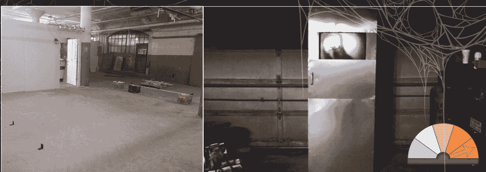

## SCARY DOOR (AND SCARY PORCH)
如果你珍惜你的理智，就不要太靠近这扇门

上方左
灯亮时没那么吓人，不过你仍然可以看到让它运作的安装在箱子上的运动传感器

上方右
谁在门口？

CABE ATWELL
电气工程师、作家、诅咒物品的工匠
bit.ly/1p6VqPw

你正进入一个毗邻某个地点的区域的范围。那种可能有怪物或某种奇怪镜子的地方。这些只是例子；它也可能好得多。准备进入……恐怖之门。

或者不，在这种情况下，这不是真正的门。也不是《外星人》恶搞。虽然我们本专题开头展示的闹鬼屋显示了通往一个闹鬼住宅的入口，但这种项目是你漫步时可能会在内部找到的东西。

这是一扇奇怪的金属门，有一个可以透视的窗户。门后传来敲门声；也许有人迷路了？当你走近时，你透过窗户看到一个看起来正常的客厅。你看不到任何人，但敲门声仍在继续，当你伸手去抓门把手时，一个怪物面孔出现了。

Cabe 的想法是以低成本创造一个每次看到都不同的现代闹鬼屋效果。除了弹出式惊吓外，还有鬼魂和怪物在“窗户”中飞来飞去（实际上是一个 LCD 屏幕），而你可以创造的惊吓和声音则取决于你的想象。敲门声来自活塞撞击门的声音。

除了门之外，Cabe 之前还制作了一个恐怖门廊，他描述为“[an] 探索我用光和声音吞噬某人的想法，以至于他们想逃跑。”与我们之前提到的闹鬼屋项目不同，后者是通过门铃激活的，门廊可以感应你距离门有多远。

当你开始靠近时，它会开始播放 creepy 的声音并慢慢打开一些明亮的红灯。当你更靠近门时，声音会变得更大，灯光会更亮，直到你在敲门范围内时开始播放尖叫和咆哮声。

“恐怖门廊只在我店里搭建，”Cabe 向我们解释道。“但是，人们确实看到了它，并且做了我认为他们会做的事……他们想远离声音。”

两者都是相当复杂的项目，如果你计划自己制作类似的东西，Cabe 建议你格外谨慎，除非你想让自己成为万圣节展示的中心。今年他会收敛一点：“我计划……做一条林间小路，或让前院变得更可怕一些。”

在 Cabe 的房子里，我们确信它会比一点点可怕更可怕。

### COMPONENTS LIST
CONJURE UP YOUR OWN VERSION
> 这里列不下太多！查看个人资料中的链接，了解近 800 美元或更多能为你带来多少恐怖感

