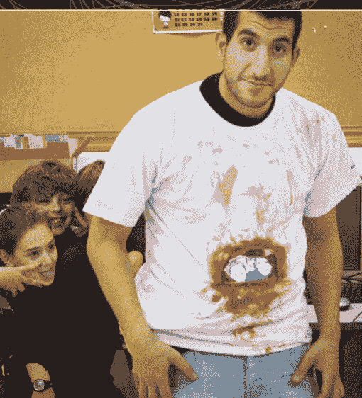
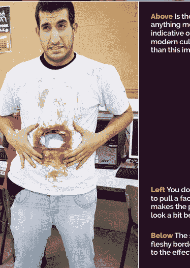
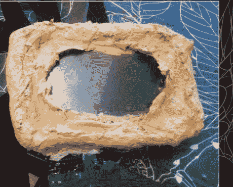

## 腹部中弹

凭借这套令人毛骨悚然的互动服装，将惊吓带在身边

LUIS MARTIN
制作者、研发工程师、重伤受害者
bit.ly/1KNZWot

吓人的南瓜、门和房子是一回事，但一个好的吓人服装是万圣节的重要组成部分。虽然你无法超越吸血鬼、女巫和僵尸这些经典形象，但每年都会出现更多富有想象力且更恐怖的服装。Luis Martin 通过加入 Pi 和一些巧妙的编程，将他的服装提升到了新高度，使其看起来像是从《行尸走肉》中被直接射穿了腹部。

实际上这是一个相当简单而巧妙的设计。使用 Raspberry Pi 作为核心，Luis 采用了 Pi Camera Module 和 7 英寸屏幕，让摄像头的实时画面播放到屏幕上。通过将 Pi 和摄像头放在背部，他能够将实时画面传输到衬衫上显示的屏幕上，营造出腹部真的有一个洞的错觉。

确实很吓人——只是不要让他转身，否则会破坏效果。它不仅仅涉及电子产品：屏幕边缘还制作了乳胶边框，以模拟穿过衣服时肉体的恐怖外观，从而更好地营造效果。加上肤色油漆、血液和细节处理以达到理想效果，他还剪开了一件旧 T 恤并用假血染色。

> “你必须渴望弄脏自己的手，”Luis 告诉我们。“尤其是血。僵尸服装里的血越多，就越逼真！”

衬衫准备好后，Luis 拿了一个 GoPro 绑带，让它将屏幕固定在腹部，同时也用来将摄像头固定在他背部的正确位置以使幻觉生效。这随后只需通过 Raspberry Pi 上的 HDMI 端口连接到屏幕——打开电源，你就可以开始了！

这听起来确实很残忍，你会认为看到一个腹部有洞的僵尸走来走去会让每个人尖叫并逃跑。“每个人都想通过洞拍照，就像某种裹着血的自拍？”现在的孩子们，呵？你肚子上开个洞，他们甚至都不害怕。

## 组件清单

### 自己制作一个版本

- Pi Camera Module
- 7 英寸触摸屏
- HDMI 线缆
- GoPro 胸部固定绑带
- 便携电池

上方 有什么比这张图片更能体现现代文化吗？

左侧 你不必做鬼脸，但这样照片看起来会更好一些

下方 屏幕的肉质边框增强了效果

