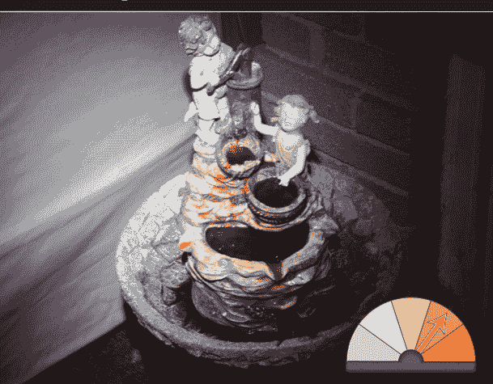
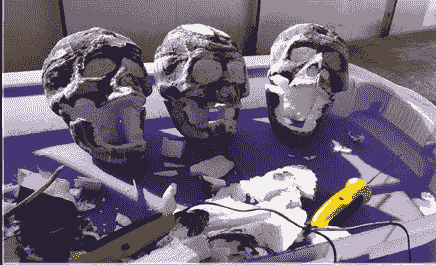
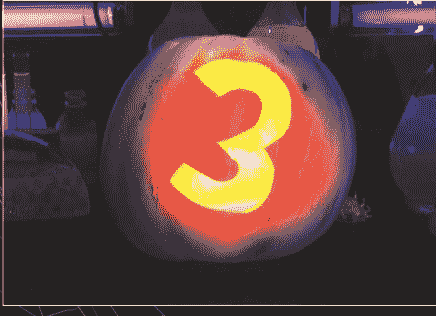

## HALLOWEENPI AT 3

一项每年都会让你骨头发颤并帮助当地食品银行的传统

CHRIS, PATRICK AND ELISHE
分别是解决方案架构师、系统专家和艺术家，闹鬼数字的提供者
on.fb.me/10uScjv

吓唬上门的人似乎是鬼怪界的大生意。我们见过门廊、门口和怪物派对，它们至少会给出一些警告或试图营造恐怖氛围，但 HalloweenPi 更倾向于跳吓式惊吓，而不是营造悬念。

要理解 HalloweenPi，我们需要了解 Halloween at 3 的历史。3 Michelle Court 的人们每年都会举办一个传统，展示他们最恐怖的万圣节主题创意，以震撼也许吓到来 trick-or-treat 的孩子或路人。Chris Kyte 不断尝试通过增加展示内容来让每年都更好，于是有了一些灵感：

“我们正在考虑如何吸引更多 trick-or-treaters 来到我们的鬼屋。我们决定开始为当地食品银行收集罐头食品捐赠时，我想起了今年生日时收到的 Raspberry Pi B+。我开始思考是否可以建造一两个气动道具来‘提升我们的水平’。”

目前，这个巨大的隧道里摆放着一个实验室，里面有彩虹色混合物在烧杯和试管中，在黑光下反应，还有一个投射的木偶会称赞孩子们的服装，以及万圣节主题展示的其他装饰。这个新增加的部分将附带一个运动控制器道具，当人们到达 Halloween at 3 时，它会弹起并吓唬他们。

“HalloweenPi 控制的气动道具将是一个非常令人毛骨悚然的装置，”Chris 说。“它将作为鬼屋的大使，对经过的人做出反应：道具会张开翅膀并发出巨大的尖叫！我们设计的道具和气动装置是模块化的。它们每年不必保持相同！”

惊吓是为了一个好目的，因为 Halloween at 3 为当地食品银行募集捐款。“气动道具带来的额外兴奋应该会让来的人数大幅增加。希望我们也能看到食品捐赠的增加。”

我们质疑在如此美好的结果下，这样一项事业如何在万圣节精神中真正邪恶，但这次我们就放过它吧。

下方上方 团队仍在努力完成今年的项目，以便在重要日子到来前做好准备

下方底部 3 Michelle Court 到底发生了什么？

## 组件清单

### 自己制作一个版本

- 4 通道继电器板
- 2× PIR 传感器
- 用于武装和解除道具的无线钥匙扣
- 一个气动缸
- 12V 气动电磁阀
- 12V 放大器
