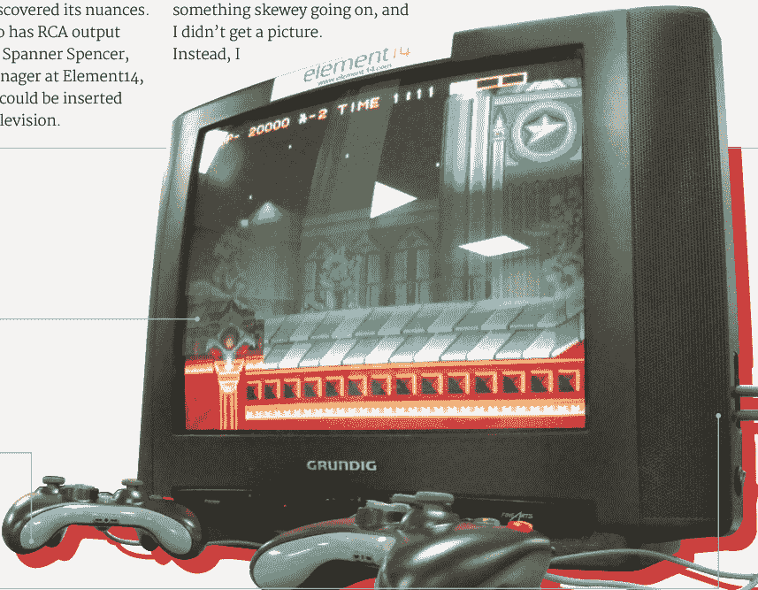
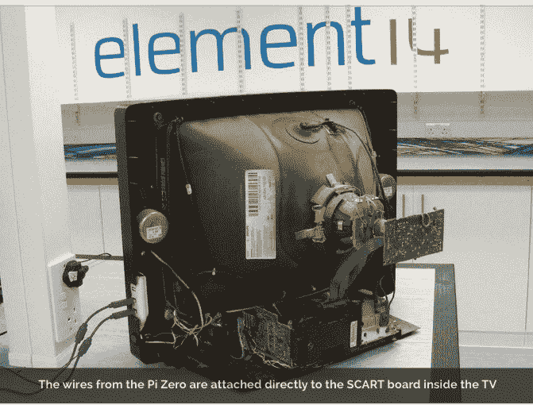
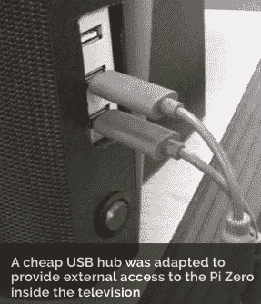
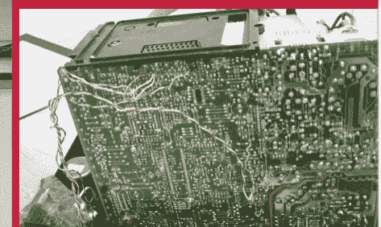
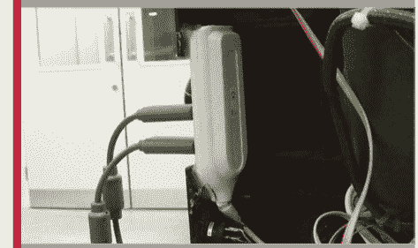
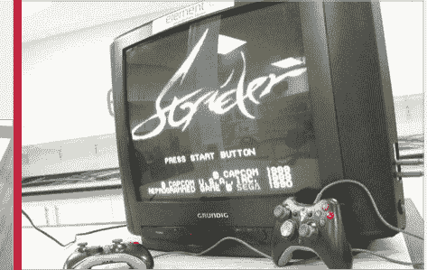
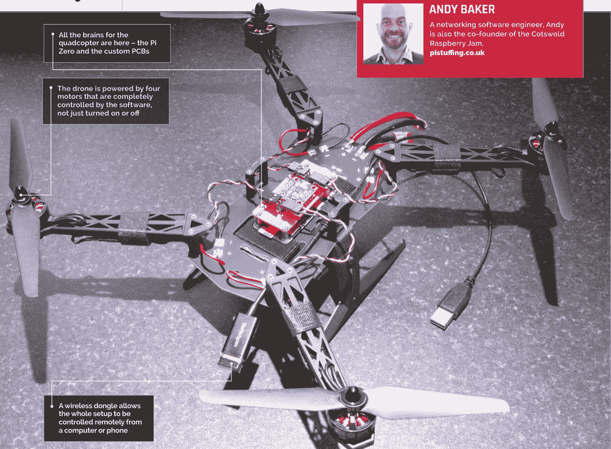

## Pi Zero 复古游戏系统

Spanner Spencer 毫不犹豫地将 Pi Zero 的 RCA 连接接到一台经典的阴极射线管电视上。Pi Zero 复古游戏系统货真价实...

### SPANNER SPENCER

Spanner 是 Element14 的社区经理，Element14 是一个面向工程师的在线社区。
magpi.cc/1m75kkg

### 快速事实
- 与 Xbox 360 手柄配合使用效果如梦似幻
- 整个项目仅用了两个小时建造
- Pi Zero 可超频至 1GHz 用于游戏
- 它使用 RetroPie，是标准 NOOBS 安装的一部分
- Pi Zero 甚至可以运行一些原版 PlayStation 游戏

公平地说，Pi Zero 引起了不小的轰动。我们最喜爱的新款最小电脑登上了 Twitter，并在《The MagPi》封面附赠时在英国报刊亭引起了混乱。甚至奥巴马总统也拿到了一份。那些幸运获得 Zero 的人迅速创建了一些很棒的项目并发现了其细微之处。Pi Zero 拥有 RCA 输出这一特点并没有被 Element14 的社区经理 Spanner Spencer 忽略，他意识到它可以安装在旧电视内部。

> “我在哈德斯菲尔德一家慈善商店花了 20 英镑买了一台破旧的 Grundig，”Spanner 说。“想想第一台 Pi Zero 游戏机为慈善事业做出了贡献，很不错。
> “起初，我在复合音响插座后面焊接了几根飞线，”他继续说，“但出现了一些奇怪的问题，我没有得到图像。于是，我改用 SCART 插座上的复合视频输入，然后将电线焊接到下面的 PCB 上以避免外部布线。
> “视频信号来自 Pi Zero 的复合输出，我直接焊接了。它有点永久性，如果添加一些引脚和插头以便更轻松地拆卸板子会更好，但就这样吧。

在经典 CRT 电视上使用 RetroPie 是玩老式游戏机游戏的好方法

连接 USB 游戏手柄（如这款 Xbox 360 手柄）即可在最少设置的情况下玩游戏

一个 USB 集线器放置在电视侧面。这样可以在不打开电视的情况下将新游戏添加到 RetroPie

## 将 Pi Zero 安装在电视内部

Pi Zero 足够小，可以塞进电视内部

Pi Zero 足够小可以塞进电视内部，但这使得访问变得困难。然而，RetroPie 允许通过 USB 驱动器传输游戏，因此 Spanner 决定使用 USB 集线器提供外部连接。“我们从一家一镑店的集线器拼凑了一个带电的 USB 集线器，”他告诉我们，“[并]在 PCB 上的电源线上焊接了一个插座，并用一根被改装的 micro-USB 线替换了电缆。我们还从集线器引出了一根第二根 micro-USB 电缆为 Pi Zero 供电，这样集线器和板子都由单一的 5V 电源供电。”“除了需要在 Pi Zero 的配置文件中将复合输出从默认的 NTSC 改为 PAL 外，一切开箱即用。我们能够玩经典的电脑和游戏机游戏，如 Mega Drive、SNES、Amiga、ZX Spectrum 等等。”Pi Zero 证明非常适合复古游戏。“考虑到额外的 RAM 开销并且能够将 Pi Zero 提升到 1GHz，它运行 RetroPie 非常出色，”Spanner 说。“对于较旧的系统，甚至不需要超频，所以如果你计划玩 Atari 2600 游戏，就让自己轻松一点吧。”安全公告！在旧 CRT 电视内部工作很危险（而且不是酷的那种）。佩戴安全护目镜并完全放电非常重要。旧 CRT 电视中的残余电荷很容易致命。请不要在不知道自己在做什么的情况下打开旧电视；更明智的做法是将 Pi Zero 的 RCA 连接到 SCART 电缆并将其插入电视，或使用更新的 HDMI 显示器用于复古游戏系统。

### STEP-01
Pi Zero RCA 输出

Pi Zero 板载复合 RCA 输出连接器。两根电线从 Pi Zero 连接到 SCART 插座的 18 号和 20 号引脚。

### STEP-02
USB 连接

Spanner 拆开了一个 USB 集线器并对其进行了修改，使其与 Pi Zero 共享电源。电视的一部分被切除以提供对 USB 端口的外部访问。

### STEP-03
NTSC 转 PAL

Pi Zero 的配置文件需要更改才能在英国 PAL 电视上获得彩色。编辑配置文件并取消注释行 sdtv_mode=2。系统现在已准备好玩游戏。

### ANDY BAKER

网络软件工程师 Andy 也是 Cotswold Raspberry Jam 的联合创始人。
pistuffing.co.uk

四旋翼无人机的所有大脑都在这里——Pi Zero 和定制 PCB

无人机由四台电机驱动，这些电机完全由软件控制，而不仅仅是开关

一个无线适配器允许整个设置从电脑或手机远程控制

### 快速事实
- Andy 声称到目前为止他已经花费了三年时间
- 较旧的版本出现在《The MagPi》第 19 期
- 不过，它在封面图片中实际上无法飞行
- Raspbian Jessie 修复了许多编程错误
- 这是他的第二个 Pi 项目
