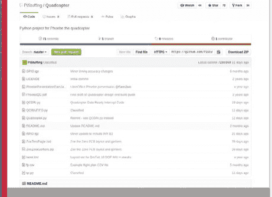
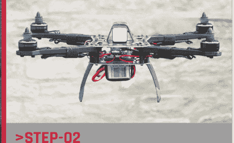
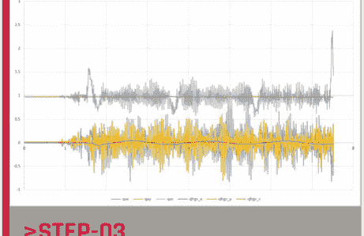
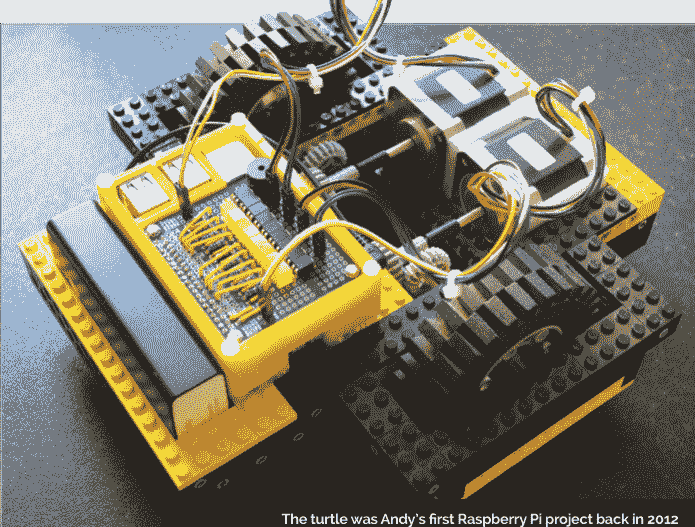
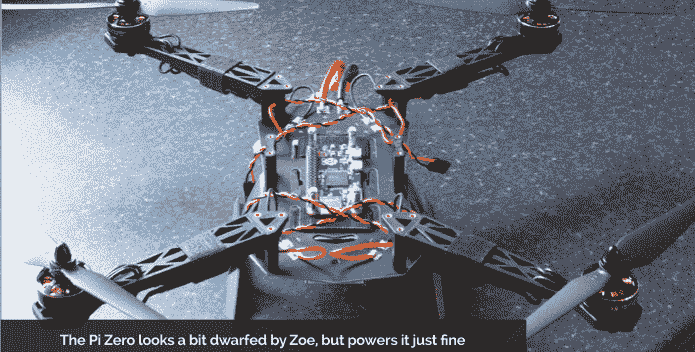

## ZOE THE ZERO

很可能成为 Pi Zero 驱动无人机群中的第一架，Zoe the Zero 是长期梦想的延续

当我们计划《The MagPi》第 40 期并附带封面 Pi Zero 时，我们进行了头脑风暴，讨论可以为专题做哪种项目，也许还能作为未来的封面。我们注意到的一件事是 Pi Zero 非常适合为四旋翼无人机和其他无人机供电。自该期发行上架以来仅一个月多一点，Andy Baker 就成功开启了这一趋势并创建了自己的无人机。

“我于 2012 年 12 月完成了我的第一个 Pi 项目（一辆带轮子的‘Turtle’机器人），”Andy 告诉我们。“我想转向真正具有挑战性的东西，而四旋翼无人机当时才开始商业化出现。我完全不知道它们是如何工作的，所以我想填补我理解上的空白，同时也玩得开心。”Andy 花了过去几年时间建造、测试和实验，从零开始创建自己的四旋翼无人机：“我还没有完成，主要是因为我实际上想完全靠自己弄清楚，不借用任何人的代码或指导。涉及了大量的实验和学习，包括大量浪费时间走错方向并在遇到隐喻性的砖墙时退回——或者更准确地说，当我无法阻止四旋翼撞到真正的砖墙时。”

## 操作 ZOE

### STEP-01
起飞

Zoe 开始执行预编程的飞行计划，设定了它应该做什么的目标。这包括以特定速度上升特定时间、悬停等。

### STEP-02
飞行中检查

无人机上的传感器提供其正在做什么的输入，以确保在计划期间一切按预期运行。

### STEP-03
飞行修正

大量数学计算将飞行计划和数据输入“粘合”在一起，以确保一切按计划进行，纠正螺旋桨/电机中的任何不匹配。

海龟是 Andy 在 2012 年的第一个 Raspberry Pi 项目

Pi Zero 看起来被 Zoe 衬托得有点小，但为其供电完全没问题

Raspberry Pi Zero 帮助 Andy 在进行几次调整后让 Zoe 恢复并重新投入运行。不过，这项历时多年的创作并不总是如此快速或简单。

“除了拥有定制的 HAT PCB 外，物理构建非常简单，因为使用了现成的机架、电机和螺旋桨组合，”Andy 说。“但软件与硬件的接口是一个主要挑战，测试费用昂贵；四旋翼无人机固有的不稳定性意味着任何缺陷最终都会导致坠毁和相应的硬件损坏。尽管从零开始建造 Pi Zero 四旋翼无人机‘仅’花费约 200 英镑，但过去几年我为达到这一阶段花费了十倍以上。”

有趣的是，Andy 并没有计划真正使用这架无人机，而是将其视为一个使其工作的挑战。

“如果它真的达到那个阶段，我几乎肯定会把项目搁置为完成，然后开始新的东西——也许是聚变反应堆，或无限 improbability 驱动。但目前，我可以在现在拥有的非常基础的四旋翼上添加大量有趣的东西，让我保持兴趣很长时间。”

虽然 Andy 花了几年时间，但现在有更多信息和套件可供使用，以走捷径。希望将来我们能向你展示如何创建自己的四旋翼无人机。

