## Pi Zero 集群板

将你的 Raspberry Pi Zero 转变为使用这块定制板打造的算力集群计算机

## 快速概览

- 该板可与任意数量的 Pi Zero 配合使用
- 从构想到完成，集群的建造耗时六周
- Actbulb 中使用了 Compute Module
- 团队一直在研究 VideoCore GPU 以用于未来项目
- 即使安装了 Pi，板子的尺寸也为 20cm × 20cm × 5cm

## IDEIN, INC

Yasuyuki Yamada、Koichi Nakamura 和 Yukimasa Sugizaki 组成了 Idein, Inc 的团队，该公司从事 AI 技术研发。
idein.jp

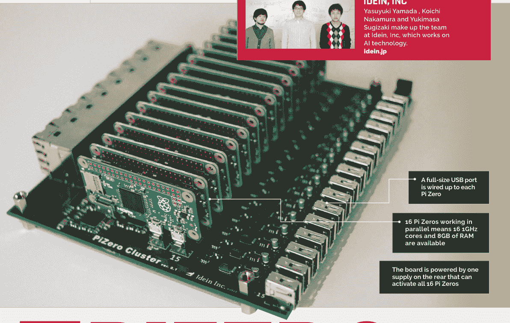

每个 Pi Zero 都连接了一个全尺寸 USB 端口

16 个 Pi Zero 并行工作意味着可获得 16 个 1GHz 内核和 8GB 内存

板子由后方的一个电源供电，可激活全部 16 个 Pi Zero

当 Raspberry Pi Zero 正在研发时，Eben Upton 曾提到一盒 Pi Zero 里装有数百个。数百个核心和数百 GB 的内存——如果使用得当，这就是一箱算力。我们从未算出过一盒理论上能处理多少 FLOPS，即使这可能并不现实。然而，一家日本公司也看到了 Pi Zero 在数量上的威力，并打造了 PiZero Cluster Board，可让多达 16 个 Pi Zero 进行并行计算。

我们就集群板采访了 Idein, Inc 的代表董事 Koichi Nakamura：

“When I was playing with Raspberry Pi Zero, I realised that costs of cables and adapters are relatively expensive, and found a solution that used micro USB plugs for cradles. I used this idea to create our computer cluster… I think it’s useful for many other projects, [but it was] originally designed and developed for our internal purposes.”

Idein 目前正在开发 Actbulb，这是一款基于 Pi 的传感器套件，可插入标准灯泡插座，按你想要的方式使用。传感器包括麦克风和摄像头；它还具备联网功能并配有音频扬声器。

“Since we are developing products using Raspberry Pi, we need a cluster of many Pis for software development and tests,” Koichi explains to us. “It’s also useful to set up many other devices… We plan to create a cluster to enable setup of hundreds of our devices a day.”

## 创建集群

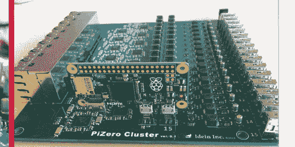

### >STEP-01
为自己做好准备

首先，你只需将 Raspberry Pi Zero 插入即可。它一次可使用最少 1 个，最多 16 个。

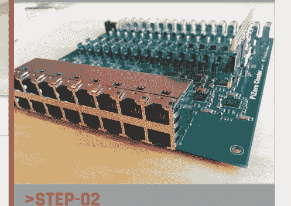

### >STEP-02
连接它

下一步是连接所有部件。应先接入以太网交换机和线缆，然后再接入交流适配器供电。

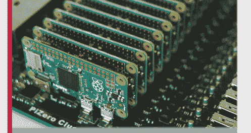

### >STEP-03
并行工作

就这样！打开电源后，你就可以使用 MPI 或其他任何方法同时利用多个 Pi Zero 进行编程。

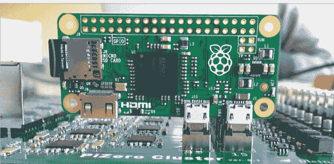

上图 Pi Zero 通过其 micro USB 电源和数据端口插入。每个单元还需配备安装了操作系统的 SD 卡

下图 是促使 Pi Zero 集群板诞生的基于 Pi 的传感器。它可连接到标准灯具

它在网上引起了巨大反响，许多人对该板子感到兴奋。然而，Koichi 认为这是一个相当简单的项目：

“PiZero Cluster Board 只是 16 个相同电路的集合。每个电路都通过 SMSC LAN9512 芯片从[每个]Raspberry Pi Zero 的 micro USB 端口引出一个以太网端口和一个 USB 端口。还有 16 个电源电路，可从 12V 单电源为 Raspberry Pi Zero 和 LAN9512 生成 5V 和 3.3V。全部 16 个电路都相同。”

> 我们计划创建一个集群，以便每天设置数百台设备

由于 Pi Zero 供应紧张，团队最初无法获得足够数量来完成集群。幸运的是，我们在《The MagPi》动用了所有人情，拉动了所有关系，并恳求、哀求和借用，才为他们凑齐了测试所需的剩余 15 个 Pi Zero。

由于板子的受欢迎程度和多种用途，Koichi 计划在准备众筹时将其放到 Kickstarter 上。它将是我们在线上看到的原型的改进版。

“In our current plan, the number of Raspberry Pi Zeros and USB ports is reduced to 14,” Koichi tells us. “We’ll also add an on-board Ethernet switch to the board, and the number of ports is reduced to two.” This improvement will reduce the number of Ethernet ports and cables required, and so lower the board’s overall cost.

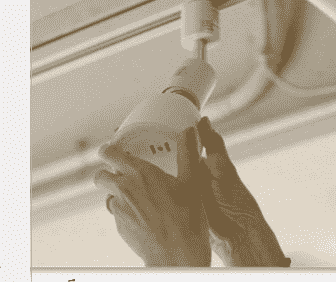

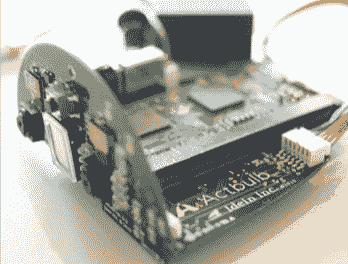

Actbulb 的内部结构比普通灯泡复杂得多

## 教程

跟随这些精选项目学习，制作真正令人惊叹的东西

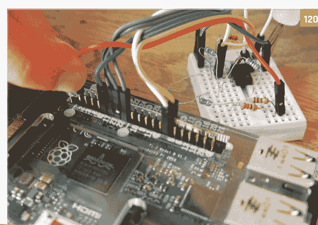

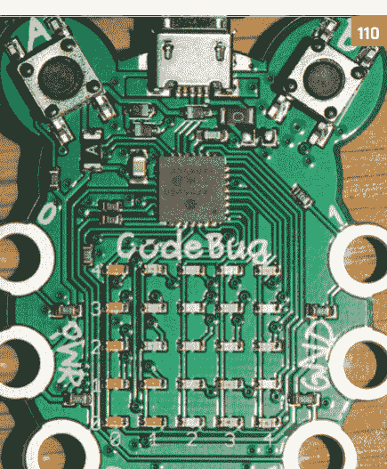

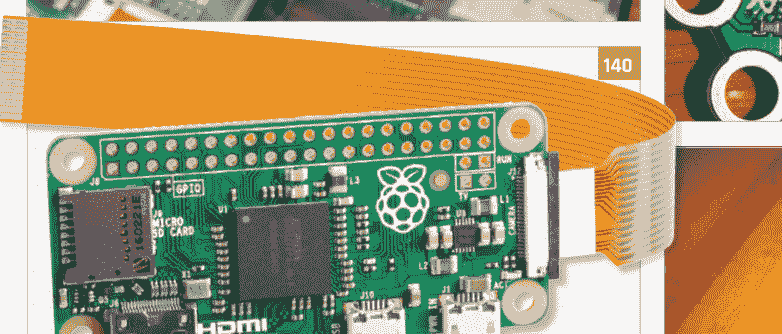

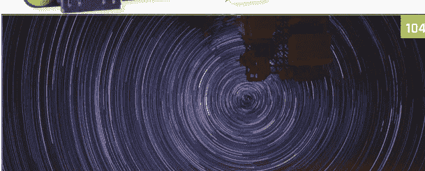

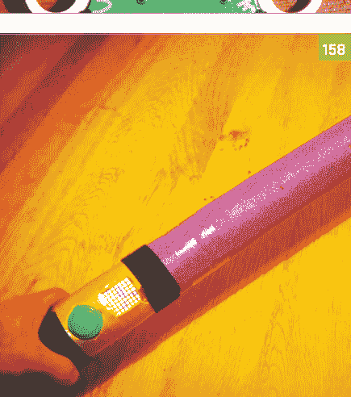

## 教程

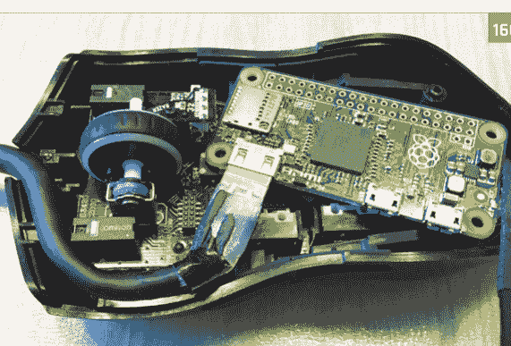

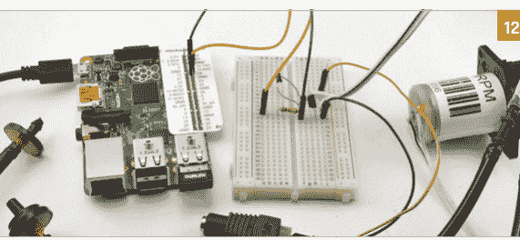

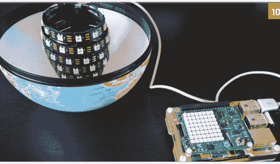

- 96 **使用 Sense HAT 入门**
- 使用你的 Sense HAT 进行读数并显示信息
- 98 **使用 Sense HAT 进行像素艺术**
- 在你的 Sense HAT 上显示微小像素字符
- 100 **GPIO Zero 交通帽**
- 通过编程交通灯学习一些基本的 GPIO Zero 代码
- 102 **使用 Wolfram 发推**
- Wolfram 在 Raspberry Pi 上免费，你可以用它做一些很酷的事情
- 104 **延时摄影**
- 通过设置特殊项目创建令人惊叹的延时摄影视频
- 106 **推送通知与 MotionEye OS**
- 使用 Pi 和 MotionEye OS 制作智能 CCTV 系统
- 108 **PI 唤醒灯**
- 一个唤醒灯，帮助你在早上更自然地醒来
- 110 **用 Python 3 编程 CodeBug**
- 使用 Python 3 在小小的 CodeBug 上制作游戏
- 112 **使用 Piano HAT 玩乐**
- 将你的 Pi 变为钢琴，成为下一个肖邦
- 115 **PI PHRASE**
- 在 Raspberry Pi 上制作游戏节目并记住你所看到的内容
- 118 **使用 Skywriter 进行魔法演示**
- 使用 Skywriter 的手势控制为你的演讲增添魅力
- 120 **自制你的 HAT**
- 找不到符合你需求的 HAT？自己做一个！
- 124 **物联网植物浇水器**
- 在本实用指南中实现植物浇水的自动化
- 128 **管道温度监测**
- 通过检查管道在冬季保持房屋安全
- 132 **PI MI-LIGHT**
- 控制无线灯泡实现真正的家庭自动化
- 136 **制作二进制时钟**
- 制作一个美丽且与众不同的计时器
- 140 **使用 Pi Zero 入门**
- 了解最小的 Raspberry Pi 的方方面面
- 146 **Pi Zero 配件**
- 使用这些出色的扩展为你的 Pi Zero 配备
- 148 **Pi Zero 游戏主机**
- 创建一台具有自带可充电电源的高级便携复古游戏主机
- 152 **Pi Zero 复位开关**
- 添加一个非常简单的按钮来复位你的 Pi Zero
- 154 **Slack 活动监测**
- 想知道你在 Slack 上错过了多少条消息？制作这个监测器
- 156 **PI-SABER**
- 在这根武器化的泳池漂浮棒中感受电子的力量
- 158 **鼠标中的 Quake III**
- 将鼠标插入电视并在上面玩 Quake III。魔法！
- 160 **Pi Zero NES 手柄**
- 在手柄内部创建一个快速简单的复古游戏主机

## 教程

跟随这些精选项目学习，制作真正令人惊叹的东西

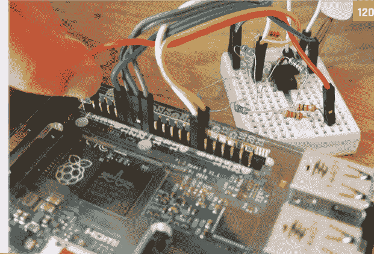

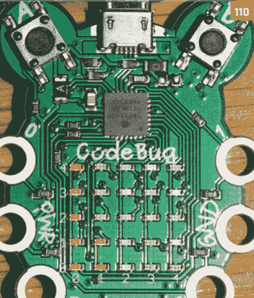

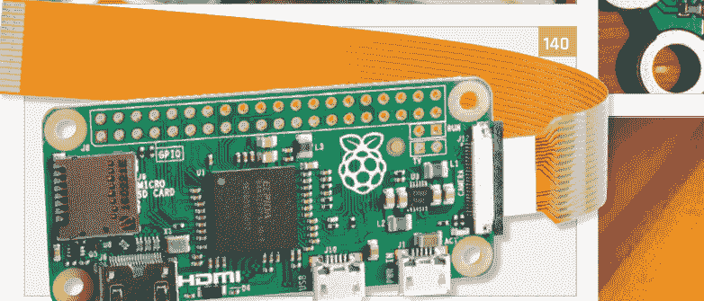

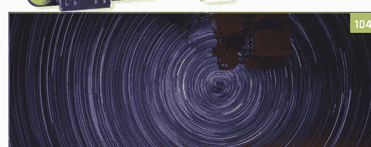

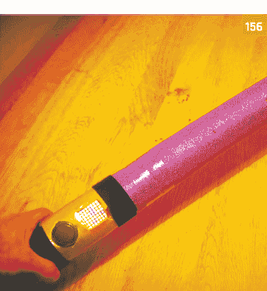

## 教程

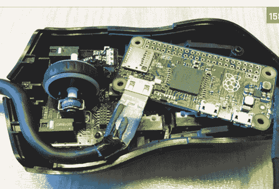

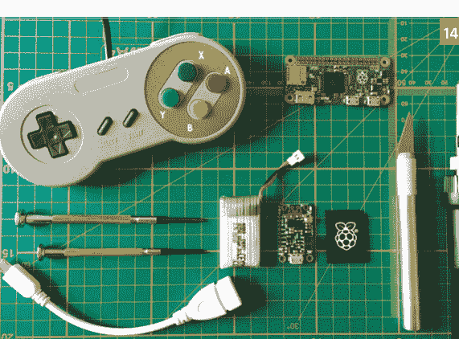

- **96 使用 Sense HAT 入门**
  使用你的 Sense HAT 进行读数并显示信息
- **98 使用 Sense HAT 进行像素艺术**
  在你的 Sense HAT 上显示微小的像素字符
- **100 使用 GPIO Zero 控制交通灯 HAT**
  通过编程交通灯学习一些基本的 GPIO Zero 代码
- **102 使用 Wolfram 发推**
  Wolfram 在 Raspberry Pi 上免费，你可以用它做一些很酷的事情
- **104 延时摄影**
  通过设置特殊项目创建惊艳的延时摄影视频
- **106 推送通知与 MotionEye OS**
  使用 Pi 和 MotionEye OS 制作智能 CCTV 系统
- **108 Pi Glowbe**
  一种唤醒灯，帮助你在早上更自然地醒来
- **110 用 Python 3 编程 CodeBug**
  使用 Python 3 在小小的 CodeBug 上制作游戏
- **112 使用钢琴 HAT 玩乐**
  将你的 Pi 变为钢琴，成为下一个肖邦
- **115 Pi Phrase**
  在 Raspberry Pi 上制作游戏节目，并记住说出你所看到的内容
- **118 使用 Skywriter 进行魔幻演示**
  使用 Skywriter 的手势控制为你的演讲增添魅力
- **120 自制 HAT**
  找不到符合你需求的 HAT？自己做一个吧！
- **124 物联网植物浇水器**
  在本实用指南中实现植物浇水的自动化
- **128 管道温度监测**
  通过检查管道在冬季保持房屋安全
- **132 Pi Mi-Light**
  控制无线智能灯泡，实现真正的家庭自动化
- **136 制作二进制时钟**
  创建一个美丽且与众不同的计时器
- **140 使用 Pi Zero 入门**
  了解最小的 Raspberry Pi 的方方面面
- **146 Pi Zero 配件**
  用这些优秀的附加组件为你的 Pi Zero 配备
- **148 Pi Zero 游戏主机**
  创建一台具有自带可充电电源的高级便携复古游戏主机
- **152 Pi Zero 复位开关**
  添加一个非常简单的按钮来复位你的 Pi Zero
- **154 Slacktivity 监控**
  想知道你在 Slack 上错过了多少条消息？构建这个监控
- **156 Pi-Saber**
  在这根武器化的泳池漂浮棒中感受电子的力量
- **158 鼠标中的 Quake III**
  将鼠标插入电视并在上面玩 Quake III。魔法！
- **160 Pi Zero NES 手柄**
  在手柄内部创建一个快速简单的复古游戏主机
