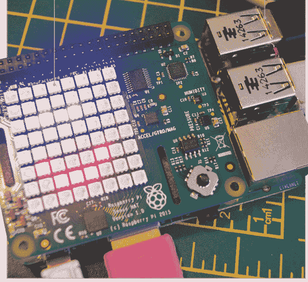
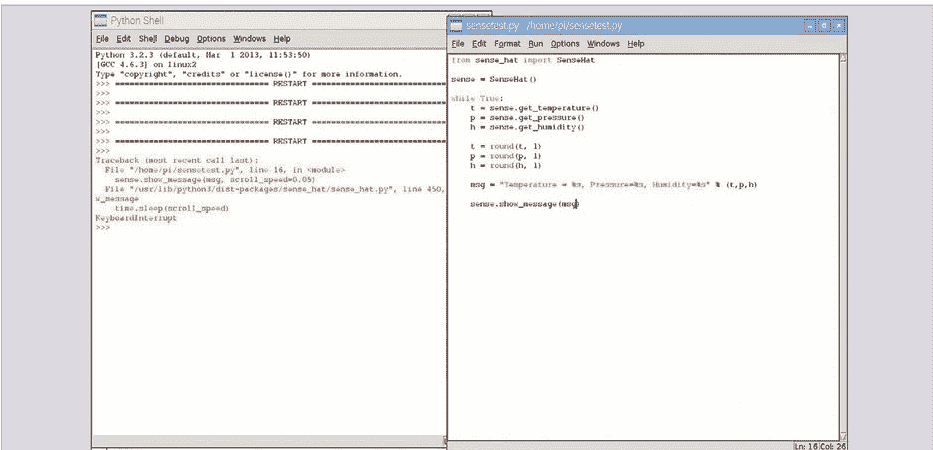
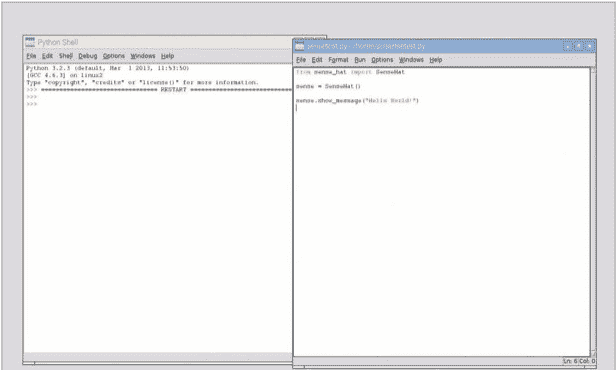
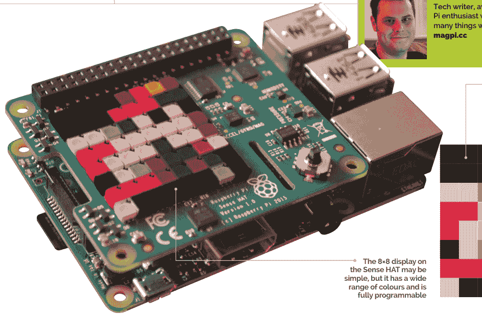

## 使用 Sense HAT 入门

令人兴奋的新传感器扩展件一旦你知道如何使用，Raspberry Pi 的使用就非常简单。我们会教你如何使用。

### 所需材料

- Sense HAT magpi.cc/1TGGUt5
- Sense HAT 库
- Raspbian - magpi.cc/1MYYTMo

本期我们对 Sense HAT 进行了大量介绍，杂志早期我们采访了创作者，后来又对其进行了评测。这是一款令人惊叹的设备，希望到现在你已经为自己抢到了一台。

虽然它确实很容易使用，但由于目前它依赖于通过 Python 脚本进行编程，所以你首先需要学习一些东西才能开始使用。不过命令非常简单，所以我们只用几页就能向你展示如何开始充分利用你的新玩具！

学习如何使用 Sense HAT 的功能，并弄清楚如何制作这个笑脸

你只需要一台 Raspberry Pi 即可使用 Sense HAT - 不需要其他小工具！



### >步骤-01
安装 Sense HAT

让 Sense HAT 准备就绪非常简单。关闭你的 Raspberry Pi，并确保你的 Raspbian SD 卡已插入，如果尚未插入的话。将 Sense HAT 放置在 GPIO 引脚上，小心对齐，然后用力按下，使其正确连接到 Raspberry Pi。完成后，重新打开 Raspberry Pi。如果连接正确，Sense HAT 上的 LED 在启动时会以彩虹图案点亮。到达桌面后，图案可能会关闭，但这是正常的。

### >步骤-02
Sense HAT 库

Sense HAT 并非在每台 Pi 上都能立即工作。如果你使用的是非常旧版本的 Raspbian，可能需要下载一个自定义脚本来安装 Python 访问所需的库，并更新一些核心内核代码以使其正常运行。你可以通过打开终端并运行以下命令来下载并安装更新：

```
$ sudo apt-get install sense-hat
$ sudo pip3 install pillow
```

在两个命令都运行完毕后（每个命令可能需要几分钟才能完成），你需要重新启动 Raspberry Pi。你也可以从命令行执行此操作：

```
$ sudo reboot
```

### >步骤-03
开始使用 Python

我们可以通过编写 Python 代码来开始控制 Sense HAT。由于 Sense HAT 使用 GPIO 引脚，我们需要有管理员权限才能执行脚本。这意味着需要在命令行中使用 sudo 打开 IDLE：

```
$ sudo idle3 &
```

打开一个新窗口开始编写 Python 脚本。每个 Sense HAT 脚本都需要以两行导入相关 Python 模块开始，然后是一行将其转换为变量以便更轻松地编写代码。

```
from sense_hat import SenseHat

sense = SenseHat()
```



### 更轻松的绘画

使用列表为特定字母设置颜色（例如，红色可以是 r=[255,0,0]）。你可以更进一步，创建一个字母矩阵来显示图像

左侧 你可以将传感器输出设置为变量，然后在 LED 上打印出来，结合 HAT 的所有功能

### >步骤-04
文本和图片

最简单的开始方法是让文本在 LED 显示屏上滚动。Sense HAT 的库会自动将一串文字转换为在矩阵上滚动的横幅。以下这样的行就会创建它：

```
sense.show_message("Hello World!")
```

你也可以控制滚动速度和颜色。你还可以操纵单个 LED，通过告诉脚本更改哪个像素，并提供 RGB 颜色变量，例如：

```
sense.set_pixel(0, 0, [0, 0, 255])
```

将此放入变量中，将左上角像素设置为蓝色

### >步骤-05
环境传感器

使用 Sense HAT 的两个传感器，你可以测量温度（摄氏度）、气压（毫巴）和相对湿度（百分比）。你可以用以下方法获取三个单独的测量值：

```
sense.get_temperature()
sense.get_pressure()
sense.get_humidity()
```

不过你需要将它们附加到变量（例如，t = sense.get_temperature()），这样你就可以打印出读数或将其显示在 LED 矩阵上。

### >步骤-06
运动感应

陀螺仪、加速度计和磁力计可用于实时检测运动。这比使用其他部件稍微复杂一些，因为它涉及理解三维值如何表示 Raspberry Pi 的方向，然后如何使用加速度计来计算空间中的移动。陀螺仪和加速度计函数（分别为 get_orientation().values() 和 get_accelerometer_raw().values()）将返回三个值，你可以随意使用。

这本实用指南将解释有关运动传感器的所有你需要知道的内容：http://bit.ly/1UBdEmA

### 减慢文本速度

你可以通过添加 scroll_speed 选项来编辑滚动文本速度。使用类似以下内容：sense.show_message("Hello World!", scroll_speed=0.5)

下方 你可以编写的最基本脚本，但它对于掌握 Sense HAT 的基本编码非常有用



## 教程

### 逐步操作

ROB ZWETSLOOT
技术作家、狂热编码者、Raspberry Pi 爱好者，拥有使用 Raspberry Pi 构建众多事物的历史
magpi.cc



创建简单的图像或更高级的像素艺术来代表你最喜欢的东西


Sense HAT 上的 8×8 显示屏可能很简单，但它具有丰富的色彩并且完全可编程
