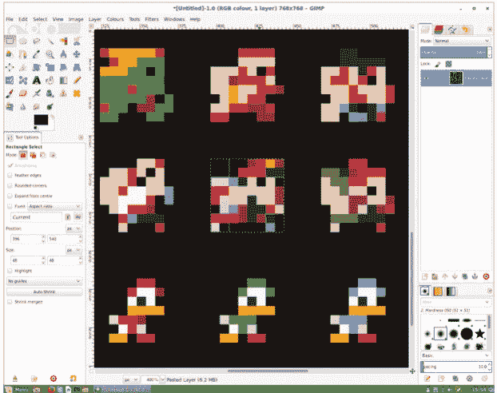
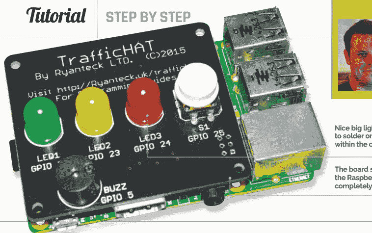

## Sense HAT 上的像素艺术

利用 Python 和 Sense HAT 的 LED 读取并显示 8×8 像素艺术

### 所需材料

- Raspbian magpi.cc/1MYYTMo
- Sense HAT magpi.cc/1TGGUt5
- 像素艺术

### 启发性代码

本教程受到了 Twitter 上读者 Mike Legg 的启发，他创建了代码来循环显示 Johan Vinet 表格上的全部 100 个字符。在此处查看此 Python 代码：bit.ly/1GOVoBp

我们知道你在想什么：8×8 像素艺术似乎没有多少像素。如果你这么想，你是对的。那是 64 个像素来传达某些内容——对于低复杂度的物体来说很简单，但对于真正的像素艺术来说似乎是一项艰巨的任务。然而，如果你回想游戏的早期时代，有很多精灵的像素并不多，看起来……还算过得去。当时的主要限制是屏幕上同时可以有的颜色数量，而有了 Sense HAT，我们可以使用完整的 RGB 光谱，利用每个像素制作出比老式 Atari 2600 更好的东西。拿一个精灵，让我们开始吧！

### >步骤-01
准备 Sense HAT

如果你已升级到更新版本的 Raspbian，Jessie，你需要做的就是关闭 Raspberry Pi，拔掉电源线，然后将 Sense HAT 插在 Pi 顶部。重新打开，它就可以使用了。如果你尚未进行更新，你需要先安装一些额外的库。打开终端并运行以下命令：

```
sudo apt-get install sense-hat
sudo pip3 install pillow
```

...然后重新启动 Raspberry Pi（你也可以在终端中使用 sudo reboot 来执行此操作，如果你愿意！）

### >步骤-02
寻找一些艺术

有几种方法可以做到这一点：使用 Google 或在类似 DeviantArt 的网站上搜索正确的关键词（‘8×8 pixel art’ 是一个不错的开始），你应该能够找到适合在 Sense HAT 上展示的精灵。你也可以尝试使用方形图片（例如来自 Instagram 的图片）看看代码会输出什么，或者你可以绘制你的

在类似 Swanky Paint 的软件中制作自己的像素艺术。为了测试本教程，我们从 Johan Vinet（twitter.com/johanvinet）创建的精灵表中选取了 100 个角色之一，可在此处找到：bit.ly/1jxaJ3m。

## >STEP-03
### 准备艺术作品

Sense HAT 只能显示 64 个像素，我们的代码假设你拥有的图像正好是这个大小。在普通电脑上，使用图像编辑器（如免费软件 GIMP）来准备图像。通过裁剪图像去除任何边框（你可能需要放大以确保），并将其保存为你能记住的文件名，扩展名为 .png 或 .gif。如果你的 8×8 艺术作品实际上并未以 8×8 图像保存，这一点尤其重要；例如，如果艺术作品中的每个“像素”宽六个像素，就像我们的代码中那样。

## >STEP-04
### 研究像素艺术

如上所述，你的像素艺术可能并非按像素实际保存。我们创建的代码已考虑到这一点。检查像素宽度的最简单方法是查看图像的分辨率。在我们的例子中，它是 48×48，这意味着每个“像素”是六个真实像素宽（并且高，因为它是正方形）。你可以在 GIMP 中通过使用正方形像素画笔并增加大小，直到与图像中的像素相同来检查这一点。或者，在裁剪图像后，你可以将图像缩放到 8×8；不过这样可能得不到理想的结果，因为它会试图把所有内容挤在一起。

## >STEP-05
### 将其全部加载到 Raspberry Pi 上

将图像放到 Raspberry Pi 上并在图像查看器中打开，以确保传输正常。我们是通过将 SD 卡直接插入准备图像的电脑并将其复制到主文件夹中名为“SenseHAT”的目录来完成的，但你也可以将其放在 USB 闪存盘上并从 Pi 中复制，或上传到云存储然后下载到 Pi。

## >STEP-06
### 编写代码！

按照代码列表进行操作并根据自己的像素艺术进行调整，这可能意味着你需要在代码中更改文件的位置（我们的代码假设你将其放在 Raspbian 主目录下的名为“SenseHAT”的文件夹中），或需要将每个像素的宽度更改为 1 或更高。按 F5 运行代码，它将随后在 Sense HAT 上显示图像三秒钟，然后自行关闭。

## Pixelart.py

```
from sense_hat import SenseHat
import time
from PIL import Image
import os

### Open image file
image_file = os.path.join(
os.sep, "/home", "pi", "SenseHAT", "pixelart.png")
img = Image.open(image_file)

### Generate rgb values for image pixels
rgb_img = img.convert('RGB')
image_pixels = list(rgb_img.getdata())

### Get the 64 pixels you need
pixel_width = 6
image_width = pixel_width*8
sense_pixels = []
start_pixel = 0
while start_pixel < (image_width*64):
    sense_pixels.extend(image_pixels[start_pixel:(
start_pixel+image_width):pixel_width])
    start_pixel += (image_width*pixel_width)

### Display the image
sense = SenseHat()
sense.set_rotation(r=180)
sense.set_pixels(sense_pixels)
time.sleep(3)

sense.clear()
```



上面 Rob 非常自恋，并且（小心地）剪出了他化身 M. Bison 的图像以在 Sense HAT 上显示，取自 Johan 的精灵列表



## ROB ZWETSLOOT

技术作家、热衷编码者和 Raspberry Pi 爱好者，拥有使用 Raspberry Pi 构建众多事物的历史。
magpi.cc

大灯很容易焊接并在代码中使用

板子可以整齐地插在 Raspberry Pi 上——它将完全覆盖 A+
