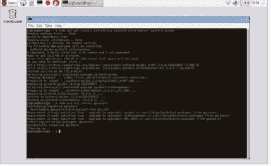
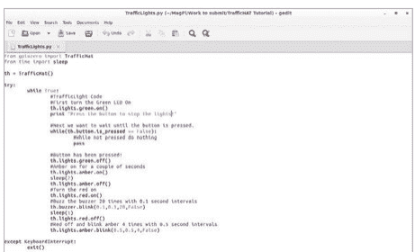
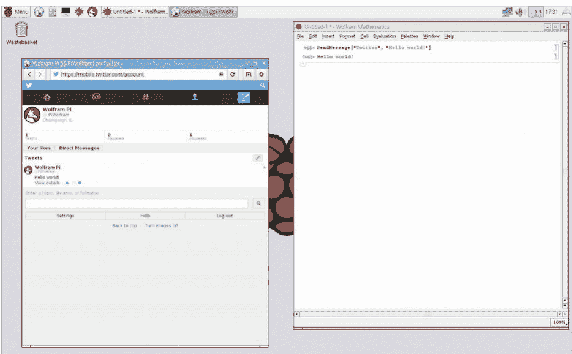

## 使用 GPIO ZERO 的 Traffic HAT

作为 GPIO Zero 支持的板子之一，Traffic HAT 是展示该库的完美方式...

## 所需材料
- Traffic HAT
  magpi.cc/1Mma7oD
- GPIO Zero
  magpi.cc/1MmaJnP
- 焊接烙铁（可选）

Traffic HAT 是一个很棒的小套件：一个安装在 GPIO 上的 Raspberry Pi 扩展板，使学习物理计算编程变得稍微容易一些也更有趣，同时还有大号组件可以帮助你学习焊接的基础知识。
随着 GPIO Zero 的发布，Traffic HAT 现在比以往任何时候都更容易编程，无论你想手动使用它还是利用内置于 GPIO Zero 中的便捷 Traffic HAT 功能。跟随我们学习如何充分利用 HAT 和 GPIO Zero。

你将使用的主要功能是：三个 LED、一个推按钮开关和一个蜂鸣器。
请务必按照板上的轮廓指南放置它们。蜂鸣器的正极侧在组件上标明，板上也有指南显示应将其安装在哪一侧。LED 应焊接，使灯泡的平面边缘与轮廓的平面边缘相遇。

## >STEP-01
### 准备 Traffic HAT

你可以购买预焊接好的 Traffic HAT，这样就不用担心焊接问题，但它也是学习焊接的绝佳入门套件。你只需要安装



上面我们在电脑上编写了代码并将其移动到 Raspberry Pi，但这与直接在 Pi 上编写没有区别

## >STEP-02
### 安装 Traffic HAT

确保你的 Raspberry Pi 已关闭。将 HAT 插入 GPIO 引脚，板子本身横跨 Raspberry Pi。这样，它就不会像木板一样探出边缘，看起来就像 Pi 的正常附加件。
完成后，你可以打开 Raspberry Pi。启动到 Raspbian 后，你需要确保已安装 GPIO Zero。这可以通过在终端中使用以下命令完成：

```
sudo apt-get install python-pip python-w1thermsensor python-spidev
```

```
sudo pip install gpiozero
```

## >STEP-03
### 基础 GPIO Zero

LED 都有一个 GPIO 编号，按钮和蜂鸣器也是如此。我们可以将其与 GPIO Zero 结合使用，以 GPIO Zero 风格手动激活 LED。在 IDLE 中打开一个新的 Python 脚本



上面你也可以在 Python 3 下安装 GPIO Zero 软件；事实上，创建者推荐这样做。不过，你需要更改我们代码中的打印行

并以以下代码开始它，以便它知道要使用哪些功能：

```
from gpiozero import LED
```

然后写入以下内容，使连接到 GPIO 24 的红色 LED 点亮：

```
led = LED(24)
led.on()
```

按 F5 运行并查看结果。蜂鸣器和按钮是可为 Traffic HAT 导入的其他功能。

## >STEP-04
### 专用的 GPIO Zero

使用内置于 Zero 中的实际 Traffic HAT 功能，用 GPIO Zero 编程 Traffic HAT 的方式会稍微容易一些。你可以通过将第一个导入行更改为以下内容来使用它：

```
from gpiozero import TrafficHat
```

这会使用蜂鸣器、按钮和灯光功能来管理 HAT 的相应部分。灯光在代码中随后被描述为绿色、琥珀色和红色，以便在你想要激活它们时使用。我们现在将创建一个小脚本，在 Python 中执行交通灯序列。

## >STEP-05
### 设置

查看本页的代码，我们通过导入 TrafficHAT 和 time 进行了一个简单的设置。我们需要后者来模拟真实交通灯通常的延迟。将 Traffic HAT 代码设为变量 th，我们就可以开始循环了。

创建一个会持续运行的简单 while 循环。开始时让绿灯显示，并使用另一个 while 循环在按钮被按下之前停止代码。除非你按下按钮或中断程序，否则它会一直保持绿色。

## TrafficLights.py

Language
>PYTHON

```
from gpiozero import TrafficHat
from time import sleep

th = TrafficHat()

try:
    while True:
        # Traffic light code
        # First, turn the green LED on
        th.lights.green.on()
        print "Press the button to stop the lights!"
        # Next, we want to wait until the button is pressed
        while(th.button.is_pressed == False):
            #While not pressed do nothing
            pass
        # Button has been pressed!
        th.lights.green.off()
        # Amber on for a couple of seconds
        th.lights.amber.on()
        sleep(2)
        th.lights.amber.off()
        # Turn the red on
        th.lights.red.on()
        # Buzz the buzzer 20 times with 0.1 second intervals
        th.buzzer.blink(0.1,0.1,20,False)
        sleep(1)
        th.lights.red.off()
        # Red off and blink amber 4 times with 0.5 second intervals
        th.lights.amber.blink(0.5,0.5,4,False)
except KeyboardInterrupt:
    exit()
```

> 一个 GPIO 扩展件，使学习物理计算编程变得更容易一些

## >STEP-06
### 灯光时序

按钮被按下后代码的那部分乍一看可能有点复杂，但仔细检查后应该相当直接。它模拟了斑马线交通灯的工作方式，在提供稳定的红灯之前先激活琥珀灯几秒钟。

当红灯出现时，蜂鸣器会鸣响几秒钟，然后红灯关闭，琥珀灯出现，这次会闪烁，然后恢复为绿色。此时，while 循环重新开始，等待按钮提示。


## DANA FLINN & BRETT HAINES

Dana Flinn（左）是 Wolfram Research 公关部的项目管理员，Brett Haines（右）是研发部门的初级软件工程师。
magpi.cc/10tb5Af

使用 Wolfram 语言中的一个函数即可从你的 Pi 发送推文

授权只需执行一次，Wolfram 语言即可代表你发送推文


### You'll Need
- 一个 Twitter 账户
- Wolfram 语言文档中心 magpi.cc/10tbmno
- 网络访问

## TWEET FROM YOUR RASPBERRY PI WITH THE WOLFRAM LANGUAGE

Dana Flinn 和 Brett Haines 将带你了解如何使用 SendMessage 函数在 Wolfram 语言中轻松发送推文

Wolfram 语言是一种功能强大的基于知识的语言，让计算变得人人可及，也是初学者入门编程时容易上手的一门语言。要在 Raspberry Pi 上从 Twitter 发送推文，你只需要一个函数。我们将使用 SendMessage，它是 Wolfram 语言中的一个多用途函数，可让 Raspberry Pi 用户无缝地从设备上发推。

使用 SendMessage 函数，我们将带你了解如何应用符号语言并使用 Raspberry Pi 发送推文。不过别局限于仅用此函数发推！SendMessage 还可用于生成电子邮件、更新 Facebook 或 LinkedIn 状态，以及生成蜂鸣声。

### >STEP-01

### 准备语法

首先，你需要在 Raspberry Pi 上启动 Mathematica 并打开一个空白笔记本。Wolfram 语言内置了超过 5,000 个函数，初看可能会让人望而生畏。然而，使用文档中心可以轻松找到适合项目的正确函数。

在 Wolfram 语言中，所有函数都使用方括号，并且名称以大写字母开头。本项目所需的函数是 SendMessage，相当直接。它用于向指定频道发送消息，在我们这里是 Twitter。

### PYTHON VS WOLFRAM

与 Python 相比，Wolfram 提供了更轻松的 Twitter 访问方式，因此根据你的需求，Wolfram 可能已足够。

## TWEET WITH THE WOLFRAM LANGUAGE

### Tutorial



MORE IN WOLFRAM
在 Wolfram 网站上找到更多来自 Wolfram 团队的项目：magpi.cc/1SCpu2o

Left 你可以发送任何你想要的消息推文，它会立即出现——当然，限制为 140 个字符！

### >STEP-02

### 设置你的代码

要设置代码，请在 Pi 上打开 Mathematica 并输入 SendMessage 函数，然后输入你想要推文的内容。因此，根据文档中心，我们知道它应设置如下：

```
SendMessage["Twitter", "Tweet text"]
```

其中写着“Tweet text”的地方，文本可以更改为你希望发布到 Twitter 账户的任何内容。

### >STEP-03

### 评估你的代码

输入后，按 SHIFT+ENTER。这将在 Mathematica 中运行你的代码，并提示授权对话框以允许 Wolfram 语言代表你发送推文。授权后，推文将被发送到你的账户。输入访问密钥后选择“Done”，推文就会出现在你的 Twitter 动态中。

### >STEP-04

### 创建变量

之前的示例展示了发送静态字符串的推文。然而，这远非 Wolfram 语言所能实现的一切。就像其他编程语言一样，它允许用户设置变量，我们可以在其中存储任何内容。要创建变量，只需输入你想要的名称、等号，然后是你想要赋给变量的内容，如下所示：

```
myVariable = "Some string here!"
```

与许多其他编程语言不同，你无需指定变量中存储的数据类型——Wolfram 语言足够智能，可以自行判断它是什么以及如何使用！

### >STEP-05

### 使用 StringJoin

你可以使用 StringJoin 函数合并字符串。就像 SendMessage 一样，StringJoin 是通过将要连接的字符串放在方括号（[ 和 ]）之间，以逗号分隔来使用的。因此，要连接“Hello ”和“world”，你需要输入：

```
StringJoin["Hello ", "world"]
```

这不仅限于静态字符串——变量也可以与字符串连接，如下所示：

```
StringJoin["Hello ", myVariable]
```

### >STEP-06

### 将其全部组合

现在是时候把所有东西组合起来了。我们可以取一个变量，为其存储一个字符串，将其与另一个字符串连接，然后发送到 Twitter：

```
myName = "WolframLanguage"
SendMessage["Twitter", StringJoin["This tweet brought to you by ", myName]]
```

现在你知道了 Wolfram 语言中函数的工作原理，很容易深入文档并探索内置的数千个函数。现在出发去编码吧！


## JAMES SINGLETON

James 是一名软件开发人员和工程师。他创立了 Computing 4 Kids Education（C4KE）和 Yo Flow 在线健身房入会。computing4kids.com unop.uk
