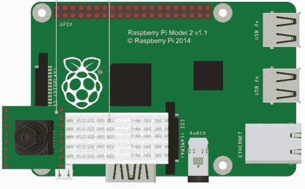
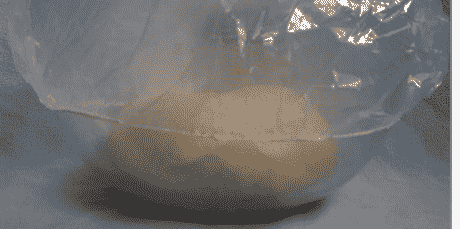
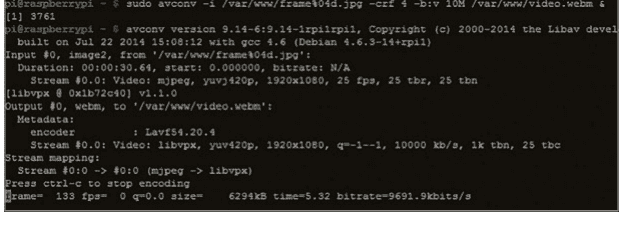
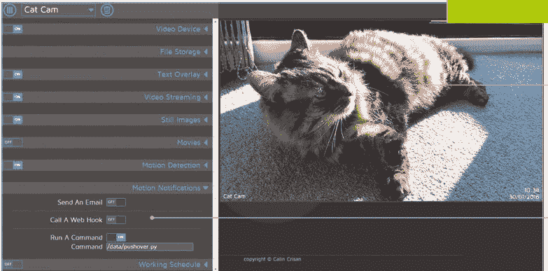
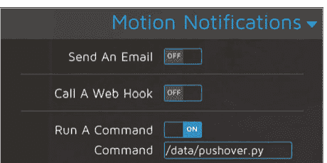
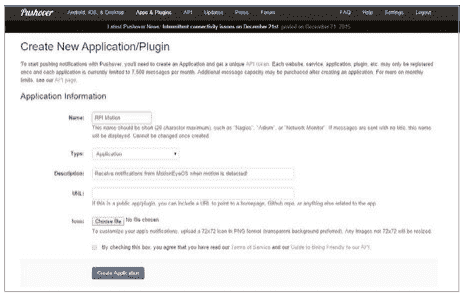
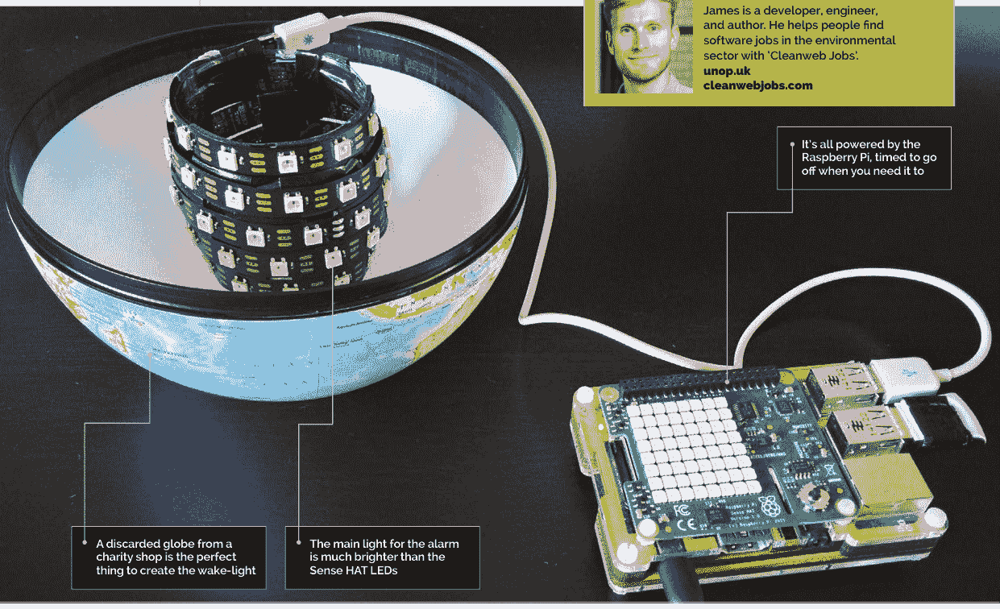

## TIME-LAPSE PHOTOGRAPHY

Photo by NASA JSC

制作一个设备以定期间隔拍摄照片。然后将这些图像合成为视频

### You'll Need
- Raspberry Pi 相机模块
- magpi.cc/1UaFuuW

延时摄影揭示了你 otherwise 看不到的有趣事物。那些发生得太慢以至于我们无法察觉的事情：面包发酵和植物生长；云、太阳、月亮和星星穿越天空；影子在土地上移动。在本教程中，我们将制作一个基于 Raspberry 的设备，让你观察肉眼无法观察到的缓慢事物。为此，我们将拍摄大量静态照片，并使用 FFmpeg/libav 将这些帧合成视频，然后可通过 Web 浏览器访问。

摄像头的顶部位于排线连接的另一端

排线上的金属触点应背向以太网插槽



### >STEP-01

### 连接相机模块

首先，使用附带的排线将相机模块连接到 Raspberry Pi。找到正确的插槽；它位于 Raspberry Pi 电路板的顶部，是离 micro-USB 电源连接器最远的一个。在较新的 Raspberry Pi 型号上，插槽方便地标有“CAMERA”。抬起插槽外部以释放夹具，然后插入排线，使金属触点朝向 micro-USB 电源连接器。最后，将排线保持在位置并将插槽外部推回以夹紧电缆。

### >STEP-02

### 启用并测试相机

为 Raspberry Pi 通电。现在你有选择：启动到命令行、打开终端窗口或建立安全 shell（SSH）连接。通过从终端运行以下命令启动 Raspberry Pi 配置工具来启用相机：

```
sudo raspi-config
```

然后选择“Enable Camera”选项。你可以通过运行以下命令来测试相机：

```
raspistill -o testimage.jpg
```

相机模块上的红色 LED 应亮起 5 秒钟，并且 JPEG 图像将保存到当前目录。如果相机倒置安装，则可以使用垂直和水平翻转命令行开关（-vf 和 -hf）。

### >STEP-03

### 安装和配置软件

安装 Web 服务器以远程访问你的图像。运行以下命令安装 Apache：

```
sudo apt-get install apache2
```

删除默认页面以查看目录内容：

```
sudo rm /var/www/index.html
```

访问你的 Pi 的 IP 地址（例如 http://192.168.1.45 – 你可以使用 ifconfig 找到它），你应该会看到一个空的目录列表。如果你运行以下命令并刷新页面，你应该会看到一个图像文件列出。你以超级用户身份运行此命令，以便可以写入目录。

```
sudo raspistill -o /var/www/testimage.jpg
```

点击文件链接，你将在浏览器中看到图像。

### >STEP-04

### 捕获图像

设置你的场景并检查相机的定位。

```
sudo raspistill -w 1920 -h 1080 -o /var/www/testimageFullHD.jpg
```

宽度和高度已更改为以 16:9 宽高比捕获较小的图像。这使后续操作更简单。顶部和底部会被裁剪，因此请确保你的主体在画面中。运行以下命令开始捕获：

```
sudo raspistill -w 1920 -h 1080 -t 10800000 -tl 10000 -o /var/www/frame%04d.jpg &
```

这每十秒（10,000 毫秒）拍摄一张照片，持续三小时（10,800,000 毫秒）。末尾的与号（&）在后台运行该进程。

Below 面包面团准备发酵。在你的视频中观看它发酵。拍摄期间请注意不要移动碗或相机





Above 在 Raspberry Pi 上运行渲染进程的 Shell。这需要一些时间，因此你可能更喜欢使用更快的机器

### >STEP-05

### 准备制作视频

你可以在 Raspberry Pi 上渲染视频，但会非常慢。更好的方法是将文件传输到更强大的计算机。无论如何，你需要在渲染机器上安装工具；对于 Pi，输入：

```
sudo apt-get install libav-tools
```

这安装了 FFmpeg 的一个分支，但你也可以使用原始的 FFmpeg。要将图像复制到远程机器，你可以使用 wget 或 curl 从 Web 服务器下载它们。例如：

```
wget -r -A jpg http://192.168.1.45
```

Or if you don’t have wget...

```
curl http://192.168.1.45/frame[0001-0766].jpg -O
```

相应地更改 IP 地址和数字。

### >STEP-06

### 制作视频

最后一步是制作视频。运行以下命令开始渲染进程：

```
sudo avconv -i /var/www/frame%04d.jpg -crf 4 -b:v 10M /var/www/video.webm &
```

完成后，你可以在浏览器中查看视频。默认帧率为 25fps。这将以十秒间隔的三小时帧压缩为约四十秒的视频。你可以使用 -framerate 命令行选项调整此设置。比特率（-b）已设置为高，常数速率因子（-crf）设置为低，以生成高质量视频。

### MAKE AN ANIMATED GIF

不要使用视频，使用 ImageMagick 制作动画 GIF。使用较小的图像，并以较少的频率捕获。

sudo convert /var/www/frame*.jpg /var/www/anim.gif &

### OTHER VIDEO FORMATS

WebM 是一种开放的视频格式，可直接在大多数浏览器中显示。然而，其他视频格式也可用。


## WESLEY ARCHER (AKA RASPBERRY COULIS)

自学成才的 Raspberry Pi 爱好者，现为 Pi Supply 的 Maker Zone 编写指南，帮助他人参与小玩意制作的乐趣！
magpi.cc/2dt0UBL
@RaspberryCoulis




抓到了！这就是运动检测时你的摄像头所看到（并记录）的画面

在这里你将告诉 MotionEyeOS 运行你的 Python 脚本

## 为 MotionEyeOS 添加推送通知

### 所需材料
- MotionEyeOS
  magpi.cc/1UCw1Jk
- Raspberry Pi 摄像头模块
- 适用于 iOS 或 Android 的 Pushover 应用，带完整许可（£3.99/$4.99）
  pushover.net

MotionEyeOS 非常适合将你的 Pi 用作 CCTV 摄像头。想在外出时检测移动吗？那就继续阅读吧…

MotionEyeOS 的一个优点是能够检测运动并捕捉触发它的图像和视频。你还可以在线访问摄像头的实时流，即使不在家时也很方便，如果你想偶尔查看一下的话。外出时，被通知任何移动情况非常有用，而 MotionEyeOS 提供了自定义通知的便捷选项。

本指南假设你已经设置并配置了 MotionEyeOS。需要 Pushover 许可，费用为 £3.99/$4.99。如需帮助，请查看此处的 MotionEyeOS wiki：magpi.cc/1UCvYwV。

### STEP-01
在 Pushover 中创建应用程序

Pushover 拥有一个很棒、易于使用的 API。在开始之前，我们需要在其上注册一个应用程序。在 Pushover 网站（pushover.net）上的“Your Applications”标题下点击 Register Application。为你的应用命名——比如 RaspiMotion——然后确保类型为 Application。为你的应用写一个简短的描述（例如“由我的 Raspberry Pi 发送的推送通知”），如果有创意，还可以上传一个自定义图标，该图标会在每次发送通知时显示在你的 Pushover 客户端应用中。

右侧 确保打开“Run A Command”，然后包含你的脚本路径！



### STEP-02
获取你的 API 令牌和用户密钥

创建应用程序后，你应该可以访问 API 令牌/密钥。这是一串唯一的数字和字母组合——请务必保密！你还需要你的用户密钥，登录 Pushover 网站后即可看到。好的，现在你有了应用以及 API 和用户密钥。你现在需要下载（或自行重建）一个简单的 Python 脚本，以便在 MotionEyeOS 调用该脚本时让你的 Raspberry Pi 施展魔法。

### pushover.py
```
import httplib, urllib

conn = httplib.HTTPSConnection("api.pushover.net:443")
conn.request("POST", "/1/messages.json",
    urllib.urlencode({
        "token": "APP_TOKEN",          # Insert app token here
        "user": "USER_TOKEN",         # Insert user token here
        "html": "1",                  # 1 for HTML, 0 to disable
        "title": "Motion Detected!",  # Title of the message
        "message": "<b>Front Door</b> camera!", # Content of the message
        "url": "http://IP.ADD.RE.SS", # Link to be included in message
        "url_title": "View live stream", # Text for the link
        "sound": "siren",             # Define the sound played
    }), { "Content-type": "application/x-www-form-urlencoded" })
conn.getresponse()
```

### STEP-03
创建你的 Python 脚本

MotionEyeOS 不像 Raspbian。你不能像平常那样使用某些命令，例如 git clone，所以我们必须手动创建 Python 脚本；如果你喜欢，也可以使用 WinSCP 进行拖放。我们也不需要使用 sudo，因为默认情况下我们已以 root 身份登录。我们的脚本需要位于 data 文件夹中，所以让我们进入那里并使用 nano 创建 pushover.py：

```
cd /data
nano pushover.py
```

在这里，你需要复制粘贴或输入代码列表，同时在需要的地方填入你的 API 令牌和用户密钥。

### STEP-04
使脚本可执行

与任何脚本一样，我们需要确保它可以被执行，否则它只是一堆花哨的文本！你可以通过命令行或 WinSCP 来完成。从命令行，确保你在 data 文件夹中，然后输入：

```
chmod +x pushover.py
```

或者，如果使用 WinSCP，选择 data 文件夹中的 pushover.py 文件，然后按 F9。在出现的窗口中，将权限更改为 0755，然后点击“OK”确认。



左侧：通过 Pushover.net 创建一个应用以开始。非常简单明了

### STEP-05
配置 MotionEyeOS 使用你的脚本

现在我们有了脚本，需要告诉 MotionEyeOS 在检测到运动时使用它。为此，登录到 Motion Notifications 菜单并打开“Run A Command”选项。然后你需要指定要运行的命令，这将是你刚刚创建的 Python 脚本——即 /data/pushover.py。完成后点击 Apply 以确认更改。

### STEP-06
测试一下！

希望到现在为止，你已经创建了 Python 脚本，使其可执行，告诉 MotionEyeOS 在检测到运动时使用你的脚本，并且已在你的智能手机或平板电脑上安装了 Pushover 应用。我们现在需要测试它是否有效！在摄像头前挥挥手（如果你精力充沛，也可以跳舞！），随后不久你应该会通过 Pushover 收到通知，警告你检测到运动！

随意尝试脚本来自定义 Pushover 中显示的消息和播放的声音。

语言
>PYTHON
下载:
magpi.cc/2oDHpYw

## 教程

## 逐步操作

## JAMES SINGLETON

James 是一名开发者、工程师和作者。他通过‘Cleanweb Jobs’帮助人们在环境领域找到软件工作：unop.uk cleanwebjobs.com



全部由 Raspberry Pi 驱动，定时在你需要时启动

慈善商店里丢弃的地球仪是制作唤醒灯的完美材料

闹钟的主灯比 Sense HAT LED 亮得多

### 所需材料
- Sense HAT
  magpi.cc/1TGGU15
- BlinkyTape LED 灯带（或 NeoPixel / DotStar）
- 一个不需要的地球仪
- 塑料瓶
- 贴纸垫
- Blu-Tack 或腻子
