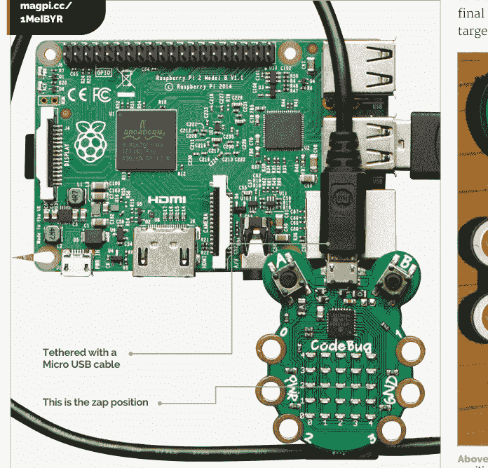
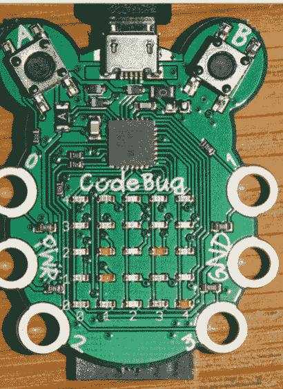
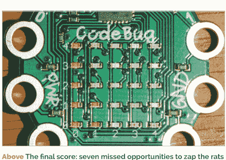

## 使用 Python 3 编程 CodeBug

从 Blocky 编程进阶，并利用 Python 的全部功能控制你的 CodeBug...

所需材料
- CodeBug magpi.cc/1MelyfA
- USB Micro B 数据线（包含在内）
- Python 库：python3-serial & python3-codebug-tether
- CodeBug 脚本：codebug-tether.cbg magpi.cc/1MeiBYR

CodeBug 设置简单，可通过网站上的类似 Scratch 的 Blocky 界面开始编程。一旦你掌握了这一点，你很可能想进入下一阶段，使用像 Python 3 这样更强大的语言来完全掌控。这使你能够包含更复杂的结构，如列表和元组，并使用过程构建更大的项目。你的专家开始思考仅用一个 25 个 LED 的方块和一个开关能做出多好的游戏。这是他的第一次尝试。

### >STEP-01 游戏规则

我们需要一个简单的游戏，在目标处于特定位置时按下按钮。在 1970 年代末，你的专家在教授 Commodore PET 或 Ohio Scientific Basic 时，曾把‘Zap the Rat’游戏作为家庭作业布置。你需要在移动的‘老鼠’目标经过电路上的某个‘击打点’时点击按钮。在这个版本中，每次成功击中老鼠速度就会加快，你需要在最少的尝试次数内击中三只老鼠。最好在游戏运行期间显示击中次数，并给出最终得分以显示错过目标的次数。所有这些能装进 5×5 的 LED 显示屏吗？



通过 Micro USB 数据线连接

这是击打位置



上图显示老鼠在 (4,0)，击打位置标记，以及击中计数为两次击中


TONY GOODHEW
自 1967 年起教授编程（IBM 1130 使用 FORTRAN IV）。BBC Micro 教师培训师，现使用 Raspberry Pi 和 Arduino。



上图 最终得分：错失击打老鼠的机会七次

### >STEP-02 规划显示

电路将是所有外边缘 LED，老鼠从左下角开始运行：(0,0)。击打单元将在 (4,2)，(3,2) 处有一个永久点亮的 LED 来标记它。击中次数可以用从 (1,1) 到 (1,3) 上升的点亮 LED 列来表示。按钮‘B’将用于击打老鼠。最终得分可以用字符‘O’来显示，表示没有错过的击打机会——相当难以实现——或用点亮的 LED（0 –25）表示每次失误。要算作‘击中’，必须在击打位置 LED 点亮时按下按钮；一直按住按钮是无效的。

### >STEP-03 设置 CodeBug

要以有线模式运行 CodeBug，你需要下载并安装一个名为 codebug_tether.cbg 的程序。按正常方式安装后，CodeBug 暂时成为 Raspberry Pi 的从设备，服从从 Python 3 发送的指令。（这有点像使用 Nanpy 从 Pi 控制 Arduino。）

Pi 上还需要安装两个额外的 Python 库，python3-serial 和 python3-codebug-tether。将浏览器指向 magpi.cc/1MeIWdR 并按照 Thomas Macpherson-Pope 的优秀说明操作。

打开 IDLE 3 并输入 Zap_the_rat.py Python 脚本。保存并运行它。

### >STEP-04 待办事项

你可以对脚本进行以下修改和添加：

- 随机化老鼠的起始位置
- 随机化老鼠在电路中运行的方向
- 将零最终得分改进为一个正方形，从位置 (2,2) 向边缘扩张和收缩再返回，共五次作为庆祝。

### Zap_the_rat.py

Language >PYTHON

```python
#### Zap the Rat - Python3 Game for Tethered CodeBug
#### Tony Goodhew - 5 Oct 2015
import codebug_tether
import time
cb = codebug_tether.CodeBug()
cb.clear()

#### Circuit LED co-ordinates - round the edge from bottom-left
LEDx = (0,0,0,0,0,1,2,3,4,4,4,4,4,3,2,1)
LEDy = (0,1,2,3,4,4,4,4,4,3,2,1,0,0,0,0)
for i in range(0,-66,-1):  # Display game title
    cb.write_text(i,0,'Zap the Rat', direction="right")
    time.sleep(0.1)

score = 0            # Rats zapped!
opps = 0             # Zap opportunities
p = 0                # Position of rat on circuit (0-15)
delay = 0.05         # Initial delay between rat moves
old_sw = 0           # Last value of switch B
running = True       # Loop control variable
cb.clear()
cb.set_pixel(3,2,1)  # Show Zap position

while running:
    cb.set_pixel(LEDx[p],LEDy[p],1)  # Show rat
    if p == 10: opps = opps +1       # Incr opps - in (4,2)
    time.sleep(delay - score * 0.007) # Wait - gets faster
    sw = cb.get_input('B')           # Read switch B
    pixel = cb.get_pixel(4,2)        # Rat in Zap position?
    cb.set_pixel(LEDx[p],LEDy[p],0)  # Hide rat
    if old_sw == 0 and sw == 1 and pixel == 1: # Hit?
        score = score +1             # Increment hits
        cb.set_pixel(1,score,1)      # Show hits
        if score == 3:               # Game over?
            running = False          # Stop looping
    p = -1                           # Position of next rat
    old_sw = sw                      # Store switch value
    p = p + 1                        # Update rat position
    if p > 15:                       # Rat pointer out of range?
        p = 0                        # Reset to start position

cb.clear()  # Game over - display opportunities
opps = opps - 3  # Remove successful opportunities
print("Missed Opportunities were ",opps)
if opps > 25:  # Reduce missed opps to 25 max
    opps = 25
if opps == 0:
    cb.write_text(0,0,'O') # Zero missed opps
else:
    for x in range(0,5):  # Display missed opps
        for y in range(0,5):
            if opps > 0:
                cb.set_pixel(x,y,1)
            else:
                cb.set_pixel(x,y,0)
            opps = opps - 1
time.sleep(5)
cb.clear()  # Tidy display
```
