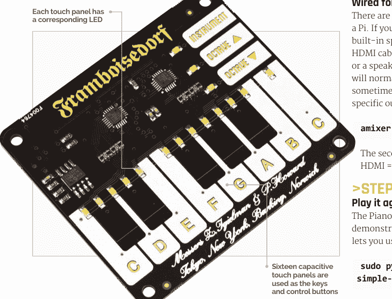
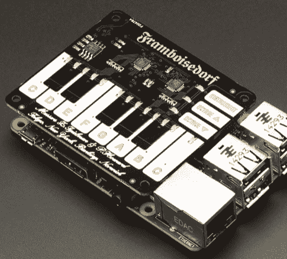
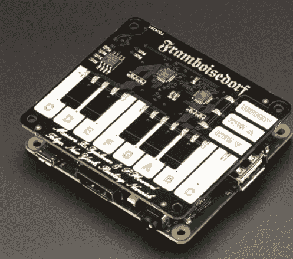
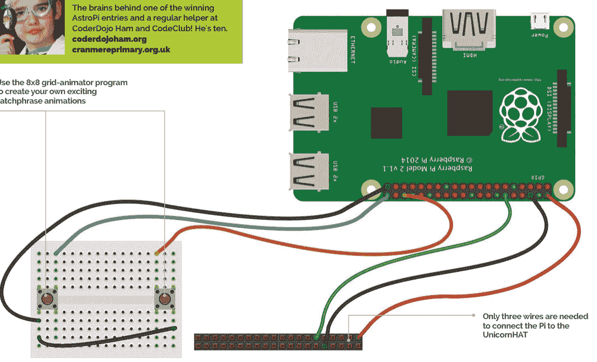
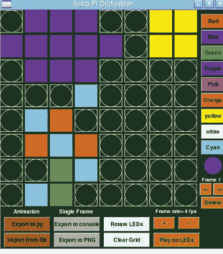
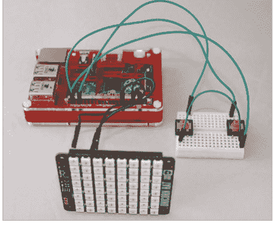

## 用 Piano HAT 演奏

Pimoroni 最新推出的 HAT 是释放你弹奏欲望的绝佳方式。让我们用它来构建一个相对音高测试器

所需材料
- 一个 Piano HAT
  magpi.cc/1OALwNT
- Piano-HAT 库
  magpi.cc/2dXkyIM
- 耳机或外接扬声器

相对音高是指通过与参考音比较来识别给定音乐音符的能力。与绝对音高不同，相对音高可以通过训练得到改善。Piano HAT 是一款多功能硬件，我们可以用它来创建一个有趣的游戏，测试人们识别不同音符的技能。它受到了 Zachary Igielman 传奇的 PiPiano 的启发，并将你的 Pi 变成一个功能性音乐键盘。16 个电容式按键 each 都有一个 LED，因此你可以创建自己的‘学习演奏’教程，或只是为你的表演增添视觉效果。

### >STEP-01 开始使用 Piano HAT

像大多数 HAT 一样，这个使用起来很简单。只需小心地将其插入 Pi 的 GPIO 引脚。然后安装 Piano-HAT Python 库。这需要 Pi 上的 I²C 总线启用，网上有很多说明。但为了让生活更轻松，Pimoroni 的那些海盗提供了一个方便的脚本来处理一切：

```
curl -sSL get.pimoroni.com/pianohat | bash
```

### >STEP-02 有线音频

从 Pi 获取音频输出有两种选择。如果使用带内置扬声器的 HDMI 显示器或电视，音频可以通过 HDMI 电缆播放。如果没有，可以切换到使用插入耳机插孔的耳机或扬声器。Pi 通常会自动检测可用输出，但有时会判断错误。要强制音频使用特定输出，可以使用此命令：

```
amixer cset numid=3 2
```

第二个数字决定输出：HDMI = 2，耳机插孔 = 1，自动 = 0。

### >STEP-03 再来一次

Piano-HAT 库有一组不错的演示 Python 脚本。一个很好的入门脚本让你使用 Piano HAT 作为……钢琴！

```
sudo python Pimoroni/pianohat/simple-piano.py
```



每个触控面板都有对应的 LED

十六个电容触控面板用作琴键和控制按钮


## Relative_Pitch.py

```
import pianohat # import libraries we need
import pygame
import time, random

pygame.mixer.pre_init(44100, -16, 1, 512) #Configure pygame sound
pygame.mixer.init() #Initialise pygame mixer
pygame.mixer.set_num_channels(16)
pianohat.auto_leds(True) # LEDs light when keys pressed
### A dictionary mapping sounds and notes onto keys
NOTES = {'0':['C','./sounds/piano/39172__jobro__piano-ff-025.wav'], # C
'1':['C Sharp','./sounds/piano/39173__jobro__piano-ff-026.wav'], # C sharp
'2':['D','./sounds/piano/39174__jobro__piano-ff-027.wav'], # D
'3':['D Sharp','./sounds/piano/39175__jobro__piano-ff-028.wav'], # D sharp
'4':['E','./sounds/piano/39176__jobro__piano-ff-029.wav'], # E
'5':['F','./sounds/piano/39177__jobro__piano-ff-030.wav'], # F
'6':['F Sharp','./sounds/piano/39178__jobro__piano-ff-031.wav'], # F sharp
'7':['G','./sounds/piano/39179__jobro__piano-ff-032.wav'], # G
'8':['G Sharp','./sounds/piano/39180__jobro__piano-ff-033.wav'], # G sharp
'9':['A','./sounds/piano/39181__jobro__piano-ff-034.wav'], # A
'10':['A Sharp','./sounds/piano/39182__jobro__piano-ff-035.wav'], # A sharp
'11':['B','./sounds/piano/39183__jobro__piano-ff-036.wav'], # B
'12':['C','./sounds/piano/39184__jobro__piano-ff-037.wav'] # C
}

def handle_note(channel, pressed): # handler for key presses
    global note
    global correct
    if channel < 13 and pressed: # Only for note keys
        if str(channel) == note: # Did the player get it right?
            print('correct, it was a ' + str(NOTES[note][0]) )
            pianohat.auto_leds(False)
            for x in range(16): # Flash all the lights to celebrate
                pianohat.set_led(x, True)
            time.sleep(0.05)
            for x in range(16): # Then turn them off
                pianohat.set_led(x,False)
            pianohat.auto_leds(True)
            correct = True
        else:
            print('wrong, try again')

def play(note): # Play a note from the dictionary
    pygame.mixer.Sound(NOTES[note][1]).play(loops=0)
    time.sleep(1)

pianohat.on_note(handle_note) # Set keys to use our handler

while True:
    print('Here comes a C')
    time.sleep(1)
    play('0') # Play a C
    time.sleep(2)
    correct = False
    print('Now identify this note')
    time.sleep(2)
    note = random.choice(list(NOTES)) # Pick a random note
    play(note)
    print('press the key for the note you heard')
    count = 6 # Set countdown timer
    while count > 0 and correct == False:
        time.sleep(1)
        print(str(count) + ' Seconds remaining')
        count -=1
    if not correct: # If they didn't get it right, tell them the answer
        print("time's up, it was a " + str(NOTES[note][0]))
```

如果你按下乐器键，你会注意到声音从钢琴变成了打击乐。Piano-HAT 库本身不会将任何键映射到特定声音；所有这些都是使用 Python 完成的。声音本身是 WAV 文件，使用 Pygame 库播放。

让我们将自己的声音映射到 Piano HAT 的其中一个键上。 在网上找一个简短的 WAV 文件（或使用 Sonic Pi 创建自己的），并将其保存为 mysound.wav。 然后输入 Listing_l1.py（第 52 页）中的代码并运行它：按下 D 键时应该会播放你的声音。

## >STEP-04

## A little light music

你会注意到按下任何键时相关的 LED 灯都会亮起。这是默认行为，但可以使用以下方法禁用：

```
pianohat.auto_leds(False)
```

在 Listing_l1.py 中立即在 handle_note 函数之前添加这一行。现在我们可以添加代码，使只有 D 键的 LED 会工作。插入

```
pianohat.set_led(2,True)
```

...在 pygame.mixer.Sound 行之前，以及

```
pianohat.set_led(2,False)
```

...在它之后。现在重新运行程序以验证只有在敲击时 D 才会亮起。

## >STEP-05

## Use a dictionary

使用一堆 if... 语句将键映射到声音很容易，但相当冗长。对于我们的相对音高测试，我们希望将键（一个整数）与音符（一个文本字符串）和声音关联起来





要播放的声音（也是一个字符串）。一个简单的方法是使用 Python 构造的字典。现实世界的字典有单词索引，每个单词都有定义。在 Python 字典中，单词称为‘key’，而定义则是‘values’。Listing_l2.py 使用一个简单的两项字典将声音和名称（值）映射到 C 和 D 键（键）上。试试看。

## >STEP-06

## Putting it all together

我们现在已经探索了相对音高测试所需的一切：我们将使用 Piano-HAT 库附带的钢琴声音作为音符。输入 Relative_Pitch.py 清单（第 51 页）中的代码并使用 sudo 运行它。参考

## Listing_l1.py

```
import pianohat
import pygame
import signal

pygame.mixer.pre_init(44100, -16, 1, 512)
pygame.mixer.init()
pygame.mixer.set_num_channels(16)

def handle_note(channel, pressed):
    if channel == 2:
        pygame.mixer.Sound('./mysound.wav').play(loops=0)

pianohat.on_note(handle_note)
signal.pause()
```

> 在 Python 字典中，单词称为‘key’，而定义则是‘values’

播放一个音符（一个 C）后，经过短暂暂停，会播放需要识别的音符。玩家然后有 6 秒时间按下他们刚刚听到的音符的正确键。如果他们答对了，所有 LED 都会闪烁庆祝，否则会被要求再试一次。作为扩展，如何使用不同的、可选的乐器呢？

## Listing_l2.py

```
import pianohat
import pygame
import signal

pygame.mixer.pre_init(44100, -16, 1, 512)
pygame.mixer.init()
pygame.mixer.set_num_channels(16)
NOTES = {0:['Sound1', './mysound.wav'],
         2: ['Sound2', './mysound2.wav']}

def handle_note(channel, pressed):
    if channel == 0 or channel == 2:
        pygame.mixer.Sound(NOTES[channel][1]).play(loops=0)

pianohat.on_note(handle_note)
signal.pause()
```

## Tutorial

JASPER HAYLER-GOODALL
是 AstroPi 获奖作品之一的大脑，也是 CoderDojo Ham 和 CodeClub 的常客！他十岁。
coderdojoham.org
cranmereprimary.org.uk

使用 8x8 网格动画程序创建你自己的精彩口号动画

只需三根线即可将 Pi 连接到 UnicornHAT



## You'll Need

-   Unicorn 或 Sense HAT 购买处。 pimoroni.com
-   一个高 40 针排针（用于 Sense HAT） shop.pimoroni.com
-   一些跳线、两个按钮和一个面包板
-   8x8 网格动画程序 magpi.cc/2dXmlbn
-   Fuzzy Wuzzy 库 magpi.cc/2dXlOvH

## PHRASE!

制作你自己的流行电视节目 Catchphrase 的版本。你只需要几个组件和一个 LED 矩阵，在这里是 Unicorn HAT...

Catchphrase 是一档电视游戏节目，参赛者试图猜出在大屏幕上可视化的知名短语或谚语。在这个项目中，你将制作一个类似的游戏，使用 Sense HAT 或 Unicorn HAT 来显示动画。我们主要为 Unicorn HAT 编写了这个项目，但稍作修改后也可以与 Sense HAT 一起使用。为了使游戏成为双人游戏，我们添加了一些按钮来查看谁最快猜出口号。

如果你有 Sense HAT，请取下已附带的排针并换上一个高的排针。这应该会在 Sense HAT 顶部留下一些引脚伸出，足以连接电线。

## >STEP-01
Put your hat on

稍后我们将连接一个面包板来使用一些按钮，因此我们需要访问 Pi 的 GPIO 引脚。因此你不应该直接将 Unicorn HAT 放置在 GPIO 引脚上；相反，使用跳线连接它。令人惊讶的是，Unicorn HAT 只使用三根引脚（5V、GND 和 GPIO 18），所以这些是我们需要关心的唯一引脚。

## >STEP-02

## Download the animator program and get creating

当你下载 8x8 网格动画程序时，请确保使用适合你的 HAT 的版本。如果你有 Unicorn HAT，请使用以下命令：

```
sudo python 8x8grid-unicorn.py
```

要创建动画，只需从右侧调色板中选择一种颜色，然后点击网格上的一个圆圈将该颜色打开。通过按 >> 按钮添加另一个帧；这将复制当前帧。如果需要清除帧，请按‘clear frame’按钮。你也可以在 上播放你的动画


## Maingame-Uni.py

```
import unicornhat as uh #import the necessary modules
import time, random,signal
import catchphrases_uni as cp # the file with our animations
import RPi.GPIO as GPIO
from fuzzywuzzy import fuzz

def halfthing(num,colour): #turns on half the LEDS to indicate who pressed button first
    uh.clear()
    for x in range (num,num+4):
        for y in range(0,8):
            uh.set_pixel(x,y,colour[0],colour[1],colour[2])
    uh.show()

def pressed(num): # Function to be run when buttons pressed
    global running
    running = False # stops animation from playing
    halfthing(num,(255,0,0))
```

```
get_answer(3) # call with goes set to 3

def b21pressed(channel): # Run when button on GPIO 21 pressed
    pressed(0)

def b16pressed(channel): # Run when button on GPIO 16 pressed
    pressed(4)

def get_answer(goes): # Asks the player for their answer
    answer = raw_input('Name that catchphrase? ')
    match = fuzz.ratio(answer, picked) # compare answer to catchphrase title
    if match >=85:
        print 'Correct!'
    elif match >= 60 and match < 85: # if it nearly matches
        goes=goes-1
        if goes==0:
            print('run out of goes')
```

LED 灯和删除帧。当你对动画满意时，点击‘export to py’，它将被保存为 animation8x8.py。

### >STEP-03
调整动画

然后你需要使用命令行重命名文件（为你自己选择的名称）：

```
mv animation8x8.py yourchoice.py
```



右图 使用 8x8 网格动画程序创建你自己的精彩口号动画

然后你应该重复步骤 02，直到你至少有三个动画。确保在每次导出后重命名它们。

现在我们需要将动画复制到口号代码中。首先，在 IDLE 中打开 yourchoice.py（或你命名的文件），然后找到带有 frames=[ 的行。一直高亮到最后的 ]，然后将其复制并粘贴到名为 catchphrases.py 的新文件中。对其余动画重复相同操作并将它们粘贴到同一文件中。最后，你需要使用 Python 字典和列表将动画与其名称关联起来；一个示例 catchphrases.py 已包含在此项目的 GitHub 仓库中。

### >STEP-04
连接并测试按钮

要将按钮连接到树莓派，你需要三根跳线、一块面包板和两个按钮。要制作电路，请遵循第 55 页的图像；要测试按钮，请使用 listing1.py 代码。如果使用 Sense HAT，请确保使用相同的 GPIO 引脚（16 和 21）。

### >STEP-05
Fuzzywuzzy 匹配

模糊匹配是关于找出一个字符串与另一个字符串有多接近。打开一个 Python shell（使用命令行或 IDLE），然后导入 fuzzywuzzy 库。

```
>>>from fuzzywuzzy import fuzz
```

```
else:
    print 'Close.. Try again (' + ( str(goes) + ' guesses remaining)'
    get_answer(goes)
else:
    print "That's not right"
print 'Press ^C to exit'

def show_catchphrase():  # Display an animation on the LED matrix
    picked = random.choice(cp.ANSWERS.keys()) # Pick random animation from file
    for i in range(3):
        for x in cp.ANSWERS[picked]:
            if running:
                uh.set_pixels(x) # display a frame from animation
                uh.show()
                time.sleep(0.25) #pause before next frame
    time.sleep(1) # pause before we play animation again
```

```
return picked

GPIO.setmode(GPIO.BCM) #set GPIO numbering to BCM
GPIO.setup(21,GPIO.IN, pull_up_down=GPIO.PUD_UP) #Set these pins as inputs
GPIO.setup(16,GPIO.IN, pull_up_down=GPIO.PUD_UP)
#set callback functions that are run when button pressed
GPIO.add_event_detect(21,GPIO.FALLING,callback = b21pressed,bouncetime=300)
GPIO.add_event_detect(16,GPIO.FALLING,callback = b16pressed,bouncetime=300)
try:
    running = True # use this to stop animation when button pressed
    picked = 'blank'
    picked = show_catchphrase()
    signal.pause() #stops the code from exiting
except KeyboardInterrupt:  # catch ^c
    exit() #exit the code
```

Fuzzywuzzy 会为两个短语的接近程度给出 100 分制的分数。

```
>>>fuzz.ratio('hello world','catchphrase')
18
>>>fuzz.ratio('piphra...','pyphase')
80
```

我们可以用它来检查玩家的答案与我们的口号有多接近（因为我们不想太苛刻！）。

### >STEP-06

## 最终代码

现在我们需要把学到的所有内容结合起来创建口号游戏。将主列表（上方）中的代码输入到名为 piphra...py 的文件中，然后使用以下命令运行它：

```
sudo python piphra...py
```

程序应该在等待有人按下任一按钮的同时在 Unicorn HAT 上播放三次动画。当玩家按下其中一个按钮时，他们一侧的 Unicorn HAT 会亮起。然后他们需要输入他们认为正在显示的口号。程序随后会告诉他们答案是否正确或不正确。如果玩家的答案根据模糊匹配在 60 到 80 之间，他们也可能会看到“再试一次”的消息。



左图 此项目可与 Sense HAT 或 Unicorn HAT 一起使用。如果使用 Unicorn HAT，应像这样连接

## Listing1.py

```
import RPi.GPIO as GPIO #import the necessary modules
import time

GPIO.setmode(GPIO.BCM)  #set GPIO numbering to BCM
GPIO.setup(16,GPIO.IN, pull_up_down=GPIO.PUD_UP)
GPIO.setup(21,GPIO.IN, pull_up_down=GPIO.PUD_UP)

while True:
    print('b1= '+str(GPIO.input(16))+ ' b2= '+str(GPIO.input(21)))
    time.sleep(0.1)
```
