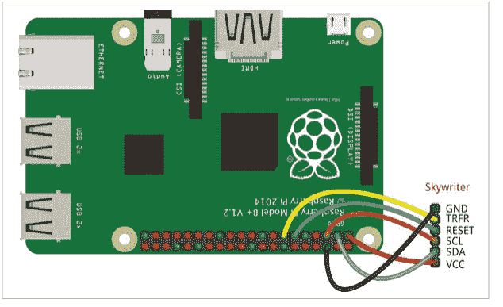

## 使用 Skywriter 进行魔术演示

使用 Skywriter HAT 用令人费解的魔术力量或原力的掌控让你的观众惊叹

## RICHARD HAYLER

Richard 是 CoderDojo Ham 的导师。他的学校 CodeClub 是 Primary School Astro Pi 竞赛的获胜团队之一。magpi.cc/1ILmeoi coderdojoham.org


## 你需要

- Skywriter HAT 或板子商店。pimoroni.com
- Skywriter API 库 magpi.cc/2dXntBn
- Python AutoPy 库 magpi.cc/2dXmbpZ
- LibreOffice Impress libreoffice.org

下方 如果需要，你可以使用更长的线或排线将 Skywriter 板远离 Pi

说实话：仅仅使用树莓派来运行你的演讲幻灯片就会让观众觉得你很酷。但如果这还不够令人印象深刻，为什么不进一步用你的意念移动能力翻阅演示文稿并通过在空中绘画来注释幻灯片呢？你甚至不需要是霍格沃茨或绝地学院的毕业生：只要拥有一台 Skywriter 设备和一些简单的 Python，你就可以开始了。Skywriter 设备使用一排发射电极生成在三维空间中传播的电场。当你将手移动到 Skywriter 上方时，它会扰乱该场，这些变化会被接收电极网格检测到。这些测量值可用于计算你的手的位置和移动方向。

### >STEP-01
连接 Skywriter 设备

如果你有 Skywriter HAT，它就像其他 HAT 一样直接连接到 GPIO 引脚上。如果你有更大的 Skywriter 板，你需要将六个 GPIO 引脚连接到顶部的对应引脚上，如下图所示。



### >STEP-02
安装软件

确保你拥有最新版本的 Raspbian，并安装了所有更新。像往常一样，那些乐于助人的 Pimoroni 海盗提供了一个单一脚本来处理安装，包括完整的 Python API。像大多数 HAT 一样，Skywriter 需要 Pi 上的 I²C 总线启用，所以如果你尚未在 Pi 上激活它，你需要在 Skywriter 工作前重新启动。

```
curl -sSL get.pimoroni.com/skywriter | bash
```

你还需要 AutoPy Python 库及其依赖项，因此使用以下命令安装这些：

```
sudo apt-get install libx11-dev libxtst-dev
```

...然后：

```
sudo pip install autopy
```

### >STEP-03
测试你的 Skywriter

Python API 提供了示例脚本来帮助你熟悉 Skywriter 的工作原理：

```
cd Pimoroni/skywriter
sudo python test.py
```

现在在 Skywriter 上方轻轻挥动手臂。你应该会看到三列滚动数字，对应于设备上方三轴（x/y/z）盒子中手的位置。Python 库预先配置为识别某些手势：轻扫（在 Skywriter 上滑动）、轻触或触摸（将手降至表面上方一点），以及最棘手的 Airwheel（在 Skywriter 上方以圆形模式摆动手指）。需要一段时间才能掌握

为了让这些手势始终被检测到，请花一些时间练习。你可以编辑 test.py 脚本并注释掉 @skywriter.move() 函数（它会显示 x/y/z 数字），以便更容易看到你是否掌握了其中一个手势。

## >STEP-04
### 配置你的演示软件

现在是准备你的演示软件的时候了。LibreOffice Impress 与 Microsoft PowerPoint 非常相似，在 Raspberry Pi 上运行良好。如果不需要 LibreOffice 套件中的其他应用程序，你只需使用以下命令安装 Impress 和核心组件：

```
sudo apt-get install libreoffice-impress
```

你将使用 Python 代码通过 Skywriter 检测手势并生成键盘敲击来以正常方式控制 Impress。唯一额外的配置是激活允许你用鼠标在幻灯片上绘图的功能。这可以通过选择 Slide Show>Slide Show Settings 并勾选 ‘Mouse pointer as pen’ 复选框来完成。

## >STEP-05
### 使用代码

键入右侧列表中的代码并将其保存为 magic_control.py。你可以使用 IDLE 或你选择的任何其他文本编辑器来完成此操作。启动 LibreOffice Impress 并打开你的演示文稿。然后最小化 Impress 并通过 Idle 或通过命令行运行你的代码：

```
sudo python magic_control.py
```

现在切换回 Impress 并准备开始你的演讲或演示。

## >STEP-06
### 惊艳你的观众

通过在 Skywriter 上向上滑动开始幻灯片放映。你可以通过左右滑动（向前）或右向左滑动（向后）在幻灯片之间导航。要结束演示，请在 Skywriter 上向下滑动。

要注释幻灯片，你需要激活绘图功能。使用 tap/touch 来完成此操作：现在你将用手部动作控制鼠标，在屏幕上留下痕迹，就像用笔绘画一样。这需要练习，所以请确保你提前花了一些时间准备！绘图完成后，再次 tap/touch 以解除笔功能。

我们都知道，在现场表演的压力下，事情可能会出错。如果你想快速禁用 Skywriter 对演示的控制，请使用双击退出 Python 程序。

## Magic_Control.py

语言
>PYTHON
下载:
magpi.cc/
2dXnBko

```python
#!/usr/bin/env python
import skywriter
import signal
import autopy
import sys

mouse_down = False
#work out how big the screen we're using is.
width, height = autopy.screen.get_size()

@skywriter.move()
def move(x, y, z):
    #print( x, y, z )
    global mouse_down
    if mouse_down: # Only run if we're in drawing mode
        x = (x) * width
        y = (y) * height
        # scale to screen size
        x = int(x)
        y = height - int(y)

        if( y > 799 ):
            y = 799

        autopy.mouse.move(x, y)
        #print( int(x), int(y) )

@skywriter.flick()
def flick(start, finish):
    print('Got a flick!', start, finish)
    if start == "east":  # Back through Impress slides
        autopy.key.tap(autopy.key.K_LEFT)
    if start == "west":  # Forward through Impress slides
        autopy.key.tap(autopy.key.K_RIGHT)
    if start == "north": # Start slideshow
        autopy.key.tap(autopy.key.K_F5)
    if start == "south": # Quit slideshow
        autopy.key.tap(autopy.key.K_ESCAPE)

@skywriter.double_tap()
def doubletap(position):
    print('Double tap!', position)
    sys.exit()  # Emergency stop

@skywriter.tap()
def tap(position):
    global mouse_down
    print('Tap!', position)
    if mouse_down:  # Toggle mouse up/down
        autopy.mouse.toggle(False)
        mouse_down = False
    else:
        autopy.mouse.toggle(True)
        mouse_down = True

#@skywriter.touch()
#def touch(position):
###  print('Touch!', position)

signal.pause()
```
