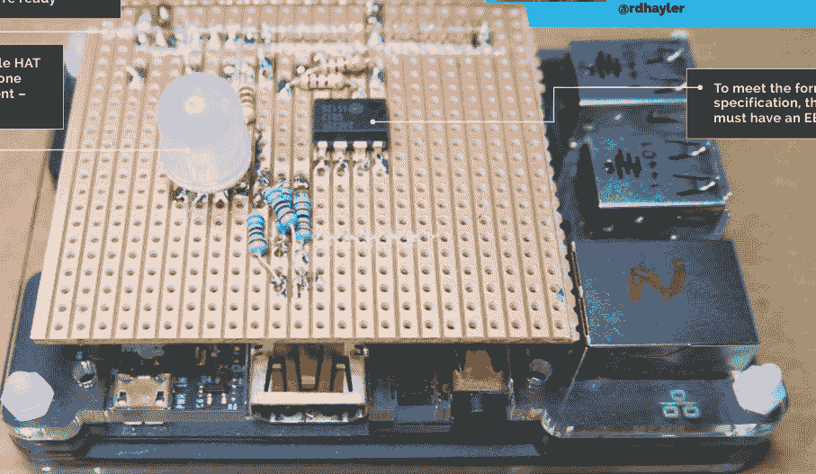
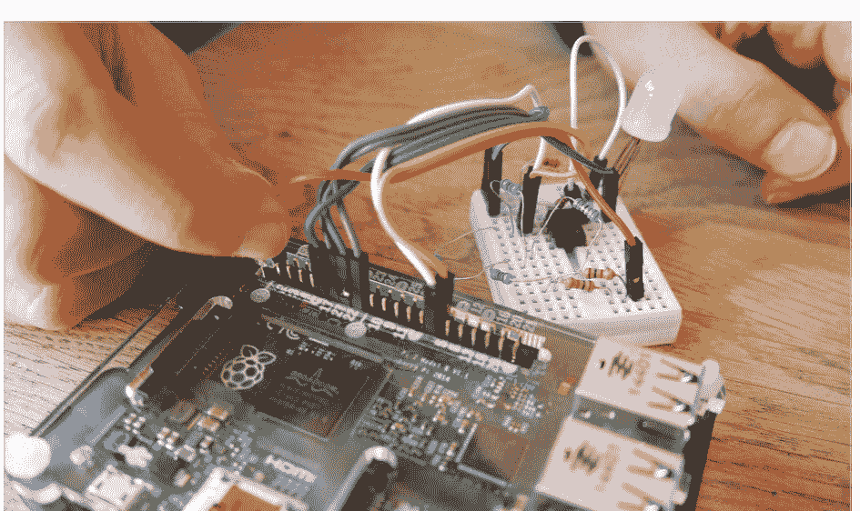
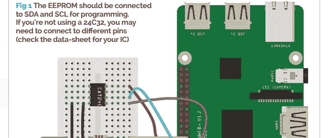
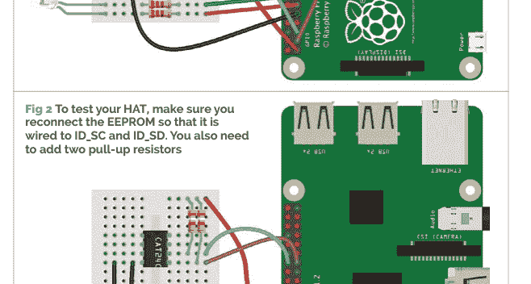
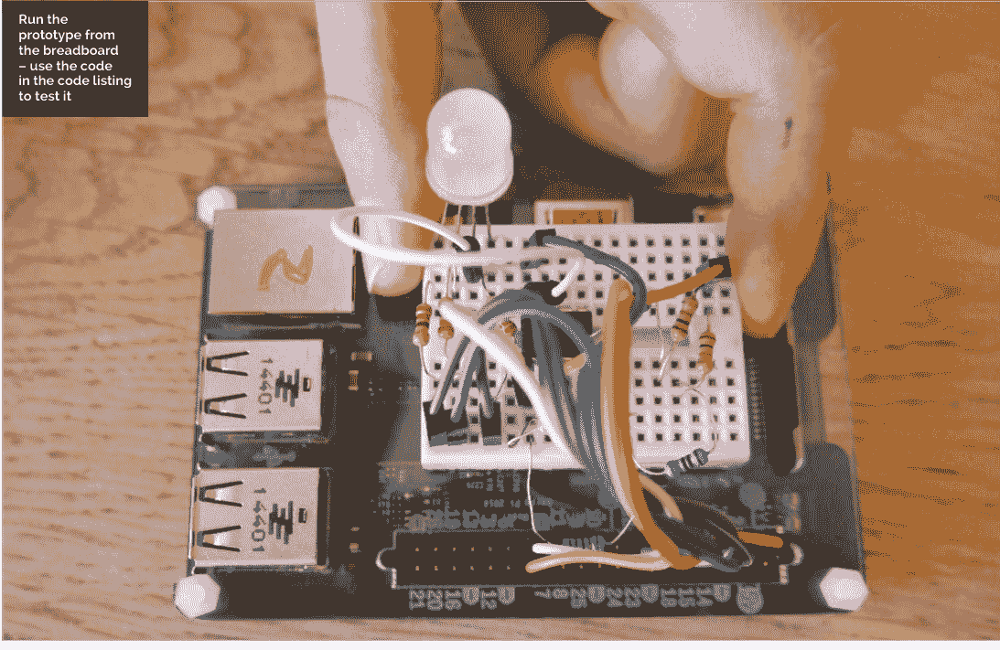
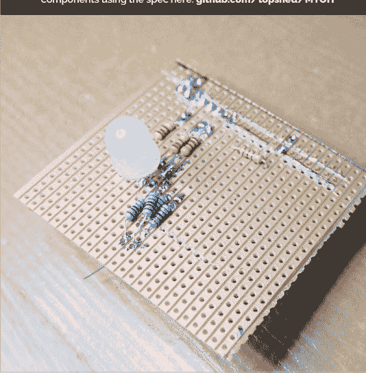
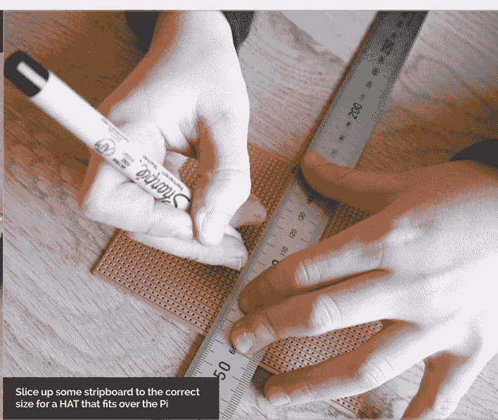
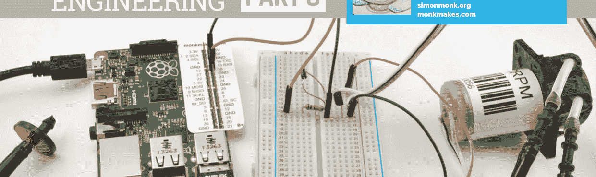

## 自制你的 Pi HAT

有一些很棒的 HAT 可用于增强你的 Pi 的硬件功能。是否曾想过如何设计和构建一个原型 HAT？本教程将向你展示如何入门

### 你需要

- 一个 EEPROM（推荐使用 CAT24C32）
  magpi.cc/1RwAaQP
- 一个面包板和一些跳线
  magpi.cc/1RwAdMt
- 一些 LED
  magpi.cc/1RwAiQi
- Pi HAT 规范仓库
  magpi.cc/10AHAgK

RICHARD HAYLER
Richard 是 CoderDojo Ham 的导师，他的学校 CodeClub 是 Primary Astro Pi 竞赛的获胜队伍之一，他们的代码现在在国际空间站上。
magpi.cc/41Lmeoi
@rdhayler



一旦准备就绪，就将所有组件焊接到原型 PCB 板上

我们的简单 HAT 只有一个组件——一个 LED

为了符合正式的 HAT 规范，板上必须有一个 EEPROM

HAT 最早于 2014 年 Raspberry Pi Model B+ 发布时出现。从那时起，出现了一些令人惊叹和美妙的 HAT，其中许多已在《The MagPi》的往期中出现：Unicorn HAT、Piano HAT、Sense HAT 和 Explorer HAT。官方上，HAT 代表 ‘Hardware Attached on Top,’ 尽管你的专家怀疑这个缩写是在名字之后才出现的。你还能怎样称呼一块放在 Pi 顶部的扩展板呢？虽然你可以制造和销售不符合 HAT 标准的板子，但这样做有很多优点。具有相同的物理尺寸使得确保你的板子能够

与大多数 Pi 外壳兼容，并且包含 EEPROM 允许操作系统在启动时识别 HAT 并设置任何所需的硬件。这些说明适用于最新版本的 Raspbian（Jessie）或旧的 Wheezy。如往常一样，开始前运行 sudo apt-get update 和 sudo apt-get upgrade。然后使用以下命令启用内核对 I²C 的支持：

```
sudo raspi-config
```

选择 ‘Advanced Options’，然后向下点按并选择 ‘A7 I2C’。确保两个问题的答案都高亮显示为 ‘Yes’。或者，如果你使用的是 Jessie，也可以通过 GUI 中的 Raspberry Pi 配置工具进行设置。

然后系统会提示你重新启动。Pi 重启后，使用以下命令安装 I²C 工具包：

```
sudo apt-get install i2c-tools
```

现在是时候在面包板上构建你的 EEPROM 电路了。按照图 1 所示组装电路。如果你没有使用 24C32，可能需要连接到 SDA 和 SCL 的不同引脚。检查你的 IC 的数据表以确保正确连接。你还需要为 HAT 提供一些功能：为了保持简单，图 1 的电路只包含一个三色 RGB LED，但你可以根据想要 HAT 实现的功能使用任何你想要的组件。

为 Pi 上电。你可能会注意到 LED 已经亮了（也许只是微弱地）。这是因为 Pi 不知道连接了什么，因此 GPIO 输出处于 ‘floating’ 状态。我们的 HAT 将通过预配置它使用的引脚来处理这个问题。下一页的代码片段（myoh-rgb.py）提供了与 LED 交互的简单 Python 代码；你需要安装出色的 gpiozero 库才能使用它。

接下来，检查第二个 I²C 总线上检测到了哪些 I²C 设备：

```
i2cdetect -y 1
```



### 什么是 EEPROM？

EEPROM 代表 'Electrically Erasable Programmable Read-Only Memory' 并且是一种用于电子设备中存储少量数据的芯片。

左侧 先在面包板或 Explorer HAT 上构建电路以确保其工作正常，以便你可以进行更改

图 1 EEPROM 应连接到 SDA 和 SCL 以进行编程。如果你没有使用 24C32，可能需要连接到不同的引脚（检查你的 IC 的数据表）



图 2 为了测试你的 HAT，请确保重新连接 EEPROM，使其连接到 ID_SC 和 ID_SD。你还需要添加两个上拉电阻




## 教程
## 逐步操作
## 静态警告！

EEPROM 很容易被静电损坏，所以在处理它们之前请尽量使自己接地。理想情况下，佩戴防静电腕带，或者至少把那件尼龙毛衣留在衣柜里。

你应该会看到一个显示 I²C 总线上发现设备的表格。假设你没有连接其他东西，除了一个之外，其余条目都应为空，用两个破折号表示：- -。通常，你的 EEPROM 应该在最左侧的列（0）中显示为数字 50，位于水平轴上的 50 旁边。如果看不到此内容或命令返回错误（‘No such file or directory’），请尝试另一个总线：

```
i2cdetect -y 0
```

如果你的 EEPROM 仍然没有显示，请检查你的连接以及是否已启用 I²C 支持。现在你需要一些软件。从 GitHub 克隆 HATs 参考资料和工具（magpi.cc/10AHAgK）。阅读这份文档非常值得，因为它详细解释了 HAT 规范背后的思路。你还将使用便捷的 EEPROM 工具来刷新你的芯片。首先，编译 eepmake 工具：

```
cd hats/eepromutils
make
```

然后修改 eepflash 脚本，该脚本假设 EEPROM 在第一个 I²C 总线上；如果你的也是，则可以明显跳过此步骤。复制 eepflash.sh 然后用你喜欢的文本编辑器修改：

```
cp eepflash.sh eepflash1.sh
nano eepflash1.sh
```

将所有 i2c-0 的提及更改为 i2c-1，并将 i2c-0/0-0050 更改为 i2c-1/1-0050，然后保存文件。现在你需要用自己的设置修改提供的模板。在你喜欢的编辑器中打开 eeprom_settings.txt 文件并修改各个字段。大多数都是自解释的，你可以在规范中阅读有关每个字段的更多信息。然而，UUID 特别重要，必须符合 RFC 4122，以便每个 HAT 都能唯一标识，因此可以用作每块板的序列号。它还允许 HAT 堆叠。完成之后，你需要将可读的文本文件转换为可写入 EEPROM 的二进制数据。

```
./eepmake eeprom_settings.txt eeptest.eep
```

然后将此数据转储到 EEPROM —— 这是实际的刷新操作，你会看到一个警告询问你是否确定要继续：

```
./eepflash1.sh -w -f=eeptest.eep -t=24c32
```

确保使用我们之前修改过的脚本版本。如果使用不同类型的 EEPROM，请相应更改 -t 参数。

从面包板运行原型 —— 使用代码列表中的代码进行测试





更高级的一步。使用这里的规范焊接 GPIO 排针和其余组件：github.com/topshed/MYOH



将一些洞洞板切到适合覆盖 Pi 的 HAT 的正确尺寸

## myoh-rgb.py

```
from gpiozero import RGBLED
from time import sleep

led = RGBLED(22,27,17)

led.on()
sleep(0.5)
led.off()
led.red = 1
sleep(0.5)
led.red =0
led.green=1
sleep(0.5)
led.green = 0
led.blue = 1
sleep(0.5)
led.blue=0
```

语言
>PYTHON 3
下载：
magpi.cc/1RwC040

要测试你的新作品，你需要修改电路，使 EEPROM 以 HAT 的一部分的方式连接到 Pi。GPIO 引脚 27 和 28 保留用于 HAT 检测，所以再次断电你的 Pi 并按图 2 所示移动相应的导线。然后添加 3.9kΩ 上拉电阻，以确保引脚不会‘浮空’。

现在重新连接到你的 Pi 并让它启动。如果一切正常，/proc/device-tree/hat 目录应存在，其文件的內容应与默认 eeprom_settings.txt 文件中的详细信息相匹配。你还应看到 RGB LED 使用的 GPIO 引脚现在已被预设，因此它根本不应该亮。

恭喜！你现在已经编程了一个 EEPROM，Pi 识别其符合 HAT 规范。

作为最终测试，运行 myoh-rgb.py 代码并检查 RGB LED 是否按颜色序列闪烁。显然，这是一个非常基础的 HAT；利用 Pi 预加载必要驱动程序的能力，有很多可能性可以轻松支持更复杂的硬件。Sense HAT 是这种技术的绝佳示例。

现在你已经制作了一个简单的 HAT 并掌握了流程，看看你还能创建哪些其他惊人的附加组件！

如果你想完全遵循整个 HAT 设计流程，现在你可以选择从面包板过渡到真正的电路板。Raspberry Pi 基金会的规范还设定了电路板的物理属性，直至圆角的半径和摄像头及显示器电缆插槽的包含。对于原型制作，你可能不必太担心这一点；本教程的 GitHub 仓库中提供了一个简单的洞洞板设计，并在主图像中显示。如果想更进一步，精彩的 Fritzing CAD 软件内置了 PCB 模板，可帮助你制作适合制造的最终设计。

> 看看你还能创建哪些其他惊人的附加组件！

## 教程
## 逐步操作
## 日常工程
## 第 8 部分
## 西蒙·蒙克

Simon Monk 是《Raspberry Pi Cookbook》和《Programming the Raspberry Pi: Getting Started with Python》等书籍的作者。
simonmonk.org
monkmakes.com



## 基于网络的