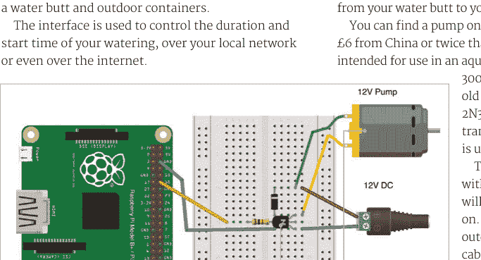
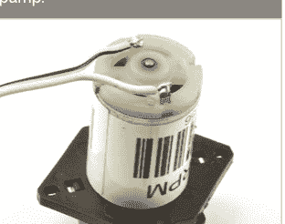
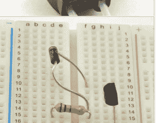
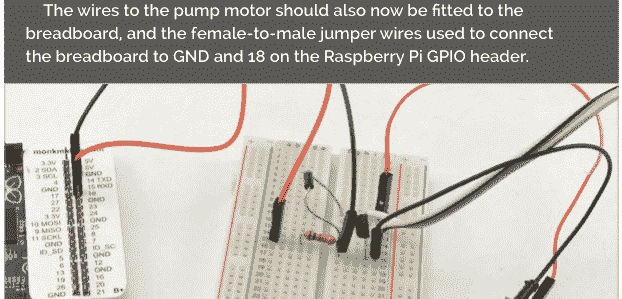
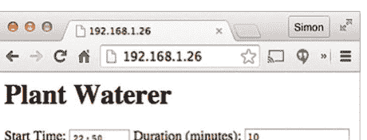
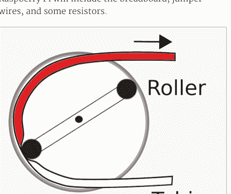
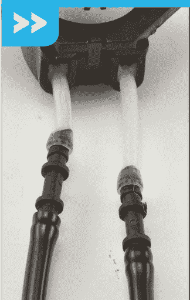
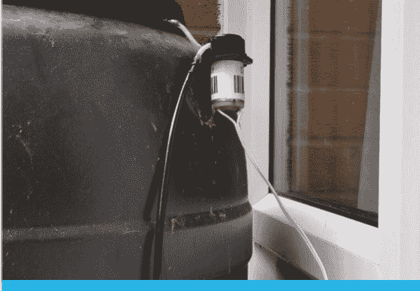
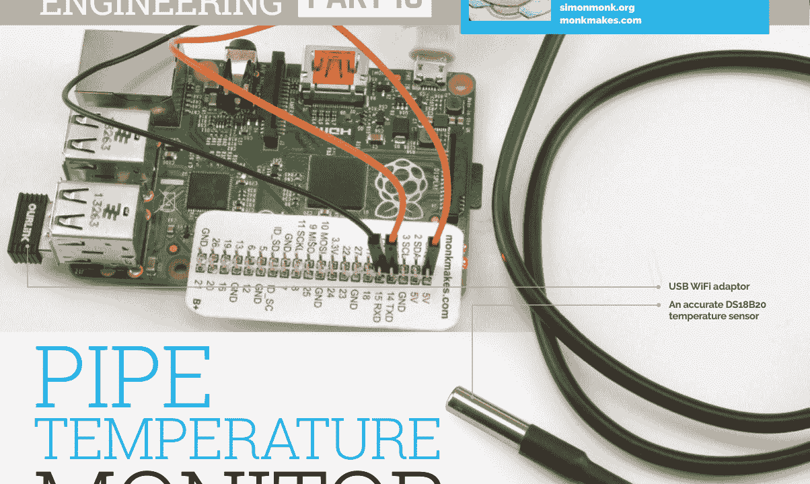

## 植物浇水器

Above 浇水罐遇见物联网

借助知名技术黑客和作者 Simon Monk，使用你的 Raspberry Pi 解决现实世界的电子和工程问题

## 你需要

- 半尺寸面包板
- 12V 蠕动泵
- 2x 公对母跳线
- 2x 公对公跳线
- 1k 欧姆电阻
- MPSA14 晶体管 (CPC: SC10647)
- 1N4001 二极管
- DC 圆插座转螺丝适配器 (CPC: CN19646)
- 12V DC 1A 电源（仅为泵供电）
- 管子和接头

本项目自动浇灌你的植物。你可以在室内在你不在时照顾室内植物，或与雨水桶和室外容器一起使用。
界面用于通过本地网络甚至互联网控制你的浇水的持续时间和开始时间。

正如左侧所需组件列表所示，本项目使用面包板上构建的小电路，以及蠕动泵将水从雨水桶输送到容器。
你可以在 eBay 上找到泵，从中国购买约需 6 英镑，从英国购买约需两倍价格。泵 intended 用于水族箱。它们消耗约 300mA，对于 2N3904 这样的老式常用晶体管来说有点太多了，因此改用可承受 1A 的 MPSA14 达林顿晶体管。
泵通常不带引线提供，所以你可能需要焊接引线。如果计划在室外使用泵，请将双芯音箱线或类似线材焊接到泵端子上；长度必须足够让你将泵放在室外，而 Raspberry Pi 和其余电子设备在室内。
泵需要自己的 12V DC 电源，即



## 构建项目

这是一个相当直接的项目来构建。面包板上只有三个组件。除了电子元件外，你还需要找到一种方法将泵连接到水容器上，如果在露天，还需防止雨水进入泵。

## >STEP-01
在泵上焊接引线

钟线或音箱线都很好。为了更容易将松散的末端推入面包板，用焊锡将其镀锡，这样在尝试插入面包板时它们不会 bunch up。



## >STEP-02
构建面包板

插入组件到面包板时，确保晶体管和二极管的方向正确。晶体管有一侧弯曲，应朝向左侧，二极管一端有条纹，需要朝向面包板顶部。电阻可以任意方向连接。为了防止电阻和二极管引线之间意外短路，最好缩短其中一个或两个引线。



## >STEP-03
连接面包板

将公对公跳线连接到 barrel 插座适配器的螺丝端子。使用红色和黑色导线，并确保将红色导线连接到标记为 '+' 的螺丝端子。将跳线的另一端插入面包板。

泵电机的导线也应现在安装到面包板上，并使用母对公跳线将面包板连接到 Raspberry Pi GPIO 排针上的 GND 和 18。





Above 通过浏览器控制浇水器

使用 DC barrel 插座转螺丝适配器和两根公对公跳线连接到面包板。

我们使用的管子和配件来自低成本超市的‘微型灌溉系统’。这包包含几米管子以及用于固定管道的小支架，和用于将泵连接到管子的完美小连接段。

面包板、跳线和电阻最好作为电子入门套件购买。Monk Makes Electronic Starter Kit for Raspberry Pi 包含这些零件。大多数 Raspberry Pi 入门套件都会包含面包板、跳线和一些电阻。



Above 蠕动泵

## 蠕动泵

蠕动泵使用电机驱动齿轮箱，进而驱动一对滚轮挤压柔软但坚固的管道以推动水通过泵。

这些泵的优点是‘自吸’。也就是说，在开始泵水之前你不需要排出进水管中的空气；它们最终会将水抽出。它们另一个优点是电机停止时有效地密封管道，即使水在一定压力下也不会流过。

## 构建你的浇水器

与所有项目一样，最好在零件仍在工作区时测试项目并确保一切正常。一旦确认一切正常，你就可以将项目安装到最终位置。


## STEP-04
测试

在安装项目之前，先使用两根短管连接到泵和两个玻璃杯，其中一个装有水来测试它。跳到软件部分并将开始时间设置为比当前时间提前一分钟。等待泵启动，然后确保它能将水从一个玻璃杯泵到另一个玻璃杯。这也能告诉你哪根管是入口，哪根是出口。

确保软管真的牢固地连接到泵上。如果有任何空气进入，泵将无法正常工作。



## STEP-05
安装

我们的示例设置是临时的。树莓派放在室内，泵的导线通过窗户引出。泵的进水管装在水桶盖下并伸入水中。出口管通向植物容器。



现在项目的硬件部分已完成，我们只需要让软件运行起来。程序用 Python 编写，并使用名为 Bottle 的库来提供该项目的 Web 服务器功能。如果你制作了《The MagPi》第 32 期和第 33 期的 Web 门锁或青少年闹钟，你应该已经安装了 Bottle。如果没有，要安装 Bottle，请确保你的树莓派有互联网连接，然后运行以下命令：

```
sudo apt-get update
sudo apt-get install python-bottle
```

## Waterer_Server.py

```
from bottle import route, run, template, request
import thread, time
import RPi.GPIO as GPIO
import datetime

### Change these for your setup.
PUMP_PIN = 18

### Configure the GPIO pin
GPIO.setmode(GPIO.BCM)
GPIO.setup(PUMP_PIN, GPIO.OUT)
GPIO.output(PUMP_PIN, 0)

### Global variables
start_time = "22:00"
duration = "30"

### Handler for the home page
@route('/')
def index():
```

你可以从树莓派命令行使用以下命令下载本项目的程序：

```
git clone https://github.com/simonmonk/pi_magazine.git
```

要运行程序，请更改到项目代码所在的目录，然后使用以下命令运行程序：

```
cd /home/pi/pi_magazine/08_waterer
sudo python waterer_server.py
```

这将在你的树莓派上启动一个 Web 服务器。你可以通过在另一台计算机或手机上打开浏览器窗口并输入你的 Pi 的 IP 地址来检查这一点。打开终端并输入 ifconfig 来找到它。如果一切正常，将显示一个网页，邀请你输入浇水的开始时间和持续时间。

## 代码如何工作

该程序的 Python 代码注释非常详细。在我们讲解时，将代码放在编辑器中会很有帮助。

程序首先导入它需要的 Bottle、thread、time、RPi.GPIO 和 datetime 库。常量 PUMP_PIN 用于指定用于控制泵的 GPIO 引脚。如果你想使用不同的引脚，请更改此值。

使用了两个全局变量：start_time 和 duration。变量 start_time 包含下一次浇水的时刻；其格式为包含小时（24 小时制）的两个数字的字符串，后跟冒号，再跟分钟的两个数字。duration 是浇水应持续的分钟数。这两个变量都将通过项目的 Web 界面设置。

```python
global start_time, duration
### Change the start_time and duration

local_start_time = request.GET.get('start_time', '')
if local_start_time != "":
    start_time = local_start_time
local_duration = request.GET.get('duration', '')
if local_duration != "":
    duration = local_duration
return template('home.tpl', start_time=start_time,
duration=duration)

def update(thread_name):
    global start_time, duration
    watering = False
    end_timestamp = 0
    while True:
        # Get the time formatted as a string for comparison
        # with the alarm time
        current_time = time.strftime("%H:%M")
        # If its time to start watering, do so, but not if
        # you are already watering
```

```python
if current_time == start_time \
and not watering:
    print("Starting Watering")
    watering = True
    GPIO.output(PUMP_PIN, 1)
    end_timestamp = time.time() + int(duration) * 60
### Check to see if its time to stop watering
if watering and time.time() > end_timestamp:
    print("End Watering")
    watering = False
    GPIO.output(PUMP_PIN, 0)

time.sleep(1) # allow other threads to run

### start a separate thread to check the time
thread.start_new_thread(update, ("update_thread",))

### Start the webserver running on port 80
try:
    run(host="0.0.0.0", port=80)
finally:
    print('Cleaning up GPIO')
    GPIO.cleanup()
```

由 start_new_thread 命令启动，这会导致 update 函数有效地独立于程序的其余部分运行。update 函数将当前时间与开始时间进行比较，如果相同，则通过打开连接到泵的晶体管的 GPIO 引脚来启动浇水过程。

> 由于这个 Python 程序主要充当 Web 服务器，检查开始时间的代码在单独的执行线程中运行

代码的下一部分提供 Web 界面。Bottle 使用 @route 指令来指示紧随其后的函数是 Web 请求的处理程序。因此，默认路由页面 '/' 由名为 index 的函数处理。index 函数使用 Bottle 的模板机制返回包含在名为 home.tpl 的模板文件中的 HTML。你可以在其代码目录中找到项目中使用的 HTML 模板（bit.ly/1NezVHT）。

当你在网页上的开始时间和持续时间字段中输入值时，它们将在表单提交时作为参数传递。这些在 index 函数中提取，只要它们不为空（空字符串），就会用来设置 start_time 和 duration 的新值。

由于这个 Python 程序主要充当 Web 服务器，检查开始时间的代码在单独的执行线程中运行。这个线程是

程序的最后几行在端口 80 上启动 Web 服务器。try / finally 子句用于在程序使用 CTRL+C 退出时将 GPIO 引脚设置回输入。

## 使用你的浇水器

你可以在计算机上使用 Web 浏览器，或在连接到 Wi-Fi 网络的智能手机上使用。因此，树莓派需要网络连接，这也允许 Pi 与互联网时间服务器同步。如果你发现你的树莓派时间相差一小时，则可能需要使用 raspi-config 工具设置时区。

如果你喜欢一点网页设计，你可能首先想做的是为网页添加一些样式。做到这一点的地方是模板文件 home.tpl。如果你精通网络，你也可以设置端口转发以允许从互联网访问浇水器。

## 教程

## 逐步演示

## 日常工程

## 第 10 部分

## 西蒙·蒙克

Simon Monk 是《Raspberry Pi Cookbook》和《Programming the Raspberry Pi: Getting Started with Python》等书籍的作者。
simonmonk.org
monkmakes.com



USB WiFi 适配器

一个精确的 DS18B20 温度传感器
