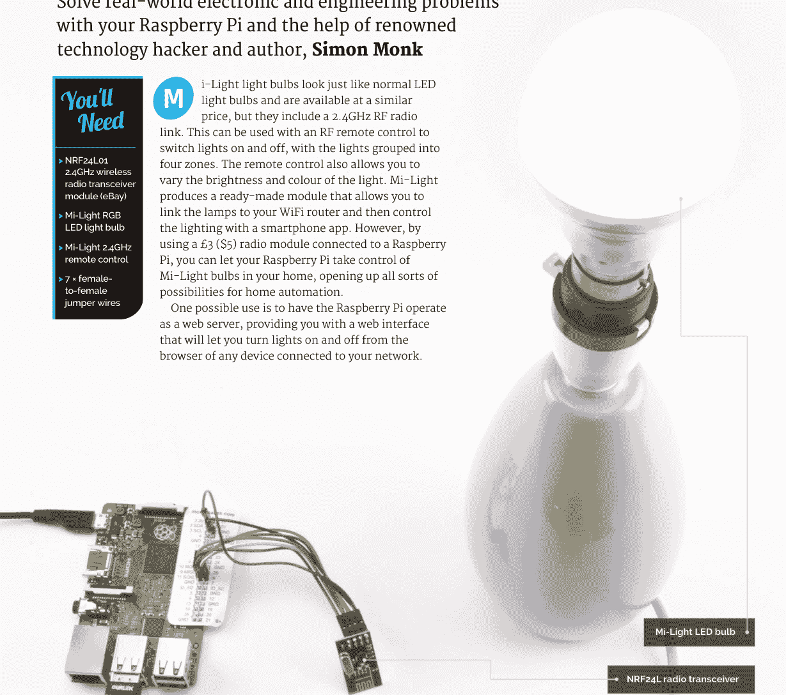
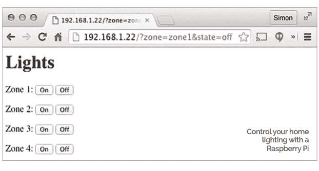
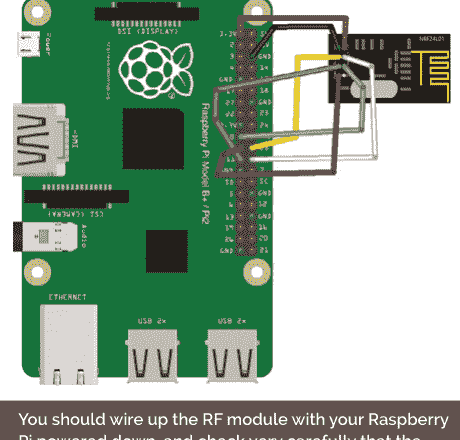
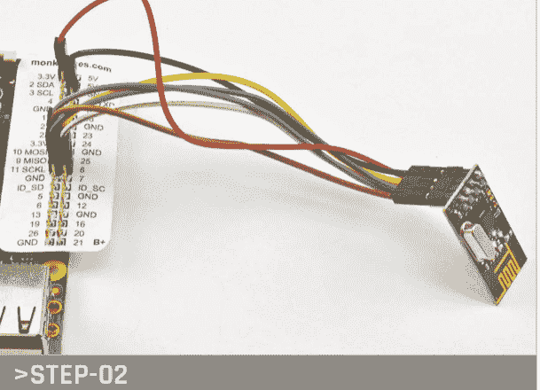
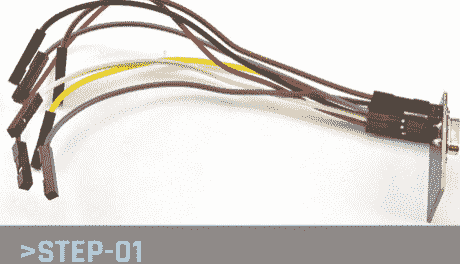
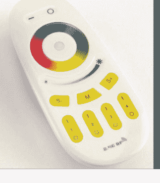
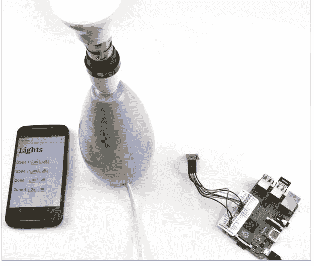
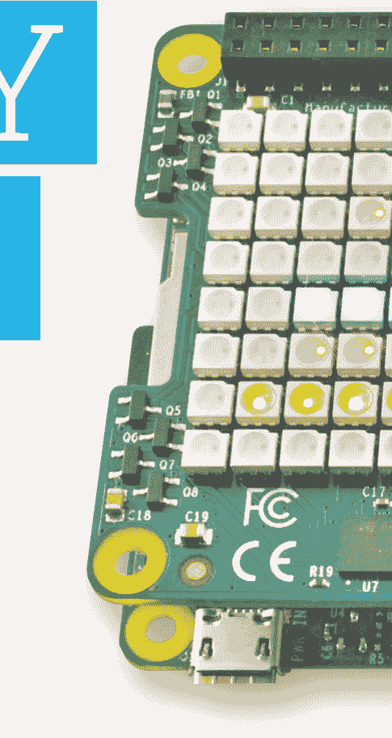
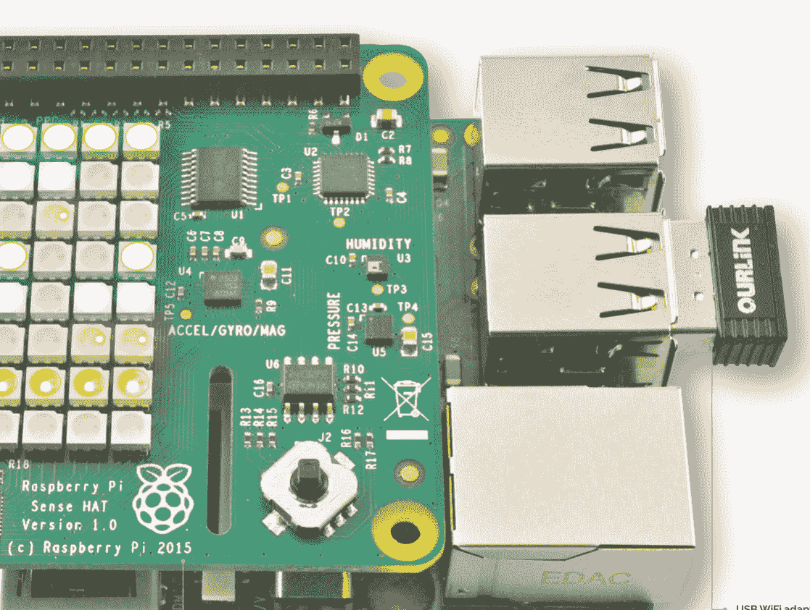
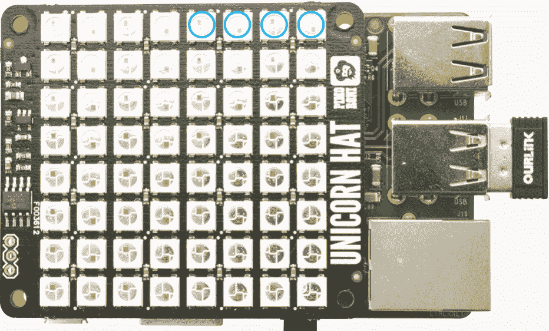

## PI MI-LIGHT

使用你的 Raspberry Pi 以及知名技术黑客和作者 Simon Monk 的帮助，解决现实世界的电子和工程问题

## 所需材料

- NRF24L01
  2.4GHz 无线射频收发模块（eBay）
- Mi-Light RGB LED 灯泡
- Mi-Light 2.4GHz 遥控器
- 7 × 母对母跳线

Mi-Light 灯泡看起来就像普通的 LED 灯泡，价格也相近，但它们内置了 2.4GHz RF 无线电链接。 这可以与 RF 遥控器配合使用来开关灯光，灯光分为四个区域分组。 遥控器还可以调节灯光的亮度和颜色。 Mi-Light 生产了一种现成的模块，可以将灯具连接到 WiFi 路由器，然后使用智能手机应用程序控制照明。 然而，通过使用连接到 Raspberry Pi 的 £3（$5）无线电模块，你可以让 Raspberry Pi 控制家中的 Mi-Light 灯泡，从而为家庭自动化打开各种可能性。

一个可能的用途是让 Raspberry Pi 作为 Web 服务器运行，为你提供一个 Web 界面，让你可以通过连接到网络的任何设备的浏览器打开和关闭灯光。



Mi-Light LED 灯泡

NRF24L01 无线电收发器

本项目基于 Torsten Tränkner 的一篇原创博客文章，你可以在这里用德语找到：torsten-traenkner.de。 该项目仅在 Raspberry Pi 2 上测试过，可能需要对其他型号的 Pi 进行一些调整。

正如所需组件列表所示，本项目不需要任何焊接。 RF 模块使用母对母跳线连接到 Raspberry Pi。 即使最终 Raspberry Pi 将接管灯光的操作，你在最初设置时仍需要一个 Mi-Light 遥控器。



## 搭建你的 PI-MI-LIGHT 控制器





你应该在 Raspberry Pi 关闭电源的情况下接线 RF 模块，并在重新通电前非常仔细地检查所有连接是否正确。 使用像 Raspberry Leaf（由 MonkMakes 提供）这样的 GPIO 模板将有助于你在 GPIO 连接器上找到正确的连接。



### 步骤-01
将引线连接到 RF 模块

首先使用接线图作为参考将跳线连接到 RF 模块。 你需要连接到每个引脚，除了连接器右下角的引脚（引脚 8）。 使用与接线图相同颜色的引线将有助于你做出正确的连接。

### 步骤-02
连接 RF 模块

按如下方式将 RF 模块的引线连接到 GPIO 接头：
- RF 模块的引脚 1（GND）连接到 GPIO 接头的 GND。
- RF 模块的引脚 2（VCC）连接到 GPIO 接头的 3.3V。
- RF 模块的引脚 3（CE）连接到 GPIO 25。
- RF 模块的引脚 4（CSN）连接到 GPIO 8。
- RF 模块的引脚 5（CLK）连接到 GPIO 接头的 SCLK（GPIO 11）。
- RF 模块的引脚 6（MOSI）连接到 GPIO 接头的 MOSI（GPIO 10）。
- RF 模块的引脚 7（MISO）连接到 GPIO 接头的 MISO（GPIO 9）。



### 步骤-03
配对 Mi-Light

对于此步骤，你需要将灯泡插入合适的灯座。 然后打开正常的灯开关并立即按下 Mi-Light 遥控器上四个灯区之一的开按钮。 灯泡会闪烁三次作为确认。 配对后，遥控器将能够打开和关闭灯光并进行其他调整。

在你开始使用它之前，本项目需要在软件设置上花费相当多的时间。
无线电模块使用 Raspberry Pi 的 SPI 接口，需要启用它，因此使用以下命令运行 raspi-config：

```
sudo raspi-config
```

向下滚动到高级选项，选择它，然后选择 SPI。 启用它，并在询问是否

> 这段代码全部用 C++ 编写，但可以从我们的 Python 程序中调用

是否自动加载 SPI 模块时，选择是。
接下来，你需要通过发出以下命令为 RF 模块安装并构建 NRF24 库：

```
git clone https://github.com/TMRh20/RF24
cd RF24
make all
sudo make install
```

之后，你需要使用以下命令下载一个消息库，该库为基本 RF 模块提供更高级别的接口：

```
cd ..
git clone https://github.com/mysensors/Raspberry
cd Raspberry
make
sudo make install
```

下面 从手机浏览器打开/关闭灯区

现在使用以下命令下载 Torsten Tränkner 编写的代码：



```
cd ..
wget http://torsten-traenkner.de/wissen/smart_home/openmilight_raspberry_pi.tgz
tar xzvf openmilight_raspberry_pi.tgz
```

这段代码全部用 C++ 编写，因此为了在 Python 中使用它，你的专家编写了一个名为 send_cmd 的 C++ 程序，该程序旨在从 Python 调用并发送要发送到 Mi-Light 的命令消息。 使用以下命令从你的 Pi 命令行下载此程序和项目的 Python 代码：

```
git clone https://github.com/simonmonk/pi_magazine.git
```

将项目文件夹 11_mi_light 中的所有文件复制到 openmilight 文件夹中，然后使用以下命令编译其中两个程序：

```
cp pi_magazine/11_mi_light/* openmilight
cd openmilight
sh ./comp.sh
```

你还需要使用以下命令安装将用于 Web 服务器的 Python Bottle 库：

```
sudo apt-get install python-bottle
```

在你运行主程序之前，你需要找到用于与 Mi-Light 配对的 Mi-Light 遥控器的 ID，以便你的 Raspberry Pi 可以冒充它。
使用以下命令运行 openmilight 程序，然后在遥控器上按几次区域 1 的开按钮。 每次按下按钮时，你应该会看到如下示例中的十六进制数字流。

```
sudo ./openmilight
in listening mode
B0 A1 56 41 C1 03 72 .
B0 A1 56 41 C1 03 73 .
```

前三个数字（在本例中为 B0、A1 和 56）对于你的遥控器会有所不同，因此使用 CTRL+C 退出程序并编辑文件 lights.py，将文件顶部 ID 变量的值更改为你的遥控器的三个十六进制数字。
最后，你可以使用以下命令启动 Web 服务器：

```
sudo python lights.py
```

将方便的 Web 浏览器指向你的 Raspberry Pi 的 IP 地址，你将看到一个网页，其中包含所有四个区域的开和关按钮。 单击区域 1 的按钮，你应该能够打开和关闭连接到该区域的所有灯光。

## Lights.py

```
from bottle import route, run, template, request
import os

ID = 'B0 A1 56'
MIDDLE = '06 C9'

ZONES = {
  'zone1': {'on': '03', 'off': '04'},
  'zone2': {'on': '05', 'off': '06'},
  'zone3': {'on': '07', 'off': '08'},
  'zone4': {'on': '09', 'off': '0A'}
}

def light_on(zone):
  print(zone + "on")
  send(ZONES[zone]['on'])

def light_off(zone):
  print(zone + "off")
  send(ZONES[zone]['off'])

def send(code):
  global ID, MIDDLE
  for i in range(1, 5):
    message = ID + MIDDLE + code + '00'
    os.system('./send_cmd "' + message + '"')

### Handler for the home page
@route('/')
def index():
  zone = request.GET.get('zone', 'zone1')
  state = request.GET.get('state', 'off')
  if state == 'on':
    light_on(zone)
  else:
    light_off(zone)
  return template('home.tpl')

### Start the webserver running on port 80
run(host="0.0.0.0", port=80)
```

## 代码如何工作

在我们讲解时，将代码放在编辑器中会很有帮助。

程序首先导入 bottle 和 os 库。 os 库是必需的，以便从 Python 调用 send_cmd C 程序。

常量 ID 需要设置为你的遥控器的三个十六进制数字，如前所述。 MIDDLE 中的代码不需要更改。 请注意，这两个常量中的空格必须保留原样，以便在构建十六进制消息时，每个十六进制数字之间都有空格。

Mi-Light 遥控器允许定义多达四个区域，你可以为每个区域连接多个灯。 有单独的开和关代码可以独立控制每个区域。 这些存储在变量 ZONES 中，它是一个字典的字典，使得查找你想要的命令的适当十六进制代码变得很容易。

两个函数（light_on 和 light_off）根据作为其参数指定的区域名称打开或关闭所有灯光。 这两个函数都使用 send 函数通过 C 程序（send_cmd）实际将命令发送到 RF 模块。 send 函数首先通过连接 ID、MIDDLE 部分、命令代码，最后是 00 构造一个消息字符串。 然后调用 C 程序五次，将消息作为参数传递。 由于它可能有点不可靠，因此发送五次消息几乎可以确保将其发送到灯泡。

接下来是代码的 Web 服务器部分，包含在 index 函数中。 它期望网页提供两个请求参数：区域名称（zone）和是否打开或关闭（state）。 然后使用此信息调用 light_on 或 light_off。 在 index 函数的末尾，返回模板 home.tpl 的内容，以向浏览器提供 Web 界面的 HTML。

代码的最后一行启动 Web 服务器。 切换到 Raspberry Pi 上的浏览器，或网络上的另一台计算机，并在地址栏中输入你的 Pi 的 IP 地址。 要发现你的 Raspberry Pi 的 IP 地址，请在 LXTerminal 中输入以下命令：

hostname -I

它将在响应的开头作为四个用点分隔的数字；例如，192.168.1.22。

## 使用你的 PiMi-Light 控制器

除了从计算机上的浏览器控制灯光外，你也可以同样轻松地使用连接到与 Raspberry Pi 相同网络的智能手机上的浏览器。

你还可以改编《The MagPi》第 33 期中的闹钟程序，以在特定时间打开和关闭灯光。

本项目仅打开和关闭照明。 已经做了大量工作来逆向工程 Mi-Light 协议，以弄清楚所有代码的作用。 因此，如果你想扩展此项目以调整灯光的颜色和亮度，那么你可能想查看 Henryk Płotz 的工作：magpi.cc/1NZfcmt


## 教程
## 逐步指南
## 日常工程 第12部分
## 西蒙·蒙克

西蒙·蒙克是《Raspberry Pi Cookbook》和《Programming the Raspberry Pi: Getting Started with Python》等书籍的作者。
simonmonk.org
monkmakes.com


## 二进制
## 时钟

### 所需材料

- 带有 40 针 GPIO 接口的 Raspberry Pi
- Sense HAT 或 Pimoroni Unicorn HAT
- USB WiFi 适配器或以太网连接

利用你的 Raspberry Pi 以及知名技术黑客和作者 Simon Monk 的帮助，解决现实世界的电子和工程问题

这是一个非常简单的项目。事实上，你真正需要做的只是将 Sense 或 Unicorn HAT 插入 Raspberry Pi 的 GPIO 接口并安装软件。

该项目以二进制形式显示当前时间。显示屏的行（从上到下）为年份的最后两位数字（例如 15）、月份数字、月份中的日期、小时（24 小时制）、分钟、秒，最后是百分之一秒。

### 读取二进制时钟

要读取二进制时钟，你要么擅长识别二进制数字，要么使用一些算术来计算时间，通过将某一行点亮的 LED 的二进制位值相加。

例如，第一行以两位数字格式显示年份。因此，如果位置 8、4、2 和 1 的 LED 全部点亮，则年份为 8+4+2+1 = 15。在 2016 年，只有数字位置 16 会点亮。

LED 的颜色没有特殊意义——它们不同是为了使显示更具趣味性。如果您使用 Sense HAT，您可能需要使用以下命令安装 HAT 的软件：



```
sudo apt-get update
sudo apt-get install sense-hat
sudo pip3 install pillow
```

如果您使用 Unicorn HAT，则运行以下命令：

```
sudo apt-get install python-pip python-dev
sudo pip install unicornhat
```

该项目的软件有两个版本——一个用于 Sense HAT，一个用于 Pimoroni Unicorn HAT——因此请确保为您的硬件使用正确的程序版本。Sense



USB WiFi 适配器
用于网络时间

Sense 或 Unicorn HAT

HAT 版本名为 binary_clock_sh.py，而 Unicorn 版本为 binary_clock_uni.py。
您可以使用以下命令从 Raspberry Pi 命令行下载此项目的程序：

```
git clone https://github.com/simonmonk/pi_magazine.git
```

该命令实际上会下载 Simon 的 The MagPi 系列中所有项目的代码，因此如果您已为其中一篇早期文章发出过此命令，请更改目录到 pi_magazine 并运行以下命令来更新您的目录
包含此项目（12_binary_clock）：

```
git pull
```

要运行程序，请更改到项目代码所在的目录，然后使用以下命令运行程序：

```
cd /home/pi/pi_magazine/12_binary_clock
sudo python binary_clock_sh.py
```

或者，如果您使用的是 Unicorn HAT：

```
sudo python binary_clock_uni.py
```

### binary_clock_uni.py

```
#!/usr/bin/env python

import unicornhat as hat
import time, datetime

year_color = (0, 255, 0)
month_color = (0, 0, 255)
day_color = (255, 0, 0)
hour_color = (0, 255, 0)
minute_color = (0, 0, 255)
second_color = (255, 0, 0)
hundredths_color = (127, 127, 0)
off = (0, 0, 0)

hat.clear()
hat.brightness(0.5)

def display_binary(value, row, color):
    binary_str = "{:08b}".format(value)
    for x in range(0, 8):
        if binary_str[x] == '1':
            hat.set_pixel(x, row, color[0], color[1], color[2])
        else:
            hat.set_pixel(x, row, 0, 0, 0)

while True:
    t = datetime.datetime.now()
    display_binary(t.year % 100, 0, year_color)
    display_binary(t.month, 1, month_color)
    display_binary(t.day, 2, day_color)
    display_binary(t.hour, 3, hour_color)
    display_binary(t.minute, 4, minute_color)
    display_binary(t.second, 5, second_color)
    display_binary(t.microsecond / 10000, 6, hundredths_color)
    hat.show()
    time.sleep(0.0001)
```

64 32 16 8 4 2 1

- 年
- 月
- 日
- 小时
- 分钟
- 秒
- 秒的 1/100



### binary_clock_sh.py

```
#!/usr/bin/env python

from sense_hat import SenseHat
import time, datetime

hat = SenseHat()

year_color = (0, 255, 0)
month_color = (0, 0, 255)
day_color = (255, 0, 0)
hour_color = (0, 255, 0)
minute_color = (0, 0, 255)
second_color = (255, 0, 0)
hundredths_color = (127, 127, 0)
off = (0, 0, 0)

hat.clear()
```

```
def display_binary(value, row, color):
    binary_str = "{0:08b}".format(value)
    for x in range(0, 8):
        if binary_str[x] == '1':
            hat.set_pixel(x, row, color)
        else:
            hat.set_pixel(x, row, off)

while True:
    t = datetime.datetime.now()
    display_binary(t.year % 100, 0, year_color)
    display_binary(t.month, 1, month_color)
    display_binary(t.day, 2, day_color)
    display_binary(t.hour, 3, hour_color)
    display_binary(t.minute, 4, minute_color)
    display_binary(t.second, 5, second_color)
    display_binary(t.microsecond / 10000, 6, hundredths_color)
    time.sleep(0.0001)
```

语言
>PYTHON
下载:
magpi.cc/1P1182l

### 代码如何工作

两个版本实际上非常相似。两者都首先导入它们显示所需的库。然后它们定义了一些颜色变量，您可以根据需要更改，以为时钟的每一行设置不同的颜色。

大部分操作都在 display_binary 函数中进行。该函数接受三个参数。第一个是要以二进制形式显示的值，第二个是应显示的行（0 到 7），最后一个参数是要显示的颜色。

该值使用 String 的 format 函数转换为二进制字符串表示形式。然后 for 循环遍历每一列（x 值），如果该数字包含 1，则将该行和列中的像素点亮为指定颜色，否则像素将被清除。

主循环获取当前时间，然后将其拆分为各个组成部分，并在单独的行上显示每个部分。为了以两位数字格式显示年份，我们使用取模 100（t.year % 100），即除以 100 后的余数。

### 使用您的二进制时钟

在构建时钟时，将键盘、鼠标和显示器连接到时钟是可以的，但最好让程序在

> 两个版本实际上非常相似。

Raspberry Pi 第一次启动时自动启动。为此，运行以下命令使程序可执行：

```
sudo chmod +x binary_clock_*.py
```

然后，使用以下命令编辑文件 /etc/rc.local：

```
sudo nano /etc/rc.local
```

在以 # 开始的第一组注释行之后添加以下行。如果您使用的是 Unicorn HAT，请将该行更改为 _uni 版本。

```
sudo /home/pi/pi_magazine/12_binary_clock/binary_clock_sh.py &
```

重启您的 Raspberry Pi，这次程序应该会自动启动。

请注意，您仍然需要互联网连接，以便 Pi 获取正确的时间。
