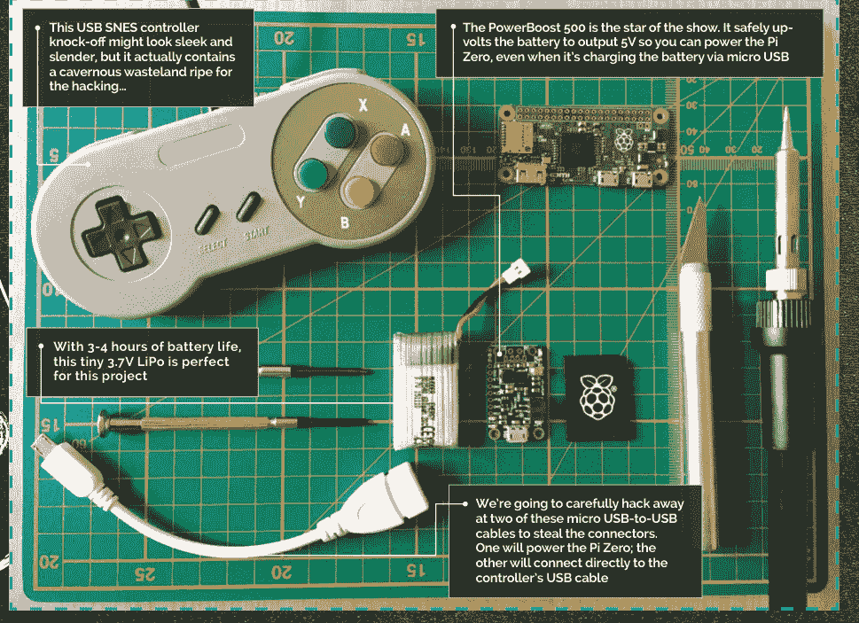
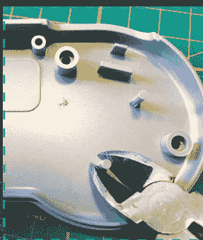
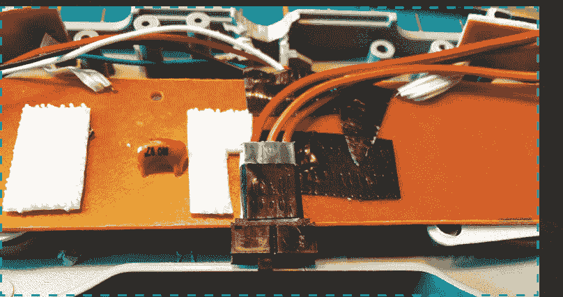
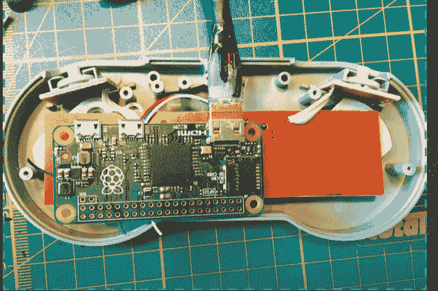
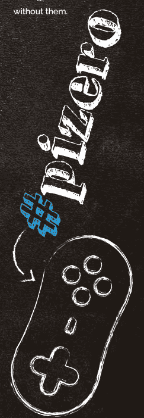
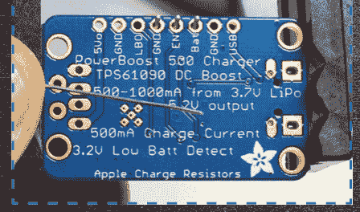
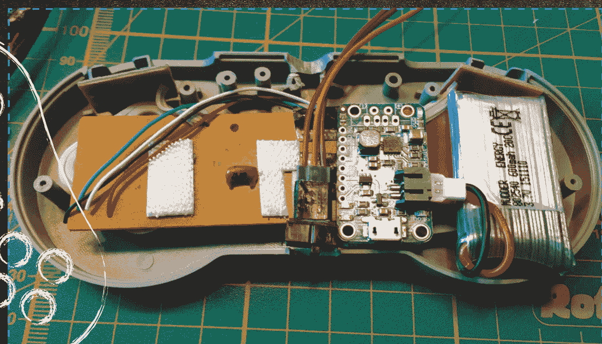
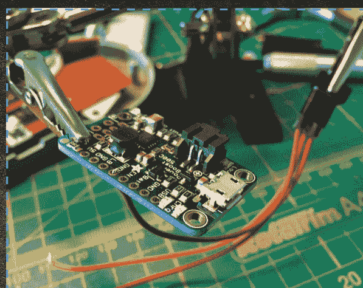
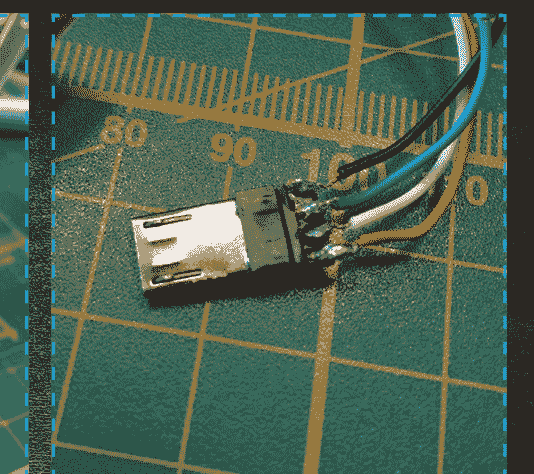
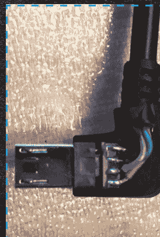

## Pi Zero 游戏机

Pi Zero 小巧的身形让我们第一次能够用一个简单的 USB 手柄打造一台完整的复古游戏机。方法如下……

### 所需物品

- USB SNES 手柄 – eBay
- PowerBoost 500 makersify.com
- 3.7V 500mAh LiPo 电池 – eBay
- RetroPie magpi.cc/Retro-Pie
- 迷你 HDMI 转 HDMI 电缆（3m） amazon.com
- 2x micro USB 电缆 amazon.com

这款 USB SNES 手柄仿制品看起来时尚纤薄，但实际上内部包含一个广阔的荒地，等待被黑客改造……

PowerBoost 500 是主角。它安全地将电池升压至输出 5V，从而为 Pi Zero 供电，即使它通过 micro USB 为电池充电时也是如此

凭借 3-4 小时的电池续航时间，这个小小的 3.7V LiPo 对于这个项目来说是完美的

我们将小心地对这两根 micro USB-to-USB 电缆进行改造以窃取连接器。一根将为 Pi Zero 供电；另一根将直接连接到手柄的 USB 电缆

### 提示

SNES 手柄

由于它们非常便宜，我们实际上从 eBay 上买了几副 USB SNES 手柄。

这个项目受到了杂志特约编辑 Rob Zwetsloot 几期前完成的一个类似项目的启发。Rob 取了一个现代 USB 版本的复古任天堂娱乐系统手柄，打开它并将 Pi Zero 放了进去。虽然它运行完美，通过 RetroPie 运行经典的 NES 游戏，但我们认为这个项目可以更进一步。经典手柄上不会有两根线从中出来（在本例中为 HDMI 和电源 USB），因此我们的新目标是创建一个完全自包含的手柄内主机，只有一根线出来连接到电视或显示器的 HDMI 端口。于是 Pi Zero 驱动的 SNES Consoller 诞生了…… 为了让这个项目在手柄内部工作，需要挤进惊人数量的技术。幸运的是，大多数 USB 手柄内部大部分是空的，只使用四根细小的 USB 彩色编码线连接到一个细长的电路板，该板处理输入（方向键和六个按钮）。我们如何从手柄获取输入并将其发送到 Pi Zero？实际上再简单不过了——我们要做的就是剪掉手柄的 USB 电缆并直接将电线焊接到一个 micro USB 连接器上，该连接器可直接插入 Pi Zero 的 USB 端口。由于 USB 布线完全通用，因此它可以正常工作。

## 雕刻外壳
不过在做任何其他事情之前，我们需要在控制器本身创造更多空间。我们先在背板上剪掉支撑支架，具体情况因购买的 USB 控制器而异（有数百种），但我们的控制器每侧有三个支撑。用侧切钳剪掉它们，或用美工刀砍掉，然后打磨掉任何尖锐边缘，使其与外壳齐平。

我们可能还需要移除控制器本身的几个螺丝孔支撑，但先不要过度——在尝试将所有东西装入内部时应见机行事，因此我们尽量少移除螺丝孔。

完成后，我们需要剪掉连接到控制器控制板上的四根 USB 线，留出足够的活动空间

在线缆上以便最终将另一端连接到你的 Pi Zero。为了保持简单，我们将在控制器内部将一条超薄迷你 HDMI 转 HDMI 线连接到 Zero。对于我们的控制器，只需将 HDMI 线与控制器本身的 USB 线出口对齐就非常容易，但你需要用美工刀雕刻出更大的开口，并小心剥离迷你 HDMI 连接器的外壳，使其紧密贴合。

## 固定你的 Pi Zero
接下来要做的是将 Pi Zero 固定到位。其在机箱中的位置由 HDMI 线缆决定。我们希望将其直接固定到控制器的控制电路板上。后方很可能有几个
凸起元件，因此我们使用粘性魔术贴 Command 条。这为我们提供了避开元件所需的间隙，同时在制作过程中也能灵活地移除或调整 Zero 的位置。一旦牢固地用魔术贴固定，我们也可以着手安排电池和 PowerBoost 500 的位置，放心地知道一切都能如预期般组合。我们计划将 PowerBoost 板放置在 Pi Zero 右侧正下方，使其上的 micro USB 电源连接器靠在控制器底部右下方的直边上。这样可以在控制器底部中央添加电源开关，并将电池放置在目前完全空置的右侧隔间中。

由于 PowerBoost 500 在连接电池时会自动开机，我们需要安装一个电源开关来打开和关闭我们的 SNES 控制器。我们使用的是从基础电子套件中获得的非常标准的三针开关，以及三根带颜色编码的公对母跳线——分别为电源（红）、地线（棕）和控制（橙）——其公头端已被剪掉，以便稍后焊接到 PowerBoost 板上。接下来，将跳线的母端胶带粘在一起，然后直接将开关插入其中。我们将开关放置在板的中底部
开关位于 Pi Zero 下方且靠近 PowerBoost 500 将放置的位置处，雕刻出空间使开关齐平安装，并将其粘
固定到控制器的控制板上以保持其位置。参考左侧的文本框查看如何正确焊接。

USB 端口需要面向控制器的干净边缘，以便你能为其雕刻合适的孔。我们将 PowerBoost 放置在复位开关旁边
复位开关旁边，micro USB 朝向板的底部边缘。幸运的是，这意味着电池连接器已经朝向正确的方向，使电池能够占据右侧隔间的剩余空间。由于

> 在这一点上，明智的做法是确保你仍然可以合上外壳并找到任何卡住的地方

## Tip
## 你需要的工具
确保你手边有一把非常锋利的美工刀、一把像样的电烙铁和一套小螺丝刀——没有它们你将无从下手。

## 焊接 POWERBOOST 500
使用 PowerBoost 500 为项目供电非常简单方便，但我们强烈建议你参考 Adafruit 在 magpi.cc/1PmIDWL 的优秀指南。你将了解其所有功能和能力，并学习如何正确焊接板子。如图所示，我们需要焊接三个高亮的引脚才能使电源开关正常工作。完成后并连接电池，你会发现当你将开关从靠近地线引脚（棕色）拨到电源引脚（红色）时，设备会开关机。你还会发现 PowerBoost 板上有一个方便的 micro USB 端口——将其靠在控制器外侧边缘，对塑料雕刻出端口，你就能在玩游戏时为电池充电。

## 放置 PowerBoost 和电池
开关和 PowerBoost 准备好后，我们可以着手安排 PowerBoost 和 3.7V 500mAh 电池本身的位置。这可能是项目中最棘手的部分。通常这些 LiPo 电池的电源线相当短，所以你可能需要费点劲才能正确安装。此外，由于我们希望利用 PowerBoost 板的充电功能，micro
PowerBoost 的部分在机箱内位于 Pi Zero 右边缘下方，我们使用两个双面粘性贴片将 PowerBoost 连接到控制器的电路板上，使其实际位置低于 Zero。电池本身无需固定，因为其尺寸使其不会移动。在这一点上，明智的做法是确保你仍然可以合上外壳

并找到需要调整的任何卡住点。我们发现必须移除一些螺丝的支撑支架，但我们确保至少保留两个（最左和最右的）完好无损，以便仍能牢固地固定外壳。

## 焊接 micro USB
就剩下的实际动手工作而言，我们几乎完成了。最后的任务是物理连接 Pi Zero 与 USB 线缆和 PowerBoost。关于供电，直接将 PowerBoost 的 5V 和地线引脚焊接到 Pi Zero GPIO 上的 5V 和地线引脚是完全可以的，但由于你将来可能想把 Pi Zero 用于其他用途

我们决定采用侵入性较小的方式，拆开一根单独的 micro USB 线并将其焊接到 PowerBoost 上。USB 的好处是无论 USB 尺寸如何，四根带颜色编码的线缆都相同：两根用于供电，两根用于控制。

> USB 的好处是无论 USB 尺寸如何，四根带颜色编码的线缆都相同

为 Pi Zero 供电，我们只需要红线和黑线；分别对应电源和地线。它们连接到 micro USB 线上的两个外侧连接器——连接器的最长平边朝上并朝向你时，地线在左侧。只需搜索“micro USB 线连接器”即可找到方便的参考图。将地线和电源线简单焊接到 PowerBoost 上的 5V 和地线引脚——真的就是这么简单。将其连接到 Zero 进行测试——假设你的 Pi Zero 中有一张配置正确的 SD 卡，打开电源开关时它应正常亮起。连接控制器 micro USB 也同样简单。将 micro USB
连接器的最长边缘朝上并朝向你时，之前剪下的带颜色编码的 USB 线缆从左到右焊接为黑色、绿色、白色，然后是红色。micro USB 连接器焊接完成后，你现在只需预先为 Pi Zero 配置 RetroPie 即可开始使用！

## 设置 RetroPie
就这样——你已经完成了最困难的部分！现在你只需按照 magpi.cc/Retro-Pie 上的说明将其设置在可插入 Pi Zero 的 microSD 卡上即可。它已经有支持 Pi Zero 的版本。由于控制器中没有 WiFi 空间，我们强烈建议你使用带键盘和鼠标的 USB 集线器进行设置，确保提前加载你想要的所有游戏并从互联网抓取简介和图片。我们不能帮助你获取游戏，原因显而易见，但搜索引擎绝对是你的朋友。完成后，只需将其加载到项目 Pi Zero 中，合上外壳并开机，享受激烈的复古游戏体验吧！

Tip
RETROPIE
我们喜欢 RetroPie。它是复古游戏世界的 Kodi 或 openELEC（家庭影院前端）。从 magpi.cc/Retro-Pie 获取它

Tip
3.7V 500MAH 电池
你需要仔细检查机箱的尺寸与所选电池的尺寸，以确保其正确贴合。它会很紧凑，但很容易做到。

