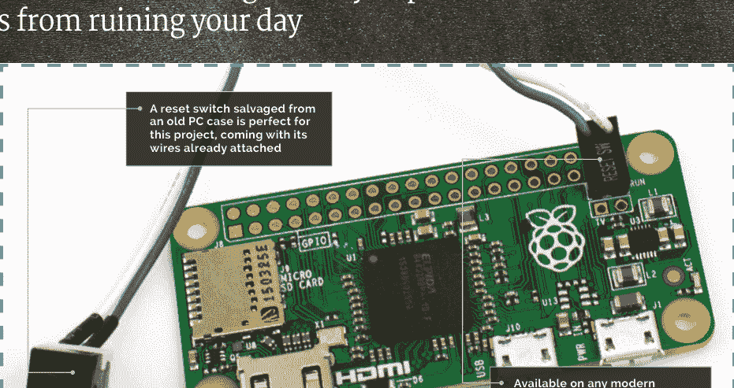
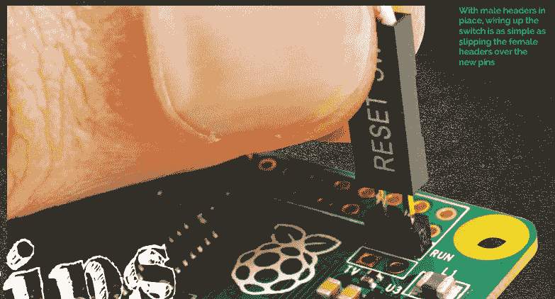
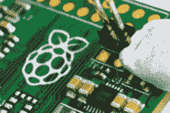
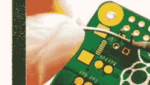

## Pi Zero 重置
### 重置开关

一个简单的首次焊接项目，为你的 Pi Zero —— 或全尺寸 Pi —— 添加重置开关，是防止崩溃和挂起毁掉你一天的好方法

## 所需材料
- 焊接烙铁和焊锡
- 2× 2.54mm 公头排针
- 回收的 PC 机箱重置开关
Or
- 瞬时开关，常开 magpi.cc/zdXrPZg
- 2× 母头跳线

从旧 PC 机箱拆下的重置开关非常适合这个项目，自带线缆已连接

现代所有 Raspberry Pi 上都提供 RUN 引脚，可用于从崩溃中恢复或启动已关机的 Pi。

Pi Zero 体积小巧、成本低廉且功耗极小，使其非常适合嵌入式项目。只有一个问题：如果代码进入无限循环或以其他方式导致 Pi Zero 崩溃，如何快速恢复运行，尤其是在 Pi Zero 被锁在不易触及的地方并由难以中断的内部电池供电的项目中。解决方案？一个连接到 Pi Zero 上 RUN 引脚的重置开关，可在崩溃时重启 Pi，或从关机状态将其开机。

## STEP-01
### 找到 RUN 引脚

在早期型号中称为 P6 引脚，RUN 引脚连接到处理器中保持其标准运行模式的引脚——因此得名 RUN。当通过将引脚上的一个触点短接到另一个触点而接地时，处理器会离开 RUN 状态。就实际效果而言，这与短暂切断处理器电源相同；如果 Pi 正在运行，它将重启，如果 Pi 已关机，它将开机。RUN 引脚位于 Pi Zero 板的右侧，夹在 GPIO 引脚和复合视频引脚（标记为‘TV’）之间。

## STEP-02
### 插入公头排针

所有 Raspberry Pi 型号的 RUN 引脚都是未布线的，即没有插入任何引脚。虽然可以直接将开关焊接到引脚上，但这样会阻挡 GPIO 和 TV 引脚；最好将公针焊接到引脚上并将线缆引到重置开关。

取一捆引脚中的两根，通过将拇指放在引脚之间塑料上的凹槽中并推动将其折断。从顶部将它们插入 Pi Zero 的 RUN 引脚，并用胶带或 Blu-Tack 固定，准备焊接。

公头排针就位后，接线开关就像将母头排针套在新引脚上一样简单

## STEP-03
### 准备烙铁

确保烙铁安全地放在支架上，然后将其插入插座。

## STEP-04
### 焊接引脚

翻转 Pi Zero 以露出你穿过插座的引脚。如果你使用清洁海绵，先在流动水下浸湿，然后拧干，使其潮湿但不湿透；如果使用铜丝屑，则不需要水。

给烙铁几分钟预热，然后将烙铁头在海绵或铜丝屑上擦拭。清洁后，通过将少量焊锡熔化在烙铁头上，然后再次在清洁材料上擦拭来“上锡”。烙铁头应看起来有光泽，没有黑色残留物或变色的迹象。

将烙铁压在其中一个引脚的底部，确保它也接触到电路板上的亮铜环或方块。数到三，然后用另一只手将焊锡推向引脚底部，不要触碰烙铁头。

焊锡应熔化然后似乎被“吸入”引脚孔中。如果没有，请移除焊锡和烙铁，清洁烙铁头的尖端，调整位置，然后重试。

## STEP-05
### 检查焊点

两个引脚焊接完成后，在尝试使用 Pi Zero 之前检查你的手艺。焊点应看起来从电路板平滑地流向引脚，没有任何间隙。如果电路板上仍能看到铜，或焊锡没有粘在引脚的腿上，请再次使用烙铁“回流”焊锡，必要时添加更多。

确保你没有用多余的焊锡将两个引脚连接在一起。如果有，请使用吸锡泵或吸锡带去除多余焊锡，否则 Pi 将无法启动。

## STEP-06
### 接线开关

如果你使用的是来自 PC 机箱的重置开关，母头排针可以直接以任意方向插入 RUN 引脚的新引脚上。否则，使用一对母对母跳线将引脚连接到任何描述为“瞬时，常开”的开关。这些开关形式多样，从廉价的触觉开关到更昂贵的防破坏设备。

Pi 运行时可短按开关进行重置，但请注意，如果 Pi 正在写入时，这可能会导致 SD 卡损坏。如果 Pi 已关机，按下开关可将其重新开机——这是始终安全的。

## QUICK TIPS
### KEEP THE TIP CLEAN

脏的烙铁头会使焊接变得困难。焊接时定期清洁烙铁头，并不时用新焊锡重新上锡。

### EMERGENCY USE ONLY

就像切断电源一样，使用重置开关也可能导致 SD 卡损坏。仅在无法以其他方式关闭 Pi 时才使用它！

一块小小的 Blu-Tack 或遮蔽胶带可以帮助在翻转电路板进行焊接时保持组件位置

任何瞬时型常开开关都适用于此项目，包括这种高质量的金属防破坏开关

## Feature
### MORE #PIZERO PROJECTS!
