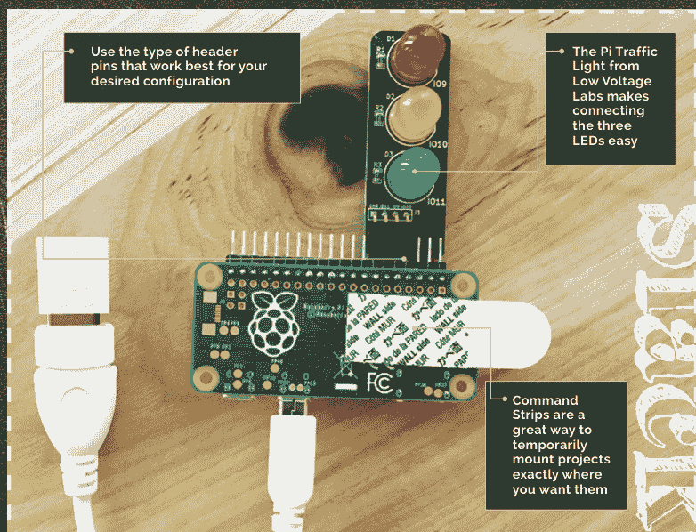
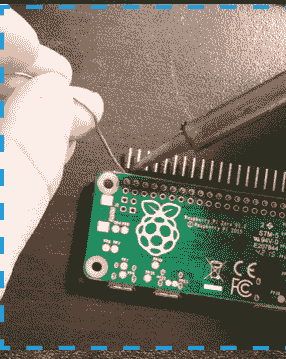

## SLACKTIVITY MONITOR

使用此 LED 显示屏跟踪 Slack 聊天活动。你可以一目了然地知道是否有安静、轻度聊天或喧闹的争论

为了在 Raspberry Pi 基金会内部进行沟通，我们使用 Slack，这是一种类似 IRC 的聊天服务。活动可能非常多，人们花了时间来调整通知设置。但我们想要的不仅仅是 Slack 通知所能提供的。我们希望能够一目了然地看到同事之间有多少聊天。幸运的是，Slack 的 API 和 Python 库功能强大且易于使用。组装简单，材料 inexpensive，尤其是在使用 Pi Zero 的情况下。

## Initial configuration

要设置自己的 Slacktivity Monitor，请从全新的 Raspbian 安装开始。对于 Raspberry Pi Zero，你需要使用 Raspbian Jessie，可以在 NOOBS 上找到，或使用 Raspberry Pi 下载页面上的映像写入 SD 卡（raspberrypi.org/downloads）。与其它 Raspberry Pi Zero 项目一样，最简单的方法可能是先用 Raspberry Pi 2 或 B+ 配置和安装所有内容，然后在准备好后将 microSD 卡移到 Pi Zero。确保通过进入终端并使用以下命令进行必要的更新：

```
sudo apt-get update
sudo apt-get upgrade
```

你需要设置一些基本配置选项。从桌面进入偏好设置菜单中的 Raspberry Pi 配置。在系统选项卡下，将 Pi 设置为启动到 CLI（命令行界面）并启用“等待网络”。你也可以使用命令行实用程序 raspi-config 设置这些选项。确保你也已配置 Pi 连接到你的 WiFi 网络。或者，你可以使用 USB 以太网适配器与 Pi Zero 配合使用。

## 所需材料
- Pi Traffic Light magpi.cc/1VamjoL
- WiFi 适配器
- 直角排针
- 焊接烙铁和焊锡
- Blu-Tack 或 Command Strips



使用最适合你所需配置的排针类型

来自 Low Voltage Labs 的 Pi Traffic Light 使连接三个 LED 变得简单

Command Strips 是临时将项目精确安装在你想要的位置的绝佳方式


Slacktivity Monitor 足够小巧轻便，可以用 Blu-Tack 或 Command Strips 安装到显示器上。

## Software setup

从命令行下载 Python Slack 客户端库：

```
sudo pip install slackclient
```

下载项目代码：

```
git clone https://github.com/mrichardson23/slacktivity-monitor.git
```

你需要在项目代码中使用自己的 Slack API 令牌，以便 Slacktivity Monitor 可以验证自身身份。登录 Slack 后，前往 magpi.cc/1Vai8OF 并为你要监控的用户和团队点击创建令牌。将该令牌代码复制到你的代码中，替换文本 SLACK TOKEN HERE。

代码跟踪大约最近一分钟的活动。如果在此期间没有发送消息，则红色 LED 会点亮。如果在最近一分钟内有消息（但少于 15 条），则黄色 LED 会点亮。如果在最近一分钟内发送了 15 条或更多消息，LED 将变绿。你可能需要根据 Slack 团队的典型活动水平调整此阈值。

设置脚本在启动时运行。从命令行执行：

```
sudo nano /etc/rc.local
```

在 exit 0 行之前，添加一行以启动你的代码：

```
python /home/pi/slacktivity-monitor/main.py &
```



为了将 Pi Traffic Light 连接到 Raspberry Pi Zero，你需要焊接排针。

完成后，保存文件并关闭 Pi，以便你可以焊接排针、添加 Pi Traffic Light 并将其安装在需要的位置。

## Physical build

在 Pi Zero 上焊接排针并将 Pi Traffic Light 连接到这些引脚。代码使用 15 号引脚用于红色，14 号引脚用于黄色，28 号引脚用于绿色。这是因为它们都与一个接地引脚相邻，所以 Pi Traffic Light 可以直接插入排针并完美工作。根据你希望如何布置 Slacktivity Monitor，你可能想要更改引脚编号和颜色。

使用 Blu-Tack 或 Command Strips 将 Slacktivity Monitor 固定到你的显示器上。

当你为 Pi 通电时，脚本应自动启动并连接到你团队的 Slack 实例。即使没有最近的活动，你最初也可能会看到交通灯变黄，因为当新客户端连接时，Slack API 会返回最近的消息。

## Going further

代码忽略除消息之外的所有内容，因此你也可以调整 Slacktivity Monitor 以对不同类型的事件做出反应。例如，你可以使用红灯指示你的老板离线，黄灯指示她处于空闲状态，绿灯指示她处于活动状态。

## Main.py

```
import time
from slackclient import SlackClient
from gpiozero import LED

token = "SLACK TOKEN HERE" # found at
### https://api.slack.com/web###authentication

red = LED(15)
yellow = LED(14)
green = LED(18)

red.off()
yellow.off()
green.off()

sc = SlackClient(token)

message_counts =[]

if sc.rtm_connect():
    while True:
        message_count = 0
        events = sc.rtm_read()
        for event in events:
            if event['type'] == 'message':
                message_count = message_count + 1
                message_counts.insert(0, message_count)

            if len(message_counts) > 600:
                message_counts.pop(600)
                total_message_count = 0

            for i in range(0,len(message_counts)):
                total_message_count = total_message_count + message_counts[i]

            if total_message_count == 0:
                red.on()
                yellow.off()
                green.off()

            if total_message_count > 0 and total_message_count < 15:
                red.off()
                yellow.on()
                green.off()

            if total_message_count >= 15:
                red.off()
                yellow.off()
                green.on()

            time.sleep(.1)
else:
    print "Error. Invalid token?"
```


Pi Zero 轻松就能放入手柄中，所以即使它也能看起来像那么回事

泳池泡沫棒让这把武器比一些玩具更安全、更结实

除了发光的剑刃，你还可以在点火按钮上方有一个自定义显示屏
