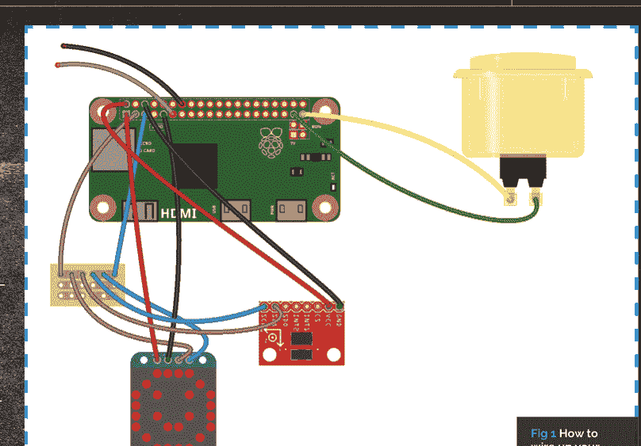

## PI-SABER

原力与 Pi Zero 同在，那么何不用它来为你自己的 Pi-Saber 供电呢？

### 所需材料
- Adafruit 双色 8×8 LED 矩阵 magpi.cc/1ZMEBM4
- 一个大按钮 magpi.cc/1ZMEGPM
- 电池供电的 3v LED 圣诞灯
- Adafruit ADXL345 三轴加速度计 magpi.cc/1ZMEMHh
- 一个游泳泡沫棒/泳池圈
- 一个充电宝
- 焊接工具套件、跳线和洞洞板
- 一些胶水、美工刀、胶带和一些魔术贴条

重现你最喜欢的绝地武士对战非常有趣，但许多玩具光剑都相当脆弱。这款 Pi-Saber 应该足够坚固，能够承受一些充满活力的重现。产生启动效果的 LED 在 Pi-Saber 挥舞时亮度也会波动，以最大化兴奋感。我们假设你已连接了 GPIO 接口。然而，为了更坚固的 Pi-Saber，你可以直接将每个连接焊接到 Pi Zero 上。

```
sudo apt-get install git python-pip python-dev python-imaging python-smbus
sudo pip install gpiozero
```

现在安装并测试加速度计。我们假设你有一个 ADXL345，但有一些替代品在稍作修改后也能工作。首先，安装这个方便的 Python 库：

```
git clone https://github.com/pimoroni/adxl345-python.git
sudo cp adxl345-python/adxl345.py /usr/local/lib/python2.7/dist-packages/
```

加速度计使用 I²C 总线，因此你需要进入 Raspberry Pi 配置程序并从高级选项中选择“启用 I2C”选项。重新启动后，如图 1 所示将加速度计连接到 Pi。进入 adxl345 目录并运行：

```
python example.py
```

晃动加速度计并验证 x、y 和 z 的显示值是否相应变化。

### 学徒的光
Pi-Saber 的手柄上会有炫酷的显示屏，按下主按钮时也会亮起。有很多不错的 Adafruit 8×8 LED 矩阵单元自带背包，可使 Python 控制变得简单。测试时，你只需通过面包板连接它们，但对于成品，你需要更稳健的方法。一个简单的选择是使用一块小洞洞板，直接焊接导线或使用公头排针。像往常一样，LED 矩阵有一个很棒的 Python 库：

```
git clone https://github.com/adafruit/Adafruit_Python_LED_Backpack.git
```

然后进入该目录并运行安装程序：

```
sudo python setup.py install
```

仓库中有几个示例脚本可用于测试。

Pi-Saber 的其他 LED 组件将覆盖主轴。有很多选择，但圣诞灯是获得一串预接线、低功耗 LED 的绝佳且廉价的方式。显然，LED 越多，Pi-Saber 效果越震撼。然而，将每个灯安装到泡沫棒中可能相当繁琐耗时，因此 20 个灯串在美观和理智保持之间是一个不错的折中。就在电池座之前剪断导线，剥去绝缘层，并在每根导线末端加上母端跳线座。将它们连接到 GPIO 上的 3V 和 GND 引脚并检查是否点亮。然后将一根导线从 3V 引脚切换到 GPIO 引脚 17。

### 帕达万的第一步
首先，在 Pi Zero 上准备好 Raspbian，以便我们能正常使用 Python：

加速度计使用 I²C 总线，因此你需要激活

### 绝地大师光剑
Pi-Saber 的最后一个元素是一个漂亮的大开关按钮。制作一些带合适连接的导线，或直接焊接到按钮触点上。然后如图 1 所示将其连接到 Pi Zero 的 GPIO 引脚（26 和其中一个 GND）。现在是时候把所有东西组装起来了。检查所有东西是否按 Fig 1 所示接线，然后通电



给 Pi 通电。下载 PySaber.py 代码（magpi.cc/1ZMFVi3），或将其输入到文本编辑器中并运行。

```
sudo python PiSaber.py
```

按下按钮之前不应该有任何反应：LED 矩阵应显示一个快速图案并

> 按下按钮之前不应该有任何反应：LED 矩阵应显示一个快速图案然后开始‘闪烁’

然后开始‘闪烁’。同时，灯串上的 LED 应该全部点亮。拿起加速度计，晃动它，你应该会看到剑身上的 LED 亮度波动。一旦一切正常工作，添加以下行：

```
python /home/pi/PiSaber.py &
```

...到 /etc/rc.local 文件（“exit 0”行上方），以便 Pi 启动时代码会自动运行。

现在将泡沫棒切成两半，然后像热狗面包一样纵向切开一半——不要切到底。测量你的泡沫棒并画草图，确定你的充电宝和按钮如何放入内部。弄清楚后，完全去除一半泡沫棒的相应部分，留下一个楔形。然后标记组件位置并切除那些泡沫块。顺便在剩余内侧泡沫棒上沿长度方向切出一条小沟槽用于 LED 电缆。现在计算 LED 之间的间距，使其环绕均匀，然后将其穿入；先用肉签或类似物打些导孔。一旦所有东西就位且导线整齐，用胶水将切开的剑身沿长度方向粘合回去。用胶带覆盖手柄部件，然后用魔术贴将其绑紧。应该就这样了——现在你已准备好进行史诗般的战斗。

语言 >PYTHON 2.7 DOWNLOAD: magpi.cc/1ZMFVi3
