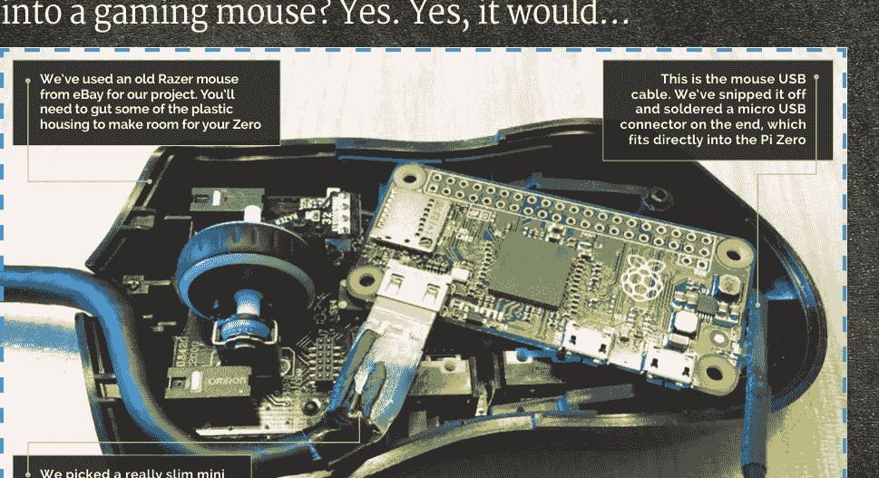
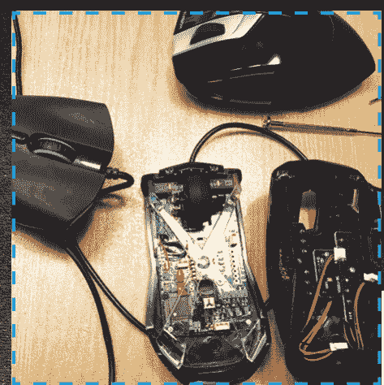
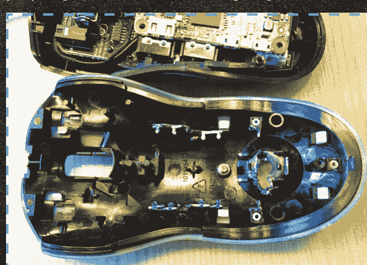
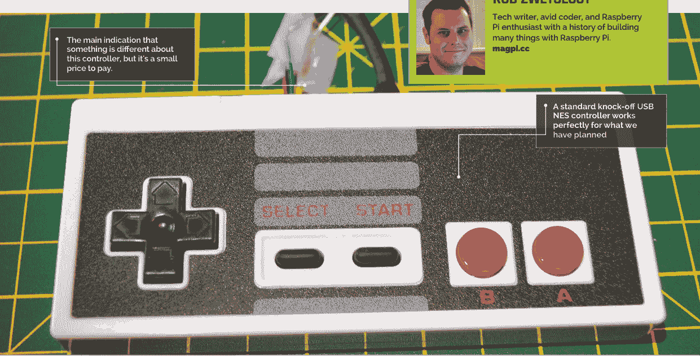

## QUAKE III MOUSE

如果能把一台完整的电脑放进游戏鼠标里，是不是很棒？是的。是的，会的…

### 所需材料
- 游戏鼠标
  - eBay
- Mini HDMI 线缆
  - amazon.com
- 2× micro USB 转 USB 线缆
  - amazon.com
- Quake III 文件
  - （你合法拥有的）

我们为项目使用了 eBay 上的一只旧 Razer 鼠标。你需要挖掉一些塑料外壳以腾出空间给你的 Zero

这是鼠标 USB 线缆。我们将其剪断并在末端焊接了一个 micro USB 连接器，可直接插入 Pi Zero

我们选择了一根非常纤细的 mini HDMI 转 HDMI 线缆以便放入鼠标。你可能还需要移除连接器外壳

### Pi Zero
当 Pi Zero 最初在内部公布时，Raspberry Pi 的 Eben Upton 提出了将其放入游戏鼠标并安装 Quake III 的想法。我们的脑袋炸了。由于现代游戏鼠标有这么多按钮，实际上只需稍微调整控制设置，就可以在完全不需要键盘的情况下控制奔跑和跳跃。从本质上讲，我们在这个项目中做的很多工作都是对本专题其他地方 SNES Consoller 项目的扩展：挖空一个游戏鼠标（大部分只是空的、符合人体工学的塑料），将其 USB 在内部连接到 Zero，你就基本完成了。当然，这些事情说起来总比做起来容易，而且确实花了几次 eBay 购物之旅才找到合适的鼠标。我们最终选择了 2009 年左右的一款旧 Razer Lachesis。它有一个滚轮，滚轮正后方有两个按钮，鼠标两侧各有两个按钮。它内部也有足够的空闲空间容纳我们的 Pi Zero 和 HDMI 线缆。完美。

由于游戏鼠标内部比复古控制器复杂得多，我们不得不很早就放弃了用电池为 Quake III 鼠标供电的计划。最终结果是，除了 HDMI 线缆从前面取代原始 USB 连接器伸出外，我们还配备了一根纤细（但超长）的 micro USB 转 USB 线缆。所述线缆很容易用套管或胶带一起包裹，而且如今大多数电视都提供可为 Pi Zero 供电的 USB 端口。最终，这只是一个小小的妥协。

## STEP-01
### 剖开鼠标
听起来很残忍，但一旦你能真正打开它，其实比你想象的要容易得多。我们的 Razer Lachesis 在鼠标底部贴纸下藏有一个单独的十字螺丝。拆掉它后，我们能够取下鼠标顶部盖的 LED 灯板，并用侧切钳修剪掉一些支撑支架和塑料模制件。Razer 方便地为 LED 灯甚至 USB 端口使用了连接器，因此清空一切以腾出空间变得轻而易举。

## STEP-02
### 焊接 micro-USB
接下来，我们剪断了鼠标的 USB 线，留出足够的余量在末端焊接一个可直接插入 Pi Zero 的 micro USB 连接器。就这么简单。布线很直接——将 micro USB 连接器最长的平边朝上并朝向你，布线从左到右焊接——黑色、绿色、白色和红色。由于 USB 完全通用，不可能弄错——只需搜索‘micro USB cable connector’即可找到示例图。焊接起来可能有点费劲，但只要有一支不错的烙铁和一些辅助工具来固定它，就相当简单。

## STEP-03
### 安装 Zero 和迷你 HDMI
现在我们要安装 Pi Zero，同时考虑到它会连接一根（相对）庞大的 HDMI 线。我们最好的建议是购买你能找到的最纤薄的 mini HDMI 转 HDMI 线，但你需要用美工刀小心地去除外壳，以免损坏线缆本身。在我们的 Razer 鼠标上，我们发现 Zero 斜着放置很合适，HDMI 线绕过机身通向旧 USB 线所在的前部端口。此时，明智的做法是确保能够牢固地密封鼠标，因为你可能需要再雕刻出一点塑料外壳来容纳它。

## STEP-04
### 为 Pi Zero 供电
遗憾的是，鼠标内部根本没有足够的空间容纳可充电电池和配套的电池控制器板。相反，我们将从 Zero 的电源端口引出一根纤薄的 micro USB 线，从鼠标前面引出，与 HDMI 线并行。一旦项目完成并正常工作，你可以把两根线用胶带缠在一起，或使用一些合适的热缩套管将其牢固地固定在一起。你需要确保两根线都足够长，这样在另一端有

足够的松弛度，并且 HDMI 和 USB 线都能插入。

## STEP-05
### 安装软件
下一步是在你的 SD 卡上设置一个 Raspbian Jessie 镜像；我们建议将 Zero 从鼠标中取出进行操作，并使用连接了键盘、鼠标和 WiFi  dongle 的 USB 集线器。安装好 Raspbian Jessie 后，你需要设置你的游戏（本例中为 Quake III）。安装并不轻松，但你可以在 magpi.cc/QuakeIII 找到该过程的完整说明。你需要重新编译游戏并从可靠来源获取 Quake III 的 pac 文件。抱歉——我们的律师不允许我们说得更具体了！

## STEP-06
### 终极游戏鼠标
电源和 USB 连接问题解决后，并且安装了最新版的 Raspbian Jessie 和 Quake III，剩下的就是进入选项菜单并将控制重新分配到尽可能多的鼠标按钮上。我们选择用滚轮切换武器，左侧两个按钮用于前后移动，相对的两个侧键用于横向移动。刚开始需要一段时间适应，但很快你就能掌握它。

## Tip
### QUAKE III
Raspberry Pi Beginners 有一个非常不错的 YouTube 视频，展示了在你的 Raspberry Pi 上安装 Quake III 的替代方法。
youtu.be/btSGRnXuaAAA

## Tutorial
### STEP BY STEP

## ROB ZWETSLOOT
技术作家、狂热编码者和 Raspberry Pi 爱好者，拥有用 Raspberry Pi 制作众多事物的工作经历。
magpi.cc

> 这个控制器与众不同的主要迹象，但这是值得付出的小代价。

> 一个标准的山寨 USB NES 控制器完全可以满足我们的计划
