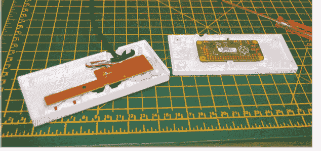
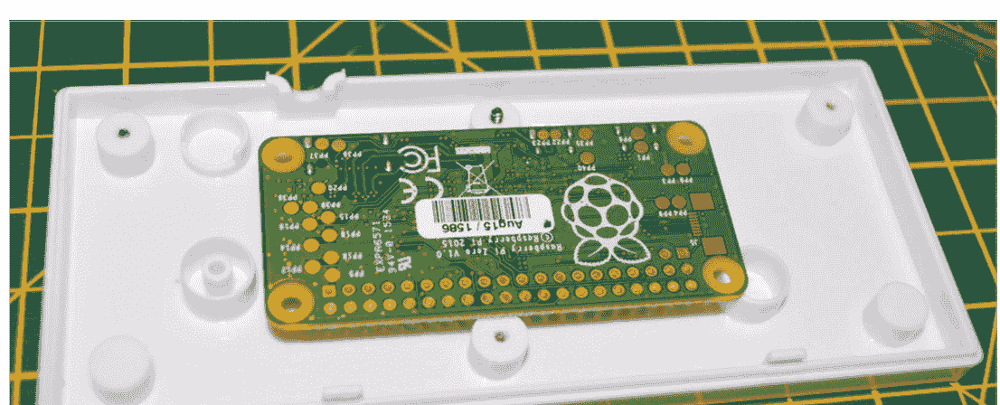
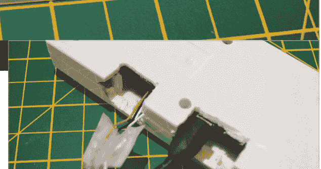
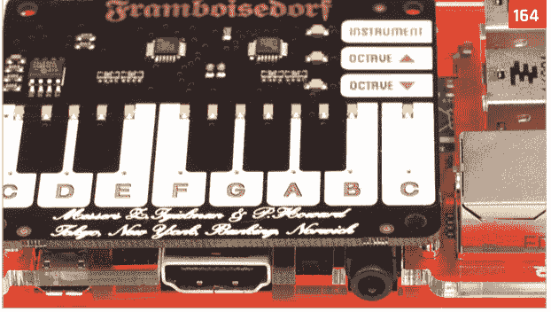
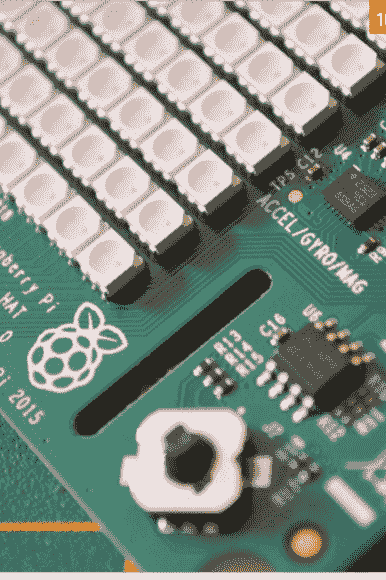
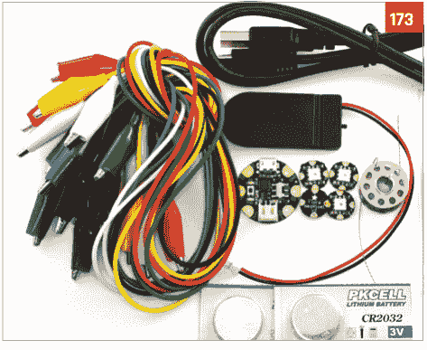
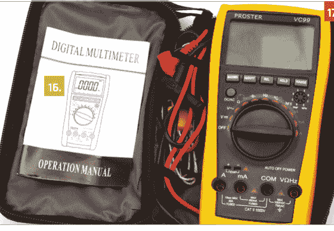

## NES ZERO
我们将上个月的项目创意变为现实，用一台被 Zero 赋能的 NES 控制器来运行 NES 游戏…

## You’ll Need
- USB NES 控制器（查看 eBay！）
- 一个 Raspberry Pi Zero - raspberrypi.org
- RetroPie - magpi.cc/z1HVgNba
- 一把旋转工具（如 Dremel）
- 一根旧的 micro USB 线
- 一把螺丝刀、烙铁和剥线工具

自从几个月前在 Pi HQ 第一次看到 Raspberry Pi Zero 以来，我们一直在思考 Pi Zero 的各种酷炫用途。其中一个最初的想法是将 Pi Zero 塞进 NES 控制器中，借鉴 Ben Heck 的伟大发明，进一步将 NES 迷你化到最核心的组件。

我们上期写过如何做到这一点，但现在我们终于有时间制作一个概念验证，所以我们将向你展示如何将 Pi Zero 完全装入 NES 控制器中。

## STEP-01
### 设置 RetroPie
这更多是为了方便。下载 RetroPie 镜像并使用你喜欢的方法将其写入 microSD 卡（如果你以前没做过，请查看 Raspberry Pi 指南：magpi.cc/1XTmymk）。写入后，在文件资源管理器中打开它，导航到 home、pi、RetroPie 并将你的 NES ROM 放入 nes 文件夹。

将 micro SD 卡插入 Pi Zero，并在开机前将 USB NES 控制器连接到它。然后你可以进行初始设置并配置控制器。

## STEP-02
### 腾出空间
似乎许多 USB NES 控制器内部结构大致相同（它们可能使用 NES 控制器的模具，或只是通用模具），因此你很可能需要腾出一些空间。我们使用旋转工具修剪了螺丝孔和边缘的环。我们想利用原来的 USB 线端口作为 HDMI 线，因此建议你将 Pi Zero（已插入 SD 卡！）放在后盖内，确定需要修剪的位置。

我们使用记号笔标记需要切割的位置，在工作过程中定期将 Zero 放在后盖上

## STEP-03
### 线缆孔
如果你和我们做一样的操作，不仅需要拓宽 USB 孔以便插入迷你 HDMI 线并为电源端口开一个新孔，还需要为 micro USB 端口伸出留出空间。标记出 mini HDMI 线需要切割的空间；你甚至可以考虑在后盖上切出一个正方形，以便更容易插入。边做边测试，但注意在打磨时塑料碎屑。

上方 我们的切割在某些地方有点粗糙；你可能还需要打开控制器的底部以便线缆放入

> 剩下的就是把它插入电视和电源…

## STEP-04
### 接线控制器
USB 线的接线非常简单，四根线提供电源、地线和数据。幸运的是，线缆内部的线色是标准的。剪掉你想牺牲的 micro USB 线的末端，剥去橡胶、编织线和包裹四根独立导线的箔层。剥开以露出芯线。对 NES 板上的 USB 线做同样的处理：在我们的设备上，线缆绝缘之前线是可以触及的。将对应的线焊接在一起，并用电工胶带或热缩管单独绝缘。

## STEP-05
### 组装
我们用了一点 Blu Tack 将 Pi Zero 固定在底板的内部，同时仔细确保 micro USB 连接器已插入并且不会遮挡连接控制器各部分的螺丝或卡扣。然后我们小心地将其拧紧并检查连接器是否合适。剩下的就是把它插入电视和电源，确保整个系统正常工作。

## STEP-06
### 开始游戏
正如我们所说，我们的版本只是一个概念验证。然而，它却在 Pi Wars 上成功度过了长达六小时的小朋友对老游戏的激烈挫败，显然控制器和 Pi Zero 足够坚固，可以承受长时间的游戏会话。你需要拆卸设备才能接触到 SD 卡并加载或更改其上的 ROM。不过，你可能可以让它通过 WiFi 连接并通过 SSH 传输文件。

## OTHER CONTROLLERS
你只需看看杂志前面关于 Xbox 控制器改装的内容，就能明白这可以用在其他控制器上

## 评测

了解最适合您 Raspberry Pi 之旅的最佳附加组件、操作系统和书籍

