## 目录

## 评测

## 评测

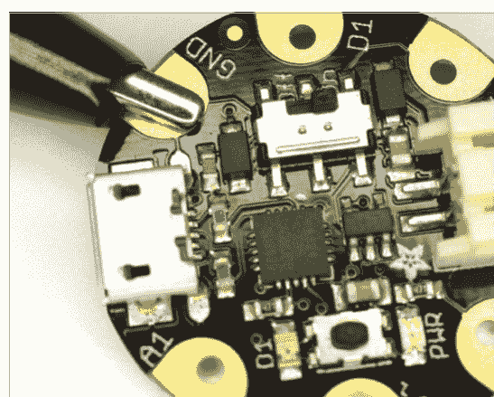

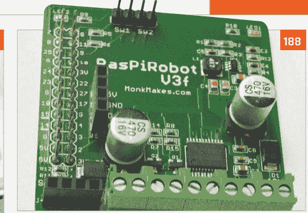

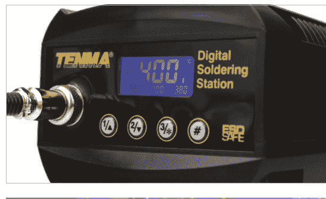

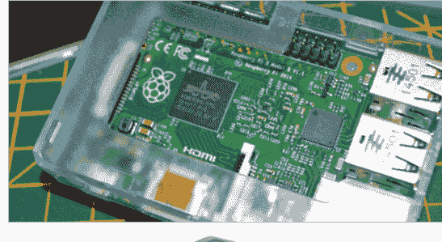

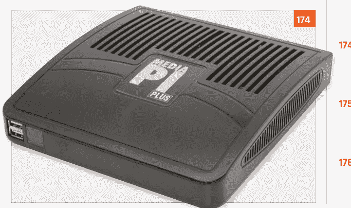

- 164 **钢琴帽**
- 用于您的 Pi 的音乐[content]
## 评测

了解最适合您 Raspberry Pi 之旅的最佳附加组件、操作系统和书籍

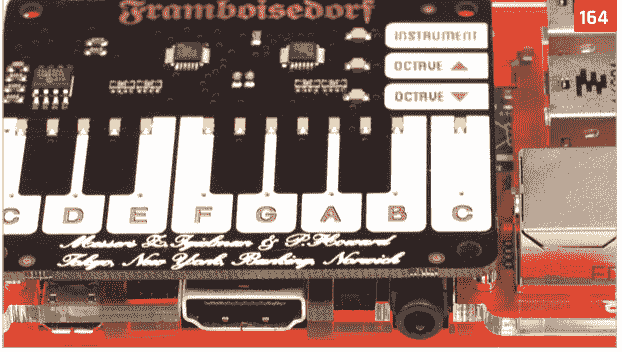

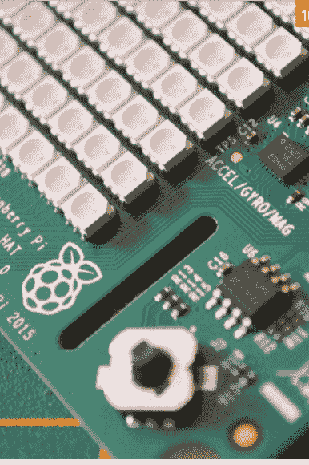

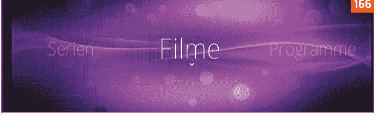

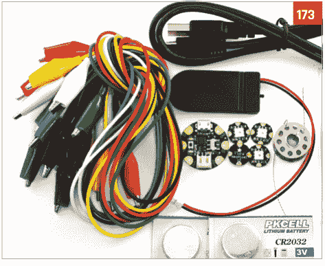

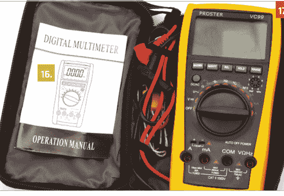

## 目录

## 评测

## 评测

- 164 **钢琴帽**
- 用于您的 Pi 的音乐乐器附件

- 165 **IQAUDIO PI DAC+**
- 让 Raspberry Pi 音频输出更佳

- 166 **LIGHTBERRY PI**
- 使用此氛围灯套件提升观影体验

- 167 **SPI-BOX**
- 用于创建简单 CCTV 系统的专用套件

- 168 **SENSE HAT**
- 为 Astro Pi 任务提供动力的特殊 HAT

- 170 **PROSTER MULTIMETER**
- 使用此多功能工具检查项目中的电路

- 172 **ADAFRUIT GEMMA**
- 可穿戴技术正流行，自己制作一些吧

- 174 **MEDIA PI PLUS**
- 适用于 Raspberry Pi 的专用外壳，使其成为终极媒体中心

- 175 **PIMORONI DAC HAT**
- 另一款有望提升 Raspberry Pi 音频的 HAT

- 176 **PI-TOP**
- 您自己组装的众筹 Pi 笔记本电脑

- 178 **DIGITAL SOLDERING STATION**
- 使用这款先进焊接站提升焊接技术

- 180 **BARE CONDUCTIVE TOUCH BOARD STARTER KIT**
- 使用导电油漆等制作有趣的电子项目

- 181 **MAGZOR STARTER KIT**
- 使用您自己的规格构建定制机器人

- 182 **CAMJAM EDUKIT 3**
- 为纪念 Pi Wars 竞赛而推出的微型机器人套件

- 184 **UBUNTU PI FLAVOUR MAKER**
- 为 Raspberry Pi 创建您自己的 Ubuntu 发行版

- 186 **LCD CONTROL CASE**
- 适用于 Raspberry Pi 的专用外壳，可使用微型触摸屏

- 188 **RASPIROBOT V3**
- 在下一个 Raspberry Pi 机器人中使用此机器人电机板

- 189 **ZEBRA ZERO**
- 专门为 Pi Zero 制作的精美木质外壳

- 190 **BOOKS**
- 了解许多优秀书籍，可帮助您制作和编程

## Maker Says

> 基于 Pi 的钢琴，经过 Pimoroni 的标志性润色
> Pimoroni

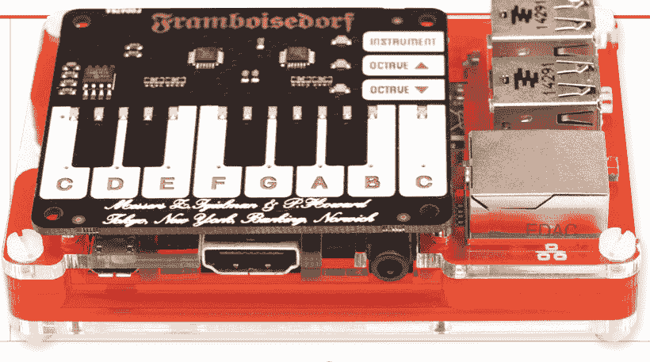

pimoroni.com

£15 / $24

## PIANO HAT

Les Pounder 审视了一款基于 HAT 的钢琴键盘，该键盘使用电容式触摸键作为输入

2014 年，一位名叫 Zachary Igielman 的 14 岁少年为他的 Pi Piano 发起了成功的众筹活动。最初使用 MCP23017 GPIO 扩展器和一系列瞬时开关创建，Pi Piano 使用压电蜂鸣器模拟音符的音调。Zachary 的顾问之一是来自 Pimoroni 的 Phil Howard，他与 Zachary 合作创建了这个新改进版本。

## 众筹项目

最新版本现称为 Piano HAT，并使用基于电容触摸的界面模拟传统钢琴键盘的一部分。该板尺寸为 64 毫米 x 56 毫米，可整齐地安装在型号 A+、B+ 和 Pi 2 之上。作为 HAT 板，它还连接到全部 40 个 GPIO 引脚。除了键盘之外，我们还可以通过板上的三个额外输入来提高和降低八度音阶并更改乐器。

硬件只是该项目的一部分，支持 Piano HAT 的软件全部基于 Python，这使得在此语言中创建的现有项目可以轻松集成 Piano HAT。Phil Howard 编写了一系列示例，使用 Pygame 库演示如何通过一系列音频样本将 Piano HAT 用作典型钢琴，这些音频样本可以根据需要更换为任何类型的声音，以便您构建自己的输入。Piano HAT 还附带一个教程，演示如何使用内置 LED 教导演奏一首简单的曲子，即“小星星”。因此，使用此库，我们可以为他人学习编写自己的教程。

## 强大的 MIDI 合成器

软件不仅限于简单的采样。事实上，Phil 提供了许多方法将 Piano HAT 库连接到 Pi 上运行的 MIDI 服务。这随后将 Piano HAT 转变为 Yoshimi 和 SunVox 等软件的强大合成器输入，尽管这些应用程序需要 Raspberry Pi 2。

Piano HAT 看起来像是一个相当简单的板，但得益于清晰的 Python 库、构建良好的硬件和强大的 MIDI 控制选项，我们拥有一个用于音乐冒险的板。

## 相关

## MAKEY MAKEY

这款多功能板已被用于制作楼梯钢琴、使用水作为相机触发器，以及使用意大利面制作键盘。

£40 / $50
makeymakey.com

## 最后的话

如此简单的板，但由于 Python 和 MIDI 的存在，应用无限。这是一个进行音乐实验的绝佳平台，并且可以轻松地与 Minecraft 和其他项目一起使用。
★★★★☆

IQaudio.com

£30 / $50

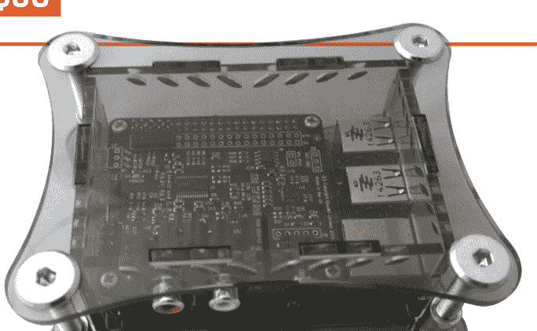

## Maker Says

> > 具有可变唱机线路输出和专用耳机放大器的卓越音质表现
> 
> IQAudIO

## IQAUDIO PI-DAC+

任何 Raspberry Pi 都能通过这款高分辨率 DAC 和耳机放大器成为发烧友音乐流媒体设备

## 相关

## AUDIOPHONICS I-SABRE DAC ES9023

Audiophonics 的 DAC 与 Pi-DAC+ 价格相似，但它缺少耳机输出。它使用 Sabre ES9023 DAC 而不是 Pi-DAC+ 中的德州仪器/ Burr Brown DAC，并包括直通 GPIO 连接器，以便您可以堆叠额外的板。

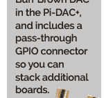

£30 / $48
magpi.cc/2dr8X2d

即使是独立的 Pi 也能成为非常不错的音乐流媒体设备，但添加高质量 DAC 后，它就成为真正的发烧友设备。IQaudio Pi-DAC plus 是一款符合 HAT 的板，使用 I²S 接口在 Pi 和 DAC 之间实现数字音频的最佳传输。安装后，您可以从两个唱机插孔获得模拟输出，用于连接到放大器，或 3.5 毫米耳机插孔，以及用于添加可选功能的额外引脚。

## 无需焊接

该板不附带任何说明，但您可以在 IQaudio 网站上找到这些说明。无需焊接，并且适用于 Raspberry Pi A+、B+ 和 2。您需要将提供的支柱拧到 Pi 上以支撑板，然后只需将其连接到 Pi 的 GPIO 板，轻轻拧紧即可。

IQaudIO 还可以提供一个外壳，即一个丙烯酸外壳，具有适合 Pi-DAC+ 端口的合适开口。组装后，您可以下载许多内置 Pi-DAC+ 驱动程序的音频中心发行版——包括 Volumio、RuneAudio 和 PiCorePlayer——或按照说明在现有安装中添加支持。IQaudio 网站上还有一个预配置的 Raspbian 镜像。我们使用了 Volumio 1.55，效果完美。音乐来源可以是 NAS 上的文件、Spotify 等流媒体服务，或直接连接的 USB 硬盘。

## 极佳音质

DAC 音质出色，由德州仪器 PCM5122 DAC 提供动力，分辨率高达 24 位/192kHz。从音质角度来看，配备此类 DAC 的 Pi 可以与更奇特、更昂贵的设备相媲美。我们对耳机输出也印象深刻：使用一对 Sennheiser HD600 耳机测试时，声音极佳，具有最佳音频的清晰度和宽敞感。

额外成本的扩展选项包括附加旋转音量控制或用于远程音量控制的红外传感器。Pi-AMP+ 是一款 2×20W 立体声放大器，可连接到板顶部。您还可以使用随附的可选直角排针，设计为焊接在 Pi-DAC+ 下方以访问 Pi 的 GPIO 信号。

## 最后的话

出色的音质和耳机放大器的加入使 Pi-DAC+ 成为热爱音乐的 Pi 爱好者的推荐配件。

## 创作者说
> 易于
> 安装，
> 简单
> 使用，令人愉悦
> 观看
> Lightberry

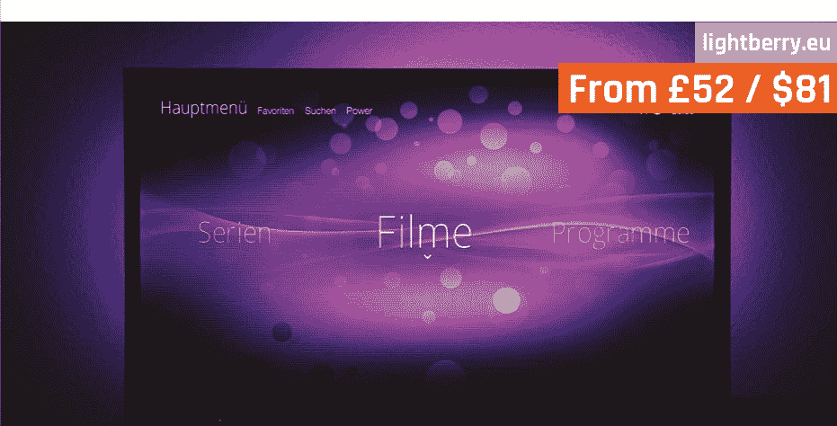

## LIGHTBERRY
Russell Barnes 测试了一项旨在为家庭影院体验增添新维度的技术

Lightberry 的灵感来自飞利浦开创的一种电视技术，名为 Ambilight。虽然该技术自然预装在 Ambilight 电视上，但完全可以对任何电视进行改装，以添加其特有的增强氛围的技巧。它有什么作用？原理很简单：你将一圈可变色 LED 灯环固定在 LCD 电视背面——前提是电视靠墙放置且环境光线较低——LED 上的颜色旨在与屏幕上的画面在颜色和亮度上完美同步，使得光线似乎从屏幕中渗出并在背景的墙面上舞动。正如飞利浦的创作成果一样，Lightberry——它利用 Raspberry Pi 进行计算——的全部目的就是为你的观看体验增添更多沉浸感。虽然想法很简单，但背后的技术绝对不简单，不过对大多数人来说，结果确实不言自明。

Lightberry 以整套套件形式出售，起价略高于 £50 / $80，也可单独购买各个部件。它旨在消除技术方面的烦恼，为你提供尽可能接近即插即用的体验。显然，从屏幕数据中采样数百万像素并在恰当时刻将其转换为正确的 LED、颜色和亮度并不是最简单的项目，但 Lightberry 让它变得简单。它还设计为可完美配合该技术的最佳软件解决方案，包括 Hyperion 和 Boblight。一旦你挑选了适合自己电视尺寸的合适长度 LED 灯条并订购了所需的所有套件，一切都会装箱送达并准备组装。虽然我们在盒子里没有找到说明书，但 magpi.cc/2drsyPG 提供了简短但实用的分步说明来帮助你快速上手。过程中最费劲的部分可能是安排和固定 LED 本身。其余部分只需连接适当的转换盒、下载软件并将其安装到 SD 卡上——任何 Raspberry Pi 用户都应该对此过程非常熟悉。

## 相关
## PHILIPS AMBILIGHT
Lightberry 的真正替代品是真正的 Ambilight 电视。我们在撰写时能找到的最便宜的一台是 £350。哎呀。

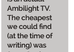

£350 / $550 起
bit.ly/1Ji6m9Y

## 最后的话
虽然需要一点试错才能找到最佳的 LED 位置，但一旦找到最佳点，我们发现 Lightberry 使用起来令人愉悦。它不是最便宜的 Raspberry Pi 项目，但它肯定会让家中的电影迷们满意。

## 创作者说
> Raspberry Pi 的安全摄像头解决方案
> 
> SB Components

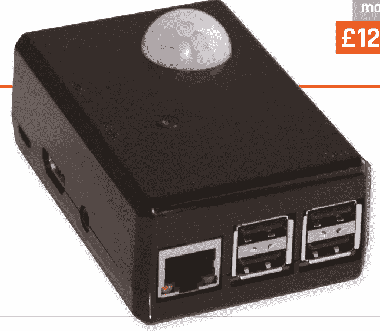

## SPI-BOX
一个非常简单的解决方案，用于创建不会花费过多的运动检测安防设备

这是在科技杂志中关于小型电脑和微控制器的经典教程之一：运动检测摄像头。你可以用多种方式实现——有些比其他方式更容易——而 Raspberry Pi 提供了许多工具，可以让这类项目总体上变得相当简单。

SB Components 推出了一款专为 Raspberry Pi 设计的运动检测摄像头套件。作为一种廉价安防系统，套件中的功能相当标准：一个 PIR 运动探测器、一个专用的整体外壳，甚至还有一个定制版的 Raspbian，附带发送安全警报的软件。全部价格略高于 £10；加上 Raspberry Pi B+ 或 2 以及 Pi Camera 的费用——在纸面上——你就能以约 £50 的价格拥有一台相当不错的安全摄像头。组装非常简单。

外壳分为两部分，Raspberry Pi 卡在底部部分，边缘周围所有主要端口均可完全访问。PIR 和 Pi Camera 可以拧到盖子上，而一根三线束用于将 PIR 直接连接到 GPIO 端口。插入提供的 SD 卡，你就可以开始使用了。

外壳背面有相当标准的安装孔，可安装在固定在墙上的几颗螺丝上。你需要设置设备上的邮件系统，可通过 SD 卡上的配置文件访问，你可能可以从另一台电脑上完成；不过之后它只需要一个 WiFi 适配器和电源即可完成工作。

由于代码是用 Python 编写的，如果你需要调整灵敏度或照片/视频的捕获方式，修改起来相当简单。整体效果相当不错，尤其是考虑到价格，不过我们不会依赖它进行任何严肃的安全工作。

说实话，这和任何其他 Raspberry Pi 安全摄像头一样好。它会比你自己拼凑的要好得多，而且可能更便宜、更整洁，所以如果你对增加一点安全性感兴趣，不妨看看。

## 相关
## NATUREBYTES
Naturebytes Wildlife Cam Kit 虽然设计用途不同，但可以配置用于安防。它也是防水的。

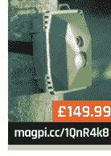

## 最后的话
这是一款很棒的小套件，非常简单地创建了一台可用的 Pi 驱动安全摄像头，非常适合任何室内应用。它也几乎不超过 £20（带摄像头），是一种廉价的方式来更好地监视某物。

## 创作者说
> 自己制作 Astro Pi！
> Raspberry Pi

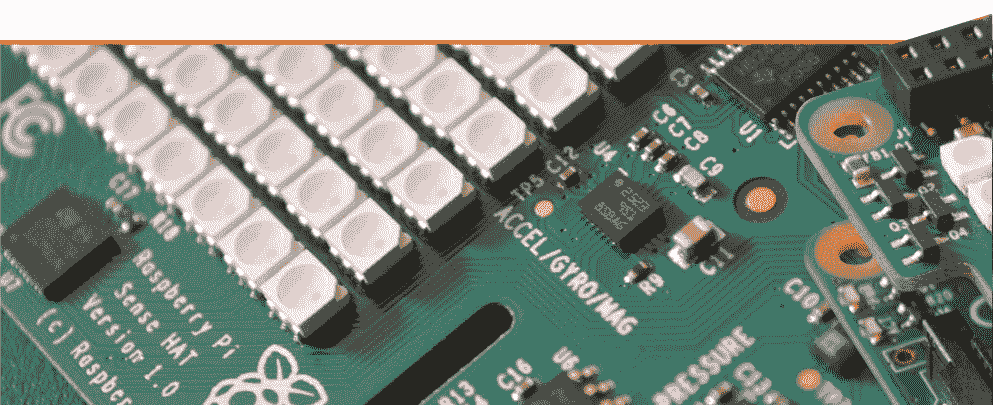

## SENSE HAT
太空：最后的边疆。这是 Sense HAT 的航行。它的使命：让 Raspberry Pi 用户轻松感知环境。勇敢地前往没有 Pi 去过的地方……

## 相关
## ARDUBERRY
虽然没有什么是完全像 Sense HAT 的，但 Arduberry 允许你将 Arduino 板连接到 Pi，从而能够创建自己的定制传感器套件，尽管成本更高。

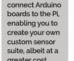

$29.99/£19.70
magpi.cc/2drt54j

如果你从头到尾阅读过这本杂志（你真的应该这样做，我们这里有一些顶级内容。别担心，我们会在这里等你追上进度。好了？很好！），你就会看到从第 6 页开始的 Sense HAT 发布故事。这块小板使 Astro Pi 成为可能，集成了传感器套件以及一个非常简单的 LED 显示屏。它的想法是它坐在你的 Pi 的 GPIO 引脚顶部，通过几个额外的软件包为你提供来自周围环境的更多数据。

像 Raspberry Pi 基金会生产的所有其他硬件一样，它的价格相当便宜。另一方面，它的价格几乎与 Raspberry Pi 2 Model B 相当，因此可以被视为对一块扩展板来说有点贵。但从大局来看，考虑到它赋予你的功能，Sense HAT 代表了物超所值的选择。它之所以如此便宜，是因为它被设计为易于构建，并做出了一些妥协以保持价格低廉。

## 便宜如硅芯片
别误会：Sense HAT 绝对不是廉价产品。它的结构与 Raspberry Pi 相同坚固，没有容易损坏的突出电容器或其他元件。毕竟它是要被发射到太空的，所以需要相当坚固。我们不会开始踩它来测试它的坚韧程度，但它可以承受被粗暴地装上和卸下 Raspberry Pi。它非常紧密地安装在 GPIO 引脚上（占用全部 40 个引脚），甚至可以用其他 GPIO 接头或连接到各个引脚的导线使用。在编程上没有问题，只要你不是同时尝试使用 Sense HAT 的功能，尽管如果你知道特定传感器或 LED 矩阵使用的引脚，你可能可以用一点创造性编程来绕过它。

Sense HAT 上的具体传感器种类繁多。有通常的环境传感器套件，如温度、压力和湿度，沿

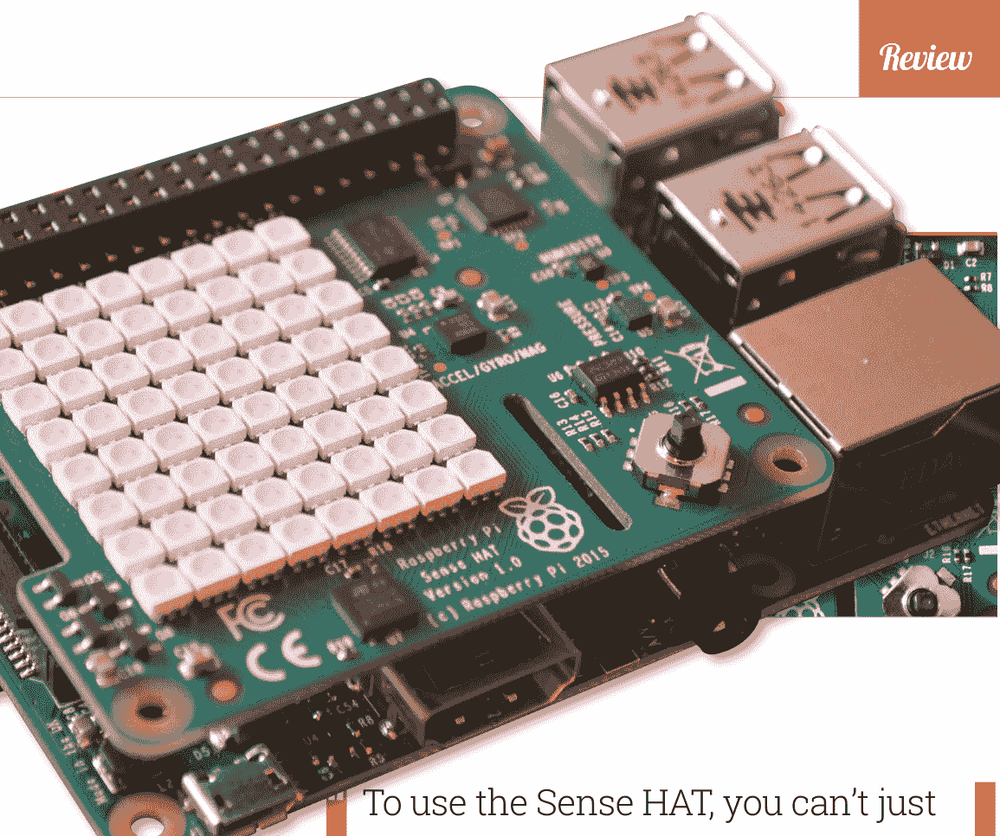

> 使用 Sense HAT，你不能只是为它打开一个图形界面

配备了三组位置传感器，包括加速度计、陀螺仪和磁力计。它们都相当精确，能够在各自领域感知广泛的范围，其输出会即时修改以便使用 Sense HAT 库读取。

## 戴上你的编程帽子

使用 Sense HAT，你不能只是为它打开一个图形界面……至少目前还不行。实际上，创建通用界面或满足你需求的定制界面非常简单，因为坦白说，Sense HAT 的编程方面非常直接，使用 Python 的基本语法和一些自身简单的命令结构。因此，你只需几行代码就能轻松从 Sense HAT 获取数据，并且非常容易将数据或图像打印到屏幕上。文本输出由代码处理，因此你不需要做任何荒谬的编码来更改单个图片以使其在屏幕上滚动。

输入和输出的控制也非常全面，Sense HAT 的全部功能都可随时使用。也有大量在线资源（通过 Astro Pi 和 Raspberry Pi 网站）来帮助你学习如何使用它。我们喜欢那个笑脸教程示例；它让我们感到开心。

## 我们嗅到赢家了

总的来说，这是一款出色的设备。它做工精良，功能众多，而且编程也非常容易，得益于为该板提供的出色软件。你可以单独使用它，也可以与其他项目结合使用（我们不久后想把它连接到机器人上），如果它足够好用在国际空间站，那么它肯定足以应付你可能有的任何疯狂想法。

## 最后的话

Sense HAT 易于使用，并且不会为此妥协任何功能。它物有所值，是一个很棒的板子，真正扩展了你能用 Pi 完成的事情。

★★★★★

## 制作者说

> > 非常
> 具有成本效益的
> 万用表
> 带有
> 模拟条
> 
> Proster

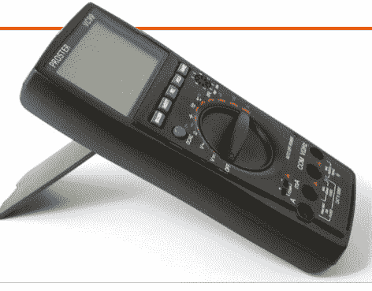

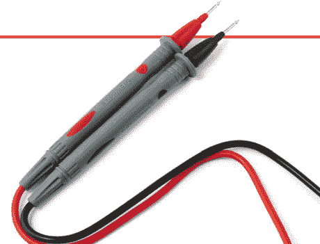

## PROSTER VC99
万用表

万用表 VC 系列能满足爱好者的一切需求，它看起来像个划算的选择吗？

## 相关

## EXTECH EX330 万用表

EX330 拥有 Proster VC99 的所有功能，只是将晶体管测试模式换成了非接触式交流电压检测，并且包装更紧凑。可惜的是，它的价格也贵得多。

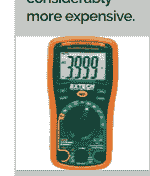

£47 / $60
adafruit.com

多年来，爱好者可负担的万用表与专业级硬件之间一直存在差距。摆脱街头电子商店里 10 英镑的万用表通常意味着要花费 100 英镑或更多来购买专业设备。最近，中国万用表开始在不破产的情况下给大牌带来严重竞争——像 Proster VC99 这样的设备就是例子。

VC 系列的一部分，Proster VC99 可通过其原始设计制造商（ODM）在不同品牌下获得，旨在为爱好者提供比普通口袋万用表更广泛的功能。当然，通常的功能都齐全且正确——交流电压感应最高可达 1,000V，直流最高可达 700V，电流测量最高可达 20A，最长十秒，电容测量，以及带视觉和听觉连续性测试模式的电阻测量。

但 VC99 真正填满了附加功能列表：有一个频率计数器模式，适用于测量最高 60MHz，精度为 ±0.5%，一个带捆绑 K 型温度探头的温度感应模式，以及通过内置多极插座为 PNP 和 NPN 晶体管进行电流增益测试（hFE）。对于任何曾经购买过带 hFE 模式插头适配器的万用表的人来说，只是在购买后不久就丢失了该适配器，仅此一项功能就物有所值。

## 为质量付费

自然，Proster VC99 不会花费两倍价格的原因有很多。其中最主要的是其精度：虽然 ±0.5% 的基本精度与即使是昂贵的万用表相比也不错，但电容测量的 ±3.5% 精度评级就明显逊色了。屏幕虽然大，在大多数条件下易于阅读，但没有背光，后壳的支架只能以相当平缓的一个角度支撑万用表。

令人惊讶的是，VC99 并没有在每个角落都偷工减料。随万用表附带的是一个方便的拉链收纳袋，而机身外围的防震橡胶还包括探头的收纳支架。这些也值得一提：与同价位竞争对手相比，VC99 随附的探头质量出奇地高。除非你需要特定的东西，比如探头末端带测试钩，否则你不太可能很快考虑升级。

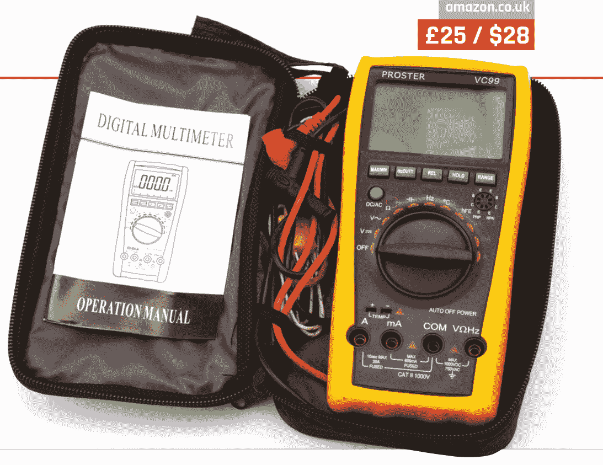

## 基本功能

为 VC99 设置测量时，很容易忘记它是一款经济型万用表。探头牢固地固定在端口中，模式拨盘切换时带有令人愉悦的触觉咔嗒声。显示屏下方设有按钮用于各种功能，包括在频率和占空比测量之间切换——对于使用软件驱动脉宽调制的 Pi 项目测试非常方便——以及启用最大和最小读数的记录。还有一个按钮可启用相对测量：例如在测量电阻时，这可用于自动从显示数值中减去测试探头本身的电阻。你在低廉的购买价格中得不到的是任何校准证书的迹象。虽然我们测试单元的测量结果与校准硬件相比是准确的，但不能保证生产线上的下一台型号校准得同样好。如果有可供比较的校准硬件，可以拆下万用表的机壳，通过调整板载电位器手动校准，但这样做会使你可能拥有的任何保修失效。

## 难以阅读

Proster VC99 的另一个争议点是随附的手册。小巧且写得令人困惑，它提供了使用设备所需的大部分信息，但不是以最易获取的方式。糟糕的翻译迹象也很明显，包括在万用表正面，其在 15 分钟不活动后自动关电的能力自豪地印为‘AUTO OFF POWER’。这些都是小问题。虽然不是每个爱好者都需要比普通口袋万用表更功能丰富的设备，但那些需要的人会发现 VC99 完全胜任。任何在光线不足的环境中工作的人，都最好把省下的钱花在灯上，以弥补万用表显示屏缺乏照明的不足。

## 最后的话

虽然其精度更适合爱好者而非专业人士，但 Proster VC99 万用表以口袋友好的价格提供了丰富的功能。

## 制作者说

> > 一个功能强大的迷你可穿戴平台板
> >
> > Adafruit

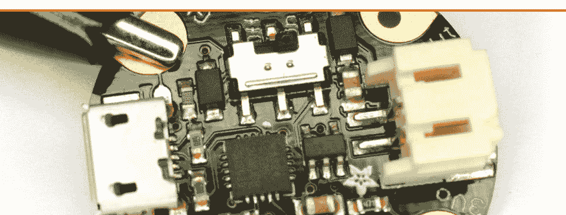

## ADAFRUIT GEMMA STARTER PACK

作为可穿戴电子编程的入门，Adafruit 是否组装了完美的套件？

## 相关

## KITRONIK ELECTRO FASHION E-TEXTILES DELUXE KIT

在第 37 期中评测过，Kitronik 套件的编程能力比 Adafruit 的少，但在英国可以以更便宜的价格买到。

£15 / $35
cpc.farnell.com

随着可穿戴计算成为蓬勃发展的业务，找到帮助创客入门的公司也就不足为奇了。由此产生的套件大多数基于导电线，可以缝入织物中以在电气上连接组件。因此，很容易看到 Adafruit 的 Gemma Starter Pack 中包含的 LED 和导电线线轴，并将其视为又一个跟风产品。但这样做忽略了主角——Gemma。

Gemma 由 Arduino 公司合作设计和制造，是为 Atmel 的超紧凑型 ATtiny85 微控制器的智能 breakout 板。ATtiny 微控制器是 ATmega 芯片的精简版，后者为全尺寸 Arduino 板供电。当低功耗和小型占用比可访问的引脚数量更重要时，ATtiny 微控制器是很好的选择。这使其成为可穿戴项目的明显选择。

使用 ATtiny 与导电线最大的两个障碍——需要特殊编程设备及其封装类型——都被 Gemma 解决了。该芯片放置在一个直径仅 28 毫米的小圆盘上，配有三个可编程 I/O 引脚、3.3V 供电和地、以及电压输入的连接器。JST 连接器允许电池轻松连接，而 USB 连接器配合专门编写的引导加载程序意味着 Gemma 可以使用标准 Arduino IDE 和捆绑电缆从任何 PC 编程。

Gemma 是明星，但入门套件还有很多其他零件。彩色鳄鱼夹的捆扎使你在用导电线缝制之前可以轻松原型设计你的设计，缝制所需的针也一并提供。有四个 Adafruit 著名的可编程 RGB NeoPixel LED，采用适合可穿戴的 Flora 形式，以及一个用于捆绑 CR2032 电池的电池架，带集成电源开关。

线本身质量很好，提供了慷慨的 23 米长度。由不锈钢制成的薄双股编织，比竞争对手 Kitronik Electro Fashion 系列中使用的较粗线更容易操作，但附带警告说它不适合组件功耗超过约 50mA 的项目。可单独购买的三股替代品可承受高达 100mA；两者均提供在适合任何重型缝纫机的预绕线轴上。

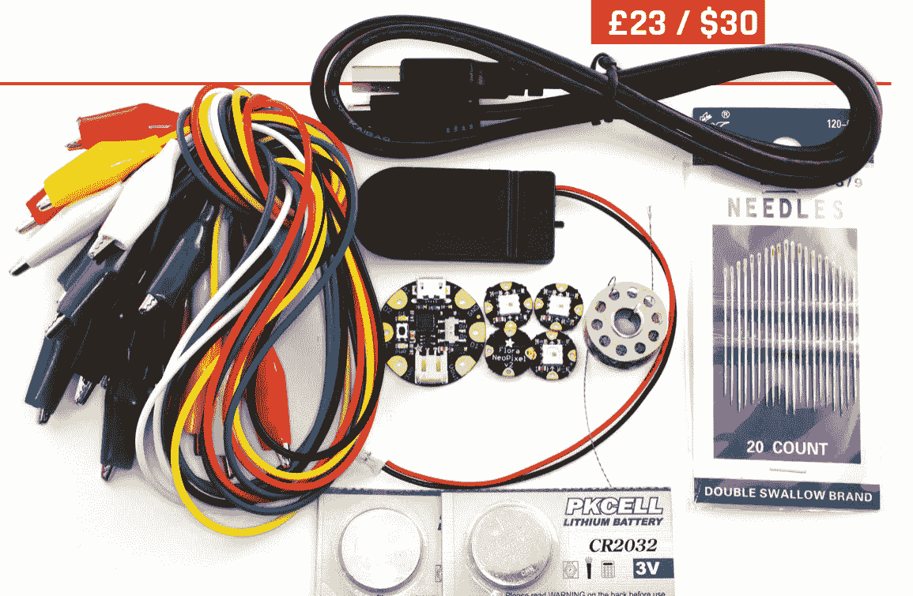

## Gemma 是主角，但还有很多其他部件

与大多数电子纺织品入门套件一样，毫无疑问重点放在 LED 项目上。 一旦你玩腻了给孩子玩具加上 RGB 发光眼睛，就能开始尝试 Gemma 的威力。 虽然三个输入输出引脚感觉有限，但它们提供了惊人的灵活性：其中两个支持脉宽调制 PWM，可用于调光 LED 或驱动小型舵机，而另一个也可以用作模拟输入来读取各种可选传感器。 不过，这些必须与 Gemma 使用的 3.3V 逻辑兼容，而这与 Arduino 世界中更常见的 5V 逻辑不同。

对于希望项目能直接迁移的 Arduino 爱好者来说，也有令人失望的地方。 除了引脚数量有限外，Gemma 没有可访问的串行端口。 这意味着它无法与例如串行连接的蓝牙或 Wi-Fi 适配器结合，轻松制作联网服装。 然而，专注于它不能做什么，就忽略了套件的真正目标。 Adafruit 将 Gemma 套件宣传为初学者入门可编程穿戴式和电子纺织品项目的完美方式，也是其非可编程 LED 基础套件的明显下一步。 使用可循环切换数百万种颜色的 RGB LED 让事情保持有趣，而套件的低成本使其对仅对电子纺织品项目稍感兴趣的人以及希望在下一次制作中尝试一些不同之物的 Arduino 用户都具有可及性。 唯一的真正负面是缺乏印刷文档。 虽然 Adafruit 网站上有大量支持信息、教程和项目，但像竞争对手 Kitronik 套件那样提供的小册子本会被欢迎，并有助于使这款产品成为真正独立的产品。

上方 套件包含开始所需的一切

### 最后的话

如果你有 Arduino 平台的经验并想进入可穿戴电子领域，Gemma 就是正确选择，而这款套件是完美的入门方式。

### 创客说

> 新款 MEDIA PI+ 增强外壳，适用于 Raspberry Pi 2
> SB-Components

magpi.cc/2dVKN2t
£39.99 / $60

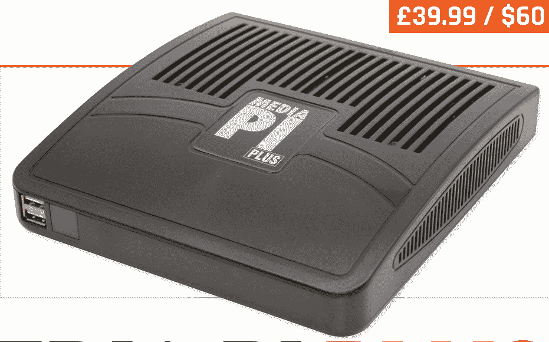

## MEDIA PI PLUS

A media centre case and remote for your Raspberry Pi: is it a necessity for a TV-connected Pi, though?

我们都知道至少有一个人只是把 Raspberry Pi 用作媒体中心，在电视上运行 Kodi，甚至是能完成工作的古老 XBMC 版本。 长期以来一直缺少的是适合连接电视的 Pi 的外壳——一个可以不显眼地放在电视下方、旁边是 Sky+ 盒子和你多年未碰的 Wii 的外壳。

虽然 Media Pi Plus 不是第一个，甚至不是第一个 Media Pi 产品，但它们稀少到值得突出讨论。 就 Media Pi Plus 而言，它是为 Raspberry Pi B+ 和 Pi 2 的外形尺寸重新发布的。 从美学角度看，它绝对看起来像是你会放在电视下方的东西，具体来说就像 Freeview 盒子：它低调、黑色，品牌标识非常少。

外壳需要一些组装，因为不包含 Raspberry Pi。 打开外壳，你可以看到它是如何工作的：它向外延伸并在很大程度上空的外壳内重新安置了 Raspberry Pi 的多个端口。 虽然这看起来有点多余，但它确实为 USB 端口提供了额外电力，允许连接集线器。 你也可以直接将红外接收器连接到 GPIO 端口，这与附带的媒体遥控器配合良好，即使你只能用它关闭 Pi 而不能重新打开。

它主要是为 Kodi 设计的，这就是为什么我们的版本附带预格式化的 SD 卡上的 OpenELEC，虽然其他 Kodi 版本和分支 我们说的是 OSMC 也能很好地工作。 你可能需要调整一些遥控器设置，但总归没问题。

Media Pi Plus 最好的地方是它非常便宜。 即使算上 Pi 2，整套也只要 70 英镑出头，这对于一个能够长期可靠提供 1080p 的媒体中心来说性价比非常高。 组装有点棘手，外壳感觉有点脆弱，不过如果你不打算乱扔或粗暴对待，它是让你的 Pi 媒体中心使用起来更方便的完全可用的方式。

### 相关

### MODMYPI MODULAR CASE

The modular case can be modified to fit in better with your lounge, revealing only the ports you need to connect to a TV.

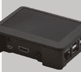

£5.99 / $9
bit.ly/1M4gQTi

### 最后的话

The box is a bit bulky in relation to the Pi's size, but it does a good job of making the small jump needed to get the Pi better suited for powering a TV.

★★★☆☆

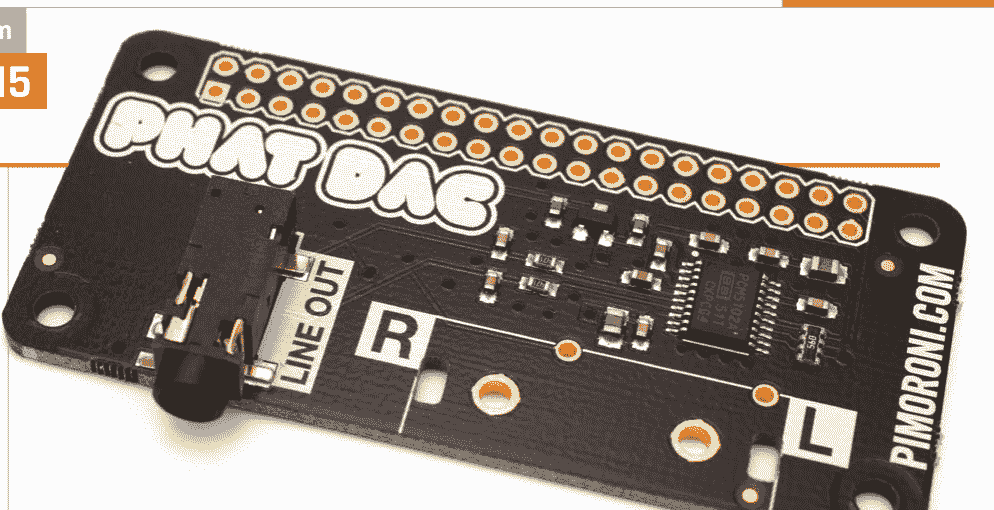

### 创客说

> 适用于 Raspberry Pi 的超实惠高品质 DAC
> Pimoroni

## PIMORONI PHAT DAC

If you’re disappointed by the Pi Zero’s lack of analogue audio output, the pHAT DAC may be just the add-on you need

### 相关

### HIFIBERRY DAC+ STANDARD RCA

The HiFiBerry uses top-quality components and has RCA jacks pre-soldered, but its size makes it less suitable for Pi Zero use.

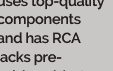

£23 / $40
hifiberry.com

Pi Zero 的微小尺寸使其非常适合各种任务，除了其功能列表中的一个遗漏：模拟音频。 对于任何试图将 Pi Zero 嵌入旧收音机或音响系统的人来说，这是一个太大的损失。 幸运的是，Pimoroni 的聪明人提供了 pHAT DAC 解决方案。 pHAT DAC 是 pHAT 家族的一部分——该系列硬件附加在顶部 HAT 板专为 Pi Zero 外形尺寸而设计——它为板子添加了高质量的数字模拟转换器 DAC，允许任何 Pi Zero 输出线路电平音频，准备进行外部放大。 pHAT DAC 的输出不应与全尺寸 Raspberry Pi 系列的模拟输出混淆：pHAT 的德州仪器 PCM5102A DAC 更胜一筹，提供无噪声 192kHz 24 位线路电平音频。

pHAT DAC 随附一个需要焊接到板上才能连接到 Pi Zero 的 40 针母头，而 Pi Zero 上需要焊接 40 针公头。 Pimoroni 的做法是有方法的：如果你在制作永久项目，可以去掉母头并将 pHAT DAC 直接焊接到 Pi Zero 的引脚上，创建一个超薄的电路板三明治。 你还可以添加一对单独以 1.50 英镑出售的 RCA 连接器，以补充 3.5mm 插孔。 焊接完成后，安装并不像它本可以的那样简单。 提供了逐步说明，但不适用于最新的 Raspbian 版本——而且虽然社区成员已提供安装脚本以使其更易于使用，但这尚未链接到产品页面。 安装完成后还有另一个问题：没有简单的方法在 pHAT DAC 和 HDMI 输出之间切换。 对于大多数用途来说这不是问题，但如果你计划将 Zero 变成多功能便携式音乐播放器，这可能会造成困扰。 一旦运行起来，pHAT 还是有很多值得喜欢的地方——尤其是与优质放大器和不错的音箱搭配时提供的出色音质。

### 最后的话

While the installation experience needs work, the pHAT DAC certainly fills a hole. If you need analogue audio from your Pi Zero, it can’t be beaten – but paying three times the cost of the Zero itself may sting a little.

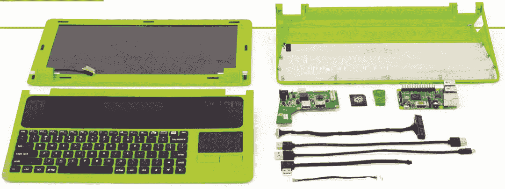

## PI-TOP

由 Raspberry Pi 构建并由你亲手打造的笔记本电脑。

它是否被 Pi 过度限制，还是一个很棒的小型便携教学工具？

它其实并不算老，但你还记得 One Laptop Per Child（OLPC）项目吗？它是一款使用往昔组件的廉价笔记本电脑，专门为尽可能简化将计算技术带入最贫困的发展中国家而创建。它也非常“绿色”，我们并不是指生态意义上的——虽然它功率也相当低，所以从这个意义上讲它技术上确实是“绿色”的。当我们把 pi-top 从盒子里拿出来时，这就是首先浮现在我们脑海中的东西，但绝对不是贬义！pi-top 的电梯演讲是，它是一款众筹的笔记本电脑套件，需要用户自行组装，并由附带的 Raspberry Pi 驱动。当然它远不止于此，我们稍后会深入介绍，但这已经让你对我们所面对的东西有一个基本印象了。

### 抛开第一印象

pi-top 内置了强烈的教育导向。每个 pi-top 用户在登录前必须创建一个云账户，然后设置等内容会同步到该账户。它还会同步来自 CEED Universe 的数据，这是一款游戏化学习软件，专门为满足新的 GCSE 课程而定制。除了常规的 Raspberry Pi 教学资源外，这让它在课堂上更具优势，因为学生可以使用任何一台 pi-top，而不必随身携带太多数据。理论上听起来很棒。不过在讨论其其他优点之前，让我们先回到开箱环节。盒子本身很精美，最先映入眼帘的是分离的笔记本屏幕背面那鲜亮的绿色，上面印有 pi-top 标志。所有零件分层存放，用柔软的泡沫仔细包装。你需要仔细寻找激光切割的可拆卸电路盖以及所需螺丝和线缆的选件，但它们都在。说明书，以及组装过程，都相当简单。笔记本底壳主要有三个部分，电路板只有两块包括 Raspberry Pi，所以大部分过程都是准备和装配零件。虽然说明书总体不错，但对两种螺丝的区分并不太好。提示：看起来像主板铜柱的螺丝需要固定到 PCB 上；它们头部中央有一道螺纹。另外，其中一个连接方向也不完全清楚。我们在某个时候不得不拆开一点，才能正确组装。

### 相关

### KANO

在游戏化编程教育和搭建方面类似，但它并不是像 pi-top 那样的全能一体产品。

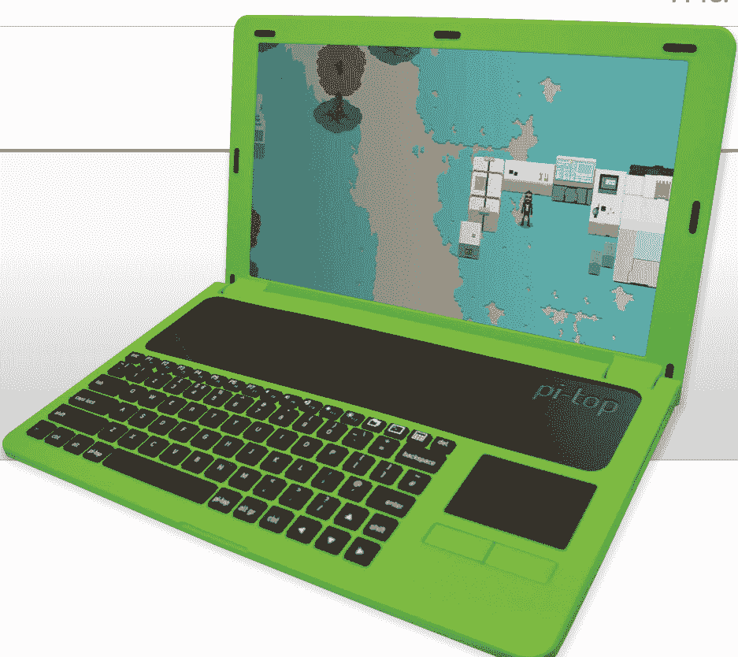

### 厂商说

> 用我来玩、学习和创造！
> Pi-Top

> 它看起来很棒并且完全正常工作，多亏了 Pi 2 处理器带来的额外动力

否则，组装相当迅速。我们打开了 Netflix，看了几集《博杰克历险记》后它就准备好启动了，所以不到一小时，而且如果每分钟不傻笑的话可能更快。确保所有端口和线缆都正确连接，然后就可以第一次开机了。

第一次设置账户非常快速简单，你还可以选择想要从面板快速启动的软件。pi-topOS 是基于 Raspbian Wheezy 的定制界面，提供不同的默认软件，尽管你仍然可以完全访问 Raspbian 上可获得的标准软件包。

界面大致与普通 Raspbian 相同，但面板位于底部，并且在一些显示特性上更具 OS X 风格。它看起来很棒并且完全正常工作，多亏了 Pi 2 处理器的额外动力；我们唯一遇到的问题是默认选用的 Chromium 浏览器仍然有点慢。

CEED Universe 在撰写本文时仍处于早期 alpha 阶段，相当有趣。从 Minecraft 中借鉴资源收集和建造元素，并将其应用于九十年代初期 PC 游戏的俯视美学，以此来教授编程和物理计算，这相当独特。

玩家被要求在游戏中执行 Python 编程任务，从类似 Hello World 的内容开始。它非常游戏化，如果做得好，最终版本会非常出色。

因此，pi-top 是一款很棒的设备。虽然它可能不会取代同价位范围内的普通笔记本电脑，但它是一款出色的教育工具。它也是一款便携式 Raspberry Pi，续航时间为十小时，这本身就很棒。希望它能进入课堂，或落入有志青年程序员手中。

### 最后的话

充分利用 Raspberry Pi 创造出一台功能完备的笔记本电脑，由你亲手组装——整个系统对于想要学习的人来说是一次很棒的体验。

### 厂商说

> > 提供
> > 几乎
> > 瞬时
> > 工作
> > 温度
> > Tenma

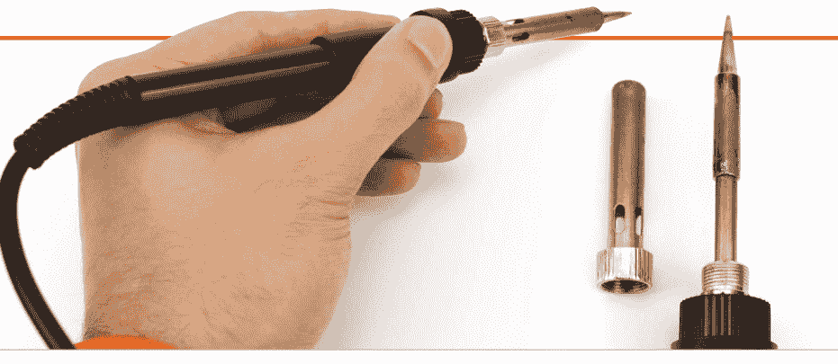

## TENMA 60W DIGITAL SOLDERING STATION

Gareth Halfacree 探讨度级精确的温度控制是否在业余焊接工具包中有一席之地...

### 相关

### WELLER SP25N

对于小型焊接作业来说，像这款 Weller SP25N 这样品质良好的恒温烙铁，是笨重焊接站更便宜的替代品。

£20 / $14

amazon.co.uk

洞洞板对于原型制作来说很好，但每个电子爱好者的生命中总会到来一个时候，需要熔化金属并开始焊接东西。无论是修复损坏的东西还是建造新东西，焊接都是一项重要技能，其难易程度取决于你选择的工具。Tenma 60W 数字焊接站旨在弥合超廉价恒温烙铁与专业工程师工作站上精细调校的高端工具之间的差距，前者是业余焊接者的主力。售价低于 50 英镑/70 美元，其功能列表仍然令人印象深刻：笨重的底座可将烙铁温度控制在最低 150°C 至最高 450°C 之间，要么通过在三个预设温度等级之间切换，要么自行设置，并且它以 60W 的功率提供 ±1°C 的稳定性。

为了在本次评测一开始就把话说清楚：不，你几乎肯定不需要一台高度精确的温控焊接站。然而，它可以让生活更轻松。如果你曾经尝试焊接并发现有时焊锡就是不流动——特别是在制作大连接时——那么你就体验过使用功率不足的烙铁无法快速提供热量的挫败感。如果你焊接过程中看到 LED 或其他怕热元件冒烟，那么你就体验过另一面：烙铁提供了过多的热量。

### 温度控制

温控烙铁解决了所有这些问题。你可以为所使用的焊锡设定合适的温度，并且它会被板载控制器跟踪和调整。如果大焊点过快地带走烙铁头热量，输出会增加；如果烙铁头过热，输出会降低。目标是达到一度温度稳定性。这是一项强大的功能，相比更便宜的不会自动调节输出的可变温度烙铁，这是一个明显的提升。作为入门级产品，你会期望在 Tenma 的做工上看到一些妥协。看底座单元，这些妥协并不明显：单元结构坚固并包括物理电源开关，而正面大型的背光 LCD 显示屏清晰易见，同时

## TENMA 60W 数字焊接站
### 评测
cpc.farnell.com

£47 / $79

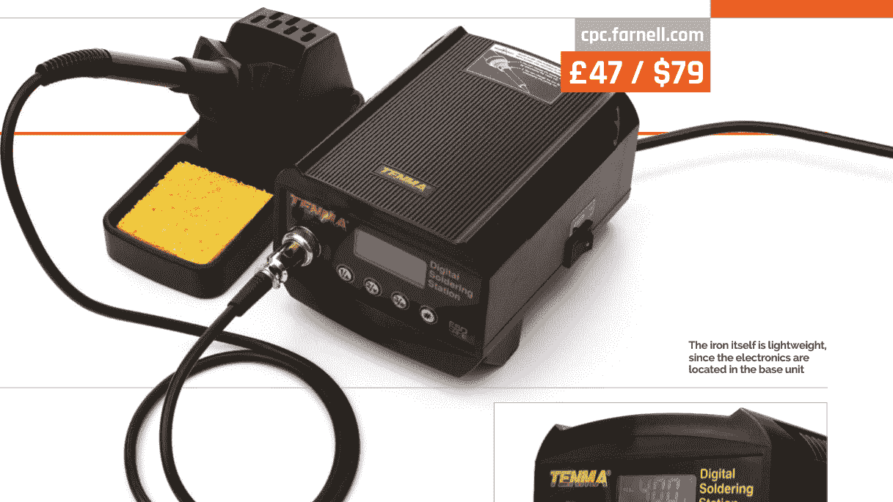

焊铁本身很轻，因为用于焊接的电子元件位于底座单元中。多极连接器为焊铁供电并提供反馈，焊铁体积小巧轻便，这得益于大部分电子元件位于底座单元中。这里唯一的真正缺点是该设备固定在购买国家的电网——要么是 220V 要么是 110V——并且其电源线是集成式的而非可拆卸的。

### 省钱之处
直到你看到随附的支架时，才开始看出 Tenma 在哪里省钱。虽然支架本身是一个坚固的金属外壳，但它无法充分固定焊铁，很大程度上是因为焊铁缺乏重量，而连接到底座单元的导线相对较重。它可以使用，但需要小心确保焊铁不会掉出来。与此同时，随附的清洁海绵勉强够用，应尽快更换为更厚的海绵——或替代的烙铁头清洁系统。撇开这些问题不谈，Tenma 焊接站使用起来令人愉快。其 60W 输出和双加热线圈意味着焊铁的烙铁头——可通过快速拧动固定螺母轻松更换，有各种形状和尺寸可选——能够迅速升温。此外，底座单元上的实时温度读数意味着在判断其是否准备就绪时无需猜测。另一个特点是 Tenma 对静电放电（ESD）安全性的声明。这意味着——与入门套件和廉价商店中常见的极其便宜的焊铁不同——当你将焊铁的金属烙铁头触及其中一个触点时，静电放电不会损坏任何敏感元件。这种问题不太可能影响大多数爱好者，但未来不会困扰你的保证无疑很不错。

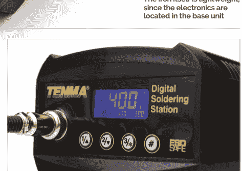

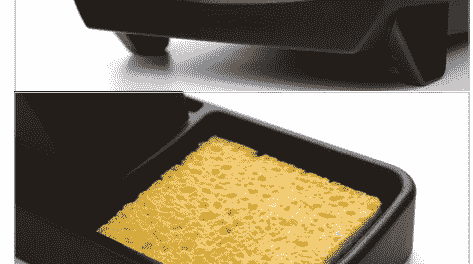

上方 清洁海绵不佳

上方顶部 大型 LCD 清晰易读

### 最后的话
与优质的固定温度焊铁相比，价格仅略有提升，并且优势颇多，如果你想为自己升级焊铁，Tenma 是一个不会出错的选择。

### 厂商说
> > 你所需要的一切
> 开始
> 改变
> 你周围的
> 世界
> 
> Bare Conductive

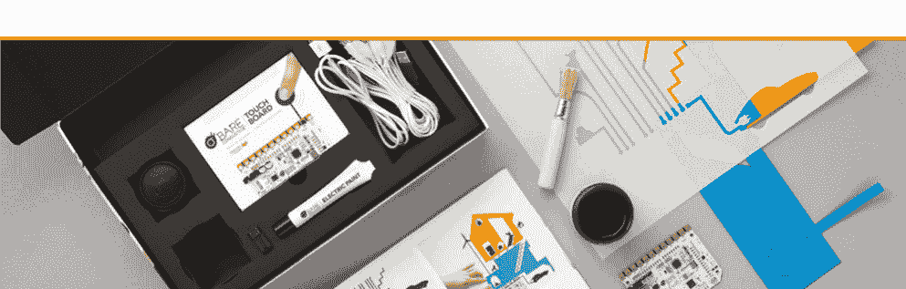

## BARE CONDUCTIVE TOUCH BOARD 入门套件
外观精美，Touch Board 是否就是 Bare Conductive 所承诺的导电奇迹？

关于 Bare Conductive Touch Board 入门套件，首先要讨论的就是其价格。在英国仅略低于 100 英镑，在美国为 150 美元，对预算有限的创客来说绝对不是冲动消费。不过，当你看到其制作所付出的用心和关注时，很难说它物有所值。

盒子体积庞大，根本不可能在你外出时从信箱中溜出来，里面包含令人印象深刻的零件选择。自然而然的亮点是 Touch Board 本身，它还配有一罐导电漆，配有粗刷子，一支同一导电漆的细尖喷嘴管，用于更精确的涂抹，自供电可充电扬声器，USB 电缆，microSD 卡读卡器和香蕉夹电缆。此外还有一套卷起来的模板套装（稍后会详细介绍）以及一本令人印象深刻、超大尺寸、全彩的指南手册，涵盖套件的三个主要项目。

指南手册绝非事后才想起，但开始使用时几乎不需要它。Touch Board 本身的包装，一个盒子套在另一个盒子里，同时充当快速入门指南，并揭示了一个非常巧妙的功能：预先录制的教学信息已加载到随附的 128MB microSD 卡上。

对于不熟悉的人来说，Touch Board 是一款与 Arduino 兼容的设备，旨在让使用导电漆、导电线甚至 Play-Doh 变得尽可能简单。它预先配置为每次触摸其 12 个电极输入之一时播放 SD 卡上的 MP3 文件。

然后用于引导用户入门：连接 micro-USB 电缆和随附的扬声器或一副耳机，用手指触摸输入 E0，你会听到祝贺信息；按下 E1，你将了解板子的输入。这一过程一直持续到 E11，它会引导你前往 Bare Conductive 网站了解更多信息。

然而，使用入门套件时，你也有离线支持。上述指南手册以逐步的方式引导你完成三个示例项目做得非常出色。每个步骤都有全彩图片，很难迷路或困惑。

第一个建议的项目是最大的：学习如何制作图形传感器。这涉及卷起来的模板和覆盖层，它们配有方便的粘性标签。

### 相关
### MAKEY MAKEY
The device that brought the banana piano to the masses, the Makey Makey is a cheaper way to get started with conductive materials.

£40 / $50
makeymakey.com

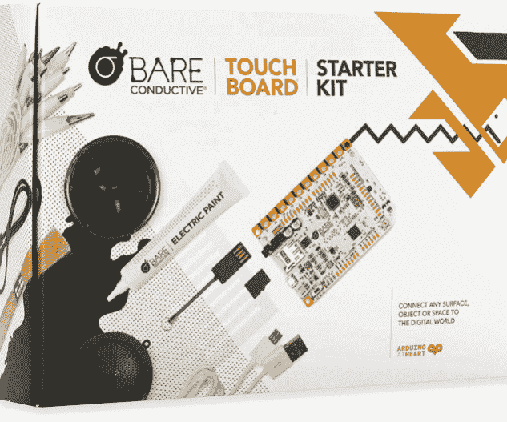

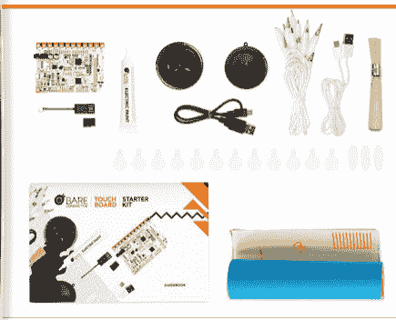

> 指南手册在引导你完成三个示例项目方面做得非常出色

将模板贴在墙上——或者，如果你不确定油漆会成为房屋固定装置的某种永久性，则贴在一张大纸或卡片上——并刷上油漆。用彩色覆盖层装饰，使用较细的油漆管绘制通向 Touch Board 的导线，将 MP3 复制到 microSD，瞧：一座互动房屋。

剩下的两个项目是主题的变化。第一个为日常物品添加触摸灵敏度，例如提醒你剂量的药瓶，或描述其自身场景的相框。最后一个项目要求你将油漆刷在地板上以创建入侵报警器，尽管它仅在入侵者赤脚时才有效。

这三个项目详细介绍了 Touch Board 的部分功能，但并非全部。指南手册后面的扩展项目页面引导你前往网站了解板子的更高级功能，例如重新编程使其作为非接触式距离传感器或 Makey Makey 风格的乐器运行。

到目前为止，Touch Board 可能已经吸引了孩子，但可能让更高级的爱好者望而却步。在指南的后面部分，揭示了 Touch Board 比初看更强大：它是一个功能齐全的 Arduino，与各种 Shield 和附加组件兼容，可提供从蓝牙连接到电机控制的一切。

看一眼板子本身就能看到熟悉的 Arduino 引脚排，尽管没有引脚，但可完全访问这些引脚以进行更高级的创作。这结合 Atmel ATmega 微控制器，使板子能够做 Arduino 能做的任何事情，包括与外部硬件接口，例如电机、伺服器、传感器，甚至 Raspberry Pi 本身。结合 Bare Conductive 巧妙油漆的灵活性，这使套件在三个捆绑项目完成后仍具有相当大的延展性。

### 最后的话
它并不便宜，但对于任何想要开始使用导电漆或触摸类项目的人来说，这套套件很容易推荐，而且制作精良，细节关注度很高。

★★★★★

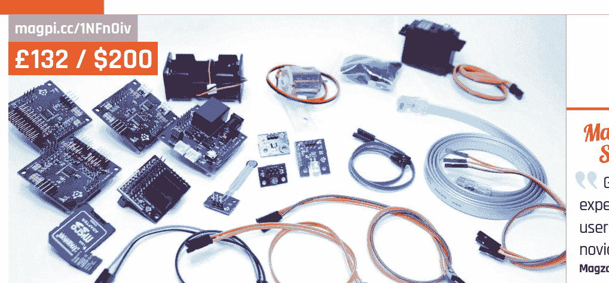

magpi.cc/1NFn0iv

£132 / $200

## MAGZOR MECHATRONICS STARTER PACK
一个模块化机器人，可以按你的规格构建，甚至无需编写任何代码。它是否太好了而不真实？

在 Raspberry Pi 机器人套件向各个方向分支的时代——无论是简单、易用且便宜，还是更高级——看到一个试图弥合初学者到中级水平的尝试是件好事。Magzor 系统从一套可以以任何组合相互作用的零件套件开始，并连接到 Raspberry Pi 以创建你自己的机器人或机电项目。该套件的工作方式是让你在网页界面上输入你想要使用的东西，有点像拼图块。界面随后会创建零件应如何组合的自定义配方，甚至提供一些基本代码来让它们全部运行。它相当直观，虽然我们收到的入门套件中没有其中一个更通用的零件。这意味着我们必须弄清楚它在给我们一个可以用现有设备构建的东西之前还需要哪些其他信息。说明本身不错，但我们有时会感到有点困惑；有一点我们正在寻找一个端口，但 PCB 上并没有按说明描述的方式明确标记。等到我们完成初步构建后，我们基本上弄明白了说明试图使用的语言。与 Raspberry Pi 为中心设备的运作方式大相径庭的是，该套件在 C++ 中编程。会生成一个基本脚本来激活所有内容，你可以自行修改以达到确切规格。从构建阶段到编程阶段的技能水平跃升很奇怪，要求你手动编译代码，而不是能够实时运行并在进行中进行更改。虽然这种编程水平是值得学习的好东西，但它似乎与这种可以快速迭代和重建的机器人特性略有矛盾。以目前的教程方式，没有创建代码并将其移动到 Pi 上然后编译和运行的简单逐步指南；需要比一些机器人初学者所拥有的更多直觉和知识。随着对系统这一方面的更多关注，它会好得多，但现在它可能超出了初学者范围。

### 厂商说
> > Great for experienced users and novices alike
> 
> Magzor

### 相关
### CAMJAM EDUKIT #3
Also reviewed in this issue, the CamJam kit allows you to build a robot and then fairly simply program it to perform various tasks. Much simpler and aimed towards a very beginner level of robotics, though.

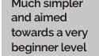

£17/$26

### 最后的话
这里有一些很棒的想法，但构建和编程的一些部分有点晦涩。它对于做比简单机器人更高级的机电一体化的人来说相当不错。

## 制作者说

> 创建
> 你自己的
> Raspberry
> Pi驱动的
> 机器人
> 
> CamJam

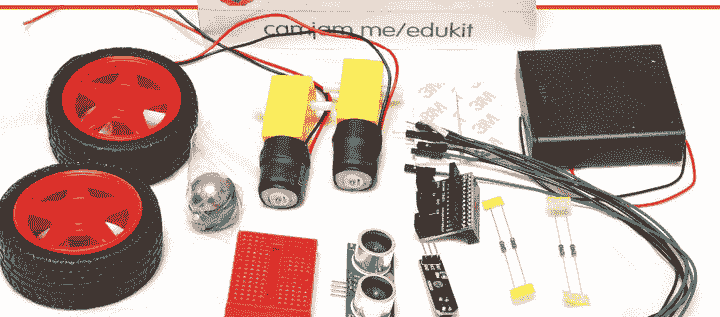

## CAMJAM 教育套件 #3

### 机器人技术

一款低成本的机器人套件，可以教你如何组装一台 Raspberry Pi 机器人，以及如何对其进行编程

如果你回想起几期前的文章，你可能记得我们曾做过一篇封面专题，介绍如何制作一台价值 50 英镑的 Pi 驱动机器人。该机器人的唯一真正问题是，你需要从许多不同的地方购买大量不同的组件来保持价格低廉。我们当时并没有足够的时间为人们组装一套可购买的套件；不过现在看来这可能没那么重要了，因为最新的 CamJam EduKit 与我们本会制作的套件非常接近。

一个装满非常标准的机器人组件——以及一块定制板——构成了第三款 CamJam 套件。虽然它确实包含这些标准组件，但它不像乐高或宜家套件那样，有些机器人套件就很像那样。由于它们是无底盘的组件（尽管随附的盒子在紧急情况下也能凑合使用），CamJam EduKit #3 的设计旨在让你在创作上拥有更多自由，并真正让你思考自己正在构建的内容。

套件还附带了一个面包板。单独看你可能只会认为它只是另一个面包板，减少了你需要焊接的工作，但它也提供了许多扩展超出原始机器人限制的方法，可添加额外的传感器、组件等等。这使其非常适合在原始机器人范围之外的课外学习。

机器人的在线工作表非常全面，教你如何组装和编写代码。由于 EduKit #3 的发布在一定程度上与 Pi Wars 挂钩，其中还提供了如何为该活动中涉及的一些挑战风格进行编程的提示。的确，我们在 Pi Wars 上看到了几台由该套件驱动的机器人正在行驶，其中一台在其他机器人失败的循线赛道上表现非常出色。

那么这是一款很棒的入门套件，或者至少是适合那些想要比一些非常简单的套件更进一步的人的套件。它让你更深入地了解 Raspberry Pi 如何实际控制机器人，并为你提供成长的空间。

## 相关

### PI2GO

价格稍高一些。然而，这也是一款很棒的小型入门套件，可以教你了解 Pi 的机器人技术。

£55 / $83
magpi.cc/1SWFHXi

## 最后的话

对于希望更动手制作自己创建的机器人的初学者来说，这是一款很棒的套件。也有大量出色的文档可供他们顺利入门。

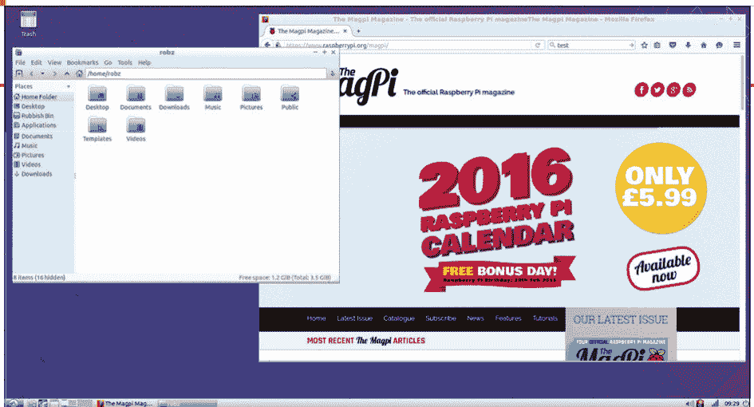

## 制作者说

> > 为 Pi 制作你能想到的尽可能多的 Ubuntu 版本
> > Ubuntu Pi Flavour Makers

## UBUNTU PI FLAVOUR MAKER

为你的 Raspberry Pi 提供更多 Ubuntu 版本。Pi 是否有足够的动力来运行它们呢？

## 相关

### UBUNTU MATE

当 Raspberry Pi 2 发布时，Ubuntu 终于能够来到 Pi 上，首先是 Ubuntu MATE 的一个版本。

如果你一直关注 Raspberry Pi 的发展，你可能知道在其早期曾呼吁将 Ubuntu 用作其操作系统。作为家用用户中最受欢迎、如果不是最受欢迎的 Linux 版本之一，许多寻求为他们的新迷你电脑提供熟悉体验的人都希望使用这个发行版。它从未实现。然而，由于 Ubuntu 基于 Debian，Raspbian 基本上是最好的替代品。当 Raspberry Pi 2 发布时，情况发生了变化，随之发布了适用于 Pi 的 Ubuntu MATE，这为更多“版本”的 Ubuntu 打开了大门——或者至少是运行在 Ubuntu 上的不同桌面环境。Ubuntu Pi Flavour Maker 就是这一结果之一。其核心，Flavour Maker 是一系列脚本，允许你为 Raspberry Pi 构建一个略微定制的 Ubuntu 版本。它使用对 Pi 2 上的芯片类型进行优化的至关重要的 armhf 版本的 Ubuntu，为你提供不同的软件和桌面的选项，甚至可以根据需要选择服务器和桌面版本。这对一些更初级的用户来说可能听起来有点复杂，但不用担心——制作该软件的善良人士创建了一系列可安装到 SD 卡的镜像，就像任何 Raspberry Pi 操作系统一样。可供选择的有两个版本的 Ubuntu Server：一个是为最大速度而设计的极简安装，另一个是如果你需要更多软件的常规安装。还有三个使用不同桌面的“spins”：LXDE、Xfce 和 MATE。LXDE 和 Xfce 是在低功耗 PC 上使用的常见轻量级桌面界面；Raspbian 自发布以来一直使用 LXDE，或者至少是其一个版本。

### 启动

那么它们实际运行情况如何？与普通 Ubuntu 类似，首次启动时有几个设置步骤，尽管主要安装已经完成，所以步骤有所简化。诸如区域设置和键盘之类的设置会在启动到桌面之前完成，尽管这需要几分钟时间。每次后续启动要快得多，但仍然远不及启动到 Raspbian 的速度。与 Raspbian 相比，操作系统呈现方式非常不同。Raspbian 的大部分内容都针对 Raspberry Pi 进行了优化，其中还包含大量教育工具，而 Ubuntu spins 更像是一个传统的桌面——默认未安装编程工具，也使用常规程序。

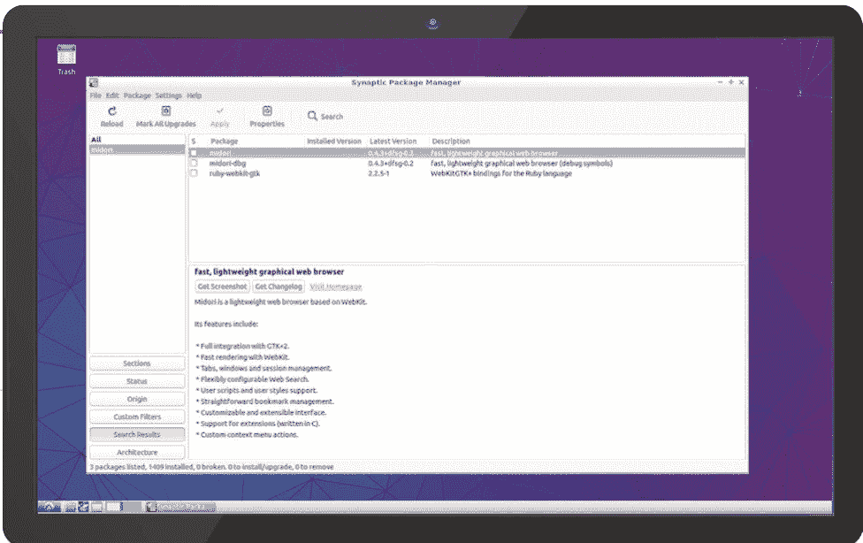

上图 图形化包管理器的选择使安装变得更加容易

与 Raspbian 相比，图形化包管理器的加入是一项新颖之处。Software Centres 和经典的 Synaptic 都可用，为用户提供搜索他们可能想要的软件的方式，而 Raspbian 目前并不容易做到这一点。由于它基于 Ubuntu armhf，选择范围不如完整版 Ubuntu 广泛，但仍然非常好。大量主要软件可用，唯一的真正限制是运行 Ubuntu 的 Raspberry Pi 2 的性能和功率。

由于使用了更标准的软件，Ubuntu 在 Raspberry Pi 2 上可能会有点滞后。Firefox 是默认浏览器，虽然有像 Midori 这样的轻量级替代品可用，但它并不总是快速且响应灵敏。

它感觉就像原始 Raspberry Pi 上的浏览器那样——功能齐全，但使用一段时间后会有一点令人沮丧。如果你想观看大于 360p 的内容，YouTube 上的视频似乎也不可行。

不过并非全部都很慢。选择合适的软件包和合适的用例，它完全可以正常使用。Ubuntu 本身就是比 Debian 更耗资源的基底，所以对于需要额外性能的任何事物，它永远不会是首选的操作系统或发行版。

三者中，Xfce 版本运行最好，但就性能而言，Raspbian 仍然更好。

作为桌面系统，它更好一些。通过对默认应用程序进行少量修改，它完全可用，而且看起来比 Raspbian 更像样一些。然而，对于项目和更小众的使用，Raspbian 看起来仍然是王者。

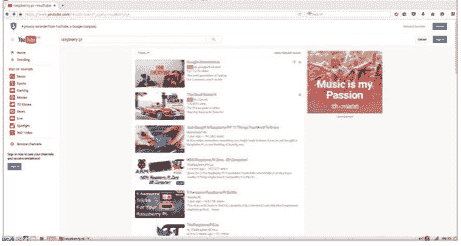

上图 YouTube 的表现时好时坏，尤其是在像 Firefox 这样更耗资源的浏览器上

## 最后的话

它永远不会像 Raspbian 那样快，但这是一项令人惊叹的努力，为 Raspberry Pi 可用的操作系统增添了更多多样性。

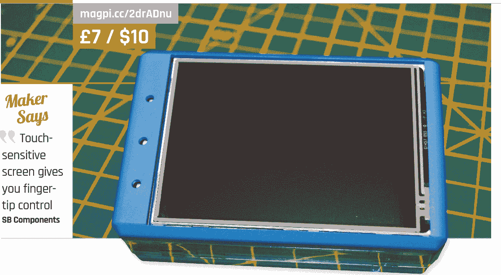

## 制作者说

> 触摸屏让你实现指尖控制
> SB Components

## LCD 控制外壳

一个用于迷你 LCD Raspberry Pi 屏幕的简单外壳——在正常使用下表现如何？

上一期我们评测了 SB Components 的 SPI-Box，这是一款专为 Raspberry Pi 2（和 B+）定制的机箱，允许运动传感器和 Pi Camera Module 从机箱中伸出。借助捆绑的软件，这意味着你拥有一个功能齐全且廉价的安全摄像头，配备大量软件功能使其真正实用。采用类似的设计理念，SB Components 还创建了一个特殊机箱，用于在适当的封装中将 3.2 英寸 LCD 触摸屏与 Pi 一起使用。它也很便宜。

该机箱由三部分组成：一个几乎与 SPI-Box 设计相同的底座，以及一个用于保护 Pi 组件免受屏幕影响的中间层，最后是一个紧密贴合 Pi 和屏幕的顶部部件。与 SPI-Box 一样，底座将 Pi 牢牢固定到位；可能有点太牢了，因为再次取下它可能会有点麻烦。

将 LCD 屏幕放在中间层上然后用顶部封闭非常容易——许多 Pi 迷你 TFT 屏幕仅使用前 26 个 GPIO 引脚，这是源自原始 Raspberry Pi 设计的遗留。中间层仅打开这些引脚，因此不会产生混淆。然后整个屏幕可通过机箱访问，甚至通常的微型开关阵列（如 Adafruit 屏幕上的）也可通过小针孔访问。想象一下旧电子设备上的复位开关——只是尽量避免使用尖锐的东西。

仅使用该机箱，你就为使用触摸 LCD 屏幕的 Raspberry Pi 增加了一个极佳的配件。它坚固、非常易于组装，微型开关的访问也很整洁——通常这类开关在这些机箱中会被忽略。至关重要的是，它还有足够的空间来使用整个屏幕。此外，它还具有类似 SPI-Box 的墙壁固定支架。由于它技术上只需要电源，也许还需要一个无线适配器，它可以成为一个很棒的便携式 Pi 或墙上的廉价家庭自动化控制器——唯一真正阻碍这一点的是整个单元的深度，尽管这不是机箱的错。

如果你喜欢屏幕和机箱的想法，但对购买屏幕、组装它，然后让整个设置在你的 Raspberry Pi 上工作感到犹豫，那么 SB Components 还提供了一个捆绑套件（magpi.cc/2drz490）。在 Raspberry Pi 之上仅需 29.99 英镑（43 美元），你基本上就能获得一套创建便携式 Pi 的套件，总价略高于 50 英镑。

## 相关

### PI BOW PITFT+

更新的 PITFT PiBow 允许在 Pi Model 2 和 B+ 上使用 Adafruit 的 PITFT 屏幕的稍大第二版本。

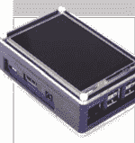

£13.50 / $19.95
magpi.cc/10Ai31M

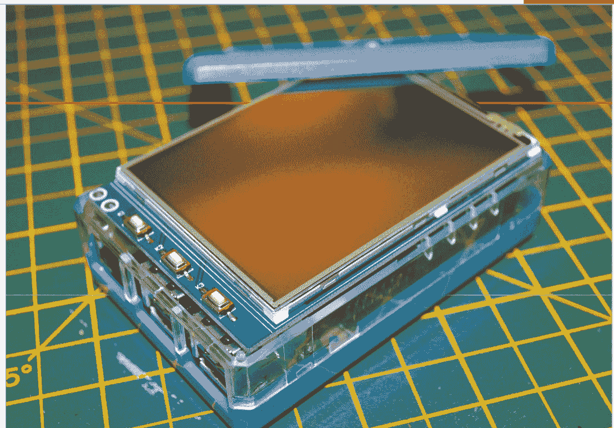

套件附带一个兼容的迷你触摸屏，可与 Pi 和外壳配合使用，还有电源、WiFi 适配器以及预先准备好的 SD 卡。由于是完全相同的外壳，这种尺寸触摸屏的构造也相同，但并非完全无法使用。至少，它为你自行创建自定义界面留下了空间，并且还可以访问 SPI-Box，这是一个不错的小补充。

> 套件附带一个兼容的迷你触摸屏，可与 Pi 配合使用

相同；然而，真正的亮点是 SD 卡。

过去，将 Raspbian 配置为与这些触摸屏配合使用并非快速过程。现在由于图像更易获取，稍微容易了一些。即便如此，拥有一个开箱即用的版本也很不错。它仍然运行现代版 Raspbian，其中包含一年多前发布的界面更新。使用起来有点棘手

这两种 LCD 外壳都物有所值，尤其是它们填补了使用或想要使用这种类型屏幕的人群的略显小众的市场。微动开关孔也很容易进行修改，使其更易于使用，因此只要具备正确的知识就能改进它。无论你想要便携式 Pi 的雏形还是触摸屏遥控器，这款产品都不会让你失望。

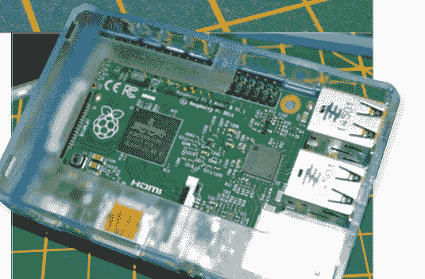

上图 在屏幕关闭的情况下 Pi 的大部分仍可访问，尽管它主要集中在 GPIO 的前 26 个引脚上

## 最后的话

一个坚固且外观精美的盒子，与其他用于小型触摸屏显示器的产品一样出色，为其他项目和用途打开了无限可能的大门。

## 树莓派畅销书 TAB ELECTRONICS

McGraw Hill 的小众创客分支推出了几本深受爱好者欢迎的书籍...

### 编程树莓派

作者: Simon Monk
出版社: Tab Electronics
价格: £9.99
ISBN: 978-0071807838
magpi.cc/2dXcZIC

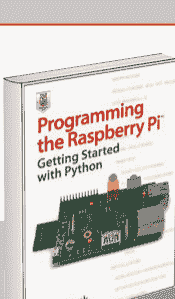

一本出色的 Python 入门书，充分发挥了 Pi 的优势。现在就买一本（但请阅读在线勘误表），然后在十一月购买更新版时转赠给朋友。

### 发明者的实用电子学

作者: Paul Scherz & Simon Monk
出版社: Tab Electronics
价格: £24.99
ISBN: 978-0071771337
magpi.cc/2dXbXgo

如何使用和理解电子元件，包含关于传感器、微控制器、模块化电子和最新软件工具的更新章节。仅理论章节就物有所值。

### 邪恶天才的树莓派项目

作者: Donald Norris
出版社: Tab Electronics
价格: £15.99
ISBN: 978-0071821582
bit.ly/1GBAHJx

风格独特的初学者入门指南，介绍如何使用 Pi 构建硬件项目（基于旧的 B 型号，但大多数项目在当前型号上只需少量修改），从蓝牙控制机器人到气象站。

### 教你的孩子编程

作者: Bryson Payne
出版社: No Starch
价格: £19.99
ISBN: 978-1593276140
nostarch.com/teachkids

Dr Payne 承诺“编程如此简单，父母也能做到！”从海龟图形开始，读者被吸引进来，Python 显得自然、简单，却仍令人惊叹。学习者被鼓励进行实验，而不是被如何和为什么的细节所淹没——但在需要细节的地方，例如数字类型和运算符，它们会被介绍。随着概念的引入，我们将其融入海龟图形——因此条件语句导致分形螺旋，用户输入选择绘制的形状。每章末尾的编程挑战——将 High Card 游戏改成 War，或为 Pong 游戏添加音效——引导进一步学习。面向九岁及以上儿童，这里有足够的内容适合每个人——父母可以带年幼的孩子完成一些项目，青少年也不会觉得被轻视。Payne 在提供大量有趣的项目以保持兴趣和引入编程概念以几乎通过渗透建立真正的理解之间取得了平衡。Python 和 Pygame 的安装被 banished 到附录中，你在那里也会找到创建自己的模块的说明！而且再次，Miran Lipovača 精美的插图将一本已经很优秀的 No Starch 书籍提升到了另一个水平。强烈推荐给所有年龄段的学习者。

评分 ★★★★★

### JavaScript 机器人学

作者: Edited by Rick Waldron
出版社: Maker Media
价格: £19.99
ISBN: 978-1457186950
oreil.ly/1Gv23Rv

树莓派是一个很棒的小板，但它并不怎么移动——除非你把它装进机器人。当然。Johnny-Five 机器人库提供了用 JavaScript 在各种平台上轻松编程机器人的机会——在这本书中，“会漫游、游泳、打字、行走、跳舞、发送警报、制作音乐”的机器人等等。在项目中，只有 PiDuino5 移动机器人平台需要树莓派（结合了 Arduino 广泛的外设范围和 Pi 的高性能软件）——由 Jonathan Beri 制作的出色项目，其中包含硬件新手的有用提示，例如在不将机器人连接到网络的情况下连接到 Pi，以及提供可构建到项目中的挑战，例如计算机视觉。其他章节都采用不同的板卡，成本也大不相同。有些有现成的零件可用，有些则涉及大量 DIY——特别是关于 Delta Bots 的章节，这种工业机器人制造了你的汽车（除非你开的是 Morgan）。这一章还提供了大量灵活性，可插入另一个 Pi 并扩展接口。所有项目都配有清晰的彩色图片以帮助构建。充满乐趣，充满学习，是实用机器人学的绝佳入门。

评分 ★★★★☆

## 使用 Spark 进行机器学习

**作者:** Nick Pentreath
**出版社:** Packt
**价格:** £30.99
**ISBN:** 978-1783288519
bit.ly/1GnnQdE

凭借四核和 1GB RAM，树莓派 2 正是运行 Apache Spark 的小型廉价集群的理想选择——该集群计算框架在机器学习算法方面表现出色。Pentreath 带来了关于使用 Apache Spark 进行机器学习的示例驱动书籍。适合 Hadoop 生态系统——是研究和开发机器学习算法的绝佳平台。这项工作从在 Amazon EC2 上设置开始，但网上有很多帮助可以让 Spark 集群在 Pi 上运行，然后你就可以准备好剩余的章节了。

这些章节涵盖了机器学习的现实用例，这将使任何具有基础或零知识的主题的人走得很远，并帮助具有一些机器学习经验的人在从文本挖掘到降维等方面建立起使用 Spark 的强大理解。示例几乎全部使用 Scala 和 Python——后者从 Pi 用户的角度来看是本书的受欢迎加分项。推荐给所有有志于成为数据科学家的人。

评分 ★★★★☆

## 从零开始的数据科学

**作者:** Joel Grus
**出版社:** O'Reilly
**价格:** £26.50
**ISBN:** 978-1491901427
oreil.ly/1awOcy7

有一些很棒的书指导你通过框架和库构建数据科学项目，但 Grus 采取了不同的方法来教育对数据好奇的人：从头开始构建工具和实现算法，以阐明特定的要点，使你在完成本书后能更好地利用框架。这里没有 Python 3。然而，Python 2 非常好，值得坚持用于其他早期的数学课程。关于统计学、概率和线性代数的章节是对我们这些生疏的人的极佳复习，并为接下来要做的事情奠定了坚实的基础。

在涵盖了数学和编程之后——正如 Grus 所说，“做数据科学的原材料”——作者转向了处理数据的科学和艺术，展示了在进行建模和机器学习之前如何探索你所拥有的东西。Grus 在必要时深入细节，但在其他情况下信任读者自行查阅参考资料。在所有情况下，这本书都应该能造就更好的数据科学家。

在介绍数据科学之后，我们开始进行 Python 编程的快速入门或复习，做得很好，但突出了本书的唯一缺陷——数据科学库在很大程度上仍然依赖于 Python 2.7，因此

评分 ★★★★☆

## 必读：安全

安全不是一个复选框，而是一个持续的过程。这五本近期出版物应能让你保持思考

### PF 之书

**作者:** Peter N.M. Hansteen
**出版社:** No Starch
**价格:** £23.50
**ISBN:** 978-1593275891
nostarch.com/pf3

OpenBSD 的有状态数据包过滤器 pf 帮助你构建灵活且强大的防火墙——从流量整形到阻止策略。

### 网络与系统安全

**作者:** John Vacca
**出版社:** Syngress
**价格:** £37.99
**ISBN:** 978-0124166899
magpi.cc/2dXdzQ8

对组织复杂网络挑战的有用概述——从 LAN 到 RFID，经由云安全和入侵检测。

### 渗透测试

**作者:** Georgia Weidman
**出版社:** No Starch
**价格:** £33.50
**ISBN:** 978-1593275848
nostarch.com/pentesting

寻找系统漏洞的绝佳入门——渗透测试变得易于理解，而且插图也很精美。

### 区块链：新经济蓝图

**作者:** Melanie Swan
**出版社:** O'Reilly
**价格:** £16.50
**ISBN:** 978-1491920497
oreil.ly/1L2AFMq

区块链不仅仅是比特币，信息安全和数字自由将变得更加依赖于这项技术。

### Bruce Schneier 信任系列

**作者:** Bruce Schneier
**出版社:** Wiley
**价格:** £26.99
**ISBN:** 978-1118906835
oreil.ly/1JfnR7G

Liars & Outliers（信任如何运作——以及失效——以及我们需要重新思考的内容）和 Carry On（45 篇“发人深省”的文章）的超值组合。

## 树莓派畅销书

### APRESS
Apress 为 Pi 用户提供了几本实用的书籍。以下是我们从最受欢迎的书籍中挑选的

### 用 Python 学习树莓派编程
作者: Wolfram Donat
出版社: Apress
价格: £17.50
ISBN: 978-1430264248
bit.ly/1LeMgN6

面向树莓派的项目式 Python 入门：制作网络爬虫、气象站、媒体服务器、家庭安防系统、水下摄影系统，以及带摄像头的近太空气象气球。

### 树莓派硬件参考手册
作者: Warren Gay
出版社: Apress
价格: £11.50
ISBN: 978-1484208007
bit.ly/1kWUipn

深入探究 Pi 的工作原理以用于传感器项目：电源、内存、USB、以太网、SD 卡、I2C、GPIO 以及 UART（串行）接口。附带 C 语言测试代码。

### 使用 Arduino 和树莓派入门传感器网络
作者: Charles Bell
出版社: Apress
价格: £23.50
ISBN: 978-1430258247
bit.ly/1uu1HaB

构建基于树莓派的传感器节点，然后将 Arduino 传感器节点和 XBee 无线电模块连接到 Pi，并在 Pi 主机的 MySQL 数据库服务器上收集数据。

### 树莓派儿童版
作者: Richard Wentk
出版社: Wiley
价格: £21.99
ISBN: 978-1119049517
bit.ly/1K7C41E

节奏良好的入门，从设置到编程和调试，沿途掌握命令行技能。有趣的软件项目——如 Turtles 和 Minecraft（都用 Python 控制）、简单且动态的网站，以及使用网络摄像头——介绍了许多有用的计算技能。考虑到目标受众，必然的设置章节既必要又恰到好处，提供了有关电缆和其他信息等细节，使年轻创客无需成人帮助即可开始。

忽略“儿童版”品牌，这本书对任何渴望获得树莓派启蒙的紧张成人电脑用户来说都是宝贵的起点。从命令行和 nano，到 Python、选择 Web 服务器和学习编程技能，Wentk 使用 Raspbian 进行介绍和教学。他以清晰的风格、温和的幽默以及让每个学习挑战变得易于接近的能力来做到这一点。

PHP 可能正在失去光泽，但它提供了处理数据的最快入门，随后用于运行 shell 和 Python 命令。在 PHP 中运行 webcam.py 然后引出调试 Web 问题、修复 Unix 文件权限以及测试你的软件——所有这些都是在完成本书后扩展知识所必备的技能。

### Python 函数式编程
作者: David Mertz
出版社: O'Reilly
价格: Free PDF download
oreil.ly/1KcIHgo

函数式编程“关心要计算什么而不是如何计算”，更倾向于表达式求值而非语句，并将函数视为一等对象（你可以像传递数据一样将一个函数传递给另一个函数）。Python 尽管不是函数式编程语言，却是“一种多范式语言，能在需要时轻松进行函数式编程，并易于与其他编程风格混合”。从第一章《（避免）流程控制》开始，作者（Python 软件基金会董事兼业余哲学家）就提供了从命令式示例中微妙改动而来的代码，这些改动不会让你感到不安，但会温和地作用于你的大脑，累积起来有助于将焦点从“如何”转移到“什么”。

> “仅仅改变表达形式就能在我们推理代码的方式和理解的难易程度上产生惊人的巨大差异，”Mertz 说，他使用列表推导式、生成器以及字典和集合来抽象“如何”并重新组织我们对数据的思考，逐步推进到惰性求值和高阶函数（那些调用或生成其他函数的函数）。

对于所有希望超越 OOP 的 Python 爱好者来说，这是一本良好、快速的入门书。

### 硬件创业
作者: Renee DiResta, Brady Forrest & Ryan Vinyard
出版社: O'Reilly
价格: £23.50
ISBN: 978-1449371036
oreil.ly/1LRSDmb

当今的硬件初创公司与前辈相比已大不相同，这得益于使用 Pi 和 Arduino 等板子进行原型制作的极低成本、新的硬件制造生态系统（包括小批量生产和 3D 打印零件），以及精益技术从软件业务向硬件业务的转移。

在《硬件创业》中，DiResta、Forrest 和 Vinyard 为任何被较低进入成本吸引、希望将副业项目转变为硬件业务的人提供了路线图。从原型制作和制造，到社区参与和法律问题，以及开发和生产产品然后交付给客户的各个方面，都以适当的深度进行了探讨，适合认真考虑将产品创意转变为业务的人。

开源硬件仅被简要提及，而出售用户数据几乎被视为理所当然，但鉴于硬件领域的社区和合作项目比软件领域少，对狭隘的硅谷式初创公司观点的关注不足为奇。然而，树莓派本身就是以社会企业方式运营成功的硬件业务的典范。

评分 ★★★★☆

### 树莓派计算机视觉编程
作者: Ashwin Pajankar
出版社: Packt
价格: £16.99
ISBN: 978-1784398286
bit.ly/1Pdzlbf

学习计算机视觉最好采用实践方法：使用 BSD 许可的 OpenCV 库，可在 C/C++、Java 和 Python 中进行图像和视频处理。Pajankar 在特定的 Pi/Python 环境中介绍 OpenCV，但假设没有之前的树莓派知识——幸运的是，他的树莓派介绍简洁得令人钦佩。然而，OpenCV 安装部分却奇怪地缺乏精炼。

假设具备 Python 知识，但仅限基础：NumPy 很早就被介绍，用于使用 OpenCV 所需的数学函数。关于图像和网络摄像头的实用示例，使用 Pi 摄像头模块，能帮助数学基础较弱的读者理解。去噪和边缘检测——对你自己的 Pi 摄像头项目很有用的任务——之后是运动检测和条形码读取。涵盖了更多真实的计算机视觉技术；最后一章更长，介绍 SimpleCV 库，这是一个使计算机视觉任务更简单的框架。

虽然现在已有许多 OpenCV 书籍，其他书籍侧重于 C++、Java 和跨平台 Python 编程。我们可以挑剔代码风格，但总体而言，对于希望开始使用 OpenCV 并学习计算机视觉基础知识、且具备少量 Python 经验的树莓派用户来说，这本参差不齐的书有很多可教之处。

评分 ★★★☆☆

## 必读：应用 Python

不仅用于教学和树莓派项目，Python 对于各种现实世界任务来说都是很棒的语言

### Python 数据科学精要
作者: Alberto Boschetti & Luca Massaron
出版社: Packt
价格: £26.99
ISBN: 978-1785280429
bit.ly/1bCAZEA

直接而实用的 Python 数据分析入门，代码示例良好，注重解决问题。

### 使用 Python 进行网页抓取
作者: Ryan Mitchell
出版社: O'Reilly
价格: £21.50
ISBN: 978-1491910290
oreil.ly/1NkXYBu

对网页抓取基础的透彻讲解，对持续增长的主题进行了平衡而简洁的覆盖。

### 精通金融 Python
作者: James Ma Weiming
出版社: Packt
价格: £32.99
ISBN: 978-1784394516
bit.ly/1f32g4U

综合性的金融理论和数学模型集合，应用于有利可图的难题，涵盖 OOP 和 FP。富有教育意义且有趣。

### 黑帽 Python
作者: Justin Seitz
出版社: No Starch
价格: £23.50
ISBN: 978-1593275907
nostarch.com/blackhatpython

渗透测试和安全分析，用 Python 编写网络嗅探器、操纵数据包、感染虚拟机以及创建隐蔽的特洛伊木马。

### 使用 Python 学习机器人技术
作者: Lentin Joseph
出版社: Packt
价格: £29.99
ISBN: 978-1783287536
bit.ly/1rlaeZ

“机器人技术是一门艺术。”使用 Python、ROS 和 OpenCV 从零构建交互式自主移动机器人。

## 树莓派畅销书

### C 编程
对于树莓派上的可靠嵌入式编程，没有什么比 C 编程语言更接近裸机了

### 头脑先行 C
作者: David Griffiths & Dawn Griffiths
出版社: O'Reilly
价格: £33.50
ISBN: 978-1449399917
orei.ly/1heoaQR

面向想学习 C 的程序员的易懂入门读物，包含实用的自学项目。不是权威参考书，但是在理解 C 之路上友好的起点。

### C 程序设计语言
作者: Brian W Kernighan & Dennis Ritchie
出版社: Prentice Hall
价格: £41.99
ISBN: 978-0131103627
bit.ly/1f2D4bq

K&R 如人所知，是一部简洁得近乎禅宗公案的著作，却包含了全部的 C 语言：它会让你成为更好的程序员，并加深你对 C 的理解。

### C 编程：现代方法
作者: K N King
出版社: W W Norton
价格: £52.50
ISBN: 978-0393979503
magpi.cc/2dXdPin

正在迅速成为 C 学习者最喜爱的书籍——内容全面，对 C 标准的处理非常严谨，付出努力将换来 C 语言的顿悟。

### NumPy 实用手册
作者: Ivan Idris
出版社: Packt
价格: £29.99
ISBN: 978-1784390945
bit.ly/1MrED5c

Python 的库是一项极佳的资产，NumPy 针对数值例程的快速预编译函数——辅以 SciPy、Matplotlib、IPython 和 Scikits——不仅提供类似 MATLAB 的功能，还提供了一个科学软件生态系统，其应用可能超乎你的想象。Idris 涵盖了科学家、工程师、程序员和分析师会期望的所有示例，以及音频和图像处理等意想不到的用途。

> “我们 NumPy 用户生活在令人兴奋的时代，”Idris 说，指的是围绕云、并发以及用于多维分析（MDA）查询的在线分析处理（OLAP）的新的和未来的 NumPy 发展。但着眼于当下，《NumPy Cookbook》介绍了强大的 IPython 环境，并让你从 NumPy 的基本构建块开始：数组和通用函数——其中涉及一些花式索引，并开始处理 WAV 文件。音频和图像，是的，在它们两侧还有更多关于数组和函数的介绍，以及加速代码。所有这些都在 SciPy 生态系统的广泛背景下进行，并与更广阔的世界对话——无论是 MATLAB 和 Octave，还是 R 和 JPype（用于 JVM 语言）。随后是性能分析、调试、测试和行为驱动开发，使这本书成为任何希望编写超出自己电脑之外的实用 Python 代码的人的有用读物。推荐。

### 聪明女孩隐私指南
作者: Violet Blue
出版社: No Starch
价格: £11.99
ISBN: 978-1-59327-648-5
magpi.cc/2dXeikt

在网站上以女性身份登录和以男性身份登录之间的差异必须亲身体验才能相信：作者建议在社交媒体网站上注册一个一次性账号来试试。女性在网上是目标，隐私面临来自善意朋友、贪婪公司以及我们都需要采取措施保护自己的人的威胁。该书附带隐私贴纸，以防止他人在你不知情的情况下使用你的设备摄像头录制你。八条“现在就可以使用的隐私提示”提供了将天平大幅倾向你的现成指南，进行隐私检查也是如此。完成之后，Blue 展示了为了保持安全不应分享哪些信息。如果你认为这是偏执，请阅读关于（男性）《连线》杂志记者 Mat Honan 的报道，他的数字设备被抹除，Twitter 账号被恶意篡改——这一切都源于攻击者查找到 Honan 的地址（简单的 whois 查询）并用它获取 Amazon 账户数据，然后转向 Apple。

Blue 提供了应对所有恐怖和骚扰、从身份盗窃中恢复，同时仍能在网上追求浪漫的实用步骤。可悲的是，这是一本非常必要的书。

## 软件的工作原理
作者: V Anton Spraul
出版社: No Starch
价格: £19.99
ISBN: 978-1593276669
magpi.cc/2dXeMH6

“我们生活在一个魔法的时代，”V Anton Spraul 在引言中写道，引用了 Arthur C Clarke 关于先进技术的著名格言。毕竟，我们中的许多人使用技术，却缺乏对计算机内部实际发生的事情的真正理解。从密码哈希和加密等安全主题，到现代生活的其他基础如搜索和地图路线，本书展示了程序内部发生的事情、其局限性以及未来可能的发展。
加密是许多日常任务的核心，从购物到查看银行余额。Spraul 将我们带回计算机前的加密时代，并以清晰的解释帮助即使是非技术用户也能理解这一过程。特别重要的是 Spraul 对每种技术潜在缺陷和弱点的讨论，这将帮助读者对各种安全恐慌的新闻报道做出恰当的判断。

对游戏图形、计算机动画和图像压缩的见解令人着迷。关于搜索中使用的技术——从快速排序算法到哈希——以及并发编程中的技术解释，将帮助树莓派上的初学者程序员在理解上取得进展，从而真正支持他们正在学习的方法。地图路线是另一章信息丰富的章节，特别是如果你正在从事机器人项目。

## 树莓派机器人项目
作者: Richard Grimmett
出版社: Packt
价格: £29.99
ISBN: 978-1-78528-014-6
bit.ly/1U6oOVD

从设置章节开始，通过 SSH 和 VNC 进行远程访问，以及使用 nmap 在网络上定位你的 Pi，Dr Grimmett 假设读者没有任何知识，但介绍了重要主题——第二章关于 Python 编程，涵盖了一些 OOP 特性、使用 Emacs，并简要探讨了 C 和 C++。
第一个机器人主题是语音，使用 Espeak 和 PocketSphinx 处理输入和输出——“什么自尊的机器人想要随身携带键盘？”——以及你对 C 的初步了解用于编辑和重建控制程序。

在视觉章节中，OpenCV 的安装和使用基础得到了很好的解释。对于机器人移动性，GPIO 控制电机（无需焊接），驱动车轮，语音命令控制移动。然后，通过选择现成的腿部组件，以及一点 Python 来解释语音命令，你的机器人就可以应对不平地面，甚至楼梯。
避障传感器防止机器人撞墙；无线和 GPS 找到机器人。最后，机器人操作系统（ROS）管理系统控制。然后，使用可由树莓派控制的模型套件，将你的机器人带到水上、水下或空中。仅用 276 页，从初学者到机器人专家！

## 必读：3D 打印
3D 打印触手可及，每个人都可以通过自建或在当地创客空间共享来实现

### Make: 3D 打印
作者: Anna Kaziunas France
出版社: Maker
价格: £13.50
ISBN: 978-1457182938
oreil.ly/1KllGq

为你提供了解令人兴奋但常常令人困惑的 3D 打印世界所需的一切知识。

### 3D 打印蓝图
作者: Joe Larson
出版社: Packt
价格: £30.99
ISBN: 9781849697088
bit.ly/1lge22Z

以 Makerbot 为重点、以项目为基础的指南，介绍如何使用免费开源的 Blender 程序为 3D 打印准备设计。

### 3D 打印傻瓜书
作者: Kalani Kirk Hausman
出版社: Wiley
价格: £21.99
ISBN: 978-1118660751
bit.ly/1WT7JID

将 3D 打印置于上下文中，并向你展示如何构建自己的 RepRap。

### 开源实验室
作者: Joshua M. Pearce
出版社: Elsevier
价格: £33.99
ISBN: 9780124104624
bit.ly/1JyYNas

学术指南，介绍如何构建 RepRap，然后 3D 打印完整的科学仪器实验室。

### Eventorbot!
作者: eventorbot
出版社: Instructables
价格: FREE
bit.ly/1PUixgw

更少的材料和更坚固的结构造就了一台更便宜、更易用且非常稳定、设计精良的 3D 打印机。100% 开源。

## 树莓派畅销书

### 七周

Pragmatic 的 Seven Weeks 系列比较了程序员热门主题中的解决方案

### 七周内掌握七种数据库

作者：Eric Redmond & Jim R Wilson
出版社：Pragmatic Bookshelf
价格：£23.50
ISBN：978-1934356920
bit.ly/1eLlcZb

对 NoSQL 数据库的实用入门：Redis、Neo4J、CouchDB、MongoDB、HBase、Riak（以 PostgreSQL 作对比）。快速获得足够经验进行实践比较的最简单方法。

### 七周内掌握七种并发模型

作者：Paul Butcher
出版社：Pragmatic Bookshelf
价格：£25.50
ISBN：978-1937785659
bit.ly/1L5fITS

随着 GPU 和 CPU 中多核的普及，Butcher 探讨了并行和并发的竞争技术。写得很好，并且牢牢植根于 Clojure。

### 七周内掌握七种 Web 框架

作者：Jack Moffitt & Frederic Daoud
出版社：Pragmatic Bookshelf
价格：£25.50
ISBN：978-1937785635
bit.ly/1VEahMc

一次引人入胜且愉快的旅程：使用 Sinatra、CanJS、AngularJS、Ring、Webmachine、Yesod 和 Immutant 探索极简主义、组合、静态类型、状态机、声明式语法以及其他 Web 编程方法。

### 使用 Python 和树莓派入门

作者：Dan Nixon
出版社：Packt
价格：£25.99
ISBN：978-1783551590
bit.ly/1KZemHZ

我们评测过许多优秀有趣的 Python 教程，但将 Python 学习置于树莓派编程背景下的书籍总会有优势：快速朝着 Pi 上的个人项目构建是一个很好的动力。Nixon 的书在基础部分——例如对数值变量的处理以最好地适应 GPIO 值——就建立了基础 Python 学习与我们喜爱的微型单板计算机之间的联系。

> “这拥有最广泛的库支持，并且仍是许多操作系统的默认 Python 版本。”我们建议新手是时候放弃 Python 2 了。尽管如此，前几章的大部分内容都是一个良好的 Python 入门，不会使课程过度偏向 Pi，提供了对控制流和数据结构的良好基础——以过程式为主，带有一点函数式风格。

然后在同时涵盖线程和锁的一章中引入了面向对象作为概念。特殊的关注点继续探讨 Python 中的打包，但随后书籍转向 GPIO 和摄像头模块。数据解析和接口完善了这本有用的入门书，它将为有信心的学习者提供足够的 Python 沉浸感，以便转向自己的项目。

### Python 3 面向对象编程

作者：Dusty Phillips
出版社：Packt
价格：£31.99
ISBN：978-1784398781
bit.ly/1LinBQP

十年前，Python 是一种被忽视的脚本语言，而面向对象编程（OOP）是通过 Java（附带厨房水槽）、Smalltalk（至少在学术界——随后为 Scratch 1.x 提供动力）甚至 C++（ouch）引入的。幸运的是，对于今天的学习者来说，Python 已被广泛接受，并且作为一种具有强烈 OOP 倾向的多范式语言，它成为 OOP 的理想入门。

Phillips 的书在你可能通过为 Pi 编写简单的过程式脚本而获得的基础 Python 知识之上构建，并为你提供完整的面向对象讲解。从逻辑上讲，从对象和类开始，这引出了继承；讨论了多重继承（take that, Java），然后是第一个案例研究。每章都以一个有用的案例研究和实践导向的练习收尾，通常会产生进一步的思考，供读者带到自己的工作中。

从属性可访问性到设计模式，Phillips 在 Python 的做法背景下阐述了 OOP 的精髓——在过程中稍微拉伸了最佳实践，因为有些地方并不适合正则表达式——但他不断推动读者在自己的代码背景下考虑每一点知识，使这本书非常互动。

## MAKE：精选集，第 2 卷

作者：The Editors of Make
出版社：Maker Media
价格：£19.99
ISBN：978-1680450323
oreil.ly/1hpWhbr

想要获得灵感吗？从目录中挑选一个项目开始阅读。我们推荐第 6 章：音乐与音频，其中包括雪茄盒吉他、激光竖琴和太阳能木琴。获得灵感后，你可能会发现关于搭建和装备工作坊的略带男子气概的介绍部分更容易阅读，并且对术语密集的文本更加宽容。

项目按章节分组，如机器人与无人机、微控制器与微型计算机，以及趣味与游戏。其中中间一章包括许多有趣的 Arduino 项目，包括声音合成，以及将 Pi 变成 Tor 代理用于匿名浏览，或 FM 发射器。

项目从平凡但有用的（音频放大器、丢失螺丝查找器），到难以分类的（盖革计数器），再到纯粹的乐趣（令人惊叹的发光鞋）。其中最引人注目、很少有人读了不会想去制作的是《最无用的机器》：拨动开关，一只手臂从门中伸出并将开关重新关掉。它就做这些。奇怪地令人着迷，对吧？

几乎每一页都能找到灵感，因为这是自第一本精选集出版以来八年 Make 杂志的提炼。

### 评分 ★★★★☆

### 儿童 Scratch

作者：Derek Breen
出版社：Wiley
价格：£21.99
ISBN：978-1119014874
bit.ly/1FSU6Jm

删除那只猫。那是 Breen 的第一条指示。Scratch 面向所有人，而不仅仅是喜欢可爱猫咪的年幼孩子。但 Breen 写了一本能让年轻人和老年人快速编码和学习的书——在第一章就创建 Flappy Bird 克隆，这就是 Scratch 的威力。

引言非常符合伊塔洛·卡尔维诺《一个冬夜旅人》的精神——但幽默更明显——直接吸引你，你只会在打开电脑并启动 Scratch 时放下书。作者的幽默和个性让教程栩栩如生，但有用的细节程度确保课程在读者心中停留更久。

分为三个部分——设计师、动画师、游戏开发者——《儿童 Scratch》在图形方面非常出色，矢量和拼贴章节是第一部分的精彩收尾。动画部分发展成为教授视觉导向儿童如何编码的绝佳方式。注重细节、良好的图形和出色的写作特点是游戏部分，该部分以四款经典街机游戏为基础，再次通过渗透式学习进行教学。毫不保留地推荐给所有年龄段的孩子——包括成年人！

### 评分 ★★★★★

## 必读：数据

数据——无论大小——是任何语言程序员日益关注的问题

### 清洁数据

作者：Megan Squire
出版社：Packt
价格：£29.99
ISBN：978-1785284014
bit.ly/1FWLLjh

实用策略，快速轻松地弥合我们想要的数据与我们拥有的数据之间的差距。

### Python 数据科学傻瓜书

作者：John Paul Mueller & Luca Massaron
出版社：Wiley
价格：£21.99
ISBN：978-1118844182
bit.ly/1VEcY01

使用 Python 进行实用数据科学的全面介绍。对 Python 学习者友好且不居高临下。

### 学习 Haskell 数据分析

作者：James Church
出版社：Packt
价格：£22.99
ISBN：978-1784394707
bit.ly/1RtmVxc

基于 Haskell 的数据处理入门，不忽视其数学本质。实用且富有教育意义。

### 使用 Python 进行衍生品分析：数据分析、模型、模拟、校准和套期保值

作者：Yves Hilpisch
出版社：Wiley
价格：£60.00
ISBN：978-1119037996
bit.ly/1HzDGSG

金融界日益增长的使用为我们在 Python 中进行数据分析提供了一些有用的工具。

### 学习 JavaScript 数据结构与算法

作者：Loiane Groner
出版社：Packt
价格：£27.99
ISBN：978-1783554874
bit.ly/1MYzqzd

使用 JavaScript 进行数据结构和算法的初学者友好介绍。全面、易于接近、优秀。

## 树莓派畅销书
### PACKT 秋季
秋季开始时，Packt 推出了十多本与树莓派相关的书目。这三本正热销……

### 树莓派 LED 蓝图
作者：Agus Kurniawan
出版社：Packt
价格：£19.99
ISBN：978-1782175759
magpi.cc/1SNfIZy

千万不要低估通过代码点亮灯光来吸引孩子们学习编程的力量。Kurniawan 的书利用了这种魔力来介绍一系列 GPIO 和 I²C 编程技术。

### 树莓派 Android 项目
作者：Gökhan Kurt
出版社：Packt
价格：£22.99
ISBN：978-1785887024
magpi.cc/1SNfObu

简短但实用的汇总，介绍了多种将 Android 设备与 Pi 2 结合使用的方法，从远程桌面和传感器，到监控摄像头和媒体中心，再到收集汽车数据。

### 用示例学习 Python 游戏编程
作者：Joseph Howse & Alejandro Rodas de Paz
出版社：Packt
价格：£25.99
ISBN：978-1785281532
magpi.cc/1SNfVfd

经典游戏、有用的库和必备算法：Rodas 和 Howse 通过三者的精心组合来构建你的知识，然后以 OpenCV 的计算机视觉作为点睛之笔。

### 流畅的 Python
作者：Luciano Ramalho
出版社：O'Reilly
价格：£33.50
ISBN：978-1491946008
oreil.ly/1FAcbtb

现在有几本书可以回答“接下来用 Python 学什么？”这个问题，但《流畅的 Python》有力地证明了它值得放在你的书架或 SSD 上。Ramalho 呈现了 Python 的所有优点，这些优点是你从其他语言转来时可能错过的，因为 Python 拥有许多独特或仅在少数语言中才有的特性。所有这些都不会偏离核心语言和标准库太远。

他涵盖了 Python 中记录不佳的特性，例如协程，每一章都包含能让你成为更好程序员的内容。有些会立即令人印象深刻，而另一些则会对你未来的代码做出细微改进。

《流畅的 Python》分为六个部分，书中之书。第一部分提供了对数据模型的基本见解，其余部分可按需任意顺序阅读；它涵盖了诸如集合（序列、映射、集合）、函数作为一等对象、构建类、生成器、并发等主题，以及更多内容。REPL 在整个书中用于实践学习，并且有很多关于非常受欢迎的 Python 社区运作的窥见。它注定成为另一本 O’Reilly 经典之作。

从列表切片操作符的力量，到向量空间模型上的鸭子类型，再到解锁一些强大的

评分 ★★★★★

### Python 并行编程食谱
作者：Giancarlo Zaccone
出版社：Packt
价格：£31.99
ISBN：978-1785289583
magpi.cc/1SNgPYZ

这是一本食谱，也是一本教程，既教授借助 Python 进行并行编程，也教授用 Python 进行并行编程。除了 GPU 编程章节主要使用 Nvidia 的 CUDA——在树莓派上不相关——之外，其余章节都使用 Python 3，但它也涵盖了 PyOpenCL。

导论章节深入探讨冯·诺依曼架构和共享内存方案，以描绘并行程序员的运行环境，然后 tackling Python 并发程序员最大的问题——全局解释器锁（GIL）。从传统的多线程的 threading 包开始，Zaccone 在每个示例中从如何做到到其工作原理，逐步构建，通过信号量、条件和队列。

他转向基于进程的并行，进行了集体通信的有用探讨；异步编程，包括 Python 3.2 的 concurrent.futures 模块、用于管理事件和协程的 Asyncio、任务操作和 Future 类；用于跨机器分发的 Celery 框架，以及其他有用的库。英语用法的偶发 idiosyncrasies——不是作者的母语——本可以整理一下，但技术内容非常准确，值得偶尔重读一句话以求清晰。这是一本关于并行编程的良好入门和实用参考。

评分 ★★★★☆

### 电子工作坊
作者：Stan Gibilisco
出版社：Tab Electronics
价格：£18.99
ISBN：978-0071843805
magpi.cc/1SNqXrF

Stan Gibilisco 很长时间以来一直在撰写和 tinkering 电子产品，因此这本简短的参考书和入门书受益于数十年的经验提炼，展现出一种清晰的方法，表明这位作者和 tinkerer 有很多东西可以传授给新手。关于“设置工作室”的开篇章节是对一些其他创客入门中“我们假设你有一个巨大的空房间和很多钱”做法的令人愉快的极简替代。虽然非常适合新手——并且可以线性阅读——但对于那些自 NE555 还是热门新芯片以来就一直在焊接的人来说，这里也有大量值得查阅的有用参考和技巧。剩余章节按预期方式按主题组织：电阻、电容器、电感器、变压器、二极管、晶体管、IC 和数字基础、更多组件和技术，然后是实用的附录和延伸阅读。

除了清晰的解释外，真正使本书脱颖而出的是每章末尾的实验，它们将组件和工具的实际使用与演示各种电子理论相结合，如果仅作为理论教授，这些理论会相当枯燥乏味。例如，在测试 JFET 时，你会理解电子应该在何处流动，而不应该在何处流动。

评分 ★★★★★

### 用 Ruby 学习游戏编程
作者：Mark Sobkowicz
出版社：Pragmatic
价格：£15.99
ISBN：978-168500738
oreil.ly/1OlPRoN

从 Sobkowicz otherwise 有用的 2D 游戏编程入门的目录、引言和内容来看，你会以为 GNU/Linux 平台不存在。Windows 和 Mac OS X 各有一章，但 Raspbian 的 Linux 亲属甚至在附录中连脚注都没有。幸运的是，你可以在 github.com/gosu 上找到在 Raspbian（或 Ubuntu 等）上安装书中使用的 Gosu 库的完整说明——我们使用 rbenv 在 Ruby 2.1.2 上安装了 Gosu。完成之后，翻到第三章，因为《Ruby 游戏编程》在树莓派上仍然有很多可提供的内容。这不是一本关于 Gosu 的书，甚至也不是 solely 关于 Ruby 的书，而是关于用于编程 2D 游戏的各种技术，这些技术涵盖了广泛的游戏玩法和视角。而且 Python 的富有表现力且稍微不那么拘谨的表亲 Ruby 是一种很好的介绍语言：它简洁易读。介绍精灵、交互、平台游戏和横向滚动，Sobkowicz 是所有组件的优秀向导，并写了一本适合各年龄段初级编码者的书。撇开把 Linux 用户拒之门外的不满不谈，这是一本实用且愉快的游戏编程入门。

评分 ★★★★☆

## 必读：计算机科学精要
近期学术巨著助你提升脑力，借助 Python 学习计算机科学。

### 使用 Python 进行计算入门
作者：Ljubomir Perkovic
出版社：Wiley
价格：£159.99，或电子书 £29.16
ISBN：978-1118890943
magpi.cc/1SNieu

对广度优先计算机科学入门教材的欢迎更新，重点关注面向对象编程。

### 探索计算机科学
作者：Jessen Havill
出版社：Chapman and Hall/CRC
价格：£57.99
ISBN：978-1482254143
magpi.cc/1SNjTe

计算思维被视为“一种强大的探究模式和发现工具，适用于各种学科。”

### 用 Python 做数学
作者：Amit Saha
出版社：No Starch
价格：£19.99
ISBN：978-1593276409
magpi.cc/2dXgete

计算机科学前奏；补上高中数学，并在过程中与 Python 一起玩得开心。

### 计算物理
作者：Rubin H Landau, Manuel J Páez & Cristian C Bordeianu
出版社：Wiley
价格：£75.00
ISBN：978-3527413157
magpi.cc/1SNiw95

对经典著作的 Python 化改写，对任何物理学生都必不可少。对所有科学家都有用的数学和编程。

### 用计算机制作音乐
作者：Andrew R Brown & Bill Manaris
出版社：Chapman and Hall/CRC
价格：£31.99
ISBN：978-1439867914
magpi.cc/1SNiz7

面向非传统受众的计算机科学入门，使用 Python 在 Jython 环境中进行音乐创作。

## 树莓派 Erlang 畅销书

源代码开放 17 年后，是时候拥抱这种在并发方面表现出色的健壮函数式语言了

### 学点 Erlang 大有裨益！
作者: Fred Hébert
出版社: No Starch
价格: £33.50
ISBN: 978-1593274351
magpi.cc/1NuXisx

充满真实世界示例的易懂入门，坦诚地探讨了使用 Erlang 的优点和不足。内容全面，是学习函数式编程的良好入门。

### 编程 Erlang
作者: Joe Armstrong
出版社: Pragmatic
价格: £27.99
ISBN: 978-1937785536
magpi.cc/1NuXoAm

来自 Erlang 创造者之一，包含对 Erlang 编程思维过程的真实见解。第二版对初学者很有帮助，但以一个开放式问题‘Sherlock’s Last Case’收尾。

### 编程 Elixir
作者: Dave Thomas
出版社: Pragmatic
价格: £23.99
ISBN: 978-1937785581
magpi.cc/1NuXzM4

Elixir 运行在 Erlang 虚拟机上，并基于底层的 Erlang/OTP 架构，但使用可扩展、类似 Ruby 且使用起来快速强大的语法。MagPi #33 有完整评测。

### 勇敢者的 Clojure
作者: Daniel Higginbotham
出版社: No Starch
价格: £23.50
ISBN: 978-1593275914
magpi.cc/1NuXHeC

40 年后的语言。设置好工具后就是 Clojure 基础的速成课程，途中会与在 Ruby 等语言中实现类似功能的方式进行比较，以突出不可变数据等关键差异。

> “Clojure 优雅得令人难以向任何人介绍它而不让他们有所提升，”Alan Dipert 在引言中写道。

带有幽默的书籍可能好坏参半，但 Higginbotham 对强大的 JVM Lisp 的介绍是一本如此优秀的语言教程，即使那些通常偏好更枯燥方法的读者也会被吸引。

早期，读者会被介绍 Emacs 作为 REPL 和编辑器：下载本书的 Emacs 配置包实际上会让你在使用 Emacs 时获得最佳的起点；你很快就会欣赏到 Emacs 的特性，如 kill ring，并发现它为何仍是编辑和与 Lisp 家族交互的首选

这里的改进涉及有趣的示例——尤其是如果你认为对哈比人施暴很有趣——这可以使学习比一些牵强的“真实世界”示例更轻松。每个主题都以最适合培养对 Clojure 真正理解的顺序引入，这段旅程将改变你的编码方式。

评分 ★★★★★

### 团队 Git
作者: Emma Jane Hogbin Westby
出版社: O’Reilly
价格: £33.50
ISBN: 978-1491911181
magpi.cc/224fsew

> “你可以用 Git 做的不只是构建软件，”Hogbin Westby 说道，这是一种以人为本的版本控制方法。

《团队 Git》结合了对 Git 使用最佳实践的实际审视，以及对 Git“为什么”的审视——它在工作流程中的位置，甚至如何为项目组建合适的团队——并以关于 Git 托管的有用章节作结。

章节‘Workflows that work’涵盖了记录流程的被忽视的基本要素——这件事通常要等到项目陷入混乱后才会被考虑。实践章节从‘Teams of One’开始，提供出色的 Git 使用入门，然后‘Rrrrgh!’章节——回滚、还原、重置和变基——展示了在不丢失代码也不对团队成员工作流程产生负面影响的情况下进行修改的最佳方式。

代码审查和错误修复各有一章，而命名不佳的 blame 命令也得到了公平的审视。

关于各种 Git 托管服务的章节可能帮助你找到合适的公共或私有仓库。这本书是管理项目技术和社交层面需求者的最有用单一指南，无论是在传统就业、物联网初创公司还是开源项目中。

评分 ★★★★☆

### 编程树莓派
作者: Simon Monk
出版社: Tab Electronics
价格: £9.89
ISBN: 978-1259587405
magpi.cc/224f0lh

这可能是送给刚在圣诞节得到树莓派的人的完美入门编程书。Monk 没有浪费任何文字，先介绍了 Pi 及其操作系统，然后教授 Python 以及如何用 Python 使用 Pi，文字直接易吸收，令人回想起 8 位时代最好的入门指南。如果你不是 Pi 新手，可以跳过前二十几页，然后通过精心挑选的示例（如掷骰子模拟）学习 Python——在不知不觉中你就会学会条件语句、控制流和比较运算符。接下来，Hangman 介绍了函数，以及字符串、列表和字典。面向对象编程通过温度转换器略有涉及，然后通过在早期代码示例的基础上构建来学习文件处理和 GUI 编程（使用 Tkinter）。Pygame 章节使用了许多学到的技巧，然后转向重构。书中其余部分用同样的简洁风格介绍 Pi 硬件：GPIO 引脚、面包板原型制作、连接 Arduino，然后是一系列示例项目，最终 culminate 在一个树莓派机器人。毫无保留地推荐给各年龄段的自信初学者。

评分 ★★★★★

### 可穿戴计算与增强现实基础
作者: Woodrow Barfield
出版社: CRC Press
价格: £95.00
ISBN: 978-1482243505
magpi.cc/224g3wG

随着计算机小到可以安装在杂志封面上，以及传感器变得更好，可穿戴计算——在你需要的地方获取数据——已触手可及。从 Google Glass 到 Google Cardboard，无处不在的计算正变得更近且更便宜。增强现实被广泛应用于许多行业，孩子们在 MakeFests 上焊接可穿戴计算机。如果你是参与 AR 项目的创客或程序员，这本论文集将极大地拓宽你对该领域的认识。Barfield 汇集了 25 篇学术论文，共 700 多页，分为四个部分：导论（包含一些更短、更具哲学性的主题概述）；技术（主要是显示和触觉反馈，但也包括追踪）；增强现实（包含一些引人入胜且多样的案例）；以及可穿戴设备。最后一部分特别强调了与纺织品和服装的集成，并提出了关于触觉渲染的有用研究。这是一本学术论文集：提供了大量参考文献，语言学术化，但大多相当易懂。研究跨越多个学科，非数学读者只会在少数几章中感到停顿。价格昂贵，但也许对当地创客空间图书馆来说是值得的投资，特别是如果你正在开发增强现实项目。

评分 ★★★★☆

## 必读：新年决心

为你的新年决心助力，学习新东西，甚至提升你的 IT 职业生涯！

决心：发明那个 Pi 扩展板！

### 为发明者准备的 Fritzing
作者: Simon Monk
出版社: Tab Electronics
价格: £21.99
ISBN: 978-0071844635
magpi.cc/22aGuXY

开发、原型制作、测试、生产并为电子项目融资。充满实用技巧。

决心：变得艺术化！

### SparkFun Processing 指南
作者: Derek Runberg
出版社: No Starch
价格: £19.99
ISBN: 978-1593276126
magpi.cc/22aGyHd

精心制作的艺术与代码指南，使用 Processing，现在可在树莓派上运行。

决心：找一份新工作！

### 裂解编程面试
作者: Gayle Laakmann McDowell
出版社: Career Cup
价格: £25.36
ISBN: 978-0984782857
magpi.cc/224gPd8

带着 McDowell 无与伦比的指南，自信地迎接新年中的重要编程工作面试。

决心：机器学习！

### Python 机器学习
作者: Sebastian Raschka
出版社: Packt
价格: £28.99
ISBN: 978-1783555130
magpi.cc/224gXJw

处理数据，从中学习，并从原本难以穿透的大数据墙中提炼出可操作的洞察。

决心：函数式编程！

### fp101
作者: Delft University
出版社: EdX – Online MOOC
价格: Free – Online MOOC
ISBN: N/A
magpi.cc/224h3Rp

在无缝吸收 Haskell 的同时掌握函数式编程的“是什么、为什么和怎么做”，然后在现实世界中应用。

## 随时随地阅读我们

## 节省 25%
通过报刊亭订阅
（限时优惠）

## 用 Scratch 学习编程

使用我们全新的 Essentials 电子书

可在 MagPi 应用上获取！

仅需 £2.99 $3.99

## 免费：下载全部 30 期原版刊物

## The MagPi 杂志

现已推出
适用于智能手机和平板电脑

可在 App Store 上获取

在 Google Play 上获取

## 订阅起价

£2.29 or $2.99
滚动订阅

立即下载 - 免费！

- 免费获取全部 30 期历史刊物
- 每月即时下载
- 快速渲染性能
- 实时链接与交互功能

## 立即订阅

## & 免费获赠一台 Pi Zero

订阅六期或全年可节省 25% 并免费获得一台电脑！

## 订阅福利

- 优先获取（在商店上架前）
- 免费送货上门
- 免费获赠电脑

## 价格

六期起价 £30

12 期起价 £55

## 立即订阅并获赠：

- 免费 Pi Zero v1.3（最新型号）
- 免费摄像头模块连接器
- 免费 USB 和 HDMI 线缆套装

随首期杂志一起寄送！

## 如何订阅：

致电 +44(0)1202 586848
或访问 raspberrypi.org/magpi/subscribe

## 免费 Pi Zero！

在您的数字设备上搜索‘The MagPi’即可找到我们

## 《官方 Raspberry Pi 项目书》第 2 卷

Raspberry Pi 是有史以来最畅销的英国电脑，全球闻名于用它制作机器人、镜子甚至艺术品等令人惊叹的事物。它也在帮助革新计算教育。在本书中了解这款全球最受欢迎的信用卡大小电脑的方方面面。

## 200 页关于 Pi 的内容

- 了解使用 Raspberry Pi 有多简单
- 探索令人惊叹的社区创作
- 跟随专家指南制作你的第一个项目
- 阅读关于扩展和配件的权威评测

