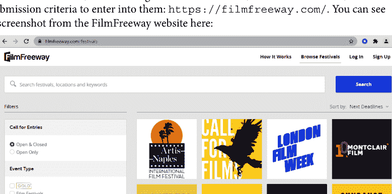
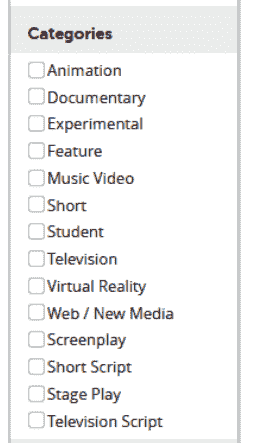
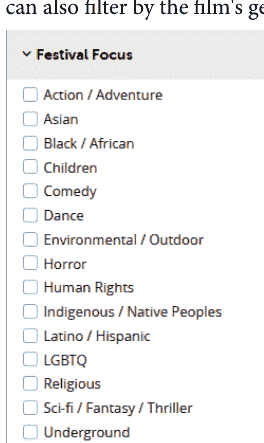
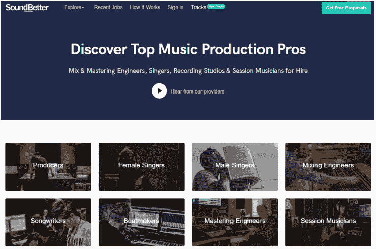
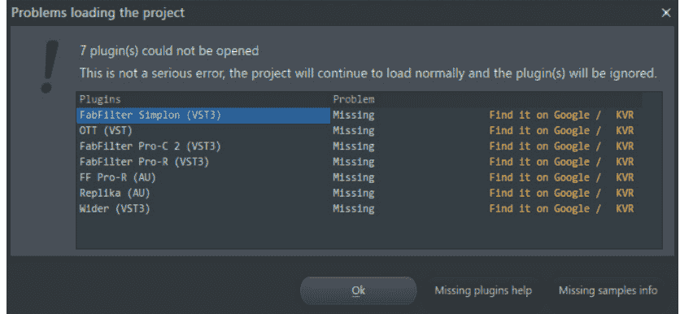
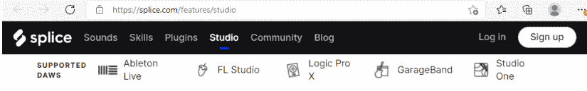
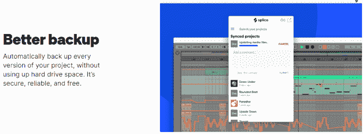
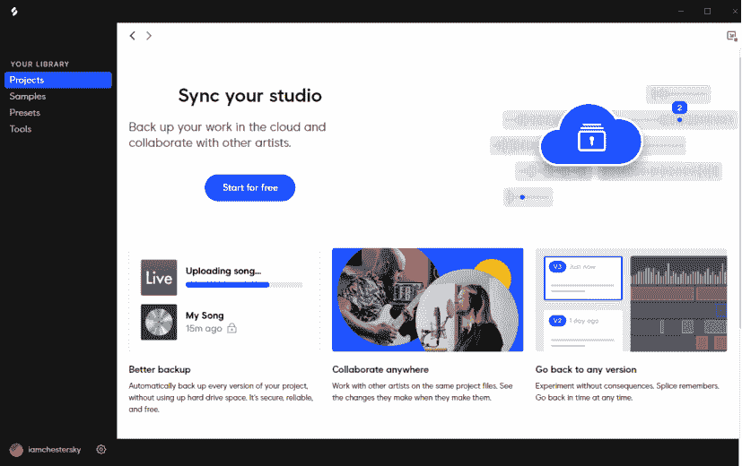
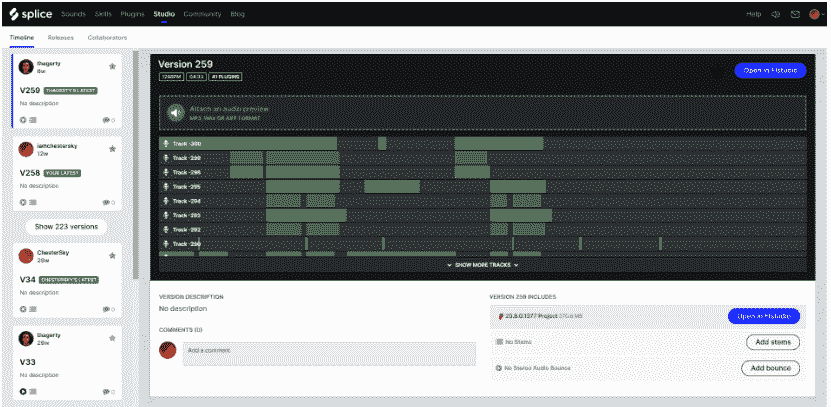
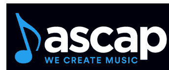

# FL Studio 原声配乐作曲家终极指南：学习为电影和游戏配乐，创作管弦乐音乐，并开启你的音乐生涯

To my parents—my mother, for her devotion, love, and care, and my father, for his boundless curiosity, support, and determination.

To my friends—Sasha, for her encouragement, support, and always making me feel listened to and appreciated, and Jagdeep, Pavel, and Ryan, for making me laugh.

- Joshua Au-Yeung

# Contributors

# 关于作者

**Joshua Au-Yeung** (职业名为 Chester Sky) 是一名音乐制作人、作曲家、导演和软件开发者。他已发行 10+ 张音乐专辑，为电影担任导演和作曲，创作了桌游和数十件艺术作品，并主持一档播客。他是在线课程的讲师，包括音乐制作和为电影与电子游戏作曲的畅销课程。他的上一本书 *The Music Producer's Ultimate Guide to FL Studio 20* 在亚马逊数字音频制作类别中排名 #1。

了解更多，请访问 https://www.chestersky.com/。

# 关于审阅者

**Shreevathsa PK** 从 5 岁开始音乐之旅。很小的时候就开始上卡纳提克古典音乐声乐课。Shreevathsa 在卡纳提克古典音乐考试中以 95% 的成绩完成初级课程，并在 13 岁时自学钢琴，参考了互联网上的许多资料。他对西方音乐的多样性以及它对个人生活产生的巨大影响感到着迷。

15 岁时，他开始借助 DAW 如 FL Studio Logic Pro 作曲。Shreevathsa 创作多种流派的音乐。业余时间，他喜欢聆听从古典音乐到电子舞曲再到日本、中国、韩国和中东等各国音乐等各种各样的音乐。

Shreevathsa 为短片作曲，并与几位 YouTuber 合作，为其 YouTube 频道提供背景音乐。他自己也有频道发布作品。Shreevathsa 也是在跨国公司工作的电子工程师。尽管工作繁忙，他每天仍会抽出几个小时来做音乐。

如果你只是为了好玩而作曲，这本书将为你提供实用的音乐基础，帮助提升你的音乐作品。你将获得音乐理论来理解作曲歌曲的基础。你将学习如何为管弦乐器作曲并制作管弦乐编排。你将学习如何使用软件来做到这一点，而无需在阅读前知道如何演奏任何真正的乐器（尽管对钢琴有一定熟悉会有所帮助）。你将学习如何改进你的歌曲并使其适应特定的情绪和心情。你还会找到避免写作障碍的音乐创意技巧。

如果你想靠做音乐赚钱，这本书将为你提供工具和技巧，让你开启音乐顾问的职业生涯。如果你想在更专业的水平上作曲，而不是仅仅作为爱好，你需要考虑如何高效地按时作曲。一旦接到任务，你需要专注于重要的任务，以便交付高质量的配乐，满足客户的要求。本书将向你展示如何高效管理音乐项目。

# 专业配乐作曲的挑战

如果你想接手为客户创作音乐的工作，你需要处理一系列挑战。从第一天起，你就被期望：

+   - 知道如何寻找作曲工作。这类工作通常不会像传统工作那样列出。
+   - 一旦你确定潜在的工作机会，你需要知道如何向客户营销和推销自己以获得工作。
+   - 你需要知道如何使用各种音乐制作软件。音乐软件在过去几十年中经历了革命，音乐制作已变得远离硬件驱动，更多地依赖软件驱动。软件格局不断变化，因为新功能和插件每月都会出现。
+   - 你需要理解足够的音乐理论来评估歌曲，以便在需要时创建与现有音乐相似的配乐。你需要理解如何制作音乐以适应所需的风格和情绪。
+   - 你需要能够持续生成可用于生产的音乐。你需要了解作曲、录音、混音、母带处理以及所有这些如何与客户的项目相关。
+   - 如果为游戏开发作曲，你可能需要了解将音乐适配到电子游戏环境的复杂性。


## 获得你的第一份作曲工作

为委托人创作音乐的工作不像普通的办公室工作。音乐工作很少发布在招聘网站上，面试也与传统面试不同。这是有充分理由的。作曲任务需要一系列非常具体的特质，这些特质很难通过阅读简历或询问传统面试问题来评估。

让我们设身处地站在客户的角度想一想。想象你是一位刚刚完成一部电影的导演。你花费时间精心修改剧本，进行试镜选角以找到外形合适、化学反应良好的演员，勘察拍摄地点，规划拍摄，最后进入后期制作的剪辑阶段。现在你需要电影中的场景传达特定情感，而你需要量身定制的音乐来做到这一点。

在花费了那么多精力确保每个细节都精准契合电影之后，你认为你会雇佣一个从未见过面的人来制作音乐吗？也许如果他们很有名且有扎实的过往作品，你可能会。但如果你以前没听说过他们，那么你就需要一些证据来证明他们能交付工作。你需要相信所创作的音乐会与电影的整体风格一致。这些信息无法通过阅读简历或询问传统面试问题获得。

当客户需要为他们的项目找人作曲时，他们做的第一件事就是想想自己现有的关系网。有没有他们已经认识的人能做这项工作？除了音乐视频之外，音乐并不是第一位的——项目才是第一位的……这意味着音乐往往是事后才想到的。一个重要的后知后觉，但如果没有项目，就没有人在寻找音乐。

这意味着什么？这意味着，你获得音乐工作的最大机会是让项目的创作者已经认识你。理想情况下，他们应该早在开始寻找作曲人之前就认识你。如果你想为电影作曲，你应该和正在积极制作电影的人待在一起。如果你想为电子游戏作曲，你需要和正在制作电子游戏的人打成一片。

找出当地正在制作的电影或电子游戏，并想办法进入这些圈子。尽可能多地了解正在创建的项目。提出问题，探索他们过去的项目，并尽你所能主动帮助他们的项目。你为建立自己的存在感做得越多，为他们作曲就会变得越自然。当然，你也需要将自己打造成一位有能力、专业的音乐作曲家。

## 如何将自己打造成专业人士

在开始申请作曲工作之前，你应该做什么？你应该尽一切努力建立一个品牌，将你描绘成一位有能力的音乐作曲专业人士。世上有许多音乐人——其中只有一小部分能在专业场合为他人创作原创音乐。你希望潜在客户知道你是这个特殊群体的一员。

许多优秀的现场音乐人不具备成为优秀作曲家的技能，而许多作曲家也不是很出色的现场音乐人。当然两者有重叠，但作曲还需要一套单独的作曲技能，这远不止是擅长演奏音乐。不过不用担心——本书将教你所需了解的一切，让你的技能达到标准。

以下是一些快速步骤，让你在潜在客户面前立刻显得更专业：

- 拥有一个看起来专业的音乐网站，展示你的音乐和音乐创作服务。网站至少应包含你的音乐样本、简短的个人简介和联系信息。
- 让你的过往音乐易于获取，以便随时提供。我个人在需要提供作品集链接时，会选择使用 SoundCloud 作为我的网站。SoundCloud 是一个网站，你可以上传音乐，听众无需登录即可收听。
- 要了解更多关于 SoundCloud 的信息，请访问 https://soundcloud.com。
- 印制名片。尽管联系信息可以存入手机，人们不再需要名片，但名片会让你看起来对从事的事业很认真。名片在活动中分发也很方便。如果你还没有名片，就去印一些。
- 创建一个专门用于音乐商务相关活动的电子邮箱。确保你的电子邮件地址听起来很专业。
- 创建一个专门用于你音乐相关业务的 Facebook 主页。当你分享一则说你为某个项目制作了音乐的帖子时，这相当于为你做免费广告。
- 比 Facebook 主页更好的做法是，创建一个与你的音乐业务相关的本地社区团体或 Facebook 群组。我在大学时，想拍电影，但校园里没有任何电影制作社团。于是，我创建了自己的社团。这帮助培养了一个电影制作人社区，并给了我机会开始创作我的音乐作品集。我还很幸运地选修了电子游戏制作课程，这给了我第一次为游戏作曲的机会。如果你是学生，你有绝佳的机会组织围绕音乐/电影/电子游戏的学生社团。总会有很多志同道合的人渴望加入成为成员。趁着还在学校，充分利用这些学生机会吧。

接下来，我们来谈谈人脉拓展。

## 如何拓展人脉

如果你想作曲，你应该去参加那些正在筹划电影和游戏的聚会活动。找出制片人、电影制作人、演员和作家在哪里聚集。

如果你有兴趣寻找现有团体或创建本地社区团体，可以考虑查看以下网站：https://meetup.com/。Meetup 是一个帮助你查找或举办本地活动的网站。有时，你可以在附近找到与电影或电子游戏相关的活动。如果附近没有，考虑自己创建一个 Meetup 群组。

另一个开始拓展人脉的好地方是业余电影节，那里总有见面交流的聚会。电影节上的见面会可能不会明确列在活动手册上。如果这样，可以在活动现场打听，你总会发现有些成员之后会去吃点东西。在见面会上，离开前把你的名片给每个人，并获取他们的联系信息。尽一切努力与项目创作者成为朋友。

活动结束后，发一条短信或电子邮件，提醒人们你是谁、你们谈话中的相关内容，并表达你希望保持联系。也许可以给他们发一个你创作的歌曲链接。然后，定期通过电话或消息与他们跟进，了解他们的最新活动。我一直觉得业余电影节的气氛对新人包容友好，所以如果你是新手，这是一个很好的起点。

在见面会上认识某人直接获得工作是不太可能的。我从未见过第一次见面就发生这种事。通常是在多个活动中反复遇到同一群人，直到人们最终开始认出你的脸。每次他们见到你，你就越容易与他们的项目产生关联。然后，当你觉得时机成熟时，提及你有一些音乐想发给他们考虑。

不知道在这些活动中如何开始拓展人脉或如何打破僵局？这里有一些稳妥的聊天开场白：

- 我发现打出“初来乍到”这张牌通常很有用。人们喜欢向活动介绍新朋友。你可以问主办方喜欢活动的哪些方面、他们是如何参与进来的，问问有哪些人参加，以及是否可以介绍你认识。即使你以前参加过某个活动一两次，有时假装你希望被介绍认识周围的人仍然有帮助，因为这能让你更容易进入新的圈子。
- *你目前在做什么项目？* 真心好奇，尽可能了解他们项目的任何细节。人们喜欢炫耀。当他们炫耀时，如果你倾听，能学到很多。


- *你是如何进入____的？* 例如，导演、制作、写作、游戏制作等等。

你可以志愿帮助组织现有的 networking 活动；这是一个轻松获得入门机会并让自己变得相关的方式。它甚至可能给你展示过去作品的机会。也许你可以找个借口做一次演示来展示你的过去项目。如果有任何方式可以做一个简短的演讲，这是在活动中让人们记住你的脸的保证方式。

## 如果我还没有音乐作品集怎么办？

为了获得作曲工作，你通常需要有一些之前的作曲经验。人们在信任你之前想看看你过去创作了什么。在开始时，这可能感觉像是一个你被困住的恶性循环。你需要工作来获得经验，但你需要经验来获得工作。如果没有过去的作品可以指出来呢？那么，你可能需要为自己创作一些作品。报名为业余电影节制作电影。去这些电影节并尝试招募对制作短片感兴趣的人。这些人将来可能会想聘请作曲家，或者——更可能的是——恰好知道要参加的活动或正在进行项目的某人。

有很多面向公众开放的电影比赛。如果你有兴趣向电影节提交影片，以下网站列出了电影节、联系信息以及参与的提交标准：https://filmfreeway.com/。你可以在这里看到 FilmFreeway 网站的截图：



图 1.1 – FilmFreeway

FilmFreeway 网站有过滤器，可以帮助你缩小想要参与的电影类型。你可以按报名费、国家、日期和提交截止日期进行筛选。网站将电影节分解为以下类别，以便轻松找到你感兴趣的电影类型：



图 1.2 – FilmFreeway Categories

除了 **Categories** 之外，你还可以按影片的类型/重点进行筛选：



图 1.3 – FilmFreeway Festival Focus

如果你想找到可以参与的电影节，FilmFreeway 是一个极佳的资源。

近年来，我发现 Facebook 对于冷联系非常有用。在 Facebook 上，你可以加入致力于你所在地区电影和游戏制作社区的 Facebook 群组。在这些群组中，你可以看到人们 networking 以及发布电影点名帖。我发现给这些群组中的人发消息有时会带来工作机会或推荐。即使帖子只是为了招募演员，用一封描述你提供的服务的邮件申请有时也能让你获得入门机会。在多次情况下，我发现作为作曲家申请演员招募帖子带来了机会。

当你找到需要音乐的联系人时，你需要找到一种方式来证明你是这份工作的最佳人选。如果你发送一份通用的简历，你可能得不到这份工作。在申请之前，研究项目的所有信息。当向客户发送初始消息时，解释你如何创作符合他们项目的音乐。然后，去创作一些你认为适合他们项目的演示音乐。最佳情况——创作者喜欢演示音乐，你就有了一个可以扩展的起始音乐想法。最坏情况——你为免费创作了一些可以添加到作品集中的音乐。但如果你正在阅读这本书，这意味着你热爱制作音乐，所以你应该把它看作是乐趣而不是负担。目标是获得一份制作音乐的工作。你如何获得这份工作？你制作音乐。看，你已经赢了！

值得一提的是以下网站：`https://soundbetter.com/`。你可以在这里看到 SoundBetter 网站的截图：



图 1.4 – SoundBetter

SoundBetter 网站允许你雇佣或出售音乐相关服务。你可以在该网站上列出你的服务供雇佣。该网站有一个专门的音乐工作招聘板块。

如果你通过传统的求职方法来寻找作曲工作会很困难。作曲工作很少向公众广告。如果你想寻找工作招聘信息来发送简历，你可能会遇到很大困难。大多数作曲工作来自已建立的网络。它们来自已经认识你和你的作品的人。你需要在他们需要音乐之前很久就与正在积极创作音乐相关项目的人建立关系。

好消息是，一旦你获得了一份工作，客户通常会一次又一次地使用你的服务，而且找到更多项目的推荐会变得容易得多。

## 为会见客户做准备

你很快就会发现，在与客户的面试中，他们通常不知道自己在配乐中想要什么。有时，客户认为自己知道想要什么，但他们本身不是音乐家，往往不知道如何制作音乐。他们可能知道自己喜欢什么，并对它可能听起来是什么样有一个设想，但这就像指着一件艺术品说，*我想要一个完全一样的东西……但也要符合我的偏好。* 非常模糊。你被一个自己不会做这份工作的人雇佣……而且他们对交付的工作要求极高。

与客户获得作曲工作需要能够将客户的愿景转化为音乐想法并在不使用音乐术语的情况下向客户解释的能力。为了获得聘用，你需要在为客户项目推销自己的时候证明你具备这种能力。是你的工作弄清楚客户想要什么，如果他们不确定，就引导他们。如果客户声称自己知道想要什么音乐类型，那么你的工作就是把它弄清楚并向各方阐述。

能够最好地弄清楚客户想要什么并清晰地向他们解释的人很可能是获得工作的人。这也是导演通常依赖以前合作过的作曲家的原因——他们知道可以信任他们的作曲家交付符合他们愿景的想法。所以，与客户的对话很大程度上是建立信任和融洽关系。为了让他们信任你，你必须向他们展示你对他们的项目真正好奇且感兴趣。

不要在这个阶段玩欲擒故纵。现在还太早考虑钱。事实上，我建议不要在客户已经决定要你负责项目之前提起金钱话题。你想要尽可能多地获取细节，展示你的能力，并有一个攻击计划，说明你将如何为影片增加价值。如果你简单地在客户看到你带来的价值之前列出价格，那么你可能会与其他作曲家陷入最低价竞标战。

你能向客户收取的价格取决于以下因素：

- 客户的预算。
- 项目的规模（例如，所需歌曲数量/长度）。
- 你的业绩记录。如果你有强大的作品集或声誉，更容易收取更高的费用。
- 创作配乐所需的费用（例如，雇佣音乐家、录音室和设备租赁）。
- 你的音乐为项目增加的价值。

你可能会问，*这种价值是多少？* 好吧，艺术是主观的，音乐为任何项目增加的价值每次评估都不同。说服客户你的音乐有价值是你的责任。很多价值。是的——你可能会在项目上花费一定小时数并随意指定每小时费率，但这些工作小时的价格是多少取决于谈判。你能说服客户的金额，你就可以收取。

很多作曲工作是自由职业合同。作为一般经验法则，作为自由职业承包商，按小时收取高价更明智。例如，假设客户的预算为 500 美元（美元）。你可能会说，*我将按每小时 50 美元收取 10 小时来完成工作*，而不是说你需要每小时 10 美元工作 50 小时。你无论如何都能得到 500 美元，但在第一种方法中，如果出现情况客户需要更多音乐，客户会比第二种情况更尊重你的时间。为了收取更高的价格，你需要给人一种专业的印象。你表现得越有能力和专业，你的价格对客户来说就显得越合理。

我们讨论了如何与客户获得工作。接下来，让我们讨论一旦你获得了工作该做什么。

## 规划音乐配乐

为音乐配乐做好规划是工作的重要部分。计划越周全、越详细，工作就越容易。仔细的规划充当安全检查清单，确保你正确收集了所有所需需求并且没有遗漏任何东西。规划音乐配乐的第一部分是收集客户需求并将其记录在我们称之为 **music design document** 的文档中。

在与客户的面试期间，你会想在这个文档中尽可能详细地记录信息。有许多关键项目你可能希望放入文档中。以下是一些建议。


## 为电影作曲

对于电影音乐，你需要将每个场景拆解为重要事件，以确定需要哪些类型的声音。以下是你需要考虑的一些事项：

-   导演想要什么情感/基调/氛围？
-   场景的强度如何？
-   场景中是否有对白？
-   存在哪些拟音（属于实际场景的声音）？

列出你已有的想法以及你为客户构思的内容。如果你需要特定的乐器、设备、录音室乐手等，可以在此列出你的需求。你可以将音乐设计文档作为一种提案，以便日后需要申请音乐预算时获得批准。

## 为电子游戏作曲

在电子游戏中，作曲者通常比电影更早地进入开发阶段。你可能只有概念图可供参考，以了解游戏可能的样子。音乐有助于设定情感基调，并可能影响游戏的其他设计方面，因此你的音乐可能对游戏本身的设计产生很大影响。许多游戏将音乐作为玩法的一部分。

电子游戏有各种需要音乐的事件，这些需求需要在规划阶段收集并逐项列出。游戏中需要音乐的情形包括以下示例：

-   菜单
-   关卡加载画面
-   进入新关卡
-   完成关卡
-   每个 Boss 的音乐
-   进入新房间
-   获取物品
-   解锁成就
-   环境氛围音效
-   战斗音效
-   过场动画
-   游戏中角色正在聆听的音乐
-   赢得游戏
-   输掉游戏

你参与的性质可能因游戏类型而异。大多数电子游戏都有各种需要音乐的过场动画。你可以像对待任何电影配乐一样对待这些过场动画。

在某些电子游戏项目中，你可能更多地参与游戏开发。你可能需要设计随游戏进程变化的交互式音乐。如果创作交互式音乐，你将需要一份更为全面的音乐设计文档。该文档需要跟踪音乐在整个关卡中的变化方式。如果有层层叠加的音乐，设计文档可以指定添加这些音乐层的条件。每当你为项目完成一段音乐，你都需要让这份文档保持维护和更新。

我们将在第7章“使用Wwise为电子游戏创建交互式音乐”中更详细地讨论电子游戏音乐。

## 为设计文档收集原声带需求

对于电影项目，作曲者通常是在拍摄开始或完成并进入后期制作阶段后才被引入。这通常意味着有一份用于为设计文档收集信息的粗剪版本。它可能缺少音频，但有一些视觉内容让你了解电影的样子。这使得一切都变得容易得多，因为你可以看到各个片段如何组合在一起、每首曲子应该多长，以及音乐需要切入的关键时刻。

如果客户向你提供了视频的粗剪版本，他们通常会给出音乐播放的建议时间点。对于电子游戏，通常会有你或客户为每个需要声音的事物/关卡/环境创建的逐项列表。

**临时音乐**是临时放置在电影或游戏中的音乐，让观众了解音乐听起来可能是什么样的。它通常是客户喜欢的、为其他电影或电子游戏创作的音乐。作曲者对临时音乐的看法存在矛盾。一方面，它让人了解导演的想法。另一方面，它可能让你或导演过于依赖临时音乐，以至于试图模仿它来创作。这是一个容易掉入的陷阱。试图重现另一部电影中使用的伟大音乐作品并不是你想要做的事情。如果临时音乐已经完美，那么他们就不需要你再创作任何东西了。你还不如直接使用临时音乐。你应该从临时音乐中获得灵感，然后去创作一些原创的内容。

思考临时音乐如何为电影增加价值，以及它在哪里有所欠缺。不要仅从表面价值上接受临时音乐作为项目需求——它只是一个占位符。你应该询问导演为什么选择每首临时曲目，并弄清楚他们选择该作品的目的。也许是导演想要某种情感或强度，但除非你询问，否则无法确定。

有一句有时被归于巴勃罗·毕加索的名言：*优秀的艺术家借鉴，伟大的艺术家偷窃。* 让我们讨论如何以正确的方式“偷”点子。听临时音乐并抄录当然是不好的做法。然而，如果你从多首歌曲中汲取想法，并以新的方式组合，那么你就不再是偷窃——而是受到启发。先选取你想要借鉴的想法，再找几个你也想借鉴的想法，最后将它们融合成一个混合体。

## 与客户一同观看电影

安排一个时间与客户坐在一起观看电影，并在音乐应该切入的时刻暂停。讨论电影关键时刻音乐应该传递的情感基调。当我这样做时，我们会边看，我会拿出笔记本电脑，疯狂地记录笔记、电影的时间点、期望的情感，以及对话中出现的任何评论。

在多数情况下，与客户交谈时，你会用示例作为参考来解释音乐——这些参考包括其他著名电影和对标志性场景的描述。你很可能永远不会与客户讨论音乐理论。更有可能的是，你会讨论某个场景给客户带来的感受。是什么让场景产生那样的感受呢？

如果导演提供了临时音乐，我会逐一记录每首临时音乐曲目的时间点。观看素材时脑海中浮现的任何笔记和想法，我都会记录下来。

会议结束后，我会收集笔记，以合乎逻辑的方式整理思路，并将它们改写进设计文档中。

一旦设计文档完成并获得批准，就该创建一份我喜欢称之为**原声带规划器**的文档了。这份文档将安排整个项目的配乐。它会将我们在设计文档中确定的所有需求，逐项细化为可执行的片段。原声带规划器文档还将作为沟通工具，帮助各方规划配乐。

## 创建原声带规划器

你如何组织一部电影的配乐？如果只是一首单曲，你可能不需要太多规划。但我们讨论的不是一首单曲，而是数十段、甚至数百段不同的声音片段。如果你正在制作电子游戏原声带，你可能还需要跟踪编程方面的考虑细节。

当你从客户那里获得对音乐的反馈时，事情并不像询问意见那么简单。你会得到答案，但你可能不知道如何据此行动。你需要一种合乎逻辑的方法来跟踪所有建议和更改，并将它们整理为可以执行的具体步骤。

如果你参与的是大预算电影，公司可能会希望使用某种工单跟踪软件。不过，更常见的情况是，客户让你自己负责组织配乐工作。

我个人发现，一份老式的 Google Drive 文档或 SharePoint 共享文档既简单又实用。大多数人已经知道如何使用共享驱动器文档，所以你不用担心客户不会使用该软件。

你可以将可编辑文档的链接分享给导演和工作人员。所有人都可以访问相同的文档，所以每个人都能随时看到最新版本。请确保定期备份文档副本，以防有人不小心把所有内容弄乱。


下面是我为一位客户使用的**配乐规划表**示例。我加入了“时间”列，用于显示建议将音乐放置在影片中的位置；歌曲文件名列；歌曲需求说明列；歌曲状态列；以及客户和作曲家的评论列：

| 时间 | 文件名 | 导演备注 | 歌曲状态 | 导演反馈/建议 | 作曲家评论 |
|---|---|---|---|---|---|
| 04:30 | 04:30 - Fall | 基调应当悲伤、悔恨、阴暗 | 已批准 | 完成。很棒 | 看起来你已经拥有这段音乐所需的一切了。如果还需要其他内容，请告诉我。 |
| 08.20 | 08.20 - Nostalgia long version | 基调应当不喧宾夺主。融入背景之中。略带持续低音 | 等待批准 | 没有橡皮筋声音的版本似乎在每次和弦变化时都会有轻微的咔哒声。除此之外都很棒。我们能否加入“Goodbye song”大约 48 秒处出现的那种微妙持续低音？ | 带有橡皮筋声音的“Nostalgia”歌曲非常完美。我们会在混音时进行调整。 |
| 20:32-20:56 | 20:32- Drone | -无调性<br>-期待感 - 氛围<br>-持续低音 | 需要修改 | 环境感、自然的基调。需要传达不确定的情绪 | 另加入了一个版本：“08.20 - Nostalgia V2”，其中包含你要求的修改。 |
| 46.00-48.24 | 46.00 - Boss Fight | 48.17 秒处的兴奋感减弱 | 进行中 |  |  |

图 1.5 – 配乐规划表

在文档中，我加入了一个按颜色编码的图例，让导演可以轻松了解每首歌曲当前所处的状态。例如，我用白色表示**进行中**，黄色表示**等待批准**，绿色表示**已批准/已完成**，红色表示**需要修改**，如下所示：

| 黄色：等待批准 | 绿色：已批准/已完成 | 红色：需要修改 | 白色：进行中 |

图 1.6 – 配乐规划表图例

如果导演快速浏览这张表，就能大致了解项目中每首歌曲的状态。每当我完成歌曲方面的进展时，我都会将歌曲更新到共享云盘，并在文档中更新相关信息。然后，我会将共享文档的链接发送给导演，让他们知道有一些改动已经完成。

如果你不使用有条理的方法来管理配乐，就很容易忘记哪些工作已经完成。确保你采用易于理解的方式命名文件。我喜欢在文件名中包含歌曲名称以及歌曲在影片中的建议时间点。例如，我可能会将一首歌曲命名为`00.46.00 - Boss Fight - Version 3.`。

这个标题可以让导演知道音乐应该按影片时间放置在哪里、场景内容是什么，以及当前歌曲的版本，从而确保他们使用的是最新版本。你也可以考虑在名称中加入歌曲速度和调性。

你应该尽可能减少导演使用音乐时所需付出的工作量。如果导演总是弄不清你的音乐在哪里、不确定哪首歌曲应该放在影片的哪个位置、不清楚歌曲的制作进度，或不知道应该使用哪个版本的歌曲，这就说明你的音乐组织方式还可以更加高效。

如果你把工作做得很好，导演打开配乐规划表后，就应该能立即知道已经完成了哪些工作。随后，他们可以打开存放你音乐的文件夹，并轻松浏览文件夹结构来找到所需歌曲。歌曲的标注方式应当让导演能够根据配乐规划表中的评论，准确知道这是什么歌曲以及如何使用。

过去，我曾收到导演的积极反馈，他们表示非常喜欢这种配乐规划表组织音乐的方法。他们认为这种方法清晰、易于使用，并且能够帮助他们了解项目进展以及还有多少工作需要完成。

## 为项目研究音乐创意

完成配乐规划表的大纲后，接下来就是有趣的部分：研究音乐创意。你已经明确了配乐需求；现在，你需要走进更广阔的领域，寻找灵感。是时候创建一个可以汲取灵感的资源参考板了。

我通常会查找客户在交流中提到的电影或游戏中的音乐。我会回顾临时音乐，特别关注其中使用的乐器。我会记录音乐风格，并看看能否找到相关资料，了解使用了哪些工具和软件技术。目标并不是复刻这些声音，而是了解过去曾经做过什么，这样如果之后需要，你就能随时参考这些信息。

电影和游戏中的片段总能在 YouTube 上找到。我会创建一份文档，其中放入相关片段的链接和描述。如果我需要为某个场景寻找灵感，就可以用这份文档作为参考。

如果时间允许，我可能会花些精力收集原创声音和乐器。有些作曲家会用手机到处录制声音。之后，他们可以将这些声音用作音频采样，并对采样进行处理，将其变成所需的任何声音。

我个人喜欢寻找平时不会听的新音乐类型——那些能让我跳出舒适区的声音，往往会给我的作曲带来灵感。不作曲时，我通常会听电子舞曲。但当我为客户作曲时，我会踏上探索之旅，寻找平时绝不会听的各种不同声音组合。越奇怪越好。如果是一种我从未听过的音乐风格，就尤其能引起我的兴趣。

在某个阶段，你一定会遇到创作瓶颈。这时，你必须有可以求助的东西，帮助自己重新开始产生想法。提前完成研究，并准备一份随时可查阅的参考文档，可以在你需要时帮助激发创作灵感。我们将在第 3 章“使用主题、主导动机和音阶设计音乐”中介绍更多构思音乐创意的技巧，并将在第 8 章“配乐创作模板”中学习如何克服创作瓶颈。

在本节中，我们学习了如何规划电影配乐。我们还学习了一种研究项目的方法。我们了解了如何使用配乐规划表来组织配乐，从而帮助你和客户跟踪音乐进展。

接下来，让我们学习如何与其他作曲家合作完成团队项目。下一个技巧稍微更高级一些，可能更适用于规模较大的项目，而不是刚开始工作时的项目。

## 与他人合作

与合作伙伴分享音乐需要组织和规划。如果准备充分，分享项目和音乐可以相对轻松。

确保你的音乐采用团队成员容易理解的格式。你需要与团队共同确定文件和格式的文件夹结构。提前讨论这些事项，确保每个人都知道如何找到音乐。

仅通过阅读文件和文件夹的命名结构，就让合作伙伴能够轻松了解你的音乐内容。可以考虑根据以下信息为文件夹命名：

- 文件名和格式
- 音乐类型
- 速度和歌曲调性
- 配器

### 合作中的问题

与其他作曲家合作时，你很快就会遇到共享项目文件以及跟踪最新文件方面的困难。如果其他人需要访问你的音乐项目文件，但无法使用你的电脑，他们该怎么办？

首先，想想如果你把整个项目文件发送给别人会发生什么。如果对方尝试打开项目，但使用的数字音频工作站与你不同，那么他们将无法直接打开，因为双方的项目文件不兼容。

即使对方使用与你相同的数字音频工作站，但没有安装相同的乐器插件，他们也许能够打开项目，却仍然无法使用，因为缺少插件。这会导致令人烦恼的错误界面，例如下面这样：



图 1.7 – 打开缺少插件的项目

处理缺少的插件是一场噩梦。你必须找出哪些插件缺失，然后尝试重新创建所使用的设置。实在不是什么愉快的事！

如果不提前沟通，这些问题会不断出现。如果你以前没有和其他音乐人合作过，很容易忽视这些问题，但它们可能让你浪费数小时并感到沮丧，而这些问题其实很容易避免。为了避免这一切，你需要在开始之前确认并共同确定你和合作伙伴能够使用哪些数字音频工作站和插件。确保只使用所有参与方都能访问的插件。

### 使用 Splice 进行版本控制

如果你和合作伙伴使用的是不同的数字音频工作站，该怎么办？这意味着你无法发送整个项目文件，因为合作伙伴无法打开它。在这种情况下，每次想要将音乐发送给其他人时，你都需要计划从项目中导出音频分轨。

如果你们使用的是相同的数字音频工作站，那么合作会容易得多。但你们仍然需要确认双方都能使用哪些乐器和效果插件。之后，你们还需要讨论如何在进行修改时互相同步更新——例如，每次修改音乐项目后都互相发送消息，让对方知道有新的项目版本。


我是不是已经把你绕晕了？如果这听起来让人困惑，那是因为它本身确实有点复杂。想要弄清楚项目文件的最新版本，既烦人又混乱。幸运的是，有一种解决方案：版本控制软件。软件开发者在很早以前就意识到需要一种管理文件版本的方法，远比音乐人早。如今，对大多数程序员来说，使用 Git 之类的版本控制软件已经是必须的。

近年来，面向音乐人的版本控制软件也出现了。其中一款最流行的音乐版本控制软件解决方案叫做 Splice。它允许你在远程仓库中保存不同阶段的项目，并打开项目的旧版本。最重要的是，你可以与协作者共享 Splice 项目文件，让他们随时都能访问最新版本。

> 注意
> 你可以免费从 https://splice.com 下载 Splice。

进入 Splice 后，你可以把项目文件分享给协作者的 Splice 账户，他们就能访问该项目的所有版本。下面的截图展示了 Splice 的主页：





图 1.8 – Splice 网站

在撰写本文时，Splice 还无法像 Git 那样合并不同文件版本之间的更改，因此每次只能有一个人对最新版项目进行修改，你们无法同时修改。这意味着，每次你打算处理项目文件时，都必须登录 Splice 并打开项目的最新版本。如果你不这样做，很可能会发现自己在处理一个过时版本的项目文件。

Splice 还提供了一个免版税声音素材库，你可以付费后在项目中使用。它还允许你租用乐器插件，直到付清相当于直接购买插件所需的金额，之后插件就归你所有。因此，如果你眼下手头拮据但又需要插件设备，这可能是一个比直接购买乐器插件更方便的替代方案。

当你登录 Splice 时，会看到类似这样的界面：



图 1.9 – Splice 仪表板

在左侧面板中，你可以看到项目导航、下载采样，或查看 Splice 中可用的工具。

每次保存项目时，Splice 都会向仓库中添加一个新版本。你可以为单个轨道添加注释，供协作者查看。如果你们使用相同的数字音频工作站，可以从 Splice 打开项目文件，此后它会自动保持项目文件同步。下面的截图展示了 Splice Studio 的示例，它用于管理歌曲版本：



图 1.10 – Splice 版本

在上面的截图中，你可以看到 Splice 如何展示项目以便协作的一个例子。左侧列出你可以选择打开的旧版本项目；顶部中间显示所做的更改；底部则可以输入你想要记录的任何备注和评论。

如果沟通顺畅，使用 Splice 与团队成员协作可以非常顺利。如果沟通不畅，那么你肯定会遇到问题。问题往往在你开始处理并非最新版本的歌曲时出现。

每当你处理一个新的歌曲版本，你都需要通知团队成员你正在保存新版本。这样，他们就会记得在进行修改前打开新版本。只要你们都轮流使用最新版本工作，就能避免出现问题。

我们已经讨论了如何与协作者分享音乐。接下来，让我们学习一些给新手的技巧。

## 避免新手错误的建议

下面是一些如果你刚接触作曲可能会忽略的要点。

### 主动征求反馈

作曲时你可能犯的最大错误之一是没有获得足够的反馈。这听起来可能像是常识，但事实并非如此。你获取反馈并作出调整的方式是一种微妙的平衡。这是工作中很脆弱的一环。如果做得不对，你会惹恼你求助的人，并且显得自己不知道在做什么；无论你的音乐多好，都会留下坏印象。如果做对了，你会与客户建立信任，并被一次又一次地请回去做更多工作。

大多数情况下，你在演奏音乐时，听众并不会仔细审视你歌曲的每个细节，也不会告诉你他们的想法。即使你在现场为观众演奏时获得了反馈，这些反馈也可能不是什么容易采纳的具体批评。

但在为客户作曲时，情况并非如此。与客户合作是一个完全不同的环境，在这里反馈就是一切。如果你把音乐交给客户时对方一言不发，那并不代表他们喜欢这些音乐，而是说明客户并没有在用心考虑这段音乐。这是很大的区别。

我在第一次作曲工作中就犯了这样的错误。在我的第一部电影中，我为整部影片谱写了配乐，这花了我几个月的时间。整个过程中，我发音乐给客户，他什么也没说，我以为那一定意味着他喜欢这些音乐。否则，怎么会有人雇你做事，而你交作品时却一句话也不说呢？结果发现，那是因为他的注意力放在别的事情上了。当我告诉客户我完成了，他说他还没有听过任何音乐。当他把音乐放进影片后，他说他对听到的效果不满意，想让我把整个配乐重做。

他认为这是我的错。随着时间流逝、与这件事拉开距离，当我回头再看时，他是对的。确保自己的音乐被客户听到并理解，是作曲者应尽的努力。不要像我一样犯这个错。尽可能经常联系客户，不断征求反馈。如果客户有一段时间没有对你的音乐发表任何意见，永远假设他们还没有审阅音乐，并且你需要跟进。

正是这段经历迫使我研究一种更好的方法来规划我的配乐乐谱。经过实验，我最终采用了本章前面讨论过的配乐规划表（Soundtrack Planner）方法。只要你不断更新配乐规划表，并让客户知道你的改动，你应该就能有效收集反馈，并确保有效沟通。

我们已经讨论了给新手的建议。接下来，让我们讨论一下工作中典型的一天是什么样子。

## 作曲的日常工作

下面是作曲时典型一天的样子。首先，我会查看配乐规划表，看还有哪些事项需要完成，以及它们的优先级。我还会查看设计文档，看看有没有关于音乐的备注。

如果我还没有想好要创作什么样的音乐，我会花些时间回顾之前的研究参考文档。我可能会有想用的乐器、能给我灵感的参考资料，或者一幅能让我进入正确思考状态的视觉画面。

如果是电影或游戏过场动画，我会在数字音频工作站中为视频片段设置标记。我会在关键时刻加上标签，以便直观地跟踪音乐需要配合的事件。我们将在*第 5 章《使用 MuseScore 创建乐谱、用 Fruity Video Player 配乐，以及剧情内音乐》*中详细讨论这一点。我喜欢为每个场景单独存放一个项目文件，不过我会复制项目文件，并复用其中已加载的乐器和效果。

接下来，我需要找到一种我认为适合这个场景的声音。乐趣和实验就从这里开始。我是个弹钢琴的人，所以通常从找和弦开始。我会试着找出一组能带出我想要的情绪基调的和弦进行。这会花上一些时间，而且我会经历数轮迭代，因为我深信，和弦进行是一首歌最终是否好听的基础。有些作曲家早期并不那么纠结和弦，而宁愿先确定一种契合场景的具体声音。开始的方式有很多，正确答案也有很多。我们将在*第 3 章《用主题、主导动机和音阶设计音乐》*中介绍大量关于构思音乐想法的建议。

一旦我对和弦进行感到满意，我就会开始为这首歌确定配器。我会把和弦进行中的旋律分配给不同的乐器。我会层层叠加乐器。我会摆弄和弦拆分，以增加一些节奏感。我会调整编曲，以卡准不同的时间标记。理想情况下，到最后，我会为每首歌做出几个变体版本。

创作与编排歌曲只是第一步。之后，你需要考虑歌曲的混音和母带处理。有时，我会先把一首未混音的片段发给客户，让他们给反馈，然后再投入更多时间去做他们可能不喜欢的东西。

混音时，我会根据频率范围把乐器细分到不同的混音总线中。然后，我会应用均衡和压缩来隔离/突出这些乐器。我会尽量让各乐器的频率不互相争抢。我可能会添加混响等效果，并平衡乐器的音量。

如果你想全面了解用 FL Studio 混音的各种细节，可以看看我的著作*《音乐制作人的 FL Studio 20 终极指南》*：

```
https://www.amazon.ca/Music-Producers-Ultimate-Guide-Studio/dp/1800565321
```


一旦我有了一些自己满意的歌曲草稿，我就会导出歌曲并加以标注和整理，以便客户能轻松识别其用途。我会将其上传到共享驱动器文件夹。我会在 Soundtrack Planner 中做一些笔记，更新其中关于任何新歌曲的信息。然后，我可能会给客户发一条简短消息，让他们知道有新的音乐需要审阅。

每隔一段时间，还会有与客户的会议或电话/视频通话，讨论客户对项目的愿景，并审阅音乐以收集反馈。对于任何反馈，我都会在音乐设计文档中做笔记，以供日后参考。

我们已经了解了作曲的日常工作；接下来，让我们学习如何从音乐版税中获取收入。

### 如何收取音乐版税

有些客户项目会以固定费率向你付费，你需要签署放弃音乐所有权利的协议。当你为低成本独立电影工作时，你拥有比与大制片厂合作时大得多的议价能力。有时（尤其是对方以低价雇佣你时），你可以通过协商，让客户只获得使用你音乐的权利，而你保留所有权。这意味着你可以在客户项目之外重复使用这些音乐并从中获利。

如果你能保留所有权，你就可以注册你的音乐以收取版税。这样一来，每当你创作的音乐被播放时，它就会为你带来额外收入。

音乐播放的版税收取方式可能非常复杂。世界各地不同的地区有不同的组织来收取版税。要自己追踪你的歌曲在电台播放的时间是不可能的。幸运的是，你不需要这样做。

有几个组织负责从音乐播放中收取收入，并将音乐收入分配给创作者。这些组织确实会抽取一小部分收入，但没有它们你就无法收取这笔钱，所以你没有太多选择。

需要收取的一种版税称为**复制版税**，也称为**机械版税**。每当你的歌曲被放入数字文件中（例如用于在线音乐分发），这就是一种复制，你应获得播放版税。

要在**美国（US）**收取复制版税，你需要使用表演权组织，例如**美国作曲家、作家和出版商协会（ASCAP）**、**广播音乐公司（BMI）**或**欧洲舞台作者与作曲家协会（SESAC）**。不过，只有通过邀请才能加入 SESAC。

你将从这些组织中选择一个，并与其注册你的每一首歌曲。然后该组织将为你收取版税收入。如果你身处不同国家，你需要查看该地区指定的收款机构。

有关 ASCAP 的信息可在 https://www.ascap.com/ 查看。你可以在这里看到他们的徽标：



图 1.11 – ASCAP

有关 BMI 的信息可在 https://www.bmi.com/ 查看。他们的徽标如下所示：


图 1.12 – BMI

还有公开表演版税。每当歌曲在电台、电视、剧院或音乐会上播放时，这便属于表演版税。如果你在美国，并且你是一位表演艺术家和/或拥有母带录音，你将使用名为 SoundExchange 的组织来收取版税。该组织负责收取表演版税并将其分配给权利所有者。如果你在其他国家，可能需要注册不同的组织。

有关 SoundExchange 的信息可在 https://www.soundexchange.com/ 查看。他们的徽标如下所示：


图 1.13 – SoundExchange

那么在线商店呢？有很多在线商店和流媒体平台可以出售你的音乐。以下是其中一些的列表：

- Spotify
- Apple Music
- iTunes
- Instagram/Facebook
- TikTok/Resso
- YouTube Music
- Amazon
- Soundtrack by Twitch
- Pandora
- Deezer
- Tidal
- iHeartRadio
- Claro Música
- Boomplay
- Anghami
- KKBox
- NetEase
- Tencent
- Triller
- Yandex Music
- MediaNet

为了更方便一次性将你的音乐上传到所有平台，而不是逐个上传，你可以使用数字分发服务。这让你可以在一个中央控制面板上管理你的音乐，并代为收取在线流媒体和购买的版税。你只需要一个服务，但它们提供的价格和服务略有不同，因此你可能需要比较一下。

以下是一些你可以使用的数字分发服务示例：

- DistroKid (https://distrokid.com/)
- LANDR (https://www.landr.com/)
- CD Baby (https://cdbaby.com/)
- TuneCore (https://www.tunecore.com/)
- Ditto Music (https://www.dittomusic.com/)
- Loudr (https://www.crunchbase.com/organization/loudr)
- Record Union (https://www.recordunion.com/)
- ReverbNation (https://www.reverbnation.com/)
- Symphonic (https://symphonicdistribution.com/)
- iMusician (https://imusician.pro/en/)

> **注意：**
> 如果你选择使用 DistroKid 作为你的数字分发服务提供商，以下链接可让你第一年享受折扣：https://distrokid.com/vip/seven/701180。

如果可以，尽量通过协商保留你歌曲的权利。收取音乐版税是作曲家可以获得的一个额外收入来源。

### 总结

在本章中，我们学习了为客户作曲的商业知识。我们了解了如何获得为客户创作音乐的工作，以快速启动你的作曲生涯。我们讨论了如何显得专业，以便客户认真对待你的建议，还学习了如何准备客户会议，从而有效利用客户的时间。我们学习了如何规划电影配乐，以便合理安排时间，如何在共享项目文件时与他人协作，以及如何使用 Splice 进行版本控制。最后，我们讨论了如何收取你的音乐版税。

在下一章中，我们将学习如何使用数字音频工作站，以便你能够开始作曲。
