## 2 探索 FL Studio 的关键功能

在本章中，我们将讨论数字音频工作站 FL Studio 的主要功能。我们将讨论 FL Studio 是什么、如何获取它，并初步了解其核心工具。具体来说，我们将讨论如何使用通道机架、钢琴卷帘、播放列表、浏览器和混音器。最后，我们将学习如何录制音频和导出音乐。

本章将涵盖以下主题：

- 什么是 FL Studio？
- FL Studio 的核心工具：通道机架、钢琴卷帘、播放列表、浏览器和混音器
- 录制音频
- 导出音乐

### 什么是 FL Studio？

**FL Studio** 是全球领先的数字音频工作站之一。它是一个软件套件，让你在创作音乐时几乎可以做任何想做的事情。你可以使用 FL Studio 满足所有作曲需求。你可以在这个软件中播放乐器插件、录制音频、创建和弦进行、混音并为视频配乐。在本书中，我们将使用 FL Studio 进行作曲。

### 获取 FL Studio

你可以免费下载 FL Studio 的试用版。试用版让你可以试用所有插件，看看它们的用途。你可以使用 FL Studio 中的所有工具，但在购买版本之前，它不会让你重新打开已保存的项目。

你可以从 Image Line 网站下载 FL Studio：https://www.image-line.com/：

FL Studio 有多个可供购买的版本层级。以下是各版本的详细说明，以便你确保获得所需的功能：

- **Fruity 版**是最便宜的。它包含所有基本功能，例如访问播放列表、通道机架、钢琴卷帘、浏览器和混音器。它包含 Autogun、BassDrum、BeepMap、Drumpad、FLEX、Fruit Kick、Fruity DX10、Groove Machine Synth、Distructor 和 MiniSynth 插件，但不包含音频录制。

-   **Producer Edition** 包含 Fruity Edition 中的所有功能，外加音频录制和后期制作工具。如果你想录制音频，你需要这个版本或更高版本。该版本还包括 Edison、Slicex、Sytrus、Maximus、Vocodex 和 SynthMaker 插件。
-   **Signature Bundle** 包含 Producer Edition 中的所有内容，外加 Fruity Video Player、DirectWave采样器、Harmless、NewTone、Pitcher、Gross Beat、Vintage Chorus 以及 Hardcore 吉他效果套件。Fruity Video Player 允许你与音乐同步观看视频，这对电影作曲家来说非常方便。我们将在 *第 5 章，使用 MuseScore 创建乐谱，使用 Fruity Video Player 进行配乐，以及介于其中的音乐* 中讨论如何使用 Fruity Video Player 为视频配乐。
-   **All Plugins Bundle** 包含购买时 Image Line 创建的所有可能的插件和功能，包括大量乐器和效果。

每个版本中包含的特性还有很多更多。要完整比较产品版本，请访问 https://www.image-line.com/fl-studio/compare-editions/。

FL Studio 提供终身免费更新。这有助于确保你始终使用最新最好的功能。每当 FL Studio 团队推出新的软件插件时，你只需更新 FL Studio 即可立即获取。多年以来，FL Studio 取得了重大进步，终身更新随着时间的推移变得非常重要。

官方 FL Studio YouTube 频道，*Image-Line*（https://www.youtube.com/user/imageline），通过发布每次软件更新，让你了解最新的 FL Studio 功能。每当 FL Studio 发布新功能时，他们都会发布教程视频，概述新内容。

现在我们知道了 FL Studio 是什么，让我们开始使用工具吧。

## FL Studio 核心工具

只有开始使用后，才能真正理解 FL Studio 中的工具。本书是关于作曲技巧的，所以我们不会列出每个控件和功能，而是只关注需要了解的功能，然后进入有趣的部分——作曲。本章中，我们将介绍初学者的基础知识。我们将在 Channel rack 中加载一个乐器，在 Piano roll 中创建简单的旋律，将其添加到 Playlist 中，路由到 Mixer，并从 FL Studio 中导出。

在 FL Studio 顶部，你会找到菜单面板和播放器。菜单面板包含 FILE 导航下拉菜单，用于创建、保存、打开和导出项目。在 FILE 下方，你会看到描述鼠标光标悬停在哪个按钮上时其名称的文本，以及使用该控件的键盘快捷键列表。如果你想知道某个插件或控件叫什么，它会在这里描述。以下截图显示了菜单面板和播放器：

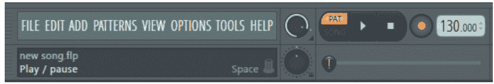

图 2.2 – FILE

在前面的截图中，你会看到一个带有 PAT 和 SONG 的按钮。左键单击可以切换选项，在播放模式和歌曲之间切换。可以把模式想象成由乐器演奏的一组旋律。歌曲比模式更大；它们由多个音乐模式、采样和自动化组成。

在 PAT 和 SONG 按钮右侧是播放和停止按钮，可播放你的音乐。或者，你也可以按空格键开始和停止播放音频。

FL Studio 中有五个主要工具部分，可通过左键单击以下按钮访问：

图 2.3 – 工具

前面的截图从左到右列出了 Playlist、Piano roll、Channel rack、Mixer 和 Browser。为了成功使用 FL Studio 作曲，你需要至少了解这些工具的基础知识。以下图表显示了工具之间的关系：

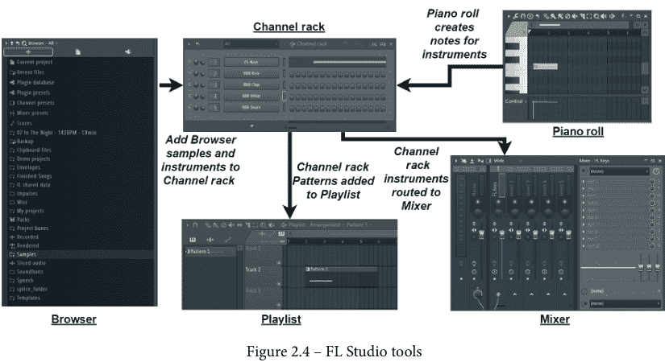

图 2.4 – FL Studio 工具

这些工具相互连接如下：

-   Browser 有助于文件导航。在这里，你可以获取声音采样并浏览文件夹。
-   Channel rack 显示项目中使用的所有乐器、采样和自动化。在这里你可以添加新的乐器供使用。
-   Piano roll 是为你加载到 Channel rack 中的任何乐器创建音符旋律的地方。
-   Playlist 包含歌曲中使用的所有模式、采样和自动化。这是显示所有声音的仪表板。
-   Mixer 是添加声音效果的地方。你可以将乐器和声音从 Channel rack 路由到 Mixer，然后在 Mixer 中编辑声音。

不用担心一开始有些内容难以理解；仅凭简短描述很难理解。我们将在本章中讨论这些内容。

逻辑上，当你创建歌曲时，首先要做的是选择一个乐器来创作音乐。这是通过 Channel rack 工具完成的。

## Channel rack

**Channel rack** 工具保存你所有的乐器、采样和自动化，并允许你在它们之间导航。每当你想查看项目中添加了哪些乐器时，这就是你将使用的工具。通过左键单击 **Channel rack** 图标打开 Channel rack：

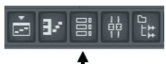

图 2.5 – Channel rack 图标

打开 Channel rack 后，你会看到类似以下内容：

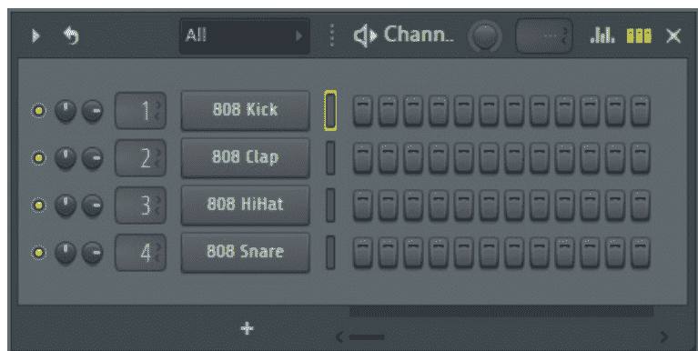

图 2.6 – Channel rack

在 Channel rack 的左上角，你会看到 **Channel Options** 下拉箭头。左键单击 **Channel Options | Add one**，你会看到所有可用的乐器插件列表。或者，你也可以右键单击 Channel rack 中的任何乐器，看到相同的选项：

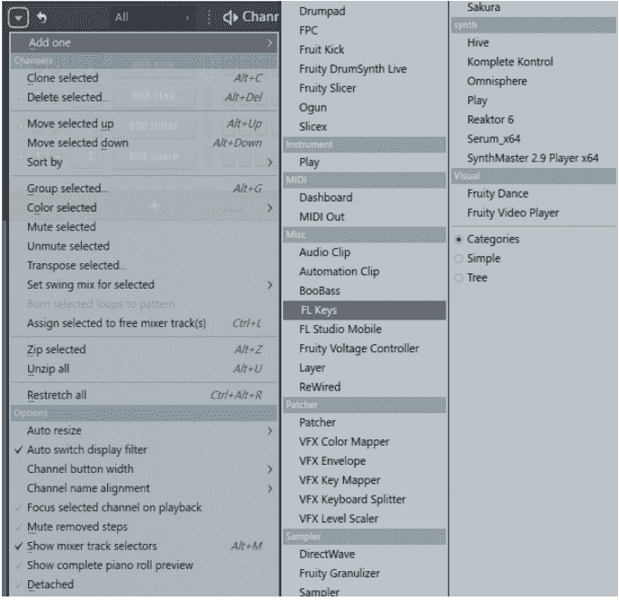

图 2.7 – 插入乐器

从面板中，你可以左键单击任何乐器，它将被添加到 Channel rack。我鼓励你在空闲时探索可用的乐器。现在，我们选择 FL Keys 乐器：

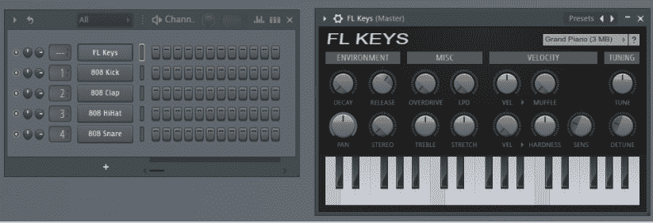

图 2.8 – FL Keys

乐器插件将打开。如果你按下键盘字母或连接的 **Musical Instrument Digital Interface (MIDI)** 键盘，你将能够听到乐器音符的播放。

如果处理打击乐采样，你可以通过在 Channel rack 上左键单击 Channel rack 中的音符按钮，直接在 Channel rack 上创建乐器音符，如下图所示：

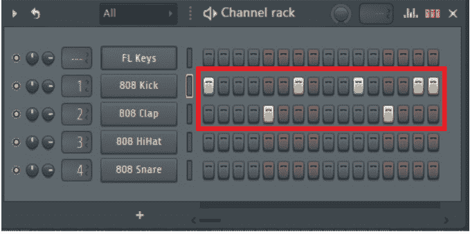

图 2.9 – Channel rack 音符

当你播放模式时，你将能够听到乐器演奏音符。

在 Channel rack 的左侧，你可以看到 **Mute/Solo** 按钮，以及 **Channel Panning**、**Channel Volume** 和 **Target Mixer Track** 控件，如下图所示：

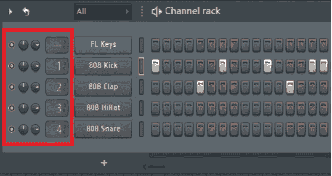

图 2.10 – 静音、声像、音量和混音器轨道

**Mute/Solo** 按钮使你能够打开和关闭单个乐器。例如，如果你按住 *Ctrl* + 左键单击 **Mute/Solo** 按钮，它将静音所有其他乐器。这有助于隔离单个声音，使一次更容易听到一个。要再次打开所有乐器，按住 *Ctrl* + 左键单击 **Mute/Solo** 按钮第二次。

**Channel Panning** 旋钮允许你听到音频从左或右扬声器发出的声音。**Target Mixer Track** 显示乐器当前路由到的混音器轨道。我们将在本章后面回来讨论这个问题。

以下是一些有用的 Channel rack 快捷键：

-   **Clone channel**: *Alt + C*
-   **Delete channel**: *Alt + Del*
-   **Re-order channels**: *Alt + up/down*
-   **Transpose channel steps**: *Ctrl + Shift + left/right*
-   **Zip channels**: *Alt + Z*
-   **Filter groups**: *Alt + G*

每当你查看 Channel rack 时，你会看到项目中使用的所有乐器。如果模式中为一个或多个乐器添加了音符，你会在 Channel rack 中看到这一点。

现在我们已经学会了如何使用 Channel rack，让我们学习如何使用 Piano roll 为乐器添加音乐音符。

## 使用 Piano roll

**Piano roll** 是你创作和弦旋律和进展的地方。这是作曲家的魔力所在。我们将在本书中一遍又一遍地回到 Piano roll。

让我们为乐器添加演奏的音符注释。在 Channel 架中右键单击你想要为其作曲音符的乐器，然后选择 **Piano roll** 选项。在下面的截图中，你可以看到我正在 Piano roll 中打开 **FL Keys**：

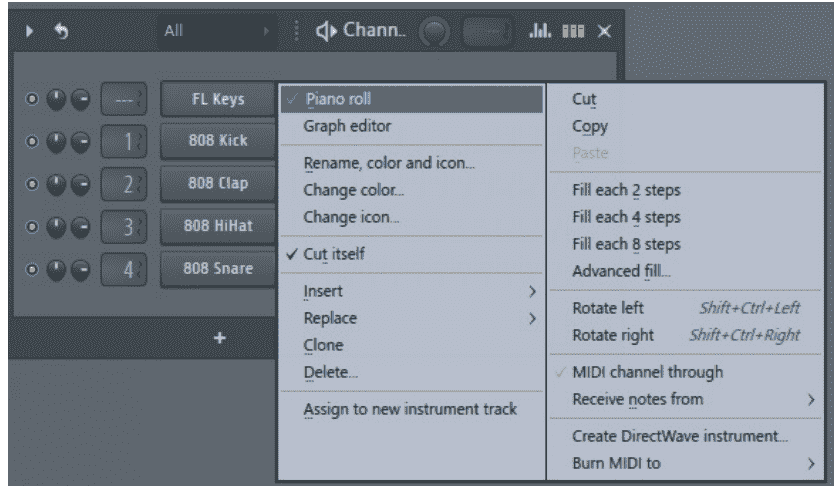

图 2.11 – The Piano roll

另外，你也可以通过选择 **Piano roll** 图标来打开 Piano roll：

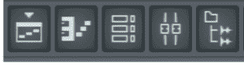

图 2.12 – The Piano roll icon

Piano roll 工具将会打开，你会看到 Piano roll。屏幕顶部会显示 **Piano roll** 字样，后面跟着当前选中的乐器。点击该文字可以让你在乐器之间导航，如下面的截图所示：

你可以一次性选择一组音符，然后将其静音或取消静音。你可以通过按住 Ctrl + Shift 并拖动想要选择的音符来同时选择多个音符，然后使用 Alt + M 快捷键静音音符。你可以使用 Ctrl + Shift + M 快捷键取消选中音符的静音。

另外，你也可以使用 Piano roll 顶部的 Mute 工具图标来静音音符。

## Splitting notes

有时，你可能想要将一个音符拆分成几段。你可以使用右 Alt + 右 Shift 快捷键并拖动到想要切分的音符位置来将音符切成两半。或者，你也可以使用 Piano roll 顶部的拆分工具来将音符切成两半。

我们已经学习了使用 Piano roll 的基础知识。我们将在第 3 章《Designing Music with Themes, Leitmotifs, and Scales》和第 4 章《Orchestral MIDI Composing》中详细讲解 Piano roll 中的大量作曲技巧。

接下来，让我们学习关于 Playlist 的内容。

## The Playlist

Playlist 是你安排歌曲中所有元素时序的地方。它包含模式、Audio Clips 以及效果的自动化。

一旦你在 Piano roll 中创建了一些音符，就意味着你为单个模式添加了音符。现在，是时候将你的模式添加到 Playlist 中了。通过选择 Playlist 图标打开 Playlist：

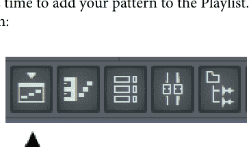

选中后，Playlist 将会打开，如下面的截图所示：

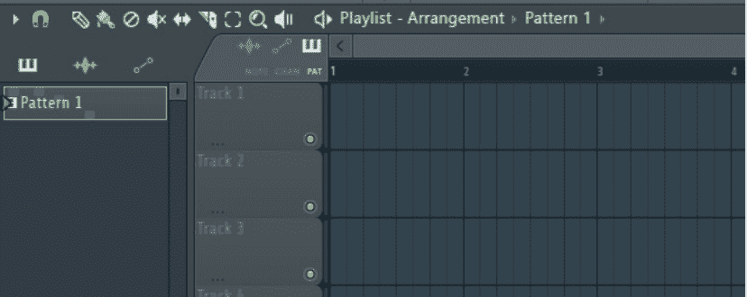

图 2.17 – The Playlist

如果你在 Playlist 上左键单击，你就可以将选定的模式添加到其中。

在下面的截图中，选定的模式是 Pattern 1，如 Playlist 顶部显示的文字 Playlist - Arrangement > Pattern 1 > 所指示的那样。这就是你刚刚为其创建了一些音符的模式。通过在 Playlist 上左键单击，模式将被添加到所选位置，如下面的截图所示：

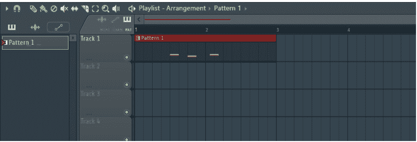

图 2.18 – Adding a pattern to the Playlist

如果你想要添加不同的模式，你可以按 **Current clip source** 按钮或模式选择器并选择你想要的模式，如下面的截图所示：

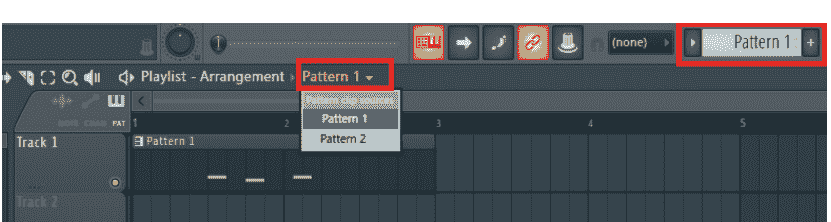

图 2.19 – Changing a pattern in the Playlist

在前面的截图中，你可以看到我有两个可供添加的模式。其中一个叫做 **Pattern 1**，另一个叫做 **Pattern 2**。你可以为视觉方便而重命名它们。

以下是一些基本键盘快捷键，可帮助加快作曲速度。一旦你将这些快捷键记入肌肉记忆，你会发现使用 Piano roll 和 Playlist 非常愉快：

- **Delete notes**: Right-click on the note
- **Duplicate notes**: *Ctrl + B*
- **Alternative duplicate method**: Left *Shift* + click and drag
- **Mute/unmute**: Double-right-click and drag over the sound clip
- **Split clip**: Right *Alt* + right *Shift* + left-click
- **Drag a clip while ignoring tempo**: *Alt* + left-click and drag
- **Select clip**: *Ctrl* + right-click
- **Select multiple clips**: *Ctrl* + *Shift* + left-click
- **Select all**: *Ctrl + A*
- **Zoom to full view**: *Ctrl* + right-click
- **Zoom in**: *Ctrl* + scroll with the mouse wheel

这些都补充了更通用的快捷键：

- **Undo**: Ctrl + Z
- **Redo**: Ctrl + Alt + Z
- **Copy**: Ctrl + C
- **Paste**: Ctrl + V

我们现在已经学会了如何将音乐模式添加到 Playlist。接下来，让我们了解模式与歌曲之间的关系。

## Understanding patterns versus songs

初学者可能很难理解为什么在尝试播放时音乐没有播放。这通常是由于不理解模式和歌曲的概念并将它们混淆所致。让我们花一点时间确保我们理解如何在模式和歌曲之间导航。

下面的截图显示了你用于在 PAT 和 SONG 之间切换的按钮：

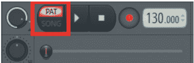

图 2.20 – PAT versus SONG

如果选择了 PAT，你将听到所选模式的播放。如果选择了 SONG，你将听到 Playlist 中所有音频的播放。因此，如果你没有听到整首歌，很可能是因为你选择了特定的模式。换句话说，当你想要为特定乐器组作曲时，你希望选择 PAT。然后模式将被添加到 Playlist。当你想要听到整首歌时，你希望选择 SONG，它将播放 Playlist 中的所有内容。

一旦你选择了 PAT，这将使你能够收听单个模式。你可以通过两种方式在所选模式之间导航。最简单的方法是找到 Playlist 左侧的所需播放列表模式并左键单击以选择它，如下面的截图所示：

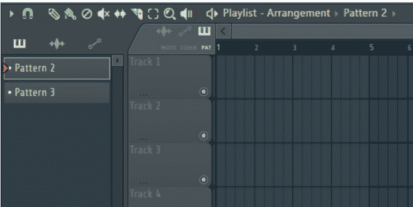

图 2.21 – Selecting a pattern

另一种方法是选择 Pattern 选项下拉菜单，如下面的截图所示：

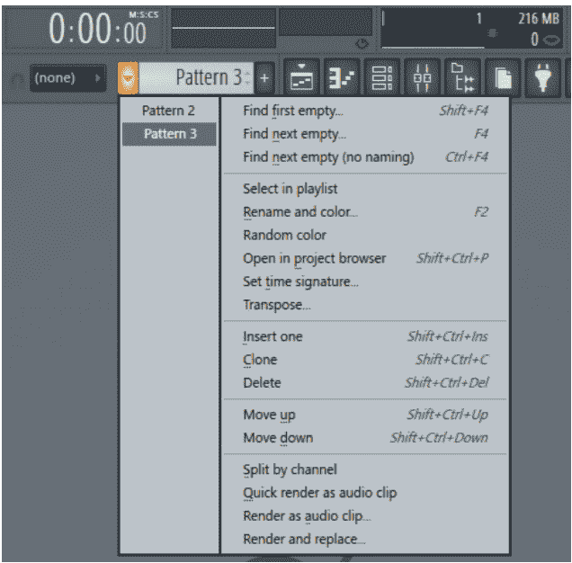

图 2.22 – Pattern options

你现在知道如何导航 Playlist 并向其添加模式。到目前为止，我们已经学习了如何在 Channel rack 中加载乐器，为乐器添加演奏的音乐模式音符，以及将音乐模式添加到 Playlist。接下来，让我们学习关于 Mixer 的内容。

## The Mixer

Mixer 是你对声音应用音频效果并平衡声音相对音量的地方。当你想要添加效果来增强它们时，你所有的声音都会发送到这里。

在你能够对乐器进行混音和添加效果之前，你需要将乐器连接到混音器轨道通道。让我们将乐器路由到 Mixer。 有几种方法可以将 Channel rack 中的乐器路由到 Mixer。我首选的方法是左键单击乐器名称右侧的 select 按钮来选择乐器，然后按 Ctrl + Shift + l 键盘快捷键：

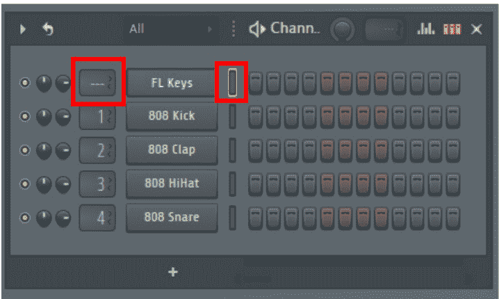

图 2.23 – Selecting an instrument

这将把所有选定轨道的乐器、名称和分配的乐器颜色路由到 Mixer。如果你只想路由单个乐器，你也可以使用 Ctrl + l。

另一种将乐器路由到 Mixer 的方法是右键单击乐器并选择 Assign to new instrument track 选项，如下面的截图所示：

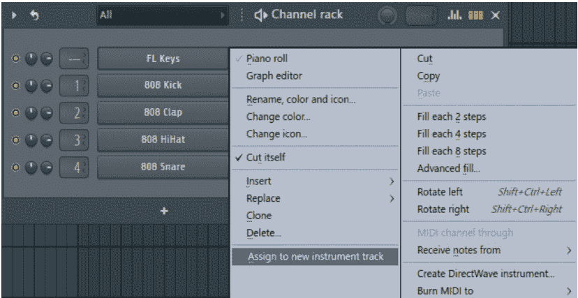

图 2.24 – Assigning to a new instrument track

另一种方法是将鼠标光标悬停在 Target Mixer Track 按钮上并使用鼠标滚轮滚动，或将其上下拖动。这将为乐器分配混音器轨道值，如下面的截图所示：

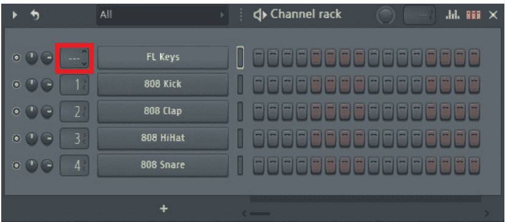

图 2.25 – Target Mixer Track

在从 Channel rack 将乐器路由到路由器后，你可以通过左键单击 Mixer 图标来打开 Mixer，如下面的截图所示：

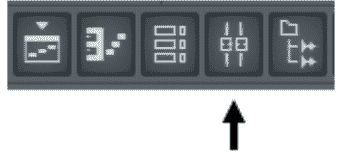

图 2.26 – The Mixer icon

混音器将打开，你会看到类似以下内容的屏幕：

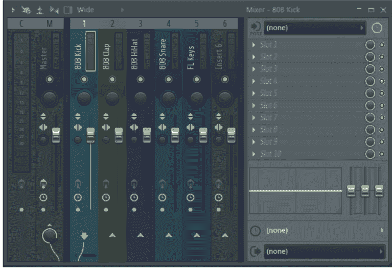

Master Channel

Insert Mixer Channels / Tracks

Effects Rack

图 2.27 – The Mixer sections

Mixer 被分为三个主要部分：

- 插入混音器通道/音轨
- 效果架
- 主通道

在本书中，我们在整个书中可以互换使用 *track* 或 *channel* 名称，因为它们的意思相同。

**插入混音器音轨** 部分列出了路由到该音轨的乐器的名称，你可以通过左键单击进行选择。每个通道都包含一个音量旋钮，可以上下拖动来调整乐器的音量，以及声像旋钮来控制你是从右声道还是左声道听到音频。

一旦你左键单击了某个通道，你现在就可以通过左键单击效果架中的一个空槽来为声音应用效果。以下截图显示了向混音器音轨添加效果的示例：

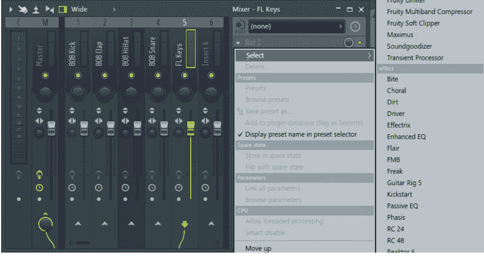

图 2.28 – 效果架

效果列表将会出现，你可以左键单击以添加。您可以添加诸如延迟、压缩、均衡和混响之类的效果。

主通道部分是所有来自 Mixer 的音频最终会被路由到的地方。从主通道输出的音频是最终导出的声音。

接下来，让我们学习关于浏览器工具。

## 浏览器

浏览器主要用于帮助你浏览项目中想要使用的采样和文件。你可以通过单击 **Browser** 图标打开浏览器：

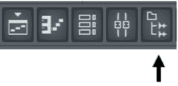

图 2.29 – 浏览器图标

在浏览器内部，你会看到一系列文件夹。如果你左键单击 **Packs** 文件夹然后单击 **Legacy** 文件夹，你会看到可用的采样列表：

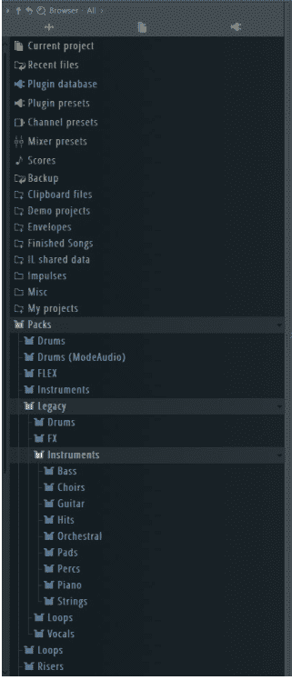

图 2.30 – 浏览器乐器

这些文件夹包含声音采样和乐器的组合。然后你可以右键单击乐器/采样并将其路由到所需的位置，例如通道架。或者，你可以左键单击并从浏览器拖放到播放列表中。以下截图显示了右键单击采样并将其路由到通道架的示例：

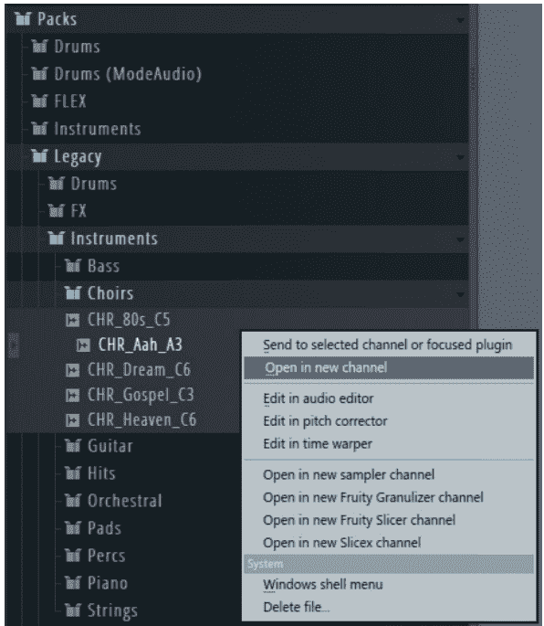

图 2.31 – 使用采样

在前面的截图中，当你在浏览器中右键单击采样时，你可以看到几个菜单选项出现。打开新通道选项将直接把采样发送到通道架。

采样的一件很酷的事情是你可以轻松地相互交换。要做到这一点，请在播放列表或通道架中选择所需的采样。然后，在浏览器中，按住鼠标上的滚动按钮（中键）同时单击你想要替换的采样。这将交换采样片段。我经常使用这个快捷方式。

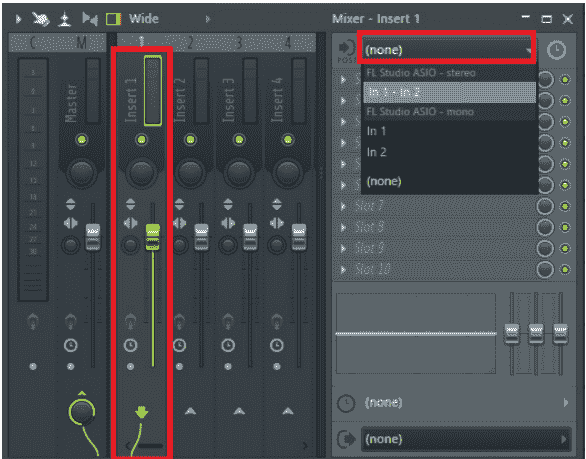

图 2.33 – 选择麦克风

一旦你选择了麦克风，你现在就可以录制音频了。如果你查看 Mixer，你会注意到在选定的混音器音轨上有一个小红指示灯，如以下截图所示：

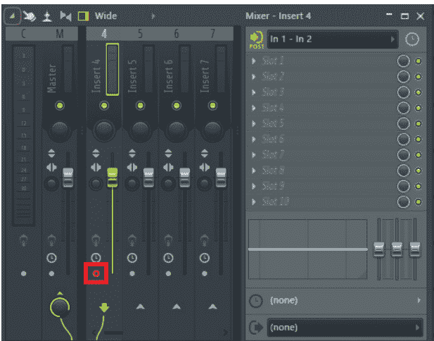

图 2.34 – 通道准备录制音频输入

这个红灯表示录制的音频将被发送到该选定的混音器音轨。音轨上的任何效果在录制时也会应用于音频。如果你愿意，可以同时在多个混音器音轨上录制。一般来说，录制原始音频然后稍后应用效果是一个很好的做法，但你也可以选择在录制时应用效果，这在你想听听音高校正效果如自动调音可能听起来如何时很有用。

我们已经设置好了混音器。现在，让我们开始录制。要录制音频，左键单击如以下截图所示的 Record（自动化，分谱）按钮：

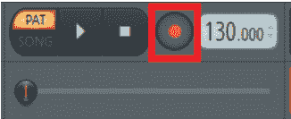

图 2.35 – Record 按钮

录制窗口将会出现。然后你可以从可用的录制选项中选择一个。你可以选择任何选项进行录制，但对于本示例，我们将选择 Audio, into the playlist as an audio clip 选项：

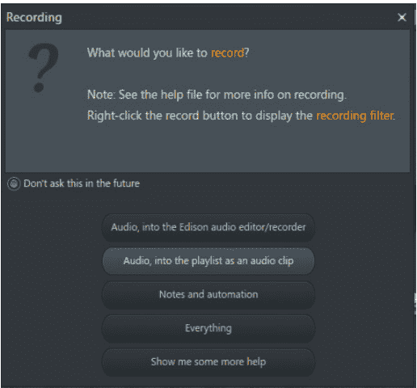

图 2.36 – Audio, into the playlist as an audio clip

你的播放列表歌曲将开始播放。你现在录制的任何音频都将与播放列表音乐同步播放，如以下截图所示：

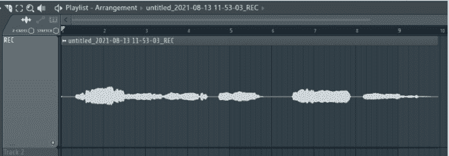

图 2.37 – 在播放列表中录制的音频

要仅录制你的音频输入而不让播放列表中的其他音乐在录制背景中播放，你需要将耳机连接到电脑。否则，你会把扬声器发出的声音重新录回 FL Studio。录制音频时务必佩戴耳机。

恭喜！你刚刚学会了如何录制音频。接下来，让我们学习如何导出我们的音乐作品。

## 导出音乐

让我们学习如何从 FL Studio 导出音乐。混音器中的主通道，如以下截图所示，包含将要导出的最终音频：

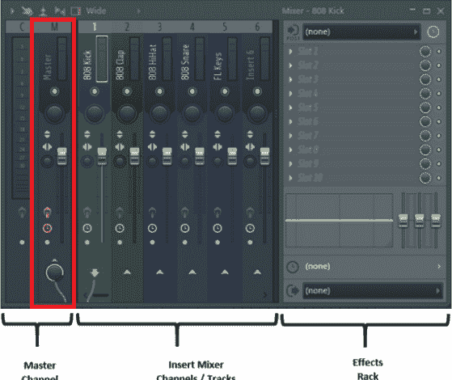

图 2.38 – 主通道

要导出歌曲，请前往 **FILE | Export | Wave file**：

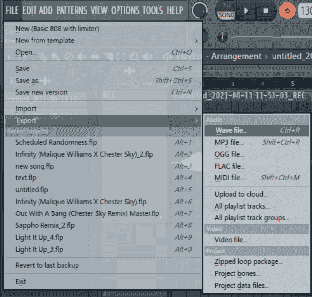

图 2.39 – 导出歌曲

选择 **Wave file** 后，你将被提示选择保存音频文件的位置。然后，你会看到一个带有歌曲导出控制的窗口，如以下截图所示：

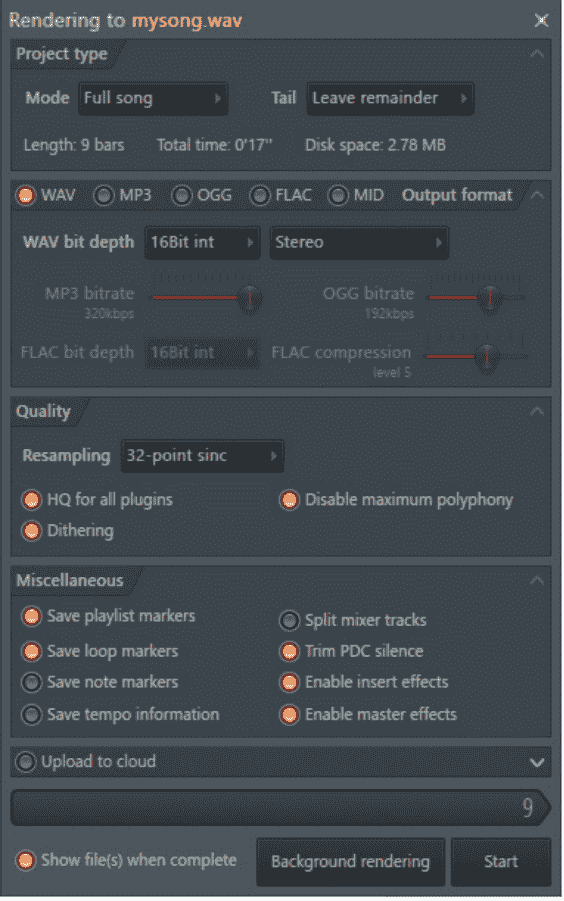

导出歌曲最简单的方法是确保 **Mode** 设置为 **Full Song**。然后，选择 **WAV** 或 **MP3**，并单击 **Start**。这将导出你的歌曲，以便你可以在 FL Studio 之外收听你的音乐。恭喜！你已导出你的歌曲。

以防你好奇，这里是对导出设置的一个详细分解。在 **Project type** 选项中，你可以选择导出完整的歌曲或仅导出单个模式。

**Tail** 选项有以下三个选择：

- **Cut remainder** 在声音和采样停止播放的瞬间突然结束歌曲。
- **Leave remainder** 允许合成器在歌曲结束时自然衰减至静音。这通常是在大多数情况下你想要的选择。
- **Wrap remainder** 将歌曲末尾出现的任何衰减放在歌曲的开头。这在你创建循环并且希望声音重复时很有用。

下面，你可以看到歌曲长度、歌曲的总经过时间以及导出的歌曲将创建的文件大小。

你可以从几种输出格式类型中进行选择。你可以选择导出为 **WAV** 或 **FLAC**，它们是无损格式，不会降低音频质量。对于音频的最终版本，你可能希望使用 WAV 格式进行导出。位深度是你可以选择输出的分辨率。可用的选项如下：

- **16-bit**，CD 质量的标准
- **24-bit**，推荐用于流媒体
- **32-bit**，用于声音存档大小

你通常可以选择 16-bit，因为在大多数情况下你可能无法分辨更高位文件大小之间的差异。

**FLAC** 使用数据压缩来减小文件大小；然而，声音将与 **WAV** 文件完全相同。然后你可以增加 **FLAC** 压缩，这会使文件大小更小，但仍然不会影响音质；它只是导出时间会稍长一些。

**MP3** 和 **OGG** 是导出时会丢失音频质量的格式。它们在保持音频声音的同时丢弃数据。**MP3 bitrate** 决定音频质量；更高的比特率允许更高的音质。

**MID** 格式允许你将项目导出为 MIDI 数据，前提是你已在项目中创建了 MIDI 数据。

你还有选择以 **Stereo** 或 **Mono** 输出的选项。这是指你是否希望允许来自左右扬声器的声音差异，或者你希望声音相同。你通常希望将其保留为立体声。

**Quality** 部分指的是抖动。基本上，它可以让你的音乐看起来比实际选择的<|message|>

