## 用主题、leitmotif 和音阶设计音乐

在本章中，我们讨论作曲家的音乐理论。我们将为如何将音乐理论应用于电影和游戏作曲提供基础背景。我们将讨论动机、主题和 leitmotif 的概念如何用于构思音乐想法。我们将讨论音阶是什么以及如何使用它们。我们将使用音阶来解释调式是什么以及如何使用它们。最后，这些概念将使我们能够使用五度圈和弦轮工具来展示音阶之间的关系，以及如何在歌曲中从一个音乐调性平滑过渡到另一个调性。

本章将涵盖以下主题：

- 作曲家的工具箱
- 理解和使用主题、动机和 leitmotif
- 理解音阶
- 理解和使用调式
- 理解升号和降号
- 使用五度圈和弦轮

## 作曲家的工具箱

当你坐下来作曲时（通常在钢琴和电脑前），你会面对一张空白画布。至少在电影中是这样描绘的。看起来什么都没有，你必须去创造。从局外人的角度来看，似乎音乐只是从你身上倾泻而出。那是关于作曲音乐的浪漫童话式思维方式。

音乐从你身上爆发听起来很美，但如果你需要持续按需创作音乐，这就不是很可靠。音乐来自哪里？我们演奏的音符并不是随机的。某些音符组合和旋律有时听起来非常和谐。似乎有时所有音符都流动并相互支撑。这是怎样发生的？一定存在某种音符组合之间的关系，使得这种情况得以发生。

你被分配了一个电影作曲任务。你已经看到了需要为其创作音乐的故事。你如何开始？你如何制作符合你期望风格并保持一致的音乐？有哪些框架可以帮助指导这一过程？本章旨在回答所有这些问题。

当你真正开始作曲任务时，这可以是一门非常技术性的艺术。你可以将作曲与木匠用木头雕刻雕塑相比较。是的，你在雕刻之前需要有一个想制作的东西的想法，但创作在很大程度上取决于你拥有的工具。掌握工具越多，你找到的机会就越多。理解如何使用工具以及工具背后的大局是相辅相成的。

作曲家有很多工具可以使用，我们将在本书中探索其中许多。为了充分利用软件工具，你需要对音乐有概念上的理解。在本章中，我们将专注于大局理论，以弄清你在作曲什么。然后，在后面的章节中，我们将研究实现你构想的工具。到本章结束时，你将理解音乐理论如何应用于作曲音乐。

## 主题、动机和 leitmotif

在开始作曲之前，我们需要想出一些作曲的参数。主题、动机和 leitmotif 是构思音乐想法的工具。它们可以帮助我们理解场景的意义并定义我们希望音乐具有的品质。

如果你上过写作或电影评论课程，你可能已经熟悉主题、动机和 leitmotif 这些术语。然而，这些术语的解释可能因授课者而异，而且通常不是在音乐语境中使用。在我们讨论的语境中，我们将按如下方式定义这些术语：

### Motif

一个 **motif** 是无法在叙事中代表具体事物的片段化音乐想法。它是一组或短语的音符，传达一个想法。它是你能做出有意义的最小音乐量。当你在叙事的不同点重放这一组音符时，动机将会意味着不同的东西。重要的是，你在整个故事中不断回到这个音乐想法。如果你不断扩展这个音乐想法并延伸它，它可以演变成一个音乐主题。

作为动机的例子，在阿尔弗雷德·希区柯克执导的 1960 年电影《惊魂记》中，当淋浴谋杀场景发生时，我们听到小提琴的尖叫声。这是一种高音、冲突、不和谐的声音，令人不愉快且刺耳。这个声音与谋杀的声音联系在一起。

### Theme

一个 **theme** 是一个可以代表叙事中具体事物的完整音乐想法，但不一定需要。它是一首可识别的旋律，整首或部分作品都是基于它。当你听到一个音乐主题时，你就知道这首歌指的是一个特定的故事。

每当你观看一部电视剧时，该剧都有主题曲。这首歌与该剧联系在一起。主题通常被认为是一种概括该剧想法的声音。

在许多现场歌剧和舞台表演中，现场乐队会在演出开始前演奏音乐。此时，他们会演奏该剧的几个音乐主题。这通常是整场演出中演奏的几首音乐作品的混音合集。

让我们讨论一个例子。在乔治·卢卡斯执导的电影《星球大战》、《帝国反击战》和《绝地归来》中，每当你看到达斯·维达这个角色时，都会播放一首特定的歌曲。这首歌就是《帝国进行曲》，更 commonly 称为达斯·维达的主题。你在整部电影中将这种声音与达斯·维达联系在一起。达斯·维达的主题与这个角色联系得如此紧密，很难想象曾经没有音乐的时候。我们理所当然地认为当角色出现时音乐会同时播放。

想象一下我们从未听过为达斯·维达使用的音乐。让我们思考达斯·维达主题的音乐并尝试逆向工程作曲家约翰·威廉姆斯可能如何想出这段音乐。

假装你在静音观看《星球大战》，第一次在视频中看到达斯·维达。尝试构思音乐想法时，你有什么信息可用？

通过观察达斯·维达出现的场景，我们学到了一些东西。维达是电影的反派。他邪恶、强大、有力量、指挥着军队。当他走进一个房间时，他吸引了周围所有人的注意。他总是穿着黑色全身盔甲。如果你取消静音并聆听，当他说话时，他有一种深沉的男性化声音，听起来很凶险。

我们只是看了角色的外表，我们已经有很多信息可以开始构思音乐。约翰·威廉姆斯选择以进行曲风格制作维达的主题。如果我们想强化角色的外表是某种军事指挥官的形式，那么以军进行曲节奏的音乐就是一个合乎逻辑的选择。如果我们想表达力量的概念，那么我们很可能想要使用能够支撑这种感觉的乐器。约翰·威廉姆斯最终使用了大量低音弦乐音符、大量打击乐和大型铜管乐器。

思考 leitmotif 可以帮助你选择想要使用的声音和乐器。你可以查看角色、地点、事件或其他重要物品，看看它们有什么意义。然后，尝试弄清楚什么声音适合传达那种意义。

我们已经了解了动机、主题和 leitmotif 以及它们如何用于构思音乐想法。接下来，让我们学习关于音阶的知识。

## 理解音阶

尝试学习任何旋律乐器，迟早你会学到音阶。如果你想创作歌曲，了解音阶是必需的。

谈论音阶时，大多数音乐书籍直接深入音乐记谱，要求你背诵音阶，并留下你可能永远不会阅读的页本书。我看过很多这样的书籍和讲座，发现其中大多数完全令人难忘。我们将尝试另一种方法来帮助你了解我们为什么使用音阶以及如何应用它们。这将帮助你理解音乐理论而不是死记硬背。事实上，你几乎不需要记住任何东西；软件可以为你完成几乎所有工作。

在本章中，我们将探索以下问题的答案：音阶到底是什么？我们为什么要有它们？它们对作曲为什么重要？以及如何在数字音频工作站中应用音阶的音乐理论？

让我们先解释音阶是什么。所有声音都是由空气中振动的分子产生的。它们以我们解释为波长的模式簇振动。频率是我们用来描述每秒通过空气的波长数量的术语。以下图示展示了我们如何将振动的空气分子解释为声波的示例。

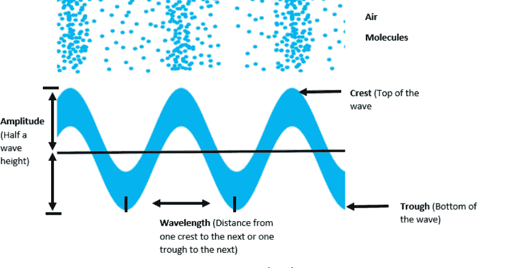

图 3.1 – 波长

乐器使空气分子以特定频率振动。当空气以特定恒定频率振动时，我们的耳朵会将噪音解释为音高。如果你有弦乐器，你会熟悉将乐器弦调音到特定频率的想法，这样当你拨动琴弦时，你会得到期望的音高。

我们根据音频频率给它们命名，称之为音符音高。例如，当在钢琴上演奏时，我们将220 Hz的频率命名为A，更确切地说是A3。和弦被定义为同时演奏的三个或更多音符。当你同时播放三个或更多不同的音频波长时，你就是在创造和弦。

如果我们把音符的频率加倍会发生什么？下图展示了220 Hz和440 Hz波形的对比。

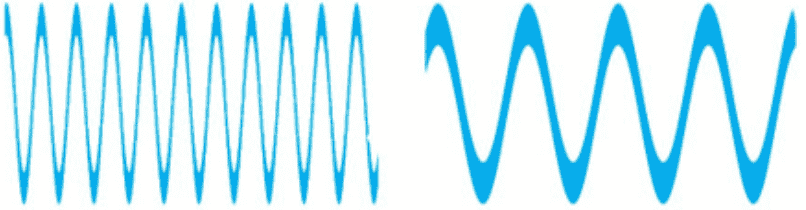

图3.2 – 频率

440 Hz的频率听起来正好是220 Hz频率的两倍高。我们给这个音程起了一个名字：**八度**。八度是一个音高与另一个频率翻倍音高之间的音程。这两个声音一起演奏时听起来很和谐。对于任何两个频率成倍数关系的声音都是如此。到目前为止，我们所说的只是根音与相隔一个八度的音搭配得很好。

好的，220 Hz的频率是我们所知的A3音符，440 Hz是A4。那么220 Hz到440 Hz之间的范围呢？在那个音程内，有一系列频率可供选择。如果我们把220 Hz的音与220 Hz到440 Hz之间的某个音搭配，我们怎么知道这个音符组合在一起是否会好听？

随着时间的推移，我们注意到某些频率比组合在一起听起来确实很好。例如，如果我们使用A3音符（频率220 Hz）与一个音程比为3:2（330 Hz）的音符搭配，它们会很好听。那个330 Hz的第二个音符通常称为E3。不过，用音程比来思考会让人困惑。与其记住音程比的名称，我们使用一些常用术语。对于3:2的音程比（A3与E3配对），我们使用术语**纯五度**。

下面的表格展示了在伴奏根音时听起来悦耳的音程。该表格按从协和到不协和的顺序排列，**协和**是指声音与根音和谐，**不协和**是指音符与根音不协调：

| 音程名称 | 音符之间的频率比关系 |
|---|---|
| 根音 | 1:1 |
| 八度 | 2:1 |
| 纯五度 | 3:2 |
| 纯四度 | 4:3 |
| 大三度 | 5:4 |
| 小六度 | 5:3 |
| 小三度 | 6:5 |
| 大六度 | 8:5 |
| 大二度 | 9:8 |
| 小七度 | 9:5 |
| 小二度 | 16:15 |
| 大七度 | 15:8 |

图3.3 – 从协和到不协和

以纯五度为例，其频率比关系是3:2。我们的耳朵喜欢根音与3:2频率比的声音搭配时的和谐感。我们的耳朵喜欢听到优美、均匀间隔的音程，如2:1、3:2、4:2、5:4和5:3。当我们偏离这些整齐的音程时，耳朵会将声音解读为更加不协和。

最和谐的音程是纯五度、纯四度、大三度和小三度。如果你想让音符与根音搭配，通常会考虑包含这些音程。

八度意味着你将根音与频率恰好为其两倍的音符进行比较。西方音乐把一个八度划分为12个半音音程。西方音乐有12个音符：A、A#、B、C、C#、D、D#、E、F、F#、G和G#。

下表假设我们以220 Hz的根音频率为起点，按频率从最小到最大列出了这些音符。它显示了根音相对于其他音符之间的频率比：

| 音符之间的纯律频率比关系 | 音符 | 音程名称 | 纯律频率（Hz） | 十二平均律频率（Hz） |
|---|---|---|---|---|
| 1:1 | A3 | 根音 | 220 | 220 |
| 16:15 | A# | 小二度（m2） | 234.7 | 233.1 |
| 9:8 | B | 大二度（M2） | 247.5 | 246.9 |
| 6:5 | C | 小三度（m3） | 264 | 261.6 |
| 5:4 | C# | 大三度（M3） | 275 | 277.2 |
| 4:3 | D | 纯四度（P4） | 293.3 | 293.7 |
| 7:5 | D# | 三全音 | 308 | 311.1 |
| 3:2 | E | 纯五度（P5） | 330 | 329.6 |
| 8:5 | F | 小六度（m6） | 352 | 349.2 |
| 5:3 | F# | 大六度（M6） | 366.67 | 370 |
| 9:5 | G | 小七度（m7） | 396 | 392 |
| 15:8 | G# | 大七度（M7） | 412.5 | 415.3 |
| 2:1 | A4 | 八度 | 440 | 440 |

图3.4 – 音符音程

上图将440 Hz到220 Hz之间的范围划分为12个音程分段。你可以看到每个频率对应的音符。你可能想知道标题为“十二平均律频率（Hz）”的那一列是什么意思。

## 什么是十二平均律频率（Hz）？

在“十二平均律频率（Hz）”这一列中，你会注意到一些频率与比率并不完全一致。例如，对于频率为220 Hz的根音，纯五度应该是330 Hz。然而，在“十二平均律频率（Hz）”列中，频率却是329.6 Hz。实际上，我们不会把乐器音高调成330 Hz，而是调成329.6 Hz。这是为什么呢？

我们之所以用不同的方式调音，是为了能轻松地转换乐器上的调性，而无需重新调音到新的调。例如，如果我们以D#（308 Hz）为根音，并搭配一个频率比为3:2的音符，那就意味着我们需要搭配一个频率为462 Hz的A#音符。但由于我们的乐器是按A调调音的，A#音符是469.3 Hz。这意味着乐器听起来会走调。那么，我们该如何解决这个问题呢？我们会有意把某些音符调得稍微偏离。虽然稍微偏离，但并不是那么明显。这样调音让我们可以自由地轻松切换到以根音为调，并让音阶中的其他音符听起来大致在调上。

## 为什么西方音乐使用12个音符？

像小提琴和长号这样的乐器可以演奏出不同于12个音符的音。你可以在12个音符之间演奏其他频率。为什么普遍使用12个音高？为什么不是更多或更少？那226 Hz或227 Hz的频率呢？其他音程比呢？为什么它们没有出现在这个列表中？

过去一些音乐家曾尝试制造把八度划分为非12个音程的乐器，比如把一个八度分成19个或24个音符。如果你演奏弦乐器或铜管乐器，是有可能演奏出其他音程的音符的。

多年来，我们意识到某些频率比在我们听来很好听，尤其是纯五度、纯四度、大三度和小三度。使用12个音符可以确保我们轻松获得这些和谐频率比，如纯五度、纯四度、大三度和小三度。虽然我们可以使用超过12个的音程，但我们发现这些音程通常听起来更不协和，也更刺耳。所以，我们使用12个音符是因为它能让我们创造出和谐的声音。

## 什么是音阶？

音阶是一个八度内互补音符的精选组合。这些音符按频率从低到高排列。在西方音乐中，我们把八度划分为12个半音音程。音阶使用的音符少于12个，它们是从这12个音符中挑选出的互补音符。音阶是一种框架，试图引导你演奏出听起来和谐的音符。

## 为什么音阶对作曲很重要？如何用音阶作曲？

你选择什么样的音阶在很大程度上决定了音乐的情绪。例如，如果你只使用小调音阶中的音符，你的音乐就会带有悲伤或阴郁的色彩。如果你只使用大调音阶中的音符，你的音乐听起来就会欢快而轻快。

通过理解每种音阶的情绪和色调，你可以选择与期望情绪相匹配的音阶。要做到这一点，我们需要知道有哪些音阶可供我们使用。

FL Studio 提供了查找给定音阶包含哪些音符的支持。让我们探索一些帮助我们使用音阶作曲的工具：

1. 在 Channel 架中加载一个旋律乐器，例如 FL Keys。如果您需要复习如何使用 Channel 架或钢琴卷帘，我们在第 2 章《Navigating Through the Key Features of FL Studio》中讨论过它。
2. 打开乐器的钢琴卷帘并选择印章工具。

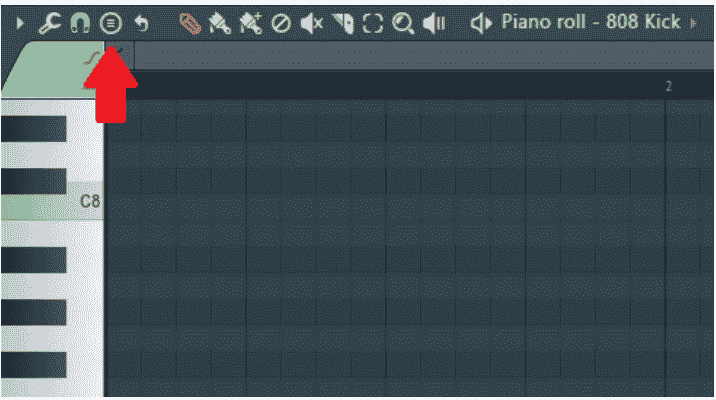

*Figure 3.5 – Stamp tool*

会出现一个下拉菜单，列出大量 MIDI 音符预设。它显示和弦、音阶以及打击序列的建议。本章感兴趣的是 Melodic Scales 选择。

3. 左键单击一个音阶，例如 **Minor Harmonic** 音阶，如以下屏幕截图所示：

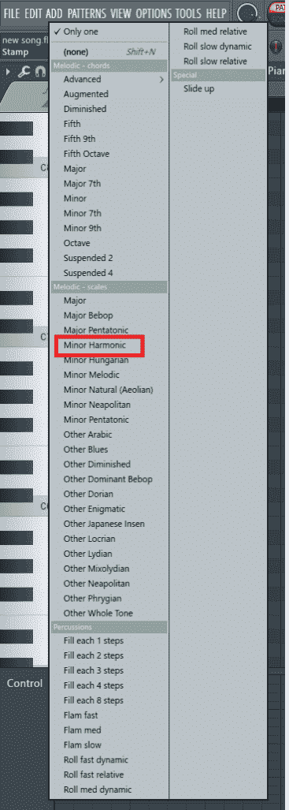

*Figure 3.6 – Choose scale*

5. 使用钢琴卷帘更改调性非常简单。左键单击钢琴卷帘中添加的任意音符。您会注意到它们作为一组被选中。将所有音符向上移动一个音高，如以下屏幕截图所示：

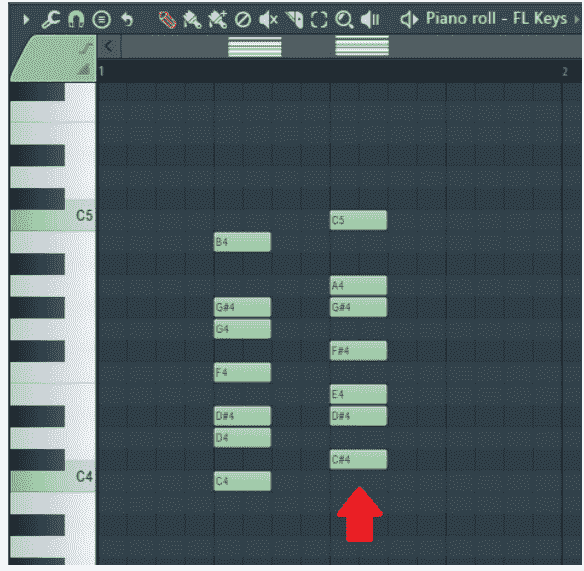

*Figure 3.8 – Transpose key*

通过将所有音符向上拖动一个音高，我们已将音符转调到新的调上。在此例中，我们的音符现在的主音是 C#。这意味着我们现在使用的是 C# 小调的和声小调，而不是 C 小调。此 C# 和声小调的音符是 C#、D#、E、F#、G#、A 和 C。

哇，转调到新调非常容易。我们不需要进行任何计算来转调音符。我们所做的只是选择音符并将其向上或向下移动一个增量，FL Studio 就会完成转调的所有工作。如果您曾经有过弄清楚如何转调音乐的任务，您会意识到这是一个改变游戏规则的事情。在钢琴卷帘中更改音乐调性非常容易，几乎不需要费力去弄清楚使用哪些音符。

您已经了解了音阶是什么以及如何更改调性。但您还不知道如何使用它们来获得所需的音调情绪。为此，我们需要介绍模式的概念。

## Understanding modes

**Modes** 是音阶，但是一种特定的音阶类型。它们在作曲时有一些有用的应用，我们可以用它们来创造特定的情绪。

让我们再看看钢琴卷帘印章工具中前面部分看到的一些音阶。如果再次打开印章工具，您会注意到有一系列音阶名称。如果您之前没有学习过音乐理论，其中一些音阶可能对您来说很陌生。例如，您可以看到音阶 **Aeolian, Pentatonic, Dorian, Locrian, Lydian, Mixolydian,** 和 **Phrygian**，如以下屏幕截图所示，以及许多其他音阶：

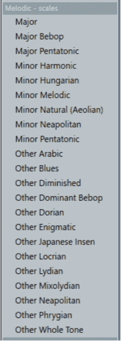

*Figure 3.9 – Modes*

这些是什么？这些是模式。模式是一种音阶类型。按逻辑顺序排列的七种模式是 **Ionian, Dorian, Phrygian, Lydian, Mixolydian, Aeolian,** 和 **Locrian**。它们彼此相关。为了说明如何相关，我们需要一个视觉参考。

使用印章工具选择 **Major Scale** 并将其放置在 C 音上。

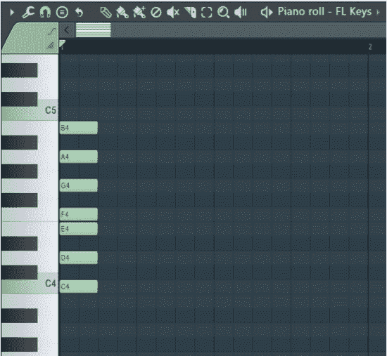

*Figure 3.10 – Major Scale, also known as Ionian mode*

上一个屏幕截图中的音阶通常被称为 **C major scale**。它也被称为 **Ionian mode for C**。术语 *major scale* 只是 Ionian 模式的更常用名称。Ionian 模式是由以下音组成的组合：

- Root
- Major second
- Major third
- Perfect fourth
- Perfect fifth
- Major sixth
- Major seventh

当我们演奏 Ionian 音阶中的音符时，通常被认为是欢快的旋律。让我再说一遍。*Major scale = Ionian mode.* 它们是同一件事。

如果我们使用相同的音符，但开始使用 Ionian 模式中的第二个音符会怎样？换句话说，我们将 Ionian 音阶的主音设为第七个音，如以下屏幕截图所示。

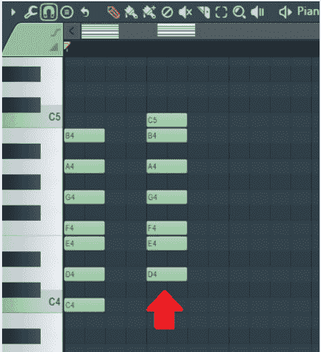

*Figure 3.11 – Dorian mode*

这个新音阶使用相同的音符但以 D 为主音。这称为 Dorian 模式。

这里发生了什么？我们做了非常了不起的事情，但您可能还未意识到其影响。即使我们使用与 Ionian 模式相同的音符，我们也创造了一个新模式。这听起来可能不是什么大事，直到您意识到 Ionian 模式演奏的音乐听起来与移调到 Dorian 模式演奏的音乐相当不同。Dorian 模式演奏的音符具有独特的个性，听起来与 Ionian 模式不同。

在 Ionian 音阶中，音阶中有七个可能的音符可供选择。相应地，有七种可能的模式。正如我们刚才看到的，如果我们从 Ionian 向上移一个音，我们就会得到 Dorian。如果我们继续向上移，我们会得到 Phrygian、Lydian、Mixolydian、Aeolian，最后是 Locrian。如果我们再向上移一个，我们就会上升一个八度并回到 Ionian 模式。

这是一件大事，当您开始创作旋律时，您会开始意识到它有多重要。您开始的主音将导致歌曲的不同情绪。以 Ionian 模式的主音开始，您的音乐听起来会很欢快和轻快。以 Aeolian 模式的主音开始，您的音乐听起来会很悲伤、美丽和黑暗。

## How to use modes

音乐的情绪取决于使用什么模式。如果您为配乐作曲，您可以选择一种情绪，然后找出最能体现这种情绪的模式。

下面的列表详细说明了模式及其相关的情绪，以及一些现实生活中的例子。我鼓励您快速谷歌这些歌曲，以便对使用不同模式可以创作什么音乐有一个概念：

- **Ionian mode**: Major key, happy music.
  - *Let It Be – The Beatles*
  - *Free Fallin' – Tom Petty*
- **Dorian mode**: Jazzy. It's a minor scale with a raised sixth.
  - *Pokémon Go Theme Song*
  - *Ballad of the Goddess – Hajime Wakai & Takeshi Hama (The Legend of Zelda: Skyward Sword)*
  - *Halo – Martin O'Donnell and Michael Salvatori*
- **Phrygian mode**: Dark, emotional.
  - *Time in a Bottle – Jim Croce*
  - *Doctor Who theme song – Murray Gold*
- **Lydian mode**: Jazzy, worldly, triumphant sounds. It's a major scale with a raised fourth.
  - *Six Feet Under theme – Thomas Newman*
  - *Superman Theme song – John Williams*
  - *E.T. theme song – John Williams*
- **Mixolydian mode**: Great for triumphant sounds with brass and strings. It's a major scale with a lowered seventh.
  - *Staff Roll – Super Mario Galaxy*
  - *Bundle of Joy – Michael Giacchino (Inside Out Film)*
- **Aeolian mode**: Minor key, sad, beautiful, melancholic, dark.
  - *Manners Maketh Man – Henry Jackman and Matthew Margeson (Kingsman: The Secret Service)*
  - *The Medallion Calls – Klaus Badelt, Hans Zimmer (Pirates of the Caribbean)*
  - *The Game Is On – David Arnold and Michael Price (Sherlock)*
- **Locrian mode**: A bit strange sounding. Not used very often unless you want odd-sounding music. Mostly used for jazz.

如果您试图为音乐实现某种情绪和音调，请考虑选择适合您情绪/音调的模式并创作符合其中的音符。

## What notes are in my scale?

我如何知道音阶应使用哪些音符？FL Studio 的好处是您不必担心任何给定音阶中的音符是什么。钢琴卷帘印章工具可以帮助您即时找到要使用的音符。

在印章工具中，您会注意到有比本章迄今为止涵盖的更多的音阶。每个音阶都提供其独特的情绪。例如，使用布鲁斯音阶会使您的音乐听起来像布鲁斯流派的音乐。我鼓励您尝试选择不同的音阶，看看它们如何改变作品的情绪和音调。

如果您需要检查给定音阶中的音符，www.pianoscales.org 是一个提供视觉参考的绝佳网站。该网站列出了大量可用的音阶。

要查找关于调式的部分，请导航到如下截图所示的 **Jazz Scale Piano** 选项卡：

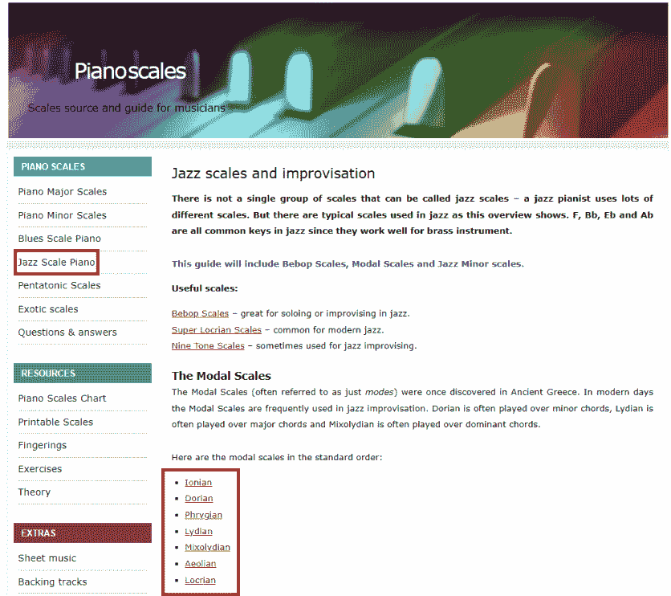

图 3.12 – 爵士音阶与即兴演奏

进入 **Jazz Scale Piano** 页面后，你会看到调式音阶的列表。如果选择其中一个，你会看到从所选主音开始的该调式所使用的音符。

随后你会看到钢琴图表的列表，说明该调式允许使用的音符，如下截图所示。

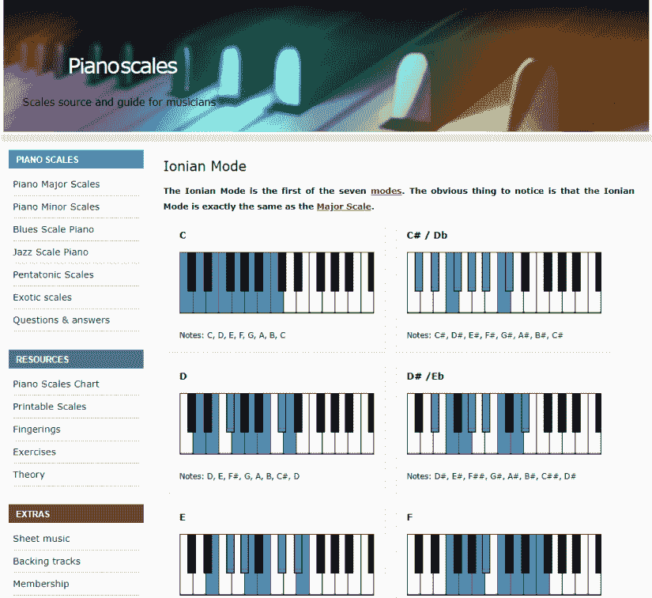

图 3.13 – 自然大调

使用该网站，很容易识别出在任何音阶中演奏歌曲时可以使用哪些音符。

我们已经学习了音阶和调式。但在作曲时是否有参考来直观地看到应使用什么音阶？有的：它被称为使用幽灵音符（休止音符）。

## 使用幽灵音符作为音阶参考

在音阶内作曲时，这里有一个有用的小技巧。它被称为使用幽灵音符（又名休止音符）。幽灵音符可用于直观地识别所选音阶中的音符：

1. 在 Channel 架中添加一个旋律乐器。例如，选择 **FL Keys**。
2. 为 Channel 架中的乐器命名，例如 `Ghost Notes`。
3. 在 Channel 架中复制该乐器并赋予不同的名称，例如 `Piano`。

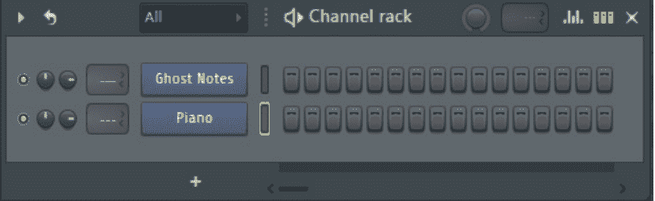

图 3.14 – 创建名为 Ghost Notes 的乐器

4. 打开名为 **Ghost Notes** 的乐器的钢琴卷帘。
5. 打开印章工具并选择所需的音阶将其添加到钢琴卷帘中。例如，你可以选择大调音阶。

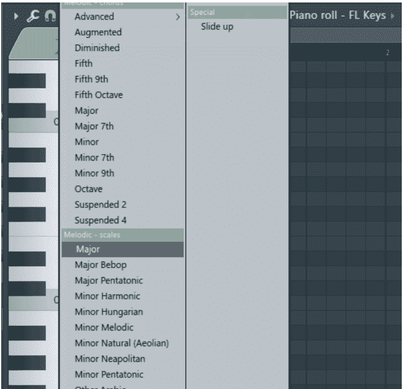

图 3.15 – 大调音阶

6. 静音你添加的音阶中的音符。你可以使用钢琴卷帘顶部的静音工具，然后拖动以静音想要静音的音符。另一种方法是双击右键并在想要静音的音符旁边按住并拖动以静音想要静音的音符。

以下截图显示了音阶中被静音的音符。

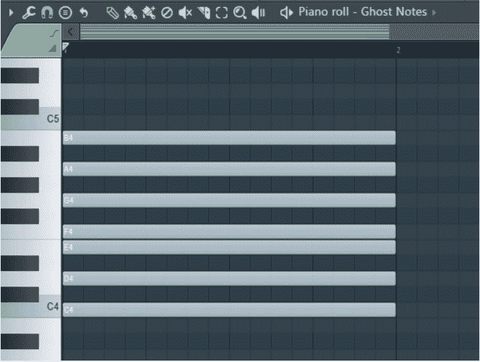

图 3.16 – 用于参考的静音音符

播放该模式时，乐器会保持静音。然而，这些音符作为视觉参考，帮助我们在作曲时提供指导，说明哪些音符可以使用。

7. 在钢琴卷帘中切换乐器，例如切换到我们命名为 `Piano` 的乐器。
8. 在钢琴卷帘网格中，你会看到由 **Ghost Notes** 乐器演奏的静音音符的淡轮廓。这些是音阶中可以使用的音符。

以下截图显示，尽管我们正在为 **Piano** 乐器作曲音符，但我们可以看到 **Ghost Notes** 乐器中使用的音符。

以下截图显示了添加与幽灵音符重叠的音符的示例。

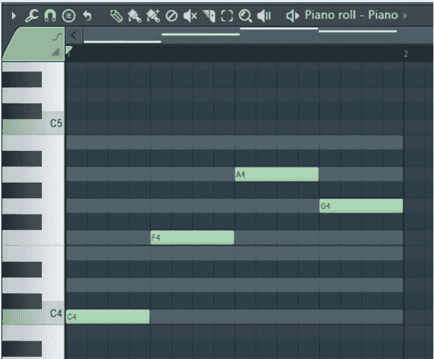

图 3.18 – 添加音符

该技术可用于任何音阶，并且可以为你节省大量时间。你不再需要花费精力去弄清楚给定音阶中的音符。你只需使用印章工具放置音阶音符，即可立即开始在其上作曲。

我们已经学习了如何使用音阶作曲；接下来，让我们学习音乐术语如何帮助我们使用音阶。

## 理解升号与降号

本章后面我们将解释如何使用音乐和弦轮工具进行作曲。但和弦轮要求你首先了解什么是升号和降号。在钢琴上，你会注意到有白键和黑键。白键是全音。我们将全音赋予字母名称 C、D、E、F、G、A 和 B。钢琴上的黑键是白键之间的半音。我们称这些为升号和降号。升号用 # 符号表示。降号用 b 符号表示。以下图表显示了带有音符标签的钢琴音符。

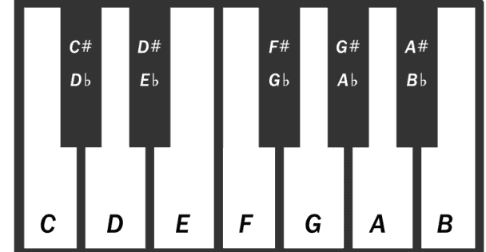

图 3.19 – 升号与降号

你会注意到每个黑键都有两个名称。例如，C 和 D 之间的黑键名称为 C# 和 Db。C# 和 Db 表示同一个音符。

为了澄清，升号和降号并不意味着黑键。升号只是表示音高提高一个半音，降号只是表示音高降低一个半音。这使你具有记谱自由，例如如果你想使用双升号和双降号。

为什么同一个音符会有升号和降号两种不同的术语？原因是为了帮助为读者澄清信息。

这里有一个例子说明如果没有使用升号和降号的规则，音乐记谱会多么令人困惑。如果我们有一个 C 和弦：C、E 和 G，如果我想将该 C 和弦改为小调版本，我应该如何称呼这些音符？正确的方法是称呼它们为 C、Eb 和 G。这样，我们可以保持与大调相同的音符名称。如果我们为这个和弦使用升号命名，它将是 C、D# 和 G。无论你如何命名，我们都是降低了半音，但一种方式保持了字母命名。保持字母命名使试图阅读音乐的音乐家更容易。

升号或降号列在乐谱开头，以告诉音乐家歌曲应使用什么调。它列在所谓的 **调号** 中。以下截图显示了调号的示例：

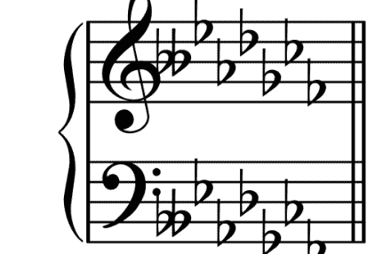

图 3.20 – 调号

https://upload.wikimedia.org/wikipedia/commons/1/1d/Db_minor_key_signature.png

调号显示高音谱号和低音谱号符号，然后在右侧列出升号或降号的数量。这告诉音乐家该作品应使用哪些升号和降号。音乐家随后可以使用此信息来确定歌曲应使用什么调。

我们知道了什么是升号和降号以及调号。有了这些信息，我们现在可以学习如何使用 **五度圈和弦轮。**

## 使用五度圈和弦轮

**五度圈和弦轮** 是音乐家用作音乐理论备忘单的视觉工具。它是一个包含调号列表的图表，并且能非常快速地向读者传达大量信息。

五度圈图表可用于多种目的。它可用于将音乐从一个调转置到另一个调。现场音乐家可能会在尝试确定使用什么调时使用它来协助即兴演奏。作为作曲者，你可能会在想要改变调时使用此工具，例如在大小调之间来回切换。以下图表显示了五度圈的简单版本。

## 调号

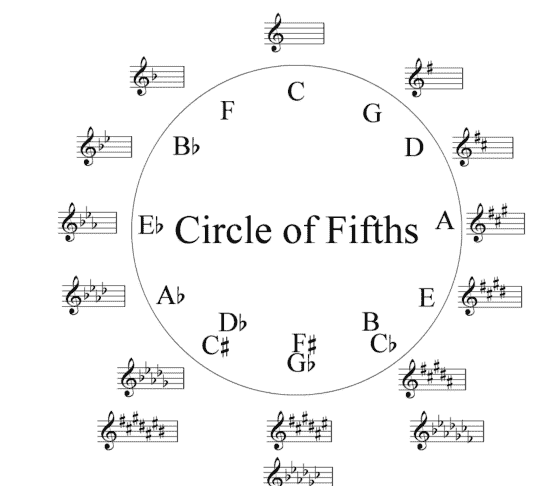

图 3.21 – 五度圈

https://commons.wikimedia.org/wiki/File:Music_Scale_Theory_-_Circle_of_Fifths.png

从顶部中心开始，内圈列出了大调（自然大调）的名称，例如 C。圆圈外部列出了该调的音乐理论调号记谱。它从 C 调开始，该调的音阶中没有升号和降号。

还记得本章前面我们学习过，纯五度是说我们从根音移动到频率间隔关系为 3:2 的第二个音的简洁说法——例如从音符 C 移动到 G。这会产生一起演奏时听起来非常好的音符组合。如果我们从根音 C 移动一个纯五度，我们会落在音符 G 上。G 调的音阶中有一个升号。如果我们从根音 G 向上移动一个纯五度，我们会落在音符 D 上。D 调的音阶中有两个升号。

试图从记忆中回忆这一点很乏味。除非你面前有一架钢琴可以查看，否则你很可能已经在试图跟踪所有这些字母时感到困惑。五度圈将使你不必记住任何信息。

五度圈使弄清楚每个音阶中的音符变得容易。在图表上，你每次顺时针围绕五度圈递增时移动一个纯五度。例如，从顶部中心的 C 调开始。如果向右移动一个增量，你会落在 G 调，这正好是一个纯五度。

当你继续沿着圆圈顺时针移动时，升号的数量每次增加一个，直到到达C#大调。

如果你从C调开始，逆时针移动，则会按纯五度下行。逆时针移动调号会依次增加降号，直到到达Cb大调。

换句话说，这个图展示了所有大调音阶调之间如何相互关联，也展示了不同音阶之间升号和降号的差异。

所以，五度圈可以帮助我们识别一个大调中包含哪些音符。这就是这个图的全部作用吗？哦不……它做的远不止这些。我们才刚刚开始。让我们来看一个更详细的五度圈图示。

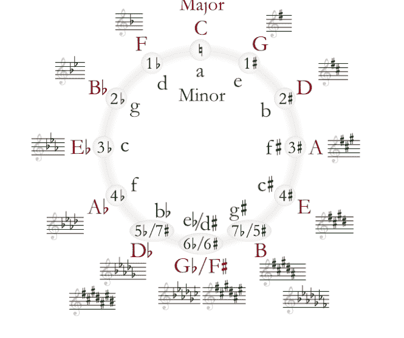

在最内圈，它列出了五度圈中各个调的关系小调。这些是使用与大调相同音符的小调音阶。它们具有相同的调号。

哇……竟然有多个音阶使用相同的音符，而且排列得如此整齐？这是巧合吗？不，不是。事实上，它必然是这样。让我们解释一下原因。

回想一下，本章前面我们学过调式。所有调式对于给定音阶都使用相同的音符，只是使用不同的主音。第一个调式我们称为伊奥尼亚调式，它等同于大调音阶。第五个调式我们称为爱奥利亚调式，它等同于自然小调音阶。自然小调音阶使用与大调音阶相同的音符，但从不同的主音开始。

理论上，如果你愿意费心，可以在五度圈图上列出所有调式，但看起来会过于繁琐。相反，在大多数情况下，五度圈图只列出每个调号对应的大调和/或小调。

好了，这个图有很多非常酷的特性，但我如何在实践中使用它呢？当你作曲时，有时你会想改变歌曲的调。这个五度圈图可以帮助你改变调。

为什么你想改变歌曲的调呢？让我们退一大步，看看我们如何理解声音的变化。

如果你想让音乐听起来能量在增加，有几种方法可以做到。你可以增加力度或演奏法强度（将在第4章“管弦乐MIDI作曲”中讨论），提高速度，或者就本章主题而言，提高声音本身的音高。

通过改变调并将音符移调到另一个调，你可以升高或降低音符音高，使音乐听起来能量水平在上升或下降。如果你想让音乐在能量上有所变化，一种方法就是换到一个新的调。此外，改变调还能增加变化，这很有用。它让你基本上可以重复演奏同一旋律两次，却不会让听众觉得重复。

让我们回到五度圈。如果我们想改变调，如何使用五度圈来实现呢？在五度圈上顺时针移动到下一个调，会增加调中的升号数量，但每次只增加一个。如果我们从C调开始，它没有升号，在五度圈上向右移动一个增量，就会到达G调，它有一个升号。这意味着音阶本身只是稍有变化。对听众来说，这是一个轻微的过渡。

另一方面，如果你从C大调开始，过渡到F#大调，听众会感觉这是一个极端的变化。我们要增加六个升号。这意味着什么呢？这意味着如果你想改变调，围绕五度圈每次以小的增量顺时针或逆时针移动，对听众来说会不那么刺耳。在五度圈上大幅移动对听众来说听起来像是极端的跳跃。

如果你从C大调开始，想通过五度圈改变调，一个不错的选择是顺时针移动一个增量到G大调，或逆时针移动一个增量到F大调。这两种调的改变对听众来说都是微妙的过渡。你一次跳过的调增量越多，过渡就越刺耳。

五度圈和弦轮有多个好处。它让你快速识别每个音阶对应的调号，从而知道可以演奏哪些音符。它还能让你识别在改变调时，可以平滑过渡到哪些音阶。

## 总结

在本章中，我们学习了一系列可用于音乐创作的工具和框架。我们学习了动机、主导动机和主题，以及如何使用它们来为作曲构思。

我们学习了音阶是什么、它们如何帮助我们确定要使用的音符，以及如何在实践中应用。我们学习了调式及其用法。我们学习了如何使用FL Studio钢琴卷帘窗的图章工具，无需学习和记忆音阶细节，即可轻松为任何给定音阶添加音符。最后，我们学习了如何使用五度圈和弦轮工具来查看音阶之间的相互关系，以及如何在音阶之间平滑过渡。

在下一章中，我们将学习管弦乐作品的作曲技巧。
