管弦乐MIDI作曲

在本章中，你将学习可用于创作管弦乐的工具。具体来说，你将学习如何使用MIDI编程来制作管弦乐。我们会让你配置好可用于创作此类音乐的工具。在此过程中，你将学习弦乐编排、和弦进行的技巧，如何让编程乐器听起来更逼真，以及一些混音最佳实践。

在本章中，我们将介绍以下主题：

- 为什么学习管弦乐作曲？
- 推荐的管弦乐工具插件
- 使用力度、演奏法和表情
- 管弦乐MIDI编程
- 管弦乐和弦进行作曲技巧
- 混音管弦乐作品的注意事项

## 为什么学习管弦乐作曲？

在为电影作曲时，你必须能够为各种风格和流派作曲。尽管你可能对某一小众流派有特别的偏好，但具备从一种风格切换到另一种风格的能力会给你带来更多机会。具备创作管弦乐作品的能力，能让你拥有一个全面、均衡的技术和工具技能库可供借鉴。

擅长音乐创作意味着你拥有多样化的作曲技能。创作管弦乐音乐是接触各种作曲情境的好方法。创作管弦乐MIDI音乐迫使你积累以下方面的经验：

- 理解如何创作和弦进行，并在不同乐器之间分配配器
- 理解现场原声乐器所呈现的限制和可能性
- 理解如何让乐器插件听起来更真实、更不“合成”
- 使用打击乐来产生动感，并知道如何在乐器声部之间过渡
- 编排配器。平衡音量并使用均衡器为各个乐器声部留出频率空间

这些技能是拥有管弦乐作曲经验后自然获得的副产品。本章将为你提供入门的基础。我们将从作曲所需的工具开始，然后进入有趣的部分，学习管弦乐MIDI作曲，让你自己也能创作音乐。

不过在开始之前，我们需要一些管弦乐器。

## 推荐的管弦乐工具插件

要创作管弦乐，你需要管弦乐器插件。如果你刚接触这方面，我建议你先玩玩FLEX。它是一个免费插件，随所有版本的FL Studio附带。

你可以将FLEX插入通道机架来加载它，如下面的截图所示：

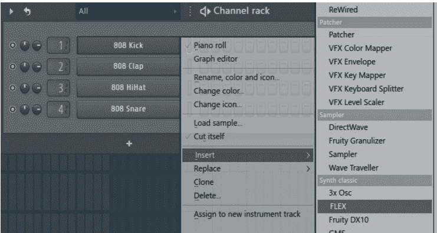

图4.1 – 插入FLEX

这将加载FLEX插件。在FLEX左上角，你会看到一个名为“FREE”的选项卡。点击进入后，会显示一个你可以在FLEX中下载的免费插件列表。下载这些插件。完成这些操作后，FLEX中就会出现诸如基础弦乐等插件包，如下面的截图所示：

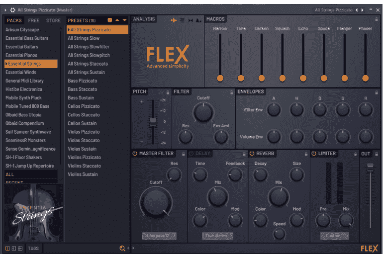

图4.2 – FLEX

当你安装FLEX自带的免费预设包时，你会找到一个包含管弦乐器的乐器库可供使用。例如，FLEX包含**基础贝斯吉他**、**基础吉他**、**基础钢琴**、**基础弦乐**和**基础管乐**等预设包。

在**基础弦乐**和**基础管乐**包中，你会发现乐器的不同演奏法。在名为**通用MIDI音色库**的包中，你会发现鼓组。这些可以为你的作品提供出色的打击乐音色库，如下面的截图所示：

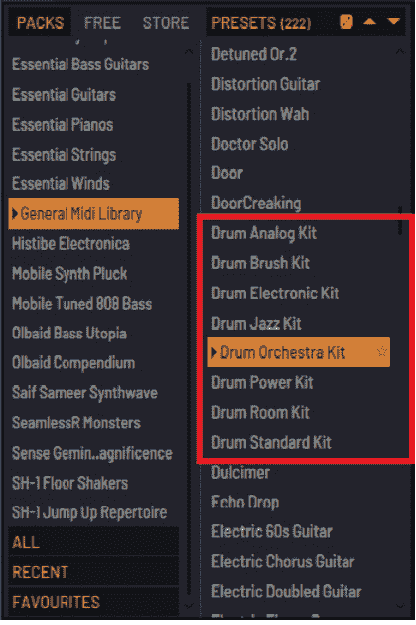

图4.3 – FLEX鼓组

**通用MIDI音色库**还列出了各种管弦乐器的乐器预设，如竖琴、萨克斯、教堂合唱、定音鼓、电颤琴、筒鼓、钟琴、吉他、原声贝斯乐器、木鱼和木琴。如果你在寻找一些不太常用的乐器，你还会找到班卓琴、风笛和教堂管风琴。

FLEX允许你按名称或与声音关联的乐器标签来搜索乐器声音。下面的截图显示了你可以搜索的乐器类型和风格标签：

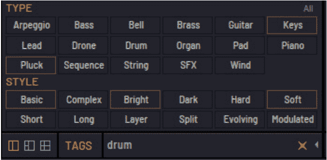

通过按类型或风格选择标签，你可以在FLEX中筛选乐器，精确定位你想要的音色。底部还有一个搜索栏，你可以在其中按名称搜索乐器。

FLEX是我遇到过的最直观的乐器插件之一，而且如前所述，它随FL Studio免费提供。

## 推荐的付费乐器插件

FLEX对新手来说还可以，但与市场上一些最好的管弦乐插件相比，它还有所不足。当你想要花钱购买一些最先进的乐器插件时，以下是我的一些推荐：

- **Native Instruments** (https://www.native-instruments.com/) 提供了大量的乐器插件和效果器。Native Instruments的产品是全球音乐制作人和作曲家的行业标配。他们还销售MIDI键盘，这些键盘常被专业人士使用。我是他们产品的忠实粉丝。
- **EastWest Sounds** (https://www.soundsonline.com/) 提供了用于电影配乐的最先进管弦乐器，多年来已被众多好莱坞电影采用。

  他们于2021年推出的插件**Opus**是一个改变游戏规则的产品。它是一个管弦乐音色库插件，包含了你期望在管弦乐队中找到的所有乐器。但Opus真正与众不同之处在于一个名为**管弦乐编排器**的功能。该功能提供了一套专为管弦乐编曲而设计的MIDI预设。它可以为管弦乐编曲提供建议，然后你可以根据自己的喜好进行调整。

  如果你想制作传统管弦乐队的声音，**管弦乐编排器**是你的不二之选。这是一个绝佳的工具，可以学习如何在管弦乐队中巧妙运用MIDI乐器和演奏法。

- **Spectrasonics的Omnisphere插件** (https://www.spectrasonics.net/products/omnisphere/) 提供了大量非常适合电影配乐的乐器。

至此，我们已经了解了可用于创作管弦乐的一些工具。不过，拥有乐器插件只是第一步。现在，我们需要学习如何使用它们。那么，我们怎样才能有效地使用它们呢？

## 什么让乐器插件听起来真实？

即使是演奏相同的音符和相同的歌曲，初学者音乐家与专业人士的表现也会显著不同。这是为什么呢？

让我们以钢琴为例。钢琴在按下琴键时发出声音。琴键触发琴槌敲击琴弦，从而发出声响。初学者在演奏时，对乐器没有太多控制。音符的音量可能相同，节奏可能忽快忽慢，演奏者也没有刻意将自己的个性融入表演中。

专业人士演奏时，他们对乐器有完全的控制。演奏者会精心控制演奏的速度。他们决定每个音符的演奏力度。在整个曲目中，双手可能以不同的音量演奏。他们的右手（通常负责主旋律）可能会比左手（负责伴奏）稍微响亮一些。

## 每日一题

| 题干 | 已知 | x | y | x + y |
| --- | --- | --- | --- | --- |
| 1 | 2 | 3 | 4 | 5 |

解：由题意可得，x = 3，y = 4，所以 x + y = 7。

让我们看一个如何有效使用力度的示例：

1. 在**通道机架**中加载**FL Keys**或其他钢琴乐器。
2. 在钢琴卷帘窗中打开该乐器。
3. 左键单击钢琴卷帘窗添加一些音符：

   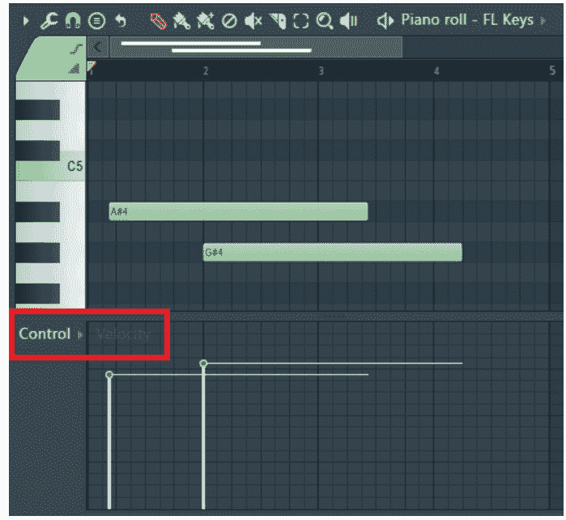

   图4.5 – 控制

   添加这些音符后，你应该会看到类似于上面的截图。在钢琴卷帘窗的左下角，你会看到**控制**，后面跟着当前已启用的控制项。默认情况下，**力度**已启用。

4. 如果你没有看到**力度**，左键单击**控制**。会出现一个下拉菜单，你可以在其中选择**音符力度**：

   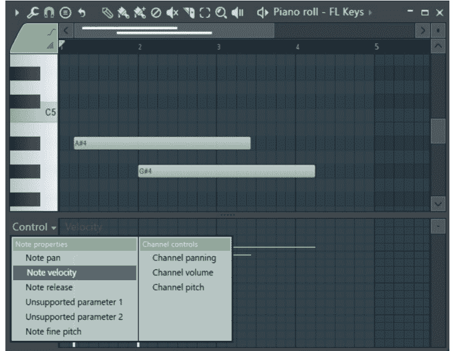

   图4.6 – 音符力度

   选择**音符力度**后，底部网格将变为音符力度的控制区。对于添加的每个音符，钢琴卷帘窗底部网格中会出现一条线，表示音符力度。在选中音符的情况下，左键单击底部网格，可以改变线的高度。线越高，力度越大。

5. 左键单击为音符添加不同的力度。下面的截图显示了这一点：

   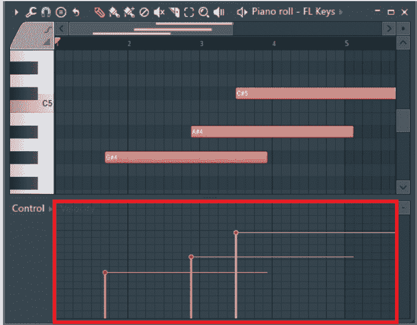

   图4.7 – 改变音符力度

   在上面的截图中，你可以看到我为音符添加了渐增的力度。随着音符的播放，它们会变得更响亮、更加鲜明有力。

6. 选中音符后，可以按住左Alt键并滚动鼠标滚轮来微调力度。

太棒了——我们已经知道如何控制力度了！那又怎样？我们为什么要在意呢？控制力度能让我们的乐器模拟现场音乐家的演奏方式。有策略地选择音符力度能让我们的乐器插件听起来栩栩如生。

要为你的声音添加真实感，你需要将每段创作的旋律的力度按以下步骤分解：

1. 找到最重要的旋律，并为其分配比伴奏旋律更高的整体力度。
2. 对于每段旋律和伴奏，找出旋律的整体动势。分配力度以强调这种动势。

在下面的截图中，你可以看到右手旋律部分。我为每个音符分配了单独的力度。这些起伏让旋律听起来不那么机械，更富有生命力：

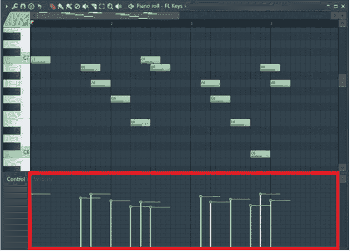

图4.9 – 右手旋律的力度

你可能想知道应该增大还是减小音符的力度。应该选择什么数值？我无法给出答案。力度的选择取决于个人偏好，也取决于你的音乐作品。不过，以下是一些提示：

- 旋律越突出，你可以使用的动态范围就越大。你的耳朵会注意到动态的变化。如果你希望听者专注于某个乐器，你可以更多地改变动态。
- 虽然力度通常与音量相关，但最好将音量视为一个独立的效果。你可以稍后在混音阶段通过音量调节和/或压缩效果来调整音量。将力度视为你想要注入到每个音符演奏中的能量和强度。你可以使用非常低的力度在乐器上产生柔和的声音，然后在混音阶段提高音量。
- 如果你希望某个乐器成为焦点，请相对于其他乐器提高其力度。如果你希望某个乐器退出焦点位置，则降低其力度。这同样适用于音量。提高乐器的音量会让你的注意力集中在它上面，而降低音量则会使其显得不那么重要。

## 使用演奏法

到目前为止，我们已经学会如何使用力度为打击乐器增加真实感，但如何为非打击乐器增加真实感呢？为此，我们需要演奏法。

当你使用试图模仿现场乐器的乐器插件时，你需要尝试不同的乐器演奏法来为声音增加真实感和趣味性。演奏法有很多种，且是乐器特定的。演奏法指的是音符之间的过渡。例如，演奏法包括连音、乐句记号、断奏、重断奏、重音、强音、渐强连音和连奏。

以下是你可能会遇到的演奏法参考列表：

- **Legato (slurs)：** 这些是长而拖出的音符，会将一个音符与下一个音符融合在一起。它们通常在采样开始时包含一个短暂的半音上扬。在弦乐器上，这可以通过在移动到下一个音符的同时用手指沿着琴弦滑动来实现。
- **Staccato：** 这些是短而快的。很容易辨认出一个音符结束后再开始下一个音符。它们通常被认为是演奏连奏音符的相反方式，音符之间有很多空间。在弦乐器上，这涉及演奏者交替进行上弓和下弓动作。
- **Crescendo：** 这会提供声音音量的持续增加。对于采样乐器来说，这听起来比交叉淡入淡出更自然。
- **Decrescendo：** 这会提供声音音量的持续减少。对于采样乐器来说，这听起来比交叉淡入淡出更自然。
- **Glissando：** 这里有两个可能的含义。一般来说，它指的是在起始音符之前的一个短暂上行滑音。在竖琴上，这意味着拨奏琴弦而不是弹拨它们。
- **Sustain：** 这涉及将一个音符保持到下一个音符，尽管这并不会为演奏者准备下一个音符。通常，这些采样是循环的，以便可以无限期地演奏。如果你单独使用延音音符，它们可能会听起来很假。为了让它们听起来更真实，你需要使用表情自动化来将一系列延音和弦与下一个序列融合。我们将在本章后面向你展示如何使用表情。
- **Trill：** 这是在两个音符之间快速交替。
- **Sforzando：** 这涉及用额外的力度演奏一个音符，以使其在附近的其他音符上更具强调。
- **Vibrato：** 这会改变音符的音高。在某些演奏法中，颤音在轻微延迟后开始，这使得可以在应用颤音之前演奏更快的音符序列。

以下是弦乐器特定的演奏法列表：

- **Martelé：** 这是指弓压在每根琴弦上，音符之间的声音会停止。这使得每个音符都强烈地被重音强调。
- **Pizzicato：** 这涉及使用手指而不是弓拨奏弦乐器，这会产生一种短促的声音，可以穿透整个管弦乐队。
- **Spiccato：** 这是一种演奏方法，弓在演奏每个音符时都会从琴弦上弹起。
- **Tremolo：** 这是指通过快速交替弓法而不离开弓来重复相同的音符。这通常用于恐怖电影。

在某些管弦乐器上，你可能有使用键位切换的选项。这是指按下某些 MIDI 音符会使不同的演奏法被激活。

到目前为止，我们已经了解了演奏法的列表，但在听到它们之前，很难想象这意味着什么。让我们看一个快速的例子，以便你可以看到演奏法在实际中的效果：

1. 在 **Channel** 架中加载两个或三个 FLEX 插件实例。
2. 导航到 **Essential Strings** 或 **Essential Winds**。你会找到不同乐器演奏法的列表，如以下屏幕截图所示：

   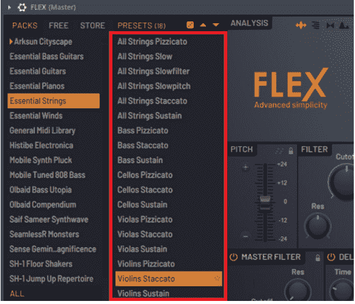

   Figure 4.10 – FLEX articulations

3. 对于每个 FLEX 实例，选择不同的乐器演奏法。例如，你可能希望选择 **Violins Staccato**、**Violins Pizzicato** 或 **Violins Sustain**。

每种乐器演奏法都会为乐器提供不同的声音。

乐器演奏法对于模仿现场演奏者的真实感非常重要。在演奏时，现场音乐家会不断交替他们正在演奏的演奏法。他们会从短促的断奏音符跳到长的连奏音符。他们会在音量上渐强和渐弱，并在各个阶段对音符加以强调。

当你为小提琴作曲时，例如，你希望在你的声音中包含各种演奏法来模仿真实的乐器。在创作旋律后，你可以加载几个带有不同演奏法的小提琴乐器版本（或使用键位切换）。然后你可以将旋律音符分配给所需的乐器演奏法。你必须对每个管弦乐器都这样做。策略性地执行此操作，你会发现你的乐器听起来非常逼真，比没有演奏法时更有趣。

到此，我们已经了解了乐器演奏法。接下来，让我们学习关于表情。

## 使用表情

在延音演奏法上，当你使用弦乐、铜管和木管乐器时，你可能会注意到改变力度似乎什么也不做。这些乐器可能使用也可能不使用力度。力度适用于通过物理敲击乐器来产生声音的乐器。由于某些弦乐、铜管和木管演奏法中没有任何东西被敲击，我们如何控制声音的强度？

一些乐器插件允许你控制一种称为 **expression** 的效果。如果你有一个带调制轮的 MIDI 键盘，通常，调制轮默认连接到此 *expression* 效果。Expression 控制声音的强度。你会注意到表情和力度之间有相似之处。增加表情，与增加力度类似，会增加声音的强度。

默认情况下，FL Studio 不附带任何使用表情的乐器（据我所知）。你需要一个具有专用表情控制器的乐器。这样的乐器示例包括 Native Instruments 管弦乐器插件或 EastWest 管弦乐插件，但市场上有很多具有表情效果的管弦乐器插件。你可以通过快速 Google 搜索 `orchestral instrument vst plugins` 找到一些免费的。

## 表情有什么用？

自动化表情对于各种情况很有用。表情可用于以下场景：

- 增加或减少乐器的强度。对于管弦乐弦乐、铜管或木管乐器，调整表情通常比改变音量更可取。改变表情听起来更自然、更逼真。对于弦乐器来说，当演奏者演奏得更响时，音调强度通常会增加。这不仅仅是音量变化——整个声音也会发生变化。
- 表情有助于使延音和弦之间的过渡感觉更自然。延音音符和弦在从一个和弦过渡到下一个和弦时听起来可能很假且平淡。为什么？通常，延音和弦在第一个音符出现时有一个缓慢的起音。当你按下下一个和弦时，你必须再次听到缓慢的起音，而你真正想要的是从第一个和弦声音继续到第二个。你可以自动化表情来使这种过渡不那么明显。

> **Note**
> 一些乐器包含连奏演奏法。连奏演奏法在音符之间过渡时听起来相当逼真。然而，音符通常一次仅限于单个音符而不是和弦。为了绕过这个问题，如果你愿意，你可以加载几个使用连奏演奏法的插件实例，并让每个实例击中不同的和弦音符。

## 手动为你的管弦乐器添加表情

让我们学习如何为我们的乐器自动化表情。首先，让我们学习手动方法。之后，我们将学习精细调整方法，这需要你拥有一台带调制轮的 MIDI 键盘。

要添加表情，你需要一个具有可自动化的表情效果的管弦乐器。通常，弦乐、木管和铜管乐器插件都附带此效果。我推荐 Native Instruments 或 EastWest 乐器插件，如本章开头所述，但你可以使用任何你喜欢的。

在以下步骤中，我假设你有一个管弦乐插件。如果没有，你需要先获取一个，然后才能继续后续步骤。在我的示例中，我使用的是EastWest管弦乐器；FL Studio默认不附带此乐器：

- 1. 转到管弦乐器插件左上角的插件选项，然后选择**浏览参数**选项：

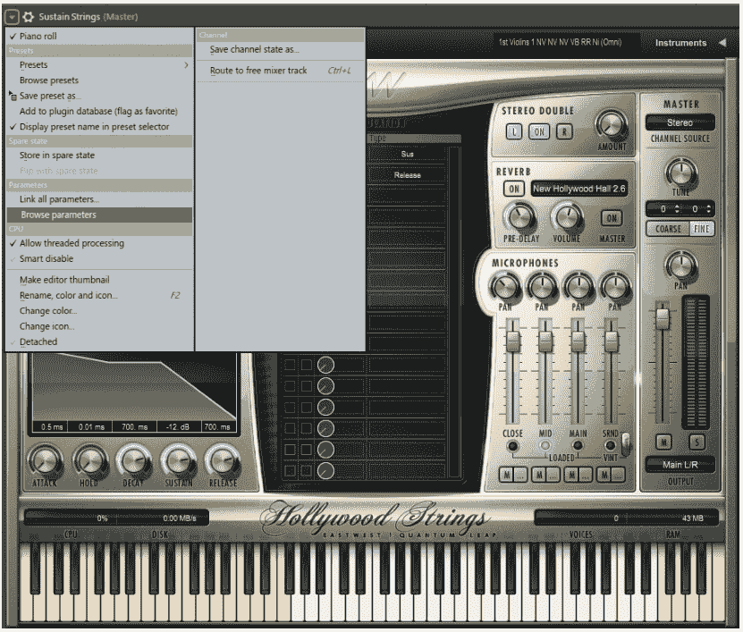

选择**浏览参数**后，浏览器中将出现可用于你乐器的所有插件效果列表。希望你的插件会有一个*表现力*效果。

2. 右键单击表现力并选择“创建自动化剪辑”：

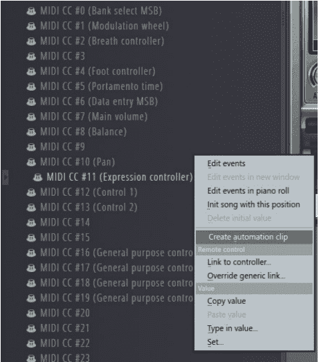

图4.12 – 创建自动化剪辑

这将在播放列表中创建一个自动化剪辑。

3. 然后，在自动化曲线上左键单击以绘制和调整曲线形状。提高曲线会增加表现力；降低曲线则会减弱表现力。

下面的截图展示了我在弦乐持续和弦上自动化表现力曲线的示例：

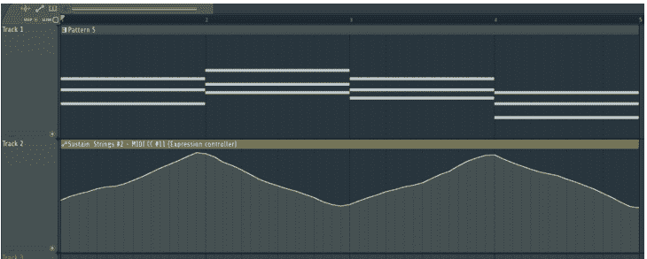

图4.13 – 在播放列表中自动化表现力

在前面的截图中，我们可以看到播放列表。在这个播放列表中，我们可以看到我们刚刚创建的MIDI和弦模式和表现力自动化曲线。

为了让表现力效果更逼真，在切换和弦时改变表现力斜线的方向可能是个好主意。

在前面的截图中，我使用了一个极端的自动化表现力示例。在这里，我们可以看到斜线从同时上下移动变为从一个MIDI和弦到下一个和弦的变化。在某些情况下，这可能会使你的和弦转换听起来更逼真。

## 为管弦乐器添加表现力的微调方法

如果你的MIDI键盘带有调制轮，并且你的乐器将调制轮连接到表现力效果，你可以在演奏歌曲时直接录制表现力自动化。如果是这种情况，录制表现力非常容易。

让我们来学习如何操作：

- 1. 按下录音按钮（自动化、乐谱），如下面的截图所示。将出现一个弹出菜单。
- 2. 选择**音符和自动化**选项，如下面的截图所示：

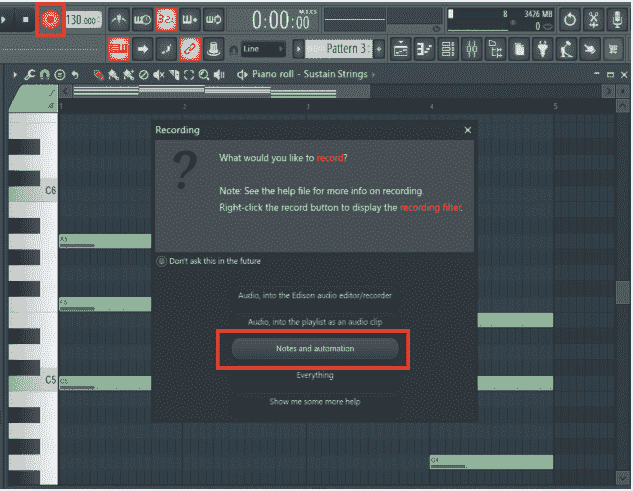

图4.14 – 音符和自动化

如果你还没有音符，请在录音时用MIDI键盘演奏音符。或者，你也可以在钢琴卷帘中预先输入音符，然后在现有音符之上录制调制轮自动化。

在音符播放时，移动调制轮来控制乐器的表现力。向上移动调制轮会增加表现力的强度，向下移动则会减弱表现力的强度。

下图显示了MIDI键盘上的调制轮示例：

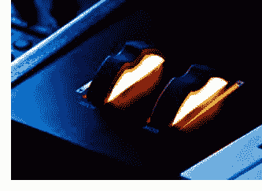

图4.15 – 调制轮

(https://commons.wikimedia.org/wiki/File:Moog_LP_Pitch_%26_Mod_Wheel.jpg)

如果你想在演奏MIDI键盘时双手并用，而不是一只手放在调制轮上，你可以将表情踏板连接到MIDI键盘。然后，你可以用脚来自动化表现力，同时双手演奏音符。下图显示了表情踏板的示例：

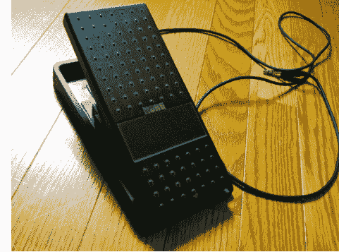

图4.16 – 表情踏板

(https://commons.wikimedia.org/wiki/File:KORG_CX-3_(2000)_expression_pedal.jpg)

使用调制轮录制自动化后，你将看到一条自动化曲线，类似于下面的截图所示：

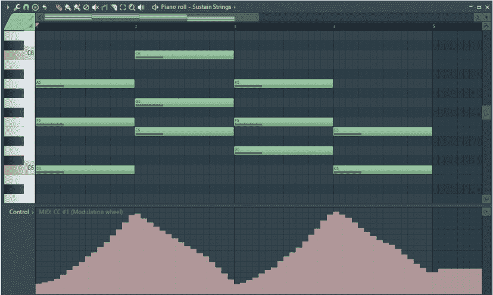

然后，你可以左键单击自动化曲线，将其调整为你想要的形状。

钢琴卷帘不仅限于自动化和表现力、力度。通过左键单击钢琴卷帘左下角的控制按钮，你可以在想要自动化的参数之间切换。例如，你可以自动化声像、音量和音高。你在模式中控制的任何效果都会显示在这里。你也可以使用此菜单切换回控制音符力度。

下面的截图显示了各种通道控制：

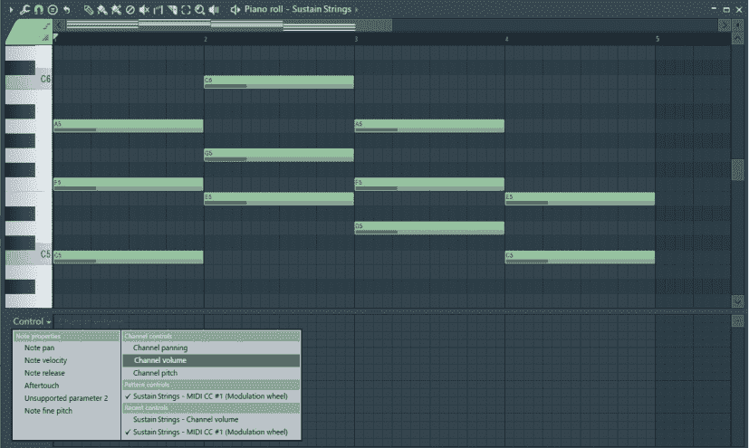

图4.18 – 选择要自动化的参数

至此，你知道如何使用表现力为你的管弦乐作品添加动态变化。接下来，我们将学习如何使用MIDI创作管弦乐。

## 管弦乐MIDI编程

让我们进入本章的核心内容：管弦乐作曲的技巧。在接下来的几节中，我们将主要关注弦乐器的MIDI编程。通过学习如何为弦乐作曲，你将学到许多可转移的工具和技术，这些工具和技术可以应用于管弦乐作曲，无论你是为弦乐、木管、铜管还是打击乐器作曲。

擅长为弦乐作曲将为你提供为许多管弦乐器作曲的可转移技能。因此，虽然我会专门讨论弦乐，但你会发现这些课程也适用于其他管弦乐器。

## 为弦乐器作曲

当我们谈论管弦乐中的弦乐器时，我们指的是低音提琴、大提琴、中提琴以及第一小提琴和第二小提琴。作曲家对管弦乐中的弦乐声部给予了大量关注。弦乐器在可做的事情方面提供了很大的自由度。它们在声音上极具表现力，能很好地与其他管弦乐器融合，并且有许多不同的演奏法可供尝试。这是作曲家展示自己技能的机会。

在为弦乐器作曲时，你会遇到*双音*和*分部*这两个术语，我们将在下面的小节中探讨它们。

### 双音

**双音**指的是在弦乐器上同时演奏两个音符。还有三音和四音。同时演奏两根以上的弦是很困难的，因为同时运弓超过两根弦很棘手。让手指进入双音位置很难，优雅地离开也很难。如果你给弦乐演奏者一首乐谱，而乐谱中满是三音和四音，你可能会发现你给了你的音乐家一首无法演奏的曲目。

不过，在完整的管弦乐队中，双音并不是什么大问题。这是因为管弦乐队可以在音乐家之间分配音符。当交给管弦乐队时，涉及双音、三音和四音的旋律通常会被分成独立的乐器供音乐家演奏。

### 分部

如何避免双音？使用分部。将音符分割到不同的乐器被称为**分部**。分部并非在所有情况下都是最佳选择。在第一小提琴和低音声部应避免分部。第一小提琴分部听起来可能过于尖锐刺耳。最好在第二小提琴中进行分部。

低音声部通常也应避免分部。低音声部中的分部可能导致过于浑浊、刺耳的音符全部混在一起。因此，最好避免在低音区（如低音提琴上）使用和弦。弦乐器中的分部通常在大提琴、中提琴和第二小提琴中效果最好。

在大多数情况下，你只需要五个声部就能构成一个平衡良好的和弦，每个弦乐器一个声部——低音提琴、大提琴、中提琴、第一小提琴和第二小提琴。通常，大提琴和低音提琴这两个最低的声部相互重叠，或者在不同八度音区演奏相同的音符。这有助于给低音音符增加一些厚重感。通常最好避免大提琴和低音提琴之间出现不同的音符，除非你故意想要刺耳、浑浊的声音。

当你将旋律分配给一个声音单薄的乐器时，你可能会注意到该乐器的播放听起来相当单薄。在这种情况下，将音符相隔八度重叠（将一个音符与另一个相同音高但高八度的音符叠加）会有所帮助。这可以帮助加厚声音。

在为管乐器（如铜管和木管乐器）作曲时，很容易忘记管乐器有物理限制——如果真人音乐家演奏你的作品的话。如果有一天有真人音乐家演奏你的作品，他们需要停顿来喘口气。要解决这个问题，请在乐句之间留有休止符，以便你的音乐家呼吸。

## 弦乐器与人声的注意事项

在流行歌曲中，你需要为人声留出频率空间。识别与人声音域相同的音符和频率。然后，看看弦乐器是否与人声冲突。如果有冲突，考虑将弦乐器向上或向下移调一个八度。如果这样处理后听起来不好，你可能需要考虑将这些音符换给更适合该音区的另一种弦乐器。

下面的截图展示了弦乐器频率与人声频率对比的示例：

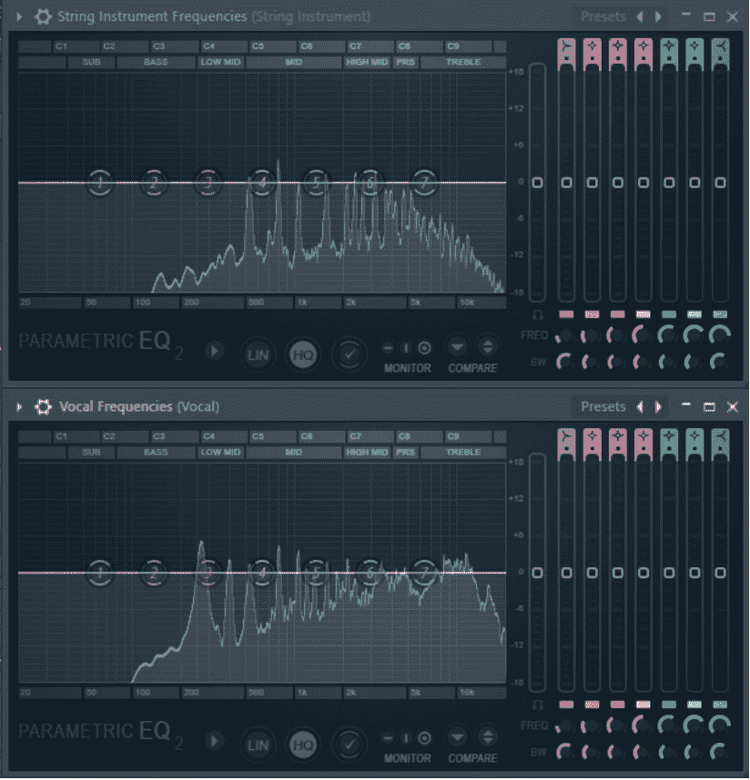

图4.19 – 频率对比

在前面的截图中，我们可以看到人声占据的频率高于100 Hz。弦乐器也占据高于100 Hz的频率。在某些情况下，弦乐器的频率可能会盖过人声，因为它们处于相同的频率范围。这可能导致人声被淹没。

人声始终是焦点。弦乐和其他管弦乐器是用来支撑人声的。当你创作与人声搭配的对位旋律时，弦乐器应该在人声保持一个音符或休息时出现。当人声休息时，弦乐可以成为焦点。当人声重新进入时，弦乐应该减少移动，以免分散注意力。

## 管弦乐和弦进行创作技巧

开始一个和弦进行只有一种方法吗？不。任何音乐理论书都会告诉你这一点。你可以从低音线开始，并在其上构建和弦。你可以先创作一段抓耳的旋律，然后构建低音线和弦来支撑它。你也可以先从节奏型开始。你可以寻找激发你的完美音色，然后围绕该音色进行构建。有很多有效的方法，你会逐渐形成最适合自己的偏好。

不过，说你可以用多种方式创作音乐并没有太大帮助。假设你采用了第一种方法，用你的低音提琴或其他低音乐器构建了一条低音线。在这种情况下，不要马上开始构建完整的和弦。从一开始就构建完整的和弦通常会导致构建非常简单的和弦。相反，一旦你有了低音线，你可以用另一种乐器（如中提琴）在上面添加一个旋律。你应该将旋律一层一层地叠加，确保每一层都能提升整体作品。

我有钢琴背景。因此，对我来说，合理的起点是在钢琴上即兴演奏一个和弦进行。在钢琴上，和弦中的音符总是会靠得很近。为什么？因为我的手指在物理上就相互靠近。如果我把钢琴换成弦乐组，我所有的音符可能都会挤在中提琴或大提琴的音域里。不过，这个问题很容易解决——我只需要将和弦进行中的音符移高或移低几个八度，以适应小提琴、低音提琴等乐器的音域。

## 旋律会不会太多？

当你有一条低音线和一段旋律叠加在上面时，你如何知道何时可以安全地添加另一段旋律，或者何时新的旋律会分散整体效果的注意力？

在你的旋律中，你应该有休止符和音符持续一段时间的地方。正是在这些停顿中，你才有机会用新的旋律引入动态。音高上下移动的动态会吸引你的注意力。你希望每次只聚焦于一个旋律。换句话说，当你的中提琴保持一个音符或暂停时，这是你的第二小提琴旋律通过一些旋律动态接管的好机会。当你的第二小提琴旋律休止或保持一个音符时，你可以让大提琴做一些动态。你希望在每一个点上焦点都集中在一段旋律上。当一段旋律达到一个合乎逻辑的延长音或休止符时，将焦点转移到另一件乐器上。关键在于从一个乐器声部到下一个乐器声部轮流进行主动的旋律动态。这样，乐器听起来就像在互相呼应。这个例子有点过于简化了，我相信你能找到例外。但这是一个有用的思考方式，值得记住。

一个好的经验法则是，如果你让任何一件乐器独奏，其旋律本身听起来也应该很有趣。如果不是，你可能需要改进旋律或添加演奏法来赋予它更多个性。

如果你选择使用冲突的音符，比如七度音与根音组合，通常将冲突音符放在较高音区（C3 以上）会比放在较低音区效果更好。任何低于 C3 的音区通常会导致浑浊的声音。在较高音区，冲突音有空间，因此听起来会比低音区更好。下面的截图展示了两个七度部分和弦的示例。它使用了 C 和 B 两个音符，由持续弦乐器演奏。

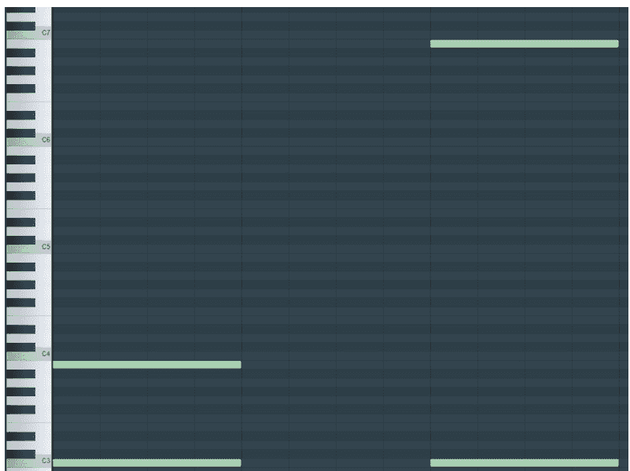

图4.20 – 七度部分和弦

左边的七度部分和弦位于较低音区。听起来很糟糕，因为浑浊且冲突。在右边，我把七度音移高了几个音区。这个音符虽然仍然是七度音，但听起来好多了。它有自己的频率空间，感觉不会与根音竞争。

从一个块状和弦序列过渡到下一个序列时，通常最好让和弦之间的移动尽可能少。上下跳跃音区听起来会很刺耳，除非是有意为之，否则应该避免。相反，你希望你的和弦进行在整首曲子中随着和弦之间的转换而微妙地扩张和收缩。

与线性的上下垂直移动相比，更倾向于扩张和收缩的和弦进行。下面的截图展示了两个和弦进行的示例：

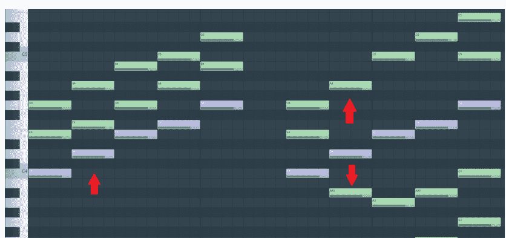

图4.21 – 线性与扩张性和弦进行对比

在前面的截图中，我们可以看到左边是一个平凡的和弦进行示例，右边是一个更有趣的和弦进行。我用紫色标示了每个进行中相同的低音线，并添加了伴奏音符来构成和弦。在左侧，我们可以看到线性垂直的和弦进行移动。所有音符都朝同一方向移动。如果你去听，会觉得很无聊且可预测。

在右边，我们可以看到一种和弦进行，其中和弦的整体动态同时向上和向下扩张。这听上去有趣得多。和弦进行中的扩张或收缩动态比线性动态更值得聆听。

让我们提供一些管弦乐创作的一般指南。这个顺序只是一个建议，因此你可能会根据自己的需要在这些步骤之间跳跃：

1. 想出低音线，并逐一添加旋律在其上方演奏。
2. 将你的乐器声部分散开来，分配到合理的弦乐器音域中——例如，高音给第一小提琴，低音给低音提琴和大提琴。你需要根据聆听时的感觉来决定上移或下移八度。
3. 头脑风暴为作品添加节奏和动态的方法。尝试节奏切分，避免听起来过于重复和可预测。考虑加入打击乐元素来增加切分和节奏。鼓类打击乐很少是单独演奏的单一乐器，它几乎总是由多种打击乐器同时演奏的分层组合。
4. 为你的旋律添加垂直动态。如果你发现某个旋律段落重复，可以考虑将其上移或下移一个八度。音符向下移动感觉像是在失去能量，而向上移动感觉像是在获得能量。因此，你经常会看到在副歌结尾、即将过渡到主歌时音符向下移动，而在过渡到副歌时（我们想要更高能量的时候）音符向上移动。
5. 添加休止符和延音，为你的旋律留出空间。这为其他乐器引入新旋律提供了空间。这样做会让你的乐器听起来像是在互相呼应。
6. 不要觉得你需要所有乐器一直演奏。让各个乐器声部在整个歌曲中逐渐淡入淡出会更有趣。如果一开始就让所有乐器演奏，你就剥夺了自己逐步构建、将所有乐器层层叠加成巨大的声音墙并在后期渐强的机会。
7. 为你的乐器添加演奏法。
8. 考虑叠加额外的管弦乐器。例如，如果你希望弦乐器更有冲击力，可以考虑添加另一件演奏法更具冲击力的弦乐器，或像木琴这样的打击乐器。叠加之后，你可能会发现其他一些管弦乐器，如铜管或木管，比你原来的弦乐器更合适，因此你需要做一些替换。
9. 在添加了演奏法和叠加之后，你可以考虑力度动态。建议将这一步留到最后，因为如果你移动音符，任何自动化都需要重做。优化音符的力度，并为你的乐器添加表情。最后，添加强弱渐强和渐弱。

10. 在乐器之间平衡音量电平。**EQ（均衡）**你的乐器频率，为每件乐器腾出空间并将注意力集中在主旋律上。使用自动化，使你的音量电平和/或表现力在整首歌曲中按期望变化。

11. 在某些情况下，你可以考虑用合成贝斯替换大提琴来击出低频。如果你想创造众所周知的*墙式音效*，这是一种击出低共振隆隆低频的方法。如果是这样，你需要为你的合成贝斯乐器添加一个低通滤波器。通过这样做，你的合成贝斯频率专注于低端，而不会压倒你的混音中的其他部分。

## 使采样乐器听起来更逼真的技巧

要让你的 MIDI 音符听起来更像现场弦乐器，你可以考虑以下技巧：

- 采样库不知道音符何时会结束。真正的音乐家会准备好离开音符并产生自然的渐弱。你可以通过自动化表现力来尝试模仿渐弱。
- 当现场管弦乐队开始演奏音符时，开始时会有一个轻微的渐强——一个轻微的渐强。好的采样库通常会为你完成此操作，但如果你使用的是廉价采样库，那么你可能需要找到一种变通方法来实现这一点。
- 当真正的音乐家演奏时，他们的音符并不完全 100% 准时。自然地，会有一些随机波动。你可能会想用 MIDI 编程将所有内容量化以使所有时间都完美。量化是一种钢琴卷帘效果，它将音符移动以适应钢琴卷帘网格并消除任何不精确。虽然这会将所有内容捕捉到钢琴卷帘网格上，但也会使所有内容过于机械般完美。你可以尝试通过使用名为 **Humanize** 的效果来修复这个问题，该效果存在于一些数字音频工作站中，例如 **Cubase**。

Humanize 会为你的音符的开始和结束时间添加一点随机变化。FL Studio 没有 **Humanize** 效果，因此如果你想添加一些随机变化，就必须手动调整音符的开始和结束时间。

手动随机化是一项大量工作，即使你有 Humanize 效果工具，它仍然可能听起来缺乏现场演奏的真实感。出于这个原因，高级作曲家通常会现场录制他们的 MIDI 钢琴演奏并保留演奏的节奏，稍作修改。他们还在演奏时录制表现力，而不是事后添加表现力。他们使用调制轮或 MIDI 键盘踏板来做到这一点。

- 如果所有音符力度都相同，你的音乐听起来会很机械。最好为你的音符力度添加随机性，使其听起来更像现场乐器。对于打击乐器（尤其是鼓），你应该始终添加一些力度变化。

## 为你的音符力度添加随机变化

FL Studio 允许你为音符力度添加随机变化。这可以使用名为 **Randomizer** 的工具来完成。让我们学习如何使用 Randomizer 为音符力度添加随机性：

1. 在钢琴卷帘中，选择钢琴卷帘选项 | 工具 | Randomize 下拉菜单，如以下屏幕截图所示：

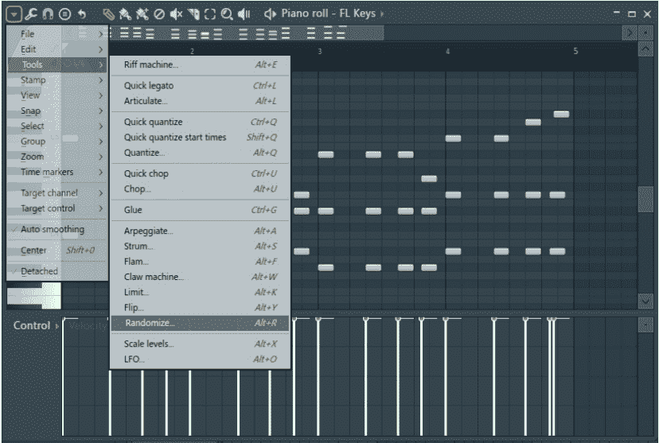

图 4.22 – Randomize

2. 禁用 **Pattern** 和 **Bipolar** 按钮。根据你的力度偏好调整力度 (**VEL**) 旋钮，如以下屏幕截图所示：

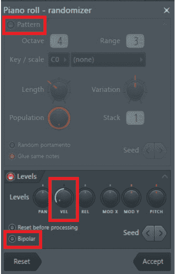

*图 4.23 – 随机化力度*

3. 调整旋钮后，你会发现你的作品中的音符已被分配了一些音符力度的随机性。你也可以随机化声像和音高。

有了这些，你就知道如何让你的管弦乐 MIDI 音符听起来更逼真了。

## 管弦乐作品混音的注意事项

在混音时，你力求在低频、中频和高频之间实现良好的平衡。这意味着你在选择乐器时需要小心。你的音符选择也会决定你是否能实现良好的平衡。例如，贝斯很少会比其上方的部分高出一个八度以上。任何更多，你就会发现中频不足。这就是为什么你通常应该专注于弦乐部分的五个声部（每个声部一个——大提琴、低音提琴、中提琴、第一小提琴和第二小提琴）。实现这五个声部的良好组合将为你提供低频、中频和高频的良好平衡。

幸运的是，在数字音频工作站中，我们对声音有精细的控制，可以创建在现实世界中很难实现的音色组合。我们可以使用一种名为 **均衡（EQ）** 的工具来实现这一点。如果一种乐器被淹没，我们可以使用 EQ 来雕刻频率以增强我们的乐器。例如，我们可以削减频率以给其他乐器留出空间，或提升过软的频率。

**混响** 是一种模拟空间中自然回声的效果。当你在混音采样乐器时，添加混响效果可以帮助融合你的管弦乐器。它使所有乐器听起来都存在于同一个房间中。混响在音乐以低音量播放时会消失在对话后面，因此你通常可以添加相当多的混响。

> **提示**
> 
> 将扬声器调低，直到你几乎听不到音乐，并看看它是否仍然听起来需要混响。

对于钢琴、竖琴或打击乐等打击乐器，轻微的延迟效果可以帮助使其栩栩如生。

当你添加 EQ 时，如果你有采样质量不佳的乐器，通常最好将乐器的底部和顶部频率滚降。如果有好的采样库，则不需要这样做。

在专业级别，作曲家不会为他们的乐器插件使用键位切换。键位切换在进行乐器演奏法的精细混音时会变得繁琐，尤其是在演奏法频繁变化时。这样做需要你在重新排列音符位置时更改自动化效果。更简单的方法是将演奏法分配给不同的乐器并单独混音它们。此外，如果你想从不同的采样库中分层乐器，键位切换会使跟踪演奏法的开始和结束变得困难。

当你聆听你的作品时，你可能会注意到在混音之前某些乐器压倒了其他乐器。对于现场管弦乐队，作曲家必须考虑可以一起分层的乐器。如果错误的乐器组合配对，一些乐器可能会完全被淹没。

了解乐器频率范围可以让你了解如何平衡乐器，以便实现所需的音效。以下图表显示了乐器的频率范围：

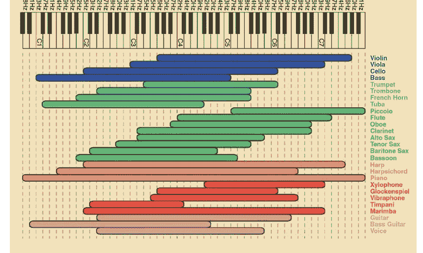

图 4.24 – 乐器频率图表
(https://commons.wikimedia.org/wiki/File:Estensione_Strumenti_Musicale.jpg)

如果你发现大多数乐器都占据相同的频率范围，你可能会发现乐器互相淹没。在这种情况下，值得用不同频率范围的乐器替换一种乐器。

当你聆听你的作品时，你可以使用插件在混音器通道中直观地看到频率范围。如果可以的话，你可能想了解一下频谱图插件。频谱图插件为你提供了歌曲频率的精细见解。

## 现场管弦乐队的注意事项

如果插件采样库这么好，为什么我们还要使用现场管弦乐队？现场管弦乐队相比采样管弦乐插件有几个优势。在现场管弦乐队中，你可以获得更自然的演奏法。例如，当你播放一个延音乐器采样时，你的数字音频工作站不知道你计划何时停止演奏音符。所以，它只是循环采样然后突然结束。当真正的演奏者演奏一个延音音符时，音乐家可以让声音自然地进出音符。

现场音乐家可以在音符开始前做好准备，并在音符结束前做好准备并进行渐弱。请注意，最顶级的采样库在使这种声音听起来自然方面做得很好，所以这变得越来越少是一个问题。

你应该使用现场管弦乐队的另一个原因是通过麦克风录制。当你录制一个管弦乐队时，你有近距离麦克风（称为 **tree mics**）、更远的麦克风（称为 **wide mics**）和用于捕捉整个房间的声音，包括混响（称为 **surround mics**）的麦克风。当管弦乐队演奏时，你的 tree mics 会捕捉到它们旁边管弦乐器的一些声音。

其他管弦乐器的部分会渗入每个 tree mic 录音中。这使其听起来自然。当你使用采样库时，你得不到所有乐器自然融合的声音。尝试添加混响效果以将所有管弦乐器放置在模拟房间中以模仿这种行为。

现在我们已经学习了如何创作管弦乐作品，让我们总结本章。

## 总结

为管弦乐队作曲的能力在为电影和电子游戏作曲时备受推崇。了解管弦乐 MIDI 作曲技术可以让你快速创作管弦乐音乐并交付由现场音乐家演奏的配乐。

在本章中，你学习了如何使用 MIDI 编程创建管弦乐音乐。你了解了可以用来创作管弦乐音乐的各种插件。你还学习了如何使用力度、演奏法和表现力为你的作品增添真实感。最后，你学习了各种管弦乐 MIDI 编程技术、使采样乐器听起来逼真的技巧和混音思路。

在下一章中，你将学习如何为音乐家创建乐谱、将音乐与视觉同步，以及如何创建音效。

