## 使用 MuseScore 创建乐谱，使用 Fruity Video Player 进行配乐，以及叙事音乐

作为一名作曲家，你应该掌握一些工具技能。其中之一就是为现场音乐家创建乐谱。这需要熟悉音乐记谱软件。其中最受欢迎的软件之一是 MuseScore。使用 MuseScore，你可以导出你的音乐项目并轻松快速地生成乐谱。

你应该能够将音乐与视觉同步。导演会要求你的音乐在某些标记处响起，你应该知道如何对音乐进行时间编排以实现这一点。这可以使用数字音频工作站中的视频插件来完成。在本章中，我们将学习如何使用 FL Studio 的 Fruity Video Player 工具将音频与视觉同步。

开始一个新项目是可以的，前提是你想从头开始创作整首歌曲，但这并不是一种高效的作曲方式。我们将学习一种更快、更简单的方法。我们将把整个 FL Studio 作品转移到 MuseScore。基本上，我们是在做相当于复制粘贴 MIDI 音乐音符的工作，这样 MuseScore 就可以为我们完成大部分音乐记谱工作。这将为你节省大量的时间。

说实话，我第一次看到以下技术有多么容易时，我感到非常震惊。也许你也会如此。以下是如何使用 FL Studio 项目通过 MuseScore 创建乐谱的方法：

- 1. 下载并安装 MuseScore。
- 2. 在 FL Studio 中创建一个歌曲。

要执行以下步骤，你需要在 FL Studio 中有一个歌曲以便导出为 MIDI 数据。只要它在钢琴卷帘中使用了一些 MIDI 音符，你就可以使用你在 FL Studio 中创建的任何歌曲。

- 3. 我们即将将你的项目导出为 MIDI 数据。在此之前，请确保保存一份项目的副本作为备份。为 MIDI 导出准备项目将不可逆地修改你的项目。因此，你必须先保存备份副本，以便在需要进一步调整时可以访问原始文件。
- 4. 确保 Channel 架中的所有乐器都已适当命名。MuseScore 将根据你在 Channel 架中设置的乐器名称为每个部分命名。

你可以通过在 Channel 架上右键单击乐器并选择 Rename, color and icon... 来重命名乐器，如以下屏幕截图所示：

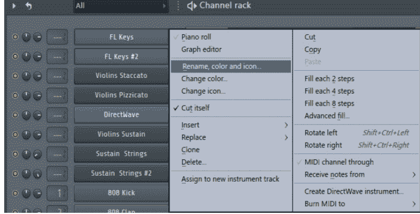

图 5.3 – 在导出前为你的乐器命名

确保为你的乐器赋予以后容易识别的名称。

- 5. 在 FL Studio 中，导航到 **Tools | Macros | Prepare for MIDI export**，如以下屏幕截图所示：

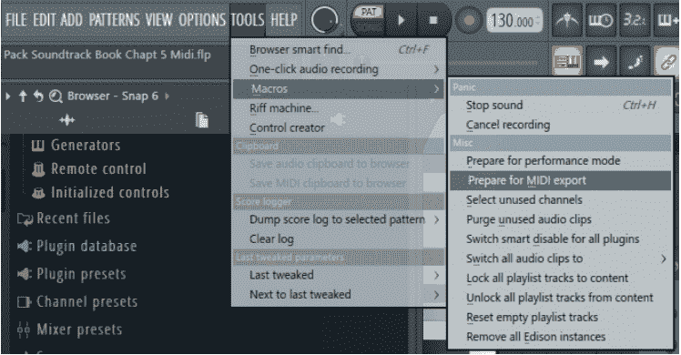

图 5.4 – 准备 MIDI 导出

选择 **Prepare for MIDI export** 后，将对你的项目执行一系列步骤以准备 MIDI 导出。

- 6. 导航到 **FILE | Export | MIDI File**。将出现一个弹出窗口提示你保存 MIDI 文件并为其命名。记住你保存 MIDI 文件的位置。

7. 确保选择了 MID，然后点击 Start，如以下屏幕截图所示：

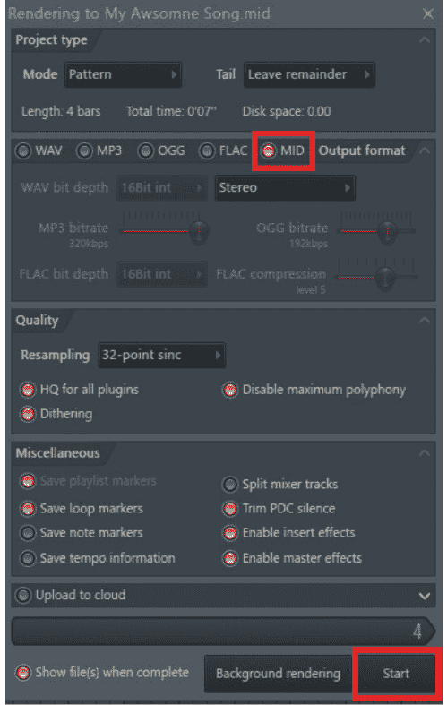

图 5.5 – 将歌曲渲染为 MIDI

你的歌曲已渲染为 MIDI 文件。我们现在可以将其导入 MuseScore。

8. 打开 MuseScore。

9. 选择 Load score from file 并选择你从 FL Studio 导出的 MIDI 文件。以下屏幕截图显示了如何导入你的项目：

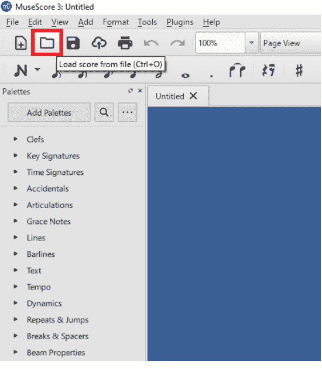

图 5.6 – 加载乐谱

选择你的 MIDI 文件后，MuseScore 将使用 MIDI 文件中的数据填充一份乐谱。以下屏幕截图显示了 MuseScore 从 FL Studio 项目生成的乐谱：

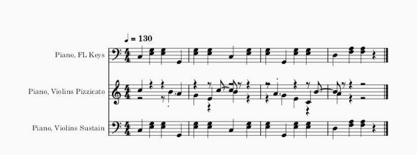

图 5.7 – MuseScore 添加你的歌曲

哇！这很容易。我们完全不需要担心音符的放置和间距问题。

你会注意到 MuseScore 犯了一些错误。例如，它对乐器的命名做出了可能正确也可能不正确的假设。你需要在 MuseScore 中之后去修复这些问题。此外，MuseScore 可以导入音符，但不知道如何直接从数字音频工作站导入表情记号。对于这一点，你需要手动添加音乐记号。

不用担心，有很多工具可以添加乐谱细节，例如标题、速度、调号和表情记号。在 MuseScore 的左侧，你会看到包含音乐记号的调色板列表。

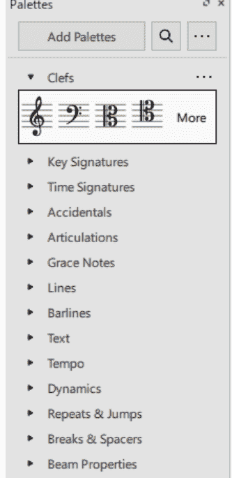

图 5.8 – 包含音乐记号的调色板列表

通过左键单击任意调色板下拉箭头，你可以看到可用的记号列表。然后你可以左键单击并将记号拖到你的乐谱上。

添加音乐记号非常容易；只需从左侧的调色板中获取你需要的项目并将其拖到你的总谱上。非常直观。

恭喜！你现在知道如何从 FL Studio 导出项目到 MuseScore 以创建乐谱。接下来，让我们学习如何使用 Fruity Video Player 将音乐与视觉同步。

## 使用 Fruity Video Player 将音乐与视觉同步

如果你在电影制作团队早期就加入，导演可能会要求你在拍摄前为场景创作一首具有关键情感的歌曲。你会创作歌曲，编辑在素材准备好时调整画面以适应歌曲。这是你最容易的情况。它允许你有很大的灵活性和自由度进行实验，同时限制最少。如果为动画配乐，音乐几乎总是在动画阶段之前完成，这意味着动画师可以围绕音乐进行设计。

但音乐并不总是先于视觉。这在你被要求在后期制作中为画面配乐时尤其如此。在某些情况下，导演会给你一部电影的剪辑版，并告诉你根据画面为音乐配乐。如果导演不喜欢前一位作曲家创作的音乐，这意味着你需要介入并修复或重新配乐。

如果视频素材已经存在，你需要调整你的音乐以在电影中的某些关键时刻响起，使其适应视觉所要求的关键时间点。FL Studio 提供了用于规划音乐时间并将音乐与视频同步的工具。

FL Studio 中同步音乐与视频的工具称为 **Fruity Video Player**。Fruity Video Player 随 FL Studio Signature Edition 及更高版本提供。

让我们开始使用 Fruity Video Player 进行配乐：

- 1. 在 Channel 架中，右键单击一个乐器并选择 Insert | Fruity Video Player。

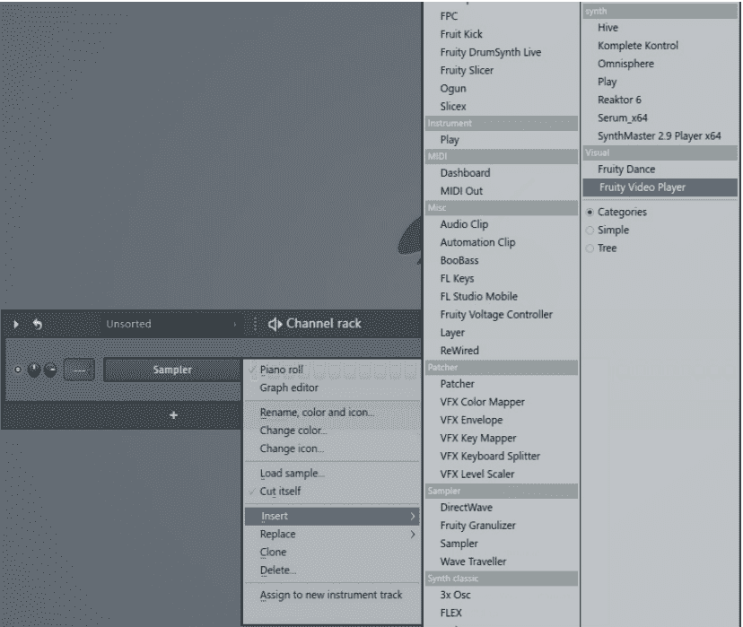

图 5.9 – 插入 Fruity Video Player

插件将加载，你会看到以下内容：

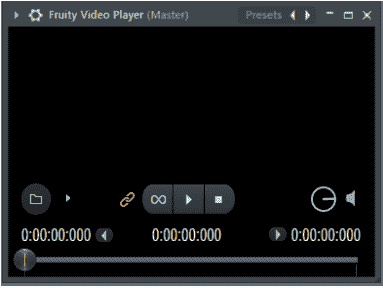

图 5.10 – Fruity Video Player

Fruity Video Player 允许你加载视频以与视觉同步播放。

- 2. 点击插件外部可能会导致它被背景面板隐藏。这很烦人，因为你通常希望视频播放器始终可见。我们可以通过点击下拉插件选项并选择 **Detached** 来修复这个问题，如以下屏幕截图所示：

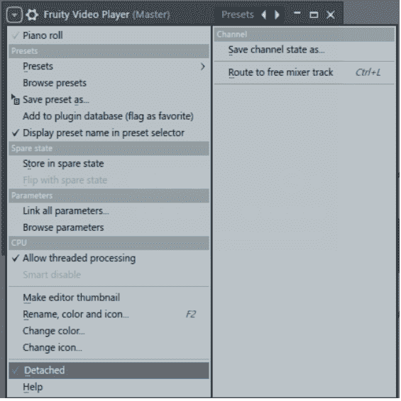

图 5.11 – 分离 Fruity Video Player

从现在开始，Fruity Video Player 将始终保持在最前面。

- 3. 通过点击 Load video file... 按钮（左侧看起来像文件夹的按钮）并选择你电脑上任意视频来加载视频到播放器中。视频将被加载到播放器中。你现在可以在 FL Studio 中播放视频。
- 4. 在插件选项下拉菜单中，你会看到其他可用工具，如以下屏幕截图所示：

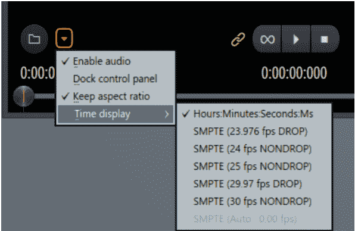

图 5.12 – 插件选项

点击下拉箭头后，我们得到以下插件选项：

- - **Enable audio**：可以禁用以节省 CPU 功率。
- - **Dock control panel**：保持控件在视频上方。取消选择时，控件会在鼠标悬停时出现。
- - **Keep aspect ratio**：保持视频宽高比。如果取消选择，重新缩放视频播放器将重新缩放视频大小。
- - **Time display**：设置时间显示最后三位数字显示的信息（毫秒 (ms) 或 **Society of Motion Picture and Television Engineers (SMPTE)** 格式）。你正在配乐的视频可能具有不同的时间格式，因此你可能需要调整以适应你的视频。
- - **Slave Playback To Host**：如以下屏幕截图所示，这会将你的播放列表音乐与视频播放同步：

Figure 5.13 – Slave Playback to Host

如果未选中，视频将独立于播放列表中的歌曲播放。你通常希望选中此项。

- **as start time** 和 **as end time** 按钮让你设置视频开始和结束播放的时间。以下截图显示了 **as start time** 和 **as end time** 按钮：

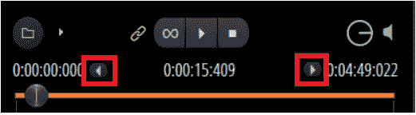

Figure 5.14 – The as start time and as end time buttons

如果你需要在视频开始几秒后而不是正好在开头开始配乐，就可以使用这些功能。

我们已经加载了视频播放器。现在我们需要学习如何在 FL Studio 中规划视觉效果并标记重要时刻。视觉标签将有助于更精确地把握音乐时机。我们通过设置标记来实现这一点。

## Setting markers

**Markers** 对于为你需要音乐响起的时刻提供视觉参考非常有用。标记是你可以在播放列表时间轴上手动设置的视觉标签指示器。例如，也许你需要在某个特定时间位置让音乐进入或淡出。标记可以帮助你确定该位置。

让我们学习如何创建标记：

- 1. 在 Channel 架中加载一个 Fruity Video Player 实例。向 Fruity Video Player 中加载你想要配乐的视频。
- 2. 确保 Fruity Video Player 已分离，这样在点击播放器窗口外部时它仍保持打开状态。
- 3. 使用 **as start time** 和 **as end time** 控制设置视频的入点和出点。
- 4. 确保启用了 **Slave Playback To Host**，以便你的视频与播放列表同步。
- 5. 打开播放列表。
- 6. 在播放列表中创建一个新的空 Pattern，并使其与你想要配乐的视频一样长。如果你的视频长 1 分钟，请确保播放列表中的 Pattern 也长 1 分钟。

在以下截图中，你可以看到我在播放列表中创建了一个名为 **My Video** 的新 Pattern：

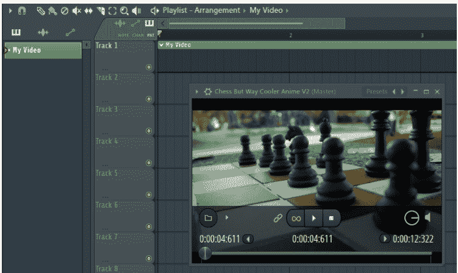

Figure 5.15 – Empty pattern added to the playlist

- 7. 滚动播放列表时间轴。你可以通过在时间轴上左键单击并拖动光标向左或向右来完成此操作。随着拖动，Fruity Video Player 中的视频会根据时间轴中的位置同步移动。以下截图显示了光标被拖动的示例：

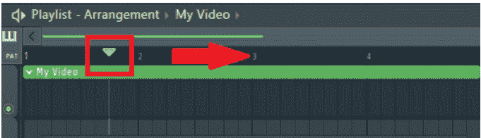

Figure 5.16 – Dragging along the timeline

8. 在滚动时间轴时，当你到达一个重要的场景时刻时，按 Ctrl + T。这样将在时间轴上创建一个名为 Auto 的标记。

9. 右键单击标记并将其重命名为你选择的更有意义的名称。以下截图显示了一个示例：

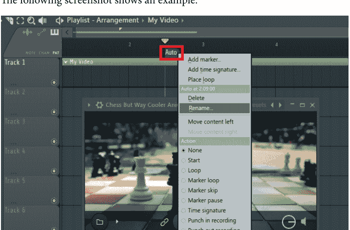

Figure 5.17 – Added marker

10. 对视频中的所有关键时刻重复此过程。

查看你在采访电影导演时收集的任何笔记。导演会有关于在任何给定场景中想要的情感的设想。应该有关于强度何时应增加或减弱的提示，以及导演希望音乐何时进入或退出的提示。你可以在视频的整个过程中为所有这些提示添加视觉标记。

以下截图显示了为视频中重要时刻设置的标记示例：

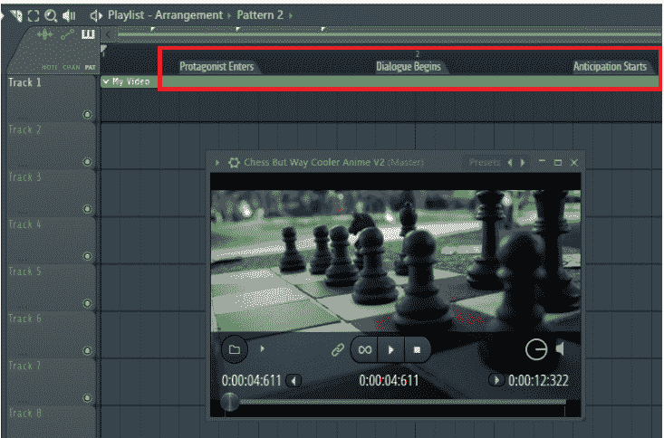

Figure 5.18 – Markers set in the video

通过在视频中设置标记，你可以可视化音乐中需要发生的所有重要变化。这将帮助你规划音乐。

> Note
> 标记可以在播放列表或钢琴卷帘中设置。通常，在钢琴卷帘中设置标记很有帮助，这样你可以看到 MIDI 音符放置与之对齐的位置。

## Setting time signatures

**Time signatures** 允许你组织和衡量音乐。它们将其划分为每小节的拍数，使其更易于阅读和理解。这有点像句子末尾的句号，用于区分一个句子和下一个句子。它们有助于为书面音乐提供结构。

拍号由上数和下数组成。默认情况下，FL Studio 项目以 4/4 拍号加载项目。这意味着每小节 4 拍。在钢琴卷帘中，这意味着网格被划分为 16 个方格。以下截图显示了一个小节的示例。你会看到小节中水平排列的 16 个方框。

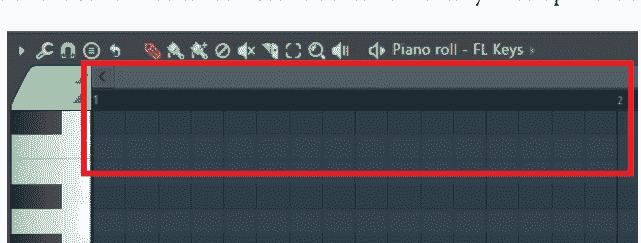

Figure 5.19 – 4/4 time signature

音乐并不局限于 4/4 拍号，许多歌曲使用不同的拍号。使用不同的拍号可以让你创建不同风格的音乐。例如，华尔兹风格的歌曲的拍号为 3/4 而不是 4/4。

你可以更改歌曲的拍号。更改拍号的方式与向歌曲添加标记的方式相同。

让我们更改歌曲的拍号：

- 1. 在钢琴卷帘 Pattern 中确定你想要更改拍号的位置。
- 2. 在键盘上按 Ctrl + T。一个标记将显示在光标位置的时间轴上。
- 3. 右键单击新创建的标记。选择 Add time signature 选项。示例如下所示：

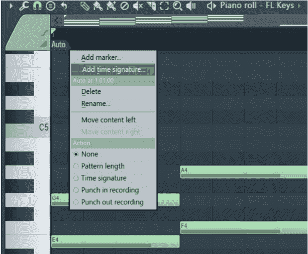

Figure 5.20 – Add time signature

一个窗口将弹出，允许你选择想要的拍号。分子是拍数，分母是小节。默认情况下为 4/4（意味着每小节 4 拍）。以下截图显示了一个示例：

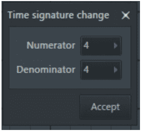

Figure 5.21 – Time signature change

4. 将拍号值更改为你选择的数值。你可以在歌曲中添加具有不同拍号的标记。以下截图显示了一个示例：

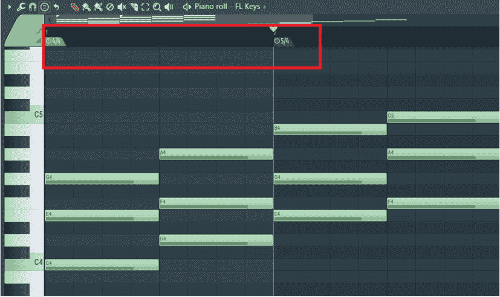

你现在知道如何在歌曲中更改拍号。更改拍号让你可以自由地在作品中转换不同风格的音乐。

我们已经学习了如何使用 Fruity Video Player 将音乐与视频同步。接下来，让我们讨论叙事音乐和音效。

## Diegetic music (The Art of Foley) and sound effects

在 1920 年代，Jack Foley 因在广播中为故事添加音效而闻名。随着时间的推移，为叙事添加音效被称为 **Art of Foley**。你可能也遇到过 *diegetic sound* 这个术语，它是同一回事。**Diegetic** 音效是指从电影故事世界中发出的任何声音。

除了对白之外，你在观看电影时听到的内容大部分并非在拍摄视觉时录制的。每一次爆炸、脚步声、天气声、移动声、动物咆哮声和其他音效都是在拍摄素材后精心设计和挑选的声音。

如果音效做得好，观众不会注意到电影中充满了后期制作添加的声音。优秀的声音设计将视觉与声音无缝匹配，让你的大脑认为它们是一起创作的。

所有声音都涉及两种元素以某种方式相互碰撞。产生的声音取决于材料和使其碰撞的方法。大型工作室会聘请 Foley 艺术家浏览他们的电影，并为每件物品策略性地添加声音。换句话说，人们把东西互相敲打并录下它们发出的声音。

作为观众，我们对音效习以为常。作为声音设计师，音效并没有那么明显。创造声音需要对每个声音投入细心和思考。

在作曲时，考虑导演打算放在电影中的声音非常重要。音效通常会分散音乐的注意力。如果你在一个充满非常强烈的音效的场景中，你需要考虑这对音乐的影响，因为它可能会被音效掩盖。

叙事音乐涉及取自故事发出的声音，并将它们用作作曲时的乐器。这些声音可能不是管弦乐器——它们可以是任何音效。与使用常规乐器相比，创作叙事音乐的好处是它有助于让音乐与视觉的世界保持联系。

尽管叙事音乐在电影配乐中只有时会被使用，但在为电子游戏配乐时却经常使用。电子游戏的音效和音乐通常融合得如此无缝，以至于你忘记了它们各自的开始和结束。

我们将在 *Chapter 7, Creating Interactive Music for Video Games with Wwise.* 中更详细地探讨为电子游戏配乐。

## Sound effect examples

让我们考虑一下电影中使用的一些音效示例。在电影 *Fight Club* 中，有很多徒手格斗音效。骨骼碎裂的拳击声是通过砸碎鸡腿并录下声音创造的。电影中咆哮的海浪声通常是通过录制振动金属片的声音创造的。而电影中的雪声通常是有人踩在沙子上的声音。嘎吱作响的雪声通常实际上是玉米淀粉被踩碎的声音。

以下是一些展示电影音效如何制作的推荐视频：

- **Fight Club | The Beauty of Sound Design**: https://youtu.be/as2Rk4WcljA
- **The Magic of Making Sound**: https://youtu.be/UO3N_PRiGX0

添加音效通常是在视频编辑软件中而不是数字音频工作站中完成。这样可以让你将时序精确地与视觉同步。音效同步可以在数字音频工作站中完成，但通常在视频编辑软件中更容易。

## 推荐的音效插件

虽然你可以为项目自行制作音效，但值得研究一下是否已有现成的音效库和工具能满足你的需求，尤其是在你需要在截止日期前完成工作时。也有很多网站提供专为电影设计的音效。

让我们讨论几个前沿的音效插件。Krotos 制作音效设计的插件。Krotos 的插件被用于许多电影制作中，可在 https://www.krotosaudio.com/ 获取。

### Dehumaniser

Krotos 的 Dehumaniser 是其最著名的音频效果插件。它通过修改人声来创建怪物音效。它已被用于《复仇者联盟：奥创纪元》、《丛林之书》、《驱魔人》等电影，以及《怪奇物语》等剧集。以下截图显示了 Dehumaniser 插件：

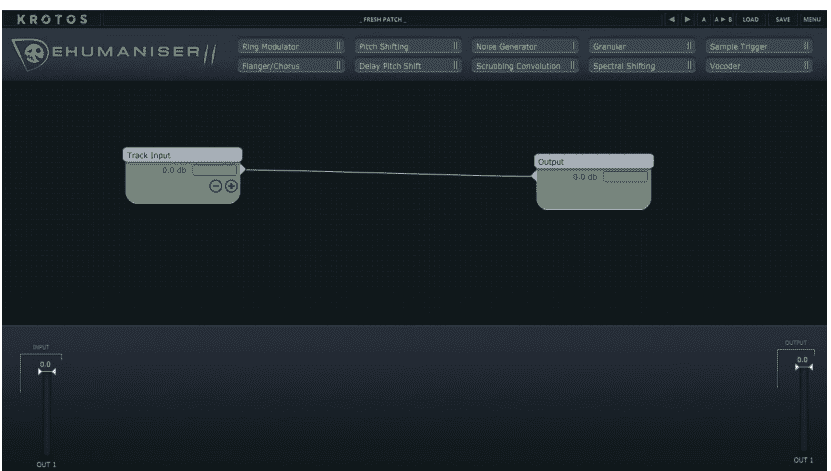

图 5.23 – Krotos Dehumaniser

它像声码器插件一样工作，接收人声输入并修改声音以创建你选择的语音。说 Dehumaniser 就像声码器有点轻描淡写，因为该插件可以将你的声音变成动物咆哮或变形金刚机器人。

你可以在 https://www.krotosaudio.com/dehumaniser2/ 了解更多关于 Dehumaniser 的信息。

### Igniter

Krotos 的 **Igniter** 插件允许你创建车辆、跑车、摩托车、飞机、直升机、航天器、无人机以及许多其他车辆的声音。

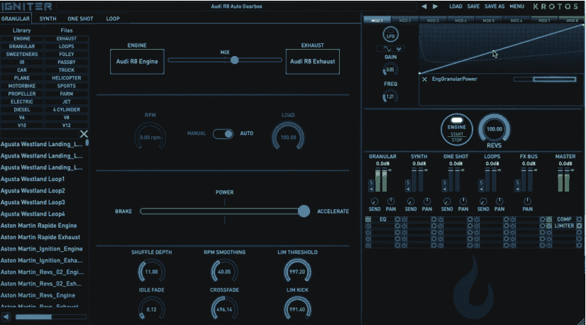

图 5.24 – Krotos Igniter

它包含汽车、飞机、直升机、摩托车、卡车和拖拉机的声音。以下是包含的部分车辆声音列表：

Agusta Westland 119x, Aston Martin, Rapide, Audi R8, BMW i3, Bucker BU 131, Cessna 560XL, CH-47D Chinook, Dacia 1310, De Havilland Tiger Moth, Ferrari 348, Ford F150, Harley Davidson 99 Hog, Honda Civic, Huey UH-1H, Land Rover Defender, Mercedes Actros, Porsche Carrera, Subaru Crosstrek SUV, Agusta Westland, Tesla Model S, Toyota Chaser, U650M Tractor, and Subaru Impreza

你可以在 https://www.krotosaudio.com/igniter/ 了解更多关于 Igniter 的信息。

### Reformer

Krotos 的 **Reformer** 插件以动态方式创建 Foley 音效。它允许你为视觉效果创建实时同步的音效。

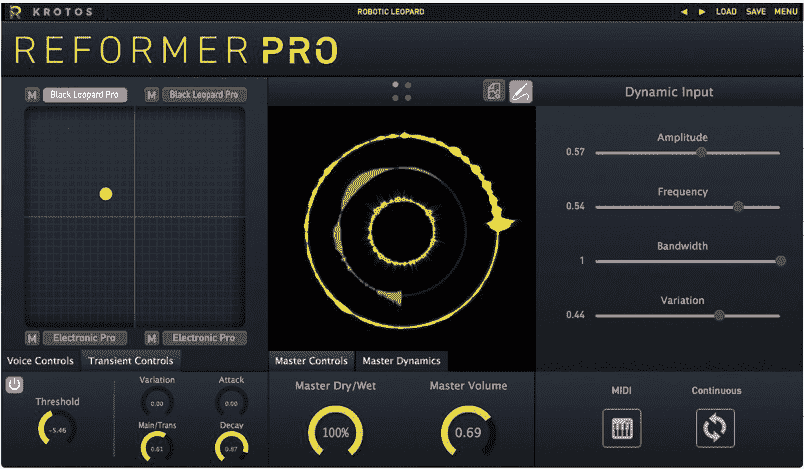

图 5.25 – Krotos Reformer

实时修改 Reformer 控制会产生新的声音。其最明显的应用是为没有任何现有声音的动画创建声音，因此你需要从零开始发明。例如，它可用于为动画创建声音，其中需要新的声音具有自定义长度。

你可以在 https://www.krotosaudio.com/reformer-pro/ 了解更多关于 Reformer 的信息。

### Weaponiser

Krotos 的 **Weaponiser** 允许你创建武器音效。以下截图显示了 Weaponiser 插件：

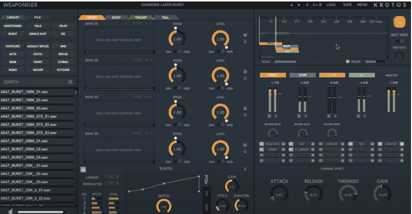

图 5.26 – Krotos Weaponiser

Weaponiser 允许你快速为真实和科幻武器、科幻音效、脚步声、呼啸声和转场制作声音，并为任何给定情况进行自定义。

你可以在 https://www.krotosaudio.com/weaponiser/ 了解更多关于 Weaponiser 的信息。

### Omnisphere

Spectrasonics **Omnisphere** 是一款知名合成器。它是一款 MIDI 插件，拥有大量采样独特乐器的曲目，非常适合音效设计。

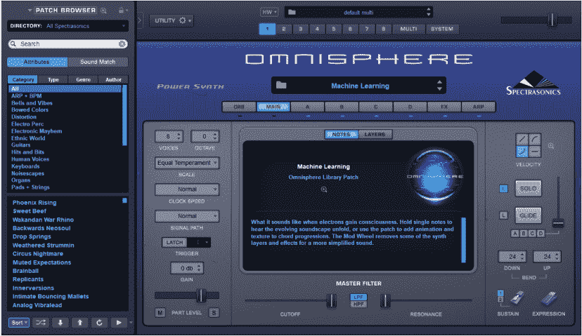

图 5.27 – Spectrasonics Omnisphere

Omnisphere 非常庞大。它提供数千种采样现场乐器和合成器。它可以导入声音并对其进行调制和应用效果。它是一款强大的插件。

你可以在 https://www.spectrasonics.net/products/omnisphere/ 了解更多关于 Omnisphere 的信息。

### 音效库

如果你没有时间自行修改和定制音效，你可以考虑获取免版税音效库的访问权限。有很多网站销售 SFX（音效）。这些网站提供数千种免版税音频样本。

一些网站以套装形式销售单个样本，而其他网站则销售订阅服务，允许你以年费获得其整个库的访问权限。然后你可以简单地下载并以任何你喜欢的方式使用音频。

提供音效的网站包括以下：

- **Boom Library**: https://www.boomlibrary.com/
- **ProSoundEffects**: https://www.prosoundeffects.com/
- **Sound Ideas**: https://www.sound-ideas.com/
- **Artlist**: https://artlist.io/sfx/
- **Soundsnap**: https://www.soundsnap.com/
- **Soundly**: https://getsoundly.com/

写实的声音可以让观众感觉他们正在经历真实事件。如果处理得当，声音可以吸引观众，让他们认为声音源自故事本身。本节中你学到的工具和资源将帮助你制作出可用于院线电影的音效。

## 总结

在本章中，我们学习了如何在 MuseScore 中创建乐谱。这让你可以将音乐从 FL Studio 导出，以便交给现场音乐家演奏。

我们学习了如何使用 Fruity Video Player 将音乐与视频同步。这让你可以微调音乐时机，以便在视频中击中重要的关键时刻。

最后，我们学习了关于写实音乐，以便你为电影和电子游戏考虑音效。我们讨论了推荐的产品和音效库，供你在项目中考虑。

在下一章中，我们将学习如何为电子游戏创建自适应音乐。
