# 第 6 部分：用音乐影响情绪和设计情感音乐

作为作曲家，你有能力控制观众的情绪。视觉效果的含义取决于伴随的音频。你只需通过音效的选择，就能将一个什么也没发生的无聊场景变成一个强烈的情感时刻。你可以通过音乐选择让场景变得快乐或悲伤、放松或紧张、浪漫或可怕。

电影中反复出现的有几种常见情绪。在本章中，我们将介绍多个技巧，帮助你为各种情绪设计音乐情绪。

在本章中，我们将涵盖以下主题：

- 什么是恐惧？
- 设计惊吓
- 设计 creepy 音乐
- 作曲快乐和悲伤音乐
- 作曲浪漫音乐
- 在音乐中制造紧张感并为预告片作曲史诗音乐

如果你是初学者，感到不知所措，请放心，你不需要记住本章讨论的技术。本章旨在作为参考指南，你可以在需要特定情绪音乐时随时查阅。这些技术针对偶尔出现的特定情况。

在本章中，我们将尝试不仅给你提供为特定情绪作曲的工具，还提供某些声音为何让你产生特定感受的理由。有了这种理解，你将获得洞察力，可以自行实验并想出新的声音。

### 作曲诡异音乐

了解如何使用声音让观众感到不舒服是作曲家拥有的绝佳工具。如果做得正确，音乐可以同时让观众感到恐惧，同时让他们完全投入并沉浸在故事中。在我们吓唬观众之前，我们需要了解恐惧是什么。

#### 什么是恐惧？

恐惧是对潜在危险的不确定性的心理反应。从生物学角度来看，恐惧帮助你避免可能伤害你的情况。

让我们想想你在野外漫游的远古祖先，在他们狩猎和觅食食物的时候。在森林或丛林的黑暗中，他们看不到周围发生了什么。他们的耳朵密切聆听可能伤害他们的生物的声音。

未知是危险的。数千年来，我们的耳朵变得敏感，能够区分熟悉的声音和不熟悉的声音。任何被耳朵解读为威胁的东西，都可能使我们的身体进入高度警觉状态。你的身体会将血液输送到有助于战斗或逃跑的器官；你的心跳加速，耳朵高度集中聆听，眼睛四处张望。这些都是生存机制，旨在在面对潜在威胁时提高你的生存几率。如果我们想用声音来产生这些生物反应，我们需要创造一个感官环境，让听众相信自己处于危险的场景中。

什么声音会让我们觉得可能有危险？乍一看并不那么明显。请注意，恐惧也有不同种类。有时，我们会感到脊背发凉。有时，我们会因惊吓而跳起。有时，我们看到令人不安和困扰的图片，但并没有明显的威胁。我们如何解释所有这些不同的恐惧形式？我们需要心理拼图中的另一块，而这块就叫做**认知失调**。

## 理解认知失调

认知失调是对不一致或矛盾信息的感知。当你遇到不一致或矛盾的信息时，你的大脑会努力理解这些信息。在某些情况下，这会导致身体进入应激状态，你会体验到恐惧。

我们可以通过组合听起来不自然地搭配的声音，为耳朵创造认知失调。通过创造一种不熟悉的听觉情境，我们可以让自己感到不舒服。将令人不安的声音与令人不安的视觉效果配对，你就拥有了一个在观众心中激发恐惧的绝佳情境。

以下是认知失调的一个例子：

### 紧张场景 + 无辜音乐 = 令人毛骨悚然

你的眼睛看到一个非常强烈的场景。也许演员看起来很紧张，正在惊慌失措。现在，将这个紧张的场景与听起来非常无辜的声音叠加——它会与视觉冲突并产生认知失调。

在许多涉及小丑、杀人儿童玩具或被附身儿童的恐怖电影中，你会听到无辜的音乐。它可能包含玩具的声音、旋转木马音乐或儿童歌唱的声音。如果这种声音伴随着紧张的场景出现，大脑会将其解读为令人毛骨悚然。

如果你反转前面的等式，你可能会得到一种可以被解读为有趣的情况。

一个好的惊吓是由以下技巧创造的。首先，令人毛骨悚然的音乐逐渐增强，为震惊事件做好准备。在令人毛骨悚然的音乐达到强度高潮后，会有一段短暂的安静时刻来制造期待，随后是一个响亮的、令人害怕且不和谐或冲突的声音。这个结尾的声音与震惊的视觉效果配对。

我在前一段提到过令人毛骨悚然的音乐的累积。每当你听到声音强度的上升或下降时，这通常意味着我们将使用自动化。我们在*第4章 管弦乐MIDI作曲*中学习了如何使用自动化来增加表现力和音量。**Expression**是一种用于调整音乐强度和音量的效果。以下截图显示了一个示例：

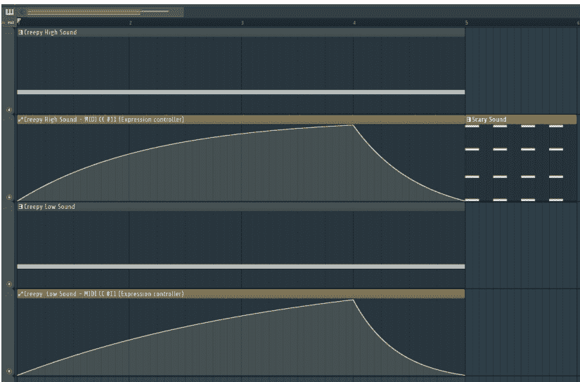

图6.1 – 自动化令人毛骨悚然声音的强度

在前面的截图中，自动化被用来随着时间的推移增加乐器声音的表现力。使用自动化，乐器声音的强度增加到渐强，然后降低到寂静，随后是一个令人害怕的声音。

与适当的视觉效果配对，令人毛骨悚然的声音会累积到惊喜揭露。我们随后将强度降低到寂静，持续一会儿。这会让观众在期待惊吓时感到不安，因为他们经历的累积感觉必须导向某个地方。最后，我们用令人害怕的声音和图像组合来震惊观众，从而完成惊吓。

记住顺序：*令人毛骨悚然的音乐累积起来，随后是几秒钟的寂静，然后是一个令人害怕的声音。*如果你直接进入令人害怕的声音，你就错过了建立必要的累积，让听众处于脆弱状态。令人毛骨悚然的音乐之后的短暂寂静是吓唬观众最重要的悬念时刻。寂静是一个不确定性的时刻，听众不确定接下来会发生什么。如果你让听众保持在脆弱状态一段时间，恐惧会进一步累积，场景会感觉更可怕。

## 设计可怕的声音

我们已经确定了惊吓的关键部分。它由**令人毛骨悚然的音乐**后跟**令人害怕的声音**组成。在接下来的页面中，我们将诊断这些是如何创造的。让我们先从惊吓的令人害怕的声音部分开始——即提供最终惊吓的部分——然后我们将学习如何制作**令人毛骨悚然的音乐**。

令人害怕的声音可以是任何听起来不熟悉和不自然的声音——你在日常环境中不常遇到的声音。有几种类型的声音是吓唬听众的良好候选者：

- **频率跳跃**：极端的频率跳跃会让听众感到惊讶。

  频率跳跃是指从高频率跳到低频率，或反之亦然。请记住，频率只是音高的另一个词。换句话说，我们说的是音高的任何极端变化。音高的极端突然跳跃在日常环境中并不常见。通常从高到低或从低到高时会有逐渐的上升或下降。

  使用FL Studio，创建频率跳跃非常容易。只需从高八度的音符移动到低八度的音符，或反之亦然。
- **非标准和声**：非标准和声是听起来不和谐的声音——也就是说，不和谐的声音。如果你忘记了不和谐的声音是什么，请参考*第3章 使用主题、主导动机和音阶设计音乐*。

  不和谐的冲突声音可以发挥巨大作用。一个标志性的例子是阿尔弗雷德·希区柯克电影《惊魂记》中谋杀场景期间小提琴的不和谐尖叫。

  以下显示了非常不和谐的冲突音符的示例：

  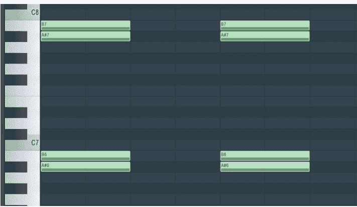

  图6.2 – 不和谐的音符

  不和谐的音符相互冲突，并且可以通过使用类似尖叫的刺耳乐器来进一步增强。在阿尔弗雷德·希区柯克的电影《惊魂记》中，所使用的乐器是尖叫的小提琴。
- **混沌噪音**：混沌的声音可以创造一种让人感到恐慌和混乱的情境。例如，如果你将视觉效果与大量愤怒人群的声音配对，喊叫和无序奔跑，这可以被解读为一种压倒性的情境。与白噪声相似的声音也可能让人感到非常有压力和痛苦，这可能是使用它们所期望的效果。
- **超出预期范围的声音**：乐器通常预期在特定的音高范围内演奏。如果超出该范围演奏（无论是更高还是更低），它们听起来会非常令人不安。例如，如果你有一段人类声音的录音，其音高降低到不自然的低水平，这听起来会令人不安。对乐器也同样适用。将乐器的音高改变到不自然的低或高水平会听起来非常令人不安。
- **类似尖叫的声音**：我们的耳朵对听到尖叫声高度敏感。这是一种具有进化起源的生物安全机制，旨在提醒我们危险，确保当有人因恐惧而尖叫时，你会注意尖叫的来源。

我们已经介绍了可以在惊吓的“吓”部分用来吓唬观众的声音。接下来，让我们看看如何为惊吓的累积部分创建令人毛骨悚然的音乐。

## 设计恐怖音乐

恐怖音乐可用于多种场景。有时，你只需要一些氛围音效来表现特定的环境或主题。如果你想增添神秘、悬疑的气氛，或未知的感觉，本节正是你所需要的。

恐怖音乐由非自然和陌生的声音组成。这些声音越显得不寻常，就越有可能成为令听众不安的绝佳素材。

在 FL Studio 中，你可以通过以下技术创建被视作恐怖的声音：

- 音乐失谐
- 中途突然转调
- 反转音乐
- 减慢、加快及突然变速
- 混响、故障效果和延迟，可用于增强上述任何方法

## 失谐音乐

大多数音乐都经过优化，以鼓励音符之间相互和谐。彼此不和谐的音符称为*不和谐音*。相比之下，声音越和谐，听起来就越悦耳，乐器通常也会调校得尽可能合调。如果你想制造恐怖的声音，你可以采取一种完全相反的方法，设计故意失谐的乐器。我们在*第3章 使用主题、主导动机和音阶设计音乐*中已讨论了协和与不协和。

## 中途突然转调

大多数歌曲在整首歌中保持相同的调性。这样，音乐听起来贯穿始终一致。音乐既设定了听众对接下来可能出现的音符的期望，也满足了这种期望。如果要从一个调过渡到另一个调，我们会尽可能平滑地过渡。当 DJ 为人群播放歌曲时，他们会安排曲目顺序，使得歌曲间的切换能处于相近的调性，让过渡显得不那么突然，流动也更自然。

我们学习了如何使用和弦转轮技巧在调性之间过渡，相关内容已在*第3章 使用主题、主导动机和音阶设计音乐*中讨论过。

如果你想给听众带来一阵惊喜，你可以在全曲中突然转入与彼此不相似的调性。这种声音非常不寻常，会让你的耳朵聚焦于调性的变化。这种变化会感觉非常出乎意料，并将听众从当下情境中抽离。这就像电影中打破第四面墙，演员直视镜头看着观众。你让听众意识到音乐已完全改变。突然变速也能给听众带来这种效果。

## 反转音乐

一般而言，声音向前播放。将声音倒放，尤其是放慢速度后，可能产生一些恐怖甚至骇人的声音。黑胶唱片收藏者中流行一种游戏：倒放著名歌曲，寻找隐藏信息。这可能会产生一些非常奇怪且仿佛是来自另一个世界的声音。

在 FL Studio 中，你可以通过在播放列表中的样本上右键单击两次，然后选择 Reverse 按钮，来反转任何声音样本的声音。以下截图展示了一个示例：

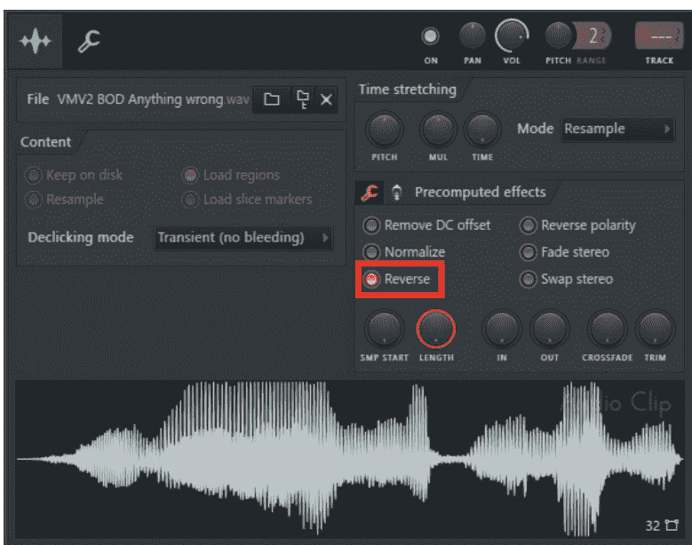

图6.3 – 反转音频样本

如果你想让声音更加恐怖，还可以考虑放慢音频的时间和音高。

## 将音频渲染为波形

如果你的乐器正在播放 MIDI 音符，而你想反转声音，则不能仅仅双击播放列表中的样本。在反转声音之前，你需要额外一步。你需要先将 MIDI 音符转换为音频波形。完成后，声音就变成了常规音频样本，可以使用之前描述的方法进行反转。

你可以使用称为**渲染为音频**的技术（更常称为**冻结音频**）将乐器的 MIDI 音符音乐转换为音频样本。

让我们来学习具体做法：

- 1. 将你的乐器从通道机架路由到混音器。我们在*第2章 浏览 FL Studio 的关键功能*中已学习过如何操作。以下截图展示了一个示例：

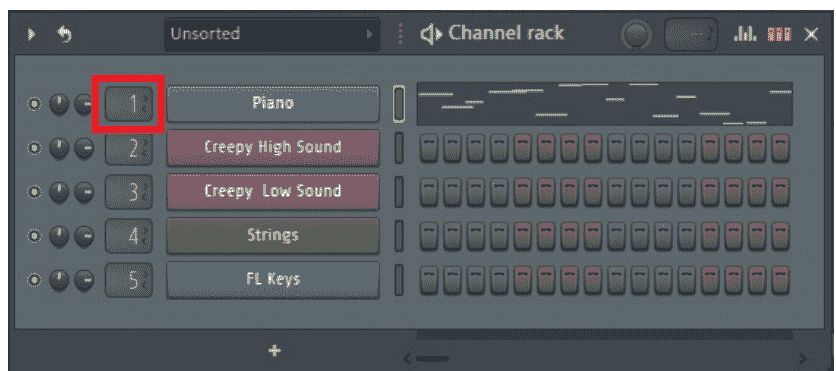

图6.4 – 将通道机架乐器路由到混音器

- 2. 在你想将其音频渲染为波形的乐器上，选择**启用磁盘录音**按钮。你可以同时选择多条轨道，如下面的截图所示：

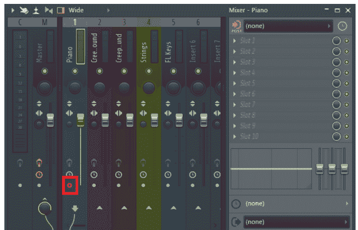

图6.5 – 启用磁盘录音

3. 在混音器中，选择 选项 | 磁盘录音 | 渲染为波形文件，如下面的截图所示：

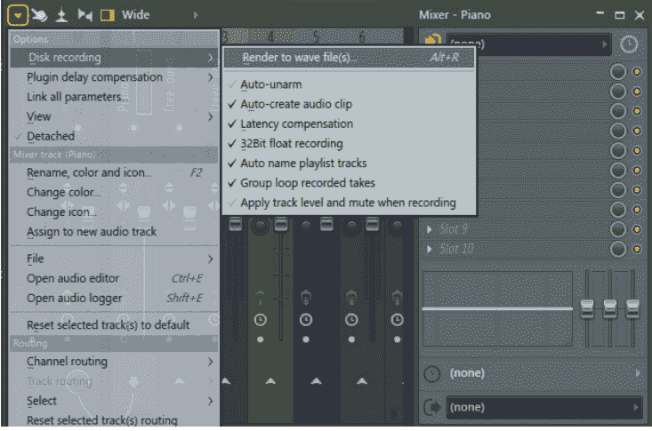

图6.6 – “渲染为波形文件”选项

将出现一个包含各项选项的窗口菜单，如下面的截图所示：

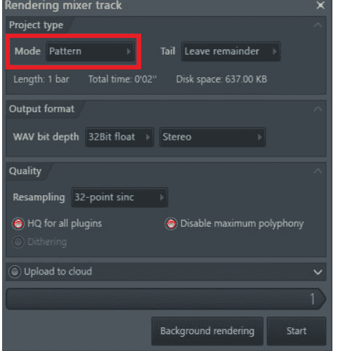

图6.7 – 渲染混音器轨道窗口

- 4. 调整模式，以指明你要渲染的是样式还是歌曲。样式指的是所选的一段音符乐句，而歌曲指的是整个编排。

- 5. 点击开始。通道机架中的乐器将播放 MIDI 音符，混音器将录制声音，从而创建音频样本。随后，这段音频将输出为一个样本，可以放入播放列表中：

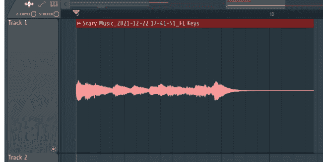

图6.8 – 输出波形

然后，你可以双击播放列表中的样本，以访问反转样本控制项：

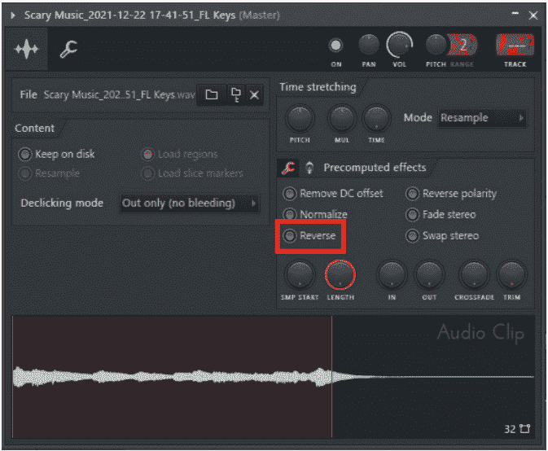

图6.9 – 反转渲染后的音频样本

利用渲染为音频技术，你可以将混音器中带或不带效果的任意声音转换为样本，然后进行反转。

## 减慢、加快和突然变速

音频速度的变化可能是出乎意料的事件。放慢的音乐往往是非常恐怖的声音，尤其是同时伴随音乐音高下降时。

更改样本速度与更改整首歌曲的速度方法不同。如果你想更改样本速度并使其保持在新速度，请左键双击该样本，然后更改**音高**和**时间**值，如下面的截图所示：

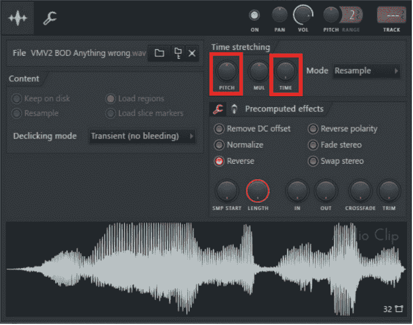

图6.10 – 更改样本的速度和音高

这种方法会改变歌曲中某一特定时刻的速度。然而，它并不能随时间逐渐自动化样本的速度和/或音高变化。

如果你想随时间改变速度，你需要为整个项目更改速度。你可以通过右键单击项目速度并选择**创建自动化剪辑**来实现。

这将允许你调整速度以加快或减慢歌曲，如下面的截图所示：

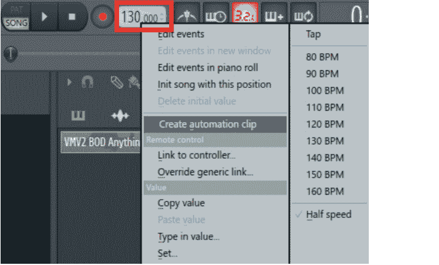

图6.11 – 自动化速度

通过自动化，你可以随时间增加或减少歌曲的速度，如下面的截图所示：

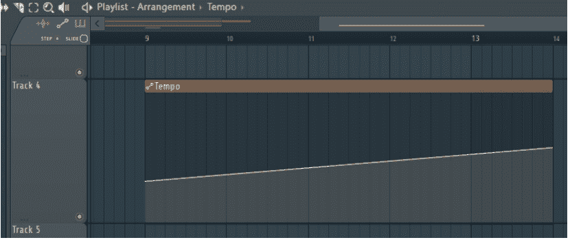

图6.12 – 自动化速度

在上面的截图中，我们可以看到歌曲的速度随时间加快。你也可以自动化为相反效果，让歌曲随时间减慢，并且可以在整首歌中设置多次变化。

## 混响、失真、故障效果和延迟

混响、失真、故障效果和延迟等效果是可用来创造非自然声音的工具。通常，目标是使用恰到好处的混响和延迟来支撑现有声音，而不让效果引起注意，但如果你试图创造奇异超凡的声音，情况就不同了。尽情发挥，调高混响、延迟、失真或你能想到的任何其他效果。

我们已经讨论了制造恐怖音乐的技术和效果。但还缺少一个重要元素——使用哪些音符来配合乐器，以创造令人毛骨悚然的恐怖音乐。接下来让我们学习这一点。

## 恐怖与惊悚音乐的音符组合

某些音符组合听起来熟悉而舒缓，但另一些组合可能听起来非常陌生且令人不安。在本节中，我们将讨论可用于创作恐怖或惊悚音乐的音符组合。我们将讨论的技术包括以下内容：

- 恐怖高音与恐怖低音的组合叠加
- 小调中的音符
- 冲突音符
- 错误音符
- 按固定比率递增音符

## 恐怖高音与恐怖低音的组合叠加

一种非自然且常被认为恐怖的情况是，同时将高音与低音配对，而中间频率相对较少。这在自然中并不常见。通常，一个声源产生的噪音涵盖了低频率、高频率或整个频谱。但你很少会听到来自单一声音源只有低频和高频、中间却没有任何内容的声音。

这种罕见的声音会让你的耳朵竖起并注意，因为它们听到了一些本不该预期到的声音。要创造这种效果，请将主要频率较低的乐器与主要频率较高的乐器叠加。

## 小调中的音符

小调中的音符给人一种悲伤或可怕的感觉。如果用柔和的乐器演奏，会显得悲伤或美丽。如果用阴森的乐器演奏，则会显得毛骨悚然。

## 冲突的音符

如果你想制造惊吓效果，需要一种能突然跳出来抓住听众注意力的声音，可以考虑使用冲突的音符。冲突的音符是极不和谐的音符。

具体来说，冲突的音符组合包括以下内容：

- 同时演奏一个根音和相隔三个全音的音符。例如在以下截图中所示：

    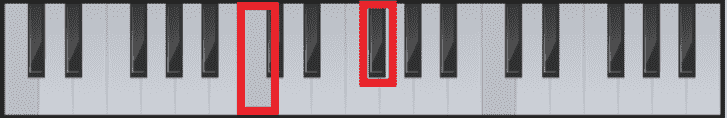

    Figure 6.13 – Three whole tones apart

    在前面的截图中，我选择了一个相隔三个全音的音符组合——在这个例子中是 C 和 F♯。只要保持三个全音的距离，你可以使用任何音符。

- 同时演奏相隔一个半音的任意两个音符，如以下截图所示：

    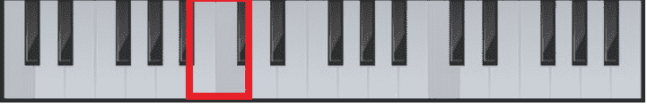

    Figure 6.14 – A semitone apart

    在前面的截图中，你可以看到两个音符 C 和 B，相隔一个半音。这些音符示例并不局限于直接相邻，也可以分布在不同的八度上。

## 错误的音符

在大多数音乐中，我们期望歌曲保持在给定的调性内。调内的音符彼此和谐。这听起来很愉快。如果你想采取相反的做法，可以创作令人不愉快的音乐。演奏不属于给定调性的错误音符，或者甚至可以考虑从一个调性的音符开始，然后逐渐偏离该调性进入混乱的境地。

如果你想生成混乱、随机的音符，FL Studio Piano roll 有一个名为 **Randomize** 的工具，专为创建随机的音符变化而设计。

以下步骤说明如何即时生成随机音符：

- 1. 选择一个模式并打开 Piano roll。
- 2. 选择 **Tools | Randomize** 选项，如以下截图所示：

    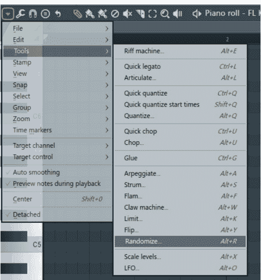

    Figure 6.15 – Randomize

- 3. **Randomize** 工具将会出现。选择 **Seed** 按钮，如以下截图所示：

在尝试随机化设置并选择 **Accept** 后，你会看到随机音符被生成，如以下截图所示：

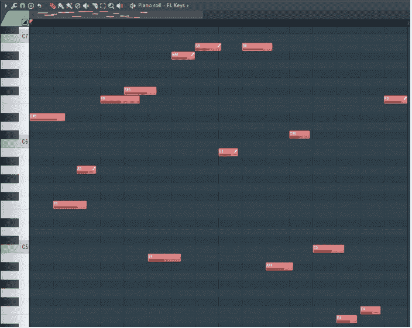

Figure 6.17 – Random notes

如果你不喜欢当前版本的音符，可以一直按随机化器的 **Seed** 按钮来生成新的随机变化。

## 按固定比率递增

如果你喜欢创造听起来混乱的不规则音符组合，有多种方法可以实现。通常，插入随机性会达到你想要的效果。但如果我们不想承受随机弹奏音符带来的完全混乱呢？有没有一种可重复的方法来创建仍然听起来不和谐但更连贯的音符？有的。

大多数音阶都局限于单一八度内的音符。音符的限制为歌曲提供了结构，并使旋律对听众来说可预测。

如果你想要听起来不寻常、与众不同的效果，可以考虑按恒定间隔递增。例如，全音音阶使用按全音递增的音符。以下三个截图显示了按固定间隔比率递增的示例：

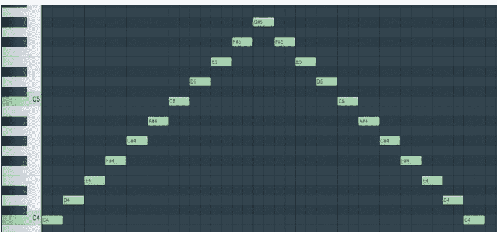

Figure 6.18 – Incrementing by whole tones

前面的截图显示了按两个半音递增，也称为全音。

你可以用很多方式选择不同的固定间隔。以下截图显示了按三个半音递增时会得到什么：

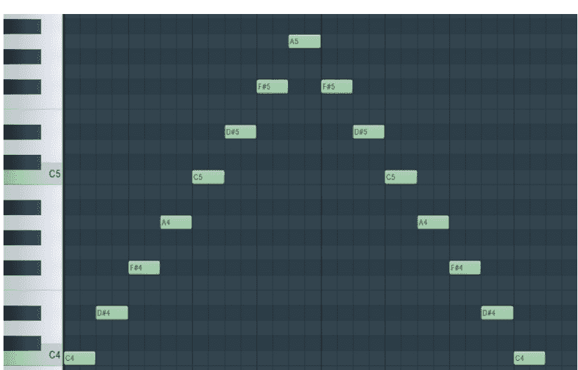

Figure 6.19 – Incrementing by three semitones

在所有这些示例中，我使用 C 作为根音，但你可以使用任何音符作为根音。以下截图显示了按四个半音递增时会发生什么：

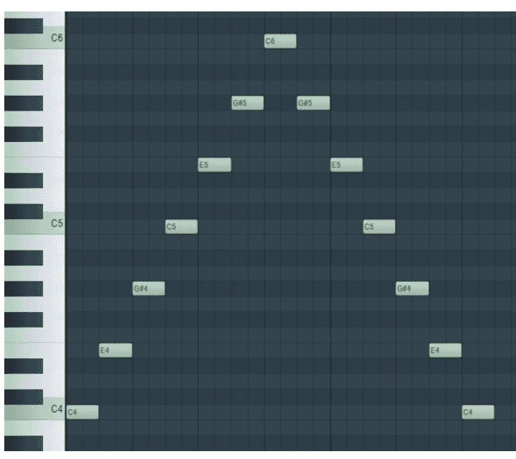

Figure 6.20 – Incrementing by four semitones

使用按固定比率递增的音符组合会产生非常奇怪的声音。如果在合适的乐器上演奏，它会显得相当阴森。

到目前为止，我们已经学习了如何创作吓唬观众的音乐以及如何设计惊吓效果。它由阴森的音乐渐进组成，随后短暂安静下来营造期待感，然后以可怕的声音大揭露来震惊观众。

我们学习了可用于震惊听众的声音、用于创造阴森声音的技术和效果，以及可用于创造可怕或阴森音乐的音符组合。在创作可怕音乐时，我们关注的是不和谐的声音——即它们相互冲突、不协调，并且出乎意料且不熟悉。

现在，让我们进入更熟悉的音乐领域，学习如何为特定情绪创作音乐。

## 为特定情绪创作音乐

电影中的某些场景需要特定的情绪。作为电影作曲家，你很可能会被告知场景所需的情绪类型。然后你的任务就是弄清楚如何为该情绪创作音乐。

本节中的技术旨在作为为特定情绪创作音乐的一般指导方针。它们并不是硬性规则；有很大的实验空间。但如果你需要一个起点，这些指导方针应该能帮你开始。

有许多技术可以为给定情绪创作音乐。你可能想先研究其他项目中类似情绪的歌曲是如何制作的，或者你可以查看各种音阶，看看是否有一种能提供接近你目标情绪的声音。

如果你想查看一些音阶，可以查看网站 `https://femurdesign.com/omni/`，它允许你快速探索各种音阶的声音。以下截图显示了该网站上的 OMNI 工具：

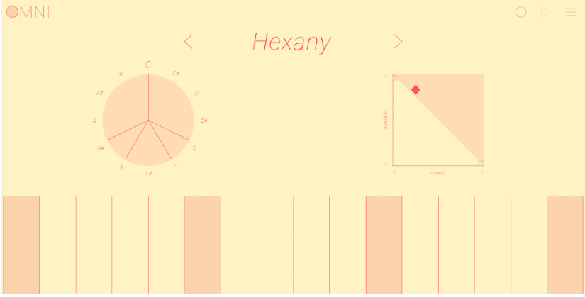

Figure 6.21 – OMNI

OMNI 允许你快速浏览音阶并查看给定调性中的音符听起来如何。顶部是所选音阶，你可以通过它进行导航。左侧有一个和弦轮，允许你为音阶选择根音。右侧是一个控制器，让你控制音效的混响和延音量。底部有一个键盘，允许你在音阶中演奏音符。

如果你想快速浏览一些音阶并听听它们的声音，这个网站非常方便。

## 创作快乐的音乐

快乐的音乐构成了你在广播中听到的音乐的大部分。如果你查看排行榜上的热门歌曲，其中大部分都是大调音阶。为什么？大调音阶被听众认为是快乐的声音。快乐的音乐让人感到快乐，而人们喜欢感到快乐。在本节中，我们将看看创作快乐音乐的技巧。

> **如果你想知道为什么大调音阶听起来快乐，请查看 Adam Neely 的以下视频：**
> 
> `https://www.youtube.com/watch?v=9rEqrPwVITY&ab_channel=AdamNeely`

创作快乐情绪音乐时应考虑以下技巧：

- **大调式 – Ionian、Lydian 和 Mixolydian：** 歌曲是否听起来快乐最重要的因素是音符选择。有三种调式非常适合创作听起来快乐的音乐。它们是 **Ionian、Lydian** 和 **Mixolydian** 调式。如果你想快速创作快乐音乐，请选择适合这些音阶的音符。如果你需要复习，我们在 *Chapter 3, Designing Music with Themes, Leitmotifs, and Scales* 中详细讨论了调式。

- **活泼的节奏 – 不一定快但活泼：** 快乐的音乐通常具有活泼的节奏。如果你边走边听音乐，你可能会注意到你的步伐往往与你听的歌曲节奏一致。这不是巧合。你的身体会本能地对周围环境做出反应。慢音乐让你想放慢速度，快音乐让你想加快速度。

    在快步行走时，人类心脏大约每分钟跳动 110–120 次。如果你希望听众以步行速度移动，请瞄准这个范围。如果你希望听众移动得更快，可以增加节奏。大多数电子舞曲的节奏通常在 124–130 bpm 范围内。这是配合歌曲节拍步行、跳舞或慢跑时不错的速度。

- **偏好硬声而非柔声：** 冲击力强的声音比柔和、起音慢的声音传递更多能量。鼓和打击乐器通常是更硬、更有冲击力的声音。因此，如果你的歌曲缺乏能量，可以考虑加入一些鼓或更多打击乐声音。

## 用音乐影响情绪与设计情感化音乐

> **注意**
>
> 如果你想获取更详细的乐理教程，以便更深入地掌握挂留和弦，可以访问 Michael New 的这个 YouTube 频道：https://www.youtube.com/c/MichaelNew/featured。其中包含大量关于和弦理论以及挂留和弦构成的深入讲解。

- **慢速节奏：** 悲伤的音乐通常伴随着较慢的速度。请记住，一个人快走时的平均心率约为每分钟 110–120 次。如果你想要更悲伤的音乐，那么速度应该设定得比快走时的心率更慢。

  即使一首曲子是小调，速度也会影响其效果。由汉斯·季默创作的《加勒比海盗》系列电影主题曲就是一个例子。季默曾好奇，如果用**小调**谱写这首歌并加快速度，结果会怎样。结果，这首歌听起来更有活力，如今已成为该系列电影的主题曲。《加勒比海盗》的主题曲虽然是小调，但听起来并不悲伤。快速的速度和 6/8 拍号创造了一种全新的感觉。如果你想创造出独特的风格，不妨考虑改变速度或拍号会对音乐的感觉产生怎样的影响。

- **音符之间留出大量空间：** 对于快歌，你可以塞入大量音符，因为它们会被快速演奏。而对于较为悲伤的慢歌，你希望让音符持续更久，把它们拉长。

- **让音符持续延音：** 在缓慢、悲伤的歌曲中，你可以充分利用氛围音效。这是长音持续音、拉长的铺底音色、弦乐以及持续钢琴音符大展身手的好地方。

- **混响：** 如果你希望声音悠长而延绵，首先想到的应该是混响。混响是一种模拟空间内回声效果的效果器，能让你的声音延音更久。

- **给每件乐器留出空间：** 在舞曲中，你会在不同乐器之间快速切换，依靠节奏相互呼应。而在悲伤的歌曲中，你不需要同时塞入大量乐器。你可以在乐器切换时给它们留出空间，也有机会让独奏乐器尽情发挥，绽放光彩。

- **用颤音增添额外情感：** 通过使用颤音，可以使长音更具表现力。如果你使用弦乐器，颤音是一种有用的演奏技法，可以在需要强调情感时使用。

- **连奏技法：** 在快节奏音乐中，你依赖打击乐器带来的干脆音色。而在悲伤音乐中，你希望声音彼此融合。连奏技法可以让你创造出这种效果。

- **柔和的乐器音色：** 如果你希望音符之间相互融合，就需要考虑使用那些天然就能融为一体的乐器。在悲伤音乐中，你希望使用音色柔和的乐器。小提琴、大提琴等弦乐器是绝佳选择。

- **下行走向：** 上行音符进行往往与昂扬、欢快的旋律相关。而下行音符进行（通常是下行的低音线条）则与较为悲伤的旋律相关。

我们已经学习了创作悲伤音乐的技巧。接下来，让我们学习如何创作浪漫音乐。

### 创作浪漫音乐

浪漫音乐是快乐与悲伤音乐的结合。它行走于两者之间的中线，融合两种情绪，既不过于偏向悲伤，也不过于偏向快乐。悲伤的元素让听者感到沉思与沉重，而快乐的元素则让听者感到愉悦与轻盈。

以下技巧可用于创作浪漫音乐。

- **小调调式——伊奥利亚、弗里吉亚、多利亚、洛克里亚：** 小调调式常与悲伤联系在一起，但也可以与美感相关联。大多数浪漫音乐都以小调调式创作。

- **弦乐器和轻柔的打击乐器：** 弦乐器具有极强的表现力，它们允许你在拉长的音符上使用颤音技法。大提琴和小提琴常常与浪漫音乐联系在一起。小提琴可以表现出翱翔于管弦乐队之上的旋律，这在许多浪漫作品中效果颇佳。竖琴、钢琴等柔和的打击乐器也非常适合浪漫音色。总的来说，你应该避免使用生硬、冲击力强的打击乐音色。

- **连奏与颤音：** 通常，你应当倾向于使用彼此融合、悠长而富有表现力的音符。连奏技法能让你将音符无缝地衔接在一起。你也可以通过颤音让悠长的音符更具表现力。

- **慢速节奏：** 浪漫作品通常采用较慢的速度。

我们已经学习了如何创作浪漫音乐。接下来，让我们学习如何制造张力。

### 制造张力 / 为预告片创作史诗音乐

到目前为止，我们专注于特定的情绪：快乐、悲伤和浪漫。如果你的歌曲需要充满能量和张力，该怎么办？如果你在为电影预告片作曲，有时你需要创作所谓的**史诗音乐**。这种音乐通常是预告片所需要的。史诗音乐是让人感到强大而激烈的音乐。

以下是一些在场景中营造紧张感的技巧：

- **大鼓：** 如果你想让音乐听起来宏大而有力，一个快捷方法就是引入大鼓的音色，例如定音鼓、低音鼓、锣、定音鼓和大镲。创建打击节奏，并将鼓声层层叠加。

  加入压缩和混响效果可以让鼓声听起来更宏大。混响是模拟回声的术语。物体所处的空间越大，可能的声反射就越多；乐器和环境越大，回声的机会也就越多。

- **贝斯与铜管乐器：** 宏大而深沉的声音传达出规模与深度。如果你想让某件事物更具史诗感，你需要有强劲的低音乐器作为配乐的基础。

  管弦乐中的铜管声部能够传达出强有力的声音，因此你可能需要考虑加入这一声部的乐器。圆号往往能穿透混音并脱颖而出。铜管乐器家族包括小号、法国号、长号和低音大号。

- **低沉浑厚的声音：** 如果你想传达宏大场景的规模和尺度，就需要深沉低音。为此，寻找大型乐器或模拟它们的声音。大型乐器会产生更大的混响，因此你需要找到支持该声音的混响效果。

- **谢泼德音调：** 在电影《敦刻尔克》中，作曲家汉斯·季默在其大部分配乐中使用了被称为“谢泼德音调”的技巧，这部电影曾因其音乐获得奥斯卡提名。谢泼德音调用来描述一种似乎永无休止的上升音高，它不断攀升，永不停歇。

以下截图展示了谢泼德音调波形示例：

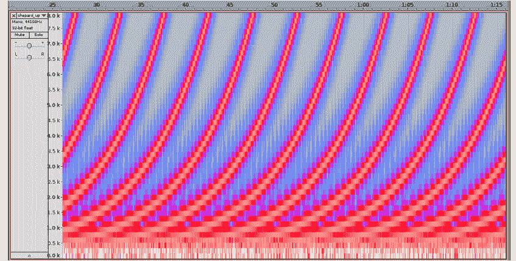

图 6.22 – 谢泼德音调

https://upload.wikimedia.org/wikipedia/commons/4/48/Shepard_Tones_spectrum_linear_scale.png

创建谢泼德音调并不像提高声音频率那么简单。如果你把声音频率提高到足够高，耳朵就无法再听到这个声音了。相反，谢泼德音调的原理是：当声音频率接近高值时，它开始逐渐消失；同时，一个新的低频声音逐渐浮现，取代高频声音。这种方式让人感觉音高在持续攀升。

如果你想更多了解谢泼德音调，可以观看 VOX 关于谢泼德音调的视频《让《敦刻尔克》如此紧张的声音错觉》(https://youtu.be/lvWTQcZbLgY)。

- **丰满的和声：** 将你的声音分层。如果你奏出一个音符，可以加倍演奏，或与多种乐器在不同的八度上演奏同一个音。注意低频端，力量感通常来自那里。通过分层，你可以创造出强大而包罗万象的声音墙。

- **对比：** 在平静与激烈的时刻之间转换。如果之前出现的是平静得多的内容，那么后来的声音会显得更加激烈。更激烈的场景通常有更多的打击乐和扑面而来的贝斯音色。因此，你通常需要在这些激烈时刻到来之前逐步铺垫，而不是一开始就直接进入高潮。

