# 第 7 部分：使用 Wwise 为视频游戏创建交互式音乐

本章将为您介绍如何为视频游戏创建交互式音乐。您将了解什么是交互式音乐以及 **水平重排序** 和 **垂直重混音** 的技术。

我们将通过使用 **Wave Works Interactive Sound Engine (Wwise)** 音频引擎软件来实现这一点，该软件允许您自定义音乐在视频游戏中的集成方式。在 Wwise 中，我们将下载一个预先构建好音效和音乐的演示游戏。使用该演示游戏，我们将了解如何应用交互式音乐技术。最后，我们将学习如何在 FL Studio 中创建用于垂直重混音的音乐。

在本章中，我们将涵盖以下主题：

- 什么是交互式音乐？
- 开始使用 Wwise
- 了解水平重排序
- 在 Wwise 中实现水平重排序
- 了解垂直重混音
- 在 Wwise 中实现垂直重混音
- 在 FL Studio 中创建用于垂直重混音的音乐

### 什么是交互式音乐？

视频游戏需要制作大量的音乐。游戏中发生的任何事情都可能需要音效。其中许多音效会在游戏过程中发生变化。对于每个环境和关卡，您可能希望考虑创建能够适应玩家操作的音乐。

以下是您在为视频游戏作曲时可能需要考虑的游戏音效列表：

- 预告片
- 角色
- 按钮点击
- 菜单
- 加载关卡屏幕
- 进入新关卡
- 完成关卡
- 每个 Boss 的音乐
- 进入新房间
- 获得物品
- 成就
- 环境的环境音
- 战斗音效
- 过场动画
- 游戏内角色正在收听的音乐
- 胜利
- 失败

为了创建交互式音乐，您需要工具来告诉游戏何时更改音乐。一些游戏构建软件内置了创建交互式音乐的工具，而且游戏引擎的工具每年都在改进。目前，如果您想要对一切进行精细控制，您可能需要学习专门用于创建交互式音乐的中间件软件。

市场上有多款用于创建交互式音乐的中间件软件。其中最受欢迎的两款是 Wwise，可在 `https://www.audiokinetic.com/` 获取，以及 FMOD，可在 `https://www.fmod.com/` 获取。这两种软件示例允许您操纵视频游戏的音频，并与 Unity 和 Unreal Engine 等游戏开发软件具有集成支持（目前是两款最大的游戏开发软件）。

这两种音频引擎软件都非常出色，如果您从事视频游戏音效集成工作，很可能会需要使用 Wwise 或 FMOD。

以下屏幕截图显示了 Audiokinetic 网站上的 Wwise：

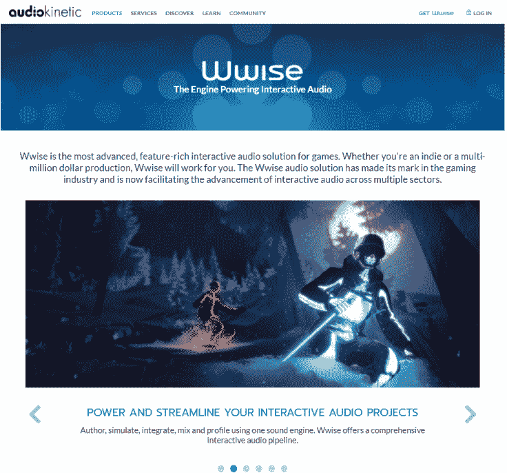

图 7.1 – Audiokinetic 的 Wwise

在本章的示例中，我们将使用 Wwise，因此要跟随示例，您需要下载该软件。您可以在 `https://www.audiokinetic.com/` 下载 Wwise。

### 开始使用 Wwise

让我们安装一个随 Wwise 提供的演示游戏，以便我们可以了解交互式音乐如何被使用。

先说一下，接下来的步骤相当繁琐。刚开始使用 Wwise 时感到有点吃力也不要觉得不好意思。第一次接触时，它是一个相当复杂的软件，需要花时间理解：

1. 下载 Audiokinetic 网站上的安装程序后，您会看到一个提示下载最新版本的窗口。

    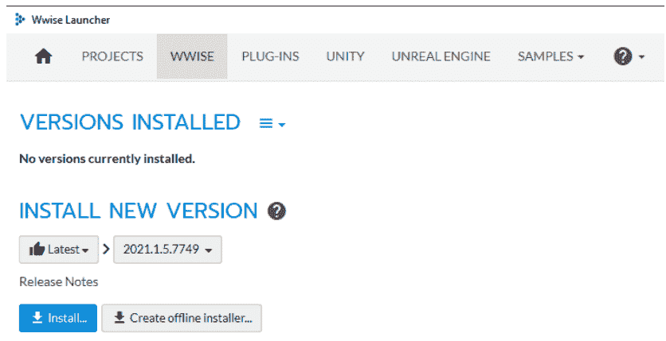

    图 7.2 – Wwise 启动器

2. 选择 Install... 按钮后，您会看到以下窗口：

    图 7.3 – 安装示例

3. 确保勾选 **Samples** 以获取演示文件。然后，选择您想要部署的平台。

    在本例中，我使用的是 Windows 电脑，因此我选择了 **Windows**。然后，选择您希望在电脑上下载软件的位置。

4. 在前面的屏幕截图中，我同时下载了 Cube 游戏以及一些我鼓励您查看的其他演示示例。对于本章的目的，我们将使用 **Cube (Demo)** 游戏，因此请确保勾选此选项。

5. 接下来，它会询问您是否要安装任何附加插件。对于我们的演示目的，我们不会添加任何额外插件。

    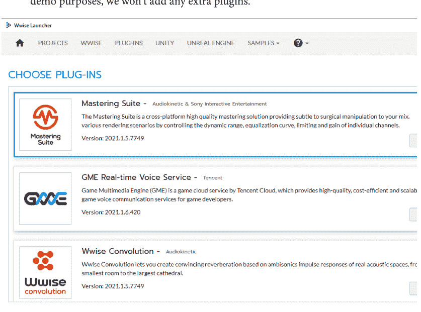

    图 7.4 – 安装 Wwise 软件

6. 点击 Install。Wwise 和示例游戏将开始下载。

7. 安装完成后，在 Wwise 启动器中，进入 **SAMPLES | Wwise** 并找到 Cube 游戏，如以下屏幕截图所示：

    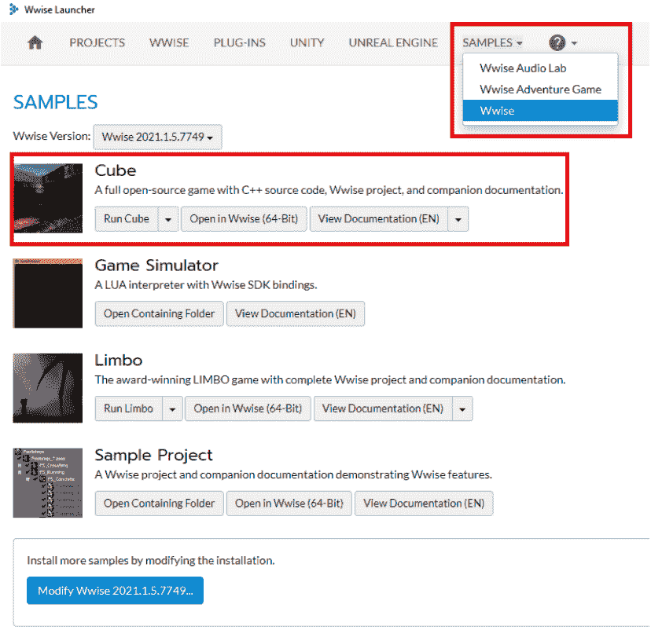

    图 7.5 – 定位 Cube 游戏

    在前面的屏幕截图中，您可以看到有多个 Wwise 示例可用。对我们最重要的就是 Cube 游戏。

8. 我鼓励您通过选择 **Run Cube** 选项来游玩 Cube 游戏。这将加载一个完全可用的游戏。以下屏幕截图显示了游戏的示例画面：

    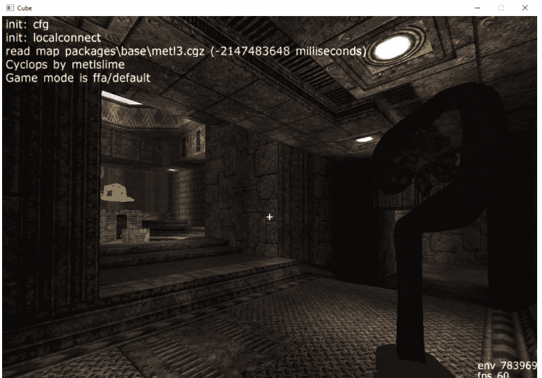

    图 7.6 – Cube 游戏玩法

    花点时间在 Cube 中尝试一下，以了解游戏玩法。它是一款第一人称射击风格的游戏。您使用键盘上的 W、A、S 和 D 键移动，并使用鼠标环顾四周和射击。

9. 如果您按下键盘上的 Esc，您可以跳转到不同的地图或退出游戏，如以下屏幕截图所示：

    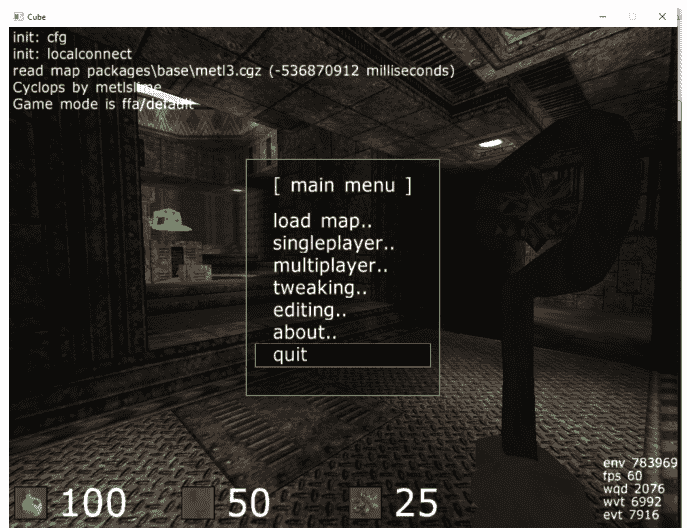

    图 7.7 – 退出 Cube

我们对游戏演示有了大致了解。现在是时候看看 Wwise 如何在游戏中运用音乐了：

1. 返回 Wwise 启动器，进入 SAMPLES 并选择 Open in Wwise (64-Bit) 选项，如以下屏幕截图所示：

    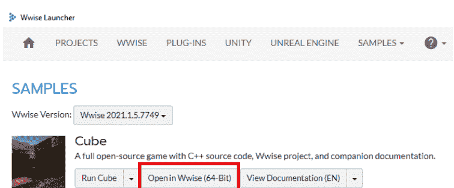

    图 7.8 – 在 Wwise 中打开 Cube

    这将打开 Cube 游戏到 Wwise 中。

我们打开了 Cube 演示游戏到 Wwise 中。您会发现它已填充了演示用的音效，因此已经为我们设置好了大量内容可以查看。

如果您查看 Project Explorer，您会看到 Audio 和 Events 选项卡。Audio 包含游戏中加载的所有音频样本。Events 列出了触发音频样本播放的事件。

在前面的屏幕截图中，我们可以看到 Audio 选项卡当前处于选中状态。音频文件夹中可以加载和播放声音样本。如果您展开文件夹并探索一下，您会发现游戏中当前正在使用的大量音效，如以下屏幕截图所示：

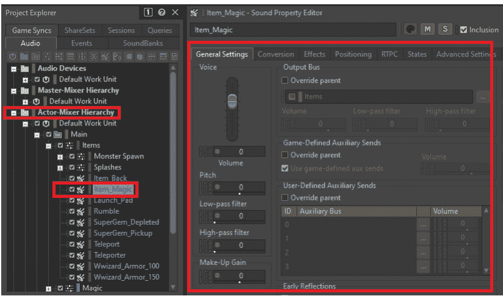

图 7.11 – 播放声音

您可以通过左键单击选择任意声音，然后按空格键来收听。选择音频样本会打开 Sound Property Editor，您可以在其中对声音进行调整，例如更改音高或添加滤波器和效果。

**Events** 选项卡列出了事件触发器，用于发出游戏应执行操作的信号，例如播放特定音频文件。以下屏幕截图显示了 **Events** 选项卡：

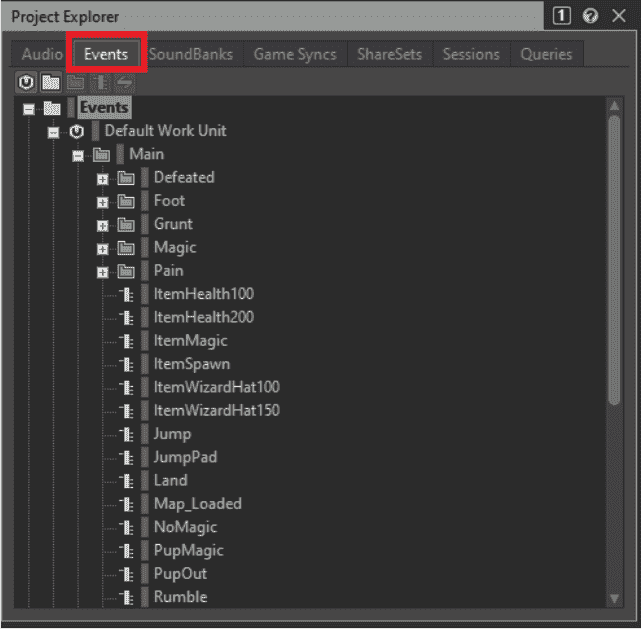

图 7.12 – Events 选项卡

当游戏中触发事件时，您会告诉它播放 **Audio** 选项卡文件夹中加载的声音。事件最初是在游戏设计引擎中创建的。换句话说，事件是在 Unreal Engine、Unity 或您使用的任何游戏引擎中创建的。在游戏引擎中，您会指定事件链接到 Wwise。执行此操作的步骤因游戏引擎而异，因此该主题超出了本章的范围。幸运的是，对于我们的示例，Cube 游戏已经为我们创建了事件。

在以下屏幕截图中，我们可以看到 **ItemHealth100** 事件被告知播放 **Item_Magic** 和 **Health_Cue** 音频，这些文件存在于 **Audio** 选项卡文件夹中：

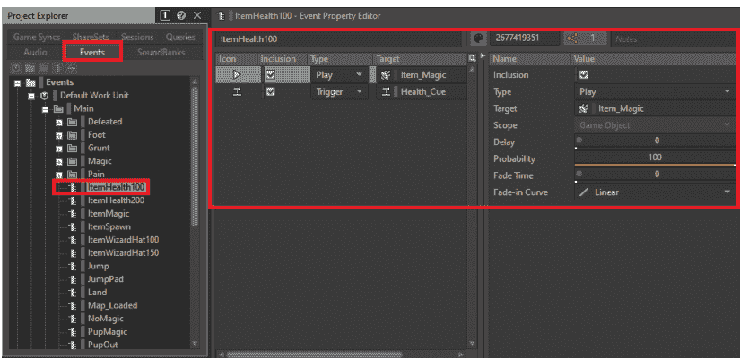

图 7.13 – 触发事件播放音频

对于游戏中的每个事件触发器，你都可以指定一个音频采样让该事件播放。在右侧，你还可以为音频文件分配播放概率，使其有时才播放音频，以免变得过于重复。

为游戏创建新音效需要你知道事件名称。因此，你需要列出你想要触发的事件的确切名称拼写列表。

事件是在游戏本身中创建的，而你在 Wwise 中使用相同的名称，所以如果你正在处理一个实际的游戏，你需要与开发人员协调，以确定应该使用哪些事件名称。

我们已经学习了声音和事件在 Wwise 中工作的基本原理。Wwise 是一个庞大的主题，完全学习它需要一本书。本章的目标是专注于学习交互式音乐，而不是学习 Wwise 的所有内容。所以，让我们深入到第一个交互式音乐主题：水平重排序。

## 理解水平重排序

水平重排序允许你无缝地在音乐曲目之间切换，将多个歌曲音轨组合起来，使其感觉像一首歌曲。

如果没有水平重排序，你会播放一首音乐曲目，然后等到它结束后再播放下一首。这听起来会很突兀，并在玩家玩游戏时将他们从当下抽离。如果你想要自然而沉浸的体验，通常希望音乐感觉是从一首歌流畅地过渡到下一首，而没有突然的间断。

此外，如果你反复播放完全相同的歌曲，它会显得非常重复并让听众感到厌倦。水平重排序允许你在音频采样之间切换，并在选择下一首歌曲音轨时添加随机变化。

水平重排序有助于在歌曲片段之间切换。如果做得正确，听众不会意识到他们听了几个不同的片段。它会感觉像一首连贯的歌曲，具有变化，可以无限循环。

## 在 Wwise 中实现水平重排序

Cube 演示版内置了水平重排序的示例。让我们花点时间看看 Cube 游戏是如何使用水平重排序的：

- 1. 进入交互式音乐布局，如以下屏幕截图所示。你也可以按 F10 来访问此布局：

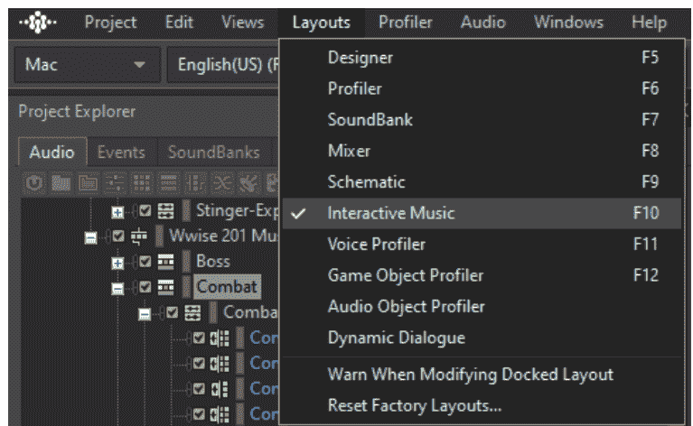

图 7.14 – 交互式音乐

- 2. 在交互式音乐层级下，选择 Combat 文件夹。

- 3. 选择 Combat 文件夹后，按空格键，你会听到音乐开始播放。注意在音乐播放列表编辑器中，当前播放音轨旁边会出现一个小黄箭头。随着音乐播放，它会从一个音轨切换到下一个，如以下屏幕截图所示：

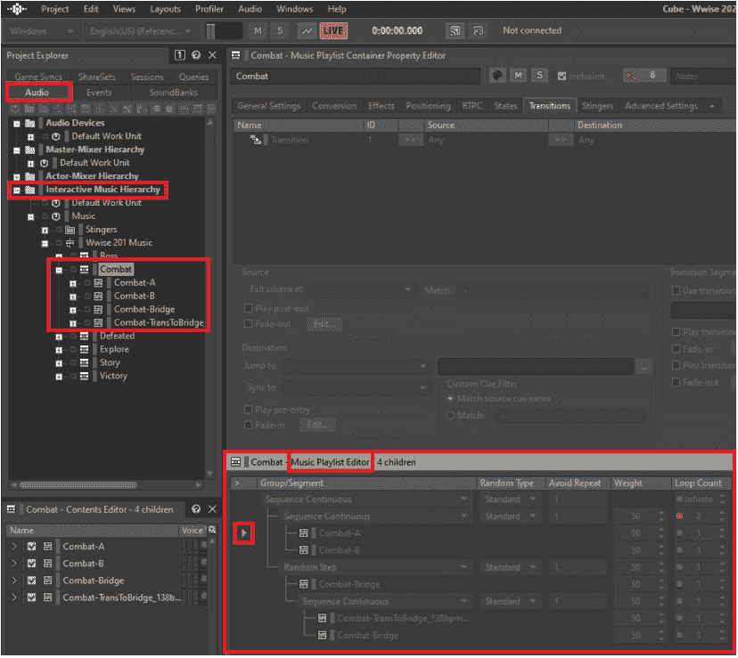

图 7.15 – 水平重排序

音乐依次播放 **Combat-A** 和 **Combat-B**。然后，有 50% 的概率会播放 **Combat-Bridge**，然后有 50% 的概率会播放 **Combat-TransToBridge** 和 **Combat-Bridge** 音轨。

游戏正在播放一个循环，但是一个根据设定概率变化的循环。有时它只播放 **Combat-A** 和 **Combat-B** 音轨。有时它会播放 **Combat-Bridge**，有时会播放 **Combat-TransToBridge** 和 **Combat-Bridge** 音轨。以这种方式播放音乐有助于为听众创造一些音频的随机变化。

音乐片段可以从 **Audio** 选项卡拖放到 **Music Playlist Editor** 中。然后你可以指定歌曲播放的顺序和概率。

你可能会想知道在 **Music Playlist Editor** 中出现的一些术语是什么意思：

- **Weight** 表示播放该音轨的概率。你可以分配概率来随机化音轨是否在序列中接下来播放。
- **Loop Count** 表示序列组在继续之前应重复播放多少次。
- **Sequence Continuous** 表示它会将序列组中的所有音轨一个接一个地播放。
- **New Group** 允许你添加包含音乐片段播放的条件。你可以在顺序播放（按顺序播放）或根据你分配的权重添加一些随机性来决定何时播放音轨之间进行选择。以下屏幕截图显示了一个示例。
- **Random Step** 允许你在选项之间随机选择。在以下屏幕截图中，这意味着它可能会切换到 **Combat-Bridge** 或 **Combat-TransToBridge** 音轨：

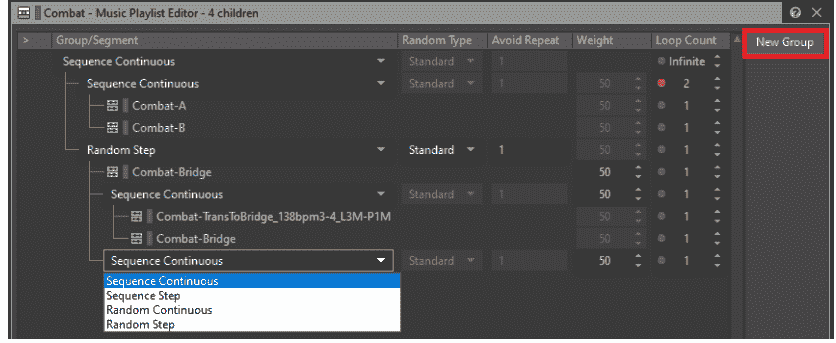

图 7.16 – 音乐播放列表编辑器显示水平重排序

只要视频游戏中存在循环，就有机会使用水平重排序创建随时间变化的音乐，为听众创造一些音乐变化。正确使用时，你的音乐会感觉不那么重复。

我们已经看到了 Wwise 中如何进行水平重排序的示例。接下来，让我们学习关于垂直混音。

## 理解垂直混音

根据任何给定关卡中发生的事件，你可以打开或关闭歌曲的音层。这与你在 FL Studio 中分层乐器并打开/关闭音层的方式非常相似。

**垂直混音** 是描述你在游戏运行时混合不同音频音层的方式的术语。在垂直混音中，你有一系列歌曲中的音频片段，你根据游戏中设定的条件选择播放或不播放。

例如，当你进入一个关卡时，一首歌曲开始播放，带有简单的旋律。当你遇到敌人时，新的旋律和乐器会在原有旋律之上叠加。这是同一首歌，但你只是打开了额外的音乐音层。

## 在 Wwise 中实现垂直混音

你可以通过多种技术进行垂直混音。Wwise 允许你使用状态、开关、实时参数控制和触发器。这些都是你可以在 Wwise 中使用的控制。任何这些方法都可用于打开或关闭音频。

你只需要满足某些条件，以便你可以启用歌曲音层的打开或关闭。你还希望在打开和关闭音频音层之间平滑过渡，以便声音变化是逐渐的，而不是突然的。

在以下示例中，我们将继续使用 Cube 演示项目。我们将创建一个新的开关，然后告诉我们的音乐根据开关的值打开或关闭。最后，我们将学习如何通过淡入淡出音层来平滑地过渡音乐音层的打开和关闭。

让我们学习如何在 Wwise 中实现垂直混音：

- 1. 首先，确保你处于 **Interactive Music** 布局，如以下屏幕截图所示。你也可以按 F10 来访问此布局。如果你在示例过程中发现缺少某些面板，请检查你是否处于 **Interactive Music** 布局，因为离开此布局可能会导致面板无法显示在屏幕上：

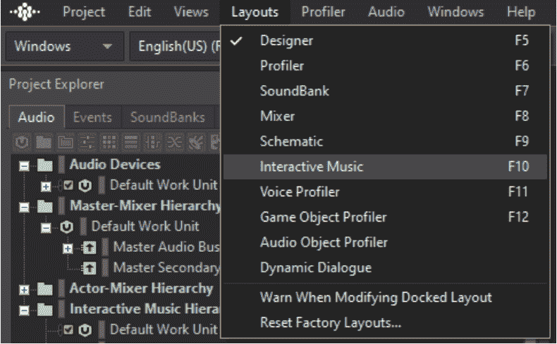

图 7.17 – 交互式音乐布局

- 2. 我们需要创建一个开关。在 Game Syncs 选项卡中，右键单击 Music 并创建一个新的开关组，如以下屏幕截图所示：

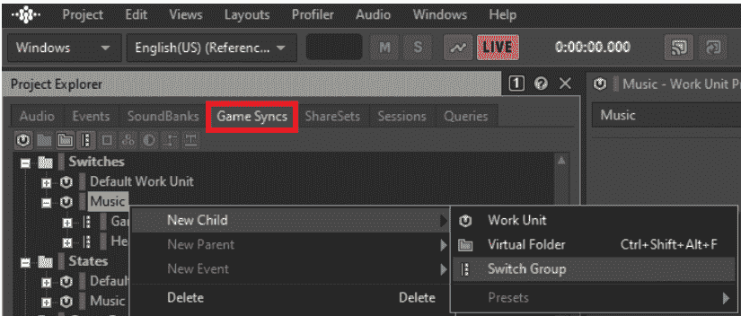

图 7.18 – 创建开关组

- 3. 为其命名；在我的例子中，我将其命名为 Energy_Level。右键单击开关组，然后创建至少两个新开关并为其命名。在我的例子中，我将它们命名为 High_Energy 和 Low_Energy。以下屏幕截图显示了创建开关的示例：

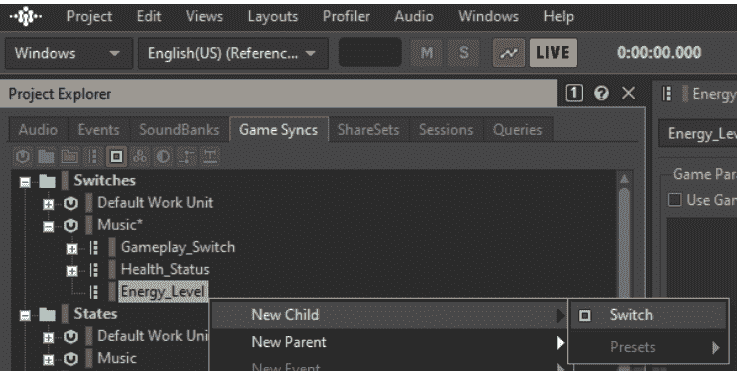

图 7.19 – 创建开关

你已经创建了一个开关组并在其中添加了开关。现在我们需要将我们的音乐片段连接到开关。

- 4. 在 Audio 选项卡中，找到一个音乐片段。在我的例子中使用 Cube 演示游戏，我选择了一个预先存在的吉他乐器片段，如以下屏幕截图所示：

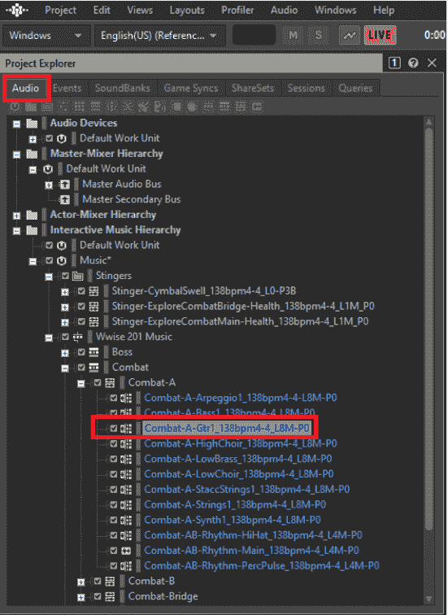

图 7.20 – 选择吉他片段

- 5. 双击音乐片段。在前面的屏幕截图中，我选择了 Combat-A-Gtr1_138bpm4-4_L8M-P0。这将打开音乐音轨属性编辑器。

- 6. 在音乐音轨属性编辑器中，导航到 General Settings 选项卡。将 Track Type 设置为 Switch，Group 设置为开关容器名称，在我的例子中是 Energy_Level，以及默认开关状态，在我的例子中是 Low_Energy。这些是你刚刚创建的开关的名称。以下屏幕截图显示了一个示例：

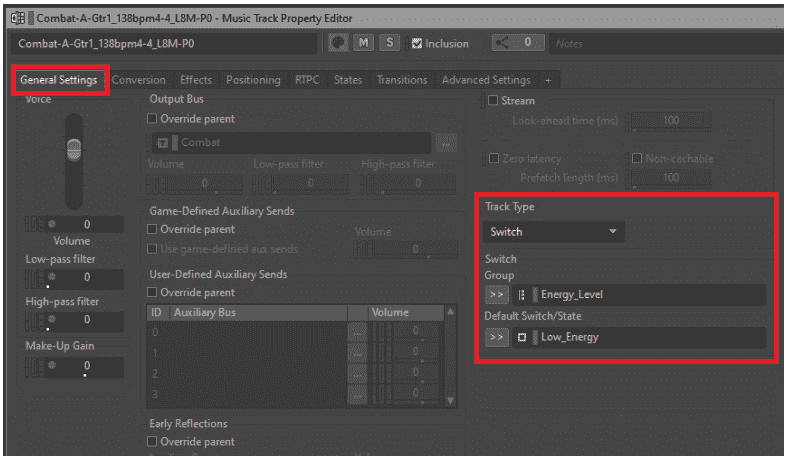

Figure 7.21 – Setting Track Type, Group, and Default Switch/State

我们已启用分段以使用开关。现在需要告诉 Wwise 根据开关值播放什么音频。

7. 在 Music Segment Editor 中，右键单击要连接到开关的音频轨道旁边的按钮，选择 Set Association，并选择要用于播放音频的开关值，如以下屏幕截图所示：

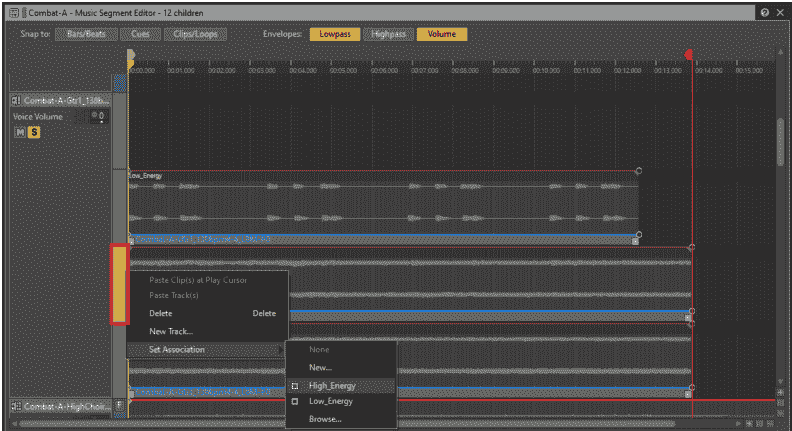

Figure 7.22 – Connecting audio with a switch

8. 对要连接到开关的每个音频剪辑重复步骤 7。

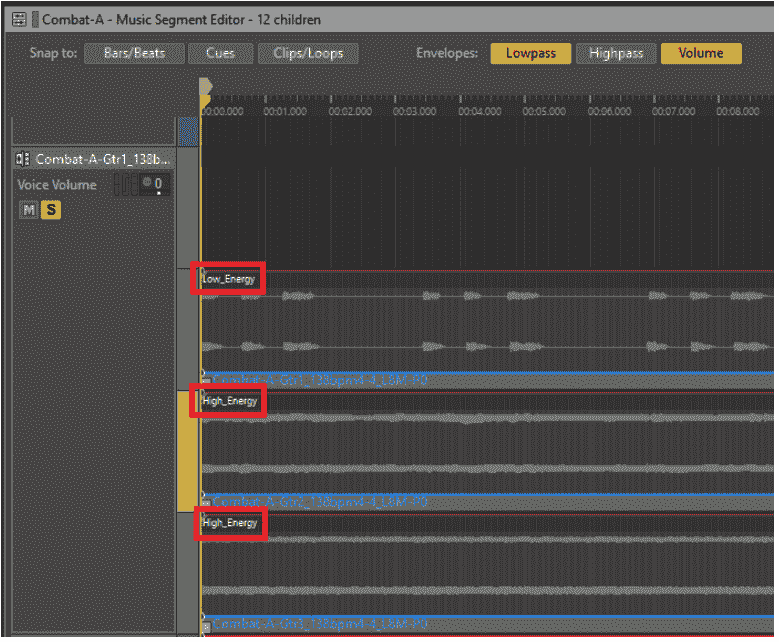

Figure 7.23 – Audio

连接音频剪辑与开关后，您应该会在音频剪辑上看到开关标签的名称，如前一屏幕截图所示。

9. 让我们测试一下我们的开关是否正常工作。通过在 Music Segment Editor 中左键单击要收听的剪辑的 S 按钮来单独播放音频剪辑。按下空格键。您会听到音乐分段播放分配给默认开关值的音频。

10. 让我们使用我们的开关并听听音频如何变化。在 Transport Control 面板中，导航到 Switches 选项卡。您将看到刚刚创建的开关容器和开关。在我的例子中，开关容器名称为 Energy_Level，默认开关状态设置为 Low_Energy。

11. 当您按下空格键收听音乐分段时，左键单击以下屏幕截图所示的下拉框，并在以下屏幕截图所示的开关值之间切换：

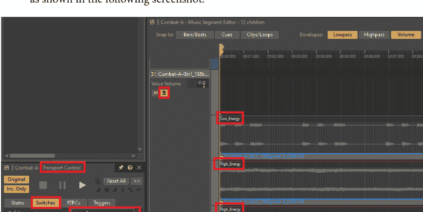

Figure 7.24 – Transport Control

音乐分段会根据开关值播放音频剪辑。如果开关设置为 Low_Energy，则会播放连接到 Low_Energy 的音频剪辑。

恭喜，我们的音乐已实现垂直混音！根据开关状态，不同层的音频现在会打开或关闭。这可以在任何想要音乐根据游戏活动变化时使用。

音乐目前在更改开关值时变化非常突然。如果音乐逐渐淡入淡出会听起来更好。让我们学习如何做到这一点。

- 1. 在 Music Track Property Editor 中，选择 Transitions 选项卡。
- 2. 在列表中选择名为 Transition 的项目。
- 3. 将 Exit source at 设置为 Next Bar 值。
- 4. 确保已勾选 **Fade-out** 和 **Fade-in**。如果您想编辑淡入或淡出所需的时间，可以选择 **Fade-out** 和 **Fade-in** 按钮旁边的 **Edit…** 按钮并调整时间。

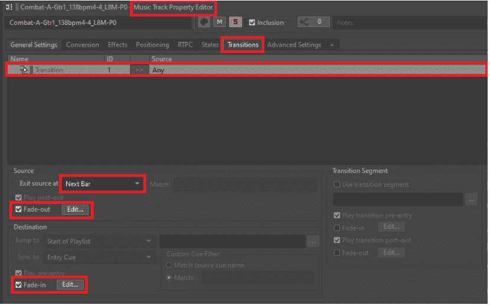

*Figure 7.25 – Music Track Property Editor transitions*

如果您播放音乐分段并在 **Transport Control** 面板中更改开关值，您会听到剪辑逐渐打开和关闭，淡入淡出。

我们的音乐现在在音乐层之间优雅地过渡。您现在知道如何使用 Wwise 创建垂直混音的音乐。

> **Note**
> 
> 如果您想要更多示例，*Unlock Audio* YouTube 频道提供了一些很棒的 Wwise 教程：`https://www.youtube.com/watch?v=mi॓XVv3QBaE&ab_channel=UnlockAudio`。
> 
> 如果您想观看更深入介绍 Wwise 的视频，Audiokinetic 在其 YouTube 频道上提供了其产品的教程：`https://www.youtube.com/channel/UCuv_-Z-CrnYup-N_dVpdCYg`。

我们已经学习了如何在 Wwise 中集成垂直混音的音乐。然而，您可能会想知道我们如何获得彼此完美同步的音乐层。有没有简单的方法可以导出歌曲的层以用于垂直混音？有的。
