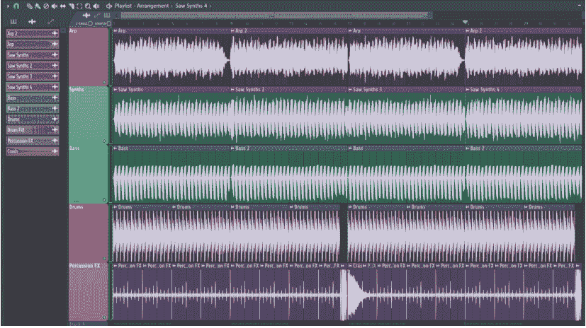
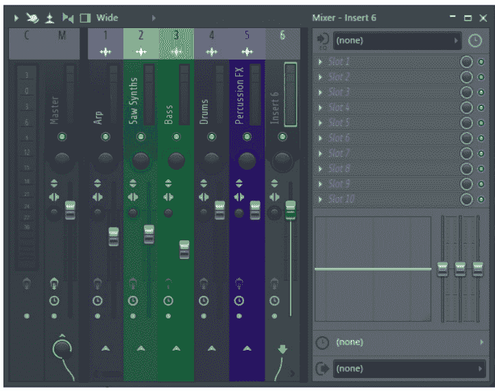
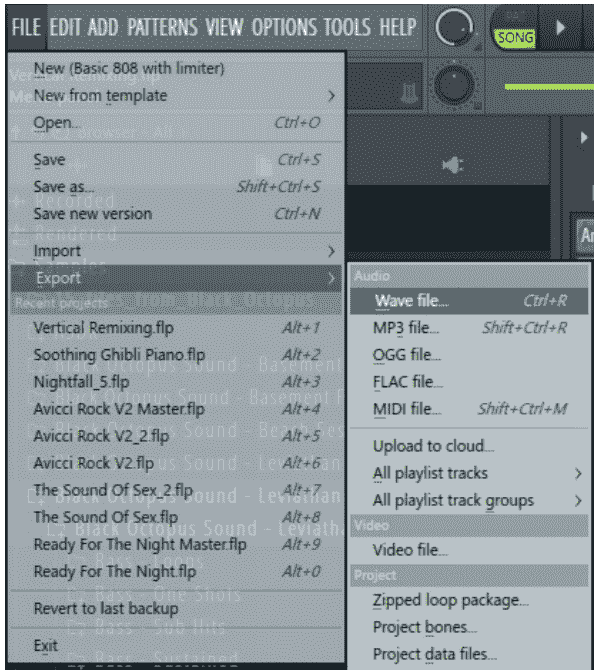
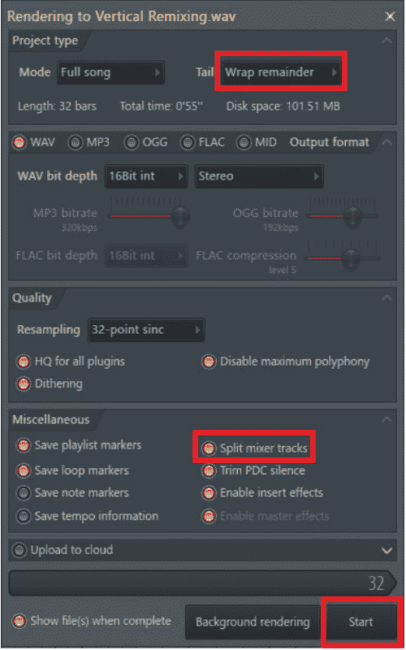
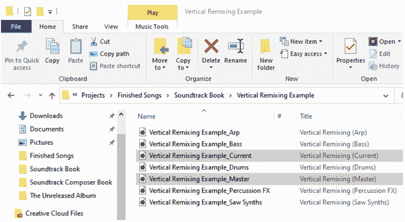
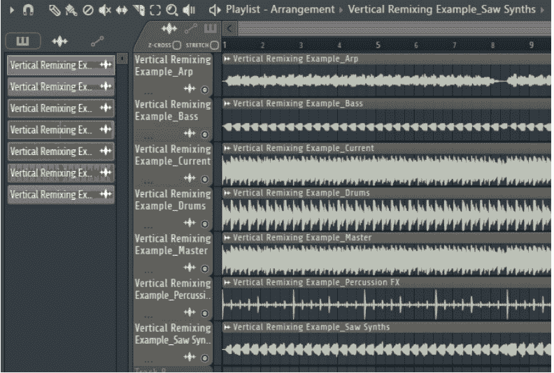

## Creating music for vertical remixing in FL Studio

为垂直混音准备音乐需要几个步骤。垂直混音是指可以打开和关闭的歌曲剪辑层。我们需要几个同步且听起来和谐的器乐层。

我们的做法是取 FL Studio 中现有的歌曲并将歌曲的各个部分组织为层。然后导出这些层。

我们需要创建一系列层组合成一首歌，然后将这些层导出为单独的文件。这些层随后在 Wwise 中重新组合并叠加。

用于垂直混音的每个音乐层都应听起来不错，并且与其他层同步。至少，这意味着层应使用相同的调性和相同的速度。您在任何给定层中包含的内容由您决定，但您需要提前规划。

以下屏幕截图显示了在 FL Studio 中为垂直混音创建的歌曲的简化示例：

Figure 7.26 – Layers in FL Studio

在前面的屏幕截图中，您可以看到我创建了五个层。有琶音乐器层、合成器层、低音层、鼓层和打击乐效果层。我已将这些层中的所有声音路由到各自的混音器通道轨道，如以下屏幕截图所示：

Figure 7.27 – Routing each layer to its own mixer track

在前面的屏幕截图中，我们可以看到五个混音器通道轨道：Arp、Saw Synths、Bass、Drums 和 Percussion FX。它们已被仔细命名。稍后，当我们导出歌曲时，它将使用这些通道轨道的名称，因此能够通过名称识别轨道非常重要。

导出歌曲时，我们可以导出每个混音器通道作为自己的音频剪辑。这将以与所有其他层相同的长度和时间同步导出歌曲层剪辑。这对于我们稍后重新组合它们很重要。

让我们学习如何导出适合垂直混音的歌曲：

- 1. 确保您已正确将轨道路由到混音器通道并为通道命名，以便以后可以识别歌曲层。
- 2. 准备导出歌曲时，转到 FILE | Export | Wave file...，如以下屏幕截图所示：

Figure 7.28 – Exporting audio for vertical remixing

选择保存文件的位置后，您将看到渲染窗口弹出，如以下屏幕截图所示：

Figure 7.29 – Exporting audio for Vertical Remixing

- 3. 如果您希望剪辑可循环，请确保已选择 **Wrap remainder**。通常，当您的歌曲播放时，如果您有任何混响效果，这将在歌曲完成后播放并逐渐淡出。如果您只播放一次歌曲，这通常是您想要的。然而，如果您希望歌曲剪辑循环，那么您希望循环末尾的混响在循环第二次开始时播放。这样，您就不会注意到剪辑之间的突然过渡。选择 **Wrap remainder** 允许这种情况发生。

如果您选择 **Cut Remainder** 选项而不是 **Wrap remainder**，您会听到歌曲逐渐淡出以及任何淡出的混响。如果您不希望歌曲在结束时突然结束，这可能是可取的。这只是取决于您是否希望在循环再次播放时听到混响。

另外，需要注意的是，第一次听到歌曲剪辑播放时，您可能不希望在开始时听到结束混响循环。这是一个具体情况，您需要考虑。您可能希望导出两个版本，一个带有 **Wrap remainder**，一个带有 **Cut Remainder**，以便同时使用这两个版本。

- 4. 确保已打开 **Split mixer tracks**。这将为每个混音器通道轨道制作一个新轨道。此选项仅在导出 WAV 文件时可用。如果您看不到此选项可用，请确保已选择 **WAV**。

- 5. 选择 **Start**，您的歌曲将被导出。导出后，您会看到 FL Studio 生成了文件列表，如以下屏幕截图所示：

Figure 7.30 – Files generated

每个混音器通道轨道都会记录发送到它的音频并创建新的音频轨道。

在前面的屏幕截图中，您会注意到有突出显示的文件名为 **Vertical Remixing Example_Current** 和 **Vertical Remixing Example_Master**。**Vertical Remixing Example_Current** 文件是在主通道上应用任何效果之前的歌曲。**Vertical Remixing Example_Master** 轨道是在主通道上应用任何效果之后的歌曲。

养成在重新组合音轨时为了日后方便而对每个文件重新命名的习惯。你很可能希望在文件名中包含歌曲的节奏和调性。

如果你把所有导出的音频片段拖回 FL Studio，你会看到它们都与彼此同步对齐，如下图所示：

图 7.31 – 重新导入的片段

注意所有音频音轨是如何相互对齐的。它们都同步且长度相同，这正是我们进行垂直混音所需的。

你现在已经学会如何创建分层音乐片段以用于垂直混音。

## 总结

在本章中，我们学习了如何创建交互式音乐。交互式音乐是根据游戏中的事件发生而在电子游戏中发生变化的音乐。这为玩家创造了更沉浸的体验。

我们学习了音频引擎中间件 Wwise，它用于在电子游戏中设置音乐。我们学习了如何使用水平重排序来创建随时间演变的音乐，有助于使音乐不那么重复。我们学习了如何在 Wwise 中实现此功能。

我们学习了垂直混音，以便根据游戏过程中发生的动作改变歌曲的配器。我们看到了如何在 Wwise 中实现它。

最后，我们学习了如何在 FL Studio 中为垂直混音创建音乐。

在下一章中，我们将学习在作曲时如何克服创作障碍。我们将介绍一系列模板，以确保你的音乐达到制作级别的质量。最后，我们将讨论额外的学习资源。
