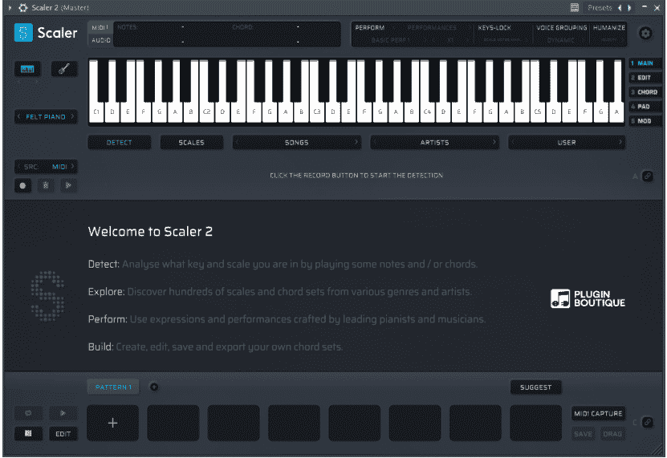
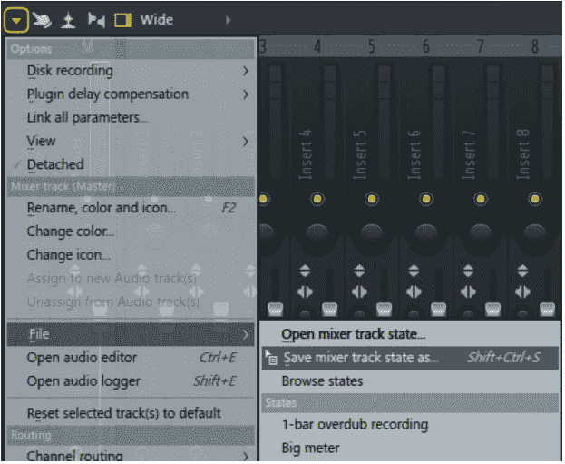
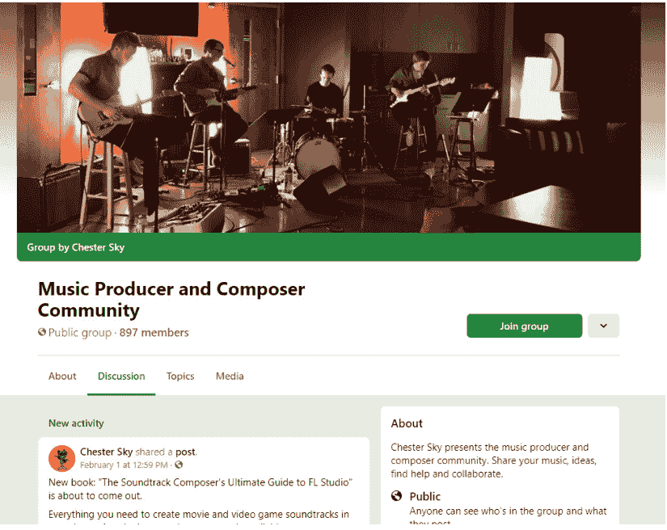
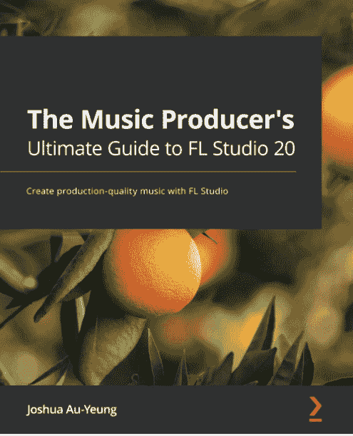

## 克服创作障碍

难以想出歌曲的点子吗？遇到创作障碍？觉得自己已经用尽了所有创造力，再也没有音乐可创作了？别担心；我来帮你。创作障碍是作曲的正常部分。它在你刚开始时就会发生，专业人士也会遇到。但没关系，你可以而且会克服它。你只需要尝试一些创造性策略。

幸运的是，我为你整理了一份策略清单，当你缺乏灵感时可以用它们来开始制作音乐。随时在你卡住时参考：

- 在乐器上即兴演奏音乐，甚至尝试一种新乐器。
- 试着用你的 MIDI 键盘或鼓垫玩玩。
- 尝试 FL Studio 的音阶功能并尝试新的音阶。
- 铺设一段鼓点。
- 按照常规流程进行。打开 **数字音频工作站 (DAW)**，设置项目，并添加你打算编写的关键段落。人们认为成就来自于 *灵感 -> 动力 -> 行动* 的循环，然而实际上循环是 *行动 -> 灵感 -> 动力 -> 行动*。开始行动，事情就会开始运转。
- 使用现有歌曲作为灵感。在 YouTube 上听一首歌并在 DAW 中找出其主和弦。将和弦上移或下移几个调，进行一些和弦反转，并将歌曲的节奏调整为更慢或更快。砰！你就有了已经听起来不错的歌曲的起点。
- 使用之前的歌曲作为灵感。如果你在上一首歌中再加一个副歌会怎样？
- 识别音乐主题。想想电视剧或电影中的一个角色，例如达斯·维达、印第安纳·琼斯或超人。然后想想他们拥有的关键特征。如果为那个角色制作原声带，它会听起来像什么？
- 看一张实物图像，比如一个地方——也许是你度假去过的地方、视频游戏中的一个地点，或杂志或网上的生动图片。然后围绕为该图像制作旋律来创作你的歌曲。
- 预设滚动 – 选择一个合成器并滚动浏览预设。弹奏几个音符，直到找到感觉良好的声音。
- 采样滚动 – 滚动浏览采样，直到找到可以构建的旋律。
- 通过选择合成器并进行实验来设计新声音。即使没有旋律出现，你也会有一个很酷的新乐器可供下次使用。
- 选择你喜欢的曲目并对其进行混音。
- 尝试使用现有的 MIDI 文件。有些人说这是在作弊，但我不同意。你不能单独使用一个 MIDI 文件并期望得到一首完整的歌曲，无论 MIDI 文件有多好。MIDI 文件是激发一些和弦来开始创作的绝佳方式。将和弦上移或下移几个音符，添加一些和弦反转，稍微改变节奏，瞧，你已经有了可以开始工作的东西。
- 合作 – 与朋友交流想法。
- 尝试新的乐器插件。
- 尝试盲目实验。压力下？什么都听起来不好？感到沮丧？大脑在放松和享受乐趣时比在压力下更具创造力。给自己许可去失败。失败是学习的关键步骤。将随机元素组合在一起，看看会得到什么。有时灵感会在最意想不到的时候到来。
- 尝试新技术。查看 YouTube 教程并学习新东西。
- 查看你通常不会尝试的流派，看看你能想出什么。
- 以人声为核心构建。是否通常先作曲然后再添加人声旋律以适应歌曲？试试反过来——先录制人声，然后围绕它制作歌曲。
- 从节奏开始。通常想出一个律动和贝斯线比想出旋律容易得多。而且一旦贝斯线进行起来，旋律往往会神奇地出现。
- 使用动机。什么是动机？它是一段简短的音乐想法或音符片段。写下几个音符。完整的旋律稍后会形成。
- 去一个新地点。新地点可以给你灵感。查看你附近的音乐活动和聚会。
- 听一首你喜欢的歌并思考你如何制作类似的东西。
- 录制声音。选择一个地点或物体并录制其声音；例如，咖啡馆、商店、海滩、公园…
- 设置计时器并强迫自己在计时器结束前工作（30-60 分钟应该有效）。
- 写出来。在纸上或白板上用图表、箭头和颜色勾画出你的音乐想法。
- 想出一个通过你的歌曲讲述的故事。整体信息和你想传达的感觉是什么？
- 听新音乐。考虑来自另一个国家或语言的音乐。
- 考虑使用 Scaler 2 插件来创作旋律：

  Scaler 2 是一个音乐理论插件，可帮助你构建和弦进程。以下截图显示了 Scaler 2：

  

  图 8.1 – Scaler 2

  Scaler 2 提供的功能包括以下内容：

  - 导入现有歌曲：Scaler 2 可以识别歌曲中使用的和弦 MIDI 音符，以便你可以在自己的作品中使用它们。
  - 给定一个和弦，Scaler 2 可以根据调性提出在接下来逻辑上合适的和弦建议。它可以根据流派或艺术家的风格提出这些建议。

要了解更多信息并获取 Scaler 2，请访问 https://www.pluginboutique.com/product/3-Studio-Tools/93-Music-Theory-Tools/6439-Scaler-2。

## 原声带作曲模板

我非常喜欢清单——有序的列表以确保你执行所有先决步骤。清单可以帮助你确保已关注每个步骤，尤其是那些容易被忽视的步骤。有些步骤感觉很小，但如果被遗忘，可能会导致日后出现大问题。Atul Gawande 所著的书籍 *《清单宣言》* 提供了使用清单改善工作流程益处的令人信服的论据。我强烈推荐阅读它。

作曲的步骤是一个重复的过程，你会在每个音乐制作项目中一遍又一遍地经历。音乐制作步骤可以分解为顺序列表。本节将为你提供一系列可供调整和使用的列表，以确保你在作曲时关注所有重要事项。出于组织方便，有三个清单对应音乐制作过程的三个不同阶段。

以下是收集原声带需求、作曲音乐和混音音乐的清单。

### 原声带需求清单

此清单旨在处理原声带作曲的业务方面。使用此清单应有助于你在为客户咨询音乐项目时涵盖许多重要的业务任务：

- 1. 与客户一起浏览项目：
  - a. 如果为电影配乐，请与客户一起观看电影，并在需要音乐的每个场景中记录所需的情感。列出需要音效的项目。
  - b. 如果为视频游戏配乐，请询问每个关卡所需的强度和情绪。列出游戏中需要音效的项目。
    - i. 确定音乐是否需要交互。
- 2. 安排一个系统来跟踪提交给客户的音乐状态。*第 1 章，《为客户作曲的业务》* 提供了使用原声带规划文档的方法。
- 3. 如果客户为项目视觉提供了临时音乐，请浏览每个临时音轨并询问客户为何为场景选择它们。询问每个场景的用户体验目标是什么。这将帮助你避免对任何特定的临时音轨产生过度依赖。

- 4. 将配乐规划表发送给客户审批，以确保你已识别出所有需要音乐和音效的项目。
- 5. 如果为客户提供咨询服务，请起草一份发票，逐项列出你打算提供的服务：
  - a. 确定你预计会产生的一切费用。
  - b. 协商预算。将发票发送给客户并获得他们的批准。
  - c. 获得他们的书面同意。
- 6. 保存你可能产生的任何费用的收据副本，以便你可以获得客户的补偿和/或用于商业税务费用扣除。
- 7. 如果与其他音乐人合作，请事先确定合作时如何共享你的音乐。提前商定如何就项目变更相互通知。第1章“为客户作曲的业务”建议使用 Splice 软件进行版本控制管理。与任何合作者进行一次试运行，以确保你们意见一致，并且能够毫无问题地共享项目。
- 8. 与客户讨论如何交付音乐。应使用什么格式，如何标注，以及如何组织声音以方便双方？
- 9. 如果你能够保留所创作配乐音乐的权利，那么是时候注册你的音乐以收取版税了：
  - a. 找到为你所在地区收取版税的组织。例如，在美国，你可以使用美国作曲家、作家和出版商协会（ASCAP）、广播音乐公司（BMI）或欧洲舞台作者与作曲家协会（SESAC）。
  - b. 使用你所在地区的征收机构（如 SoundExchange）注册你的音乐，以收取公开表演版税。
  - c. 将你的音乐上传到你选择的数字发行服务，让你的音乐进入流媒体平台以收取版税。如果你选择使用 DistroKid 作为你的数字发行服务提供商，以下链接可为你提供第一年的折扣：https://distrokid.com/vip/seven/701180。

## 混音检查清单

此检查清单旨在处理你创作的每首歌曲的混音和母带处理步骤。遵循此检查清单应能帮助你获得精良且可投入生产的音乐：

- 1. 对于每种乐器，考虑应用压缩、饱和/失真或其他效果以达到所需的声音。
- 2. 平衡每种乐器的音量，以突出你的主旋律。
- 3. 判断乐器之间是否相互淹没，并使用均衡器为每种乐器留出空间。检查乐器之间的相位干扰。
- 4. 对于每种乐器，应用减法均衡调整以去除刺耳的共振声音。
- 5. 考虑添加混响效果，使你的乐器听起来像是在同一个房间里演奏，以增加真实感。
- 6. 对你的音乐进行母带处理。如果你还没有母带处理软件，我推荐 Izotope 的 Ozone 插件。在母带处理链中，你可能需要执行以下操作：
  - a. 确定歌曲的频率范围区域：低频、中频和高频。大多数母带处理插件使用三个或四个频率范围。
  - b. 使用立体声成像插件改善立体声宽度。
  - c. 应用均衡器来平衡你的低频和高频。
  - d. 为整体混音添加压缩。
  - e. 使用动态均衡器并对混音应用减法均衡。
  - f. 添加限制器/最大化器以防止削波并将整体音量提高到所需的响度。
- 7. 将任何复杂的混音和/或母带处理链保存为预设，以便日后客户要求调整时可以快速应用。

在 FL Studio 混音器中，将混音器轨道上的所有效果保存或复制到另一条轨道非常容易。你可以通过转到 **混音器选项 | 文件 | 将混音器轨道状态另存为…** 来保存任何选定的混音器轨道。以下截图显示了一个示例：

图 8.2 – 保存混音器轨道

执行上述步骤可以将预设保存到计算机上的文件中，该文件可以在完全不同的项目中打开。或者，你可以单击 **将混音器轨道状态另存为…** 按钮并将其拖到另一个混音器通道上。这会将选定的混音器轨道效果复制到另一条轨道上。

- 8. 经常向客户提交音乐并接收反馈/批准。在提交每首歌曲后提醒客户提供反馈或批准。在最后发送所有歌曲并希望他们会喜欢一切，是*灾难的根源*。

你可能不熟悉音乐混音检查清单中讨论的一些术语。混音和母带处理的主题超出了本书的范围。如果你有兴趣学习混音和母带处理的细节，可以考虑阅读我的书《音乐制作人的 FL Studio 20 终极指南》。我还在 https://www.chesternsky.com/ 提供教授这些主题的课程。

## 总结

在本章中，我们学习了如何克服创作瓶颈。我们还查看了几个模板检查清单，你可以遵循这些清单来确保你已关注音乐创作过程中的重要步骤。

## 分享你的音乐

如果你想与其他读者和学生分享你的音乐，并征求其他音乐家的反馈，欢迎在以下 Facebook 群组中发布你的音乐：https://www.facebook.com/groups/musicproducerandcomposercommunity。

图 8.3 – 音乐制作人与作曲家社区 Facebook 页面

该群组旨在为音乐家分享音乐和资源。

## 后续步骤

如果你喜欢阅读本书，并想知道下一步可以做什么，还有更多资源可供你继续音乐之旅。

## 作者的其他作品

如果你想深入了解 FL Studio，并学习混音、母带处理以及音乐营销/出版，请查看我的书《音乐制作人的 FL Studio 20 终极指南：使用 FL Studio 创作专业品质的音乐》，由 Packt Publishing 出版。

图 8.4 – 音乐制作人的 FL Studio 20 终极指南

在这本书中，你将探索 FL Studio 庞大的工具集，并发现创作音乐的最佳实践、技巧和窍门。你将学习如何设置你的工作室环境、创建节拍、创作旋律和和弦进行、使用效果混合声音以及导出歌曲。随着你的进阶，你将了解如何使用钢琴卷帘、混音器控制台、音频包络、压缩类型、均衡器、声码器、人声切片以及用于增加立体声宽度的工具。

本书向你介绍了混音最佳实践，并向你展示了如何对歌曲进行母带处理。在此过程中，你将探索故障效果并创建自己的乐器和自定义设计的效果链。你还将涵盖 ZGameEditor Visualizer，这是一种用于为你的歌曲创建响应式视觉效果的的工具。最后，你将学习如何注册、销售和推广你的音乐以赚取版税。

## 视频课程

我提供多种畅销课程，涵盖音乐制作、FL Studio 和配乐作曲。如果你有兴趣报名参加我的课程或查看我提供的其他产品，请访问网站 `https://www.chestersky.com/`。

图 8.5 – Chestersky.com

在网站上，你将找到有关音乐制作和配乐作曲的课程。

## 社交媒体账号

如果你喜欢这本书，欢迎与我联系。我还会定期在我的社交媒体账号上发布音乐制作资源：

- **网站：** `https://www.chestersky.com/`
- **Facebook：** `https://www.facebook.com/RealChesterSky/`
- **Twitter：** `https://twitter.com/RealChesterSky`
- **Instagram：** `https://www.instagram.com/iamchestersky/`

## 延伸阅读

如果你想了解音乐职业生涯的商业层面，我强烈推荐阿里·赫斯特兰德（Ari Herstand）所著的《如何在新音乐产业中脱颖而出：建立忠实粉丝群并以音乐人身份谋生的实用技巧》。这本书无疑是我读过的关于音乐产业的最佳著作，我怎么推荐都不为过。

在本书中，我们简要提及了收集版税的服务。你可能会想，版税究竟是如何收取的？你能分到多少版税？表面上看，这似乎是个简单的问题。然而法律细节实际上非常复杂。如果你想了解版税的收取方式，请阅读唐纳德·帕斯曼（Donald Passman）所著的《关于音乐产业你需要知道的一切》。
