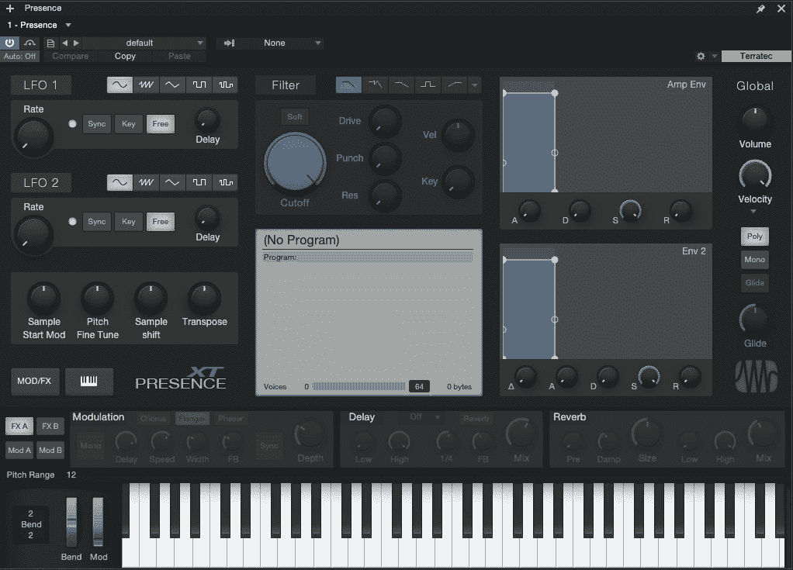
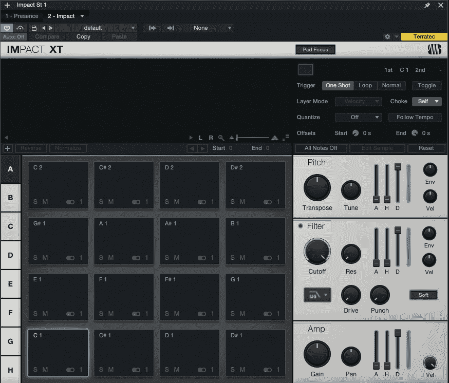
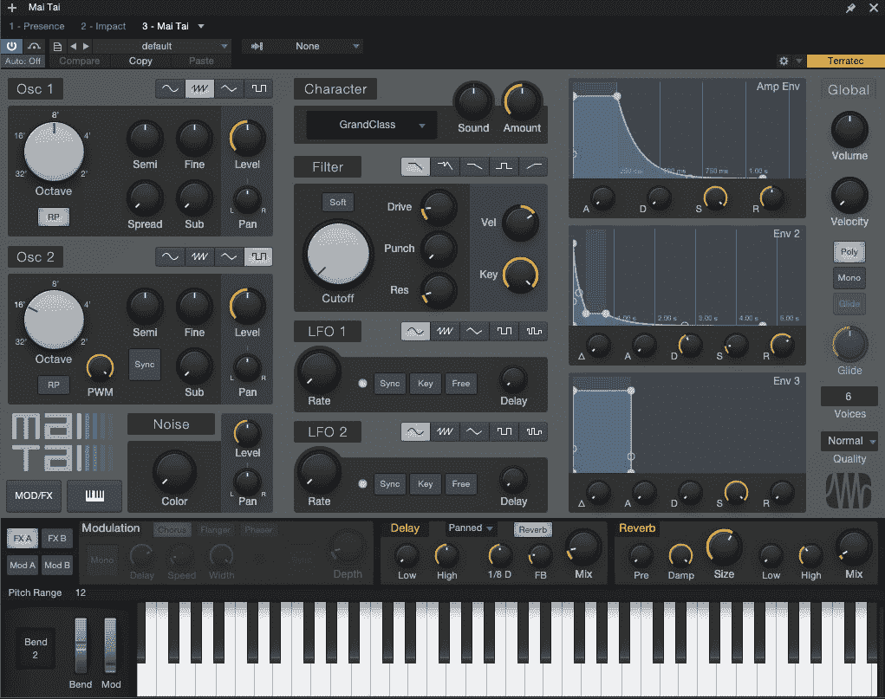
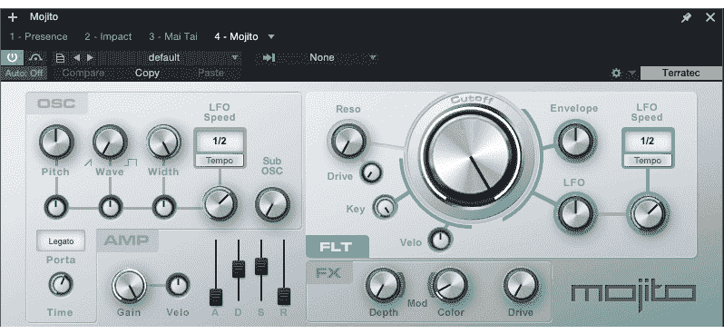
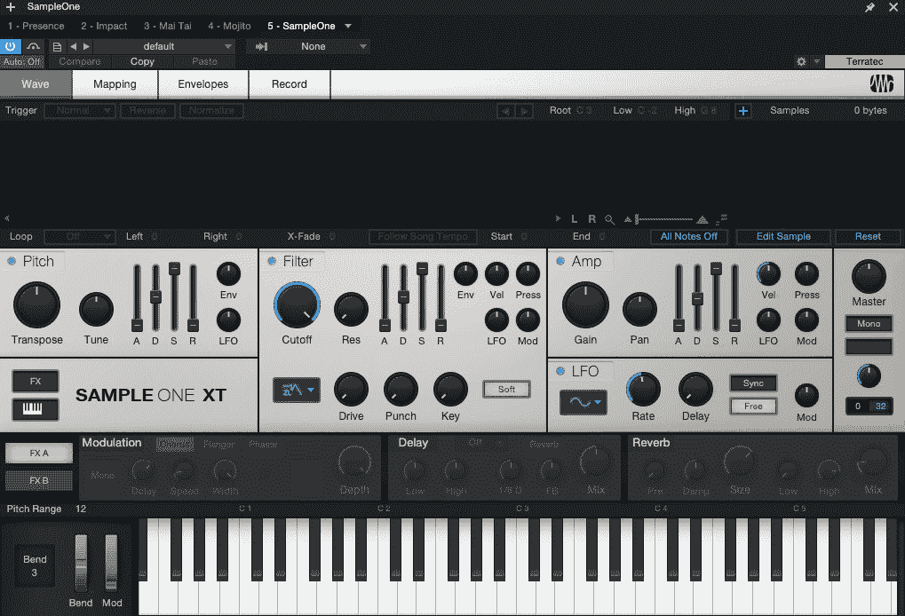
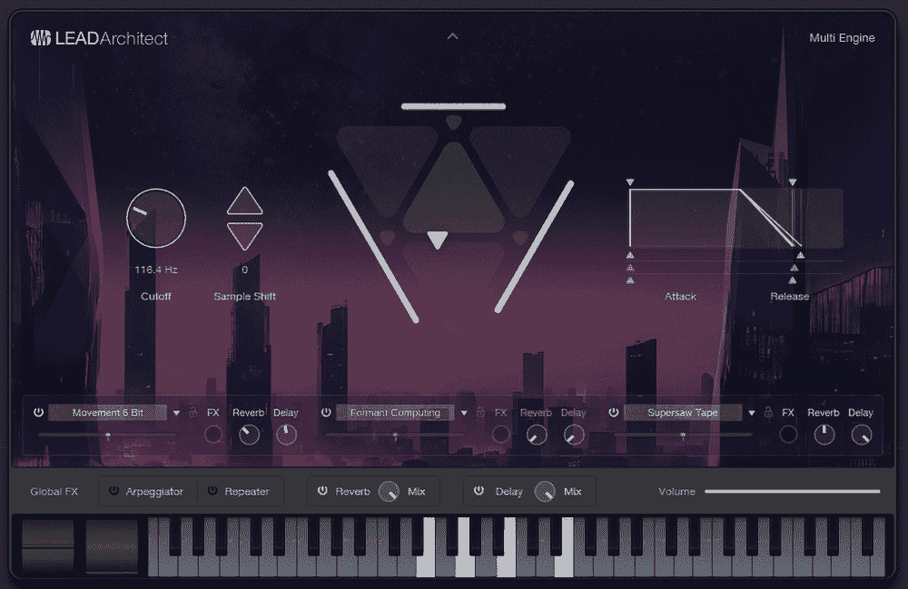
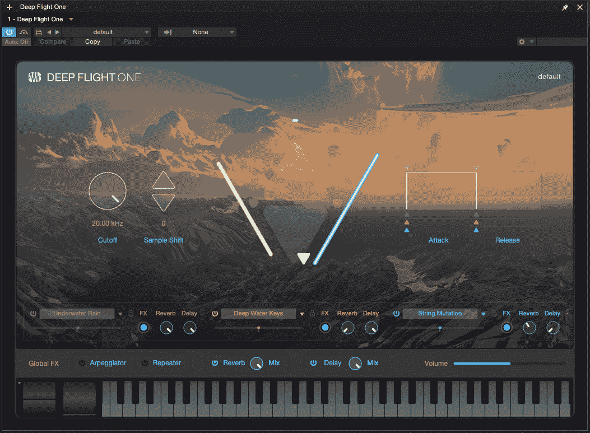

## 第 1 章：选择适合您的 Studio One 版本

在**数字音频工作站 (DAW)** 的世界里，竞争异常激烈，经过长期发展，几大成熟竞争者已在音乐制作的不同领域形成各自的专长。尽管由 **PreSonus** 开发的广受欢迎的 **Studio One** 在撰写本书时已超过十年历史，但它仍被视为后来者。然而，它凭借实力赢得了*功能全面的程序*的美誉。

尽管这令人振奋，但并非所有人都需要功能齐全版本提供的所有功能。因此，PreSonus 过去推出了多个备选套装供选择，提供不同层级的功能、复杂度和定价。

随着时间的推移，选项的丰富反而让事情变得复杂——曾一度多达七种不同版本的 Studio One。因此，为了让大家的生活更轻松，PreSonus 采用了“*One DAW for all*”的标语，并取消了所有 Studio One 的轻量版，只保留功能完整的 Studio One Pro。

话虽如此，截至撰写本文时，仍有三种不同的方式获取 Studio One Pro，这对新手以及寻求从已弃用版本升级的资深用户来说都可能感到困惑。

在本章中，我们将回顾这些选项，分析它们之间的差异，并讨论每种选项最适合哪类用户。读完本章后，你将清楚地了解哪种选项最能满足你的需求，以及原因。

本章将涵盖以下主要主题：

* 认识候选者——永久、年度和月度
* 选择合适的方案
* 筛选额外内容

# 认识候选者——永久、年度和月度

目前，PreSonus 提供两种拥有 Studio One Pro 的替代方式：**永久**许可证，这是一次性购买软件核心版本；或 **Pro+**，一种基于订阅的计划，提供多项额外功能。Pro+ 本身又细分为两种选项：**年度**和**月度**订阅。乍一看这些选项可能令人困惑，但关键在于决定 Pro+ 带来的额外功能是否适合你的工作流、制作风格和预算。

那么，让我们深入了解 Pro+，看看它是否适合你。

Pro+（前身为 **PreSonus Sphere**，短暂时期曾称 **Studio One+**）是一种基于订阅的模式，让你能使用 Studio One Pro 以及 PreSonus 开发的几乎所有其他软件产品。这包括 **Notion**，一款与 Studio One 紧密集成的强大记谱软件，以及大量音效、虚拟乐器、Sound Sets 和循环素材——这些都是你*正常*购买 Studio One Pro（即购买独立的永久许可证）时无法获得的。

自 Pro+ 及其前身 Sphere 推出以来，PreSonus 确实大幅丰富了该套餐以使其更具吸引力。因此，订阅将为你带来额外福利，例如独家在线活动和教育材料、云存储、云交换与协作工具、直播等。

既然我们知道订阅制计划能提供什么，现在我们可以谈谈拥有 Studio One Pro 的替代方式：

* **永久许可证**：这是基本的、传统的一次性购买选项。你支付 Studio One Pro 的全价，它将永久属于你。你将获得 Studio One Pro 的核心插件集和内容库。通过 Pro+ 提供的任何其他附加组件都需要额外付费。你将无法将 Studio One 版本更新到小版本维护更新或错误修复之外。如果你需要核心 Studio One Pro 软件的功能，但不太在意 Pro+ 提供的额外内容，请选择此选项。

* **月度订阅**：此选项让你无需长期承诺即可使用 Pro+ 的所有功能。如果你选择结束月度订阅，那就到此为止。既然你在读这本书，我假设你已经对 Studio One 有长期承诺，或正考虑建立长期承诺，所以我们直接排除此选项以简化决策过程。

* **年度订阅**：这让你能使用 Studio One Pro+ 包含的所有福利。在订阅期结束时，即使你不续订，你也将获得 Studio One Pro 的永久许可证，该版本为订阅结束时可用的版本，将永久属于你。如果你希望拥有大量循环、音色库和插件供随时调用，这是一个绝佳选项。

掌握了上述信息，我们现在可以为你选择最佳选项了。

# 选择合适的方案

在永久许可证和订阅制之间做决定时，我们需要讨论的第一个因素是 Pro+ 订阅带来的额外内容。这些内容是否与你的音乐风格和制作工作流相关且有用？

判断 Pro+ 订阅是否适合你的最佳方法是仔细查看它包含的所有额外内容，看它们对你的制作是否有用。我们将在下一节（见*筛选额外内容*）检查该套餐的主要成分。请务必访问 PreSonus 官网试听演示，亲耳感受其实际效果。

给自己几天时间查看额外内容。如果你认为在制作中会使用至少 30% 的额外内容，就选择 Pro+ 订阅。否则，按需购买。

我们在决定永久许可证和订阅制模式时需要讨论的第二个因素是价格。撰写本文时，Studio One Pro+ 年度订阅费用为 $179.99，首次用户购买永久许可证费用为 $199.99。因此，考虑到年度订阅结束后你将获得永久许可证，撰写本文时选择年度订阅是显而易见的明智之举。不过，这些价格可能会变动，所以在掏出信用卡前最好做些调查。

接下来，我们将深入探讨 Pro+ 包含的额外内容，以帮助你在永久许可证和订阅制模式之间做出选择。

# 筛选额外内容

PreSonus 提供大量可在 Studio One 中作为插件或扩展使用的额外内容。在本节中，我们将浏览主要类别，因为这将帮助你为你的制作风格选择合适的组合。但请记住，项目太多，无法在此逐一介绍。一旦你清楚地了解了内容类别，最好花些时间在 PreSonus 官网浏览 `https://my.presonus.com/products` 的产品目录，看看哪些对你的制作风格有用。

## 虚拟乐器

Studio One Pro 核心版附带多种虚拟乐器，涵盖从采样原声乐器到鼓和合成声音的所有基础需求，足以让你开始编曲。当你觉得这些虚拟乐器不够用时，Pro+ 提供了多种替代方案，将把你的制作推向新高度。在本节中，我们将仔细研究这些乐器，帮助你决定哪种替代方案最适合你。此处列出的所有核心乐器均可在 Studio One Pro 中使用，除了 Lead Architect 和 Deep Flight One，它们仅通过 Pro+ 订阅提供。

### Presence

**Presence** 是随所有版本的 Studio One 附带的标准配置。它是一个采样播放器，用于触发真实乐器的音频采样。因此，你从 Presence 获得的音质直接取决于你加载其中的采样质量。

图 1.1：Presence

## 虚拟乐器（续）

### Presence

Presence 拥有自己的采样文件格式，称为 **Sound Sets**。随 Studio One Pro 永久许可证附带的标准 Sound Set 包含数百种乐器音色，这些音色大多平平无奇，没什么好兴奋的。它们可用于创建演示曲目的轨道，但极不可能进入最终精良的制作中。

Studio One Pro 还附带另一个名为 **Presence XT Core Library** 的 Sound Set，它拥有更高质量的采样。Pro+ 订阅将允许你获取 PreSonus 目录中提供的许多其他 Sound Set，因此有大量内容可供探索。

Presence 还可以加载和播放 EXS、Giga 和 Kontakt 格式的采样，充当 PreSonus 生态系统与 Native Instruments 等其他厂商之间的桥梁。如果你正从另一款 DAW 迁移，且已拥有这些文件格式的采样库，Presence 将为你提供全面支持。

### Impact

**Impact** 是 PreSonus 对广受欢迎的基于垫的鼓采样器的演绎，允许你编排复杂的鼓轨。不同的采样被加载到每个垫中，随后可以单独进一步调整和操控，从而实现对鼓声的精细控制。

Impact 一个被忽视的功能是其作为即时采样播放器的能力。只需将任何音频片段或文件（无论来自 Studio One 本身，还是来自你的桌面、访达、资源管理器等）拖放到其任意垫中即可。你可以使用此方法创建专属的自定义鼓组，并将其保存以供未来项目使用！

Figure 1.2: Impact

Impact 附带多个鼓组，每个鼓组都是为特定流派量身定制的鼓声集合。在标准包中，EDM 和嘻哈风格的鼓组比原声鼓组受到更多青睐。Pro+ 订阅可让你访问约 100 GB 的额外鼓组、循环和音色。

### Mai Tai

作为一款复音、模拟建模合成器，**Mai Tai** 提供了令人惊叹的多种高质量音色和优秀的预设，并拥有简洁的用户界面。

Figure 1.3: Mai Tai

### Mojito

作为一款简单、单音、减法合成器，**Mojito** 非常适合创建和调整贝斯和主奏音色。除非你在进行深度音乐合成，否则 Mojito 和 Mai Tai 足以应对大多数 EDM 和流行音乐风格的需求。

Figure 1.4: Mojito

### Sample One

**Sample One** 是一款功能强大、特性丰富的采样器，允许你通过 MIDI 触发任何音频录音。它附带大量音色塑造工具和板载效果。如果你从事电子音乐或嘻哈制作，这绝对是你武器库中必备的利器。

Figure 1.5: Sample One

### Lead Architect

**Lead Architect** 是 PreSonus 虚拟乐器家族的最新成员，目前仅通过 Pro+ 订阅提供。它是一款基于采样的乐器，具有合成器风格的滤波和调制。其音色偏向前卫和侵略性，这款乐器保证能提供强劲的主奏音色，能在任何稠密的音乐编排中脱颖而出。

Figure 1.6: Lead Architect

### Deep Flight One

**Deep Flight One** 最初作为 Presence XT 的创意音色库诞生，但很快演变为一个独立的虚拟乐器。它允许你组合和操控三层采样音色，以创造超凡脱俗的音景、持续音、垫音和氛围纹理。如果实验性、创意性的声音设计是你的菜，那么这款工具将大有可为。Deep Flight One 目前可通过 Pro+ 订阅获得，也可单独购买，为现有的永久许可证增添一丝超凡脱俗的色彩。

Figure 1.7: Deep Flight One

在本节中，我们回顾了随核心 Studio One 安装附带的虚拟乐器，以及通过 Pro+ 订阅提供的额外乐器和功能。当我们在 *第 6 章* 中使用这些乐器时，将对它们进行更深入的探讨。现在，让我们专注于 Studio One 生态系统中丰富的效果器插件选择。

## 效果器插件

Studio One 用户长期以来对其内置插件感到满意。早期版本唯一缺少的是 **analog flavor**（模拟风味）：旨在赋予那种难以捉摸的模拟特质或温暖感的插件，许多人觉得这在 DAW 中是缺失的。近年来，PreSonus 大胆且成功地进军模拟建模插件市场，并发布了多款成功产品。如今，对第三方插件的需求甚至更少了。

在本节中，我们将查看每个 Studio One 版本附带的插件选择，以便你决定哪个特定版本最适合你的需求。

### 永久许可证

对于大多数用户，Studio One Pro 的内置插件（包含大量均衡器、压缩器、混响和调制效果，撰写时共计 45 个插件）将是他们永远所需的一切。这里有相当丰富的多样性，整体质量足以胜任专业音乐制作。PreSonus 选择将一些新的和/或不寻常的插件排除在永久许可证附带的插件列表之外，显然是为了让 Pro+ 更具吸引力。不过，如果你喜欢其中任何一款，请记住它们也可以单独购买并添加到现有的 Studio One 安装中。

### Pro+

如果你正在寻找终极的多样性和眼花缭乱的选择数量，这就是最佳选择。截至撰写时，Pro+ 将为你提供 15 款不同的压缩器供选择，包括 RC-500、FC-670 和 Everest C100A，均模拟自经典复古模拟硬件。此时，这变成了个人偏好问题，而非音乐风格问题。有些人喜欢拥有许多玩具（我有时也犯这个毛病，但要当心可怕的 **Gear Acquisition Syndrome**（**GAS**，设备收集综合征）），而有些人只挑选几个效果器，坚持使用它们，专注于他们的音乐。如果你属于前者，Pro+ 凭借其丰富的选择，保证能让你满意。

在本节中，我们看到虽然有大量插件选项可供选择，但明确你的制作目标将缩小选择范围，使你轻松挑选出最佳替代方案。接下来，我们将了解被称为 **Additional Content**（额外内容）的庞大集合的最后一个组成部分，并完成我们对 Studio One 生态系统的巡礼。

## 循环与音色

循环与音色是 *production-ready*（可直接用于制作）的元素，可在你创作歌曲时作为起点激发最初的灵感火花，或为日趋成熟的项目增色添彩：

*   循环是预先制作好的音频录音或 MIDI 片段。它们可以包含从鼓点律动到合成器琶音的任何内容。当你将它们拖放到项目中时，它们将自动匹配歌曲的速度，并以允许你在编排中反复重复的方式构建，因此得名。

*   另一方面，音色指的是虚拟乐器用来生成复杂声音纹理的构建模块。例如，当你将 **Prime Selection Sounds** 加载到 Presence 中，Presence 将使用该音色集来生成该集合独有的声音。

# 第 1 章：摘要

总的来说，循环和声音被组织成**制作工具包**，它们是包含整首歌曲编排的若干音乐元素，你可以自由地将它们拖放到你自己的项目中。

然后你可以随心所欲地调整它们，或者因为它们免版税，你可以保持原样（听起来就像 Spotify 上另外一万首歌一样）。

撰写本文时，Studio One Pro 核心版本附带 13 个此类制作工具包（偏向电子音乐流派）。

这对于家庭录音室用途来说是个不错的选择，但如果你的制作工作流严重依赖制作工具包，你很快就会觉得这些不够用，并发现自己在到处寻找更多素材。

真正的惊喜来自 Pro+。你将获得一份看似无穷无尽的制作工具包、鼓组工具包、循环和声音列表。

如果循环是你制作风格的主要成分，那么这是显而易见的选择；Pro+ 订阅的费用远低于单独购买所有（或其中几个）素材的费用。

不过，如果你觉得只是偶尔需要一两个循环或制作工具包，这可能就大材小用了。

建议浏览 PreSonus 网站上的目录，看看这些额外内容最终有多少会用到你的歌曲中。

然后你可以据此做出明智的决定，判断 Pro+ 订阅是否适合你。

下表总结并对比了各版本可用的主要功能集。

请注意，新功能和插件会不断添加，所以在做最终决定前，最好再次查看 PreSonus 网站。

| 功能 | 永久许可证 | Pro+ 年度计划 | Pro+ 月度访问 |
| --- | --- | --- | --- |
| 撰写时价格 | $199.99 | $179.99/年 | $19.99/月 |
| 包含的效果插件 | 45 个原生插件 | 原生插件 + Pro+ 套件中的所有插件 | 原生插件 + Pro+ 套件中的所有插件 |
| 包含的虚拟乐器 | 7 个原生乐器 | 原生乐器 + Deep Flight One、Lead Architect 及第三方供应商乐器 | 原生乐器 + Deep Flight One、Lead Architect 及第三方供应商乐器 |
| 循环和采样 | 20 GB | 20 GB + Pro+ 素材库中的 15,000 个循环和采样 | 20 GB + Pro+ 素材库中的 15,000 个循环和采样 |

表 1.1：各版本可用主要功能集对比

这结束了我们对 Studio One 生态系统中海量可选方案的浏览。

虽然选项数量之多乍看之下可能令人望而生畏，但专注于你的制作目标和音乐风格将缩小选择范围，帮助你决定哪个版本适合你。

## 摘要

在本章中，我们了解了 Studio One 的不同版本，并详细查看了每个版本提供的功能、特性和内容。

然后，我们考察了 PreSonus 提供的额外内容，并讨论了哪种选项适合几种不同的场景。

在下一章中，你将配置 Studio One 使其在你的系统上流畅运行，并了解最佳实践，这将为你日后节省大量时间。
