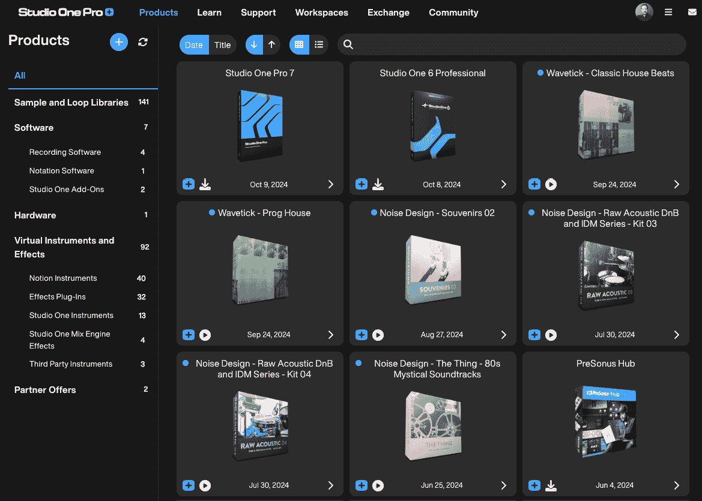
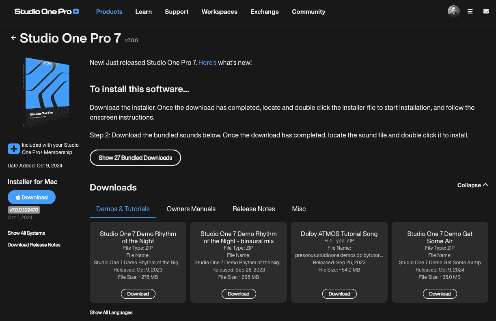
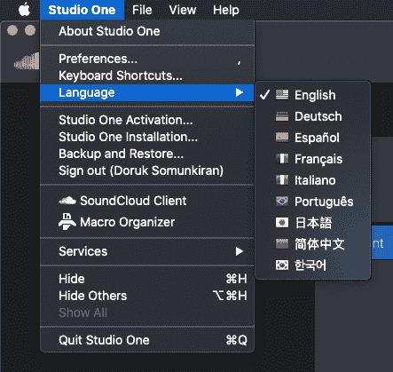
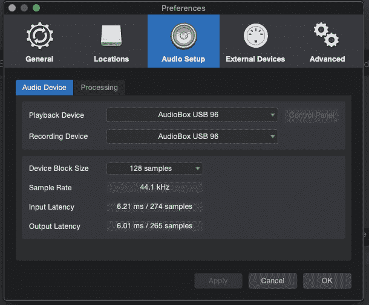
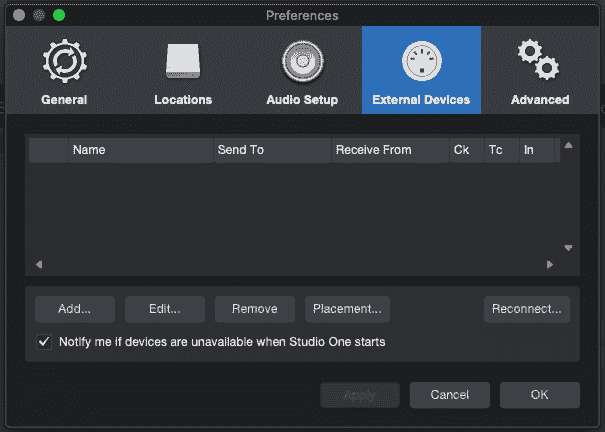
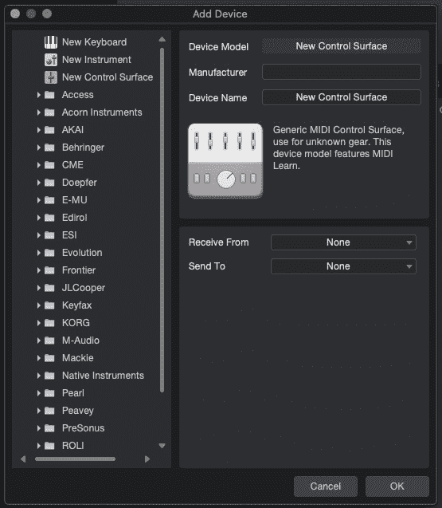
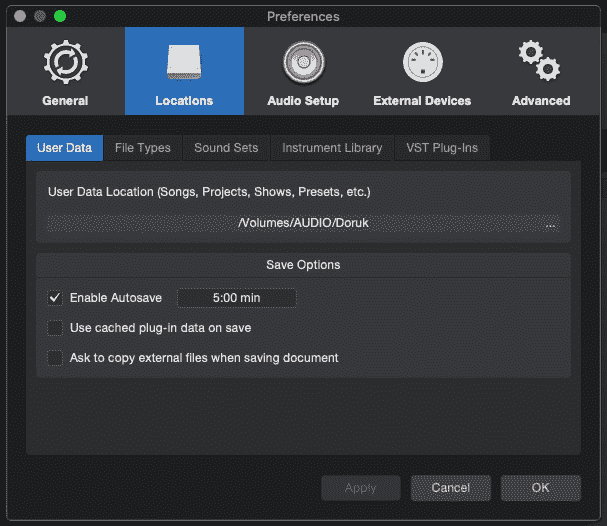
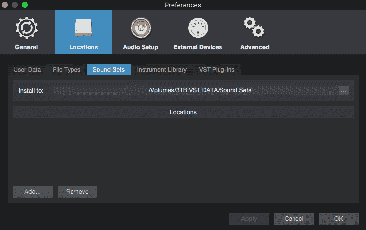

## 第 2 章：安装和配置你的 Studio One 环境

安装和配置软件通常是一项简单的任务，但涉及音频制作软件时，事情可能会变得非常棘手。

计算机的设计初衷是分块处理数据，在这些数据块之间，它们要么处理来自后台任务的数据块，要么耐心等待你的下一个指令。

另一方面，音频制作需要以高吞吐量处理不间断的数据流，这是现成的计算机无法直接应对的。

在本章中，我们将深入探讨可用于针对你的制作环境优化 Studio One 的策略，并确保你从系统中榨取最佳性能。

我们将梳理选择和下载你将使用的软件组件及额外内容的过程。

然后，我们将讨论适用于不同场景的几种方案——从基于笔记本电脑的便携设备到功能齐全的音乐工作室——并了解如何配置 Studio One 以在每个系统上高效运行。

读完本章后，你将准备好开始使用 Studio One 制作音乐，确信它正以最佳效率运行，并将具备解决日后可能出现的任何配置问题的能力。

在本章中，我们将涵盖以下主要主题：

*   安装 Studio One 和额外内容
*   配置 Studio One
*   优化系统以获得最佳性能

## 技术要求

要运行 Studio One，你的计算机必须满足以下最低系统要求：

*   **操作系统**：macOS 12.4 (Monterey) 或更高版本，或 Windows 10 或 11（仅限 64 位）
*   **处理器**：Intel Core i3 / Apple M1 或更高，或 Intel Core i3 / AMD A10 或更高处理器
*   **内存**：8 GB（最低）；16 GB 或更多（推荐）
*   40 GB 可用硬盘空间用于安装、额外内容和项目
*   最低显示器分辨率 1280 x 768 dpi
*   互联网连接（安装、激活和基于云的集成所必需）

## 安装 Studio One 和额外内容

无论你购买 Studio One 永久许可证还是订阅了 Studio One Pro+，你的旅程都将从在 PreSonus 网站上创建账户开始。

这将成为你一切 Studio One 相关事务的中心枢纽。

完成购买后，登录 `my.presonus.com`。

这里有很多内容可供探索，还有许多有价值的内容帮助你充分利用 Studio One 体验。

我们稍后将仔细查看这些资源，但首先，让我们让 Studio One 在你的电脑上跑起来。

### 安装 Studio One

从 `my.presonus.com` 主页前往 **Products（产品）** 页面。

在这里，你将看到随购买包含的所有软件、虚拟乐器、效果器、采样和循环库的列表：

图 2.1：PreSonus 网站上的产品页面

在列表顶部，你将找到最新版本的 Studio One。

点击它，你将进入一个可以找到安装程序的页面：

图 2.2：包含下载链接和额外内容的 Studio One 下载页面

下载安装程序并在电脑上运行它。

安装完成后，你崭新的 Studio One 会要求你登录 MyPreSonus 账户。

完成后，它将自动检索激活码并自行激活。

> **提示**
> 你可以使用同一个激活码在多达五台不同的电脑上安装 Studio One。

与竞争对手相比，这是一个极佳且非常慷慨的选项，适合那些需要在不同平台上工作的人。

因此，例如，你可以在工作室的两台不同电脑、家里的电脑、笔记本电脑或现场演出设备上安装 Studio One，并使用工作区在这些电脑之间共享同一个项目。

重要的是要注意，这些电脑必须属于同一用户；不允许在用户之间共享激活码。

### 安装额外内容

你会注意到 Studio One 的核心安装程序相当轻量。

PreSonus 采用了模块化的“自助餐”式方法，你只需挑选并安装实际会用到的组件，从而节省时间、带宽和磁盘空间。

#### 免费额外内容和插件

# 配置 Studio One

## 安装额外内容

如果您返回 **Products** 页面，您将找到额外的软件、效果插件、音色包和循环素材，这些不属于标准 Studio One 安装的一部分，但作为您购买的一部分可免费获得。请花时间浏览选项，在 PreSonus 网站上查看它们的演示，并挑选您想要使用的内容。

我建议您安装以下内容：

* **Ampire**：一套包含复古吉他放大器、音箱和效果踏板数字模拟的插件套装。虽然主要面向电吉他，但您可以用它为几乎任何声音增添复古色彩。

* **Fat Channel XT**：一套全球顶级录音室中备受推崇的复古模拟效果处理器的数字模型集合。当我们讨论混音您的项目时，这些处理器将非常有用。

选好您想要使用的素材后，下载它们。请运行效果插件的安装程序，但将音色包和循环素材留在下载文件夹中。

### 内含音色包

回到您下载 Studio One 安装程序的页面（*图 2.2*），点击显示 **Show n Bundled Downloads**（显示 n 个捆绑下载）的按钮（其中 *n* 代表根据您的 Studio One 版本可免费获得的额外内容数量）。点击后，您将看到一个音色包列表，其中包含大量乐器选择，范围从交响弦乐到合成纹理，以及可用于启动或丰富您制作的成品循环素材。请花时间逐一查看。在 PreSonus 网站上试听它们的演示，看看是否符合您的制作风格。

无论您的制作风格如何，我建议您下载以下内容：

* Studio One Instruments Volume 1 & 2
* Impact XT Kits and Sounds
* Studio One Musicloops

这些提供了丰富的声音调色板，可涵盖多种流派的基础需求（不过，可用性取决于您的 Studio One 版本）。

虽然这些是我推荐的，但您也可以下载其他喜欢的内容，暂时留在下载文件夹中。我们将在本章后面的 *Configuring file locations* 部分再次讨论它们。

### Melodyne Essential

在同一页面的更下方，您将看到一个标题为 **Downloads** 的部分。在这里您可以下载 **Melodyne Essential**，这是一个捆绑的第三方程序，可让您对人声录音进行音高校正，并将音频录音转换为 MIDI。下载并运行安装程序；它会将 Melodyne 集成到 Studio One 中，并处理所有必要的配置。我们将在 *Chapter 8* 中详细讨论 Melodyne。

## 探索在线资源

现在我们已经安装了 Studio One 和一些额外资源，让我们快速浏览一下 `http://my.presonus.com` 上提供的优秀资源，以免您错过任何功能：

* 我们已经讨论过 **Products** 页面。不妨时不时回来看看——可能会有新惊喜！

* 在 **Learn** 页面上，您将找到一系列视频，展示如何在 Studio One 中执行特定任务或使用特定功能。**Exclusives** 部分为 Studio One Pro+ 会员提供了更多内容。（既然您在读这本书，极不可能需要它们，但拥有它们也不错！）

* **Support** 页面是您在需要 PreSonus 支持团队协助时提交和跟踪工单的地方。

* **Workspaces** 是仅面向 Studio One Pro+ 会员的创新功能的入口。它允许您与合作者分享混音和分轨，并使用标记和表演备注进行实时沟通。这是一个与同行音乐人协作或远程接收客户反馈的绝佳工具。

* **Exchange** 页面是一个优秀的平台，用户在此分享他们为 Studio One 创建的资源：从音色包到鼓型，从效果链到配色方案，应有尽有。如果您需要 Studio One 没有的功能，这里是首选之地；很可能其他人已经需要过该功能，编写了宏并分享出来供其他用户使用。此页面上的所有内容均免费！

* 最后，**Community** 页面拥有一个非常活跃的讨论板，涵盖广泛的话题。讨论主题不限于 Studio One；您会找到从木管乐器到视频后期制作等各种讨论。MyPreSonus 账户可让您阅读帖子；但是，要参与对话，您需要 Studio One Pro+ 订阅。

太棒了！您刚刚完成了 Studio One 之旅的第一步。您已选择并下载了基于 Studio One 的制作环境所需的一切。现在您可以自定义 Studio One 并对其进行优化，使其在您的系统上流畅运行。

## 填写艺术家档案并选择语言

**Start** 页面正中间是 **Artist Profile** 窗口。在上一节安装 Studio One 时，您登录了 PreSonus 账户，因此 Studio One 已经知道您是谁，它会从您的账户信息中提取照片、名、姓和网站链接来填充此部分。如果由于某些原因（例如防火墙）此部分仍为空，请手动填写信息。

Studio One 将使用此信息在每次启动时热情欢迎您，但这不仅仅是为了友好的问候；此信息还将被 Studio One 用于填充您即将导出的精彩音频文件中的 **meta tags**（元标签）。您是否好奇播放 MP3 文件时专辑名称和发行年份等附加信息是如何显示的？这些信息存储在 MP3 文件包含的元标签中。因此，下次您导出 MP3 与朋友或客户分享粗略混音时，您的姓名和其他信息将自动添加。

这也是确保 Studio One 使用您最舒适语言的好时机。截至撰写本文时，Studio One 用户界面支持九种语言。如果您想使用英语以外的语言，请转到顶部菜单的 **Studio One**，在 **Language** 下进行选择：

Figure 2.4: Selecting your language

现在 Studio One 知道您是谁了，是时候把它介绍给团队的其他成员：您工作室里的硬件设备。

## 配置音频设备

启动 Studio One 时，它会询问操作系统计算机上可用的音频设备，并根据判断选择您可能想要使用的设备。现在让我们确保选择了正确的设备，并对其进行优化以获得最佳性能。

回到 **Start** 页面，在您的照片和姓名正下方，您将看到一个名为 **Setup** 的部分。在这里，点击 **Configure Audio Device**，这将打开 **Preferences** 窗口的 **Audio Setup** 选项卡：

Figure 2.5: Audio Setup window

## 音频设备选择

此选项卡上有两个下拉菜单：

*   **播放设备**：你可以将其视为从 Studio One 输出的音频。你在此选择的设备将是你连接扬声器或耳机的设备。
*   **录音设备**：这是输入到 Studio One 的信号。这是你将连接声源（如麦克风和乐器）的设备。

在大多数家庭录音室环境中，这两个设备是同一个；典型的音频接口将同时充当播放设备和录音设备。因此，对绝大多数用户而言，你只需在这两个菜单中都选择你的音频接口，即可开始工作。

同理，USB 麦克风因其易用性而日益流行。USB 麦克风基本上就是一个内置了微型音频接口的麦克风，通过标准 USB 线缆连接到电脑。如果你有这种设备，从 **录音设备** 下拉菜单中选择它，即可准备就绪。

如果你的录音室需要更复杂的设置，你可以灵活运用 **音频设备** 选项卡上的选项。让我们探讨几种方案：

*   如果你拥有由独立的模数转换器和数模转换器组成的更精细的设备，你可以分别将它们独立设置为录音设备和播放设备。
*   如果你想将 Studio One 的音频输出路由到流媒体或屏幕捕获软件（例如在在线会议中向客户播放项目），你可以将环回软件设置为播放设备。

不过，为了本书的目的，我们将坚持最典型的家庭录音室场景，并假设你已为这两个菜单选择了同一个音频设备。

**重要提示**

如果你的设备已连接到电脑，但在这些列表中看不到它，极有可能是该设备的驱动程序未安装或未被识别。Studio One 使用 ASIO 协议访问音频设备，因此请前往设备制造商的网站，下载与你的操作系统匹配的 ASIO 驱动程序。之后，重启电脑，问题应该就能解决。如果没有合适的驱动程序（这种情况会发生），你可以尝试在 Windows 电脑上安装免费通用的 ASIO4ALL 驱动程序。

## 缓冲区大小与延迟

音频制作需要不间断地流式传输和处理海量数据，而计算机原生并不具备处理这种任务的能力。数字音频工作站和音频设备通过使用 **缓冲区** 来解决这个问题。

你可以把缓冲区想象成一个水箱，它能在停水时保障房屋用水。利用缓冲区能为电脑和音频设备的处理器争取时间，使其能从容地完成任务。更大的缓冲区意味着更好的性能，即使是在配置普通的电脑上。但正如生活中的许多事物一样，这是有代价的：**延迟**。简单来说，延迟是指你对着麦克风唱歌到在耳机中听到自己声音之间的时间延迟。就像水流进流出水箱需要时间一样，音频数据通过缓冲区也需要时间。信号路径上有多个缓冲区，每个缓冲区引入的延迟都会累加。

当你在音频设备上连接麦克风并对着它唱歌时，麦克风捕捉到的声音必须经过多个缓冲区，你才能在耳机中听到回放。这是你整个系统施加的 **往返延迟**，以 **毫秒** (**ms**) 为单位测量。超过 10 ms 的延迟将非常明显且令人分心。你将无法在延迟超过该水平的情况下进行录音。解决办法是减小缓冲区大小。随着缓冲区大小减小，延迟会降低，但这会给系统带来更重的负担。当电脑难以负荷时，你会开始听到咔哒声、爆音和各种伪影。最终，你可能会遇到音频掉样或系统冻结。

自从数字音频工作站诞生以来，这一困境就一直存在。经典的变通方法是在录音时减小缓冲区大小（因为那时延迟会变得明显），而在编辑和混音时将其调大。但 Studio One 引入了一种创新且更有效的方法，让你可以独立调整音频设备和电脑的缓冲区设置。

以下是如何配置系统以实现最低延迟和最高性能。返回 **音频设置** 窗口，但这次请特别注意标记为 **音频设备** 和 **处理** 的两个选项卡。

### “音频设备”选项卡

**音频设备** 选项卡显示并允许你调整由音频设备产生的延迟：

图 2.6：音频设备的延迟测量与设置

当你对着麦克风唱歌时，音频设备中的转换器会将来自麦克风的模拟信号转换为数字数据。此转换需要一些时间，并在 **音频设备** 选项卡上列为 **输入延迟**。

电脑完成处理并将音频数据发回音频设备后，设备中的数模转换器会将该数据转换回模拟信号，以便你在耳机中听到自己的声音。此转换所花费的时间列为 **输出延迟**。

输入和输出延迟共同构成了音频设备在系统总延迟中所占的份额。这可以通过更改 **音频设备** 选项卡上的 **设备块大小** 值来调整，但暂时不要动它；我们将在介绍完 **处理** 选项卡后再回到它。

**音频设备** 选项卡还有一个仅适用于 Windows 用户的特定选项：**后台释放音频设备**。这控制 Studio One 在最小化时是否允许其他程序使用你的音频设备。例如，当你在 Studio One 中处理项目时，决定休息一下，打开浏览器观看视频。浏览器可能会更改音频设备的设置，这可能导致你切回 Studio One 时出现问题。此选项默认禁用，意味着 Studio One 最小化时不会与其他程序共享音频设备，但你可以尝试启用它，如果你发现其他程序能友好共存的话。

### “处理”选项卡

现在，转到 **音频设置** 窗口的 **处理** 选项卡：

图 2.7：“音频设置”窗口的“处理”选项卡

此选项卡让你监控和调整 Studio One 自身增加的延迟。在该选项卡底部，**音频往返** 会给出你对着麦克风唱歌到在耳机中听到自己声音所需的确切时间（以毫秒为单位）。超过 10 ms 的延迟将会被察觉。

以下是如何在保持电脑高效运行的同时，将延迟降至最低：

*   在 **音频设备** 选项卡上，将 **设备块大小** 设得足够低，使 **处理** 选项卡中的 **音频往返** 低于 10 ms，并保持该设置。
*   当你需要最低延迟进行录音时，将 **处理** 选项卡上的 **掉样保护** 设为 **最小**。
*   录音完成后，将 **掉样保护** 设为较高的值。你会有更高的延迟，但这不会成问题（混音时，按下播放键多等 20 ms 无伤大雅）。当你开始添加插件时，你将需要那额外的缓冲保护。

这些设置没有铁律或固定值；一切取决于你电脑的处理能力和音频设备驱动程序的效率。

## 配置外部设备

# 将您的 MIDI 控制器引入 Studio One

现在让我们把您的 MIDI 控制器、键盘、控制面板以及其他外设引入 Studio One。这些设备大多支持即插即用操作，但如果您想超越标准 MIDI 功能来使用它们（这对于大多数用途来说可能过于基础），则需要手动配置它们。

Studio One 将外部设备分为三类。让我们逐一了解，以便您将设备归入正确的类别：

*   **Keyboard（键盘）** 指用于演奏和控制其他 MIDI 设备及软件乐器的硬件 MIDI 设备。

*   **Instrument（乐器）** 是指合成器、采样器或工作站等外部硬件设备。它利用传入的 MIDI 数据来生成或处理声音。

*   **Control Surface（控制面板）** 指带有传输控制、推子和旋钮的硬件设备，可用于操控其他设备或 Studio One 内部的功能和参数。

请注意，一个硬件设备可能包含此处列出的多种设备类型。例如，如果您拥有一台集键盘、内置合成引擎和传输控制于一体的硬件工作站，您将需要在这三个类别下分别添加它。

现在，让我们确保您的设备配置正确，以便从中获得最佳性能。

回到 Studio One 的 **Start（开始）** 页面，点击 **Configure External Devices（配置外部设备）**。这将带您进入 **Preferences（偏好设置）** 窗口的 **External Devices（外部设备）** 选项卡：

图 2.8：外部设备窗口

点击 **Add…（添加…）**。您将进入 **Add Device（添加设备）** 窗口：

图 2.9：添加设备窗口

请参考以下小节和 *图 2.9* 添加您所需的任意数量的设备。

> **Tip（提示）**
>
> 在本节中，我们将仅涵盖初始配置所需的基本步骤。您会注意到我们将跳过菜单中列出的某些选项，因为它们需要更多上下文。别担心，我们将在后续章节中回到它们。

## 添加键盘

要添加键盘设备，请按以下步骤操作：

1.  在 **Add Device（添加设备）** 窗口的左侧，您将看到设备类别列表，随后是设备制造商列表。向下滚动，查看是否能找到您设备的制造商和型号。如果找到了，请选中它。如果没有，请选择列表顶部的 **New Keyboard（新建键盘）**。

2.  在 **Add Device（添加设备）** 窗口的右上角区域，在 **Device Name（设备名称）** 下为您的键盘提供一个名称。这是您在 Studio One 内部工作时用于选择该键盘的名称，因此请使其简短且具有描述性，尤其是当您将使用多个键盘时。

3.  在 **Device Name（设备名称）** 下方，选择该设备将激活的 MIDI 通道。这是一项强大的功能，可让您构建灵活的配置。

    例如，如果您有一个键盘和一个独立的打击垫控制器，请将键盘设置为使用除 `Channel 10（通道 10）` 以外的所有通道，并将打击垫控制器设置为仅使用 `Channel 10（通道 10）`。在您的键盘设备上，将 `Channel 10（通道 10）` 分配给鼓声。现在您可以使用打击垫控制器演奏鼓声，用键盘演奏其他所有声音。

4.  在 **Receive From（接收自）** 下拉菜单中，选择将此设备连接到计算机的物理连接。如果设备通过 USB 直接连接，您将在此看到其名称。否则，它将是一个通用名称，例如 `USB MIDI Cable 1（USB MIDI 线缆 1）`。

5.  在 **Filter（过滤器）** 部分，您可以过滤掉从此键盘发出的不需要的 MIDI 消息。除非您绝对确定不会使用这些 MIDI 消息，否则请勿在此选择任何内容。

6.  **Send To（发送至）** 下拉列表允许您将来自此设备的 MIDI 数据路由到另一个硬件设备。

    例如，如果您想让 `Keyboard X（键盘 X）` 控制 `Hardware Synthesizer Y（硬件合成器 Y）`，请为 **Receive From（接收自）** 选择 `Keyboard X（键盘 X）`，为 **Send To（发送至）** 选择 `Hardware Synthesizer Y（硬件合成器 Y）`。如果您只会使用软件合成器，可以将其保留为默认设置：`None（无）`。

> **Tip（提示）**
>
> **Send To（发送至）** 和 **Receive From（接收自）** 容易混淆。虽然我们正在配置键盘设备，但这些设置的命名是从 Studio One 的角度出发的，而不是键盘设备的角度。因此，请将这些设置理解为“Studio One 将发送至”和“Studio One 将接收自”。您想选择您希望 Studio One 发送数据给并从中接收数据的设备。

这就是确保您的 MIDI 键盘在 Studio One 中正确配置所需的全部操作。

## 添加乐器

现在让我们看看如何配置 Studio One 以使用您的硬件乐器：

1.  在 **Add Device（添加设备）** 窗口中，点击 **New Instrument（新建乐器）**。

2.  在 **Device Name（设备名称）** 部分为您的乐器输入一个简短、描述性的名称。

3.  在 **Send To（发送至）** 下拉菜单中，选择将此设备连接到计算机的物理连接（很可能是 MIDI 接口或 USB 转 MIDI 转换器）。

4.  您可能不需要从此设备接收 MIDI 数据，因此可以将 **Receive From（接收自）** 保留为默认设置：`None（无）`。

5.  您可以选择用于与该乐器通信的 MIDI 通道。如果该乐器是多音色的（能够同时合成多种不同的乐器声音），请将其设置为 `All（全部）`。

这就是配置乐器的方法。请务必记住，如果您有多个乐器，需要为每一个重复这些步骤。

## 添加控制面板

现在让我们添加一个控制面板以供 Studio One 使用：

> **Important Note（重要提示）**
>
> 如果您有一个带有旋钮、推子和传输控制的 MIDI 键盘，并且想将该键盘用作控制面板，即使您已按前面的说明将其添加为键盘，仍然需要按照本节所述将其添加为控制面板。

1.  在 **Add Device（添加设备）** 窗口中，点击 **New Control Surface（新建控制面板）**。

2.  在 **Device Name（设备名称）** 下为您的控制面板输入一个简短、描述性的名称。

3.  设置 **Receive From（接收自）** 和 **Send To（发送至）** 字段（如前几节所述）。

> **Tip（提示）**
>
> 如果您在 Studio One 中发现任何“灵异活动”，例如即使项目未播放，推子或旋钮也自行移动，那么您的控制面板是首要嫌疑对象。某些设备会在后台持续发射 MIDI 数据，Studio One 可能会错误地将其解释为合法命令。请参阅您设备的用户手册，查看是否可以禁用有问题的数据流。

您现在已正确地将所有硬件设备引入 Studio One；它们已优化完毕，准备好在您的第一个项目中大显身手。

在下一节中，我们将讨论磁盘性能，这是一个通常会导致大多数家庭工作室出现瓶颈的严重问题。

# 优化您的系统以获得最佳性能

让我们考虑一个常见场景：假设您有一台配备传统 **hard disk drive (HDD)（硬盘驱动器 (HDD)）** 的笔记本电脑，并且您正在处理一个包含 10 条音频轨道和 10 条虚拟乐器轨道的中型项目。

现在，如果您想在此基础上再录制一条音频轨道，会发生以下情况：只要您点击录制按钮，Studio One 将尝试同时从所有 10 条现有音频轨道读取音频数据、为虚拟乐器轨道检索音色库，并为您正在录制的新轨道写入数据。

跟上如此大量的数据流，即使对于快速 HDD 来说也是很吃力的，而且随着项目变大，情况会变得更糟。再加上操作系统可能需要使用磁盘执行其自身的后台任务，这简直是让磁盘超负荷运转。HDD 配备了缓存内存来避免这种情况，它们可以在有限时间内继续提供不间断的输入输出流，但这对于包含多条高分辨率音频轨道的现代音乐项目来说远远不够。

这是另一种场景：假设你有一台配备 `固态硬盘` (`SSD`) 的笔记本电脑。与 HDD 不同，SSD 凭借其即时随机访问能力，能够应对甚至最苛刻的项目，但这一次你将面临存储空间限制。随着你的音色库、循环素材和音频采样收藏不断增加，你会发现需要数 TB 的空间，将所有这些素材以及项目文件都存储在 SSD 上可能会变得太昂贵。

现在让我们讨论如何配置磁盘使用，以从系统中榨取最佳性能。我们在这里讨论的步骤不仅能优化系统效率，还能让你在未来以最小的麻烦扩展和升级你的设备。

### 使用多块磁盘工作

最佳解决方案是将负载分散到多块磁盘上。我们先谈谈理想场景，然后再讨论如何调整以适应你的特定设置。

理想场景提供卓越的性能、高性价比，并包含以下内容：

*   **磁盘 1**：系统盘，包含操作系统、程序和插件。这可以是 HDD；它不需要读写大量突发数据。
*   **磁盘 2**：活动项目盘。把它想象成你的工作台。这将是一块 SSD，仅包含你当前正在处理的项目。因为在任何给定时间你这里只有几个项目，所以不需要太大的存储空间，容量较小（价格较低）的 SSD 就足够了。
*   **磁盘 3**：音色库、音频采样和循环素材盘。如前所述，你的收藏必然会增长，你很快就会发现需要数 TB 空间来容纳它们。好消息是这也可以是 HDD，就像你的系统盘一样；虽然它会读取音频数据，但对持续输出的需求不会像项目盘那样繁重，因此转速 `7,200 RPM` 或以上的任何 HDD 都能轻松应对。

    如果你选择为此目的购买一块外置磁盘，你将获得额外的好处：可以在所有电脑上使用同一块磁盘。即插即用；无需在每台电脑上安装相同的数 TB 数据。只需确保磁盘（和每台电脑）支持 `USB 3.0`。早期版本的 USB 可能会对传输速度造成瓶颈。
*   **磁盘 4**：用于备份和归档项目的磁盘（可以是两块）。大容量的外置 HDD 非常适合这个用途。

如果你有一台塔式台式机，只需将磁盘 1 和 2 作为内置磁盘安装。如果你不打算与其他电脑共享音频素材，也可以将磁盘 3 作为内置磁盘安装。

如果你使用的是笔记本电脑，最好的选择是将内置 SSD 用作磁盘 1 和 2，将磁盘 3 和 4 作为外置驱动器保留。

这解决了阻碍数字音频工作站最严重的硬件问题。但我们需要让 Studio One 知晓我们的新配置；否则，它将继续将项目保存到默认位置，并在错误的地方查找素材。现在就来处理这个问题。

### 配置文件位置

按照以下步骤告诉 Studio One 去哪里查找现有文件以及在哪里创建新文件：

1.  在顶部菜单中，点击 `Studio One`，然后选择 `Preferences` (Mac) 或 `Options` (Windows)。接着，选择 `Locations`：

2.  此窗口的 `User Data` 选项卡允许你为 Songs、Projects 和 Shows 选择默认保存位置——基本上是你在 Studio One 中创建的所有内容。在这里，选择你的 *磁盘 2*（前一节讨论过）作为默认目标。从现在起，所有工作都将保存在此处，每个项目或 Song 都会自动归类到单独的文件夹下。

3.  仍在 `User Data` 选项卡中，确保 `Enable Autosave` 选项处于激活状态。当你在处理项目时，这会在指定间隔（可在右侧字段设置）自动创建项目文件的备份副本。这些备份副本存储在项目文件夹内名为 `History` 的文件夹中。如果出现问题（断电、系统冻结，或 `Undo` 无法挽回的错误操作），你可以打开最近的备份并从那里继续。Studio One 仅保留最近的 10 个备份，因此这不会用不必要的杂文件填满你的磁盘。

4.  你会记得在本章第一部分，当你下载音色库和循环素材时，你将它们留在了 `Downloads` 文件夹中，我承诺我们会回来处理它们。然后，在前一节中，我们讨论了音色库应该驻留在哪里，我们称之为 *磁盘 3*。现在，你可以将所有音色库和循环素材从 `Downloads` 文件夹移动到 *磁盘 3*。随意在任意文件夹下整理它们以便查找。*磁盘 3* 是外置还是内置无关紧要——步骤是一样的。

5.  现在，转到 `Sound Sets` 选项卡：

6.  在这里，点击 `Add` 并将位置选择器指向 *磁盘 3* 上包含所有音色库和循环素材的顶层文件夹。点击 `Apply`，然后 `OK`。Studio One 每次启动时都会扫描此文件夹，位于此处的素材将可在你的项目中使用。

7.  然后，点击 `Install to` 并再次指向同一个文件夹。点击 `Apply`，然后 `OK`。此后你下载的任何额外内容将自动安装在该文件夹中。

太棒了！你不仅解决了最大的硬件问题之一，还为你的系统未来很长一段时间的使用提供了保障。得益于这些最佳实践，你的项目将保持井井有条，工作流程也将顺畅得多。

## 摘要

在本章中，我们下载并安装了 Studio One 以及开始在工作室制作音乐所需的所有额外内容。我们添加并配置了外部设备，并优化了 Studio One 以尽可能高效地工作。

在下一章中，我们将深入探索 Studio One 环境。你将了解 `Song`、`Project` 和 `Show` 页面，如何在 Studio One 中导航，以及我们在后续章节中将使用的工具。
