## 第 3 章：探索 Studio One 环境

一些 DAW 软件功能丰富但极其复杂。另一些则更易用但功能单薄。而 Studio One 不同。得益于一个杰出的用户界面，它功能极其强大却非常易用，让你只需坐下来就能开始创作。

# 探索 Studio One 制作环境

话虽如此，表面之下还有很多内容待探索，只有当你知道要找什么时，界面才能帮助你。在本章中，我们将深入探索 Studio One 制作环境，了解我们在后续章节中将使用的所有不同页面、窗口和工具。你将清楚理解 Studio One 中每个页面和区域的功能与用途，同时学习如何高效地使用界面，充分利用你的电脑屏幕。

音乐项目很快就会变得拥挤不堪，因此掌握制作软件的一个重要部分是能够自信且高效地导航，而不至于在时间轴的轨道中迷失。

在本章中，我们将涵盖以下主要主题：

*   理解 **Song**、**Project** 和 **Show** 页面
*   浏览用户界面
*   导航 Studio One 环境

## 技术要求

要学习本章内容，你只需在电脑上安装并激活 Studio One。

## 理解 Song、Project 和 Show 页面

Studio One 有三个独立的环境，称为**页面**，专为三项不同但相关的任务设计。它们为创建和展示你的音乐项目提供了专门的工作流程。理解这些页面是什么以及它们的功能很重要，这正是我们在本章将要做的。这三个页面如下：

*   **Song 页面**：这是你进行实际音乐制作的地方，包括录制和编辑音频轨道、编程和调整虚拟乐器、编排歌曲片段以及混音。
*   **Project 页面**：你将使用此页面对在 **Song** 页面创建的歌曲进行母带处理。
*   **Show 页面**：此页面允许你在现场表演中使用 Songs。你可以将 Songs 组合成歌单，用于舞台播放，并添加真实和虚拟乐器。

这些页面完全集成并动态链接，因此你在一个页面上所做的更改会即时反映在其他页面上。

### 重要提示

在 Studio One 术语中，“song”和“project”这两个词的用法容易让人困惑。在几乎所有其他制作软件中，你创建一个 project 来制作一首 song（这完全讲得通）。但在 Studio One 中，你创建一个空的 Song，完成后将其移至 Project。换句话说，在其他制作程序中通常称为 project 的东西，在 Studio One 中被称为 **Song**（这有点遗憾，因为该程序用于创作的远不止歌曲）。一组完成的 Songs 被称为 **Project**。在整个音乐行业中，互换使用 song 和 project 一词是常见做法，因此我们在本书中也将遵循这一惯例。当专门指代 Studio One 的 Song 或 Project 时，我们将首字母大写，如本句所示。

现在我们知道了 Studio One 中每个页面的设计用途，接下来让我们仔细看看它们各自的情况。

## 浏览用户界面

要进入将要讨论的三个页面，请前往 **Start** 页面，点击标有 **New…** 的大加号。这将打开模板浏览器，如图 3.1 所示：

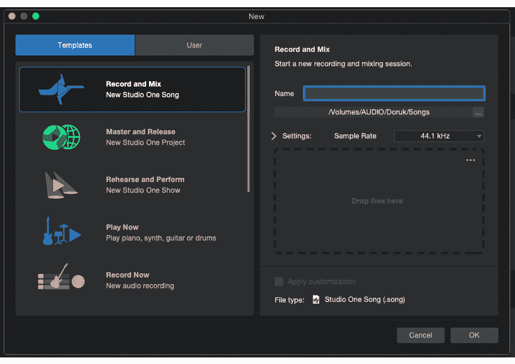

图 3.1：模板浏览器

你可以使用此处的前三个模板按钮分别创建新的 Song、新的 Project 和新的 Show。

请注意，本章的目的是探索 Studio One 环境，熟悉界面中的窗口和工具。随着书籍的深入，你将了解更多关于这些工具和窗口功能的信息。

### Song 页面

**Song** 页面是 Studio One 的核心，你将在此创建和开发项目。这是一个空的 **Song** 页面：

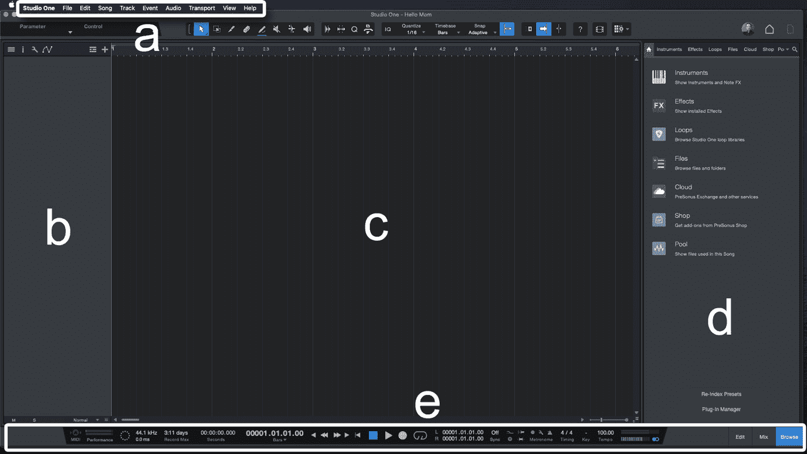

图 3.2：Song 页面的主要组件

让我们分解一下。**顶部菜单**（图 3.2 中的 a）与其他软件一样，提供大量可用的命令和选项，所有内容都整齐地归类在不同的标题下。我们可以在这里仔细看看：

图 3.3：顶部菜单

然而，Studio One 最酷的地方之一是，你不必搜索此菜单即可访问特定功能或设置。相反，Studio One 卓越的智能上下文菜单将所需一切置于你指尖：只需右键点击页面上的任何内容——事件、区域、片段，随你喜欢——与该项目相关的每一个可能命令或设置都会在一个浮动窗口中打开。

如果你使用键盘快捷键进行基本的文件和传输操作，这是另一种加快工作流程的绝佳方式，你将几乎不需要使用顶部菜单（我们也将在全书中介绍所有这些快捷键）。

**Song** 页面的大部分区域由 **track window**、**arrange window**、**browse window** 和 **lower panel** 占据。

#### 轨道窗口

**track window**（图 3.2 中的 b）是我们堆叠音频、乐器和其他轨道的地方。在轨道窗口顶部，有几个按钮我们必须提及：

图 3.4：轨道控制

从左到右，它们分别是：

*   **Track List** 按钮打开一个包含项目中所有轨道列表的窗口。
*   随着你添加越来越多的轨道，项目会开始显得拥挤，你会发现自己迷失和分心。
*   你可以使用 **Track List** 来隐藏和显示轨道；这让你只看到正在处理的轨道，有助于减少杂乱。
*   **Inspector** 按钮打开检查器窗口。
*   当你选择一个轨道时，此窗口将列出与之关联的主要参数。
*   因此，你无需离开编排窗口即可调整这些参数（例如，无需去混音窗口调整轨道推子）。
*   扳手形状的 **Options** 按钮打开一个浮动窗口，你可以在其中设置轨道布局选项，并确定选择轨道时发生的行为。
*   **Show Automation** 按钮告诉 Studio One 在编排窗口的音频波形上叠加自动化曲线。
*   显示自动化数据往往会使屏幕拥挤，且启用时无法编辑音频和 MIDI 片段，因此除非你专门处理自动化，否则请保持禁用。
*   **Global Track Visibility** 按钮控制全局轨道的可见性。
*   这些轨道始终在后台处于激活状态，它们要么让你控制项目相对于时间轴的全局方面（例如，在时间轴的特定点改变调性或速度），要么允许你识别和操作项目的片段（通过添加标记或定义歌曲片段）。
*   虽然它们始终处于激活状态，但你并不总需要它们显示在屏幕上（例如，如果你的歌曲不变速，就不需要看到速度轨道）。
*   如果你需要在项目中使用全局轨道，这就是你找到并显示它们的地方。
*   加号形状的 **Add Tracks** 按钮让你添加实际要录制或处理的轨道。
*   我们将在全书中讨论不同的轨道类型。

#### 编排窗口

**arrange window**（图 3.2 中的 c）是 **Song** 页面的核心。我们将在此创建和修改音频和 MIDI 片段，它们是歌曲的基本构建块。这也是我们将歌曲编排成片段（因此得名）并完成大部分制作工作的地方。

此窗口上方是 **tool selection panel**：

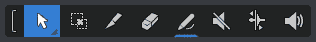

图 3.5：工具选择面板

图 3.5：工具选择面板

这里你将找到（从左到右依次为）**箭头**、**范围**、**分割**、**橡皮擦**、**画笔**、**静音**、**弯曲** 和 **试听** 工具。我们将在后续章节中详细介绍这些工具各自的功能。

### 浏览窗口

**浏览窗口**（*图 3.2* 中的 *d*）可通过**歌曲**页面右下角的**浏览**按钮切换显示，包含多个我们将频繁使用的选项卡。让我们逐一了解它们：

*   **乐器**选项卡汇集了你在*第 2 章*中安装的虚拟乐器，以及你电脑上可能已有的任何其他第三方虚拟乐器。你可以将它们以列表形式查看，或让 Studio One 将它们归类到文件夹下以便分类。你可以为最常用的乐器添加星标，将其放入**收藏**部分。要启动一款虚拟乐器，只需将其从**乐器**选项卡拖拽到编排窗口的任意位置即可。

*   **效果**选项卡托管了你系统上安装的效果插件。就像虚拟乐器一样，你可以按类别或厂商对它们进行分组，并标记收藏。要将一个效果作为插入效果添加到轨道，请将其从**效果**选项卡拖拽到轨道窗口中该轨道的名称上。要在 FX 通道上添加效果（如果这是新概念不用担心；我们将在*第 12 章*中回到这个话题），请将其拖拽到编排窗口的空白处。

*   **循环**选项卡列出了你在*第 2 章*中选择并安装的所有循环素材（来自 PreSonus 生态系统之外的循环素材不会出现在这里；它们将位于**文件**选项卡下）。你可以按乐器和风格列出循环，并使用标签进行搜索。该选项卡底部有一个小型播放器，提供所选循环的基本信息，并允许你以其原始速度或项目速度试听。当你找到喜欢的素材时（你猜对了！），只需将其拖拽到编排窗口的空白处。Studio One 将创建一个空轨道，拉伸循环以匹配项目速度，并将其放置在你拖放的时间线位置。

*   **Splice** 选项卡打开了通往 **Splice** 的大门，后者是一个提供数百万免版税采样和循环的样本库。该选项卡让搜索 Splice 庞大的采样数据库变得超级简单。只需将音频或 MIDI 事件从编排窗口拖拽到此选项卡，你就会收到几个与你歌曲风格匹配的素材建议。你可以直接试听这些素材，因为 Studio One 会将它们匹配到你歌曲的调性和速度。如果你拥有 Splice 会员资格，你可以访问整个样本库。如果没有，你仍然可以通过 Splice 和 PreSonus 的合作免费获得相当不错的循环和采样选择。

*   **文件**选项卡让你访问电脑的文件系统，就像 Mac 上的“访达”或 Windows 上的“文件资源管理器”一样。如果你的电脑上安装了来自非 PreSonus 来源的循环或音效，你可以在这里找到它们，并像使用**循环**选项卡一样将它们拖拽到项目中。该选项卡底部也有一个迷你播放器，以便你试听并以歌曲速度播放它们。

*   **云**选项卡是通往 PreSonus Exchange 和 Studio One Pro+ 的入口，我们在*第 1 章*中讨论过它们。如果你打算将导出的文件直接上传到你的账户，也可以使用此选项卡链接到 **SoundCloud**。

*   **商店**选项卡让你一窥 PreSonus 商店——总是值得逛逛；那里也有免费的福利。

*   最后，**素材池**选项卡显示项目中引用的所有音频文件。如果你在编排窗口中录制了某些内容并将其删除，实际的音频文件仍会保留在硬盘上并列在此选项卡中。在创作灵感迸发时，你可能会为一个稍后决定不采用的想法录制多个版本；这些仍会占用磁盘空间。或者你可能从其他磁盘的其他项目中添加素材而失去对它们的追踪。在这种情况下，此选项卡简直是救星。我们将在*第 17 章*详细讨论文件管理。

### 底部面板

**底部面板**（*图 3.2* 中的 *e*）位于**歌曲**页面的最底部，提供对常用设置、传输控制和全局歌曲参数的快速访问。在该面板的最右侧，你可以找到编辑、混音和浏览窗口的切换按钮。

#### 编辑窗口

你可以通过双击编排窗口中的任意项目，或选择项目后点击底部面板上的**编辑**按钮来打开编辑窗口。如果你希望编辑窗口作为一个独立的悬浮窗口（例如为了在另一块屏幕上最大化它），可以通过点击**分离**按钮来实现：

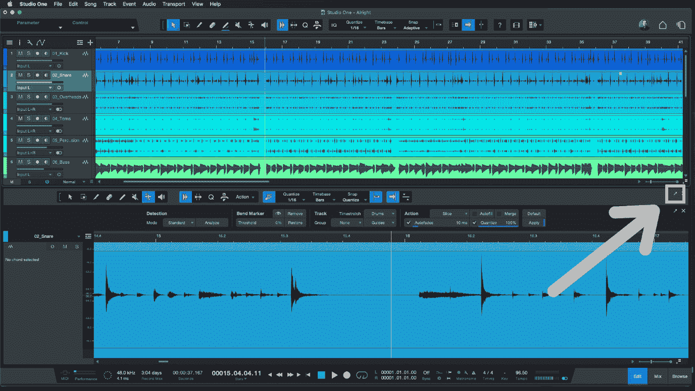

图 3.6：打开编辑窗口并标记分离按钮的歌曲页面下半部分

你会注意到编辑窗口拥有与顶部面板完全相同的工具和选项集。重要的是要记住，该窗口可以独立配置。因此，例如，你可以在编排窗口（屏幕上半部分）中选择**箭头**工具，而在编辑窗口（屏幕下半部分）中选择**弯曲**工具。当你在两个窗口之间切换时，工具会随之相应改变。

#### 混音窗口

最后，你可以通过双击任意轨道，或使用底部面板最右角的**混音**按钮来打开混音窗口。混音窗口也有一个**分离**按钮，就像编辑窗口一样，但出于某种原因，这个按钮位于最左侧：

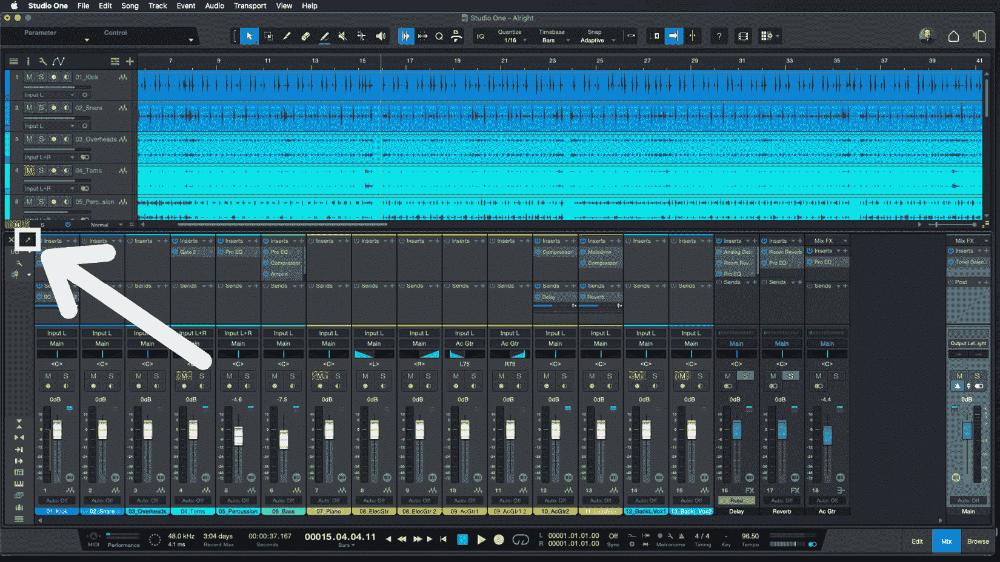

图 3.7：混音窗口及其分离按钮

虽然你将在**歌曲**页面完成大部分制作工作，但 Studio One Pro 还提供了两个额外的环境，称为**工程**页面和**现场**页面，分别允许你对轨道进行母带处理和在舞台上现场演奏音乐。我们将在*第 15 章*和*第 16 章*中深入体验这些环境，但现在是熟悉它们界面的好时机。这正是我们在下一节要做的事情。

## 工程页面

Studio One 是唯一提供独立音频母带处理环境的 DAW。**工程**页面提供了专业且强大的工作流，简化了母带处理过程。

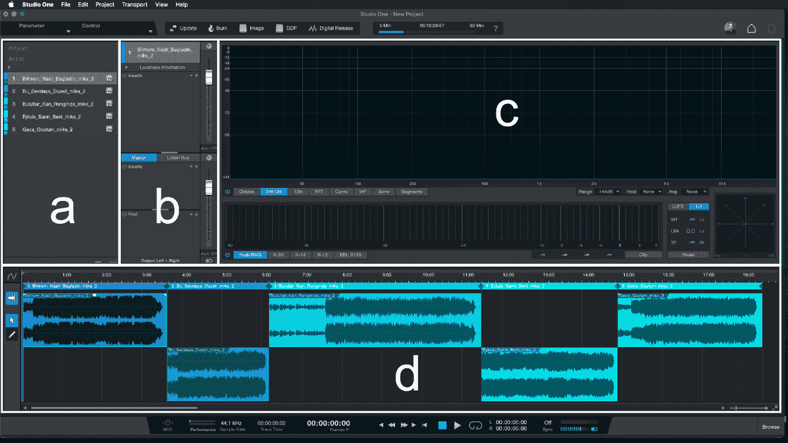

图 3.8：工程页面

与**歌曲**页面相比，**工程**页面非常直观——这里没有额外的窗口或隐藏面板：

*   **轨道栏**（*图 3.8* 中的 *a*）：这是你完成的歌曲——即你想要在一个工程中合并的歌曲——以播放列表形式显示的地方

*   **效果窗口**（*图 3.8* 中的 *b*）：用于对单个轨道或整个工程应用效果

*   **计量窗口**（*图 3.8* 中的 *c*）：包含一系列专为音频母带处理定制的分析工具

*   **工作区**（*图 3.8* 中的 *d*）：这是你为最终发行微调歌曲的地方

音频母带处理通常让初学者望而生畏，但这一独特的工作流使其变得更易上手。我们将在*第 15 章*中深入探讨此页面及母带处理过程。

# “Show”页面

接下来，我们将了解一个独特的工作环境，它能让你利用 Studio One Pro 的强大功能，在舞台上呈现现场演出。

凭借 **Show** 页面，Studio One 大胆进军现场表演领域，而 **Ableton Live** 在这一领域已称霸二十年。这是一个绝妙的构想：DAW 拥有现场音乐制作所需的所有工具——你可以将所有现场乐器和人声输入其中，应用效果并随心所欲地调整，添加软件乐器，并用伴奏轨道支持你的表演，所有这些都能实时完成。但典型的 DAW 界面是为精细的制作工作优化的，试图在舞台上使用它就像用针挖洞。在舞台上，你只需要少数核心功能，且需要它们触手可及。

**Show** 页面是一个简洁、精简的界面，仅包含你在舞台上所需的功能。如果你需要进行精细工作，**Song** 页面仅一键之遥。进入 **Show** 页面后，你首先注意到的将是它的简洁性：

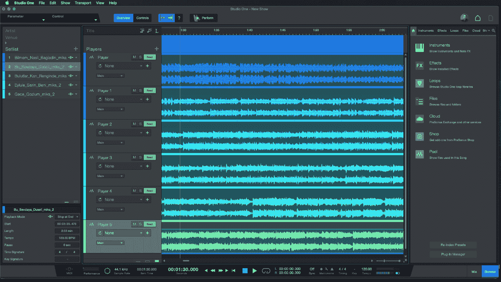

Figure 3.9: The Show page

这偏离了 Studio One 的设计美学：该界面上的控件更大、对比度更高，以便在光线不佳的环境和较小的屏幕上获得更好的可视性。

**Show** 页面使用起来非常有趣：你可以将 Studio One 的 Song 作为素材导入现场曲目并用作伴奏轨道，即时添加虚拟乐器和现场乐器，完全按照你想要的方式设置它们在现场表演中的声音，让 Studio One 处理一切，而你只需专注于表演。我们将在 *第 16 章* 中全面测试 **Show** 页面。

在本节中，我们深入探讨了 Studio One 环境，了解了你在后续章节中将大量使用的页面、窗口和工具。在我们真正开始在 Studio One 中创作音乐之前，只剩下一件事要讨论：如何在项目中高效导航。遵循这些最佳实践将节省你的时间并加快工作流程，让你专注于音乐而非软件。

# 在 Studio One 环境中导航

音乐制作需要高度的精神集中。从你开始创作第一个音乐构思，到母带处理完成一首歌曲，你都需要进入心流状态，全神贯注于你想要达成的目标。一个常见的干扰源就是 DAW 软件本身。当用户界面不断阻碍你时，很难沉浸在项目中。

能够在项目内高效导航是一项至关重要的技能，但大多数人往往忽视它。我屡见不鲜地看到学生在项目的轨道中迷失方向，在界面上寻找某个功能而分心，结果错失了宝贵的灵感时刻。

本节将介绍一套你将在后续章节和所有未来项目中使用的技能。因此，请务必不时回到这里，检查你是否已熟练掌握我们将要讨论的所有最佳实践。

## 窗口管理

在 Studio One 中工作时，你将花费大部分时间在 **Song** 页面上。正如我们在前一节所见，该页面包含多个窗口和面板；因此，我屡见不鲜地看到学生在如 *Figure 3.10* 所示的页面上难以找到方向。

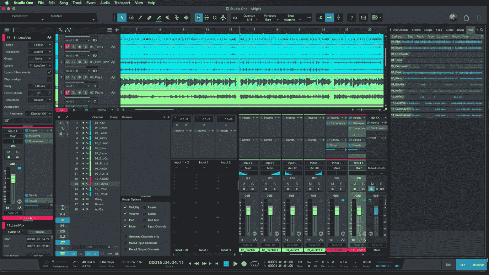

Figure 3.10: A cluttered screen

这种窗口布局可能适合展示 Studio One 丰富功能的宣传内容，但它是人体工学的噩梦——你绝不可能需要同时打开所有这些窗口。这不仅使你难以找到所需内容，还会导致视觉疲劳。

因此，第一步是关闭在任何特定时刻你不需要的所有窗口。像任何好习惯一样，一开始你可能需要提醒自己这样做，但这很快就会成为第二天性。

第二步是简化用户界面，仅显示你实际需要的元素。在工具栏的任意位置右键单击并选择 **Customize**（自定义）。这将打开 **customization editor**（自定义编辑器）：

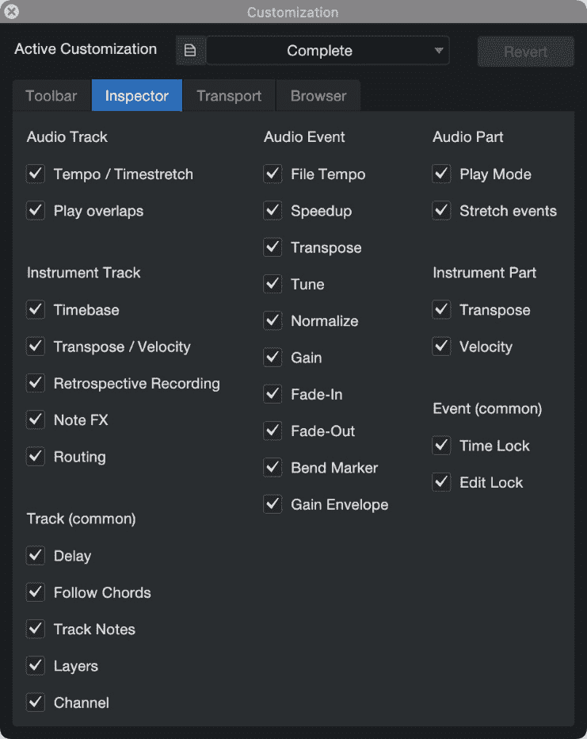

Figure 3.11: Customization editor

你可以使用此窗口显示或隐藏用户界面中的几乎所有元素。如果你是 Studio One 新手，起初可能不确定需要哪些元素，因此提供了多个预设来帮助你入门。点击此窗口顶部的 **Active Customization**（活动自定义）下拉菜单，选择与你当前任务匹配的预设——录音、编辑、混音等。

**Tip**

如果在任何时候你找不到本书或教程中提到的按钮或显示项，请在 **Active Customization** 菜单中选择 **Complete**（完整）。这将确保显示所有可用的用户界面元素。

## 缩放级别

Studio One 允许你水平和垂直地缩放项目。这是一个显而易见的功能，但许多人忽视了它。在正确的缩放级别下工作，并使用合适的工具进行调整，会极大地提高你的制作效率。以下是一些缩放最佳实践，将帮助你专注于项目：

*   记忆并使用以下键盘快捷键：*E* 键水平放大，*W* 键水平缩小；*Shift* + *E* 垂直放大，*Shift* + *W* 垂直缩小。或者，使用 *Ctrl* 键 + 鼠标滚轮进行垂直缩放，*Ctrl* + *Shift* 键 + 鼠标滚轮进行水平缩放。

*   如果你的电脑配备支持的触控板，可使用捏合手势进行放大和缩小。

*   缩放至歌曲级别（以便在编排窗口中同时看到整首歌曲的开头和结尾），并保持在此级别，除非你有正当理由再次放大。这有助于你关注歌曲的整体，并减少因不必要的滚动导致的视觉疲劳。

*   不要用编排窗口做“显微手术”。那是编辑窗口的工作。当你需要对制作的某一部分进行精细操作时，双击该部分在编辑窗口中打开它。你可以独立设置这两个窗口的缩放级别，所以如果你愿意，可以在编辑窗口中一直放大到采样级别。

*   Studio One 中一种非常实用的放大方法是将鼠标移至标尺上你想要放大的位置——例如，如果你想在第 9 小节开头放大，将光标指向那里：

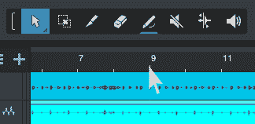

Figure 3.12: Zooming with a mouse

然后，按住鼠标向下拖动屏幕以放大到你想要的程度。编辑完成后，在同一位置按住鼠标向上拖动屏幕以缩小回原状。编辑窗口有自己的标尺，所以你也可以在那里执行此技巧。

*   Studio One 为垂直缩放级别提供了预设，可在轨道窗口的底部访问：

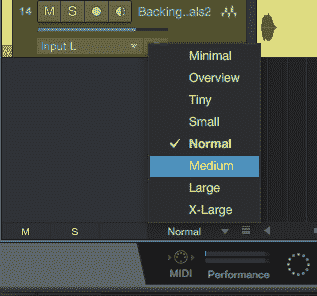

Figure 3.13: Track height or vertical zoom presets

*   你可以为这些预设设置键盘快捷键，以快速将所有轨道设置为相同高度。为此，请转到顶部菜单的 **Studio One** 并选择 **Keyboard Shortcuts**（键盘快捷键）：

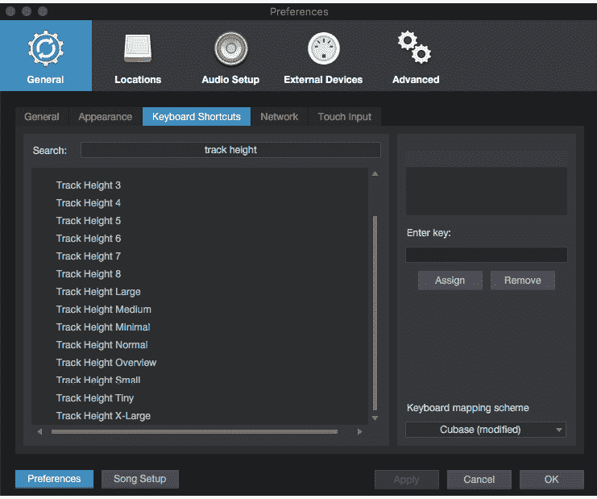

Figure 3.14: The Keyboard Shortcuts window

然后在 `Search` 框中输入 `track height`，并选择你想要创建快捷键的轨道高度（`Overview` 是个不错的起点）。之后，在 `Enter key` 字段中输入你想用于此快捷键的按键组合。如果该组合已被保留用于其他快捷键，Studio One 会警告你。一旦你找到一个你和 Studio One 都满意的按键组合，点击 `Apply`，然后点击 `OK`。

*   如果你想同步编排窗口和编辑窗口之间的缩放级别，可以通过激活 `Synchronize Editor to Arrangement` 按钮来实现：

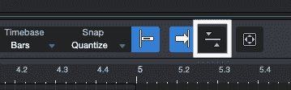

图 3.15：Synchronize Editor to Arrangement 按钮

*   始终保持 `Autoscroll` 按钮处于启用状态，以便在项目播放时，你可以看到时间线上的当前位置：

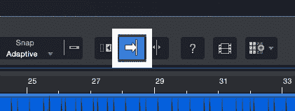

图 3.16：Autoscroll 按钮

你唯一想关闭它的时候是放大得太近了，且不想在点击 `Play` 按钮时丢失当前位置。

*   如果音频轨道录制音量太小导致看不见波形，你可以使用右下角的 `Data Zoom` 滑块来放大它们：

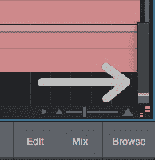

图 3.17：Data Zoom 滑块

这看起来就像你调高了所有音频轨道的增益，但别担心；你只是为了更好地查看而放大了音频波形。

在正确的缩放级别下工作将使你轻松跳转到项目中的任何位置。现在让我们看看一些最终技巧，让你的操作更加顺畅。

## 额外导航技巧

这里有一些更精细的技巧，让你能专注于项目的核心，而不会被界面上的细节分散注意力。在继续之前，你必须发誓永远、永远不要使用滚动条进行导航：

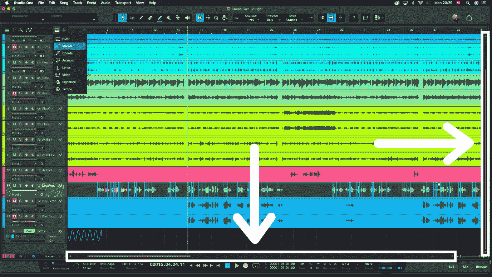

图 3.18：水平和垂直滚动条（别用这些！）

滚动条控制生硬且不精确；你最终会在编排窗口到处乱跳，直到找到你要找的位置。相反，垂直滚动请使用鼠标滚轮，水平滚动请按住 `Shift` 然后使用鼠标滚轮。如果你用的是没有鼠标的笔记本电脑，请使用触控板上的双指滑动手势。

现在来看一些顺畅导航的专业技巧：

*   按键盘上的 `.*`（句点键）跳转到项目开头（称为 `return to zero`）。

*   默认情况下，跳转到项目中特定时间的唯一方法是点击标尺上对应的时间。但既然编排窗口有大把空间，为什么要限制自己只能用那个小小的标尺呢？点击轨道窗口上的 `Options` 按钮并勾选 `Locate when clicked in empty space`。现在，当你想跳转到项目中的特定时间时，只需点击编排窗口中对应该时间的任意空白处，你就能瞬间到达！

*   有时你希望停止播放或录音时时间线返回初始位置，有时你希望它停留在原地。有一个名为 `Return to Start on Stop` 的选项，你可以通过按 `Option` (Mac)/`Alt` (Windows) 键和小键盘上的 `0` 来切换。如果你的键盘没有小键盘，只需去 `Keyboard Shortcuts` 窗口将快捷键改为最适合你的设置即可。

*   随着项目变得越来越复杂，你将需要在歌曲的特定点之间来回跳转。这就是 `markers`（标记）派上用场的地方。标记是定义和跳转到项目特定点（如歌曲副歌的开始）的便捷方式。要开始使用标记，请点击 `Global Track Visibility` 按钮并选择 `Marker`：

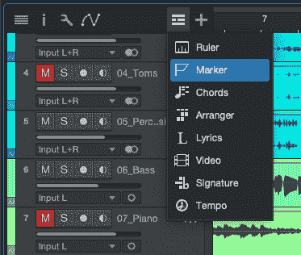

图 3.19：打开标记轨道

这将在编排窗口顶部打开标记轨道。现在点击你想要添加标记的任意时间点（例如第 9 小节主歌的开始）。然后，点击标记轨道上的 `+` 号在该时间点添加一个新标记：

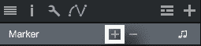

图 3.20：添加新标记

你可以根据需要添加任意数量的标记。双击这些标记为它们命名（`verse`、`chorus`、`build`、`drop` 等）。你可以轻松使用小键盘上的数字在标记之间跳转；键 `1` 和 `2` 保留用于循环入点和循环出点（我们将在后续章节讨论），因此标记将自动分配给键 `3` 及以上。

现在你可以毫不费力地跳转到项目中的任意位置，并完全掌控导航工具。用户界面尽在你的掌控之中。

# 总结

在本章中，我们深入探讨了 Studio One 中的三大主要环境：`Song`、`Project` 和 `Show` 页面。我们分析了这些环境各自的用户界面，并介绍了后续章节将使用的术语。然后，我们讨论了几个关于项目布局和导航的最佳实践，以帮助使你的工作流程顺畅高效。坚持这些最佳实践将在你开始处理更大、更复杂的项目时提供巨大帮助。

在下一章中，你将创建你的第一个 Studio One Song。
