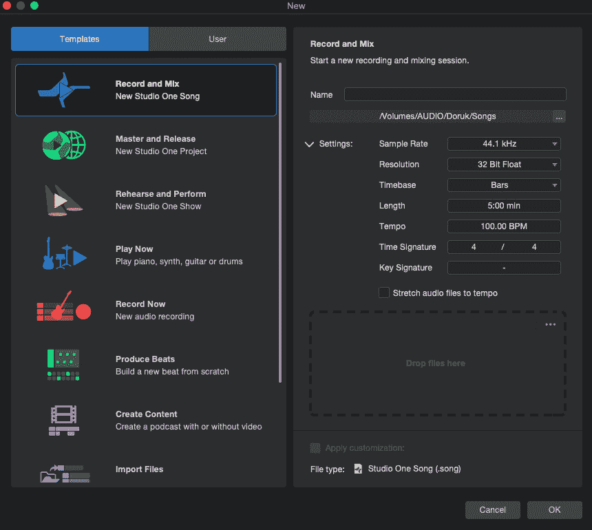
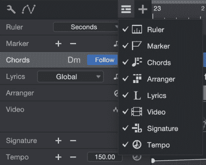
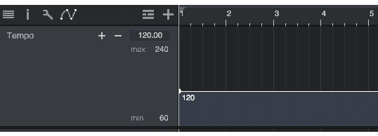
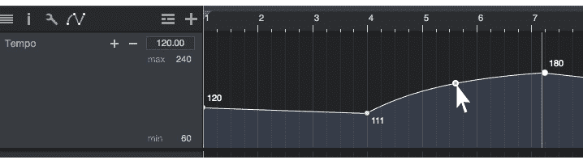
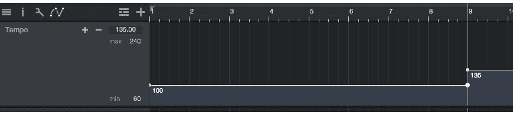
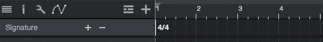
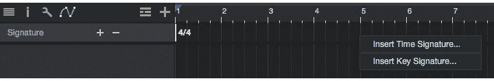
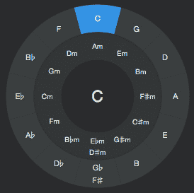
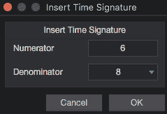

## 创建新 Song

Song 是 Studio One 的核心。你大部分的制作工作——包括录制、编辑和混音——都在这里完成。在本章中，我们将一起在 Studio One 中创建你的第一个 Song。

**音乐制作**是一个高度创造性的过程，每个项目都是独一无二的。你可能创建一个新 Song 只是为了尝试新想法看看会有什么结果，或者你可能已经有一个完整编排的作品想要最终定稿。我将在本章和后续章节中展示一个分步工作流程，但请记住这是一个灵活的过程，你可以随意跳过任何你还没准备好完成的步骤（稍后随时可以回来完成）。

在本章中，我们将仔细查看创建新 Song 时可用的选项和设置。其中一些颇具争议，经常在工作室和网络上引发辩论。这意味着需要一些技术讨论，但我保证通俗易懂。

因此，在本章中，我们将涵盖以下主要主题：

*   设置你的 Song 并探索 Song 设置
*   在 Song 中更改速度、调号和拍号

## 技术要求

要学习本章内容，你需要在电脑上安装并激活 Studio One。

## 设置你的 Song 并探索 Song 设置

Studio One 在创建新 Song 时会提供大量选项和设置，但请记住，你不必在此刻调整所有这些设置。你随时可以稍后回来设置（或修改）它们。实验是音乐制作的重要组成部分，在创建新 Song 时，你甚至可能不知道这些设置最终会是什么样。请随意跳过任何你尚未决定的参数。

现在让我们一起创建你的第一首 Song。在 Studio One 的 **Start（开始）** 页面上，点击标题为 **New…（新建…）** 的大号加号。这将打开 **New Document（新建文档）** 窗口：

*Figure 4.1: New Document window*

该窗口左栏列出了一系列模板，旨在让你快速上手，即使你以前从未使用过 Studio One。请随意探索这些不同选项；不过，我们这里将使用 **Record and Mix（录制与混音）** 模板。选中它后，该窗口的右栏将显示你即将创建的 Song 的设置列表，如 *Figure 4.1* 所示。

现在让我们逐一了解这些设置。

## Name（名称）

刚开始时很难为歌曲想出一个名字。Studio One 会自动在 **Name** 字段中填入今天的日期以及你在 **Start Page** 的 Artist Profile（艺术家档案）中选择的名称，从而解决这个问题。你可以使用这个暂定名称立即创建 Song，稍后再修改。如果你的歌已经有名字了，请直接输入。

## Save location（保存位置）

**Name** 字段下方的无标题字段可让你查看并选择该新 Song 的保存位置。在 *Chapter 2* 中，我们讨论了 Song 和 Project 文件的理想位置，并相应地配置了 Studio One。此框现在指向该文件夹。

接下来的两个设置 **Sample Rate（采样率）** 和 **Resolution（分辨率/位深）** 基于的概念容易引起混淆和争论，因此值得在此进行一些分析。我们先从 **Sample Rate** 开始。

## Sample Rate（采样率）

当你将麦克风或乐器连接到音频接口（通常称为声卡）时，接口会将来自这些声源的**模拟**信号转换为计算机可处理的**数字**数据（0 和 1）。为此，音频接口中的**模数转换器**会以固定间隔对输入的模拟信号进行**采样**。

这类似于摄像机的工作原理：它以给定间隔捕捉连续运动的静止图像（帧）。当这些静止图像回放时，就产生了连续运动的错觉。

不过，音频接口的工作速度比摄像机快得多：摄像机通常每秒捕捉 24 到 30 帧，而音频接口通常在同一时段内对音频信号采样 44,100 次。这被称为**采样率**。每秒对输入信号采样 44,100 次的音频接口，其采样率称为 44,100 赫兹 或 44.1 千赫兹。

在 **New Document** 窗口中，**Sample Rate** 下拉菜单中的可用选项取决于你的音频设备的能力。如今制造的大多数设备支持多种采样率，最高可达 192 kHz。

争论由此开始：有人认为更高的采样率能提供更高的音质，因此建议将其设置为设备允许的最高值。详细讨论数字音频超出了本书范围，但如果你想了解技术背后的科学原理，一个好的切入点是查阅 *Nyquist theorem（奈奎斯特定理）* —— 我们所有当前的数字音频技术都基于此。

### Further reading（延伸阅读）

如果你想深入了解数字音频的真实工作原理，请查看下面的文章 —— 这是一个很好的起点：[`www.soundonsound.com/sound-advice/all-about-digital-audio-part-1`](https://www.soundonsound.com/sound-advice/all-about-digital-audio-part-1)

事实是，44.1 kHz 的采样率为音乐制作提供了完全足够的音质（你可以看到我在 *Figure 4.1* 中使用了它）。使用更高的采样率只会导致音频文件变大，并增加电脑的负载。

只有两种情况需要更高的采样率：

- 如果你制作的音频素材用于视频（配乐、音效、对白等），请使用 48 kHz 的采样率。这是视频编辑软件期望的采样率。如果你提供不同采样率的文件，视频编辑软件会毫无怨言地转换它们，但每次转换都会导致一定程度的质量损失，因此最好从正确的设置开始。

- 如果你在录制音频后更改歌曲的速度，Studio One 将不得不应用**时间拉伸**（即拉伸你的音频素材以使其与新速度保持对齐）。尽管时间拉伸算法在过去几年有了显著改进，但它仍然是一个会降低音质的过程，而以高采样率录制是将其伪影降至最低的最佳方式。因此，如果你认为可能会在录制音频后更改歌曲速度，请选择高采样率（88.2 kHz 是个不错的选择）。

### Important note（重要提示）

如果你更改 **New Document** 窗口中显示的采样率，Studio One 将在你的音频设备上发起采样率变更。如果你在此选择的值不被设备支持，或者你的设备不允许第三方应用程序更改其采样率，Studio One 将发出采样率不匹配警告。你仍可在该警告下创建新 Song，Studio One 将尝试根据你的选择对传入的音频数据进行重采样，但这可能导致稳定性和性能问题。为避免此情况，请坚持使用音频设备支持的采样率。

既然我们已经讨论了采样率，现在来讨论分辨率。

## Resolution（分辨率/位深）

**Resolution** 决定用多少细节来表达录音中最柔和和最响亮部分之间的差异。这种差异称为录音的**动态范围**。

乍一看，分辨率和动态范围似乎毫不相关；前者是以**比特**为单位的数字术语，后者是以**分贝**为单位的声学术语。粗略换算的话，这里每个比特对应约 6 分贝。因此，如果你在 **Resolution** 菜单中选择 **16 Bits**，将获得约 16x6=96 分贝的动态范围，这对大多数音乐素材已绰绰有余。下一个选项 **24 Bits** 将提供约 144 分贝。在世界上几乎所有的录音棚中，以 24-bit 分辨率录制是通用做法，这也是你应该使用的设置。

你会看到菜单中还有更高的选项，就像采样率一样，有人争辩说这些能提供更好的音质。事实是这些更高选项属于过度配置；它们提供的巨大动态范围甚至超出了地球上科学分类的声音范畴。190 dB 被认为是空气所能承受的最响亮声音；超过该值将产生冲击波（即飞机超音速时我们体验到的类爆炸现象）。

## 采样率和分辨率设置

那么，如果这些选项有些大材小用，为什么还要提供它们呢？第一个原因是，有些人确实认为这些设置听起来更好，并且愿意为它们买单。第二个原因更具实用性，虽然属于特殊情况。如果你是声音录制专业人士，且身处一个非常不可控、不可预测的环境中（例如你在录制一场戏剧表演，演员在低语，你施加了巨大的增益，然后他们突然开始大喊大叫），这些选项提供的扩展动态范围将提供一层额外的安全保障。除此之外，没有任何正当理由使用高于 24 位的设置。

所以，总结本节内容：对于音乐项目，将 `Sample Rate` 设置为 44.1 kHz，将 `Resolution` 设置为 24 位。如果你制作用于视频的音频素材，将 `Sample Rate` 设置为 48 kHz，将 `Resolution` 设置为 24 位。

## 其他“新建文档”页面设置

以下设置稍后均可轻松且安全地修改，因此如果你刚开始创作歌曲，尚未决定这些事项，请随意跳过它们。

### 时间基准

`Timebase` 设置用于调整 `Arrange` 窗口顶部时间轴标尺上的时间显示方式。可用选项如下：

*   `Bars`（小节）：以音乐单位显示时间（例如小节、拍，以及八分音符、十六分音符等），具体取决于你的缩放级别。这非常实用，因为它允许 Studio One 协助你将 `Arrange` 窗口中的事件对齐到音乐上有意义的位置，例如歌曲的小节起始和拍子。这是默认设置，也是你进行音乐制作时想要使用的设置。

*   `Seconds`（秒）：以小时:分钟:秒:毫秒显示时间。如果你正在处理播客录音等项目，并希望标尺以绝对时间格式显示时间，请使用此选项。

*   `Frames`（帧）：以小时:分钟:秒:帧显示时间。在处理视频以便跳转到特定帧时，请使用此选项。

*   `Samples`（采样点）：根据上一节讨论的采样率显示时间。进行深度编辑和微观手术式编辑时，请使用此选项。

我们将在 *第 10 章* 详细讨论时间基准，届时我们将探讨如何使用 `Ruler Track` 处理不同的时间单位。现在让我们继续浏览 `New Document` 菜单。

### 歌曲长度

此设置允许你指定歌曲的长度，制作完成后将用于定义导出区域。我从未有理由在项目开始时设置此项，也未见过或听说过有人这样做。直接跳过此设置即可——一旦歌曲完成，你将能轻松设置歌曲长度。

### 速度

首先，给刚开始在 DAW 环境中进行音乐制作的人一个坏消息：你必须配合节拍器录音。这对于大多数来自传统背景的音乐人来说是不习惯的，但这是一个必要的范式转变，如果你想获得让 DAW 大受欢迎的那些优势，就必须习惯配合节拍器工作。此环境中的一切设计都是基于时间网格运行的，如果你不使用节拍器，稍后添加乐器和使用许多编辑功能将几乎变得不可能。

现在是好消息：你不必马上决定歌曲的 `tempo`。你可以先创建歌曲，尝试不同的速度，满意后再设置。你甚至可以在整首歌中更改速度，并精确控制速度变化，正如我们在下一节将看到的那样。

如果你知道歌曲的速度，可以在此处立即设置。如果不知道，直接跳过此设置。

### 拍号和调号

与速度一样，你可以在创建时设置歌曲的拍号和调号，也可以稍后设置：

*   Studio One 利用 `Time Signature` 信息，根据歌曲的节奏结构细分 `Arrange` 窗口中的时间轴标尺。正确设置此项是正确使用 Studio One 优秀编辑功能（包括跨音乐网格完美对齐事件）的前提条件。此信息还被 Studio One 的节拍器用于放置重音拍，使其与歌曲的节奏脉冲同步。查看 *图 4.1*，左侧的数字（称为**分子**）表示每小节的拍数，可设为任意值。右侧的数字（称为**分母**）表示每拍对应的音符时值，只能设为常见音符值（4、8、16 和 32）。因此，如果你的歌曲是 9/8 拍，例如，请分别将这些值设为 9 和 8。

*   `Key Signature` 设置提供的优势较为有限：它影响 `Score` 视图中可选择的音符。因此，仅当你打算使用 `Score` 视图显示和/或打印歌曲中的音符时，才需要填写此项。

现在 Studio One 已知晓你即将创建的歌曲的主要参数，在你点击 `OK` 按钮之前，还有一个最后的步骤需要讨论。

### 添加外部文件

如果有想在项目中使用的外部文件，你可以在创建时通过将它们拖放到标题为 `Drop files here` 的框中来导入。Studio One 将自动为它们创建单独的轨道，并将它们放置在歌曲的开头。

如果选中 `Stretch audio files to tempo`，Studio One 将尝试调整这些文件以匹配你在此窗口中刚选择的速度。某些音频文件在其元数据标签中包含速度信息。如果没有，Studio One 将使用自己的速度检测算法进行猜测。如果你想导入应保持原样的音频素材——如对白、音效等——请取消选择此选项。

> **提示**
>
> 如果创建歌曲后需要更改 `Stretch audio files to tempo` 设置，请转到顶部菜单，点击 `Song`，然后选择 `Song Setup`。

现在我们已经介绍了创建新 Song 所用的所有设置。点击 `New Document` 窗口上的 `OK`，你将进入 Studio One 中的第一首 Song。

如果你计划在歌曲过程中更改速度、调号或拍号，最好在开始录音前规划好这些变化，这正是我们在下一节要做的。同样请记住，你随时可以回来完成这些步骤。

# 在歌曲中更改速度、调号和拍号

你可以在整首 Song 中任意次数地更改速度、调号和拍号。Studio One 使用 `Global Track` 系列来处理这些变化。全局轨道默认跨越整个编排，每个轨道控制一项专用功能，允许你查看和修改其各自功能在整个编排中的状态。这些轨道始终处于激活状态，但默认情况下隐藏不可见。要显示它们，请点击 `Global Track Visibility` 按钮：

图 4.2：全局轨道显示按钮

在本节中，我们将使用其中两个全局轨道：`Signature` 和 `Tempo`。让我们首先看看如何在整首歌中更改速度。

## 使用速度轨道更改歌曲速度

你可能想应用细微的速度变化，为听起来机械的录音注入生命力；也可能想在歌曲中间引入剧烈的速度变化以产生戏剧张力。这些在 Studio One 中都非常容易实现，且你音乐中任何与速度同步的元素将继续保持同步。

开始操作：点击 `Global Track Visibility` 按钮并选择 `Tempo`。这将显示 `Tempo` 轨道：

**图 4.3：节奏轨道**

从这里开始，你有两个选项：你可以随时间逐渐改变节奏，或者设置节奏在特定时间点跳变到另一个值（例如，在歌曲的副歌部分切换到更快的节奏）。让我们来探索这两种选项。

以下是如何随时间逐渐改变节奏：

1.  按键盘上的 `1` 选择 `Arrow`（箭头）工具。

2.  点击 `Tempo`（节奏）轨道上的任意位置以插入节奏变化。Studio One 会在你点击的位置插入一个点。

3.  上下拖动该点以将节奏更改为所需值。你也可以左右拖动它以调整其在时间轴上的位置。

4.  重复 `steps 2` 和 `3` 以输入任意数量的节奏变化。

5.  现在将鼠标悬停在任意两点之间的斜坡上。将出现一个空心点。上下或左右拖动它，可将直线变为曲线（或抛物线）。与线性节奏变化相比，应用带有抛物线的节奏变化往往能产生更平滑的结果。在 `Figure 4.4` 中，第 1 到 4 小节之间节奏线性变化，第 4 到 7 小节之间平滑变化（带曲线）：

**图 4.4：使用抛物线应用平滑的节奏变化**

以下是如何在歌曲的特定时间改变节奏：

1.  举例说明，假设你的歌曲有一个 8 小节的前奏。你希望前奏以 100 bpm 播放，然后从前奏过渡到歌曲的下一部分时跳变到 135 bpm。

2.  按键盘上的 `,`（逗号）确保光标位于歌曲开头。

3.  在 `Tempo` 轨道的数值字段中输入 `100`。这是你希望歌曲开头的节奏。

4.  点击时间轴标尺上的第 9 小节，将光标移至 8 小节前奏的末尾。

5.  然后，在 `Tempo` 轨道的数值字段中输入 `135`。现在歌曲的节奏将从第 8 小节到第 9 小节从 100 bpm 跳变到 135 bpm：

**图 4.5：应用瞬时节奏变化**

你可以组合使用这些方法中的任意一种，为你的歌曲注入流畅的节奏变化。即使你使用 `Global Track Visibility`（全局轨道可见性）按钮隐藏了 `Tempo` 轨道，它仍将保持激活状态。

## 使用签名轨道更改歌曲的调号或拍号

`Signature track`（签名轨道）允许你更改调号和拍号。你可以通过点击 `Global Track Visibility`（全局轨道可见性）按钮并在列表中选择它来显示此轨道。

**图 4.6：签名轨道**

Studio One 利用调号信息协助你在 `Score View`（乐谱视图）中选择正确的音符。默认情况下，歌曲没有预选的调号。要添加或更改调号，请按以下步骤操作：

1.  在 `Signature` 轨道上，右键点击你想要更改调号的小节号。这将打开一个小对话框，要求你在新拍号或新调号之间进行选择。点击 `Insert Key Signature…`（插入调号……）。

**图 4.7：插入拍号和调号**

1.  Studio One 将打开一个五度圈图表，这是不同调性及其调号之间关系的可视化表示。从图表中选择你的调。请记住，大调列在外圈，小调列在内圈。

**图 4.8：调号选择图表**

1.  根据需要重复此操作多次，以向歌曲添加调性变化。

Studio One 利用拍号信息在时间轴标尺上正确细分小节。它还利用此信息在节拍器中正确放置重音。如果你使用除默认 4/4 以外的任何拍号，正确设置这一点至关重要。

现在，以下是如何添加或更改拍号：

1.  在 `Signature` 轨道上，右键点击你想要更改拍号的小节号。这将打开一个小菜单，要求你在新拍号或新调号之间进行选择（参见 `Figure 4.7`）。点击 `Insert Time Signature…`（插入拍号……）。

2.  这将打开一个小窗口，你可以在其中设置新的拍号。使用 `Numerator`（分子）和 `Denominator`（分母）字段来设置拍号。`Numerator` 表示每小节的拍数，`Denominator` 等于每拍的音符时值，因此如果你的歌曲是 6/8 拍，请将 `Numerator` 设为 6，`Denominator` 设为 8：

**图 4.9：插入拍号对话框**

太棒了！你现在已经规划了歌曲中所有重要的基石。当你开始录制音乐时，这将让你的生活更轻松，在编辑素材时也能促进你的工作流程。

## 总结

在本章中，我们在 Studio One 中创建了你的第一首歌曲。我们详细查看了必须按歌曲设置的所有参数，并讨论了如何在编曲过程中更改节奏、调号和拍号。

在下一章中，我们将进行第一次音频录制。你将学习如何设置 Studio One 以捕捉最佳的录音，并将掌握多种不同的录音方法，涵盖广泛的场景。
