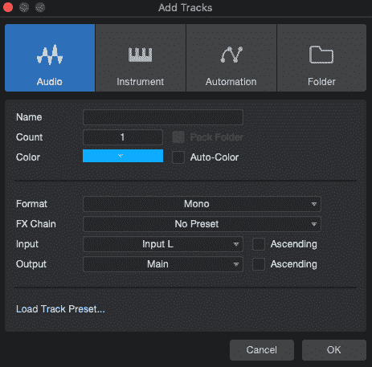
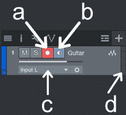
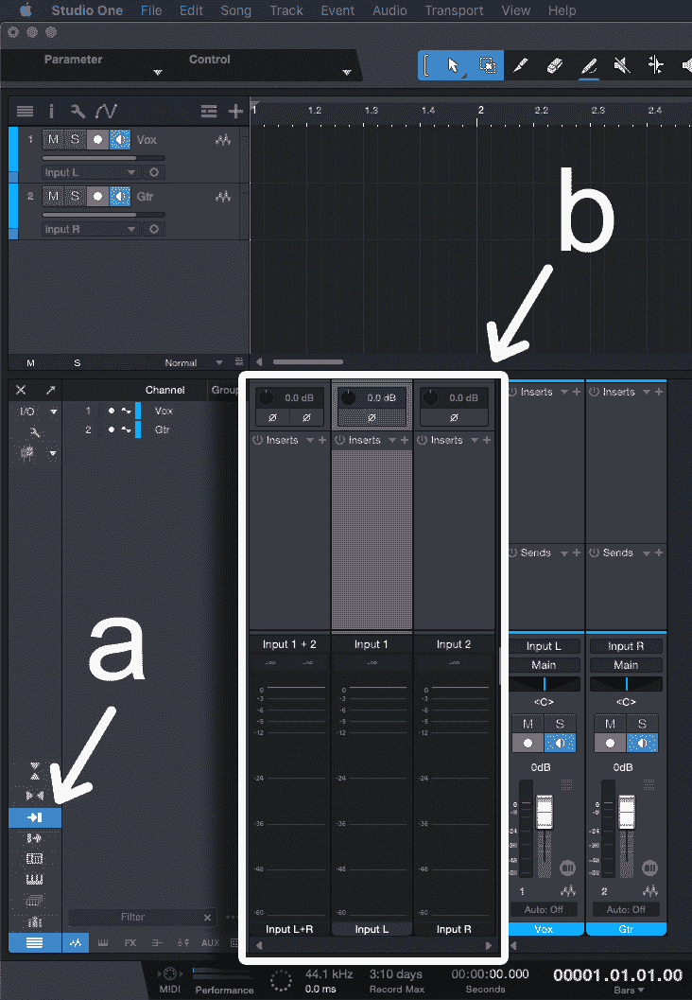
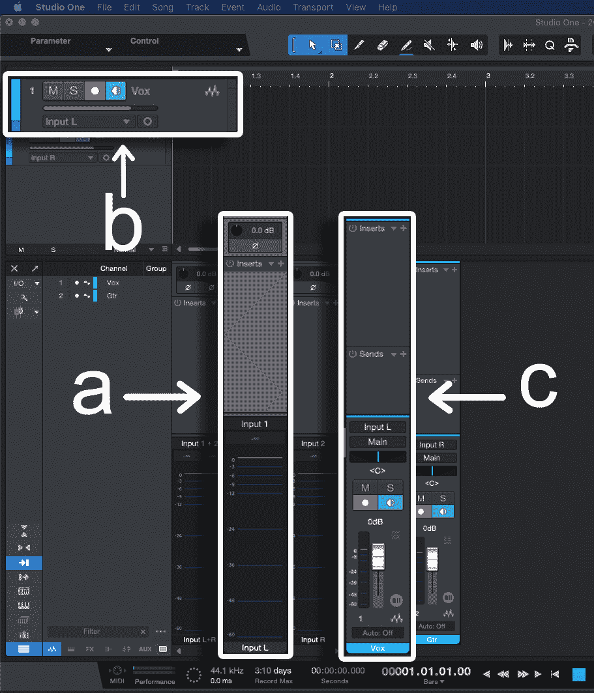
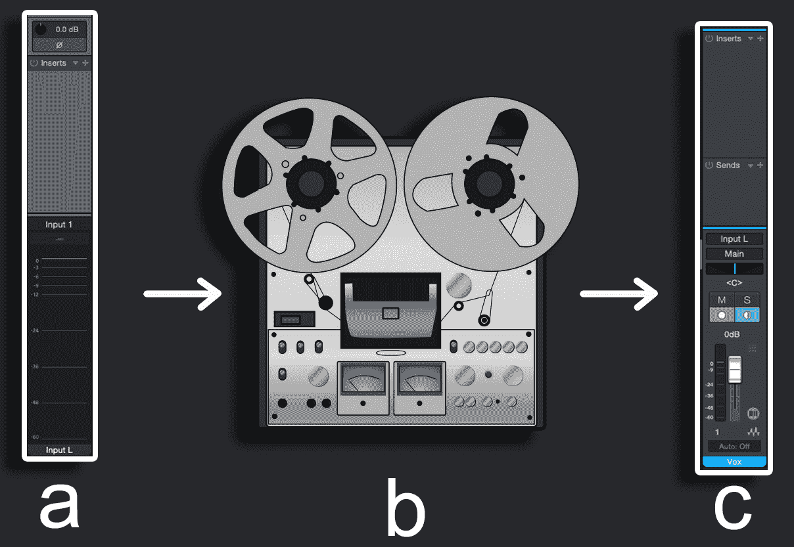
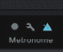
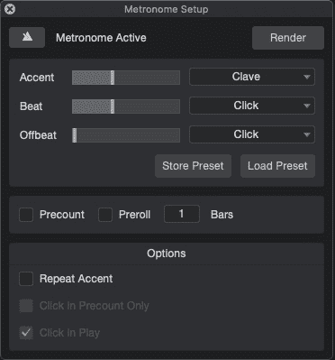
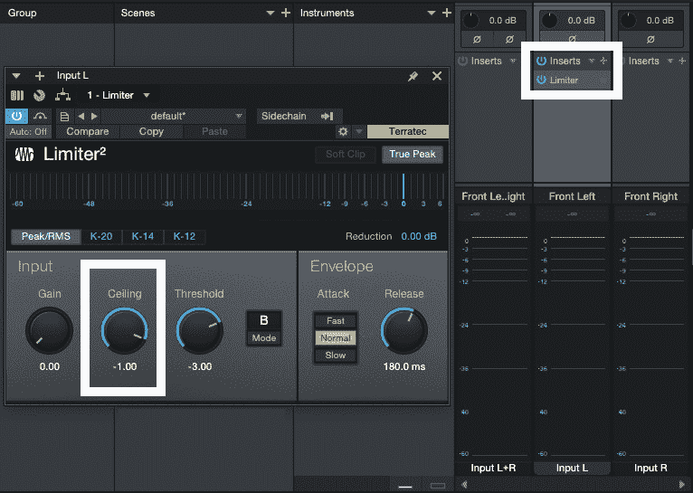

## 5 录制你的第一条音频轨道

音乐制作最酷的事情之一就是开始创作没有硬性规定的规则。有时你已经有了一个歌曲的想法，想以此为基础进行构建。有时你只是想尝试实验，直到找到一个能激发你灵感的宝藏。Studio One 允许你从这些路径中的任何一条开始你的创作之旅，并朝着完全制作完成的最终母带迈进。

本章和下一章在工作流程上并非顺序关系。如果你已经有了歌曲的想法，你会想把它作为草稿轨道录制下来，然后开始着手编曲。在这种情况下，请跟随本章学习，然后继续下一章。然而，如果你想从空白画布开始，探索 Studio One 生态系统中可用的新声音，并进行实验直到找到你下一首热门歌曲的吸引人的钩子，请跳到下一章，等你准备好添加音频素材时再回到本章。

在本章中，你将学习如何在 Studio One 中录制音频，以及如何优化你的录音工作流程以获得最佳结果。

我们将涵盖以下主题：

*   设置硬件以录制音频
*   设置 Studio One 以录制音频
*   理解不同的录音模式
*   录音最佳实践

## 技术要求

要跟随本章学习，你需要在电脑上激活 Studio One。你还需要一个录音源（麦克风和/或乐器）以及连接你的音源到音频设备的线缆。

## 设置硬件以录制音频

让我们首先将音源连接到音频设备。我们将介绍两种常见场景：

*   使用麦克风录制人声或乐器
*   使用线缆将乐器连接到音频设备进行录制

如果你想两者都做（例如，对着麦克风唱歌的同时，通过线缆连接弹奏电吉他），只需同时实施这两种方法即可。

### 设置麦克风

我们可以使用麦克风来采录人声表现，也可以用它以声学方式录制乐器。关于麦克风的技术文献汗牛充栋，这是有充分理由的：选择正确的麦克风并正确使用它（反之亦然），能决定一场录音的成败。麦克风绝对是你录音信号链中最重要的环节。

虽然我们无法涵盖关于麦克风的所有细节，但我们想确保你能选择正确的麦克风并正确使用它，所以一份速成指南是很有必要的。

## 了解你的麦克风

就结构和工作原理而言，主要有两种麦克风类型：

*   **电容麦克风**通常更灵敏，能捕捉更多细节，因此通常是录音环节的首选。它们需要外部电源为机壳内的电路供电。这被称为**幻象电源**。幻象电源通过连接麦克风和音频设备的同一根线缆供电；大多数型号不需要额外的线缆或电源。只需确保在你的音频设备上将其开启即可（在某些设备中，幻象电源被称为**48V**，即 48 伏特的缩写，这是为此目的提供的标准电功率）。

*   **动圈麦克风**不如电容麦克风灵敏和响应快，但它们也有大放异彩的时刻：其较低的灵敏度使它们对环境噪音更具包容性，并能更从容地应对大声压声源。如果你在嘈杂的环境中录音，或者录制大声压乐器（如鼓组或电吉他音箱），使用动圈麦克风会获得更好的效果。

所有麦克风都利用振膜来捕捉声波。根据尺寸，振膜分为两类：

*   **小振膜麦克风**大小约等于白板笔，更擅长捕捉高频声源。因此，例如它们是录制长笛、曼陀林和鼓组镲片的首选麦克风。

*   **大振膜麦克风**体积更大，在中低频方面更具优势。如果你只能买一支麦克风，请选择大振膜。它能在更广泛的素材上提供最佳的全能表现。大振膜麦克风在人声录制上几乎总是表现更好。

如果你以前用过麦克风，你就知道它们对来自不同角度的声音灵敏度并不相同。麦克风的**指向性模式**描述了麦克风对来自不同方向的声波有多灵敏。大多数麦克风具有**心形**指向性，意味着它们对来自前方的声音敏感，而抑制来自后方的声音。你必须了解麦克风的指向性模式，并将其放置在声源落入其最佳拾音点的位置。请查阅麦克风的用户手册；相关信息会在里面。

> **提示**
>
> USB 麦克风因其易用性而越来越流行。USB 麦克风是一种内置音频接口的麦克风。因此，你不必将传统麦克风插入声卡再将声卡连接到电脑，只需使用一根标准 USB 线将 USB 麦克风直接连接到电脑即可。除此之外，USB 麦克风的工作方式和表现就像传统麦克风一样，我们刚才讨论的所有不同功能也都适用于 USB 麦克风。

## 麦克风的摆放

大多数家庭工作室在声学方面都不是理想环境，所以在这里多花一点力气会事半功倍。你的录音环境必须安静，尤其是当你使用灵敏的电容麦克风时，但这只是故事的一半。如果房间里存在可听见的声波反射，这些反射会被麦克风拾取，除非你身处一个声学条件极佳的空间，否则声波反射在录音中是大忌。

好消息是，这通常很容易且免费解决。在房间里填充吸音材料；例如，用地毯处理地面反射的声波，挂厚窗帘阻尼窗户反射的声波，并在裸露的墙壁前放置沙发。这对大多数房间来说已经足够。如果你仍能听到反射，可以搜索 DIY 吸音板，进一步从声学角度处理房间。

如果你的电脑风扇噪音大，且你在同一房间录音，请注意麦克风的指向性模式，将其摆放到让风扇处于最不灵敏区域、而歌手/乐器处于最灵敏区域的位置。

在声源（被录制的歌手/乐器）和电容麦克风之间保持约 20 厘米（8 英寸）的距离。如果声源太安静，减小此距离；如果声源太大，增大此距离。如果你使用的是动圈麦克风，你需要让声源靠近得多。这里没有固定的配方；实验是关键。

## 使用麦克风配件

有几类麦克风配件可供选择，从必不可少到有害无益都有。让我们看看最常见的几种：

*   录音时，切勿手持麦克风。这样做会导致麦克风拾取手部的振动，最终变成低频隆隆声。虽然这在舞台表演中可以接受，但我们在录音时希望获得尽可能干净的信号。请改用麦克风支架。

*   使用**防震架**隔离通过麦克风支架传递到麦克风的任何振动。

*   **防喷罩**常用于消除**爆破音**，即 *p* 和 *b* 等字母发音时产生的突然气流。我不是防喷罩的忠实粉丝，因为它们毕竟是滤网。你可以轻松驯服人声录音中的爆破音：让歌手头部相对麦克风保持一个轻微角度，使气流不直接正面冲击振膜。

在本节中，我们讨论了选择合适的麦克风、正确摆放它以及有选择地使用配件。现在，让我们看看直接用线缆录制乐器所需的步骤。

## 设置乐器

与麦克风相比，乐器的设置非常直接。此时你只需了解一种分类：

*   电吉他、贝斯吉他，基本上任何带有内置拾音器的乐器被称为**乐器电平信号源**（有时称为**高阻抗 / Hi-Z**）。

*   合成器、电钢琴、鼓机和任何电子硬件乐器被称为**线路电平信号源**。

典型的音频设备能容纳这两种信号源类型。有些设备自动检测类型，有些为每种类型提供单独的输入插孔，有些设备则需要你手动拨动选择开关。

查阅你的音频设备用户手册，确保设备设置为接收正确类型的信号。

如果你要录制具有立体声输出的乐器，且你的音频设备有两个可用输入，请使用两根单独的乐器线缆，将乐器的左、右声道输出分别连接到音频设备的独立输入端。

现在你已经连接好输入源，准备进入 Studio One 进行一些最后的调整，然后开始录音。

# 为录制音频设置 Studio One

我们将从一个空白的 Song（工程）开始录音会话。

1.  在 Studio One 的**开始**页面，点击标题为**新建…**的大加号。这将打开**新建文档**窗口。

2.  选择**录制与混音**模板，并按照我们在*第 4 章*中讨论的那样调整新 Song 的设置。

3.  点击**确定**。

现在，让我们创建您的第一条音频轨道，并在您按下 `Record`（录制）按钮之前进行最后的调整。

## 创建音频轨道

您在新建 Song（歌曲）中需要做的第一件事，就是创建用于录制的音频轨道。您在上一节中连接到音频设备的每个物理声源，都必须分配到单独的轨道上——这样，您就能在音乐制作中分别处理每个元素。因此，例如，如果您要同时录制一位歌手、一把电吉他和一台电钢琴，您将需要创建三条独立的音频轨道。

重复以下步骤，以添加所需数量的音频轨道：

1.  点击 `Add Tracks`（添加轨道）按钮。这将打开 `Add Tracks` 菜单：

Figure 5.1: The Add Tracks menu（添加轨道菜单）

2.  在该菜单顶部，如果 `Audio`（音频）选项卡未被选中，请选择它。

3.  在 `Name`（名称）字段中，为即将创建的轨道输入一个简短、具有描述性的名称。如果您留空此字段，Studio One 将自动分配一个通用名称，例如 `Audio 01`、`Audio 02` 等。但随着您添加的轨道越来越多，要跟踪管理您的录音素材将变得更加困难。清晰地命名轨道将在项目逐渐扩大时提供巨大帮助。像 `Elec. Gtr. Clean`（电吉他 清音）这样简单的名称就足够了。

4.  如果您想一次性创建多条轨道，`Count`（数量）参数会很有用。但请记住，所有这些轨道将具有相同的属性（相同的名称、相同的输入等），这并非我们在此处想要的。保持其为 `1`（默认值）。

5.  为您的轨道选择一个 `Color`（颜色）选项。乍看之下这可能只是视觉装饰，但为轨道进行颜色编码是浏览大型项目的有效方法。为您的轨道制定一套配色方案，并在所有项目中坚持使用（例如，鼓轨道用蓝色，打击乐轨道用橙色等）。这将帮助您一眼就掌握素材全貌。

6.  在 `Format`（格式）下，对于连接到音频设备单个输入端的声源（这包括麦克风和吉他），选择 `Mono`（单声道）。对于连接到音频设备两个独立输入端的立体声声源（具有立体声输出的吉他效果器、具有立体声输出的合成器等），选择 `Stereo`（立体声）。

7.  暂时跳过 `FX Chain`（效果链）。我们将在名为 *Applying effects during recording*（录制时应用效果）的章节中手动添加效果。

8.  在 `Input`（输入）下，选择该轨道将连接到的音频设备上的物理输入端。请注意，音频设备面板上列出的输入名称可能与 Studio One 分配的通用名称不同。对于典型的入门级双输入音频设备，Studio One 会将它们标记为 `L` 和 `R`，而设备本身会分别将它们列为 `1` 和 `2`。

9.  将 `Output`（输出）保持为 `Main`（主输出）（其默认设置）。

10. 点击 `OK`。

太棒了！您已创建了第一条音频轨道！现在，让我们仔细看看位于其上的控件：

Figure 5.2: A track header（轨道标题栏）

`Record Enable`（录音准备）按钮（*Figure 5.2* 中的 *a*）将轨道置于录音准备状态。请确保该按钮已启用（显示为红色）。一旦您对录音满意并准备继续下一条轨道，就需要取消激活它。

`Monitor`（监听）按钮（*Figure 5.2* 中的 *b*）充当一个切换开关，用于选择轨道的输入源。当它处于激活状态（蓝色）时，您将听到该轨道所连接的物理输入端传来的声音。当它处于非激活状态（灰色）时，您将听到轨道上已录制的内容。我们目前还没有录制任何内容，所以请保持其激活状态。

**重要提示**

如果您的麦克风与扬声器处于同一房间，启用 `Monitor` 按钮可能会产生非常响亮的啸叫声（反馈），导致潜在的听力和设备损坏。当麦克风在同一房间内工作时，请使用耳机代替扬声器。

让我们进行一次快速的试音：

1.  对着麦克风说话，或演奏连接到此轨道的乐器。

2.  在 `Monitor` 按钮激活的情况下，您应该能在扬声器上听到自己的声音/乐器声，并在 `VU meter`（电平表）（*Figure 5.2* 中的 *d*）上看到活动指示。

3.  如果没有看到任何活动，请打开 `Input` 选择器（*Figure 5.2* 中的 *c*）并切换到其他输入端。

**提示**

如果您发现对着麦克风说话或演奏乐器与在扬声器上听到回放之间存在延迟，请减小 `Dropout Protection`（掉帧保护），正如 Chapter 2 中所讨论的那样。

## 设置录音电平

设置正确的录音电平对于捕捉干净的音频至关重要。如果电平太低，您的素材可能会被淹没在噪声底中——即来自环境、硬件电路等固有的噪声。如果电平设置过高，可能会超过系统所能处理的最大电平，导致削波和失真。以下是您在按下 `Record` 按钮之前，如何确保电平得到优化的方法：

1.  打开 `Mix`（混音）窗口。

2.  点击 `Inputs`（输入）按钮（*Figure 5.3* 中的 *a*）。这将打开 `Mix` 窗口的 `Inputs` 部分（*Figure 5.3* 中的 *b*），其中包含您音频设备上每个输入端专用的 VU 电平表：

Figure 5.3: The Inputs button and section（输入按钮和区域）

3.  现在，对着麦克风唱歌，或演奏您即将录制的乐器。至关重要的一点是，您唱歌或演奏的音量必须与几分钟后正式开始录制时的音量一致。

4.  密切关注相应的 VU 电平表。使用音频设备上的增益控制旋钮，将电平设置为在您唱歌或演奏时，VU 电平表指针徘徊在 **-12** 分贝左右（不必过于精确，-12 分贝附近是一个安全区域）。

5.  请注意，某些音频设备（如 RME Babyface）没有物理增益控制旋钮。如果是这种情况，您将不得不打开设备的软件混音器，并在那里使用虚拟增益旋钮。

6.  此时请勿触动 Studio One `Mix` 窗口上的推子。它们对录音电平没有任何影响。如果您需要调整监听音量，请使用音频设备上的输出或音量旋钮。

7.  如果您发现必须将增益过度调大（超过 3 点钟方向），这会带来麦克风前置放大器电路引入过多噪声的风险。请尝试靠近麦克风一些。

8.  如果您发现必须将增益过度调小（低于 10 点钟方向），您可能离麦克风太近了。请尝试稍微远离麦克风一些。

如果您的录音具有很大的动态范围（一些非常安静的部分紧接着一些非常响亮的部分），您可以计划分两次（或更多次，取决于歌曲结构）录制，为每个部分优化电平、录制它，然后继续下一部分。

## 录制时应用效果

对大多数人来说，在耳机中听到自己干瘪的声音并不是一种鼓舞人心的体验。原始的电吉他声音也是如此。添加能够润色人声或乐器音色的效果，将帮助音乐家进入歌曲的氛围，并鼓励他们呈现更好的表现。捕捉一场精彩的表现是您录音的终极目标，因此请随意用能让表演者兴奋的效果来“宠坏”他们。

但无论这些效果多么令人兴奋，我们都不想将它们 *print them to tape*（直译为“印到磁带上”，意指“固化录制/烧录进素材”），正如录音室专业人士常说的那样。在录制的热情中感觉棒极了的效果，几天后当您开始混音时可能会显得过头了，如果表演是带着效果一起录制进去的，就无法挽回了。

因此，我们采用一种两全其美的方法：我们可以在表演者的耳机中加入各种疯狂的效果，同时仅录制干声、未处理的信号。具体操作如下：

图 5.4：音频轨道的信号流向

假设你想为正在制作的歌曲录制自己的演唱。你将麦克风连接到音频设备上的 `Input L`；麦克风的信号现在通过调音台上标记为 `Input L` 的通道条进入 Studio One（*图 5.4* 中的 *a*）。然后，你创建一个新的音频轨道并选择 `Input L` 作为输入源（*图 5.4* 中的 *b*）。Studio One 会自动在调音台上创建一个新的通道条，以代表来自这个新轨道的输出（*图 5.4* 中的 *c*）。

轨道就像一台磁带录音机。它是录制和播放音频信号的地方。如果我们用磁带录音机的图像来替换 *图 5.4* 中的轨道（*b*），信号流向将更容易直观理解：

图 5.5：查看信号流向的另一种方式

来自音频设备的信号将首先到达 `Input` 通道（*图 5.5* 中的 *a*），然后被录制到轨道上（*图 5.5* 中的 *b*）。接着，它会被路由到该轨道的通道条（*图 5.5* 中的 *c*）。

你会注意到，这两个调音台通道（*图 5.5* 中的 *a* 和 *c*）都有一个名为 `Inserts` 的部分。`Inserts` 是 Studio One 调音台上的虚拟插槽，我们用它来应用音频效果。例如，如果你想添加混响以赋予人声深度和空间感，你可以在任意一个 `Inserts` 部分加载混响插件，最终听到的效果将完全相同。

然而，区别在于：插入到输入通道上的任何效果都会被录制到轨道中。回到我们的例子，如果你在输入通道上插入混响插件，你的演唱将连同混响一起被“烘焙”进录音里。当你开始混音时，将无法移除或修改它。

解决方法是将效果应用于轨道通道条的 `Inserts` 部分。你可以在此随意尝试各种效果，而无需最终确定。Studio One 只会录制来自输入通道的干声、未处理信号。

以下是一些建议，你可以在下一次录音时尝试这些效果插件：

- 添加一个设置温和的 `Compressor`（压缩器）插件（将 `Ratio` 参数设置在 2 到 4 之间），能让歌手在耳机中更清晰地听到自己的声音，帮助他们呈现更好的表现。
- 每个人都喜欢自己声音里有混响。插入 Studio One 自带的 `Room Reverb`（房间混响）插件，选择 `Large Hall`（大型音乐厅）预设，并根据喜好调整 `Mix`（混合）参数。
- 使用 Studio One 的 `Tuner`（调音器）插件，确保你要录制的乐器音准正确。请记住，信号在通道条的 `Inserts` 部分是从上到下流动的；如果你插入了多个插件，信号会先经过列表顶部的插件，然后依次向下。`Tuner` 插件可能会被其他插件添加的效果干扰，所以请将其拖到列表顶部。
- 使用 `Ampire` 为原本单薄干瘪的声源增添色彩和特性。虽然它主要为电吉他设计，但几乎在所有乐器上都表现良好。这种增加的音色“态度”将帮你进入正确的状态，呈现更好的表现。
- 尝试 `Redlight` 为沉闷的人声增加额外的锐度和亮度。

太棒了！通过应用这些效果，你让表演者处于最佳状态，大家都迫不及待想开始录音了。在真正按下 `Record`（录音）按钮之前，还有一个最后的步骤。

## 设置节拍器

为了充分利用 Studio One 强大的编辑功能（我们将在后续章节介绍），我强烈建议你使用 Studio One 内置的节拍器进行录音。如果你完全不想使用节拍器（例如，你在录制一段自由速度的古典乐曲），请随意跳过本节。

你可以通过按键盘上的 `C` 键，或点击下方面板上的图标来开启或关闭节拍器：

图 5.6：预计数、节拍器设置和节拍器开/关

如果你激活 `Precount`（预计数），当你按下 `Record` 按钮时，节拍器会在录音真正开始前数拍一小节。这会给你时间调整乐器位置、深呼吸并做好录音准备（这是一个极其宝贵的功能，特别是当你独自录音时）。

对于大多数常见的录音场景，以上就是你需要了解的关于使用节拍器的全部内容，但如果你需要进一步调整，只需点击扳手形状的 `Metronome Setup`（节拍器设置）图标，即可进入此页面：

图 5.7：节拍器设置窗口

在此菜单中，你可以使用三种不同的声音设置节拍器：`Accent`（重音）在每小节的第一拍播放，`Beat`（拍子）在其他所有拍子播放。因此，如果你的拍号设为 `4/4`，`Accent` 将在每小节的“1”拍播放，而 `Beat` 将在 2、3、4 拍播放。

`Offbeat`（弱拍/反拍）默认关闭，它会在每两拍之间播放。你知道 4/4 拍有时会数作“*ONE AND TWO AND THREE AND FOUR AND…*”吗？`Offbeat` 就是负责发出那些 *AND* 的声音。如果你在非常慢的速度下工作，需要听到更细分的节拍器声音，这会很有用。

此菜单允许你分别设置这三种节拍器声音的音量。如果默认声音与你编曲中的其他声音冲突，你甚至可以更改它们。

继续向下看窗口，`Precount` 正如我们提到的，指示 Studio One 在真正开始录音前预计数一小节。`Preroll`（预滚动）也是为了帮你准备录音，但它在你想从歌曲中间某处开始录音时更有用。启用 `Preroll` 后，当你按下 `Record`，Studio One 会将时间线倒回当前位置前一小节，开始播放，然后当播放经过光标位置时自动开始录音。

如果你需要更多时间准备表演，可以在此更改 `Precount` 和 `Preroll` 的时长。

`Repeat Accent`（重复重音）在你使用每小节包含多个重音的拍号时，能让节拍器更容易跟随。例如，如果你的拍号是 `12/8` 且 `Repeat Accent` 禁用，节拍器只会在小节的第一拍放置重音。如果启用它，节拍器将在每第四拍放置重音（ONE two three FOUR five six…），这让跟随变得容易得多。

如果你激活 `Click in Precount Only`（仅预计数点击），节拍器在预计数后会安静下来，并在实际录音期间保持静音。如果节拍器声音从耳机漏出并被麦克风拾取，这很有用。

默认情况下，节拍器仅在录音时点击。`Click in Play`（播放时点击）允许节拍器在播放时也被听到——这非常适合在按下 `Record` 按钮前练习片段。

说到这里，我们终于准备好按下 `Record` 按钮了！在下一节中，我们将讨论 Studio One 中可用的各种录音模式，以及如何利用它们在各种场景中捕捉最佳表现。

## 理解不同的录音模式

Studio One 中有多种不同的音频录制方法，每种方法都有不同的用途。了解这些模式将让事情变得更轻松，并使录制过程压力小得多。

## 基础录制

以下是录制音频的基础方法：

1.  点击 **Record Enable**（录音启用）按钮为您的音轨启用录音准备。如果该按钮为红色，则表示音轨已准备好录音。
2.  将播放光标设置在您希望开始录制的位置。
3.  按下数字小键盘上的 `` `*` `` 或点击 **Lower Panel**（下方面板）上的 **Record**（录制）按钮：

1.  如果启用了 **Precount**（预计数），节拍器将按您在 **Metronome Setup**（节拍器设置）窗口中指定的小节数点击，然后开始录制。
2.  如果启用了 **Preroll**（预滚动），播放光标将向后跳转您在 **Metronome Setup**（节拍器设置）窗口中指定的小节数，开始播放，当光标到达您点击 **Record**（录制）前的位置时，Studio One 将开始录制。
3.  录制将持续进行，直到您按下 `spacebar`（空格键）或点击 **Stop**（停止）按钮手动停止。

现在，让我们来看看其他可用的录制方法。

## 自动打孔

想象一下，您刚刚录制了一段精彩的表演，中间只有一个小错误。仅仅因为这一个错误就不得不丢弃整个录音，那太可惜了，对吧？通过使用 **Auto Punch**（自动打孔）功能，您可以只重新录制那段有问题的部分，而不影响录音的其余部分。具体操作如下。

假设您录音中的问题部分从第 9 小节的开始延伸到第 11 小节的开始：

1.  点击其图标激活 **Auto Punch**（自动打孔）。激活时它会变红，如图 5.9 所示。

1.  将 **Left Locator**（左定位器）设置为您希望开始录制的位置（在本例中，您需要将其设置为第 9 小节的开始）。您可以通过在时间轴标尺上手动拖动它，或在图 5.9 所示的 **L** 字段中输入数值来实现。
2.  将 **Right Locator**（右定位器）设置为您希望结束录制的位置（在本例中，您需要将其设置为第 11 小节的开始）。您可以通过在时间轴标尺上手动拖动它，或在图 5.9 所示的 **R** 字段中输入数值来实现。

    现在您的左、右定位器将如下所示：

1.  现在，将播放光标设置在您希望开始录制的位置，然后点击 **Record**（录制）。Studio One 将以播放模式启动，当播放光标到达第 9 小节开头时开始录制。它将在第 11 小节开头自动停止录制。

    尽管 Studio One 不会在第 9 小节之前开始录制，但最好还是从前几小节开始演奏/演唱，这样录制开始时您就不必“冷启动”了。

就这么简单！您通过修复一个小错误，挽救了一段原本完美的录音。

## 循环录制

这是一项出色的功能，它允许您循环歌曲的某个片段并录制多个版本，而无需不断停止和重新开始录制。您可以使用此功能尝试新想法，或通过从多个不同版本中选择最佳部分来创建一个完美的合成版本。操作步骤如下：

1.  转到顶部菜单的 **View**（视图）并选择 **Record Panel**（录音面板）。这将在 **Lower Panel**（下方面板）正上方打开 **Record**（录音）面板。图 5.11 显示了该面板中用于调整 **Record Mode**（录音模式）的部分。

1.  点击 **Takes to Layers**（版本转图层）以启用它。激活时它会变为蓝色。
2.  将 **Left**（左）和 **Right Locator**（右定位器）位置设置在您想要处理的歌曲片段周围。
3.  点击 **Loop**（循环）按钮以激活它（图 5.8 中的 *d*）。
4.  开始录制。
5.  当播放光标到达 **Right Locator**（右定位器）位置时，它将跳回 **Left Locator**（左定位器）位置，在两点之间形成一个循环。
6.  循环点之间的每一次通过都将记录在音轨内的单独图层上。
7.  录制将持续进行，直到您按下 `spacebar`（空格键）或点击 **Stop**（停止）按钮手动停止。
8.  停止录制后，录制的图层将自动展开，标记为 **Take 1**、**Take 2** 等，具体取决于您让录制在两个定位器之间循环了多少次：

在 第 8 章 中，您将能够处理这些图层，选择每个版本的最佳部分并创建一个完美的合成版本。

本章迄今为止，我们一直关注音频录制的技术层面。但录制实际上是一个复杂得多的过程，涉及美学、细节关注、沟通技巧和解决问题。

在下一节中，您将找到一系列录制最佳实践，它们将帮助您每次都能捕捉到完美的版本。

## 录制最佳实践

录制是整个音乐制作过程中迄今为止最复杂、最困难、压力最大的部分。这是因为录音过程中有几种不同且相互冲突的动态在起作用：对创造力的艺术渴望、专注于细节的技术冲动、按时完成项目的压力、对表演质量的个人不安全感，等等。如果您在为自己录音，所有这些冲突动态都会在您的脑海中发生。如果您是作为团队一员工作，它们会在人际层面浮现。无论它们如何表现，这些冲突因素都会挑战每次录音的成功。

以下是一些录制最佳实践，将帮助您让下一次录音体验变得顺风顺水：

*   录音的最终目标是捕捉最佳的表演。确保被录制者感到放松且无压力。
*   如果您在为别人录音，反馈要委婉。说 “*There are some out-of-tune notes, let’s try that again*”（“有几个音不准，再来一次”）无法解决问题。要圆滑一点（例如，您可以把录音放给歌手听，让他们自己找出走音的音符）。
*   如果您在为自己录音，不要让大脑的技术一面恐吓创造性的一面。
*   如果有走音的音符，让歌手单耳戴耳机，另一只耳朵敞开。
*   不要因小错误而停止录制。继续进行。请记住，您可以使用 **Auto Punch**（自动打孔）功能在后续通过中修复它们。许多类型的错误也可以在后期制作中修正。
*   让您的歌手/表演者即兴发挥并录制下来。稍后将这些片段点缀在歌曲的各个部分以增加色彩。

*   我曾提醒过不要在输入通道的 `Inserts`（插槽）部分使用效果器；然而，现在出现了一个例外——在你正在从中录音的输入通道上应用一个限制器。这是一个效果器插件，它允许低于指定电平（由 `Ceiling`（上限）参数设置）的信号不受影响地通过，并降低超过 `Ceiling` 电平的信号。将 `Ceiling` 值设置为 `\-1` dB，如下所示：

图 5.13：限制器插入在输入 L 上，上限控制设置为 -1 dB

这将起到安全保险丝的作用，保护你的录音免受意外削波的损害。有时歌手可能会情绪高涨，在表演的激情中，他们可能会离麦克风更近一些，或比排练时唱得更响亮。我们不想因为偶尔的几次削波而失去一个原本完美的表演。请记住，这只是一种安全预防措施。它不应被用作设置正确电平的替代品，正如我们在本章前面所讨论的那样。

*   将冗长、高难度的乐句拆分开来，以更小、更易于驾驭的片段进行录制。如果你这样做，请务必确保表演的音色和活力从一个版本到下一个版本保持一致。

*   不要对录音的某一个方面过分纠结而让其他问题溜走。作为录音操作者，你有责任捕捉完美的版本，因此要时刻留意所有技术问题以及表现力问题。

*   保持积极心态。将录音时段视为让你的歌曲栩栩如生的最大机遇。

遵循这些最佳实践将帮助你开展一场顺畅、愉快且高效的录音会话，并捕捉到最佳的表演。

## 总结

在本章中，你学习了如何为录音准备硬件。你创建了第一条音频轨道，并配置 Studio One 以从各种音源采集音频。随后，你了解了不同的录音模式，以及每种模式如何用于优化录音体验。最后，我们讨论了几条录音最佳实践，帮助你捕捉最完美的表演。

在下一章中，我们将深入探讨如何在 Studio One 中录制和编程 `MIDI`。
