## 添加虚拟乐器与录制 MIDI

虚拟乐器几十年来一直是音乐制作不可或缺的一部分，而 `MIDI` 是让我们能够使用它们的通用语言。所有 DAW（数字音频工作站）最重要的职责之一，就是接收我们的创意想法并将其转换为虚拟乐器可处理的 `Musical Instrument Digital Interface`（`MIDI`，乐器数字接口）数据。

以当今的标准来看，`MIDI` 是一种古老且繁琐的语言，因此这种转换绝非易事，但 Studio One 出色地完成了这项工作。无论你是完全的初学者还是资深专家，你都会发现有大量替代方法能在瞬间将你的想法引导为具体的音乐制作。

本章将首先为完全的初学者简要介绍 `MIDI`，然后我们将进一步考察 Studio One 录制和输入 `MIDI` 的多种方法。在本章结束时，你将对如何将音乐创意转化为 `MIDI` 数据，以及如何使用 Studio One 的虚拟乐器让创意栩栩如生有扎实的理解。

我们将涵盖以下主题：

*   认识 `MIDI`
*   添加和配置 `MIDI` 乐器
*   输入和录制 `MIDI`
*   使用 Melodyne 将音频转换为 `MIDI`

## 技术要求

要学习本章内容，你需要在电脑上激活 Studio One。`MIDI` 键盘并非必需，但将有助于实施某些录制技巧。

如果你有兴趣将音频素材转换为 `MIDI`，你需要在电脑上安装并激活 Melodyne。Melodyne 随 Studio One Pro 捆绑提供。

## 认识 MIDI

`MIDI` 是一种通讯协议，允许电子乐器相互“对话”。它在 80 年代作为一项技术标准被引入，旨在让拥有大量设备的电子音乐人的生活更轻松。摇滚乐队的键盘手只需带一台键盘上台，就能用它演奏舞台后方机架上藏着的多台设备。

随着电脑变得越来越普及，人们很快意识到，既然从键盘传送到舞台后方设备的信号纯粹是数字的，它就能轻松地存储和处理在电脑上。这是开创性的：人们现在可以在键盘上演奏音乐创意，在电脑上录制这些演奏，然后像使用文字处理器编辑文本一样回头编辑它们。他们不仅能在表演后修正错误，还能润色创意，做一些人类无法做到的事，例如编写真实鼓手永远无法演奏的鼓声部。`MIDI` 为音乐制作打开了一个全新层面的大门，其后的故事便是历史了。

尽管 `MIDI` 对音乐制作产生了革命性的影响，但它实际上基于一个非常简单的原则。`MIDI` 设置中有两个组件：

*   `MIDI controller`（MIDI 控制器）是一个将你的音乐演奏转换为 `MIDI` 数据的物理接口。它最常见的形式是音乐键盘，但随着时间的推移，出现了几种不同类型的控制器，包括鼓垫、气息控制器和 `MIDI` 吉他。你演奏 `MIDI` 键盘的方式就像弹钢琴键盘一样。不过，`MIDI` 键盘不产生声音，而是根据你的演奏生成 `MIDI` 数据。这些数据包含诸如你演奏了哪个音符、敲击力度如何等信息。

*   `MIDI controller` 生成的数据被发送到 `MIDI device`（MIDI 设备）。该设备负责将 `MIDI` 数据转换为实际的声音。它解析来自 `MIDI controller` 的数据，并根据其编程方式合成或触发声音。`MIDI device` 可以是硬件形式（例如硬件合成器）或软件形式。软件乐器也被称为虚拟乐器。我们将交替使用这两个术语。

如今，这两个组件通常通过标准 USB 端口和 USB 线缆连接，但如果你有一些较老的设备，可能会发现它们拥有五针输入和输出接口，如下所示：

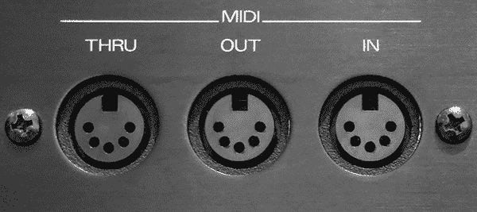

图 6.1：带有五针接口的 MIDI 设备

不过，如果你需要将这些设备连接到只有 USB 端口的新设备上，也不必担心，因为 USB 转 MIDI 转换器随处可买，且价格非常低廉。

### 将设备连接到 Studio One

Studio One 将 `MIDI` 控制器称为 `keyboards`（键盘），将 `MIDI` 设备称为 `instruments`（乐器）。我们在 `第 2 章` 中讨论了如何连接和配置这些设备。Studio One 对你可以添加的 `keyboards` 和 `instruments` 数量不设限制。然而，如果你想连接多台设备而电脑没有足够的可用 USB 端口，你会遇到实际限制。如果发生这种情况，请随意添加一个 USB 集线器并将所有设备连接到它上面；`MIDI` 占用带宽极低，标准 USB 集线器能轻松处理多台设备。

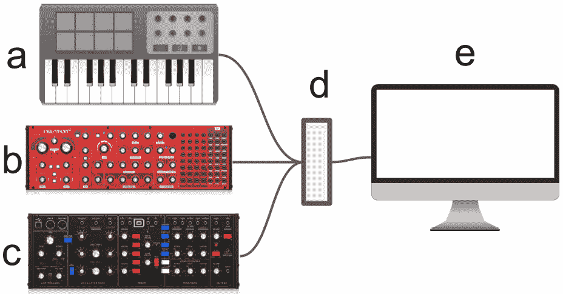

图 6.2：典型家庭工作室设置，包含 (a) 一台 MIDI 键盘、(b) 一台合成器、(c) 另一台合成器、(d) 一个 USB 集线器和 (e) 一台电脑

值得在此重申的是，如果您拥有一体机设备（也称为 MIDI 工作站），其中同时包含 MIDI 键盘和合成器，您将需要在 `Add Device` 窗口中分别将其作为键盘和乐器添加。

现在，让我们转到 Studio One 中的新 Song，将所有这些理论付诸实践。

# 添加和配置 MIDI 乐器

无论您使用的是硬件 MIDI 设备还是软件乐器，Studio One 都能通过简化的拖放工作流程，让您非常轻松地开始录制。让我们来看看每种场景。

## 添加软件乐器

为录制准备虚拟乐器再简单不过了。如果您只打算使用虚拟乐器，只需遵循本节中的步骤，然后跳到下一节“输入和录制 MIDI”。

因此，要添加乐器，请遵循以下步骤：

1. 创建一个新 Song。
2. 打开 `Browse` 窗口。
3. 选择 `Instruments` 选项卡。在这里，您将看到计算机上安装的所有虚拟乐器列表。
4. 在此列表中，找到您想要使用的虚拟乐器。然后，将其拖动并放置到编排窗口的任意位置。
5. Studio One 将启动所选乐器并为其创建一个新的 Instrument Track（乐器轨道）：

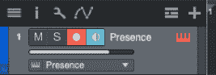

Figure 6.3: An Instrument Track

1. 将声音加载到您的乐器中。随 Studio One 附带的虚拟乐器都有多个声音预设，可供您作为起点使用。您可以在 `Preset` 下拉菜单下找到它们。

    这是随 Studio One 附带的虚拟乐器 `Presence`，自豪地展示其预设选项：

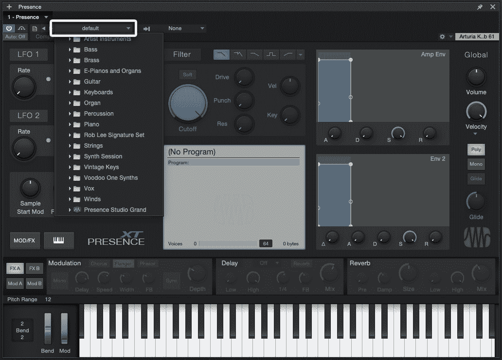

Figure 6.4: The preset drop-down menu in Presence

就这些！您现在已准备好使用虚拟乐器进行工作。

## 添加硬件乐器

将硬件乐器添加到 Song 中稍微复杂一些，但好消息是，您每个乐器只需执行一次此操作。在您的下一个项目中，您就能像虚拟乐器一样直接拖放它们了。让我们开始吧：

1. 创建一个新 Song。
2. 打开 `Mix` 窗口，然后点击左侧栏中的 `External`。这将打开 `External Devices` 面板：

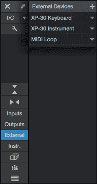

Figure 6.5: The External Devices panel

1. 此面板将列出所有连接到您计算机的 MIDI 设备。找到您想要使用的那个。您会注意到，在 Figure 6.5 中，我那可靠的 Roland XP-30 在此列表中出现了两次——第一次作为键盘，第二次作为乐器。如果您添加的设备也是这种情况，请对乐器应用以下步骤，而不是键盘。
2. 现在，点击所选乐器名称右侧的向下箭头。选择 `Edit…`，这将为您的设备打开一个编辑器窗口：

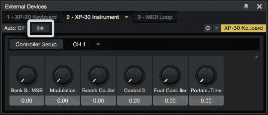

Figure 6.6: The External Devices editor window

1. 点击此窗口上的 `Outputs` 按钮（Figure 6.6 中高亮显示）。
2. 在新的子菜单中，选择 `Add Aux Channel`（`Aux` 代表 `auxiliary`，辅助）。这将在混音台上创建一个新的通道条，我们将用它来监听来自该设备的音频。点击新创建的辅助通道的输入部分。
3. 在这里，选择该乐器连接到的音频设备上的输入。Figure 6.7 显示了具有两个输入（标记为 `Left` 和 `Right`）的典型音频设备的可用选项。选择 `Input L+R - Front Left + Right` 可让此通道接收来自这两个输入的音频。

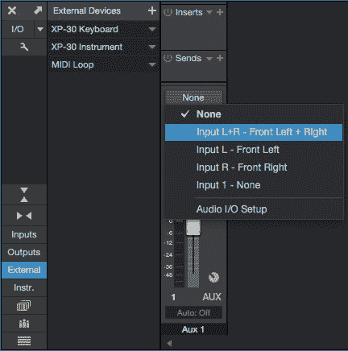

Figure 6.7: Setting the input for an aux channel

1. 返回 `External Devices` 编辑器窗口上的 `Output` 按钮，然后点击 `Save Default`。

就这些！从现在起，将此乐器添加到项目中将像添加虚拟乐器一样简单。在 `Browse` 窗口的 `Instruments` 选项卡上，该乐器现在将列在 `External Instruments` 下：

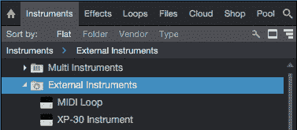

Figure 6.8: The External Instruments section in the Browse window

只需将乐器拖动并放置到 `Arrangement` 窗口的任意位置。您的外部乐器已准备好进行录制！

# 输入和录制 MIDI

在 Studio One 中，有多种输入和录制 MIDI 数据的方法，每种方法都针对不同的目的进行了优化。您可以实时演奏所有内容，用鼠标输入音符，使用音序器，甚至从音频录音创建 MIDI 数据。在本节中，我们将详细介绍所有这些方法。

让我们从最基本的一种开始：捕捉现场演奏。

## 使用 MIDI 录制现场演奏

如果您会弹键盘，哪怕只是初学者水平，将您的想法倾注到项目中的最佳方式就是老派方式——按下录制按钮并现场演奏。录制完成后，您将能够编辑您的演奏以达到完美。这消除了压力因素，让整个过程变得轻而易举。一般来说，录制现场演奏比手动输入音符要实用得多。

这听起来都很好，但如果您没有 MIDI 键盘怎么办？

### 使用电脑键盘录制 MIDI

Studio One 允许您像使用乐器键盘一样使用电脑键盘。激活此功能只需按下 `Caps Lock`。这将打开 `Qwerty Keyboard` 窗口：

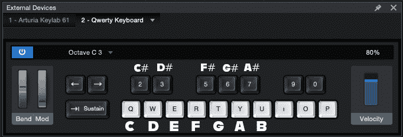

Figure 6.9: The Qwerty Keyboard window ready to generate MIDI data

在标准 QWERTY 键盘上，第一行字母（从 `Q` 到 `P`）对应乐器键盘上的 `white` 键（白键），数字键（从 `2` 到 `0`）对应 `black` 键（黑键）。因此，例如，键盘上的 `Q` 将发出第三八度的 `C` 音，`2` 将发出同一八度的 `C#` 音，依此类推。

如果您所在的国家使用不同的键盘布局，只需使用相同的物理按键，即使它们的标签不同。例如，如果您使用土耳其 F 键盘，请用 `F` 代替 `Q`。

您可以使用左、右箭头键切换八度，并像使用延音踏板一样使用 `Tab` 键。需要一点时间适应，但如果您没有 MIDI 键盘，或者只是想在机场等待时尝试新想法，这是一个很棒的替代方案。

请记住，只要此功能处于激活状态，与这些按键关联的键盘快捷键将无法工作。

### 现场录制演练

现在，让我们从“添加和配置 MIDI 乐器”部分结束的地方继续。到目前为止，您已经创建了一个新 Song 并添加了一个乐器。Studio One 为您创建了一个 Instrument Track 供您操作：

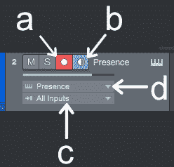

Figure 6.10: Controls on an Instrument Track

请遵循以下步骤在此轨道上录制：

1. `Record` 按钮（Figure 6.10 中的 `a`）为轨道武装以进行录制。确保已启用（红色）。一旦您对录制满意并准备好转到另一轨道，就需要取消激活它。
2. `Monitor` 按钮（Figure 6.10 中的 `b`）充当切换开关，选择与此轨道关联的乐器的输入源。当它处于激活状态（蓝色）时，乐器将响应您的 MIDI 键盘。当它处于非激活状态（灰色）时，您将听到轨道上录制的内容。我们目前还没有录制任何内容，所以保持激活状态。
3. 现在，尝试在您的 MIDI 键盘或 QWERTY 键盘上弹奏几个音符。您应该能听到乐器发出的声音。

4. 如果没有听到任何声音，请确保输入选择器（*图 6.10* 中的 `c`）指向您正在使用的键盘，且输出选择器（*图 6.10* 中的 `d`）指向与此轨道关联的乐器。

5. 使用节拍器录音将使您在想要添加其他乐器或编辑录音时轻松许多。按键盘上的 `C` 键激活节拍器的点击声。如果您需要 Studio One 在开始录音前进行预备拍计数，请按照*第 5 章*所述设置 `Metronome`（节拍器）、`Preroll`（预滚）和 `Precount`（预备拍）选项。

6. 点击 `Record`（录音）按钮或按数字小键盘上的 `*` 键激活录音。

7. 完成后，点击 `stop`（停止）按钮或按 `spacebar`（空格键）。

如果您对录音感到满意，但有个别片段想重新录制，您可以使用 *第 5 章* 中描述的 `Auto Punch`（自动打孔/自动重录）功能，仅重录该部分，同时保留其他所有内容不变。

这就是使用 MIDI 或 QWERTY 键盘录制现场演奏所需的全部步骤。如果演奏中有几个需要修正的错误，请不用担心；您将能够使用 Studio One 强大的编辑工具将演奏编辑至完美，我们将在*第 7 章*中介绍这些工具。

### 循环录音

**循环录音** 是一项便捷功能，它允许您循环歌曲的某个片段，并让 Studio One 无限期地在该片段上录音，直到您点击停止。这省去了您不断手动开始录音、停止、倒带、再开始录音的麻烦。它还能让您专注于演唱或演奏乐器。

在使用 MIDI 乐器时，有两种不同的循环录音模式，它们针对两个截然不同的目的而设计：`Record Takes`（录制采样/分轨录制）和 `Record Mix`（录制混合/叠加录制）。

转到顶部菜单的 `View`（视图）并选择 `Record Panel`（录音面板）以访问这些模式：

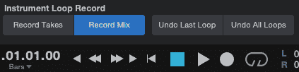

*图 6.11：乐器循环录音面板*

启用 `Record Takes` 后，每当时间线到达循环末尾，它就会跳回开头。Studio One 会在同一轨道内创建一个新图层，并将您的演奏作为新的采样录制在该图层上。等到您点击停止按钮时，您将获得与您允许时间线在该片段内循环的次数相同数量的采样。

这非常适合尝试新想法。录音完成后，您可以从所有不同的采样中挑选最喜欢的片段，创建一个完美编辑的合成采样。您也可以利用此功能专注于演奏一段困难的乐句，直到完全掌握为止。

启用 `Record Mix` 后，Studio One 不会创建新图层，而是会持续在同一图层上录音，直到您点击停止。当您想逐步构建轨道时，这非常有用。例如，在创建鼓点节奏时，您可能想在第一个循环周期中演奏踩镲和军鼓，然后在第二个周期加入踩镲，在后续周期中添加其他打击乐元素，依此类推。如果您演奏得不满意，点击停止，点击 `Undo Last Loop`（撤销上一循环，也显示在*图 6.11* 中），然后重新开始。

一旦您选择了想要使用的循环录音模式，请按照以下步骤开始录音：

1. 将左、右定位器分别设置为您想要处理的歌曲片段的开始和结束位置。

2. 点击 `Loop`（循环）按钮以启用循环。

3. 设置 `Metronome`（节拍器）、`Preroll`（预滚）和 `Precount`（预备拍）（参见*第 5 章*）。

4. 点击 `Record`（录音）按钮或按数字小键盘上的 `*` 键激活录音。

5. 完成后，点击 `stop`（停止）按钮或按 `spacebar`（空格键）。

在本节中，我们迄今为止介绍了使用 MIDI 或 QWERTY 键盘录制现场演奏的方法。现在，让我们来看看输入 MIDI 数据以供虚拟乐器使用的其他方法。

## 手动输入 MIDI 音符

MIDI 最酷的地方之一在于它允许您**编程**演奏，而非实际**演奏**它。这为您打开了令人惊叹的可能性之门。您可以将 MIDI 编程用于雄心勃勃的项目，例如仅用鼠标构建整个管弦乐演奏；也可以用于简单的任务，例如演奏超出您键盘演奏技巧的音乐创意。

Studio One 提供了适合各种场景的 MIDI 编程方法。您可以使用鼠标绘制 MIDI 音符，想多慢就多慢地演奏它们而无需追赶节拍器，或者使用音序器制作可在歌曲中反复使用的详细模式。在本节中，我们将详细介绍这些方法。

### 使用画笔工具绘制音符

输入 MIDI 音符最简单的方法是使用鼠标或触控板。创建新 Song 并添加乐器后，请按照以下步骤使用此基本方法输入音符：

1. 在 `Arrangement`（编排）窗口中，双击乐器轨道的轨道通道。这将创建一个空的乐器片段：

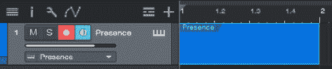

*图 6.12：乐器轨道旁的空乐器片段*

1. 现在，双击这个新的乐器片段。它将在 `Edit`（编辑）窗口中打开。

2. `Edit` 窗口有三种不同的视图选项：

    * `Piano`（钢琴）视图可让您在传统的钢琴卷帘式显示器上查看 MIDI 数据，非常类似于您在任何其他 DAW 软件中看到的界面。这是我们将重点关注的视图，因为它提供了更多编程和编辑选项。

    * `Drum`（鼓）视图针对鼓部件编程进行了优化。它仅显示 MIDI 音符的起始点，并为每个 MIDI 音符显示鼓组中对应部件的名称，如踩镲、军鼓、踩镲等。这是一种过时的 MIDI 处理方式，我建议不要使用此视图。我们将在*创建模式*一节中讨论一种更高效、更有趣的鼓编程方式。

    * `Score`（乐谱）视图允许您使用记谱法输入音符，音符排布在五线谱上。

    这三种视图本质上是查看同一 MIDI 数据的三种不同方式。请继续选择适合您工作流的视图。本节介绍的步骤在所有三种视图中均可通用：

*图 6.13：编辑窗口中的视图选择器*

1. 确保 `Edit` 窗口处于焦点状态（当其周围出现蓝色边框时即表示聚焦），按键盘上的 `3` 选择 `Paint tool`（画笔工具）。如果您愿意，也可以用鼠标激活它，但使用键盘快捷键能让您工作得更快。

*图 6.14：编辑窗口中的工具选择器，已选中画笔工具*

1. 确保 `Snap`（吸附）功能处于激活状态（在*图 6.15* 中高亮显示）。这将确保您输入的 MIDI 音符符合项目的音乐时间基准。仅当您处理自由速度的歌曲，或有意将某些音符放置在音乐网格之外时，才禁用 `Snap`。

2. 现在，打开*图 6.15* 中也显示的 `Quantize`（量化）下拉菜单。此菜单列出了音乐记谱法中最常用的音符长度（菜单中的 `T` 表示三连音，`sw` 表示摇摆音符）。选择您将要输入的音符长度。例如，如果您在此选择十六分音符，则使用 `Paint tool` 输入的每个音符都将吸附到 `Edit` 窗口网格上最近的十六分音符位置，且每个音符的长度将被限制为十六分音符。

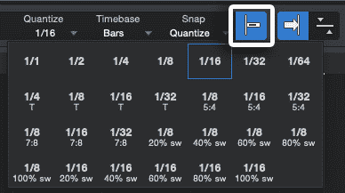

图 6.15：高亮显示“吸附”按钮的“量化”下拉菜单

1. 在钢琴视图中，你还可以为歌曲设置音阶或调式。设置后，画笔工具将不允许你输入该调式或音阶之外的任何音符：

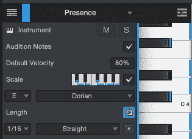

图 6.16：钢琴视图中的音阶量化菜单，设置为 E 多利亚调式

1. 现在，你可以使用画笔工具在编辑窗口中开始输入音符。单击一次即可输入一个时值为你在量化面板中设置的时长的音符。单击并拖动可输入更长或更短的音符。
2. 要查看你输入的每个音符的名称，请使用编辑窗口右下侧的缩放滑块。

用鼠标绘制音符是输入 MIDI 数据最基本的方式。视你的音乐风格而定，这可能就是你所需要的一切，但如果你打算编写复杂的编曲，你会发现这种方法非常耗时。接下来，我们将介绍一些更高级的技巧。

### 步进录制

通常情况下，当你录制现场演奏时，时间轴会随着项目的速度持续推进，你必须精确地跟随它。如果你试图演奏一个困难的乐句却跟不上节奏，你就得反复尝试，直到弹对为止。

使用步进录制，局势反转了。现在，时间轴会等待你，直到你准备好弹奏下一个音符。这对于演奏复杂的乐段非常方便。具体操作如下：

1. 在编排窗口中双击乐器轨道的轨道条。这将创建一个空的乐器片段（见图 6.12）。
2. 双击这个新创建的乐器片段。它将在编辑窗口中打开。
3. 点击步进录制按钮（图 6.17 中高亮显示）：

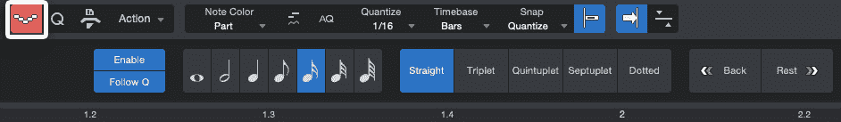

图 6.17：步进录制面板

1. 这将打开步进录制面板。在这里，选择你想要输入的音符长度。
2. 通过点击时间轴标尺上相应的小节号，将时间轴放置在你想要开始输入音符的位置。
3. 使用你的 MIDI 键盘，一次弹奏一个音符。每当你弹奏一个音符，时间轴就会前进一步，对应你在步进输入面板上选择的音符时值。

   如果你没有 MIDI 键盘，也可以使用电脑键盘进行步进录制。按下 Caps Lock 键以激活它。
4. 你不仅限于弹奏单个音符；也可以弹奏和弦（多个音符）。
5. 根据需要，使用步进输入面板上的音长选择器更改音符时值。
6. 使用步进录制面板上的“后退”和“休止”按钮，将时间轴向后移动一步（以添加音符）或向前移动一步（以插入休止符）。
7. 完成后，别忘了点击步进录制面板上的“启用”按钮以停用步进录制。否则，你在键盘上弹奏的所有内容将继续被添加到乐器片段中。

步进录制是一款出色的工具，能让你从录制复杂或困难的乐段的压力中解脱出来。接下来，我们将介绍另一种 MIDI 编程方法，它在重复段落（尤其是鼓点律动）方面表现出色。

### 创建模式

模式音序器允许你创建可在整首歌中使用的简短重复模式。虽然这种编程演奏的方法甚至比 MIDI 本身还要古老，但它经受住了时间的考验，至今仍是编程鼓点律动和旋律琶音的首选方法。

Studio One 让模式编程变得轻而易举。开始吧：

1. 添加你想要创建模式的乐器。这里我们将添加 Impact（Studio One 自带的鼓乐器），因为该方法最常见的用途是编程鼓点律动。要添加 Impact，请在浏览窗口的“乐器”选项卡中找到它，然后将其拖放到编排窗口的任意位置。
2. 使用其预设菜单（图 6.4）将鼓组加载到 Impact 中（或将声音加载到你添加的任何其他乐器中）。
3. 在 Studio One 的顶部菜单中，转到“事件”并点击“插入模式”。这将在你的乐器轨道上插入一个空模式。
4. 双击新创建的模式。这将在编辑窗口中打开模式编辑器：

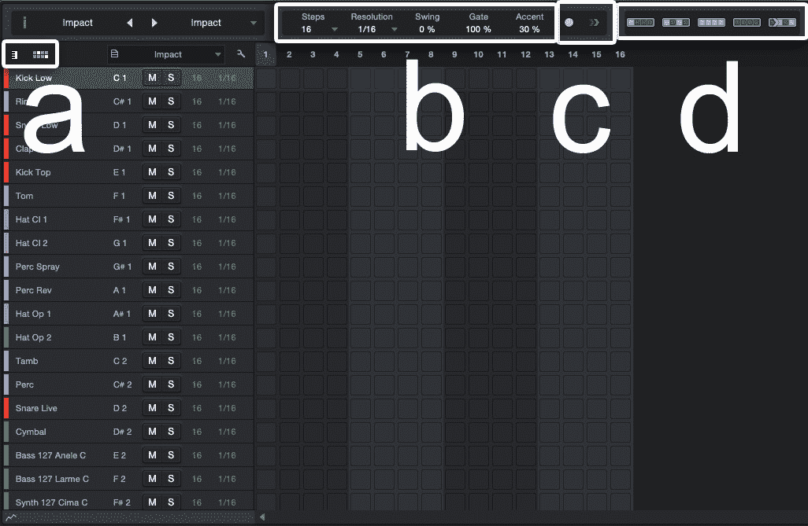

图 6.18：模式编辑器

模式编辑器有两种查看模式：

* 旋律模式适合编程琶音类型的序列
* 鼓模式专为编程鼓点律动而设计

编辑器会根据你使用的乐器显示正确的模式，但如果你想切换到不同的查看模式，可以使用模式视图按钮（图 6.18 中的 a）来实现。

**重要提示**

由于 Impact 是 Studio One 自带的原生乐器，它与模式编辑器紧密集成，加载到 Impact 中的每个声音的名称都会显示在编辑器界面的单独一行上。如果你将模式编辑器与第三方厂商的乐器一起使用，它将无法像这样显示名称，但除此之外，系统将正常工作。

模式编辑器本质上是一个矩阵。你乐器上的每个音符都显示在一行中，而小节中的每个 16 分音符则用一列表示。因此，要在小节的特定位置触发一个音符，你只需找到代表该音符的行与你想要它播放的位置的交点，然后点击它。如果不满意，再次点击同一位置即可将其移除。

这是一种直观的方法，让你能即时获得反馈来构建律动。只需循环播放模式，然后添加或移除音符，直到你满意为止。具体步骤如下：

1. 在编排窗口中选择该模式。
2. 按 P 键在模式周围设置左、右定位点。
3. 按小键盘上的 / 键，或点击循环按钮。
4. 按空格键或点击播放。
5. 在模式编辑器中添加和移除音符，直到你对模式满意为止。
6. 要用 8 分音符或 16 分音符填满整行，请使用提供的快捷键（图 6.18 中的 d）。

**提示**

你也可以在模式编辑器中使用步进录制。点击步进录制按钮（图 6.18 中的 c）激活它，然后按上一节讨论的方法操作即可。

叮镲滚奏和军鼓滚奏是单个鼓声的快速重复，常见于各种音乐流派。它们在模式音序器上执行起来很麻烦，但 Studio One 的模式编辑器让滚奏的实现变得简单：

1. 在你想要实现滚奏的轨道上右键点击。

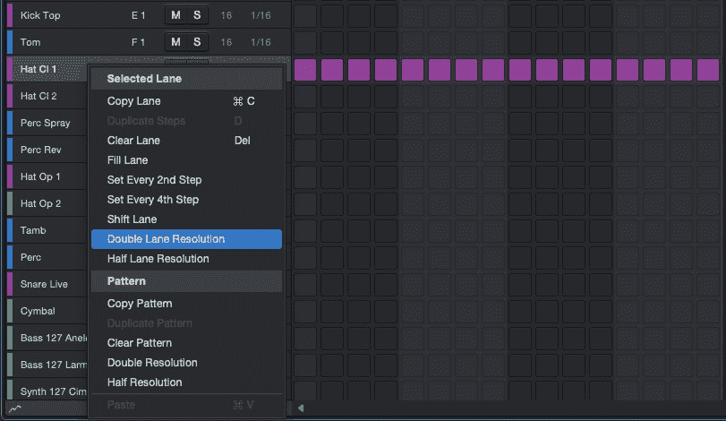

图 6.19：在模式编辑器中增加轨道分辨率

1. 在菜单中，点击“双倍轨道分辨率”。

   默认情况下，每个轨道的一个小节被分为 16 步。点击此命令后，该轨道的分辨率将加倍，给你提供 32 步进行操作。如果你想执行更快的滚奏，可以重复此命令，从而得到 64 步。
2. 拖动光标穿过你想要滚奏发生的区域。

使用全局模式参数（图 6.18 中的 b）来微调律动的感觉：

* “步数”允许你设置模式的长度。你可以用它来编程复杂的节奏型，例如 13/8 这样的奇数拍号。
* “分辨率”设置每步的长度，以标准音符时值为单位。提供了三连音和附点音符的选项。

*   `Swing` 定义了成对步骤之间的时间关系。当其处于 `0`（默认设置）时，一对中的每个步骤持续时间相等。随着摇摆值的增加，一对中的第一个音符会变长，第二个音符会变短，从而产生“摇摆”感觉。

*   `Gate` 设置每个步骤的长度。在其默认值 `100%` 时，每个步骤都以完整长度播放。降低此值会使音符变短，增加则会使其变长。

*   `Accent` 设置重音音符的强调程度。你可以通过按住 `Ctrl`（Windows）或 `Cmd`（Mac）并点击音符，将任意音符设置为重音音符。

你已经创建了完美的模式，但如果在整首歌中反复使用同一个模式，会变得单调乏味。你需要一种方法来创建模式的变奏，并将它们点缀在整首歌中，使其充满动感和激情。让我们开始吧：

1.  点击 `编辑` 窗口左上角的模式检查器按钮。这将打开模式检查器面板：

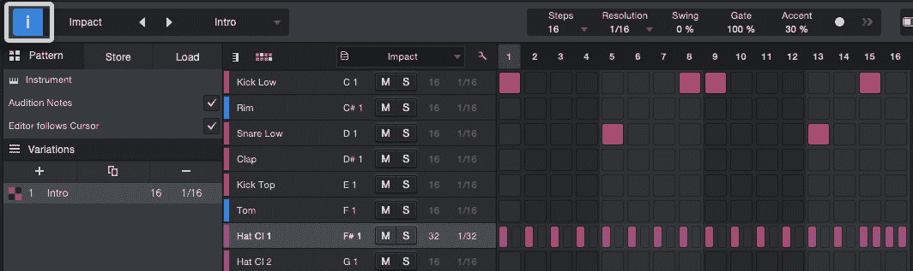

图 6.20：突出显示面板检查器按钮的模式检查器面板

1.  你正在处理的模式会在此处列出，默认名称为 `Intro`。

2.  点击加号形状的新建变奏按钮以创建一个空模式，或点击复制变奏按钮以创建现有模式的副本。

3.  通过点击新创建的模式来选中它。模式编辑器现在将显示新模式中的内容。

4.  编辑新模式，创建一个用于歌曲不同部分的变奏。

5.  按需创建任意数量的变奏。

6.  双击这些变奏的名称，为它们指定描述性的名称。

7.  一旦你创建好了你的模式库，就可以将它们从模式检查器面板拖拽到 `编排` 窗口中。

这总结了我们对 Studio One 丰富的 MIDI 输入方法的介绍。接下来，我们将探讨一种创建 MIDI 数据的更复杂方法：将音频录音转换为 MIDI。

# 使用 Melodyne 将音频转换为 MIDI

直到最近，将音频录音转换为 MIDI 数据还是纯粹的科幻小说。但如今，任何名副其实的 DAW 软件都在其功能列表中拥有此功能。Studio One 捆绑了 `Melodyne`——音频音高检测和校正的行业标准，因此相比竞争对手具有优势。不过要警告的是，这项技术仍处于起步阶段。转换的成功在很大程度上取决于源素材。

让我们看看为了获得最佳结果可以做些什么。

## 选择合适的音频素材类型

音频转 MIDI 的第一步也是最关键的一步，是识别音频录音中的音高或音符。这项任务由音高检测算法执行。该算法的成功在很大程度上取决于两个因素：

*   音高检测最适合单音素材。*单音* 一词在不同语境下有不同含义，所以让我们澄清一下：**单音** 音频素材仅包含一条单一的旋律线（这意味着没有和弦或任何和声素材，也没有任何伴奏）。因此，例如，弹奏单音的吉他是单音源，但弹奏和弦的吉他则不是。

*   当素材允许算法清晰地确定音符开始的位置时，音高检测算法能产生最佳结果。从实际角度来看，这意味着连奏素材（音符相连）比断奏素材（音符分离）更具挑战性。此外，如果音频录音中的演奏包含大量滑入和滑出音符（滑音），算法将难以确定音符的音高和起始点。

即使你的音频素材不符合上述标准，仍有一些技巧可以尝试以从中获益。我们将在下一节介绍这些技巧。

## 音频转 MIDI 演示

创建一个新 Song 后，请按照以下步骤将音频录音转换为 MIDI 数据：

1.  添加你想要使用的虚拟乐器。

2.  接下来，使用其 `Preset` 菜单为该乐器加载一个音色。

3.  找到你想要转换为 MIDI 的音频文件。将其从 `Explorer`（Windows）或 `Finder`（Mac）拖拽到 Song 中。Studio One 将创建一个音频轨道，并将音频录音作为音频事件放置在轨道中。

4.  右键点击此音频事件。在该菜单中，转到 `Audio`，然后点击 `Edit with Melodyne`。这会将音频素材发送给 Melodyne，后者将在 `编辑` 窗口中打开：

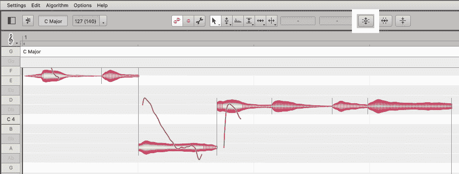

图 6.21：突出显示音高校正宏按钮的 Melodyne

请注意，Melodyne 已检测出音频录音中的所有音高，并以一种类似于 Studio One `钢琴视图` 的布局显示它们（我们在本章前面讨论过）。我们将在 *第 8 章* 中深入探讨 Melodyne。目前，我们将仅执行一个简单操作，以确保没有走音的音符干扰音高检测算法。

1.  按下 `Ctrl` + `A`（Windows）或 `Cmd` + `A`（Mac）以选择所有音符。

2.  点击 `音高校正宏` 按钮。这将打开一个小对话框：

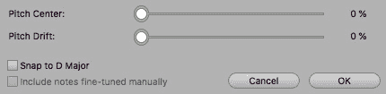

图 6.22：Melodyne 的音高校正宏对话框

1.  将此对话框中的 `音高中心` 和 `音高漂移` 滑块全部拉到 `100 %`。点击 `OK`。

    这是一种修正走音音符的粗略方法，但对于我们这里的目的完全足够。

2.  关闭 `编辑` 窗口。回到 `编排` 窗口，你会看到音频事件上方现在覆盖了一些彩色圆点，叠加在音频波形上。这些就是刚刚创建的 MIDI 音符。

3.  现在你可以将音频事件拖拽到你为虚拟乐器创建的轨道上。Studio One 会将 MIDI 数据复制到 `乐器轨道`。

4.  播放工程，看看转换效果如何。很可能还需要一些手动微调。请参考 *第 9 章* 将转换后的音符编辑至完美。

将音频转换为 MIDI 是一项令人兴奋的功能，它开启了无限的可能性。例如，你可以使用此过程将打击乐录音转换为创建你自己的节奏律动。随着算法的改进，它只会变得更好。

# 总结

在本章中，我们深入探讨了 Studio One 用于录制和输入 MIDI 数据以供虚拟乐器使用的多种方法。我们涵盖了各种音乐制作场景，并讨论了针对给定工作流程的最佳方法选择，包括实时录制音符、用鼠标绘制音符或使用步进音序器编程音符。

到目前为止，我们专注于创作并将音乐想法倾注到项目中。在本书的下一部分，我们将讨论如何使用 Studio One 出色的编辑工具来重新加工和改进这些想法。我们将从在下一章深入探讨全局编辑工具开始，为贯穿全书的编辑最佳实践奠定基础。
