## 第 7 章：编辑和重新排列您的 Song

在音乐制作中，**编辑**是将粗略的音乐录音精雕细琢至完美的过程。这涵盖了广泛的应用，范围从琐碎的工作到高度创造性的工作。现在的音乐制作人花在编辑上的时间比制作流程的任何其他阶段都多，精通编辑至关重要。在本书的这一部分，我们将深入探讨 Studio One 的编辑工具，以及如何利用它们将您的项目提升到一个全新的水平。

在本章中，我们将讨论编辑工具和模式，以及如何使用它们在 `Arrangement` 窗口中处理素材。然后，我们将探索 Studio One 的 `Arranger Track`，并使用它在 Song 层面编辑您的项目，以轻松执行复杂任务，例如重新排列歌曲的片段。

在本章中，我们将涵盖以下主题：

*   探索编辑工具
*   理解 Snap 及各种 Snap 模式
*   使用 `Arranger Track` 编辑歌曲
*   使用 `Launcher` 尝试新想法

## 技术要求

要学习本章，您需要在计算机上激活 Studio One。

## 探索编辑工具

Studio One 有八个编辑工具，它们位于 `Arrangement` 窗口的顶部：

图 7.1：从左到右的编辑工具 – `Arrow`、`Range`、`Split`、`Eraser`、`Paint`、`Mute`、`Bend` 和 `Listen`

您可以通过单击来激活这些工具，但如果您学习以下键盘快捷键在它们之间切换，将能提高编辑工作流的速度：

*   `1` 激活 `Arrow` 工具
*   `2` 激活 `Range` 工具
*   `3` 激活 `Split` 工具
*   `4` 激活 `Eraser` 工具
*   `5` 激活 `Paint` 工具
*   `6` 激活 `Mute` 工具
*   `7` 激活 `Bend` 工具
*   `8` 激活 `Listen` 工具

现在，让我们深入了解一下这些工具中的每一个。

### Arrow 工具

`Arrow` 工具是 Studio One 中迄今为止最常用的编辑工具，这是有充分理由的：它可用于各种任务，而其他工具则服务于非常特定的目的。

以下是您可以使用 `Arrow` 工具执行的基本操作列表，按键盘上的 `1` 即可激活它：

*   在 `Arrangement` 窗口中单击事件可将其选中。您可以在单击时按住 `Ctrl`/`Cmd` 键来选择多个事件。当 `Arrangement` 窗口中有多个事件且您从顶部菜单运行命令时，Studio One 将仅对选定的事件应用该命令。
*   双击事件可在 `Edit` 窗口中将其打开。
*   右键单击事件将打开一个上下文菜单，其中列出了与该特定事件相关的所有可用参数和设置。
*   单击并拖动事件可移动它。
*   在按住 `Alt` (Windows) 或 `Option` (Mac) 键的同时单击并拖动事件可创建其副本。

然而，`Arrow` 工具的功能远不止这些基本功能；让我们看看它能执行的更高级任务。

#### 调整事件大小

`Arrangement` 窗口中的**事件**是音频或 MIDI 录音的可视化表示。通常，它从录音的开头延伸到结尾：

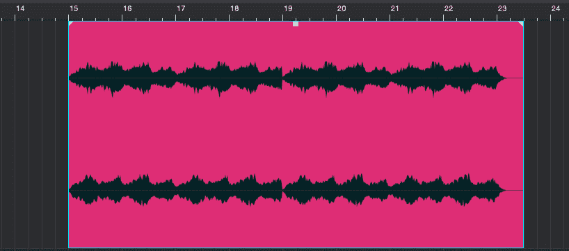

图 7.2：一个音频事件

图 7.2 中的事件代表一段音频录音，它从第 15 小节的开头开始，到第 23 小节的中间结束，如顶部标尺所示。假设您想修剪此事件，使其仅在第 17 小节和第 21 小节之间播放。以下是使用 `Arrow` 工具轻松实现的方法：

1.  将鼠标悬停在事件的左边缘。光标将变成双向箭头。
2.  单击并向右拖动事件边缘，直到到达第 17 小节的开头。
3.  现在，将鼠标悬停在右边缘。
4.  单击并向左拖动，直到到达第 21 小节的开头。

使用此方法调整事件大小是非破坏性的；它不会删除您的录音。它只是告诉 Studio One 忽略被修剪掉的部分。如果您稍后改变主意，随时可以使用 `Arrow` 工具将事件恢复到其原始大小，或介于两者之间的任何位置。

> **提示**
>
> 调整 MIDI 事件大小的方式相同。

#### 循环事件

您可以将任何音频或 MIDI 事件设置为在整个 Song 中循环，然后使用 `Arrow` 工具微调循环行为（即设置事件的哪一部分将被循环以及循环多长时间）。操作方法如下：

1.  右键单击您想要循环的事件。
2.  在事件的上下文菜单中，点击 `Loop` 复选框。事件将循环至您的 Song 末尾。
3.  现在，转到 Song 的末尾，将鼠标悬停在循环的末端。`Arrow` 工具会瞬间变形，如图 7.3 所示。`Arrow` 工具的这一隐藏功能称为 `Looping tool`。

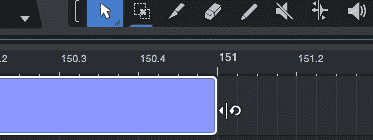

图 7.3：`Looping` 工具

4.  使用 `Looping` 工具将循环的末端拖动到您想要结束的位置。

`Looping` 工具还有更令人兴奋的功能：您可以用它来调整循环片段的长度，以尝试不同的创意可能性。例如，如果您的歌曲是 4/4 拍，并且您有一个持续一小节的节奏型，您可以使用 `Looping` 工具将该型修剪为较短的值（例如，仅三拍）或延长为较长的值（例如，六拍）。这将使循环以不同于歌曲中其他元素的周期重复，从而产生更有趣的复节奏结构。要执行此操作，请将鼠标悬停在循环第一个片段的下端。一旦箭头变成 `Looping` 工具，即可随心所欲地调整片段大小。

#### 时间拉伸

想象一下，您正在为广告制作音乐。广告代理公司告知您广告开头会有旁白，因此您准备了一段开头安静的音乐床来容纳旁白。随后，您收到了旁白录音，发现它有点太长了：

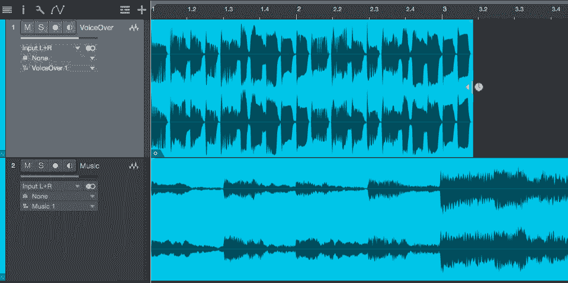

图 7.4：旁白录音（顶部轨道）超出了音乐床的安静部分（底部轨道）

如前一节所述调整旁白录音大小在这里行不通，因为它会切掉广告语的最后一小段。我们希望能够压缩整个录音以适应所需空间。这可以通过时间拉伸来实现，而且非常容易操作。以下是使用 `Arrow` 工具的步骤：

## 时间拉伸

1. 将鼠标悬停在您想要应用时间拉伸的事件的右边缘。在我们的示例中，这将是旁白录音。

2. 按住 `Alt` (Windows) 或 `Option` (Mac) 键。光标将变成一个带有时钟图标的箭头，如图 7.4 所示。

3. 在不松开按键的情况下，将事件的边缘向左拖动以缩短它，或向右拖动以延长它。

就是这么简单！如果您缩短事件，它将播放得更快。如果您延长它，它将播放得更慢。这种时间拉伸方法不会改变录音的音高，因此您的旁白演员听起来不会变成花栗鼠或达斯·维达的声音。

近年来，时间拉伸算法有了巨大的改进，但请记住，如果您大量应用它（例如，超过事件原始大小的 20%），明显的伪影将开始出现。

### 应用淡入淡出

对音频事件应用淡入淡出是音乐制作中最常见的任务之一。**淡入** 是事件开始处音量的逐渐增加。您可以用它来平滑事件开头可能存在的任何突兀声音，从而自然地进入事件。**淡出** 是事件结束处音量的逐渐减少。它通常用于平滑地结束事件。

应用淡入淡出很简单。抓取 **箭头** 工具并遵循以下步骤：

1. 将鼠标悬停在您想要应用淡入淡出的事件上。您将在其左上角和右上角看到两个微小的白色三角形（如图 7.2 所示）。

2. 要应用淡入，请点击左侧的三角形并将其向右拖动。

3. 要应用淡出，请点击右侧的三角形并将其向左拖动。

4. 当您拖动三角形时，音量的变化将显示为一条斜线，横跨在事件的开头或结尾。您会注意到这条线上出现了一个小白方块，如图 7.5 所示。您可以上下移动此方块，将线条变为曲线，并尝试不同的淡入淡出时机。

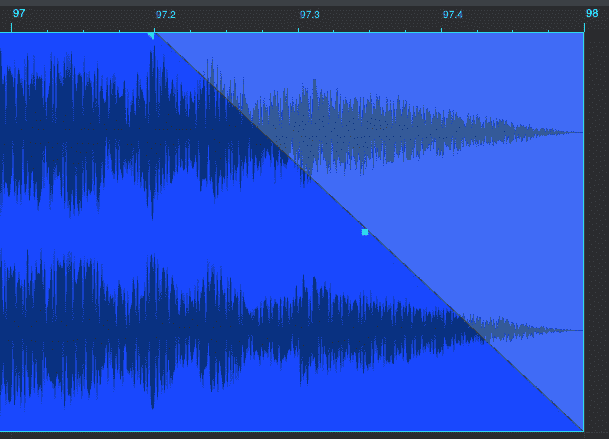

请注意，如果您在应用淡入淡出后调整事件的大小，Studio One 会将淡入淡出随事件的开头或结尾一起移动，因此可能需要手动修正。

### 调整增益

您可以调整单个音频事件的增益电平。这对于平衡不一致的音频录音的电平很有用，我们将在第 8 章中看到这一点。它也是混音音乐的重要组成部分，我们将在第 11 章中讨论。以下是如何使用 **箭头** 工具调整增益：

1. 将鼠标悬停在您想要更改增益的事件上。一个小方块将出现在其上边缘（如图 7.2 所示）。

2. 向上拖动此方块以增加增益，向下拖动以减小增益。

3. 当您拖动方块时，Studio One 将以分贝为单位显示增益变化的量。零值表示未做任何更改，正值表示增益正在增加，负值表示正在减小。

4. 如果您想进行更精细的调整，请在拖动时按住 `Shift` 键。

如果事件上有淡入淡出，然后您决定更改其增益，Studio One 将自动缩放淡入淡出以匹配新的增益值。

> **提示**
>
> 虽然 *增益* 和 *音量* 这两个术语经常互换使用，但它们之间有一个重要的区别。**增益** 是指音频设备输入端的信号电平——在本例中是指音频轨道。更改增益会改变馈送到音频轨道上所有效果插件的电平，并会影响它们处理声音的方式。另一方面，**音量** 是音频轨道输出端的信号电平。更改音量只会改变信号的响度，而不会影响其音色特性。

### 滑动编辑

**滑动编辑** 在保持音频事件长度不变的同时，允许您在时间轴上向前或向后移动其内容。它通常与其他编辑方法结合使用，例如调整大小和时间拉伸。要对音频录音进行滑动编辑，请遵循以下步骤：

1. 在按住鼠标于音频事件下半部分的同时，按住 `Ctrl` + `Alt` (Windows) 或 `Cmd` + `Option` (Mac) 键。光标将变成一个双向箭头。

2. 在不松开按键的情况下，将音频事件的内容向左或向右拖动。

请注意，您只能在事件所包含的实际录音长度范围内滑动音频事件。

### 选择替代工具

有时，您可能会发现自己在 **箭头** 工具和另一个工具之间不断切换。在这种情况下，点击 **箭头** 工具图标以打开 **替代工具** 菜单：

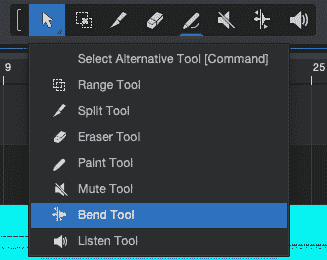

在这里，选择您经常使用的另一个工具。现在，当您想要切换到替代工具时，只需在键盘上按下 `Ctrl` (Windows) 或 `Cmd` (Mac) 即可。

到目前为止，我们已经讨论了可以使用箭头工具执行的任务。现在，让我们继续介绍其他编辑工具，它们将允许您在 **编排** 窗口中直接使用鼠标与事件进行交互。您使用这些工具执行的所有操作都是非破坏性的，并且可以撤销，所以请随意尝试和探索！

## 范围工具

到目前为止，我们一直使用 **箭头** 工具，它允许您操作整个事件。但如果您只想处理事件的一小部分怎么办？这就是 **范围** 工具的用武之地。此工具可让您选择音频或 MIDI 事件内的特定区域。然后，该选定区域本身将被视为一个单独的事件。这对于仅对事件的特定部分应用命令，或剖析事件以进行进一步编辑非常有用。

要使用 **范围** 工具，只需按键盘上的 `2` 选择它，然后拖动选择您想要的区域。您可以通过按住 `Shift` 键进行多重选择。您也可以垂直拖动以选择位于多个轨道上的多个事件上的相同区域。

当您使用 **范围** 工具选择一个区域并双击它时，Studio One 将创建一个覆盖该区域的新事件，从而无需使用 **分割** 工具。在您想要选择并删除录音的多个部分的情况下，这是一个巨大的时间节省。

**范围** 工具可以与 **箭头** 工具链接，创建一个具有超级功能的工具。要做到这一点，请点击 **编辑工具** 菜单左侧的括号（图 7.1）。现在，当您将光标移至事件的下半部分时，您将获得 **箭头** 工具，而在事件的上半部分，您将拥有 **范围** 工具。这样，您就可以选择一个区域，然后像移动、复制或调整单独事件一样对其进行操作。

## 分割工具

**分割** 工具将事件分割为多个事件。按键盘上的 `3` 激活它。现在，当您在 **编排** 窗口中移动鼠标时，一条垂直线将跟随光标，允许您使用标尺作为参考，精确定位您想要分割事件的位置。

如果您选择了跨多个轨道的多个事件，用 **分割** 工具点击其中任何一个将同时在同一位置分割所有选定事件。

## 橡皮擦工具

`Eraser` 工具可删除 `Arrangement` 编排窗口中的事件。只需按键盘上的 `4` 即可激活它，然后单击要删除的任何事件。您也可以拖动选择多个事件，一次性将它们删除。如果选中了多个事件，单击其中任何一个都会导致所有选中事件被删除。

## Paint 工具

`Paint` 工具在 `Arrangement` 编排窗口中具有多种不同功能：

*   通过在该轨道的音轨空白处单击并拖动，可在乐器轨道上创建一个空事件。
*   为编曲轨道创建歌曲片段，我们将在本章后面的 *使用编曲轨道编辑* *歌曲* 一节中讨论此功能。
*   为和弦轨道创建和弦符号，我们将在 *第 9 章* 中讨论此功能。
*   修改自动化数据，我们将在 *第 13 章* 中看到此功能。
*   修改音频事件的 `gain envelopes`（增益包络）。增益包络允许您精确更改事件中的增益电平，以便在必要时强调或隐藏音频录音的某些部分。要查看事件的增益包络，请右键单击它并勾选 `Gain` `Envelope` 复选框：

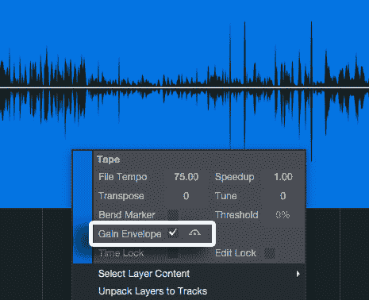

图 7.7：增益包络复选框

事件内部将出现一条白线。现在您可以使用 `Paint` 工具在这条线上添加点，以便在需要更改增益电平的位置进行调整。然后您可以上下移动这些点，根据需要增加或降低增益。

现在，让我们仔细看看 *图 7.7*。穿过音频事件中间的白线代表该事件的增益值。最初它是一条直线，意味着事件从开始到结束以相同的增益电平播放。请注意，事件中间有一个相对安静的部分，波形较小表示。通过使用 `Paint` 工具，您可以重绘白线以增加该部分的增益，如下所示：

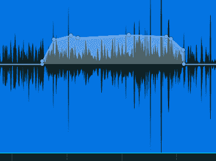

图 7.8：使用 Paint 工具重绘增益包络

当您以这种方式使用 `Paint` 工具修改线条时，可能会发现线条相当生硬。幸运的是，`Paint` 工具附带了多种替代绘图形状，可提供更精确、平滑的控制，帮助您获得完美的结果。单击并按住 `Paint` 工具图标以访问这些形状：

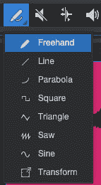

图 7.9：Paint 工具的形状选项

默认选中的 `Freehand`（自由绘制）选项允许您自由绘制，但可能会产生颠簸的结果，如 *图 7.8* 所示。若要获得更平滑的结果，请尝试 `Line`（直线）、`Parabola`（抛物线）和 `Transform`（变换）选项。当您想要创建周期性变化的自动化曲线或增益包络时，`Square`（方波）、`Triangle`（三角波）、`Saw`（锯齿波）和 `Sine`（正弦波）选项非常完美。

## Mute 工具

`Mute` 工具可将您单击的音频或 MIDI 事件静音。您也可以拖动选择多个事件，一次性将它们静音。如果选中了多个事件，单击其中任何一个都会导致所有选中事件被静音。

## Bend 工具

`Bend` 工具用于通过添加、操作和移除 `bend markers`（弯曲标记）来对音频事件的部分进行时间拉伸。为了理解什么是弯曲标记以及它们如何工作，让我们看看这段鼓录音：

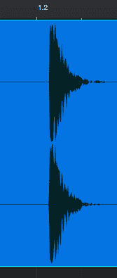

图 7.10：鼓录音

*图 7.10* 中波形的尖峰是军鼓击打声。它本应正好落在第一小节的第二拍上（标尺上显示为 `1.2`），但鼓手稍微晚了一点。幸运的是，我们可以通过使用弯曲标记轻松修复此问题。操作方法如下：

1.  右键单击事件并勾选 `Bend` `Marker` 复选框：

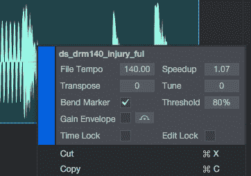

图 7.11：弯曲标记复选框

1.  按键盘上的 `7` 激活 `Bend` 工具。
2.  现在，通过单击事件添加三个弯曲标记：一个在军鼓击打前的空白处，一个在击打后的空白处，一个正好在击打开始处，如下所示：

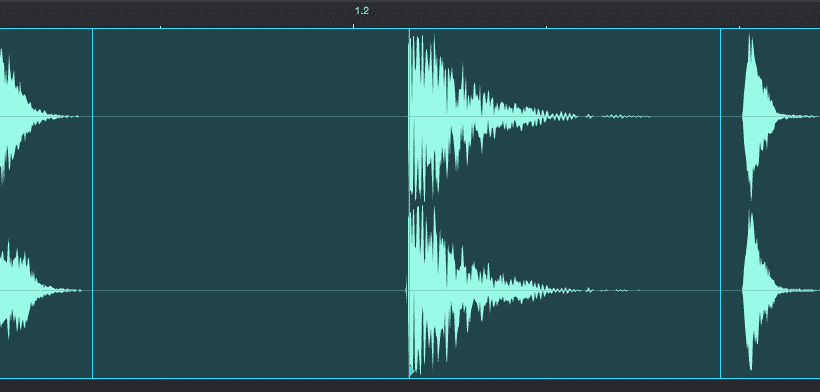

图 7.12：在鼓击打处及周围插入的弯曲标记

1.  现在您可以拖动军鼓击打开始处的弯曲标记，将其移至正确位置。我们之所以在击打前后的空白处添加标记，是因为我们不想移动事件中的其他任何内容。此处应用的任何时间拉伸都将限制在这些额外弯曲标记之间的区域内。

我们将在 *第 8 章* 中详细讨论音频弯曲。

## Listen 工具

`Listen` 工具可让您试听单个音频或 MIDI 事件的特定部分。按键盘上的 `8` 激活它，然后单击并按住事件。Studio One 将把该事件关联的轨道独奏，并从您单击的位置开始播放。播放将持续到您松开鼠标按钮为止。此工具可用于即时试听事件内容，尤其是在大型项目中。

至此，我们已完成对 Studio One 编辑工具的介绍。接下来，我们将讨论吸附功能，这是一项至关重要的功能，必须正确设置才能在编辑歌曲时获得最佳结果。

# 理解吸附及各种吸附模式

编辑音乐是一个需要精确度的繁琐过程。我们不能只是拖动事件并希望它落在正确的位置。Studio One 通过使用 `Snap`（吸附）功能帮助我们克服这一问题，这是一种自动对齐功能，可确保我们执行的任何编辑操作都能与音乐网格或其他事件完美对齐。

吸附会影响上一节讨论的所有编辑工具的行为。因此，当您使用 `Arrow`（箭头）工具移动事件、使用 `Range`（范围）工具选择区域或使用 `Split`（分割）工具分割事件时，`Snap`（吸附）都会自动对齐这些操作。

吸附默认处于激活状态，大多数情况下您都希望保持这种状态。如果您需要进行一些不需要与任何内容对齐的微小外科手术式编辑（例如移除呼吸声），可以通过按键盘上的 `N` 或使用 `Snap`（吸附）切换按钮来关闭吸附：

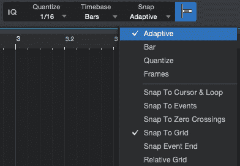

图 7.13：吸附选项——最右侧是吸附切换按钮

吸附功能有多种模式，可适应各种使用场景。这些模式可通过 *图 7.13* 中的 `Snap`（吸附）下拉菜单访问和选择。现在，让我们仔细了解一下这些模式。

## 吸附到网格

在典型的音乐制作工作流程中，您希望所有编辑操作都与音乐上有意义的时间点对齐：小节、拍子或各种音符长度。`Snap To Grid`（吸附到网格）选项正是执行此操作：它在 `Arrangement`（编排）窗口上叠加一个网格，并确保您执行的任何编辑操作都精确吸附到该网格。

要在此模式下工作，请打开 *图 7.13* 中的 `Snap`（吸附）下拉菜单并选择 `Snap To Grid`（吸附到网格）。在同一菜单上，使用以下选项设置网格的灵敏度：

*   `Adaptive`（自适应）会根据您的缩放级别动态更改网格的分辨率。如果您完全缩小，只能吸附到小节的开头。随着您放大，您将能够吸附到小节内的拍子，然后是八分音符、十六分音符，依此类推。

## Snap 选项详解

### Bar 与 Quantize

*   **`Bar`** 将网格限制在小节的起始位置。如果你想要放大查看但限制编辑操作，使其仅吸附到小节的开头，请选择此选项。

*   **`Quantize`** 允许你为吸附网格设置特定的音符长度值，而不受缩放级别影响。例如，如果你希望所有内容都吸附到八分音符，请在此处选择 **`Quantize`** 选项，然后在 *Figure 7.13* 的 **`Quantize`** 下拉菜单中选择 **`1/8`**。

接下来，让我们看看 **`Snap to Grid`** 的一个变体 —— **`Relative Grid`**。

## Relative Grid

**`Relative Grid`** 是 **`Snap To Grid`** 的一个变体，具有更具体的应用场景。假设你有一个事件开始于小节线之前：

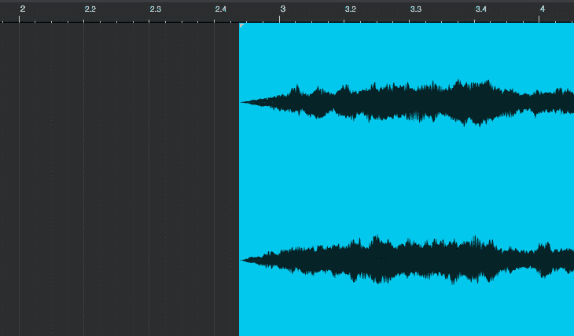

Figure 7.14: An event that starts before the beginning of a bar

*Figure 7.14* 中的事件开始于第 3 小节稍前。它在视觉上未对齐，但有时这在音乐上讲得通，你可能想保持这种状态。现在，假设你决定在歌曲开头添加一个新段落。为了给该段落腾出空间，你想将所有内容在时间上向前移动四小节。这意味着将该事件移动到第 7 小节。如果选择了 **`Snap To Grid`**，当你移动此事件时，它将吸附到第 7 小节的开头，这不是我们想要的。我们希望它开始于第 7 小节稍前的位置，就像它在第 3 小节时那样。换句话说，我们想要在保持事件相对于小节网格起始位置的相对位置不变的情况下移动它。要做到这一点，只需选择 **`Relative Grid`** 并将其拖动到第 7 小节。它将吸附到相对于该新小节的确切相对位置。

将事件吸附到音乐网格是大多数音乐制作工作所需的全部功能，但对于音频后期制作的其他领域（如编辑对白或处理音效），音乐网格变得无关紧要。幸运的是，**`Snap`** 功能拥有许多其他模式，通过协助我们在这些领域工作，使生活更轻松。

## Snap To Cursor & Loop

选择 **`Snap To Cursor & Loop`** 后，时间轴上的光标和标尺上的循环指示器将变得具有磁性。你在其附近执行的任何操作都将吸附到它们。这对于在项目的特定点工作非常有用：只需选择此模式，将光标放置在该点，然后尽情编辑，确信所有内容都将完美对齐到该点。

此模式不如 **`Snap To Grid`** 刚性。它也允许你在其他点拖动或分割对象。只有当你在光标和循环定位器附近工作时，才会注意到它们的磁性吸引力。

此模式可以与 **`Snap To Grid`** 或 **`Relative Grid`** 模式同时激活，因此如果你正在处理非音乐项目，请务必取消选择那些模式。

## Snap To Events

**`Snap To Events`** 允许 **`Arrangement`** 窗口中的事件相互吸附。假设你在轨道 1 上有一个事件，它恰好开始于你想要的位置。现在，你在轨道 2 上添加另一个事件，并希望这个新事件与轨道 1 上的事件在完全相同的时刻开始。选择 **`Snap To Events`** 后，当你拖动轨道 2 上的新事件时，它将精确吸附到轨道 1 上事件的开头。

## Snap Event End

通常，当你拖动事件时，**`Snap`** 功能会根据所选模式将其开头对齐到规定的点。启用此选项后，你也可以将事件的结尾吸附到可用的吸附位置。

## Snap To Zero Crossings

如果你双击音频事件在 **`Edit`** 窗口中打开它，然后极度放大，你会看到它围绕一条水平线振荡：

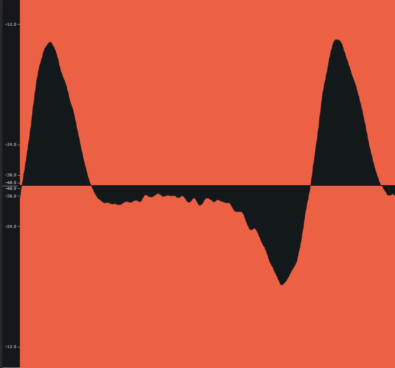

Figure 7.15: Close view of an audio waveform

这基本上是扬声器锥体播放该音频素材时运动方式的可视化表示。将水平线视为锥体的静止位置。线以上意味着锥体向前运动，线以下表示其向后拉回。

如果你使用 **`Split`** 工具或 **`Arrow`** 工具修剪在随机点切割此波形，这将打断扬声器锥体的平滑运动，导致可听的伪影，称为“爆音”。启用 **`Snap To Zero Crossings`** 可确保你执行的任何编辑都将吸附到波形穿过水平线的最近点。这些点称为 **`zero crossings`**。在这些点上，扬声器锥体将处于静止位置，不会产生爆音。

始终保留此选项启用。它会导致编辑位置轻微偏移，但仅在毫秒级范围内，不会被察觉。

到目前为止，在本章中我们已经介绍了 Studio One 的编辑工具和 **`Snap`** 选项。掌握这些信息后，你现在已准备好在 **`Arrangement`** 窗口中处理任何编辑任务。然而，随着项目的增长，处理分布在多个轨道上的大量事件可能会变得难以应付，可能需要一些额外的帮助。幸运的是，Studio One 有一个专为此目的设计的工具，我们将在下一节学习如何使用它。

# 使用 Arranger Track 编辑歌曲

一首乐曲通常包含多个段落。根据流派不同，一个段落可能是交响乐中的乐章、爵士编曲中的主题、流行歌曲中的副歌，或 EDM 曲目中的 Drop。

创作乐曲时，我们几乎从不知道它将包含多少段落以及它们的顺序。随着歌曲的发展和这些段落的演变，我们可能想尝试通过打乱段落顺序来实验歌曲的结构。有时，这成为一种必要；例如，客户可能要求我们交付歌曲的多个版本 —— 一个适合电台播放的短版本、一个较长的专辑版本，甚至一个更长的俱乐部版本。

所有这些场景都需要在项目中打乱大量音频和 MIDI 事件。这是一项潜在混乱且极易出错的任务。Studio One 的 **`Arranger Track`** 是一项旨在轻松且非破坏性地移动、复制、删除或以其他方式操作歌曲整个段落的功能，在处理大型项目时尤为救命。

要使用 Arranger Track，请执行以下步骤：

1.  点击 **`Global Track Visibility`** 按钮并选择 **`Arranger`**。这将使 Arranger Track 可见。
2.  按键盘上的 *`5`* 选择 **`Paint`** 工具。
3.  如果 **`Snap`** 尚未激活，请按键盘上的 *`N`* 启用它。
4.  在 Arranger Track 上点击并拖动 **`Paint`** 工具，以覆盖你想要定义为段落的每个区域。根据需要添加任意数量的段落。以下是一个在 Arranger Track 上创建了多个段落的示例项目：

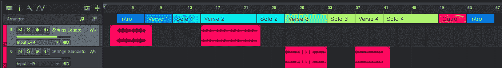

Figure 7.16: Several sections of a song marked on an Arranger Track

5.  添加新段落时，Studio One 会自动为其命名和着色。右键点击段落以根据需要更改其名称和颜色。
6.  现在你可以使用 **`Arrow`** 工具在 Arranger Track 上移动或复制段落。这些段落中包含的所有事件都将随之移动。请记住，复制事件的快捷方式是在拖动时按住 *`Alt`* / *`Option`* 键。
7.  要从歌曲中删除一个段落及其包含的所有事件，请右键点击它并在弹出菜单中选择 **`Delete Range`**。

注意，当您使用 `Arranger Track` 复制片段时，这些副本会成为独立的实体，因此您可以单独处理每一个副本，以基于原始素材创建变体。

# 使用 Launcher 尝试新想法

`Launcher` 是 `Arrange` 窗口的伴侣。它允许您尝试不同的想法并塑造您的音乐，而不会弄乱现有的编排。如果您来自另一款优秀的 DAW 软件 Ableton Live，您可以将 Launcher 视为 `Session` 视图。对于其他所有人来说，这将是一个彻底的范式转变，所以让我们直接开始吧。

一旦您在歌曲上工作了一段时间并已就位基本元素，您通常会开始考虑如何组合这些元素——从前奏开始，您将拥有轨道 A、B 和 C，然后进入主歌部分，您将添加轨道 D、E 和 F，依此类推。通常，我们在 `Arrange` 窗口中以线性方式排列这些轨道，歌曲的开头在左侧，结尾在右侧。而 Launcher 则允许您以任何您想要的方式组合这些轨道。具体方法如下：

1. 通过点击其图标（*Figure 7.17* 中的 *a*）打开 `Launcher`：

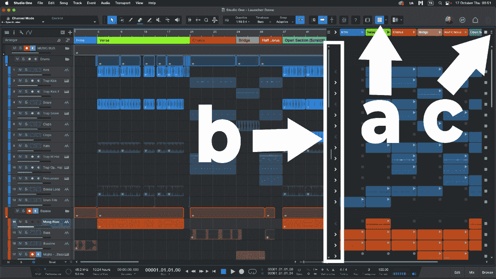

图 7.17：Launcher

2. 现在，您可以将 `Arrange` 窗口中的任何元素拖放到 Launcher 中。如果您已经在 `Arranger Track` 上标记了歌曲的片段，正如我们在前一节讨论的那样，您也可以直接拖放这些片段。

3. 有趣的部分来了：您可以在不更改 `Arrange` 窗口中任何内容的情况下，在 Launcher 中随意调整元素顺序。这使您能够在歌曲中尝试完全不同的组合，而原始编排保持完好。

4. 分隔 Launcher 和 `Arrange` 窗口边框上的箭头（*Figure 7.17* 中的 *b*）决定了点击播放按钮时会发生什么。如果某轨道的箭头指向左侧，该轨道将播放 `Arrange` 窗口上的内容。如果箭头指向右侧，它将从 Launcher 播放。这使您能够结合两个窗口的想法。

5. 乐趣不止于此！Launcher 拥有自己的 `Playlist`，可通过点击其右上角的图标（*Figure 7.17* 中的 *c*）访问。

6. 打开 `Playlist` 窗口后，您将看到迄今为止您一直在处理的歌曲片段被列为 `Scenes`（*Figure 7.18* 中的 *a*）。将这些 Scene 拖放到该窗口上半部分标题为 `Playlist 1` 的区域。在这里，您只需更改播放列表上的顺序即可调整歌曲片段的顺序。这比在 `Arrange` 窗口中复制粘贴容易得多，对吧？

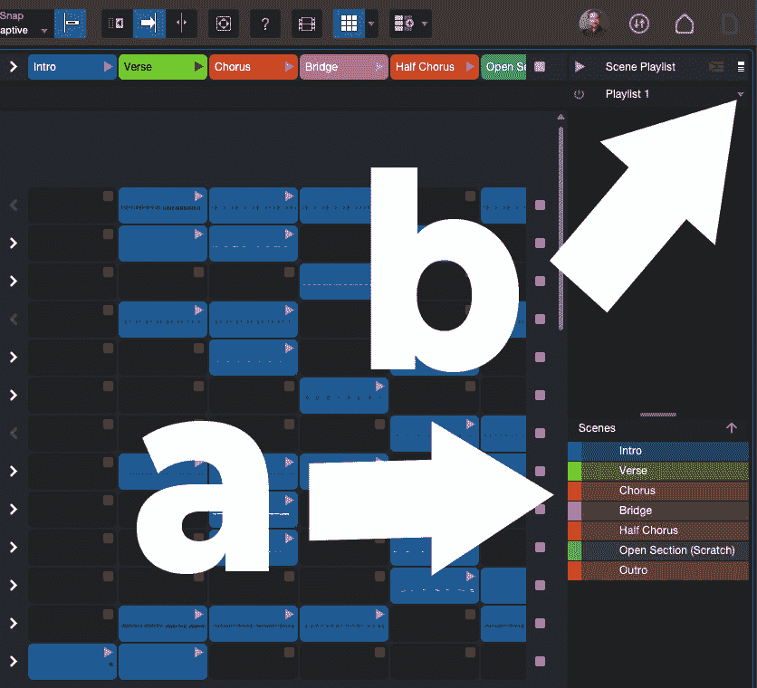

图 7.18：Launcher 的 Playlist 部分

7. 对新编排满意后，点击 `Playlist` 窗口上的小向下箭头（*Figure 7.18* 中的 *b*）。

8. 点击 `Insert Playlist into Song`。这将打开一个对话框（*Figure 7.19*）。

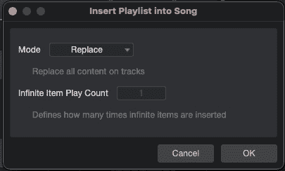

图 7.19：Insert Playlist into Song 对话框

9. 在这里，在 `Mode` 下拉菜单中选择 `Replace` 选项，将 Launcher 中的内容插入 `Arrangement` 窗口。如果您仍想保留原始编排，请转到顶部菜单的 `File`，选择 `Save As`，并为此歌曲指定一个不同的名称。

此方法允许您创建任意数量的不同版本的歌曲——创建专辑版、较短的电台友好版、延长的俱乐部版，无论您喜欢什么。

在本节中，我们学习了如何利用 Studio One 中 Launcher 这一新功能的强大功能，轻松更改歌曲的编排。这结束了我们对 Studio One 编辑工具的介绍。

# 总结

在本章中，我们深入探讨了 Studio One 的编辑工具，并学习了如何在 `Arrangement` 窗口中使用它们。我们还讨论了 Snap 和 `Arranger Track`，这两个关键功能与这些工具协同工作，使编辑变得更加容易。

在下一章中，我们将深入探讨音频编辑，学习如何修正时序问题、修复走调的人声，甚至从现有录音中创建和声音轨。

# 第 8 章
