## 编辑音频

这是音乐制作令人兴奋的时代。如今，在一个普通的家庭工作室里，我们可以做到过去几十年里最大牌的制作人只能梦想的事情。

人声走调？鼓轨时序松散？邻居决定在吉他独奏时割草？没问题！这些都能在几秒钟内修复，且不会产生任何显著伪影。修复录音错误的能力本身就是一个游戏规则改变者，但这只是开始。操控音频录音的能力为无限创意打开了大门——改变现有鼓轨的律动、从单个人声录音创建背景和声、从单一乐器创建乐器合奏。唯一的限制是您的想象力。

在本章中，我们将深入探讨 Studio One 令人印象深刻的音频编辑功能，并学习如何使用它们来修复错误和进行创意制作。我们将涵盖以下主题：

* 掌握音频编辑工具
* 修复和增强音频录音的时序
* 使用 Melodyne 修复和增强人声录音
* 使用干声分离隔离音频事件

# 技术要求

要学习本章内容，您需要在计算机上激活 Studio One。

如果您对修复走调素材或创建和声感兴趣，还需要在计算机上安装并激活 `Melodyne`。Melodyne Essential 随 Studio One 捆绑提供。您只需使用 [my.presonus.com](http://my.presonus.com) 上 `Products` 选项卡上的许可证密钥安装并激活它，我们在 *Chapter 2* 中讨论过这一点。

# 掌握音频编辑工具

Studio One 拥有令人印象深刻的音频编辑工具列表，庞大的可用选项数量乍看之下可能令人望而生畏。然而，这些工具仅由两个算法驱动。`pitch detection algorithm`（音高检测算法）告诉 Studio One 音频录音中演奏了哪些音符，而 `transient detection algorithm`（瞬态检测算法）告诉它这些音符何时被演奏。编辑工具利用这些算法对音频素材做出明智决策，并精确执行自动化任务。

在本节中，我们将介绍最常用的编辑工具。这些是您在几乎所有涉及音频的项目中都需要的工具。然后，我们将讨论如何利用其他不太常见但同样令人兴奋的工具的强大功能，以便您也能将它们集成到工作流程中。

## 转调和调音音频事件

`Transposing`（转调）和 `tuning`（调音）允许您在不改变音频事件时序的情况下改变其音高。

转调音频事件会以半音为单位改变其音高。例如，如果您有一个 C 大调的吉他循环，但您的歌曲是 D 大调，您可以将循环上移两个半音以匹配歌曲的调性。

而调音音频事件则以分为单位改变其音高。一百分等于一个半音，因此调音是一种更微妙的改变音高的方法。例如，如果您有一段乐器录音略微走调且偏低，您可以使用此功能升高其音高，直到完全准确。

现在，让我们看看如何转调或调音音频事件。右键点击您想要转调或调音的音频事件：

## 静音剪除

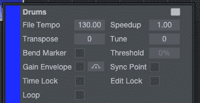

在上下文菜单的各个字段中，你需要使用 `Transpose` 和 `Tune` 字段：

*   `Transpose` 字段接受 `-24` 到 `+24` 半音之间的值，允许你向上或向下转调多达两个八度。尽管移调算法在过去几年中有了巨大发展，但它们仍有局限性。将任何音频向上或向下转调超过五个半音，最好留作实验性和创意性用途。
*   `Tune` 字段接受 `-100` 到 `+100` 音分之间的值。

`Transpose` 和 `Tune` 是非破坏性操作。你可以随时返回此菜单，将这些值切换回零。录音将以原始音高播放。

`Transpose` 和 `Tune` 命令也可以同时应用于多个音频事件。只需选择你想要微调或转调的事件，然后右键单击其中任意一个。你在 `Transpose` 或 `Tune` 字段中输入的值将应用于所有选定事件。

通常，音频录音会在乐句之间包含静音间隙。然而，由于我们大多数人在非理想环境下操作，这些间隙可能不包含真正的静音——它们可能被耳机漏音、电脑风扇噪音或其他进入麦克风的背景声音填充。

即使这些不需要的声音相对无害，它们随着一遍遍的录制堆积起来，会导致混音师所谓的混音中的 `mud`（浑浊感）。因此，移除这些间隙以清理音频轨道是常见做法。

我们当然可以拿起分割工具，剪掉这些间隙并手动删除，但在包含多条繁忙轨道的大型项目中，这将花费漫长的时间，而我们有更有意义的事情要做。谢天谢地，有一种快速高效的方法可以自动清理音频轨道或事件。

`Strip Silence`（静音剪除）命令会分析选定的音频事件并自动移除静音间隙。执行该命令很简单，只需右键单击事件并在弹出菜单中选择 `Strip Silence`。不过，通常需要一些微调才能获得最佳结果。操作步骤如下：

1.  点击 `Strip Silence` 按钮。这将打开 `Strip Silence` 菜单：

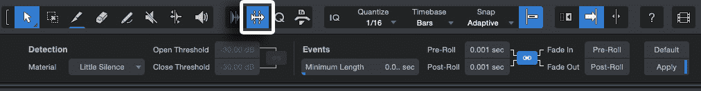

2.  使用 `Detection`（检测）下拉菜单，告诉算法你的录音素材情况，以便它自动设置最佳参数：
    *   如果录音包含清晰、明确的声音元素（如鼓点），且周围是静音区域，请选择 `Lots of Silence`（大量静音）。
    *   如果素材相对繁忙但仍包含一些静音区域，请选择 `Little Silence`（少量静音）。
    *   如果录音中没有真正的静音，且你想消除背景噪音，请选择 `Noise Floor`（噪音底）。

    此处列出的选项绝非截然分明，所以请随意选择一个选项看看效果如何。此操作是非破坏性的，如果你对结果不满意，可以通过输入 `Ctrl` + `Z` (Windows) 或 `Cmd` + `Z` (Mac) 使用撤销命令来撤销。

3.  如果上述选项不起作用，请在 `Detection` 下拉菜单中选择 `Manual`（手动）。这将激活 `Open Threshold`（开启阈值）设置，允许你以分贝为单位手动设置静音阈值。录音中低于此阈值的所有区域将被视为静音并被剪除。

4.  某些录音素材（如鼓点）衰减得非常快，会在几毫秒内降至阈值以下。这会导致声音的尾音被切掉，正如你在军鼓击打中看到的那样：

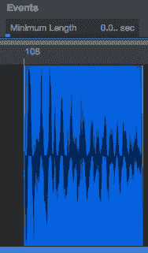

发生这种情况时，使用 `Minimum Length`（最小长度）滑块为剪辑部分设置更长的持续时间。这会覆盖阈值设置，因此即使素材在你在此设置的时长内降至阈值以下，也不会被剪除。

5.  通常，`Strip Silence` 命令会尽可能紧凑地修剪，素材一超过阈值就立即剪入，一低于阈值就立即剪出。如果你想在剪辑前后保留一些额外空间，请分别使用 `Pre-Roll`（前滚）和 `Post-Roll`（后滚）设置。

6.  如果你在执行 `Strip Silence` 命令后听到任何点击声或其他伪影，请点击 `Pre-Roll` 和 `Post-Roll` 字段右侧的链接图标，如图 8.2 所示。这将激活 `Fade In`（淡入）和 `Fade Out`（淡出）选项。在这里，你可以手动设置时间值（以毫秒为单位），为 `Strip Silence` 功能创建的每个事件添加淡入淡出。

7.  完成后，点击 `Apply`（应用）按钮，使用你刚才设置的参数执行 `Strip Silence` 命令。

接下来，我们将学习如何使用一项音频编辑功能，它将真正让你的演绎更上一层楼。

## 从多个层创建完美录音

在第 5 章中，我们讨论了循环录音，并提到它是一个很棒的工具，可以通过从几次不同的录音中选择最佳部分来创建完美的复合演绎。凭借我们对所掌握的音频编辑工具的深入了解，我们现在准备好处理这项任务了。注意，这个过程有时被称为 `comping`，是 compositing（合成/拼接）的缩写。

一旦你按照第 5 章中的描述执行了循环录音，该录音的轨道标题将显示一个图标，上面堆叠着三条线，如图 8.4 高亮显示。点击它，轨道将展开以显示你录制的录音。

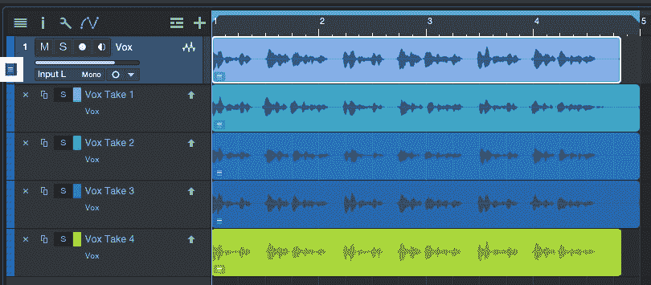

图 8.4 显示了人声录音的四个不同录音。在 Studio One 的循环录音模式下，歌手被要求反复演唱同一句歌词。我在四次录音后停止了录制。这些录音现在显示在轨道标题下方，标记为 `Take 1`、`Take 2`，依此类推。

从这些录音中拼接出完美演绎简单得不能再简单了。让我们开始吧：

1.  按键盘上的 `8` 获取 `Listen`（试听）工具。用它来比较不同录音中同一乐句的表现。
2.  一旦选定你最喜欢的乐句，按键盘上的 `1`。你会注意到光标不再是普通的 `Arrow`（箭头）工具，而变成了一个称为 `Comping`（拼接）工具的括号形状。
3.  将 `Comping` 工具拖过你最喜欢的乐句。你选择的区域将被 `promoted`（提升）到顶部，紧邻轨道标题。下次播放歌曲时，你将听到这一部分。
4.  重复步骤 1 到 3，将所有你最喜欢的乐句提升到顶部。

图 8.5 显示了与图 8.4 相同的录音，但在其中我已跨不同录音选择并提升了每个我最喜欢的乐句。

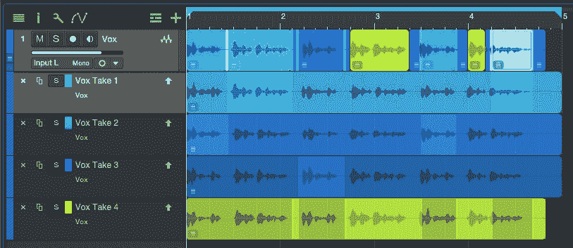

就这么简单！你刚刚从几个不同的录音中创建了完美演绎。现在，让我们继续了解其他音频编辑工具，看看如何有效地发挥它们的威力。

## 高效使用编辑命令

Studio One 在右键菜单中提供了大量的编辑命令，可以通过右键点击音频事件来访问。当你浏览此菜单时，可能会被海量的可用命令弄得眼花缭乱，并纳闷自己如何才能学会使用它们所有。

当你开始将其视为一个供你调用的选项和命令列表时，这个菜单就不再那么令人生畏了。它向你展示了可以对音频事件执行的所有操作。根据你的制作风格和工作流，在一个阶段中，你最终会多次使用其中一些命令，一些不太常用，还有一些则完全用不上。

让我们以 `Fade In to Cursor`（淡入至光标）命令为例：

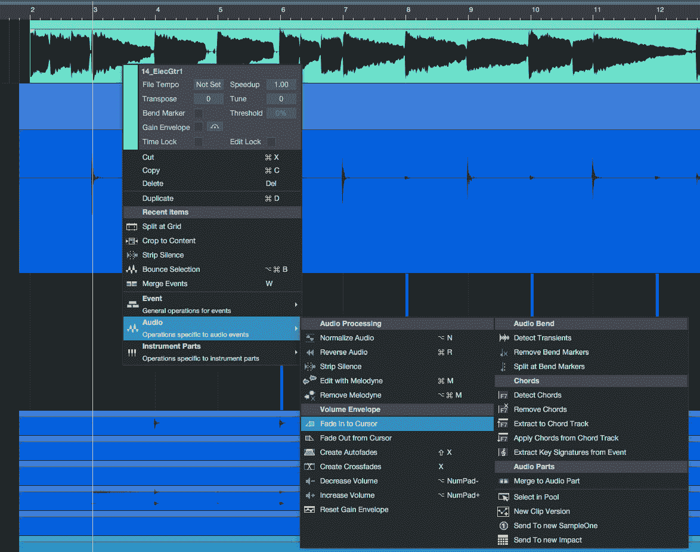

Figure 8.6: 音频事件的右键菜单

该命令的标题不言自明。它会从事件的开始处创建一个淡入，一直延伸到光标当前的位置。在图 8.4 中，我的音频事件从小节 2 开始。我的光标位于小节 3。因此，当我执行此命令时，将获得一个从小节 2 开始、在小节 3 结束的淡入效果。

但为什么要费劲在菜单深处寻找这个命令来执行一个简单的淡入呢？正如我们在 第 7 章 中所见，创建淡入淡出只需点击事件左上角的小三角形并向右拖动即可。

然而，如果你从事音频后期制作工作，且在每个阶段都需要制作大量淡入，则可以通过为此命令分配键盘快捷键、选择多个事件，然后仅按键盘上的一个键即可为所有事件应用淡入，从而节省大量时间。这就是 `Fade In to Cursor` 命令真正大放异彩的时候。

右键菜单中所有可用命令皆是如此。如果你发现某个命令会经常用到，请按如下方式为其分配键盘快捷键：

1. 在顶部菜单中，依次转到 `Studio One` 和 `Keyboard Shortcuts`（键盘快捷键）。这将打开 `Preferences`（偏好设置）窗口的 `Keyboard Shortcuts` 选项卡：

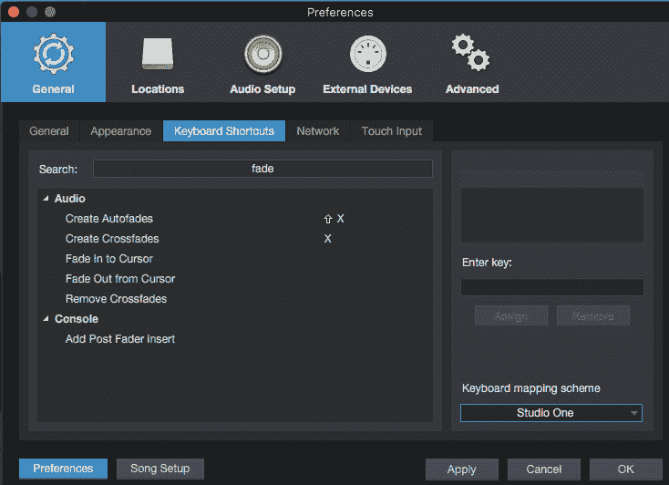

Figure 8.7: 偏好设置窗口的键盘快捷键选项卡

1. 在 `Search`（搜索）框中，开始输入你想要分配快捷键的命令名称。

2. 在命令列表中选择该命令。

3. 点击 `Enter Key`（按键输入）字段，输入你想用作该命令快捷键的字母。你可以使用数字和字母，也可以添加修饰键，例如 `Shift`、`Ctrl`/`Cmd` 和 `Alt`/`Option`。

4. 如果你输入的按键已被用作另一个命令的快捷键，Studio One 会发出警告。然后，尝试不同的按键组合。

5. 点击 `Assign`（分配），然后点击 `OK`。

选择你可能经常使用的命令，并以这种方式将它们绑定到键盘快捷键，将加快你的工作流，帮助你更高效地使用得心应手的工具。基本的音频编辑工具介绍完毕，我们现在准备好去探索更高级的音频操作方法和工具了。

# 修正和增强音频录音的时序

你录制了一段精彩的演唱，但歌手在演唱几个词时拍子拖后了。你知道可以使用重录模式再次录制仅那些词，但歌手已经脱离了状态，根本无法再现那种神奇的表现力。又或者，你借了朋友的尤克里琴，在随意弹奏时灵光一现，想出了一个很棒的主意。你肯定想录下来并使用它，但你知道自己的时序会不稳，因为你对这件乐器还很生疏。

在音乐制作中，总会遇到这类需要修正音频录音时序的情况。Studio One 让这项任务变得极其容易实现。在本节中，我们将深入探讨这项功能背后的技术，以及如何利用它来修正时序错误，并发挥其创造性的威力。

## 理解瞬态

假设我们有一段鼓录音，其中存在时序错误。为了修正这些错误，我们必须想办法知道鼓手何时击打了鼓组。这其实没有听起来那么难。请看看这两个音频事件：

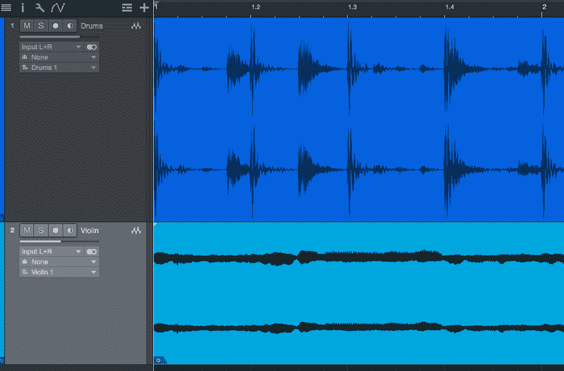

Figure 8.8: 包含鼓轨道（上）和小提琴轨道（下）的工程

在图 8.8 中，上方的轨道是一段鼓录音。每一次击鼓在波形中都清晰地表现为突然的尖峰。这些尖峰被称为**瞬态**。Studio One 拥有一个瞬态检测算法，它会分析音频事件，并在检测到瞬态的点位放置**弯曲标记**。然后，你可以拖动这些标记来手动移动击鼓点的时间位置，甚至可以让 Studio One 自动修正它们。由于 Studio One 知道每一次击打应该落在何处（如图 8.8 顶部的时间轴标尺所示），修正这些击打的位置也不像听起来那么难。这只是一个将弯曲标记与标尺上布置的网格对齐的问题。稍后我们将在“自动量化音频以修正时序错误”部分看到如何操作。

这听起来像魔法，对于挽救有时序错误的轨道来说，这无疑是一个福音。然而，事物总有两面性——图 8.8 下半部分的轨道是一段连奏风格的小提琴录音——即用一次弓子运动连接演奏多个音符。对于这种素材，瞬态检测算法很难判断一个音符何时结束、下一个音符何时开始。对于包含长延音的演唱录音也是如此。在这种情况下，即使你手动放置标记，音频弯曲也无法按预期工作，并可能引入可听的伪影。

由此可知，瞬态检测和音频弯曲的成功在很大程度上取决于素材本身。具有清晰、独特瞬态的音频录音将产生好得多的结果。牢记这一点，我们现在可以更仔细地研究如何在项目中使用这项技术。

## 使用 Audio Bend 工具手动修正错误

`Audio Bend` 是 Studio One 中用于检测和操控瞬态的算法。我们通过 `Bend`（弯曲）工具与 Audio Bend 进行交互。学习该工具工作原理的最佳方法是手动使用它来修正一个时序错误。找一段包含时序错误的音频录音，比如我们在图 7.9 中看到的那段。

最好从一段具有清晰、独特瞬态的录音开始，例如鼓或打击乐。然后，请遵循以下步骤：

1. 在 `Arrangement`（编排）窗口中，双击你想要处理的音频事件。这将在 `Edit`（编辑）窗口中打开该事件。该窗口拥有与 `Arrangement` 窗口相同的工具和按钮，但允许你专注于单个事件。这就像将事件置于显微镜下观察。

2. 点击 `Edit` 窗口上的 `Audio Bend` 按钮。这将打开 Audio Bend 菜单：

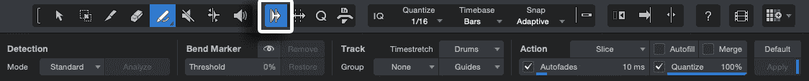

Figure 8.9: Audio Bend 按钮和 Audio Bend 菜单

1. 点击 `Analyze`（分析）按钮。Studio One 将分析录音，并在检测到瞬态的位置放置弯曲标记。

# 音频编辑：弯曲标记与量化

## 调整弯曲标记阈值

仔细观察 `Edit` 窗口中的波形。所有瞬态上都有弯曲标记吗？算法有没有漏掉一些？有没有在不该放置的地方放了标记？通常，算法能很好地自动放置标记，但如果你发现标记太少或太多，请使用 `Threshold` 滑块来调整检测灵敏度。增加阈值会使算法更敏感，从而产生更多标记。降低阈值会导致标记减少。调整阈值，直到所有瞬态都被标记且没有多余标记。请参考以下示例：

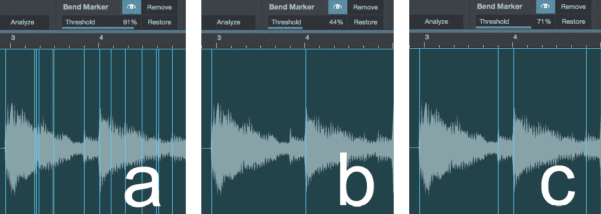

**图 8.10：各种阈值设置的对比**

图 8.10 并排对比了应用于同一音频录音的不同 `Threshold` 设置：

- 在 **a** 中，阈值设置过高，使算法过于敏感。这导致出现了太多不必要的弯曲标记。
- 在 **b** 中，阈值设置过低。这导致算法漏掉了本应被标记的较小瞬态。
- 然而，**c** 是该素材的理想设置；所有瞬态均被检测到，且没有多余标记。

## 使用弯曲工具

1. 按键盘上的 `7` 选择 `Bend` 工具。
2. 如果算法未检测到你想要处理的瞬态，你可以使用 `Bend` 工具点击瞬态的起始位置来手动添加弯曲标记。
3. 然后，使用弯曲工具，将瞬态拖动到你想要的位置。
4. 请注意，`Bend` 工具的行为会受到 `Snap` 的影响。如果 `Snap` 处于激活状态，你拖动的瞬态会吸附到时间轴网格上最近的可用位置。这有助于正确对齐鼓点，例如。你可以按键盘上的 `N` 来开启或关闭 Snap。
5. 如果你只想修正单个瞬态的位置而不影响录音中的其他内容，请点击瞬态前后的空白处以在其前后添加弯曲标记。这样，你使用 `Bend` 工具执行的任何操作都将被限制在这两个标记之间，其余表演部分将保持不变。
6. 使用 `Bend` 工具执行的操作是非破坏性的。如果你随时想恢复到原始录音，请按键盘上的 `1` 选择 `Arrow` 工具，点击音频事件以选中它，然后在 `Audio Bend` 菜单中点击 `Remove`。这将移除所有弯曲标记并将音频恢复到原始状态。

当只需修正少量错误时，这种手动修正时序错误的方法非常有效。然而，如果错误太多或录音非常密集，我们就需要一种自动修正错误的方法，这将在下一节中介绍。

## 量化音频以自动修正时序错误

在音乐制作中，**量化**是自动调整事件或对象的时序以使其与预设网格或节拍对齐的过程。这使得修正时序错误或创建更一致的节奏变得非常容易。

如果你有存在时序问题的音频录音，在 Studio One 中修复它非常简单。只需选中包含录音的事件，然后按键盘上的 `Q` 进行量化。这将启动一系列操作。Audio Bend 算法将分析该事件，并在检测到瞬态的位置放置弯曲标记。然后，它会将这些弯曲标记与当前的量化网格对齐。

在大多数情况下，这个简单的命令就能有效修复时序问题。不过，如果第一次尝试没有获得完美结果，也不必灰心。通过一些手动微调，量化的效果可以显著改善。音频量化的成功取决于以下三个因素：

- **被量化素材的类型**：正如上一节所见，具有清晰、明显瞬态的录音可以被更准确地标记，从而产生更好的结果。如果你尝试量化一个瞬态不明显的录音（如图 8.8 底部所示），你可以通过手动添加弯曲标记或修正现有标记的位置来帮助算法。
- **弯曲标记菜单中的 Threshold 设置**：仔细检查 `Edit` 窗口中的弯曲标记，并调整 `Threshold` 滑块，确保所有需要量化的瞬态都已被标记。如果标记过多或过少，算法最终会将错误的标记与量化网格对齐，导致结果不完美。
- **量化设置**：这些设置告诉 Studio One 你歌曲的节奏结构，使其能够使用正确的量化网格。虽然默认设置适用于大多数素材，但其他素材可能需要一些调整。

量化设置基于音乐音符时值，因此如果你具备基本的乐理知识，会更快得到结果。如果没有也没关系——量化是非破坏性的，如果你对结果不满意可以撤销。请随意尝试以找到合适的设置。

### 调整量化设置

请按以下步骤调整量化设置：

1. 点击 Quantize 按钮以打开 `Quantize` 菜单：

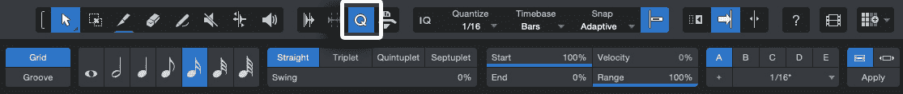

**图 8.11：Quantize 按钮和 Quantize 菜单**

2. 使用菜单左侧的音符时值选择所需的量化网格。为获得最佳效果，请选择录音中使用的最小音符时值。例如，如果你想量化一个包含 16 分音符踩镲型式的鼓录音，请选择 16 分音符。
3. `Start` 滑块决定音频遵循量化网格的紧密程度。如果将其保持在默认的 100% 设置，音频将精确地与网格对齐，这被称为 `hard quantizing`（硬量化）。虽然这在某些音乐流派中是理想的，但在其他流派中则被认为过于机械。如果你想要更松散、*人性化* 的感觉，请降低此值。
4. 点击 `Apply`。

这种方法非常适合将音频量化到网格，但并非所有音乐流派都符合对称组织的节奏结构。在下一节中，你将学习如何为具有独特节奏感的音乐创建自定义网格。

## 提取并量化到自定义律动

在音乐中，**律动** 指的是赋予乐曲节奏风味并帮助定义其风格的节奏感和特征脉冲。乐曲的律动是由不同乐器演奏时序之间的相互作用产生的。在电子音乐中，节奏通常由电脑和鼓机创建，倾向于精确且可预测。另一方面，许多其他流派包含人类演奏时的时序和乐句变化，这赋予了它们独特的个性。

这些类型的音乐不适合我们在上一节讨论的 `grid quantization`（网格量化）。如果你尝试将拉丁打击乐合奏的录音量化到网格，它将失去其*自然*的感觉。

那么，如果你正在制作一首具有独特律动的歌曲，但仍想修正时序问题，该怎么办？Studio One 有一个名为 **groove quantization**（律动量化）的功能，专为这种情况设计，用以替代网格量化。律动量化允许你将参考音频或 MIDI 事件的节奏感应用到其他音频或 MIDI 事件上。这样，你就可以在多轨道间保持一致的律动。

假设你有一个带有你想要使用的律动的鼓轨。你还有一个贝斯吉他轨，具有完全不同的律动，你想让它符合鼓轨。请按以下步骤使用律动量化来实现这一点：

1. 在 `Arrangement` 窗口中，点击“量化”按钮以打开“量化”菜单（图 8.11）。
2. 在此菜单中，点击左侧的 `Groove` 按钮以切换到 Groove 量化模式。
3. 现在，将鼓音频录制拖动并放入 `Groove` 面板中（图 8.12 中的 a）：

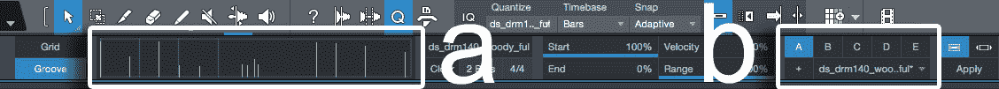

图 8.12：（a）Groove 面板和（b）Groove 预设窗口

您已从鼓轨道中提取了 Groove。

1. 在 `Arrangement` 窗口中，点击选择包含贝斯吉他录制的事件。
2. 在键盘上按 `Q`，将贝斯吉他量化到鼓的 Groove。
3. 如果您也想在未来的项目中使用此 Groove，请点击 `Groove Preset` 窗口上的加号（图 8.12 中的 b）。
4. 为此 Groove 输入一个名称，然后点击 `OK`。

Groove 量化通常在应用于项目中的所有轨道时效果最佳。如果某些乐器量化到 Groove，而其他乐器量化到网格，它们的节奏将不一致。为了保持编曲的连贯性，请务必坚持使用网格量化或 Groove 量化这两种方法中的一种。

在本节中，我们深入探讨了修复音频录制中时序错误的几种方法。现在，我们准备好应对一项稍微复杂的任务了——使用 Melodyne 来优化人声录制。

# 使用 Melodyne 修复和优化人声录制

**Melodyne** 是一款行业领先的软件工具，允许您操控音频录制中单个音符的音高和时序。Melodyne 由 **Celemony** 开发。尽管 Celemony 与 PreSonus 没有隶属关系，但他们已紧密合作十余年，在 Melodyne 和 Studio One 之间建立了无与伦比的集成度。**Melodyne Essential** 是该软件最轻量级的版本，随 Studio One 捆绑提供。Melodyne Essential 提供的功能足以满足大多数日常音乐制作的需求。

### 重要提示

尽管 Melodyne 能够操控音频的时序，但本书将不涵盖该功能。多年来，我发现 Studio One 自身的时序操控功能（我们在本章前一节中讨论过）非常有效且足够使用。因此，此处对 Melodyne 的介绍将局限于操控音频录制中的音高。

现在，让我们谈谈如何使用 Melodyne。首先，您将学习如何修正跑调的人声表演。然后，我们将探索使用 Melodyne 为您的项目添加和声人声的创造性方法。

## 使用 Melodyne 修复跑调的人声表演

音乐中的每个音符都有一个预定的频率，由国际标准确定。当歌手演唱一个音符时，我们期望它处于该特定音符指定的频率。如果歌手演唱的频率高于应有频率，该音符就是尖锐的。如果频率低于应有频率，该音符就是低沉的。

**音高修正** 软件和硬件已被广泛使用数十年，用于检测这些偏差并将音符的频率移回其应有位置，无论是自动还是手动。这是一个复杂的过程，可能会导致音频中出现严重的伪影（想想 Auto-Tune）。Melodyne 的优势在于其能够将这些伪影降至最低，并提供纯净、自然的效果。

现在，让我们看看如何使用 Melodyne 来修复跑调的音符。找到一个您想要处理的人声录制。在 `Arrangement` 窗口中，右键点击事件。从弹出菜单中，转到 `Audio`，然后点击 `Edit with Melodyne`。这将在 `Edit` 窗口中打开 Melodyne：

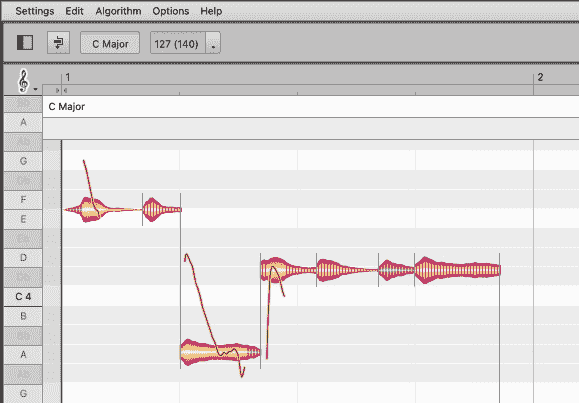

图 8.13：Edit 窗口中的 Melodyne Essential

界面中间的色块是人声录制中每个音符的可视化表示。横跨此窗口的白色和灰色条纹对应乐谱上的音符，列在最左侧的列中。窗口上方的数字对应 Studio One 项目中的小节号。

使用窗口底部和最右侧的导航栏进行移动。这些导航栏也兼具缩放控制的功能——将鼠标悬停在任一端，光标将变为放大镜图标。然后您可以拖动鼠标随意放大或缩小。

现在您已熟悉 Melodyne 的界面，可以开始使用它了。首先要做的是转到 Melodyne 自己顶部菜单上的 `Algorithm`，并确保选中了 `Melodic (Standard)`。这可确保 Melodyne 使用正确的算法进行音高检测。

让我们仔细看看色块，并学习如何操作它们。这是一个示例：

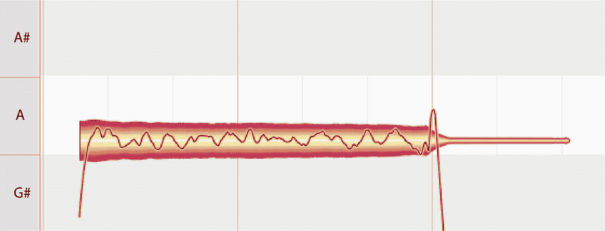

图 8.14：表示略微低沉音符的色块

色块内部的波浪线代表歌手演唱该音符时频率的微小波动。色块本身代表所有这些波动的平均值。在这里，歌手想唱 *A* 音，但有点低。我们可以看出，因为色块向下偏移朝向 *G#* 音，而不是准确落在 *A* 音上。您可以通过向上拖动色块轻松修正此问题。它将吸附到最近音符的中心，在本例中即为 *A*。这是修正后 *图 8.14* 中同一个音符的样子：

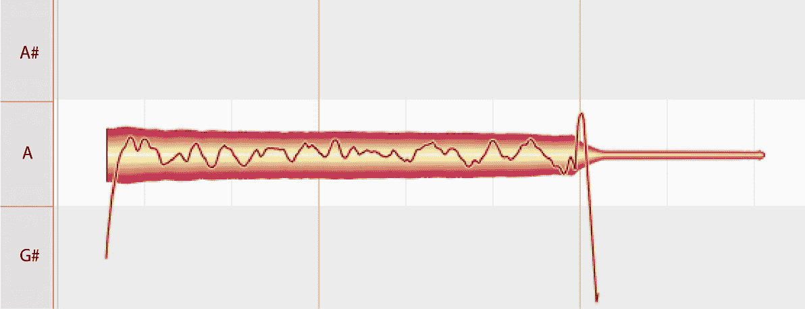

图 8.15：表示音高已修正音符的色块

如果您想暂时禁用此自动吸附选项，请在拖动时按住 `Alt`/`Option` 键。这将允许您以更精细的分辨率上下移动色块。

以这种方式手动修正音符时，需要注意一种称为 *glissando*（滑音） 的演唱技巧：

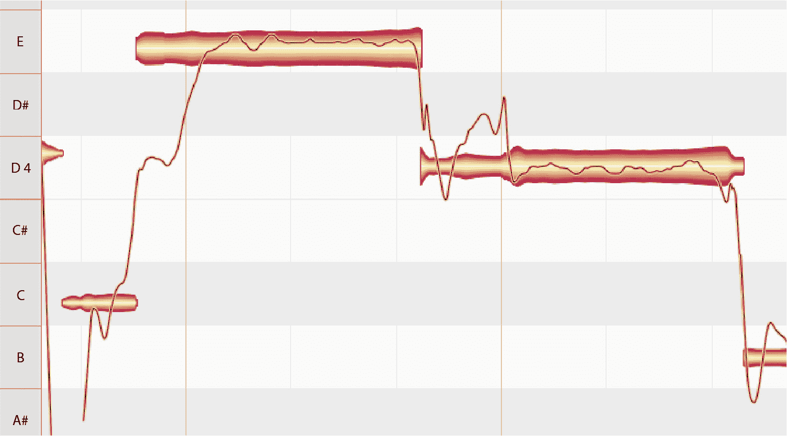

图 8.16：通过滑音连接的多个音符

**滑音** 是指歌手或乐器演奏者滑入一个音符，而不是直接落在其上。在 *图 8.16* 中，所有音符都通过滑音连接，正如连接色块的线条所示。虽然这是一种很酷的声乐技巧，但它给音高修正带来了两个挑战——第一，它会在计算音符平均频率时欺骗算法；第二，试图修正滑音的音高违背了最初使用滑音演唱的初衷，导致著名的 Auto-Tune 效果，该效果被用作某些音乐流派中的创作手段。

每当您看到类似 *图 8.16* 中的滑音时，请将其从色块主体上分离。为此，将鼠标悬停在色块的上半部分。它将变为 `Note Separation` 工具。使用此工具双击以分割色块。这是我在音符开头和结尾处分离滑音后的同一个音符：

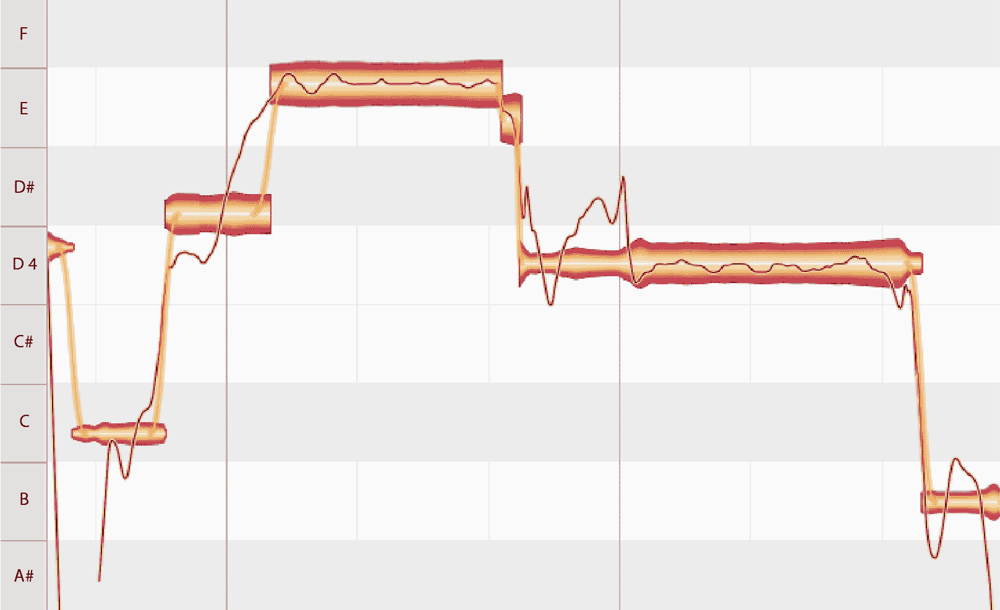

图 8.17：分离滑音后的同一个音符

请注意，通过分离滑音，我强制算法重新计算色块的位置，现在它的音高变尖了，偏向 *F* 音。现在，当我将此色块拖动到其正确位置时，算法将做得更好，因为它不再将滑音考虑在内。

# 第 8 章：Melodyne 与干声分离

Melodyne 的界面直观易懂，但学会解读音块需要一些适应时间。请随意尝试。如果你对某次操作不满意，请前往 Melodyne 自身的菜单，然后点击 `Edit` 和 `Undo`。请勿使用键盘快捷键撤销，因为这将撤销你在 Studio One 的 `Arrangement` 窗口中执行的上一步操作！

在 Melodyne 中执行的操作是非破坏性的。回到 `Arrangement` 窗口后，你随时可以右键点击事件并选择 `Remove Melodyne`。这将把录音恢复到其原始状态。

## 重要提示

虽然我们讨论的是人声录音，但 Melodyne 同样可以轻松处理任何单音源素材——这意味着你可以用它来校正任何乐器的音高，只要该乐器在任一时刻只演奏单个音符，而非和弦。可以在任何可能跑调的乐器上尝试。它在弦乐器和管乐器上效果极佳。

到目前为止，我们讨论了将 Melodyne 用于修正目的。接下来，我们将探索一种更具创意的 Melodyne 使用方法，以丰富你的项目。

## 使用 Melodyne 创作背景和声人声

背景和声人声绝对能让歌曲更上一层楼。然而，创作和演唱和声人声需要丰富的经验，且至少要求具备基本的乐理知识，因此可能无法现场录制。借助 Melodyne，我们可以从歌手的原始演唱中创作出和声人声。具体步骤如下：

1. 在录音环节中，多录制几遍歌手的演唱。保留最好的一遍作为主唱。我们将利用其他遍数来创作背景和声人声。
2. 右键点击其中一遍额外录音，选择 `Edit with Melodyne`。
3. 在 Melodyne 窗口中，点击 `Chord Track Visibility` 按钮：

4. 在和弦轨道上输入你歌曲的和弦。
5. 在 Melodyne 自身的顶部菜单中，依次选择 `Options` | `Pitch Grid` | `Pitch Background`，并选择 `Chord`。此时，Melodyne 窗口的背景将以白色显示和弦内的音符，以灰色显示所有其他音符。
6. 再次在 Melodyne 自身的顶部菜单中，依次选择 `Options` | `Pitch Grid`，并选择 `Chord Snap`。现在，音块只能移动到你歌曲所用和弦的音符上。
7. 将音块拖动到这些音符上，以创作和谐的人声。由于音块仅吸附到你的和弦音上，因此不可能出现错误的音符。请随意尝试。
8. 重复上述步骤，创建任意数量的和声人声音轨。

请记住，Melodyne 同样适用于乐器，因此你可以用这种方法从单个小提琴演奏中创作出一个小提琴声部，例如。唯一的限制就是你的想象力！

这结束了我们关于在项目中使用 Melodyne 进行修正和创意操作的指导。

## 使用干声分离隔离音频事件

**干声分离** 是指将混音音频文件中的不同元素或**干声**（如人声、鼓、贝斯和其他乐器）分离到单独的音频轨道上的过程。这为混音、重新编曲或增强原始混音的组件提供了更多可能性，赋予了创作灵活性。

干声分离技术已存在一段时间，但通常只见于第三方供应商运营的网站上，典型的提取工作流程包括上传原始文件、付费并等待提取，然后下载提取出的文件。

从版本 7 开始，Studio One 内置了干声分离功能。具体操作如下：

1. 将你想要提取干声的音频文件拖放到 Studio One 的 Song 中。
2. 使用 `Arrow` 工具点击选中该音频文件。
3. 按下 `Cmd` + `U` (Mac) 或 `Ctrl` + `U` (Windows) 打开 `Separate Stems` 对话框（图 8.19）。

4. 在这里，选择你想从原始录音中提取的音频素材。你可以选择 `Vocals`、`Drums` 和 `Bass`，这些名称不言自明，以及 `Other`，它基本上包含不属于前三类的所有其他乐器。
5. 点击 `OK`。

Studio One 将利用其 AI 技术分析录音，并将你选定的干声提取到单独的独立轨道中。从此，你可以随心所欲地使用这些干声进行采样、混音和重新编曲。不过，如果你打算在数字平台上发布成果，请务必确保不违反任何版权法规！

## 总结

在本章中，我们探索了 Studio One 的音频编辑工具，并讨论了在项目中使用这些工具的几种不同方法。我们从常见的编辑任务开始，例如清理音频轨道，然后转向更复杂的任务，例如让一条轨道符合另一条轨道的律动。我们继续深入讨论了如何将 Melodyne 融入项目以提升人声表现。我们最后探讨了如何使用干声分离技术从已混音的音乐文件中提取素材。

在下一章中，我们将探索 Studio One 的 MIDI 编辑工具，并发现它们如何帮助你让虚拟乐器栩栩如生。
