## 第 9 章：编辑 MIDI

使用 MIDI 就像演奏乐器。它是艺术与科学的结合，你不能只关注一方而忽视另一方。就像演奏乐器一样，使用 MIDI 需要练习。无论你是音乐制作新手，还是转投 Studio One 的资深专业人士，这个新工具都将提供强大的功能来创作和塑造你的音乐创意，同时保持友好的学习曲线。

在本章中，我们将采用循序渐进的方式介绍 Studio One 丰富的 MIDI 编辑工具集，从基础工具开始，逐步深入到高级工具。读完本章后，你将能够自信地使用这些工具来调整 MIDI 演奏的音高、时值和力度。这将使你能够实现广泛的音乐效果，从修正简单错误到创作复杂且多层次的音乐编排。

我们将涵盖以下主题：

* 使用基本编辑工具和量化
* 调整 MIDI 数据以提升演奏表现
* 在 Pattern Editor 中工作
* 使用 Note FX 激发创意

## 技术要求

要跟随本章操作，你需要在电脑上安装并激活 Studio One。

## 使用基本编辑工具和量化

在第 6 章中，我们介绍了录制和编程 MIDI 演奏的几种不同方法。虽然 MIDI 演奏是呈现音乐创意的绝佳起点，但它几乎从不以原始形式直接使用。它旨在被加工和精炼，就像珍贵的金属矿石一样。

在本节中，我们将探索 Studio One 的基本 MIDI 编辑工具，然后深入研究 MIDI 量化。本节讨论的所有工具和方法都基于 `Edit` 窗口，只需双击你想要处理的 MIDI 事件即可轻松打开。

正如我们在`第 6 章`中所述，`Edit` 窗口本身有三种查看选项——`Piano view`、`Drum view` 和 `Score view`（请参阅 `Figure 6.13`）。除非另有说明，本节将始终使用 `Piano view`，因为它提供了最多数量的编辑工具和选项。您在此查看模式下执行的任何操作都会即时反映在其他模式中。

现在，我们准备开始探索编辑工具。找一个您想要修复、改进或增强的 MIDI 演奏，让我们动手实践一下吧。

## 使用 Arrow 工具执行基本编辑任务

使用 MIDI 时，我们武器库中最得力的工具是好老朋友 `Arrow` 工具。让我们快速了解一下它能完成哪些任务：

1.  在 `Arrangement` 窗口中，双击您想要处理的 MIDI 事件。这将在 `Edit` 窗口中打开该事件。

2.  按键盘上的 `1` 来获取 `Arrow` 工具。

3.  要更改 MIDI 音符的时机或位置，将其向左或向右拖动。如果 `Snap` 处于激活状态，您只能将其放置在与时间轴网格对应的位置。这使您能够精确对齐音符。按键盘上的 `N` 可切换 `Snap` 功能。

4.  要更改 MIDI 音符的音高，将其向上或向下拖动。Studio One 会提供听觉反馈，帮助您找到正确的音符数值。

5.  或者，点击音符将其选中，然后使用键盘上的上或下方向键来更改其音高。按住 `Shift` 键的同时按上或下键，可将音符上移或下移一个八度。

6.  要调整音符的长度，将 `Arrow` 工具悬停在音符的开头或结尾。它会变成一个双向箭头。使用它来调整音符大小。请注意，此操作也受 `Snap` 功能控制。

7.  要复制音符，按住 `Alt`/`Option` 键的同时拖动它。

8.  要更改音符的力度，拖动 `Edit` 窗口底部的力度指示器（我们稍后将在 `Adjusting velocity` 部分详细讨论力度）。

> **提示**
>
> 请注意，`Arrangement` 窗口和 `Edit` 窗口拥有各自独立的工具菜单。例如，如果您在 `Arrangement` 窗口中选择 `Listen` 工具，在 `Edit` 窗口中选择 `Arrow` 工具，当您在两个窗口之间移动鼠标时，可用的工具会随之相应变化。

迄今为止讨论的所有操作都可以一次性应用于多个音符。输入 `Ctrl` + `A` (Windows) 或 `Cmd` + `A` (Mac) 可选中 MIDI 事件中的所有音符。使用 `Arrow` 工具绘制选框围绕一组音符可选中它们。如果您想更精细地控制选中哪些音符，请使用 `Select Notes` 窗口，我们将在下一节介绍。

## 使用 Select Notes 窗口进行精确选择

用鼠标选择 MIDI 音符对于大多数用途来说已经足够，但有时您需要选择仅满足特定标准的音符。在跨越多个轨道的繁忙 MIDI 事件中用鼠标做这件事是一项繁琐的任务。

`Select Notes` 窗口允许您快速选择满足特定标准的音符。然后您可以发出仅想应用于这些音符的命令。要打开此窗口，请点击 `Edit` 窗口上的 `Action` 按钮，然后点击 `Select Notes…`：

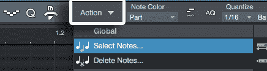

图 9.1：打开 Select Notes 窗口

这将打开 `Select Notes` 窗口：

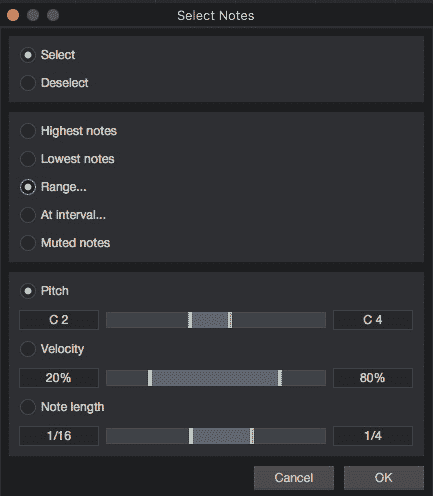

图 9.2：Select Notes 窗口

此窗口顶部显示有两种操作模式：

*   `Select` 模式选择符合您标准的音符，例如选择 `C3` 和 `C4` 之间的所有音符。

*   `Deselect` 模式选择除符合您标准的音符之外的所有音符，例如选择除 `C3` 和 `C4` 之间的音符之外的所有音符。

在窗口中央，您可以根据想要如何进行选择来设置参数：

*   `Highest notes` 选择事件中任意时间可用的最高音符。

*   `Lowest notes` 选择事件中任意时间可用的最低音符。

*   `Range…` 允许您选择处于特定 `Pitch`（音高）、`Velocity`（力度）或 `Note Length`（音符长度）数值范围内的音符。点击此选项时，窗口将展开以显示滑块，您可在其中设置这些参数，如 `Figure 9.2` 底部所示。

*   `At interval…` 允许您根据音符在时间轴网格上的位置，或根据音符之间的数字关系来选择音符。此选项有两种操作模式：

    *   `Beat` 根据音符相对于网格的位置选择音符。您可以使用 `Beat grid` 参数设置网格的灵敏度。

    *   `Event count` 根据音符之间的距离选择音符。例如，如果您有一系列音符并想选择每第三个音符，请将此处的 `Select at every n-th position` 设置设为 `3`。

*   `Muted notes` 选择事件内所有静音的音符。

现在我们已经确切知道如何定位特定音符，准备好处理更高级的编辑操作了。

## 量化 MIDI 音符以更改演奏的时机

在`第 8 章`中，我们将量化描述为自动调整事件或对象的时机以与预定网格或拍子对齐的过程。我们随后告诫不要过度使用量化，因为音频量化涉及时间拉伸，如果过度使用会降低音质。

现在有个好消息——量化 MIDI 完全不影响音质，所以您可以尽情大胆创作。MIDI 音符只是一条指令，告诉 MIDI 乐器开始发声。当您量化 MIDI 音符时，只是改变指令发送给乐器的时间，对音质绝对没有任何影响。这让您可以毫无限制地尝试创意想法。

量化 MIDI 音符很简单：只需选择要量化的音符，然后按键盘上的 `Q`。这将使用您当前的量化设置对选定音符进行量化。要查看和更改这些设置，请点击 `Quantize` 按钮打开 `Quantize` 菜单（参见`第 8 章`中的 `Figure 8.9`）。

我们在`第 8 章`中探讨了 `Quantize` 菜单。我们在那里介绍的网格量化和律动量化方法也可用于 MIDI 音符，步骤完全相同。不过，此菜单中有两个设置我们迄今尚未讨论：

*   通常，当我们谈论量化 MIDI 音符时，指的是将其起始位置与时间轴上的网格对齐。然而，有时您可能也希望精确地将 MIDI 音符的结束位置与网格对齐。这对于分解和弦的合成器主旋律、延音垫音、弦乐音色，或任何您想精确控制音符结束点位置的场景尤其合理。`End` 滑块允许您设置要对 MIDI 音符尾部进行多少量化。如果您不需要量化音符尾部，请保持 `0%`（默认设置）；设为 `100%` 则对其进行硬量化。`0%` 到 `100%` 之间的任何值都会对 MIDI 音符尾部应用逐渐增加的量化程度。

## 量化范围与人性化

`Range` 滑块允许你设置网格线周围的时间范围。当你发出 `quantize` 命令时，该范围内的任何音符都会被量化，而范围外的任何音符则保持不受影响。默认情况下，此滑块的值为 `100%`，这意味着无论音符距离网格多远，都会被量化。如果将其设置为 `0%`，另一个极端，则没有音符会被量化。你可以根据口味调整此设置，以收紧演奏中某些元素的时机，同时保持其他元素的宽松质感。

现在，让我们谈谈仅针对 MIDI 事件的更高级量化功能。

### 让僵硬的演奏更人性化

虽然量化对许多音乐流派不可或缺，但还有许多其他流派并不同样欢迎它。在 EDM 曲目中感觉完全合适的大量量化演奏，在摇滚曲目中可能会被认为僵硬且机械。在这种情况下，可以添加一些人为的真实感（是的，我们在音乐制作中也有不少矛盾修饰法）来掩盖量化的痕迹。

`Humanize`（人性化）功能旨在通过向 MIDI 音符的力度和起始位置注入随机变化，使大量量化的演奏听起来更有机。要访问此功能，请点击 `Edit`（编辑）菜单上的 `Action`（操作）按钮，然后选择 `Humanize`。这将打开 `Humanize` 窗口：

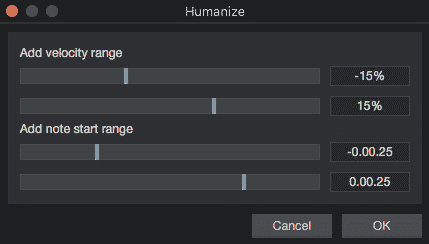

**Figure 9.3: The Humanize window**

在此处，设置你希望允许音符力度和起始点出现随机变化的范围。当你点击 `OK` 时，Studio One 将在这些范围内生成随机值并将其应用到 MIDI 音符。

结合前面讨论的 `Select Notes`（选择音符）窗口使用，`Humanize` 命令可以成为一个强大的工具。例如，你可以有选择地针对节奏循环的某些元素进行人性化处理，同时保持底鼓和军鼓的硬量化状态。

### 恢复与冻结量化

当你在 MIDI 演奏中量化或人性化音符时，Studio One 仍会保留其原始位置的记录。这使你能将 MIDI 演奏恢复到其原始状态，即使你保存并关闭项目，稍后再回来也是如此。要将演奏恢复到原始状态，请点击 `Edit` 窗口上的 `Action`，然后选择 `Restore Timing`（恢复时机）。

这当然是一个有用的功能，允许你日后改变主意，但有时它可能成为障碍。例如，假设你昨天在处理项目时量化了一个事件。今天，你再次打开项目。你对自己的量化想法很满意，只是想再量化一点以收紧一下。在这种情况下，当你启动量化命令时，Studio One 会考虑音符的原始位置，而不是你昨天将它们量化到的位置。解决方法是冻结你昨天所做的量化，用新位置替换音符的原始位置。为此，请点击 `Edit` 窗口上的 `Action`，然后选择 `Freeze Quantize`（冻结量化）。

这结束了我们对 Studio One MIDI 量化选项的介绍。接下来，我们将开始探索深度编辑功能。

## 调整音符长度并应用半速或倍速

能够精确控制音符长度是 MIDI 编辑技能组合中的一个重要因素。你可以获取为钢琴编写的短音符，并将其转换为弦乐器的长延音。反之，你也可以获取长音符并将其切碎成合成器可以演奏的琶音。以这种方式转换音符为无限可能打开了大门。

Studio One 允许你使用 `Length`（长度）命令精确控制 MIDI 音符的长度。要使用此命令，请点击 `Edit` 窗口上的 `Action` 按钮，然后选择 `Length`。这将打开 `Length` 窗口：

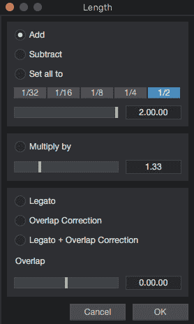

**Figure 9.4: The Length window**

让我们回顾一下选项：

*   选择 `Add`（增加）或 `Subtract`（减少），并使用下方的滑块设置要添加到或从所选音符现有长度中减去的量。
*   `Set all to`（全部设为）允许你将所有所选音符的时值设置为标准音符长度值（八分音符、四分音符等）。
*   使用 `Multiply by`（乘以）通过通用乘数修改所选音符的长度。输入比此处显示的值更小的值将有效地缩短所选音符。
*   选择 `Legato`（连奏）以将每个音符的末尾连接到下一个音符的开头。这对于从短促、不连贯的音符创建延音段落非常有用。
*   有时，MIDI 演奏可能包含重叠的音符——一个音符在第二个音符开始后继续发声。通常这不是问题，但某些单音合成器和采样库补丁在接收重叠音符时会表现异常。使用 `Overlap Correction`（重叠校正）选项可自动修复此问题：

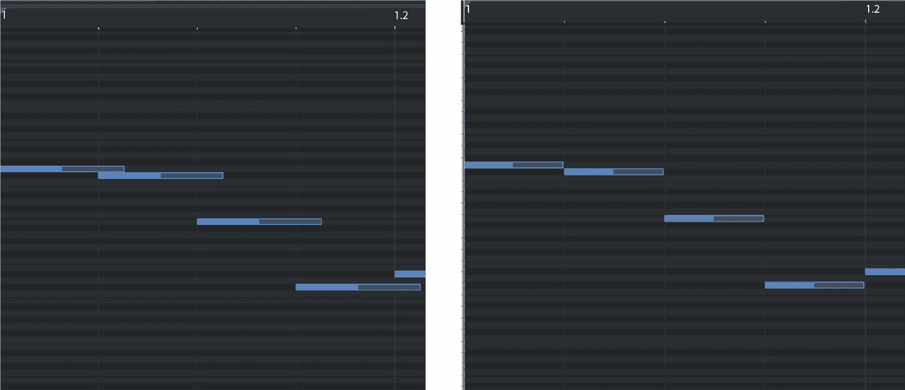

**Figure 9.5: Overlapping notes (left) corrected with Overlap Correction (right)**

有时情况恰恰相反——某些弦乐库补丁在连续音符轻微重叠时能产生更逼真的连奏演奏。如果你追求音符间平滑的连奏过渡，请再次选择 `Overlap Correction`，但这次使用该窗口底部的滑块拨入少量重叠——`0:00:25` 左右即可（此窗口中的滑块使用一种古老的 MIDI 测量单位，称为 `pulses per quarter`（`PPQ`，每四分音符脉冲数））。

你也可以使用重叠滑块拨入负值。这将导致每个音符在下一个音符开始前刚好截止。

*   使用 `Legato + Overlap Correction` 选项可自动连接断开的音符，并应用滑块中设置的任何连奏校正级别，如前所述。

> **Tip**
>
> 将 `Length` 工具与 `Select Notes` 窗口结合使用，可轻松执行复杂的编辑任务。例如，仅选择密集编排的 MIDI 事件中的中音声部，并将它们变成弦乐编排的连奏部分。

默认情况下，Studio One 会自动调整所有 MIDI 事件以匹配项目的速度。有时，你可能想要覆盖此功能，并精确控制时间拉伸如何应用于 MIDI 事件。一个典型场景是当你想为项目应用倍速或半速感觉时，歌曲中的某些元素演奏速度比其他乐器快一倍或慢一倍。这需要手动按一定量收缩或拉伸 MIDI 事件中的所有内容，这可以通过 `Stretch`（拉伸）命令实现，步骤如下：

1.  点击 `Edit` 窗口中的 `Action` 按钮，然后选择 `Stretch`。这将打开 `Stretch` 窗口：

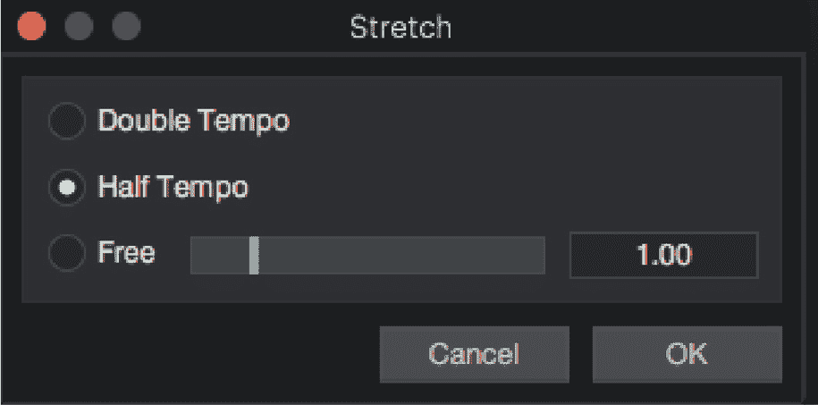

**Figure 9.6: The Stretch window**

2.  在此窗口中，选择你想要收缩或拉伸 MIDI 事件的幅度：
    *   `Double Tempo`（倍速）将 MIDI 事件的内容收缩到其原始大小的一半；因此，它将以两倍速播放。
    *   `Half Tempo`（半速）将 MIDI 事件的内容拉伸到其原始大小的两倍；因此，它将以半速播放。
    *   使用 `Free`（自由）选项可按任意值拉伸 MIDI 事件。输入小于 1 的数字会收缩事件。输入大于 1 的数字会拉伸事件。

3.  点击 `OK`。

> **Note**
>
> 请注意，如果你使用此命令拉伸 MIDI 音符，Studio One **不会**自动扩展包含这些音符的 MIDI 事件的边界。你需要前往 `Arrangement`（编排）窗口，使用 `Arrow`（箭头）工具调整事件大小。

到目前为止，我们已经介绍了编辑 MIDI 演奏的基本工具。在下一节中，我们将深入探讨更高级的编辑功能，这些功能将通过调整音符音高、使其符合不同的调性，以及优化其他 MIDI 参数以改变声音的音色，从而帮助您将音乐创意变为现实。

# 调整 MIDI 数据以增强演奏效果

尽管 MIDI 已陪伴我们近半个世纪，但一些音乐制作人仍将其视为人造且缺乏生气的。某些音乐流派，如流行、EDM 和嘻哈，已欣然接受这一特质；而其他流派，如摇滚和爵士，则将其视为必要之恶，是必须小心处理的技术副作用。

我们可以将真实感和情感注入 MIDI 演奏中，Studio One 提供了多种工具来协助您实现这一点。在本节中，我们将介绍几种 MIDI 编辑技巧，让您的 MIDI 轨道焕发生机。

## 移调音符

能够轻松移调音符且不牺牲音质，一直是 MIDI 的优势之一。移调允许您在无需重新录制的情况下更改歌曲的调性。这对于寻找最适合您音域的调性、使歌曲与现有伴奏轨道匹配，或尝试不同调性以找到最适合歌曲的调性非常有用。然而，这只是冰山一角。移调为常被忽视的创意可能性打开了大门——您可以将歌曲移调到不同的音阶（例如从大调到小调），并为现有旋律创作和声。

有几种方法可以移调音符。让我们从最基本的开始：

1.  双击包含您想要移调音符的 MIDI 事件。
2.  `Edit`（编辑）窗口现已打开，请确保已启用 Snap（吸附）。
3.  按键盘上的 `1` 选择 `Arrow`（箭头）工具。
4.  输入 `Ctrl + A` (Windows) 或 `Cmd + A` (Mac) 选择所有 MIDI 音符。
5.  使用 `Arrow`（箭头）工具，将音符向上或向下拖动到所需的音高。
6.  您也可以使用键盘上的上、下方向键垂直移动音符。按住 `Shift` 并按上或下键可按八度移调音符。

以下是一种更快的移调音符方法：

1.  点击 `Edit`（编辑）窗口上的 `Action`（操作）按钮并选择 `Transpose`（移调）。这将打开 `Transpose`（移调）窗口：

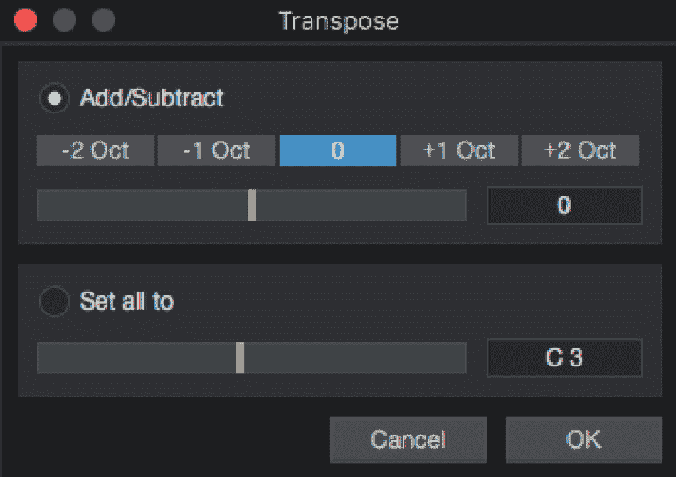

Figure 9.7: The Transpose window

1.  使用此窗口 `Add/Subtract`（加/减）部分的滑块设置以半音为单位的移调量。在此输入负值可将音符向下移调，输入正值可将音符向上移调。
2.  如果您只想按八度移调，可以使用标有 `-2 Oct` 到 `+2 Oct` 的快捷键。
3.  使用 `Set all to`（全部设为）选项可将所有音符简化为单个音符。这对于从旋律部分创建节奏部分非常有用。例如，如果您有一个贝斯型，并希望踩鼓与贝斯完全同步演奏，请使用此选项将所有贝斯音符设为 `C 1` 以触发踩鼓。
4.  点击 `OK`。

现在，我们进入有趣的部分——我们将让 Studio One 将旋律移调到完全不同的音阶或调式。通过使用此技巧，您可以完全改变旋律的感觉，并以完全不同的情绪呈现它。操作方法如下：

1.  在 `Edit`（编辑）窗口的左侧，找到标题为 `Scale`（音阶）的部分。
2.  在这里，使用左侧的下拉菜单选择调性，使用右侧的下拉菜单选择您想要使用的音阶或调式：

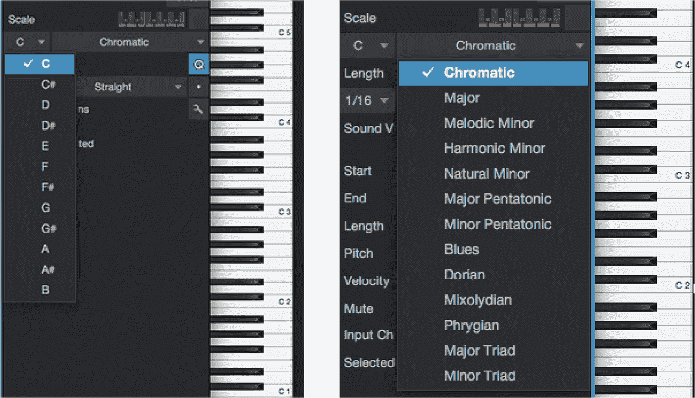

Figure 9.8: Selecting a key (left) and a scale or mode (right)

1.  点击 `Action`（操作）按钮并选择 `Apply Scale`（应用音阶）。Studio One 将把 MIDI 音符移调到您刚才选择的音阶或调式。

大胆尝试下拉列表中的所有不同音阶。一旦找到您喜欢的音阶，对歌曲中的所有 MIDI 事件重复上述步骤，将它们移调到该音阶。虽然这通常需要扎实的乐理知识，但在 Studio One 中却轻而易举。

## 调整力度

在 MIDI 中，`velocity`（力度/速度）是伴随每个音符的一个值，指示该音符被敲击的力度。合成器和其他 MIDI 控制设备利用此信息来确定生成声音的音量、音色和其他特性。

当您使用 MIDI 键盘录制一段音乐时，每个音符对应的力度值也会被记录下来。随后您可以编辑这些值以微调演奏的力度变化。操作方法如下：

1.  双击您想要编辑的事件。这将在 `Edit`（编辑）窗口中打开该事件。每个音符的力度值将显示为窗口底部 `Automation Lane`（自动化通道）上的柱状图。`Automation Lane`（自动化通道）允许您控制轨道随时间变化的特定参数，从而在歌曲过程中创建动态变化。

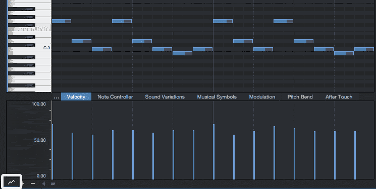

Figure 9.9: The Automation Lane at the bottom of the Edit window

如果您看不到 `Automation Lane`（自动化通道），请点击 `Show/Hide Automation Lanes`（显示/隐藏自动化通道）按钮（图 9.9 左下角的波浪形按钮）并选择 `Velocity`（力度）选项卡。

1.  此通道中的每一列代表相应音符被敲击的力度大小，范围从 `0` 到 `100`。选择 `Arrow`（箭头）工具，将某列向上或向下拖动以更改音符的力度。Studio One 会反复播放该音符，让您听到更改力度如何改变最终声音。
2.  要更改一组音符的力度，请选择这些音符，然后拖动其中任意一个音符对应的力度列。所有选中音符的力度值将按相同幅度修改。

这种方法适用于调整少量音符的力度，但有时您想在更大范围内调整力度。想象一下，您有一系列音符，想对它们应用渐强，使其逐渐听起来更响亮、更明亮。操作方法如下：

1.  双击您想要编辑的事件。
2.  在 `Edit`（编辑）窗口的工具栏上，点击 `Paint`（画笔）工具：

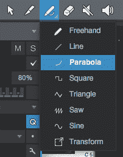

Figure 9.10: Options for the Paint tool

1.  从选项列表中选择 `Parabola`（抛物线）。
2.  现在，转到 `Edit`（编辑）窗口底部的 `Automation Lane`（自动化通道）并绘制一条抛物线（即一条曲线)。您将得到类似这样的结果：

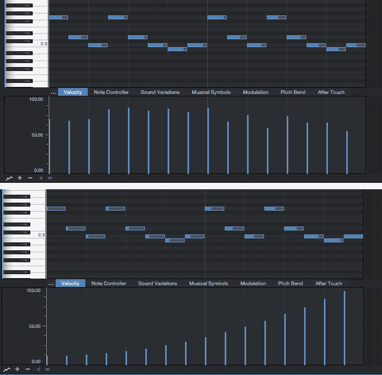

Figure 9.11: A series of MIDI notes (top) and the same notes with a parabola applied to their velocities (bottom)

1.  请注意，某些 MIDI 设备对力度变化非常敏感，而另一些则不然，因此图 9.11 中的曲线可能会产生从戏剧性的渐强到音色几乎无变化的各种效果，具体取决于您使用的设备。实验是关键。如果您认为结果可以更好，请输入 `Ctrl + Z` (Windows) 或 `Cmd + Z` (Mac) 撤销上一步操作并重试。

某些 MIDI 设备要求力度必须处于特定值或有限的数值范围内。例如，某些采样小提琴音色库仅在力度介于 `0` 和 `10` 之间时才会播放特定的发音。如果您正在使用此类乐器，则需要能够为力度设置精确值。操作步骤如下：

1.  点击 `Edit`（编辑）窗口中的 `Action`（操作）按钮，并选择 `Velocity`（力度）。这将打开 `Velocity`（力度）窗口：

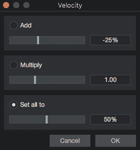

图 9.12：Velocity 窗口

1.  要按相同数量增加或减少所有音符的力度，请点击 `Add` 选项，然后选择要添加到或从其当前力度中减去的值。

2.  要按相同数量乘以所有力度，请点击 `Multiply` 并选择要相乘的值。

3.  要将所有力度设置为相同的值，请点击 `Set all to` 并选择您希望所有音符具有的值。请记住，在 Studio One 中，力度的值可以在 `0%` 和 `100%` 之间。

最后，有时您可能会遇到 MIDI 表演听起来很机械的情况，因为所有音符具有完全相同的力度值。当您使用 `Paint` 工具或 QWERTY 键盘通过鼠标输入音符时，就会发生这种情况，正如我们在 *第 6 章* 中讨论的那样。在这种情况下，通过给音符力度添加一些变化来为表演注入真实感和动态感是个好主意。以下是一种简单的方法：

1.  在 `Edit` 窗口中点击 `Action` 按钮，然后选择 `Humanize`。

2.  在 `Humanize` 窗口中，使用 `Add velocity range` 滑块设定一个范围，力度值应在该范围内变化。

3.  将 `Add note start range` 滑块设置为 `0`，以免移动音符的位置。

4.  点击 `OK`。

这结束了我们对 MIDI 力度及其几种不同处理方法的介绍。现在，让我们继续了解调制和其他 MIDI 参数，看看如何利用它们在歌曲进行过程中调整声音。

## 调整调制和其他参数

力度能有效衡量您敲击琴键的力度，但它不传达初次敲击后发生的任何信息。如果您长按一个音符，就需要另一种方法为其添加表现力和变化。

20 世纪 80 年代创建 MIDI 协议的那些聪明人意识到了这个问题，因此他们添加了几个称为**连续控制器消息**（**CCM**）的参数。这些参数允许您使用 MIDI 设备上的旋钮和推子连续控制音符的某些方面，而不管其长度如何。例如，您可以使用 CCM 逐渐增加单个音符的音量，或在音符即将结束时添加颤音。

就像力度一样，CCM 可以在表演过程中录制，事后也可以编辑，这将是本节的主题。Studio One 以相同的方式处理所有 CCM，因此一旦您学会了如何使用一种 CCM，就可以使用相同的方法录制和修改您需要处理的任何其他 CCM。

为了了解 Studio One 如何处理 CCM，我们将使用**调制**，这是最流行的 CCM。事实上，调制非常流行，以至于大多数 MIDI 键盘都配备了一个称为**调制轮**的专用硬件控制器，允许您实时操控调制数据。调制通常用于为声音添加颤音或打开滤波器，使声音逐渐变亮，但同样，每个制造商的方法都不同。

现在，让我们探索如何创建和编辑调制数据。

### 录制调制数据

在表演过程中录制调制数据可让您准确听到添加了多少表现力，并允许您即时调整调制电平。有几种方法可以做到这一点，让我们逐一探讨：

*   如果您的 MIDI 键盘有调制轮，只需在 MIDI 轨道上开始录制，正如我们在 *第 6 章* 中讨论的那样。当您演奏音符时，使用调制轮为它们添加表现力。调制数据将被录制在同一轨道内的单独通道上。

*   如果您表演时双手都在用，或者发现边弹边操控轮子不切实际，别担心。先录制音符。然后再次点击录制，这次操控调制轮。由于调制数据位于单独的通道上，这不会擦除音符。

*   如果您的键盘没有调制轮，或者您没有键盘，仍然可以录制调制数据。还记得屏幕上的 QWERTY 键盘吗？它左侧有一个虚拟调制轮，标记为 `Mod`（*图 6.9*）。点击录制并使用它为您的表演添加表现力。

一旦您录制了调制数据，就该对其进行编辑以臻完美，这正是我们接下来要做的。

### 编辑调制数据

调制数据存储并显示在 `Track Automation Lane` 中。请按照以下步骤显示此通道并开始微调：

1.  双击您要编辑的事件。这将在 `Edit` 窗口中打开该事件。

2.  如果您看不到 Automation Lane，请点击 `Show/Hide Automation Lanes` 按钮并选择 `Modulation` 选项卡。您录制的调制数据将以连续图表的形式显示在音符下方：

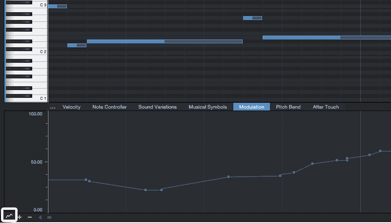

图 9.13：显示调制数据的 Automation Lane

1.  在 `Edit` 窗口中点击 `Paint` 工具，从 *图 9.10* 中选择一个选项，然后随心所欲地调整此图表。使用线条或抛物线获得平滑的变化，或尝试周期性选项（如 `Sine` 或 `Triangle`）以获得创意效果。此参数（或任何其他 CCM 参数）没有标准衡量标准，因此实验是关键。

有一点重要的事情要注意：虽然 CCM 数据与音符一起录制，但它并不直接链接到音符。这意味着如果您移动音符，调制数据将保持在其原始位置，并与音符失去同步。请看这两张截图：

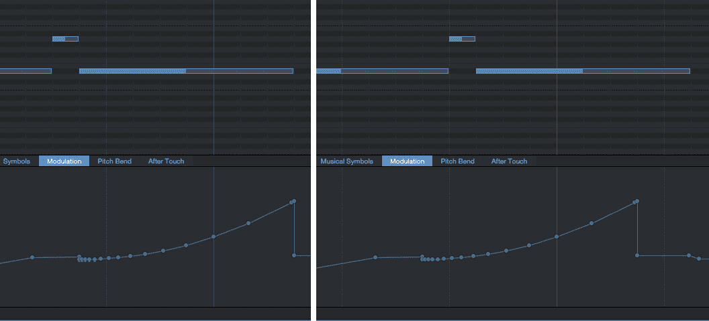

图 9.14：调制数据不跟随音符

在 *图 9.14* 的左侧，我们可以看到一条平滑的曲线，经过编辑与上方的长音符完美对齐。现在，如果我们决定将音符移动到不同位置，调制曲线将保持原位，调制添加的任何表现力将与该音符失去同步，如右侧所示。要修复此问题，请启用 `Select Part Automation with Notes` 选项：

图 9.15：Select Part Automation with Notes 切换按钮

现在，当您在 `Edit` 窗口中选择一个音符或一组音符时，这些音符下方的所有调制数据也将被选中，因此您可以将它们一起移动。

这结束了我们对 Studio One 通用 MIDI 编辑选项的介绍。接下来，我们将了解 Pattern Editor，并讨论该窗口独有的编辑功能。

## 在 Pattern Editor 中工作

正如我们在 *第 6 章* 中看到的，`Pattern Editor` 是创建旨在重复的音乐创意的完美工具。虽然其严格基于网格的设计缺乏 `Edit` 窗口的“所见即所得”方法，但 Pattern Editor 提供了一些在 Studio One 其他地方不可用的独特功能。所以，让我们逐一了解这些功能。

要开始使用 Pattern Editor，请双击要编辑的模式。这将打开 `Pattern Editor` 窗口。就像常规的 `Edit` 窗口一样，此窗口在其下部也有一个 Automation Lane，但具有不同的选项集：

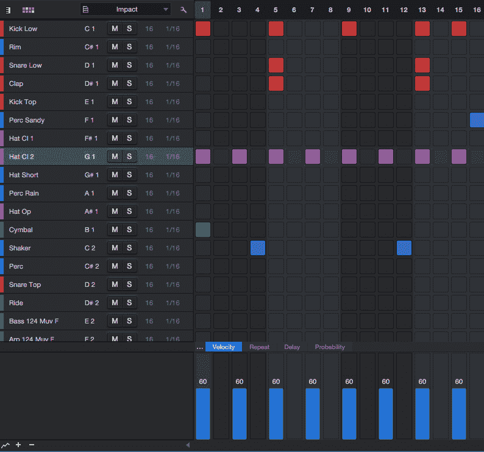

图 9.16：Pattern Editor 的 Automation Lane

现在，让我们逐一了解这些选项：

## 音符编辑功能

- **Velocity（力度）** 允许您为音符设置力度值，范围从 **0** 到 **100**。请注意，在此窗口中，您无法通过点击音符来选中它；这样做会删除该音符。相反，请点击包含该音符的通道（lane），其力度值将显示在自动化通道上。

- **Repeat（重复）** 可让您快速为音符添加连打音或滚奏（如鼓的滚奏）。这相当于使用我们在 *第 6 章* 中讨论的“双倍通道分辨率”方法添加滚奏。通常，**Repeat** 值为 **0**，意味着零次重复，但您可以增加此值以添加任意数量的重复。

- 使用 **Delay（延迟）** 值，您可以设置音符比其在网格上的位置更早或更晚播放。默认情况下，此设置为 **0**。输入正值可延迟音符，产生一种拖后的感觉。例如，如果您编写一个鼓点律动，军鼓和手拍声同时击中第 2 拍和第 4 拍，稍微延迟手拍声同时保持军鼓原位，将产生一种美妙、人性化的感觉，仿佛鼓手精准地卡在拍子上演奏，而鼓掌的人稍晚一点加入，这在现实生活中通常就是这种情况。如果在延迟滑块上输入负值，相应音符将在其网格位置之前播放，产生一种抢拍的感觉。这对于向鼓点律动注入兴奋感和期待感非常有用，尤其是在较快的速度下。

- **Probability（概率）** 是一项独特功能，用于设置特定音符被播放的可能性。这允许您为模式添加随机元素，使其更有趣、重复感更低。默认情况下，此值设为 **100%**，意味着相应音符将始终被播放。降低此值会减少其被播放的几率。这对于创作逼真的 MIDI 演奏、为模式添加人性化的变化和瑕疵非常有用。

掌握这些编辑功能将帮助您使用模式编辑器创建更具动态的元素，并克服过去困扰模式音序器的大多数局限。我们现在准备继续 MIDI 编辑工具之旅的最后一步 —— Note FX。

# 使用 Note FX 激发创造力

**Note FX** 插件是实时处理发送给 MIDI 乐器的音符的效果处理器。这允许您在处理器的界面上尝试创意想法，而无需实际更改或编辑原始演奏。

Studio One 中有四个 Note FX 插件：

- Arpeggiator（琶音器）
- Chorder（和弦器）
- Repeater（重复器）
- Input Filter（输入过滤器）

我们将逐一探索这些处理器，但首先，让我们看看如何将它们加载到 MIDI 轨道上。

## 加载 Note FX 插件

可以通过两种方式启动 FX 插件。这是第一种方法：

1. 打开 **Browse（浏览）** 面板并转到 **Instruments（乐器）** 选项卡。
2. 在乐器列表中找到 **Note FX**，并点击其旁边的小三角形。这将显示系统上安装的 Note FX 插件：
   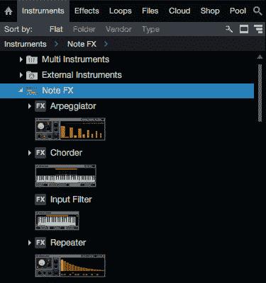
   图 9.17：浏览面板上列出的 Note FX 插件
3. 将您想要使用的处理器拖放到 MIDI 轨道上。

这是第二种方法：

1. 打开您想要添加 Note FX 处理器的轨道的 **Inspector（检查器）** 面板。
2. 找到 **Note FX** 区域。如果您使用的是小屏幕，此面板可能会显得拥挤，因此您可能需要通过调整其他区域的大小来找到它：
   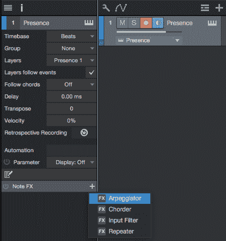
   图 9.18：检查器面板上的 Note FX 区域
3. 点击 **Note FX** 旁边的加号。这将显示系统上安装的 Note FX 插件列表。
4. 选择您想要使用的插件。

将 Note FX 插件加载到 MIDI 轨道后，您可以通过点击轨道上的 Note FX 编辑器图标来打开其界面：

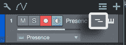
图 9.19：Note FX 编辑器按钮

现在，让我们逐一探索每个 Note FX 插件。

## Arpeggiator（琶音器）

**Arpeggiator（琶音器）** 根据来自 MIDI 轨道的和弦或单个音符，或通过键盘实时演奏的音符，生成复杂的节奏模式。此模式与工程速度同步，因此它将与音乐的其余部分保持同步。这使得 Arpeggiator 成为为 MIDI 轨道添加动感和趣味以及创建复杂、不断演变模式的完美工具。

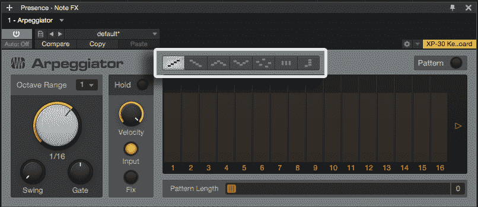
图 9.20：Arpeggiator

让我们剖析 Arpeggiator 的界面，了解其工作原理：

- *图 9.20* 中高亮显示的按钮称为方向选择器。当您演奏一个和弦时，这些选择器决定该和弦音符将按哪个方向琶音化。假设您演奏一个 C 大调和弦，由 C、E 和 G 三个音符组成。每个方向选择器将按如下方式琶音化这些音符：
  - 如果选择 **Up（向上）**（第一个选项），音符将按 C、E、G 的顺序琶音化。到达 G 后，模式将重新开始。
  - 如果选择 **Down（向下）**，音符将按 G、E、C 的顺序琶音化。
  - **Up and Down（上下）** 将产生 C、E、G、E、C。
  - **Down and Up（下上）** 将产生 G、E、C、E、G。
  - **Random（随机）** 将按随机顺序琶音化音符。
  - **From Input（来自输入）** 将按您演奏音符的顺序琶音化。
  - **Chord Mode（和弦模式）** 将重复整个和弦，而不是琶音化它。

- **Octave Range（八度范围）** 选择器指的是 Arpeggiator 播放生成音符的八度范围。如果设置为 **1**（其默认值），琶音化的音符将保持在您演奏的原始音符的同一八度内。如果设置为 **2**，琶音将跨越两个八度的跨度。最大可设置为 **4**，总共产生四个八度的范围。

- 左侧那个未标题的大旋钮实际上称为 **Rate（速率）** 设置。它允您为每个琶音步骤选择一个节奏值。它接受从全音符到 64 分音符的所有音长值，包括所有附点和三连音变体。

- **Swing（摇摆）** 允许您为琶音添加摇摆感（我们在 *第 6 章* 中讨论过摇摆）。

- **Gate（门限）** 决定琶音化音符的长度。当您调低此设置时，音符会变短。调高时，音符会变长，并相互重叠。

- **Hold（保持）** 按钮告诉 Arpeggiator 即使您释放键盘上的琴键也继续运行。当您演奏新音符时，这些新音符将替换之前的音符。

- **Velocity（力度）**、**Input（输入）** 和 **Fix（固定）** 设置决定琶音化音符的力度值如何设定。如果您希望 Arpeggiator 跟随您演奏时的音符力度，请选择 **Input**。如果您希望固定琶音化音符的力度，并使用 **Velocity** 旋钮拨入所需值，请选择 **Fix**。

琶音器创建的重复模式已成为某些音乐流派的标志，但对于其他类型的音乐，您可能希望自定义这些模式以获得更复杂、精细的编排。Studio One 的 Arpeggiator 具有一项功能正好允许您这样做，这就是我们接下来要探索的内容。

### 使用 Arpeggiator 的模式音序器

Arpeggiator 具有一个 **Pattern Sequencer（模式音序器）**，可用于编程详细的节奏模式。它与刚才描述的所有设置协同工作，并增加了一层额外的控制。您可以使用模式音序器为每个琶音化音符指定力度和门限值。

要开始使用模式音序器，请点击 Arpeggiator 右上角的 **Pattern（模式）** 按钮。**Pattern Editor（模式编辑器）** 窗口中将出现八列：

## 模式音序器

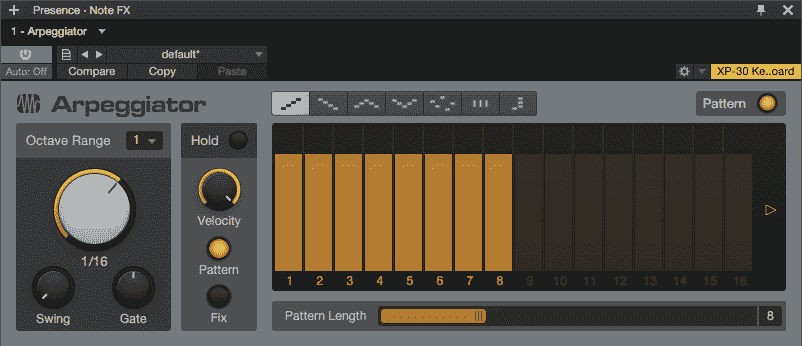

Figure 9.21: The Pattern Sequencer inside Arpeggiator

这些列代表由 `Arpeggiator` 触发的步骤。向上或向下拖动某一列可调整其力度。向左或向右拖动某一列可调整其宽度（充当单个音符的门限设置）。

如果您想编程一个超过八步的模式，请拖动底部的 `Pattern Length` 滑块。可用的最大步数为 32 步。

以这种方式使用 `Arpeggiator` 将为您打开许多创意可能性的大门，但这只是冰山一角。您可以将 `Arpeggiator` 上的每个参数都自动化，以在整个项目中动态地改变您的模式。您甚至可以在一条轨道上分配多个琶音器，并使用自动化在它们之间来回切换。我们将在 第 13 章 中讨论自动化。

## 和弦器

`Chorder` 是一款智能和弦生成器，只需弹奏单个音符即可触发和弦。这使您即使键盘技巧有限，也能轻松演奏复杂的和弦。

`Chorder` 的界面由两排钢琴键组成：

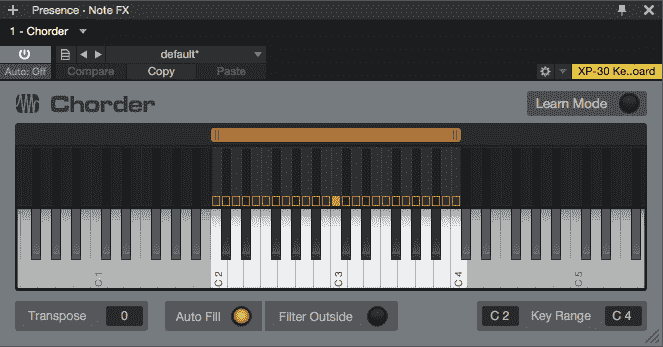

Figure 9.22: Chorder

底部的键盘显示您在键盘上弹奏的音符。顶部的键盘显示当您弹奏该音符时将被触发的音符。键盘上方的滑块设定 `Chorder` 生效的范围。如果您弹奏该范围之外的任何音符，`Chorder` 将忽略它。

如果您是乐理新手，不知道如何构建和弦，仍然可以充分利用 `Chorder`。在 `Preset`（预设）菜单中，您会发现一组针对各种音乐流派优化的和弦组合。打开界面顶部的 `Preset` 下拉菜单（查找标记为 `default` 的字段），选择一个符合您风格的和弦组合，即可开始使用。但是，如果您想编程自己的和弦以在 `Chorder` 中使用，请继续阅读。

### 编程 Chorder 以使用自定义和弦

您可以教会 `Chorder` 触发任意数量的自定义和弦。作为示例，我们将对其进行编程，以便当我们在 MIDI 键盘上弹奏 `C2` 音符时，触发一个 C 大七和弦。请按以下步骤操作：

1. 点击 `Learn Mode`（学习模式）按钮。
2. 在下方的键盘上，点击您想用作触发器的音符。在本例中，将是 `C2`。
3. 在上方的键盘上，点击您希望在弹奏 `C2` 时由 `Chorder` 触发的音符。在本例中，这些将是 `C`、`E`、`G` 和 `B`。请随意以您喜欢的方式排列这些音符以创建不同的和弦排布，添加张力音如 `D`、`F#` 和 `A`，并使用不同的八度。您可以使用上方键盘上任何八度的任何音符。
4. 您也可以通过在 MIDI 键盘上弹奏音符来添加音符，而不必用鼠标点击上方的键盘。`Chorder` 将以相同的方式记录它们。
5. 如果添加了错误的音符，再次点击它或在键盘上再次弹奏它即可将其移除。
6. 要输入另一个和弦，根据需要重复步骤 2 到 4 多次。
7. 再次点击 `Learn Mode` 按钮以退出学习模式。

现在，您只需在轨道上录制触发音符。当您播放录音时，`Chorder` 将自动生成您编程的和弦。

## 重复器

`Repeater` 是 `Arpeggiator` 的简化版。它不会对接收到的音符进行琶音化，而是简单地以预定间隔重复它们。这对于从长的、静止的音符创建节奏序列非常有用。

`Repeater` 界面上的大多数设置与 `Arpeggiator` 上的设置相同：

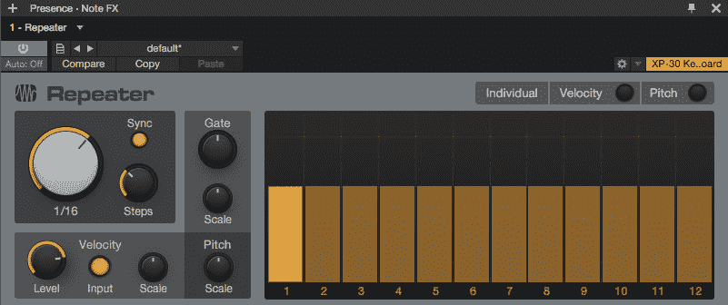

Figure 9.23: Repeater

为避免重复（此处无双关语之意），我们将仅介绍 `Repeater` 独有的设置。

`Steps`（步数）决定原始音符将被重复多少次。默认值为 `8`，但最高可达 `32`。完成此重复次数后，`Repeater` 将停止。

`Velocity`（力度）、`Gate`（门限）和 `Pitch`（音高）的 `Scale`（缩放）设置允许您逐步更改这些值。例如，通过调整 `Velocity` 的 `Scale` 设置，您可以指示 `Repeater` 使每个后续步骤的力度比前一个步骤增加或减少。

所有步骤的力度和长度分别由 `Velocity` 和 `Gate` 设置全局控制。您可以通过激活右上角的单个 `Velocity` 和 `Pitch` 按钮来覆盖这些设置，并为单个步骤设置特定的力度和长度值。激活后，您将能够拖动音序器窗口中的列来调整其长度和力度，就像在 `Arpeggiator` 中一样。

## 输入过滤器

`Input Filter` 是一款实用插件，可让您在不需要的音符到达 MIDI 设备之前将其过滤掉。当您希望乐器仅响应特定音符时，这非常有用，从而产生一些创造性的应用。

让我们来看看 `Input Filter` 是如何工作的。界面很简单：

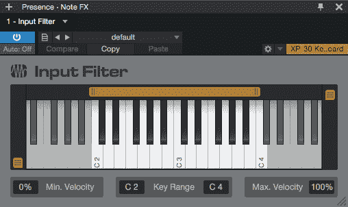

Figure 9.24: Input Filter

键范围内的音符将被允许通过，范围外的音符将被阻止。如图 9.24 所示，`Input Filter` 设置为允许 `C2` 和 `C4` 之间的所有音符通过，阻止所有其他音符。您可以通过直接在 `Key Range`（键范围）字段两侧的框中输入音符名称，或使用键盘上方的滑块来编辑此范围。

`Input Filter` 还允许您为被允许通过的音符设置力度范围。请记住，在 Studio One 中，MIDI 音符的力度值可以在 `0%` 和 `100%` 之间。您可以分别使用 `Min. Velocity`（最小力度）和 `Max. Velocity`（最大力度）字段设置力度的下限和上限阈值。高于或低于这些阈值的任何音符都将被阻止。

现在，让我们想几个这些功能有用的场景。例如，假设您想将键盘分割给两件乐器，以便当您弹奏低音区时，乐器 A 发出贝斯吉他声音，而当您弹奏高音区时，乐器 B 发出钢琴声音。您可以按如下方式操作：

1. 创建两条乐器轨道，一条用于乐器 A，一条用于乐器 B。
2. 为两条轨道选择相同的 MIDI 键盘作为输入源。
3. 在两条轨道上都加载一个 `Input Filter`。
4. 在乐器 A 轨道（贝斯吉他）的 `Input Filter` 上，将允许的音符范围设置在 `C0` 和 `C2` 之间。
5. 在乐器 B 轨道（钢琴）的 `Input Filter` 上，将允许的音符范围设置在 `C2` 和 `C8` 之间。

这是另一个场景。假设您正在制作一个管弦乐编排。乐器 A 为您提供弦乐组的声音，您希望乐器 B 仅在您用力弹奏以重音某些音符时加入并演奏定音鼓声音。具体设置如下：

1. 创建两条乐器轨道，一条用于乐器 A，一条用于乐器 B。
2. 为两条轨道选择相同的 MIDI 键盘作为输入源。
3. 在两条轨道上都加载一个 `Input Filter`。
4. 在乐器 A 轨道（弦乐）的 `Input Filter` 上，将允许的力度范围设置在 `0%` 和 `100%` 之间。
5. 在乐器 B 轨道（定音鼓）的 `Input Filter` 上，将最小力度阈值设置为 `75%`。

现在，只有当您以高于 `75%` 的力度演奏时，才能听到定音鼓。

每个 Note FX 插件都提供了令人兴奋的创意实验机会，但当你开始将它们级联，使一个触发另一个时，可能性将变得令人难以置信。尝试在同一轨道上插入一个和弦器，然后是一个重复器，以及两个琶音器。将琶音器设置为截然不同的时间值，你将进入未知领域——这是激发灵感和点燃创造力的即时途径！

在本节中，我们探讨了 Note FX 插件，它们提供了广泛的工具和效果，可用于以多种方式操控和转换 MIDI 数据，让你能够创作出新颖独特的音乐创意。

## 总结

在本章中，我们深入探讨了 Studio One 丰富的 MIDI 编辑功能列表，并讨论了多种操控 MIDI 数据的方法，用于修正和创意目的。你学习了如何调整演奏的音高、时序和其他参数，以实现广泛的音乐效果。你还更深入地了解了什么是 Note FX 插件，以及如何利用它们从简单的创意中创建复杂的编曲。

掌握这些 MIDI 编辑功能将使你能够探索新的可能性，并让你的音乐朝新的方向发展。

在下一章中，我们将讨论 Studio One 的全局轨道。你将学习如何为项目添加和弦以供所有乐器跟随，如何处理视频，以及如何添加歌词和标记以便于导航。掌握全局轨道将是将你的项目提升到新高度的下一步。
