## 第 10 章：使用全局轨道

Studio One 中的全局轨道允许用户控制影响整个项目的参数，而不仅仅是特定轨道或区域。这些轨道可用于动态更改歌曲的整体属性，例如调性、速度或和声结构。作为一种创意工具，它们允许你快速尝试新想法、探索各种可能性，并在满意后轻松确定下来。全局轨道还允许你在项目中包含额外内容，例如视频或歌词。

在本章中，我们将深入研究 Studio One 的全局轨道，并学习如何利用其强大功能更好地控制你的项目。我们将涵盖以下主题：

*   使用和弦轨道控制歌曲的和声内容
*   使用标尺、标记和歌词轨道更高效地处理项目
*   使用视频轨道为视频添加声音和音乐

## 技术要求

要学习本章内容，你需要在电脑上激活 Studio One。

## 使用和弦轨道控制歌曲的和声内容

**和弦轨道**提供了一种强大且直观的方式来创建和操控和弦进行，并控制 MIDI 乐器演奏的音符。这让你有机会实时尝试新的和声创意并构建复杂的和弦进行。

即使你完全不懂乐理，对和弦如何运作知之甚少，你仍会发现和弦轨道非常有用。这是因为和弦轨道与 Studio One 内置的和弦检测算法协同工作，该算法可以自动识别音频录音中的和弦并将其转录。这为广泛的可能性打开了大门。例如，如果你喜欢现有歌曲的和弦进行，你可以使用此功能提取其和弦，并将这些和弦作为模板来创作你自己的歌曲。

和弦进行不被视为知识产权，也不受任何形式的版权保护，因此请随意使用此技术来丰富你作品的和声内容。

现在，让我们看看如何在项目中使用和弦轨道。

### 和弦轨道入门

默认情况下，和弦轨道处于隐藏状态。要使其可见，请点击**全局轨道可见性**按钮，并从全局轨道列表中选择**和弦**：

图 10.1：全局轨道可见性按钮和全局轨道列表

> **提示**
>
> 我们在前几章中已经介绍了其中三个全局轨道。我们在第 4 章中探讨了**速度轨道**和**拍号轨道**，在第 7 章中探讨了**编曲轨道**。

一个空的和弦轨道现在将显示在**编曲**窗口的顶部，准备填入你歌曲的和弦。如果你的项目中已经有音频或 MIDI 录音，Studio One 可以分析该录音，检测其中的和弦，并自动将这些和弦提取到和弦轨道。如果你还没有录音，可以手动输入和弦。接下来我们将介绍这两种方法。

### 自动检测和提取和弦

Studio One 拥有强大的和弦检测算法，可以准确检测音频或 MIDI 录音中的和弦。如果你有一段录音想用作歌曲的和声模板，可以使用此功能自动填充项目和弦轨道上的和弦。

要从音频录音中提取和弦，请按以下步骤操作：

1.  右键点击包含音频录音的事件。这将打开一个弹出菜单：

    

    图 10.2：检测音频录音中的和弦

2.  在此菜单中，转到**音频**并选择**检测和弦**。Studio One 将分析录音，识别其中的和弦，并在音频事件的下半部分显示这些和弦。

3.  然后，再次右键点击音频事件，转到**音频**，这次选择**提取到和弦轨道**。Studio One 将用刚刚检测到的和弦填充和弦轨道。

    

    图 10.3：和弦轨道（顶部）显示从音频事件（底部）提取的和弦

从 MIDI 事件提取和弦甚至更简单——只需将事件拖动到和弦轨道即可。就是这么简单！

或者，右键点击事件，在弹出菜单中转到**乐器片段**，然后选择**提取到和弦轨道**。现在让我们看看第二种方法。

### 手动输入和弦信息

如果你知道歌曲中将使用的和弦，可以手动将它们添加到和弦轨道。操作方法如下：

1.  按键盘上的 `5` 选择**画笔**工具。

2.  点击你想输入新和弦的小节。这将添加一个暂定的 C 大调和弦（在*图 10.4*中标记为 **C**），持续整个小节的时长：

    

    图 10.4：手动向和弦轨道添加和弦

3.  按键盘上的 `1` 选择**箭头**工具。

4.  如果你希望该和弦持续时间比一个小节长或短，将**箭头**工具移至和弦事件的右边缘，向左或向右拖动以根据需要调整其大小。

5.  双击和弦轨道上的和弦名称。这将打开**和弦选择器**窗口：

    

    图 10.5：和弦选择器窗口

6.  使用该窗口中心的五度圈轮盘来选择你的和弦。

7.  要选择基本**大调**和**小调**和弦之外的和弦类型，请使用左侧的**类型**选择器。

8.  如果你想添加上层和弦音（也称为张力音），请使用右侧的**音程**部分。

# 向和弦轨道添加和弦（续）

4. 默认情况下，`Chord Track`（和弦轨道）使用根位来排列和弦内的音符。根位是指和弦的根音——即赋予和弦名称的那个音——是最低音。有时，您可能希望在低音部使用和弦根音以外的音符，以创建具有不同色彩的和弦，这被称为转位或分数和弦。在这种情况下，请使用右侧的 `Bass`（低音）部分来选择应作为低音的音符。命名完和弦后，使用 `Chord Selector`（和弦选择器）窗口左上角的箭头键移至下一个和弦。

5. 重复步骤 1 至 9，添加所需数量的和弦。

6. 您可以在 `Chord Track`（和弦轨道）上移动、复制和粘贴和弦，就像在 `Arrange`（编排）窗口中操作其他事件一样，使用 `Arrow`（箭头）工具的标准编辑选项即可。

作为步骤 6 至 9 的替代方案，您可以直接从 MIDI 键盘演奏和弦，让 Studio One 自动识别并命名这些和弦。为此，请启用 `Instrument Input`（乐器输入）按钮（图 10.5 中高亮显示）。现在，当您在键盘上弹奏和弦时，Studio One 会识别它并自动将其放置在 `Chord Track`（和弦轨道）上。

既然您已经填充了 `Chord Track`（和弦轨道），下一步就是让项目中的 MIDI 乐器轨道跟随这些和弦，这正是我们接下来要介绍的内容。

# 设置乐器轨道跟随和弦轨道

默认情况下，项目中的 `Instrument Tracks`（乐器轨道）不受 `Chord Track`（和弦轨道）影响。这意味着您在 `Chord Track`（和弦轨道）上输入的和弦不会改变 `MIDI events`（MIDI 事件）的播放方式——至少目前还不会。您可以使用两种方法确保 `Instrument Tracks`（乐器轨道）中的 `MIDI events`（MIDI 事件）跟随 `Chord Track`（和弦轨道）上的和弦。让我们从简单的方法开始。

## 通过拖放添加和弦

一旦您在 `Chord Track`（和弦轨道）上布置好歌曲的和弦，只需将这些和弦拖放到任意 `Instrument Track`（乐器轨道）上。Studio One 会自动创建与每个和弦对应的 `MIDI notes`（MIDI 音符），其时长与 `Chord Track`（和弦轨道）上的和弦事件相同：

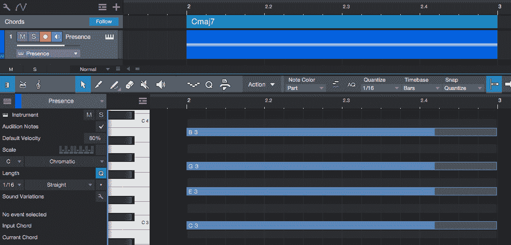

图 10.6：将和弦拖放到乐器轨道上，自动创建对应该和弦的音符

如果您是乐理新手，尚不清楚如何构建和弦，这简直是救星。只需向该 `Instrument Track`（乐器轨道）添加 `Arpeggiator`（琶音器），即可将这些冗长、静态的音符变成更有趣的模式！

如果您如图 10.2 所示对音频事件应用了和弦检测，也可以直接将该音频事件拖放到 `Instrument Track`（乐器轨道）上。Studio One 会自动创建对应每个检测到的和弦的 `MIDI notes`（MIDI 音符）。

这种拖放方法快速简便，但其缺点是 `Instrument Track`（乐器轨道）和 `Chord Track`（和弦轨道）仍未关联。因此，如果您决定在 `Chord Track`（和弦轨道）上尝试新和弦，`Instrument Track`（乐器轨道）仍会播放原始和弦。下一种方法将通过链接这两条轨道来解决此问题。

## 设置“跟随和弦”参数

`Chord Track`（和弦轨道）最大的优势在于能让您轻松尝试新的和声构思。只需更改 `Chord Track`（和弦轨道）中的一个和弦，项目中的所有轨道都会自动修改以符合新和弦。要实现此功能，我们需要设置项目中的轨道跟随 `Chord Track`（和弦轨道）。具体操作如下：

1. 选择一条应跟随 `Chord Track`（和弦轨道）的轨道，然后点击 `Inspector`（检查器）按钮以打开 `Inspector`（检查器）窗口。

2. 在 `Inspector`（检查器）窗口中，点击打开 `Follow chords`（跟随和弦）下拉菜单：

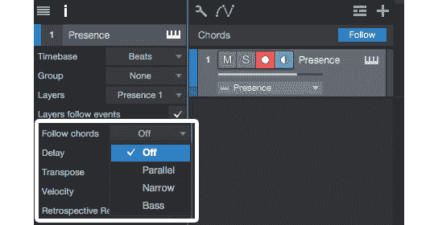

图 10.7：跟随和弦下拉菜单

3. 在此下拉菜单中，选择当您更改 `Chord Track`（和弦轨道）上的和弦时，希望该轨道上的音符如何被修改。可用选项如下：

- `Off`（关闭）：这是默认模式。`Instrument Track`（乐器轨道）不跟随 `Chord Track`（和弦轨道）。

- `Parallel`（平行）：选择此选项后，当您更改 `Chord Track`（和弦轨道）上的和弦时，`Instrument Track`（乐器轨道）上的音符将平行移调至原始和弦结构，保持音符间相同的音程。为了说明这一点，请看图 10.8 的示例。我从三个相同的 C 大七和弦开始。我保持第一个（左侧）不变。然后，使用 `Chord Track`（和弦轨道），我将第二个（中间）改为 F 大七，第三个（右侧）改为 A 小七。这是它们使用 `Parallel`（平行）设置移调后的结果：

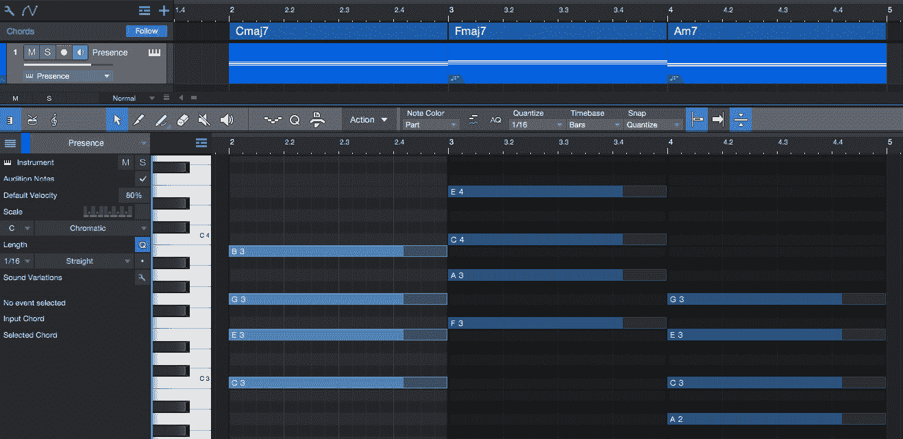

图 10.8：由跟随和弦 | 平行设置修改的 MIDI 音符

这会导致和弦之间出现大跳进，从配器角度来看并不理想，但如果您希望所有和弦保持相同的排布和织体，这可能会很有用。

- `Narrow`（窄范围/就近）：在此模式下，音符会移至新和弦可用的最近音符。这使得从一个和弦到下一个和弦的过渡更加平滑，模仿了一种称为声部进行的配器技巧。这是图 10.8 中相同的和弦，这次使用 `Narrow`（窄范围）设置修改后的结果：

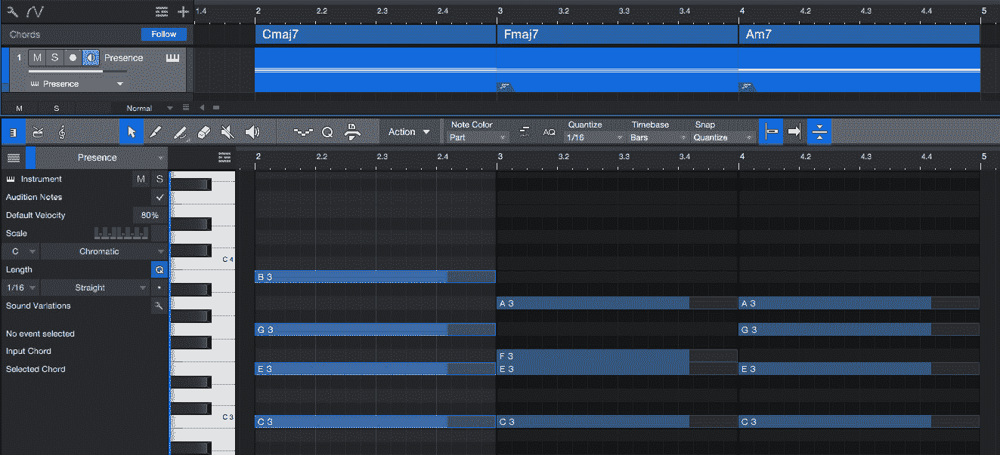

图 10.9：由跟随和弦 | 窄范围设置修改的 MIDI 音符

- `Bass`（低音）：此选项用于低音乐器。它将和弦的根音或低音分配给和弦中的最低音。使用此模式的最佳方式是删除和弦中除最低音以外的所有音符，然后将该音符移调至第一八度（C1 到 C2 之间的八度）。

4. 双击 `Chord Track`（和弦轨道）上的一个和弦。这将打开 `Chord Selector`（和弦选择器）窗口（图 10.5）。根据需要更改和弦。

现在，当您更改 `Chord Track`（和弦轨道）上的和弦时，所有 `Instrument Tracks`（乐器轨道）都会相应修改。`Audio Tracks`（音频轨道）也可以设置为跟随 `Chord Track`（和弦轨道），但它们有一些限制，且涉及一些额外步骤。我们接下来将讨论这些内容。

# 设置音频轨道跟随和弦轨道

对于 `MIDI` 素材，检测和弦和移调音符相当简单，但处理音频时，过程会复杂得多。尽管近年来音频素材的检测和移调算法有了巨大发展，但它们仍不完全准确，且可能在音质上产生明显的伪影。了解这些限制将有助于您获得更好的结果。在本节中，我们将介绍音频素材特有的问题，并讨论几种变通方法。

## 和弦检测失败时该怎么办

在音频录音上检测和弦并非易事。当您将一首流行歌曲的 `MP3` 文件拖入 Studio One 并让它检测其中的和弦时，大多数情况下您会对结果的准确性印象深刻。然而，有时检测并不那么准确，这是可以理解的——典型的流行歌曲中有太多元素可能会干扰算法。此处算法面临的最大挑战是仅关注歌曲和声语境中合理的声音，并过滤掉其他所有声音。如果失败，和弦检测将产生错误结果。

如果您已经知道歌曲的和弦，可能会觉得这无关紧要——您只需在 `Chord Track`（和弦轨道）上手动输入和弦即可。然而，Studio One 必须知道 `Audio Track`（音频轨道）上正在播放哪些和弦，才能在跟随 `Chord Track`（和弦轨道）时正确地将它们移调。

如果您的音频轨道未能正确跟随 `Chord Track`（和弦轨道），请按以下步骤修复此问题：

1. 右键单击音频事件。这将打开图 10.2 所示的弹出菜单。

2. 转到 `Audio` 并选择 `Apply Chords from Chord Track`。这将覆盖对音频事件执行的任何和弦检测，并改用 `Chord Track` 上的和弦填充它。

现在，当你对 `Chord Track` 进行更改时，音频事件将被准确地转调。

### 音频素材特有的选项

当你转调 MIDI 音符时，基本上是在告诉 MIDI 乐器在不同的音高触发相同的声音。虽然这可能会改变声音的音色，但不会降低音质。另一方面，转调音频事件是一个复杂得多的操作，需要改变音频录音中交织在一起的波形频率。此操作称为 `pitch-shifting`（移调）。

近年来，移调算法有了显著发展，以至于将音频录音转调几个半音不会产生任何明显的副作用。然而，当你使用 `Chord Track` 时，最终会以大得多的音程转调音频录音，这不可避免会导致音质损失。因此，让我们探讨一下 Studio One 内置的几种缓解此问题的方法。

在上一节中，我们介绍了 `Follow Chord`（跟随和弦）菜单下的标准选项（图 10.7）。当你在音频轨道上工作时，此菜单提供两个额外选项。如果你对上一节介绍的选项不满意，可以试试这些额外选项：

*   `Scale`（音阶）：此模式使用一种非常智能的算法。首先，它根据原始音频录音构建一个音乐音阶。然后，它转调该音阶的音符以跟随 `Chord Track`。这项技术相当先进，但有一个注意事项——为了使其正常工作，算法首先必须能够正确检测原始录音中的和弦。如果检测不准确，转调也无法正确工作。如果是这样，请尝试我们在 *What to do when chord detection fails*（和弦检测失败时该怎么办）一节中讨论的方法，或继续尝试下一个选项。

*   `Universal`（通用）：在此模式下，算法将只检测音频录音中的音符，然后将它们转调为你在 `Chord Track` 上选择的和弦的音符。这消除了必须正确检测和弦的前提条件，通常能产生稳妥的结果。

除了讨论的 `Follow Chord` 选项外，每个音频轨道还有一个 `Tune Mode`（调音模式）选择器，可帮助你针对该轨道中包含的音频素材类型优化移调算法：

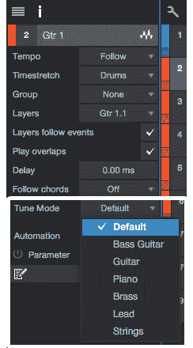

Figure 10.10: The Tune Mode selector

使用此选择器告诉算法它正在处理什么类型的素材，但不要过于字面地理解这些选项名称。例如，根据乐器的音色，`Guitar`（吉他）选项在钢琴录音上可能会产生更好的效果。所以，大胆尝试不同的选项，直到获得最佳结果。一如既往，实验是关键。

尽管性能惊人，但移调技术尚不完美。这可能会在几年内改变，但今天，将音频素材移调超过几个半音仍然不是好主意，尤其是当该素材在歌曲中很突出时。就音频轨道而言，你最好的策略是仅使用 `Chord Track` 来尝试新的和弦和和声构思。一旦你找到满意的和弦进行，重新录制音频轨道以匹配这些新和弦。这样，你的项目将不受移调导致的音质下降影响。

在本节中，我们探讨了 `Chord Track` 并讨论了使用它来丰富项目和声内容的最佳实践。接下来，我们将介绍三种全局轨道，它们旨在帮助你在项目中更有效地导航。

# 使用 Ruler、Marker 和 Lyric Tracks 更高效地处理项目

随着项目的增长，在其中找到方向会变得更难。试图通过不断缩放和滚动时间轴来定位项目中的某个点既耗时又分散注意力。本节将介绍的全局轨道旨在帮助你平滑导航并精确定位任何项目中的重要点。虽然它们不是 Studio One 中最令人兴奋的功能，但它们肯定会让生活更轻松，并让你保持专注。

能够标记和定位项目中的重要点在团队协作并开始在合作者间共享文件时变得更加重要，因为它允许每位贡献者在打开项目时立即进入状态。

让我们从探索 `Ruler Track`（标尺轨道）开始，它是全局轨道家族中最简单的成员。

## 使用 Ruler Track 跟踪不同的时间单位

`Arrange`（编排）窗口顶部的 `Ruler`（标尺）以音乐格式显示时间——小节、拍、四分音符等。当你在做音乐项目时这很合理，但对于任何其他应用则完全无关。例如，如果你编辑播客，可能会被要求“删除 8 分 23 秒处的咳嗽声”。如果你为电影做声音设计，任务可能是“在第 00:02:26:18 帧添加爆炸音效”。

作为解决方案，你可以更改标尺上显示的时间单位。为此，打开上方面板上的 `Timebase`（时间基准）下拉菜单。在这里，你可以将标尺设置为以秒或帧显示时间：

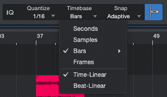

Figure 10.11: The Timebase drop-down menu

然而，如果你需要同时看到帧和音乐单位的时间怎么办？这在配乐中非常常见，例如你可能被要求“创作一个 16 小节的动作提示，精确结束在第 00:02:26:18 帧的爆炸处”。这就是 `Ruler Track` 的用武之地。

`Ruler Track` 在 `Arrange` 窗口默认标尺下方添加一个额外的标尺，允许你以辅助格式显示时间。这样，你就可以在 `Arrange` 窗口顶部拥有两个独立的标尺，为不同目的显示不同的时间单位。

点击 `Global Track Visibility`（全局轨道显示）按钮（图 10.1）使 `Ruler Track` 可见。然后，使用其下拉菜单选择你想查看的时间单位：

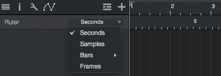

Figure 10.12: The Ruler Track

请注意，在图 10.12 中，`Arrange` 窗口的原生标尺（顶部）以音乐格式显示时间，而 `Ruler Track`（底部）设置为以秒显示时间。

`Ruler Track` 仅供视觉参考。它不会影响 `Snap to Grid`（吸附到网格）功能的行为。`Arrange` 窗口中的事件将吸附到顶部标尺上选择的任何时间单位。

现在我们知道了如何显示正确的时间单位，下一步是跳转到时间轴上的任意位置。这将由我们的下一个全局轨道来实现。

## 使用 Marker Track 进行轻松导航

`Marker Track`（标记轨道）允许你通过在时间轴上的关键点放置标记（如段落的开始和结束，或特定事件的位置）来轻松导航项目。你可以为标记添加描述性标签，轻松跟踪项目中发生的情况并掌握工作进度。

`Marker Track` 可用于帮助管理和组织项目，尤其是大型复杂的制作。如果你与其他人合作，`Marker Track` 可以成为沟通和协作的宝贵工具。

要向项目添加标记，请按如下步骤操作：

1. 点击 `Global Track Visibility` 按钮并选择 `Marker`。这将显示 `Marker Track`。

## 使用标记进行导航

点击**标尺**以将时间线放置在您想要添加标记的位置。如果您知道标记应放置的确切位置（例如，制作团队给了您特定的时间码），您可以直接将其输入到下方面板上的时间指示器中：

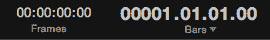

*图 10.13：下方面板上的时间指示器*

1.  现在，转到 `Marker Track` 并点击 `+` 号。这将添加一个新标记。
2.  双击标记并给它一个描述性的名称，例如 `Verse`、`Chorus` 等。
3.  重复*步骤 2*到*步骤 4*以添加您需要的任意数量的标记：

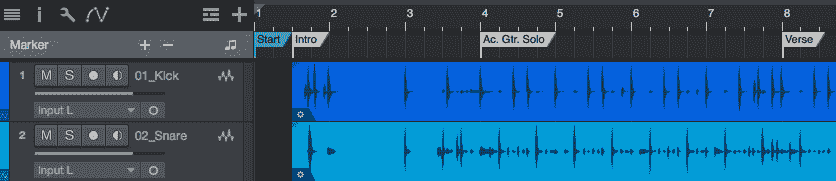

*图 10.14：在标记轨道上添加标记*

1.  通过选择标记并点击 `Marker Track` 上的 `-` 号来删除标记。

添加标记后，您可以使用它们在项目中轻松导航。例如，如果您在项目的某个片段中间工作，想要跳转到该片段的开头或结尾，请输入 `Shift` + `N` 跳转到下一个标记，或输入 `Shift` + `B` 跳转到上一个标记。

您也可以通过使用小键盘上的数字键直接跳转到标记。标记的编号方式如下——当您首次创建歌曲时，Studio One 会创建两个标记，分别标记为 `Start` 和 `End`，并将它们放置在时间线的开头和结尾。这些标记分别被分配编号 `1` 和 `2`。这些标记的名称和编号无法更改。然后，您使用 `Marker Track` 添加的每个标记都会按顺序编号，从 `3` 开始。您可以通过按下小键盘上对应的数字来跳转到任意标记。如果您有两位数编号的标记，请输入 `Ctrl` + `Alt` + `M` (Windows) 或 `Cmd` + `Option` + `M` (Mac)，然后在弹出的对话框中输入编号。

要查看所有标记及其对应编号的列表，请选择 `Marker Track` 并打开 `Inspector` 窗口：

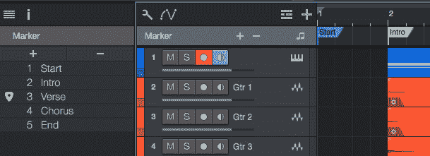

*图 10.15：检查器窗口中列出的标记*

标记对于组织和导航很有效，但 Studio One 有一项功能将这一功能提升到了一个全新的水平——`Lyric Track`（歌词轨道）。接下来我们将探讨这一点。

## 使用歌词轨道

`Lyric Track` 提供了一种便捷的方式，在您录制或播放项目时实时在屏幕上显示歌曲歌词。这使得在制作过程中更容易保持节奏/进度。如果您自己录制演唱，这能免去您将歌词写在纸上并跟踪它们的麻烦。如果您录制别人的歌，它将帮助您更轻松地在歌曲中找到方向。如果您与其他音乐家或制作人合作，`Lyric Track` 可以成为沟通和协作的宝贵工具。当您与团队的其他成员共享项目时，他们也能看到歌词，让所有人保持一致并理解歌曲的结构。

`Lyric Track` 提供了用户友好的界面来输入和编辑歌词，使调整歌词的时机和位置以匹配音乐变得容易。要开始使用 `Lyric Track`，请按以下步骤操作：

1.  点击 `Global Track Visibility`（全局轨道可见性）按钮并选择 `Lyrics`（歌词）。这将显示 `Lyric Track`。
2.  要开始添加歌词，只需双击 `Lyric Track` 上的所需位置并开始输入：

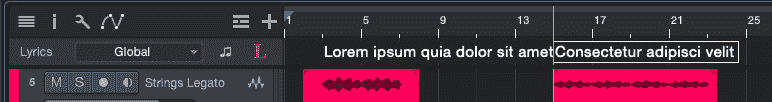

*图 10.16：在歌词轨道上输入歌词*

3.  要开始新行并前进到下一小节，请按 `Enter`。
4.  要在不开始新行的情况下前进到下一小节，请按 `Tab`。

输入歌词后，您可以使用 `Arrow`（箭头）工具来编辑它们，就像在 `Arrange`（编排）窗口中编辑其他事件一样。拖动以移动它们以微调位置，复制一组歌词事件以在下一段副歌中重复，并对它们进行排列以适应歌曲结构。

要在同一页面查看歌词，请点击 `Lyric Track` 上的 `L` 按钮。这将打开 `Lyrics Display`（歌词显示）：

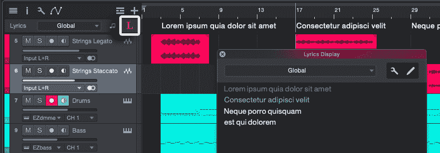

*图 10.17：歌词显示*

`Lyrics Display` 将以卡拉 OK 风格，与时间线同步显示歌曲歌词。随着项目播放，歌词将自动滚动。当前演唱的行将以蓝色显示。之前的行将显示为灰色，之后的行将显示为白色。您还可以点击 `Lyrics Display` 上的某一行以跳转到歌曲中的该特定位置。

以下是使用 `Lyrics Display` 时的两个实用技巧：

*   录制人声时，您可能希望歌词稍微提前显示，以便歌手知道接下来的内容。为此，请点击 `Lyrics Display` 上的扳手图标，进入 `Settings`（设置），然后选择 `Ahead`（提前）。这将允许您为显示的歌词设置时间偏移。
*   如果您在录制时从屏幕阅读歌词，而麦克风离屏幕较远，您可能希望增加 `Lyric Display` 的字体大小。点击扳手图标，进入 `Settings`，然后选择 `Font Size`（字体大小）。

在本节中，我们探讨了 Studio One 中旨在帮助您更好地控制项目的三种全局轨道类型。接下来，我们将深入了解 `Video Track`，并了解如何将视频文件集成到您的项目中，为电影或多媒体制作配乐或创作声音设计。

# 使用视频轨道为视频添加声音和音乐

`Video Track` 允许您向项目添加一个或多个视频文件。然后您可以使用 `Audio Tracks`（音频轨道）和 `Instrument Tracks`（乐器轨道）为视频创建对话、音效和音乐。

`Video Track` 提供了一种强大且直观的方法，为电影、视频和其他多媒体项目添加完美同步的音频，即使您在视频后期制作方面经验有限。要开始使用 `Video Track`，我们将首先探讨如何向项目添加视频文件。

## 导入视频文件

要导入视频文件，只需将其从 `File Explorer`（文件资源管理器，Windows）或 `Finder`（访达，Mac）拖放到您的项目中。`MPEG` 和 `M4V` 文件在两个操作系统上均受支持；在 Mac 电脑上，也可以导入 `QuickTime` 文件。

您可以根据需要将任意数量的视频文件导入同一个项目，但请确保它们具有相同的文件格式和帧率。如果您导入文件类型和帧率混杂的文件，Studio One 会尽力兼容，但您可能会遇到系统不稳定甚至崩溃的情况。

如果您是第一次处理视频文件，不了解文件类型和帧率，请别担心。只需安装 `Handbrake`，这是一个免费的开源工具，用于转换视频文件，它会为您将所有视频文件转码为相同的文件类型和帧率。请在此获取：[`https://handbrake.fr`](https://handbrake.fr)。

> **提示**
>
> 高分辨率播放视频文件对大多数计算机来说是一项繁重的任务。如果您处理的视频分辨率很高（通常标记为 `4K` 或 `Ultra HD`），请使用 `Handbrake` 创建一个低分辨率版本并将其导入您的项目。这样，您就能释放计算机资源，将更多算力分配给音频制作。

## 导航视频轨道和视频播放器

当您导入视频文件时，Studio One 会自动创建一个 `Video Track` 并将文件放置其中。然后它会花一点时间扫描视频、创建缩略图，并将它们横跨在 `Arrange` 窗口中：

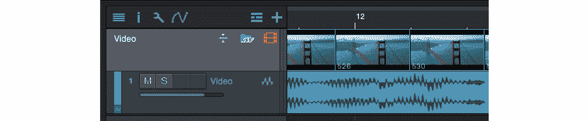

*图 10.18：视频轨道（顶部）和音频子轨道（底部）*

# 在 Studio One 中处理视频

如果视频文件已包含音频，该音频将被提取到缩略图正下方的一个特殊轨道中，称为 `Audio Sub-Track`（音频子轨道）。

`Video Track`（视频轨道）上显示的缩略图非常适合在时间线上直观地定位特定场景或帧，但它们无法用于实际观看视频。这时就需要用到 `Video Player`（视频播放器）。`Video Player` 是一个浮动窗口，它会根据 `Arrange`（编排）窗口中时间线的位置同步播放视频：

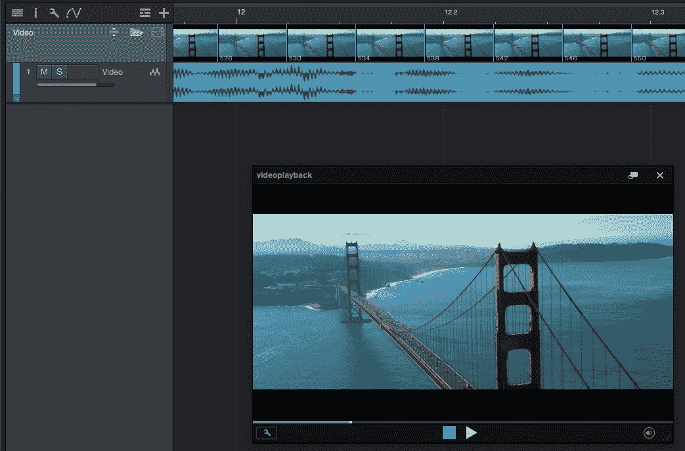

**图 10.19：视频播放器**

你可以调整此窗口的大小并将其放置在任意位置。要切换其可见性，请转到顶部菜单的 `View`（视图）并选择 `Video Player`（视频播放器）。

现在我们已经导入了视频文件并探索了基本界面，准备开始处理视频了。

## 编辑视频

在开始讨论视频项目的音频制作之前，值得一提的是 Studio One 也能对视频文件执行基本的编辑功能。你可以在 `Video Track`（视频轨道）上排列多个视频文件，并像在 `Arrange`（编排）窗口中处理其他事件一样对它们进行分割、移动、复制和调整大小。然后你可以将生成的蒙太奇导出为一个新的视频文件，其中包含你为其创建的所有音频制作元素。

虽然 Studio One 短期内不太可能取代成熟的视频编辑程序，但拥有这一额外功能以尝试不同想法或向客户交付粗略草稿是很不错的。

默认情况下，当你编辑视频时，`Audio Sub-Track`（音频子轨道）上对应的音频素材也会被一并编辑。如果你想独立编辑此轨道上的音频，请点击位于 `Video Track`（视频轨道）上的 `Link Audio Track Editing`（链接音频轨道编辑）按钮。

## 将音频和 MIDI 事件与视频同步

对于所有音频制作程序（包括 Studio One）而言，将视频导入项目的全部目的都是为了能够将音频与视频中的特定点进行同步和匹配。在本节中，我们将讨论两种实现该目标的方法。

举例而言，假设你正担任一段短 3D 视频的声音设计师，视频中一个球撞击了堆叠在一起的几个方块。导演要求你在球撞击方块的精确时刻放置一个音效：

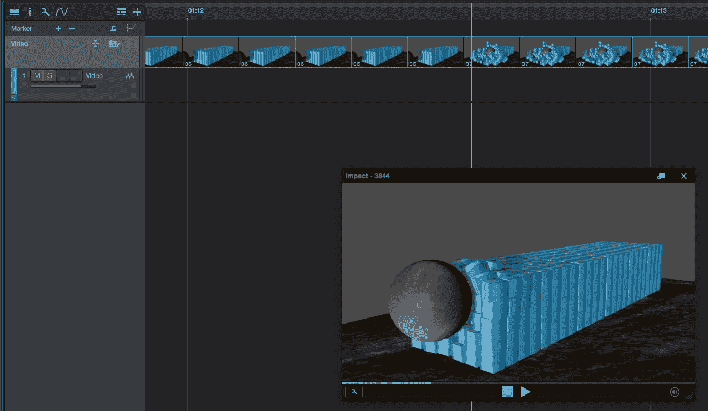

**图 10.20：视频显示器显示了需添加音效的精确帧**

一旦你找到或创建了一个适合该情境的音效，请按以下步骤将其完美同步到视频动作上：

1. 将音频事件的开头处放大到极致，确保声音开始前没有静默间隙。然后，使用 `Arrow`（箭头）工具，修剪事件的开头，使音效立即从事件的开头开始播放。要精准操作。

2. 接着，将 `Video Track`（视频轨道）放大到极致，找到你想让音效开始的那一帧。点击标尺将光标放在那里。如果制作团队发送了该精确位置的时间码，请将其输入 `Time Indicator`（时间指示器）窗口（图 10.13）。

3. 打开 `Marker Track`（标记轨道），点击 `+` 加号。这将在该时间点添加一个新标记。

4. 如果 `Snap`（吸附）尚未激活，请启用它。

5. 打开 `Snap`（吸附）下拉菜单，选择 `Snap to Events`（吸附到事件），并取消选择 `Snap to Grid`（吸附到网格）：

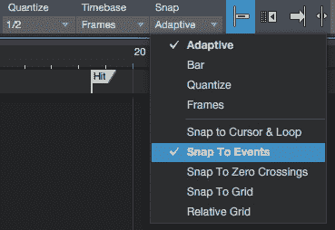

**图 10.21：将事件与标记对齐的吸附设置**

6. 使用 `Arrow`（箭头）工具，拖动包含音效的音频事件。它将完美吸附到你在*步骤 3* 中创建的标记上：

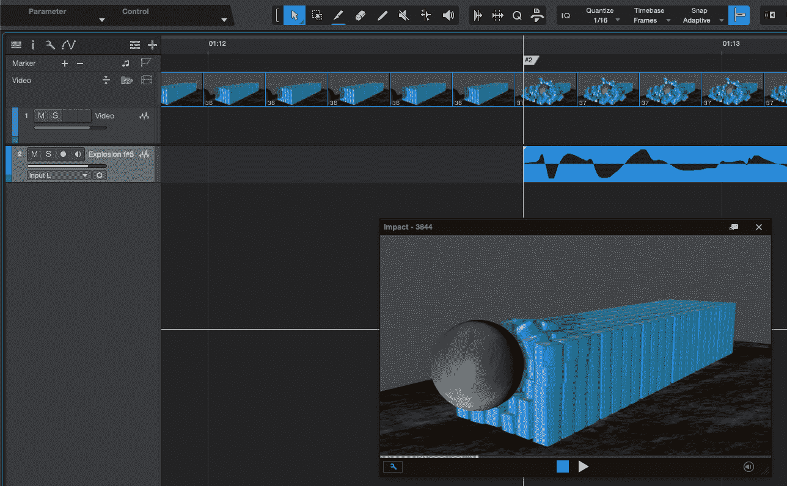

**图 10.22：音频事件吸附到标记**

我们刚才讨论的方法允许你相对于视频中的特定帧以绝对精度对齐事件。然而，并非每个项目或每个声音元素都需要这种精度。例如，如果你要为视频添加环境音效（如雨声），可以使用以下快速粗略的方法来节省时间：

1. 与前一种方法一样，将音频事件的开头处放大到极致，确保声音开始前没有静默间隙。

2. 点击 `Cursor Follows Edit Position`（光标跟随编辑位置）按钮以激活它：

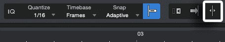

**图 10.23：光标跟随编辑位置按钮**

3. 现在，使用 `Arrow`（箭头）工具点击包含音效的音频事件并开始沿时间线拖动。你会注意到时间线光标将吸附到事件的开头。当你沿时间线拖动事件时，`Video Player`（视频播放器）将快速逐帧播放视频以匹配光标的位置。

4. 一旦找到你想让音效响起的位置，释放事件即可。

你会发现，即使仅将音效向前或向后推动几帧，也会显著影响其冲击力和真实感。在前面的例子中，将音效精确放在球撞击方块的那一帧上听起来可能不真实。这是因为光速比声速快；我们先看到球撞击方块，稍后才听到声音。尝试将音效向右移动几帧。反复实验直到完美为止。

## 理解时间基准

你正在为视频做声音设计。你已经有了对白和音效，所有内容都完美同步，铺排在项目的多个轨道上。现在，是时候开始处理音乐了。

你想尝试一个音乐创意：开始时节奏缓慢，然后逐渐加快以突出视频中的高潮点。节奏变化是配乐的基本功。还有什么比这更能传达逐渐积累的兴奋感呢？

于是，你打开 `Tempo Track`（节奏轨道）并绘制一条优美的曲线来逐渐加快节奏。你的音乐创意效果完美，但现在所有的对白和音效都跑到错误的位置了。改变节奏把它们全都移位了。这是怎么回事，该如何修复？

这里有一个概念，一旦你开始处理视频，理解它就变得至关重要。在音频制作中，我们使用两种不同的时间版本——绝对时间和相对时间。乍一看这可能像是爱因斯坦物理学的话题，但实际上非常简单。让我们看看这两种时间版本以理清概念：

- **绝对时间** 将时间线上事件的位置分配给绝对值。播客中第 4 分 38 秒处的狗叫声是一个绝对值。从 00:19:08:03 帧开始的音效是一个绝对值。

- **相对时间** 将时间线上事件的位置分配给小节和拍子。如果你在第 5 小节有一个钢琴和弦，这在音乐上完全讲得通，但它无法告诉我们该和弦将在何时（绝对时间）播放。这是因为一个小节的时间长度取决于节奏。如果曲子节奏设为 60 BPM，第 5 小节的钢琴和弦将在 16 秒处播放。如果节奏设为 120 BPM，同一个和弦将在 8 秒处播放。这就是音乐时间具有相对性的原因。

*图 10.24* 通过并排对比展示了这一点。在两张图中，顶部标尺显示以小节和拍子为单位的相对时间，底部标尺显示以秒为单位的绝对时间。注意音频事件在两张图中都与第 5 小节对齐。对于顶部图像，节奏设为 60 bpm，因此第 5 小节对应第二个标尺上的 16 秒。对于底部图像，节奏设为 120 bpm，因此第 5 小节对应第二个标尺上的 8 秒。

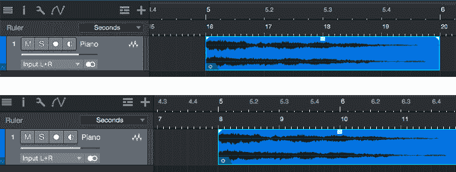

图 10.24：音乐时间相对于绝对时间的偏移

默认情况下，Studio One 中的所有轨道均使用音乐时间。更改速度会将所有内容（甚至标记）在绝对时间轴上的位置进行偏移。

您可以按轨道覆盖此行为。如果您希望轨道上的事件在速度更改时保持锁定在其绝对时间位置，请执行以下步骤：

1. 单击轨道标题以选择该轨道。
2. 打开 `Inspector` 面板。
3. 单击 `Tempo` 下拉菜单并选择 `Don't follow`：

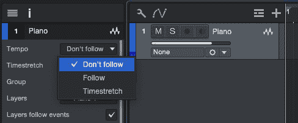

图 10.25：Tempo 下拉菜单

现在，无论速度如何变化，该轨道上的事件都将保持在其绝对位置。

默认情况下，`Marker Track` 也会跟随速度变化。要将标记锁定在其绝对时间位置，请单击 `Marker Track` 上的音符图标：

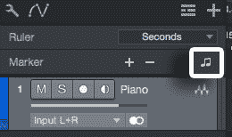

图 10.26：Marker Track 的 Timebase 选择器

通常，将包含对话、拟音、音效和环境音效的所有轨道设置为使用绝对时间。将所有音乐轨道设置为使用音乐时间。

## 导出视频

Studio One 能够直接从 `Song` 页面导出视频文件，其中包含您添加的所有音频。如果您在专业层面工作，不会用到此功能。制作公司会要求您交付高质量音频文件，并使用专用软件将这些文件与视频合成。不过，如果您只需创建简单视频或与合作者分享创意草稿，此选项可能会派上用场。

要从项目导出视频，请按以下步骤操作：

1. 转到顶部菜单的 `Song` 并选择 `Export Video`。这将打开 `Export Video` 窗口：

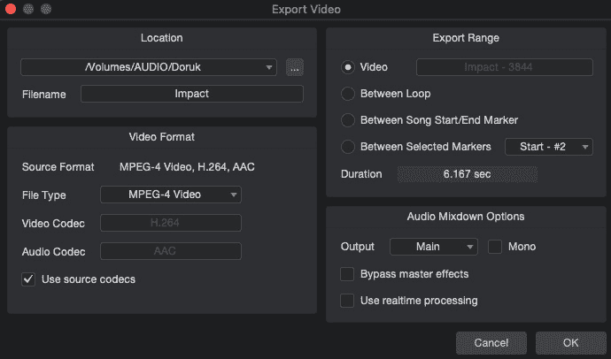

图 10.27：Export Video 窗口

1. 在 `Location` 下，选择要创建的视频文件的文件夹和文件名。
2. 在 `Video Format` 下，选择视频文件的视频格式。此处显示的选项会因您的操作系统和计算机上安装的编解码器而异。MPEG-4 是一个不错的选择；它提供良好的质量，且可在任何计算机或设备上观看。
3. 在 `Export Range` 下，选择要导出为视频文件的项目部分。此处选择 `Video` 将导出整个视频。您也可以使用其他选项仅导出项目的一部分。
4. 单击 `OK`。

在本节中，我们深入探讨了如何在 Studio One 中处理视频。我们从向项目添加视频文件开始，探索了视频编辑界面，然后深入研究了将音频和 MIDI 事件与视频中的关键时刻同步。最后，我们将最终项目导出为完整的视频文件。掌握这些知识后，您现在已准备好承担视频和多媒体项目的声音设计工作。

## 总结

在本章中，我们介绍了 Studio One 的全局轨道。我们从 `Chord Track` 开始，它只需几次点击即可控制歌曲的和声结构。然后，我们探索了 `Ruler`、`Marker` 和 `Lyric` 轨道，它们可帮助您和您的合作者即使在最复杂的项目中也能顺畅导航。最后，我们介绍了 `Video Track`，并学习了如何为视频添加完美同步的声音元素。

这结束了我们对 Studio One 广泛编辑功能的介绍。在本书的下一部分，我们将专注于混音，这是音乐制作的下一个重要步骤。我们将首先讨论如何为混音准备项目，确保所有混音会话顺利进行并交付最佳结果。
