## 第 11 章：准备混音

`Mixing` 是音乐制作中的关键步骤。如果做得正确，它能将您的音乐提升到一个全新的水平。如果执行不当，即使是最好的歌曲也可能变成痛苦的聆听体验。

许多人对混音过程感到畏惧。在混音会话中需要考虑的事情太多，无论是在艺术层面还是技术层面，以至于在整个会话中保持敏锐的专注力可能会让人不堪重负。

我教授音乐技术已有 20 多年，我无数次观察到，人们在混音中挣扎主要是因为缺乏准备——他们在杂乱无章的音乐素材的无尽迷宫中迷失，失去了专注能力。一旦我们通过组织项目将一切理顺，混音会话就会变得更易于管理，让您能专注于真正重要的事情，并以最佳方式呈现您的音乐。这为音乐制作带来了一种“道”的元素：您不仅是在组织项目中的轨道和事件，更是在梳理您混音的方法。

在本章中，我们将探讨几个步骤，以确保您的混音会话顺利进行。这将帮助您从项目中制作出最佳混音。我们将涵盖以下主题：

- 为混音会话准备 `Song`
- 组织轨道以获得更好的控制
- 设置电平、声像和自动化

## 技术要求

要学习本章，您需要在计算机上激活 Studio One。

## 为混音会话准备 Song

让我们首先讨论在 `Song` 层面需要采取的准备步骤。遵循这些步骤将有助于您的混音会话顺利进行。

### 为混音优化硬件和软件

混音对大多数计算机来说是一项资源密集型任务，因此在开始会话之前，最好让 Studio One 获得计算机所能提供的最大算力。使用以下技术为混音会话优化您的系统：

# 准备混音会话

## 掉帧保护

你可以做的第一件事是增加 `Dropout Protection`。我们在 `Chapter 2` 中讨论过 `Dropout Protection`，到目前为止，我们将其设置为 `Minimum`，因为我们希望在录制音频或演奏虚拟乐器时将延迟降至最低。然而，最小化延迟是有代价的：它强制你的电脑在极短的时间内完成任务。这对于录制和编辑任务来说没问题，因为这些任务不需要太多处理能力，但当你开始混音时，你会添加越来越多的效果插件，这会给系统带来沉重负载。

将 `Dropout Protection` 设置为 `Minimum` 时，你很快就会在音频中听到咔哒声和掉帧，甚至可能遇到系统崩溃。所以，请将其设置为 `Maximum`，这样你的电脑就有足够时间执行混音所需的计算。增加的延迟在混音会话中不会成为问题；当我们按下 `spacebar` 播放工程时，我们不介意多等 50 毫秒。

## 性能指示器

随着歌曲播放，请留意下方面板上的 `Performance` 指示器：

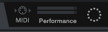

图 11.1：性能指示器

该指示器中的顶部条显示 CPU 性能，底部条显示磁盘性能。如果你有一个包含大量轨道的大型工程，你电脑上的磁盘可能难以同时从所有轨道读取音频数据。在这种情况下，随着歌曲播放，你会在磁盘性能部分看到突然的峰值，音频可能会卡顿。如果发生这种情况，请将整个工程文件夹移动到快速磁盘（理想情况下是内置 SSD）以解决此问题。

## 系统资源管理

混音会话需要大量音频数据流的不间断传输，以及不间断的处理能力来处理这些数据。退出所有其他应用程序，并禁用杀毒软件和防火墙等后台进程，以便让你的电脑将所有资源分配给 Studio One。

遵循这些要点将显著提高电脑性能，但提升电脑性能还有另一个维度，这是一个由来已久的争论话题。

## 我应该将乐器轨道转换为音频吗？

如果我们要编制一份音乐制作常见问题清单，这个问题无疑会名列前茅。你的工程包含含有 MIDI 数据的乐器轨道。在开始混音会话前将它们转换为音频是否值得额外付出努力，还是说你可以直接像对待音频轨道一样对待它们？

这个问题没有确定的答案。许多人认为没有必要将乐器轨道转换为音频，原因如下：

*   它给工作流增加了一个额外步骤。
*   音频数据占用磁盘空间，而 MIDI 的占用空间微乎其微。
*   你可以一直调整虚拟乐器直到混音会话结束。

这些观点都很有道理。然而，我会将所有乐器轨道转换为音频轨道，并建议你也这样做，原因如下：

*   一旦你将乐器轨道渲染为音频，就可以禁用乐器轨道上的虚拟乐器，从而为混音会话释放电脑资源。
*   实施增益调节将容易得多。我们将在下一节讨论增益调节，标题为（惊喜！） `Gain staging`。
*   你的工程将变得可移植。你可以将音频文件发送给合作者，即使他们没有你在工程中使用的任何虚拟乐器，也能处理这首歌。
*   你的工程将变得面向未来。如果你将来需要修改工程，当你电脑上不再安装该虚拟乐器时，你可能无法处理乐器轨道。通过将轨道转换为音频，你将永远拥有该轨道中原始声音的访问权。

将乐器轨道转换为音频轨道有几种方法。这是最实用的一种：

1.  通过按键盘上的 `1` 选择 `Arrow` 工具。
2.  选择乐器轨道上的所有 MIDI 事件。
3.  点击其中一个 MIDI 事件的右边缘并向右拖动，在末尾创建一个额外的空白小节：

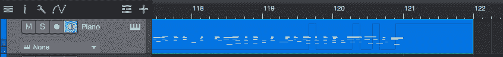

图 11.2：MIDI 事件末尾的一个空白小节

这将防止在将事件转换为音频时声音的尾部被切断。

1.  现在，右键点击事件，然后在弹出菜单中进入 `Event` 并选择 `Bounce Selection`。这是一个智能命令，当你喝口咖啡的功夫，它就会执行多项任务——将 MIDI 事件跳转为音频，创建一个与乐器轨道同名的新音频轨道，将音频放置在新音频轨道中，并将 MIDI 事件静音：

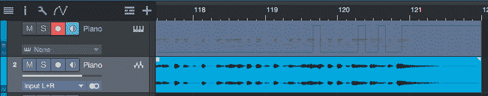

图 11.3：从乐器轨道跳转出的音频

1.  现在你可以安全地禁用虚拟乐器以释放电脑资源。为此，请使用虚拟乐器窗口上的电源按钮：

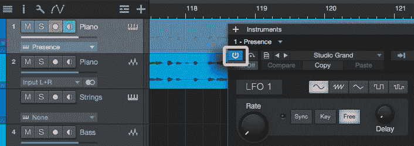

图 11.4：禁用虚拟乐器

1.  现在你也可以隐藏乐器轨道以减少屏幕杂乱；右键点击乐器轨道的轨道标题并选择 `Hide Track`。如果你以后需要修改此工程，可以使用 `Track List` 按钮（`Figure 3.4`）将轨道恢复。

使用此方法将所有乐器轨道转换为音频轨道只需几分钟，考虑到我们讨论的所有优势，这绝对值得为音频占用的额外存储空间付出代价。

## 为完美而编辑

在开始混音会话之前，请确保所有轨道都已完美编辑，且没有节奏和音准问题。这是实现混音清晰度和一致性的最重要前提。仔细聆听每个轨道，如果发现任何问题，请使用我们在 `Chapters 7` 和 `8` 中讨论的编辑方法进行修复。

人声轨道需要特别照料，因为我们天生就更关注人声。花点时间，使用编辑工具直到你的人声轨道完美无缺。此时投入的时间将物超所值。

如果某个轨道音量有严重的不一致，请使用 `Split` 工具将其切分成较小的事件，并调整每个事件的增益，正如我们在 `Chapter 7` 中讨论的那样。为了说明这一点，请看 `Figure 11.5`。上方的轨道是一位歌手在表演时过度移动的录音。随着他们远离和靠近麦克风，录音音量发生了剧烈变化。下方的轨道是同一录音，经过我将其切分成片段并单独调整每个片段增益后的结果。你可以看到它现在一致得多。

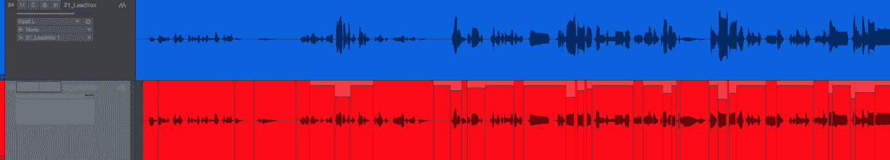

图 11.5：手动调整音频事件的增益

我们可以使用压缩器插件自动平衡增益，但这种方法更加透明、可预测，并给你更大的控制权。这绝对值得付出额外的努力和时间。

## 增益调节

在音频中，`gain` 指信号电平或音频信号振幅的增加，以 `decibels` (`dB`) 为单位测量。增益可以在音频信号链的不同阶段应用，例如麦克风、前置放大器或混音器，可用于提升低电平信号的电平、补偿微弱的信号源，或创造所需的音色或动态效果。

# 增益分级

`Gain staging` 是指在音频信号链的每个阶段设置电平或增益的过程，以确保信号在从输入到输出的整个过程中保持在最佳电平。

增益分级的目标是实现最佳的信噪比，这意味着信号应尽可能强于任何可能存在的背景噪声。如果信号太弱，它将被噪声淹没。如果太强，可能会导致失真和削波，从而降低音频质量。

从实际操作角度来看，增益分级是通过结合不同设备上的音量控制来实现的，例如效果器插件和混音台。

在混音会话中，我们本质上是将多条不同的轨道相加汇总为一条立体声轨道。即使各个单独轨道上没有失真或削波，在此汇总过程中，混音台的主输出仍可能发生削波。

要查看主输出是否存在削波，请打开 `Mix` 窗口，播放工程，并留意 `Main` 输出的峰值电平表。它位于窗口的右边缘：

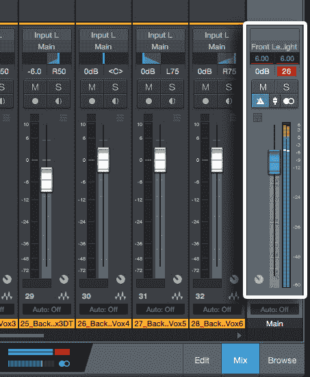

*图 11.6：主输出通道（右）严重削波*

峰值电平表显示音频信号达到的最高瞬时电平。该电平以 **分贝相对于满量程** (`dBFS`) 表示。这是一个参考刻度，将信号的最大可能电平定义为 `0` dBFS。所有其他电平均相对于此最大值测量，通常为负值。任何超过 0 dBFS 的信号都会发生削波，导致失真，因为数字系统无法表示高于此点的值。在图 11.6 中，通道条顶部指示的左右声道 dBFS 值为 `6.00`。这是一个正值，表明已超过最大电平。

如果发生削波，峰值电平表会变红以提醒你。峰值电平表顶部还会显示一个数字，指示信号削波的次数。图 11.6 中的信号削波了 26 次。

削波会导致一种难听的失真；幸运的是，它很容易修复，但首先，关于不应采取何种措施来防止削波，我要说一句警告，因为我经常看到人们这样做：不要试图通过调低 `Main` 通道的推子来修复削波！这具有误导性，因为它会清除视觉警告，让你以为已经处理了失真，但失真仍然存在。这是因为失真发生在汇总阶段，即信号链中混音器将项目中的所有轨道合并为单个立体声通道的点。`Main` 通道上的推子位于汇总阶段之后，因此调低此推子无法防止削波；它只是降低了一个已经被削波的信号的电平。

## 重要提示

尽管最大可能电平为 `0` dBFS，但常见的做法是在 0 dBFS 和混音的实际电平之间保留一些 **余量** 。留出此余量的主要原因是为母带处理过程中将应用于混音的任何进一步处理留出空间。目标是让最终混音在 `Main` 通道上峰值达到 `-6` dBFS 到 `-3` dBFS。这为母带处理留出了足够的余量。

要正确修复 `Main` 通道上的削波，请按如下步骤操作：

1. 转到 `Arrange` 窗口，按 `Ctrl + A` 或 `Cmd + A` 选择所有事件。
2. 降低任意一个音频事件的增益。所有事件的增益值将按相同幅度降低。
3. 在 `Mix` 窗口上，点击 `Main` 通道的 `VU meter` 以清除任何削波警告。
4. 播放工程，确保不再有削波。如有必要，重复 `步骤 1` 至 `3`。

当你制作混音并开始添加效果器插件时，最好留意 `Main` 通道的 `VU meter`，查看是否有任何插件引入了削波。如果有，只需重复上述步骤。

到目前为止，我们已调整缓冲区大小以提升电脑性能，编辑轨道以确保所有素材处于最佳状态，并处理了可能由削波引起的任何失真。在下一节中，我们将开始整理轨道，以便你在混音会话中能更好地掌控项目。

# 整理轨道以获得更好的控制

当灵感来袭，你开始发展一个音乐创意时，你最不想考虑的就是命名和整理轨道。这没关系，实际上在创作过程中保持混乱是可取的。但如果你带着同样混乱的项目开始混音会话，很快就会在杂乱无章的轨道和片段迷宫中迷失方向。

整理一个项目以进行混音会话只需几分钟，你会感谢自己这么做了。不信？启动秒表并遵循以下步骤：

1. 首先对轨道进行排序——你可以通过点击轨道标题并将其上下拖动来实现。大多数人从鼓轨道开始混音会话，所以将它们放在顶部是合理的。然后，也许将打击乐轨道放在鼓轨道下方，接着是所有演奏和弦的乐器。没有绝对正确或错误的方法；只需选择一个对你有意义的顺序并相应地放置轨道。你将免于在项目中上下滚动寻找轨道。
2. 在创作过程中，你可能让 Studio One 自动命名轨道，但像 `Audio_09` 这样的通用名称在混音会话中毫无意义。双击这些名称，为你的轨道指定简短、描述性的名称。这样，你一眼就能知道轨道里是什么。当你在 `Mix` 窗口工作时，这将更有帮助，因为在该窗口中，你无法看到轨道上的事件。
3. 为轨道着色！大多数人认为这只是花哨的装饰，但它是在项目中寻找方向的好方法，尤其是当轨道很多时。要执行此操作，请点击轨道标题左侧的彩色矩形，并从调色板中选择一种颜色：

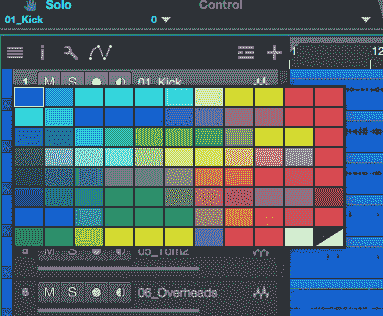

*图 11.7：轨道调色板*

对相似乐器使用相同的颜色；例如，鼓轨道用一种颜色，打击乐轨道用另一种颜色，依此类推。这样，你甚至不必看轨道名称，就能轻松识别特定音频事件上的内容。

4. 如果你的项目中有很多轨道，可以将它们放入文件夹中。Studio One 中的 `Folders` 非常像操作系统中的文件夹。它们整齐地存储轨道，以最大程度减少 `Arrange` 窗口上的杂乱。要向项目添加文件夹，请执行以下步骤：
   1. 点击 `Add Tracks` 按钮，这将打开 `Add Tracks` 弹出菜单：

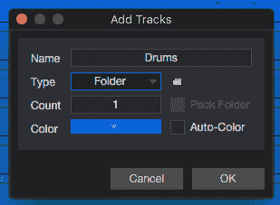

*图 11.8：添加轨道弹出菜单*

   2. 在 `Name` 字段中，为即将创建的文件夹输入一个描述性名称，如 Drums、Vocals、Percussion 等。
   3. 在 `Type` 字段中，选择 `Folder`。
   4. 在 `Color` 字段中，为该文件夹选择一种颜色。
   5. 点击 `OK`。
   6. 现在，通过 `Shift`-点击选择所有要放入此文件夹的轨道，然后将它们拖放到文件夹中。放入文件夹的轨道将显示为略微缩进：

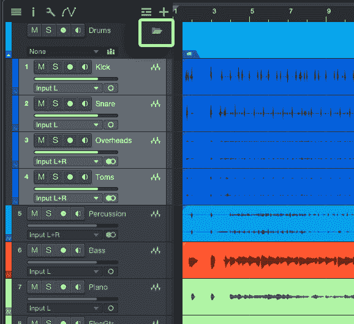

*图 11.9：文件夹内的轨道显示为略微缩进*

1. 点击 `folder` 图标（`Figure 11.9` 中高亮显示）可折叠文件夹，让你专注于其他轨道。

2. 请随意添加所需数量的文件夹。

这没花太长时间，对吧？看看你的项目有多井井有条。当你清楚地知道在哪里能找到所需素材时，进行混音会变得轻而易举。在下一节中，我们将开始使用混音会话中最基本的参数，来构建通常所谓的粗略混音。

# 设置电平、声像与自动化

想想《蒙娜丽莎》——是的，我说的就是那幅著名的画作。它其实是一幅相当繁复的构图：画框里有一位年轻女子，还有小山、树木、河流、小径、云朵，甚至一座桥。然而达芬奇以一种方式安排它们，使得当你注视这幅画时，目光会立即锁定在构图的主体上。

这正是我们在混音中追求的目标。你的项目中有多个乐器和人声分布在多个轨道上，你必须清晰且明确地引导听众的注意力到歌曲中最重要的元素上，同时提供丰满的背景。

有多种工具和方法可在混音会话中创造构图感和透视感。在本节中，我们将介绍其中两个工具——音量和声像。然后，我们将讨论如何使用自动化在整首歌的过程中动态操控这些工具。

## 设置电平

就创造透视感而言，调整轨道音量完全符合直觉。增大音量可将乐器推至混音前景，减小音量可将其置于背景。就这么简单。

然而，设置给定轨道电平的方法有几种，每种对最终声音的影响都不同。让我们逐一了解：

*   正如我们已知，Studio One 中的每个音频事件都有专用的增益控制。你可以将事件切分成更小的片段，并为每个片段独立设置增益电平，从而实现对音量的精细控制。

    音频事件上的增益设置实际上是轨道信号链上的第一个控制。它改变发送到该轨道效果插件的信号电平，因此会影响这些插件对该轨道声音的响应和着色方式。所以，取决于你使用的效果类型，改变增益电平可能会影响声音的音色和色彩，而不仅仅是音量。

*   调整轨道音量更常用的方法是使用该轨道的推子。`fader` 是一种滑动控件，以线性方式上下移动，增加或减少轨道或通道的音量。推子在 `Mix` 窗口中水平排成一行。默认情况下，它们可能显得很小，但大小可调。在 `Mix` 窗口推子区域的顶部点击并拖动以放大推子。这样，你将获得更高的分辨率来进行微调：

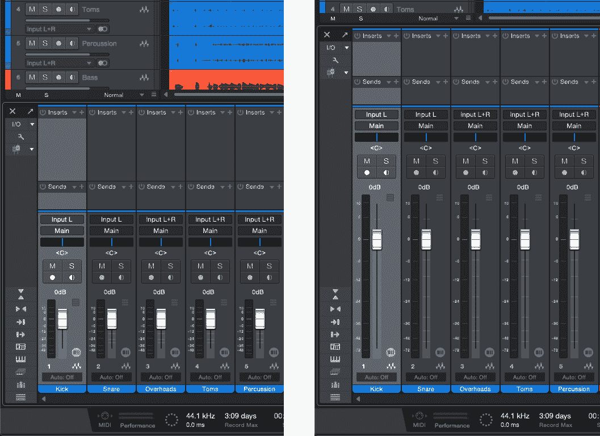

图 11.10：微小的推子（左）放大以提供更好的分辨率（右）

推子是轨道信号链上的最后一个元素，因此它们不影响发送到该轨道效果插件的信号量。它们只会透明地增加或减少音量，绝不改变音色。

使用推子的一个优势是你可以通过自动化改变其位置，从而动态地持续控制整首歌中轨道的音量，正如我们将在本章后面的 `Adding automation to create a dynamic mix` 节中看到的那样。

*   控制轨道电平的另一种方法是使用该轨道上单个效果插件的输入和输出电平设置。这允许对音量进行更具体、更精细的控制，并让你指定每个插件如何响应和着色该轨道的声音。我们将在 `Chapter 12` 中详细介绍效果插件。

通过结合使用这些工具和方法，你可以精确控制轨道音量，将其推至混音前景或置于背景。

## 声像定位以创建立体声图像

`Panning` 指在立体声声场中放置音频素材。在音乐混音中，声像用于确定每个声音的感知位置。例如，如果声音定位在左侧，音频信号的音量会被调整为左耳响、右耳弱。这会产生声音来自左侧的感觉。

声像的目标是创建清晰、独特的立体声图像，使每个声音易于识别并定位在混音中的特定位置。声像也可用于创意效果，通过将声源逐渐从一个扬声器移动到另一个扬声器。

在 Studio One 中，声像通过混音台上的声像控制来执行：

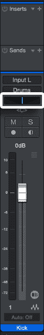

图 11.11：混音台上轨道的声像控制

这些声像控制有三种不同的操作模式，可通过右键点击声像控制来选择：

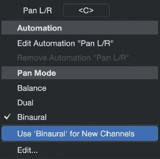

图 11.12：声像模式

现在，让我们逐一了解这些模式：

*   `Balance`：这是默认模式。它允许你将轨道上的信号定位在左侧、右侧或两者之间的任意位置。这是你大多数时候会用到的模式；它完全足以满足你在立体声场中对声音进行基本定位的需求。

*   `Dual`：此选项仅适用于立体声轨道。它提供两个独立的声像控制，一个用于轨道的左声道，一个用于右声道：

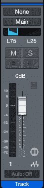

图 11.13：双声像器

使用这些控制，你可以独立地对轨道上的左、右声道进行声像定位。与 `Balance` 模式相比，这用途较窄，但在合适的场景下却能起死回生。

举个例子。通常，采样库中的钢琴声音是从演奏者的视角进行声像定位的——左侧的琴键（代表低音区）定位在左侧，右侧的琴键定位在右侧。这是因为制作采样库的人希望钢琴作为独奏乐器时听起来饱满宽广。但这并不是我们在古典音乐会上听钢琴的方式。钢琴通常放在舞台左侧某处，我们听到的是一个来自立体声场稍左位置的单一声源。

要用宽声像的钢琴采样达到这种效果，请选择 `Dual` 模式并将两个声像控制靠拢，从而有效地缩窄钢琴的立体声宽度。然后，点击这两个声像控制中间的区域，将它们稍微向左拖动，把钢琴放置在你虚拟音舞台上的期望位置，如 `Figure 11.13` 所示。

*   `Binaural`：此模式也仅适用于立体声轨道。`Binaural panning` 是一种模拟三维声像的技术，可用于为听众创造沉浸式音频体验，常用于虚拟现实、游戏以及音乐制作中。Studio One 中的 `Binaural` 声像器包含一个常规声像控制和一个立体声宽度控制：

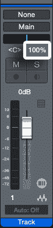

图 11.14：双耳声像器

立体声宽度控制使用一种称为中侧处理的复杂技术来调整立体声信号的感知宽度。**中侧处理**通过将音频信号分为两个分量来操控其立体声图像：中分量，代表左右声道中相同的音频信号；侧分量，包含左右声道之间不同的音频信号。通过分别处理这些分量，可以通过多种方式调整音频信号的立体声图像。

在 Studio One 的**双耳**声像器中，可以通过使用立体声宽度控制来实现这一点。当此值设置为 **100%**（其默认值）时，该轨道上信号的立体声宽度不受影响。降低该值会强调信号的中分量，在最低设置 **1%** 时有效地将其变为单声道。将该值增加到 **100%** 以上会强调信号的侧分量，逐步扩宽该轨道上声音的立体声图像。虽然这可能会瞬间让你的混音听起来更宽广，但要抵制将宽度调至最大 **200%** 的诱惑，因为这可能会导致相位问题，并在某些场景下使混音无法使用。我们将在*第 15 章*中介绍相位问题及如何识别它们，那时我们将讨论母带处理。

到目前为止，我们讨论了音量和声像，这是混音中用于将声音置于虚拟三维声场中的两个最重要的工具。正确设置这些对于制作连贯的混音至关重要，但对于当今大多数音乐流派，你会希望这些设置从歌曲的一个片段变化到另一个片段，以创造动态感和对比度。这通过使用自动化来实现，这将是我们接下来的主题。

## 添加自动化以创建动态混音

**自动化**是音乐制作中强大的工具，允许你随时间控制混音的各种参数，如音量、声像和效果。自动化可以通过多种方式用于在歌曲片段之间创造对比，并产生有趣且动态的效果。

以下是一些你可以使用自动化的典型示例：

*   在歌曲的副歌部分提升背景人声。
*   在安静片段中降低主音吉他的音量。
*   在过门（桥段）部分增加主唱人声的混响量。
*   强调被鼓镲击声掩盖的主唱演唱的某个词。

在 Studio One 中，混音台和效果插件上的每一个参数都可以自动化，所以唯一的限制就是你的想象力。现在，让我们看看如何使用自动化。

### 自动化模式

`Mix`（混音）窗口上的每个轨道和通道底部都有一个 `Automation Mode`（自动化模式）选择器，每个插件窗口的左上角也有相同的选择器：

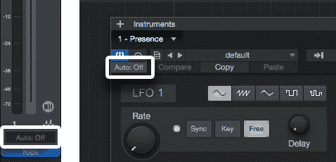

图 11.15：轨道（左）和插件窗口（右）上的自动化模式选择器

点击此选择器将显示五个选项。让我们逐一查看这些选项：

*   `Auto: Off`：此选项禁用该轨道或插件的自动化。所有参数将保持锁定在其当前位置。
*   `Read`：在此模式下，Studio One 将读取并执行该轨道上所有现有的自动化数据。
*   `Touch`：选择此模式并按下 `Play` 时，一旦你用鼠标或外部硬件控制器触碰该轨道上的参数，就会创建新的自动化数据。当你释放鼠标或控制器时，Studio One 将恢复读取并执行现有数据。这是对现有自动化进行微调的绝佳方法。
*   `Latch`：此模式类似于 `Touch` 模式，不同之处在于当你在此模式下触碰参数时，Studio One 将持续添加自动化数据，直到你停止播放。
*   `Write`：选择此选项并按下 `Play` 时，将根据所有参数的当前值持续写入自动化。如果该轨道上已有自动化数据，将被覆盖。请谨慎使用此方法，以免意外覆盖之前的调整。

现在你了解了自动化模式，我们可以继续开始添加自动化数据。

### 添加自动化

添加自动化相当简单。为了举例说明，假设你正在混音图 11.16 中的歌曲，并且想要在第 **8** 小节和第 **9** 小节之间逐渐增加第一条轨道（标记为 `Synth`）的音量，以在进入歌曲主歌前营造一些期待感：

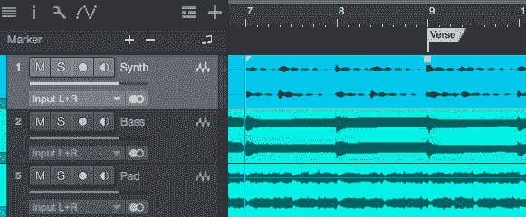

图 11.16：添加自动化前的轨道

具体操作如下：

1.  打开 `Mix`（混音）窗口并找到该轨道的推子。
2.  点击推子下方的 `Automation Mode`（自动化模式）选择器并选择 `Touch`。
3.  将时间线定位到第 **8** 小节之前的某一点，然后按 `spacebar`（空格键）播放工程。
4.  当时间线到达第 **8** 小节时，点击该轨道的推子并向上拖动。如果不完美不用担心——我们将在下一节“编辑自动化”中进行编辑。
5.  再次按 `spacebar`（空格键）停止播放。
6.  再次点击 `Automation Mode`（自动化模式）选择器，这次将其设置为 `Read`。这将防止你意外添加或覆盖任何自动化数据。

你对推子所做的更改现在已作为自动化数据写入该轨道。你可以再进行一遍操作，这次为另一个参数添加自动化。每个参数的自动化数据存储在单独的通道上，可以独立编辑，我们马上就会看到。

### 编辑自动化

你添加到轨道的所有自动化数据都存储在单独的自动化通道上。要显示这些通道，请右键点击轨道标题，在弹出菜单中选择**显示/隐藏自动化**。这将叠加显示给定参数所有自动化数据的可视化表示，称为**自动化包络**。这是我尝试提高图 11.16 中轨道音量的自动化包络：

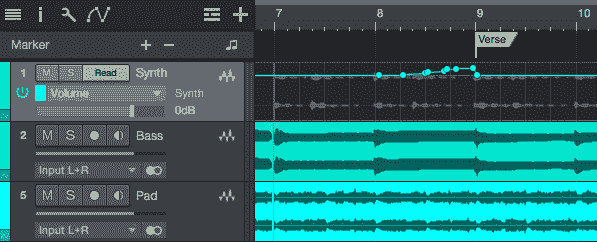

图 11.17：自动化通道上显示的自动化包络

它看起来不太平滑，但很容易编辑。方法如下：

1.  点击该轨道标题底部并向下拖动以放大轨道。这将给你更多的操作空间。
2.  点击并按住 `Paint`（画笔）工具查看其选项列表。选择适合你目的的选项（`Line`（直线）或 `Parabola`（抛物线）非常适合此示例）。
3.  在第 **8** 小节开头点击并拖动，在第 **9** 小节开头释放，以创建一条平滑的直线或抛物线：

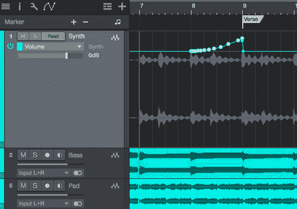

图 11.18：编辑后的自动化包络

`Paint`（画笔）工具的其他选项，如 `Sine`（正弦波）或 `Square`（方波），可用于通过自动化实现更具创意或实验性的效果，例如在两个扬声器之间持续移动声音的声像——如果你的音乐风格允许这种实验，绝对值得一试。

这结束了我们对混音中两个最基础、最重要工具的介绍：音量和声像。掌握这些知识后，你可以精准地将声音置于混音中，甚至使用自动化在整首歌曲过程中改变它们的位置。

## 总结

