## 使用效果插件打造混音

在本章中，我们介绍了您为混音会话准备歌曲和自身所需的所有基本工具和方法。然后，我们讨论了如何为每条轨道设置音量和声像控制，以及如何使用自动化在整首歌中动态地更改这些设置。

执行本章讨论的步骤将奠定坚实的基础，帮助您更顺利地进行混音会话，让您能够专注于发掘歌曲的最佳效果。

在下一章中，我们将讨论 Studio One 中的 `Effects plug-ins`，并探讨使用它们的最佳方法，以打造最完美的混音。

`Effects plug-ins` 是音频处理工具，允许您修改单个轨道或整体混音的声音。它们可用于创建各种不同的声音和效果，使其成为音乐制作中用途广泛的工具。无论您需要为人声音轨增添温暖感，为吉他创建宽敞的混响，还是为贝斯线添加粗砺的失真，总有一款插件能实现您想要的效果。

在本章中，我们将带您浏览 Studio One 的 `bundled plug-ins`（也称为 `stock plug-ins`），帮助您开始使用它们。截至写作时，Studio One Pro 捆绑了 40 多款插件，因此我们无法逐一详细介绍。相反，我们将重点关注您最可能使用的插件，以及一些因极具创新功能而值得特别提及的插件。

读完本章后，您将对手头可用的插件有扎实的了解，并能自信地为任何音频处理任务选择合适的插件。

本章将涵盖以下主题：

*   使用动态插件和均衡器控制电平和频率
*   使用混响和延迟插件增加深度和空间感
*   使用插件增添色彩和特性
*   使用特殊工具和分析插件

## 技术要求

要跟随本章操作，您需要在计算机上激活 Studio One Pro。

## 使用动态插件和均衡器控制电平和频率

`Dynamics processors`（动态处理器）是指一类用于随时间修改音频信号电平的音频处理工具。它们控制声源的动态范围，从而获得更一致、更润色的声音。现在，让我们看看 Studio One Pro 自带的动态处理器。

### 压缩器

`Compressor`（压缩器）是一种动态处理器，通过衰减响亮声音的电平来减小音频信号的动态范围。它通常用于为人声或乐器轨道创建更一致的电平，也可用于增加吉他和贝斯声音的延音。

Studio One 的 `Compressor` 插件在外观和操作上就像专业音乐工作室中的硬件压缩器一样。图 12.1 并排展示了 Studio One 的 `Compressor` 插件和全球录音室梦寐以求的一款硬件压缩器。尽管界面看起来不同，但请注意，两者拥有相同的控制组件。

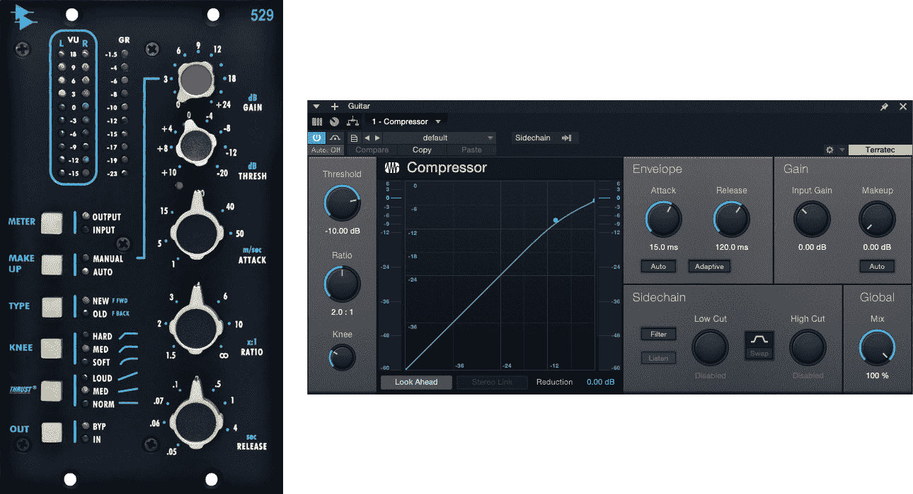

Studio One 的 `Compressor` 插件还有一些额外功能，包括内部和外部侧链功能，以及一个 `Mix`（混合）旋钮，允许您在无需 FX 轨道的情况下应用并行压缩。如果您是混音新手，这些术语听起来很陌生，别担心——我们将在第 13 章中介绍所有这些技术。

### Limiter2

`Limiter2` 是一种压缩器，旨在防止音频电平超过特定阈值。它通常用于防止音频信号失真或削波，常用于母带处理阶段，以确保最终混音电平一致，避免任何削波或失真。

从定义上讲，限制器是非常简单的设备，但 Studio One 的 `Limiter2` 插件具有某种独特的工作原理，可能会让从其他平台转过来的用户感到困惑，因此值得仔细研究一下。

让我们想象一下，您正在限速 100 公里/小时的高速公路上行驶。如果您的汽车允许设置最高车速，您可以将其设为 99 公里/小时（留出一小部分误差余量），然后踩下油门，而无需担心超速。这正是 `Limiter2` 的工作原理：您使用 `Ceiling`（上限）旋钮设置允许的最大电平，然后随意增加 `Gain`（增益）值，而无需担心音频信号削波。

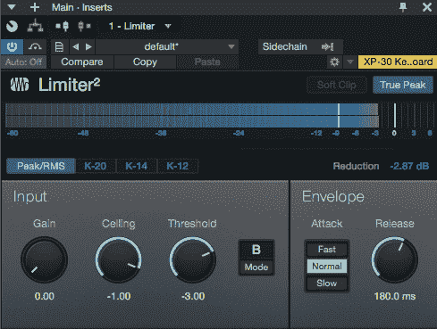

正是 `Threshold`（阈值）设置让大多数人感到困惑。为了理解其工作原理，让我们回到汽车比喻。想象一下，在我们刚才讨论的自动限速基础上，您希望汽车自动调整车速，使其在不超过限速的前提下尽可能跑得快。这意味着如果您当前以 60 公里/小时的速度行驶，汽车将自动加速，直到达到允许的最大速度。但如果随时都启用这个自动加速功能会很危险；例如，您不希望在从车库驶出时它处于激活状态。因此，您设定一个最低速度，换句话说，设定一个阈值，只有达到这个阈值时，自动加速才会启动。这正是 `Limiter2` 上 `Threshold` 控制的作用。

`Threshold` 设置相对于 `Ceiling` 工作，允许您设置上限以下的一个范围，在该范围内自动补偿增益开始起作用。随着您将 `Threshold` 设为更低的值，自动补偿增益将延伸到音频素材中越来越安静的部分，使这些部分也变得更响亮。

当我们在第 15 章讨论母带处理时，将详细介绍 `Limiter2` 上的其他参数。

### 扩展器

`Expansion`（扩展）与压缩相反，通过衰减信号中较低电平部分的电平来增加信号的动态范围。这对于恢复已压缩信号的动态范围或消除背景噪音很有用。

Studio One 的 `Expander` 插件提供内部和外部侧链功能，以及一个 `Range`（范围）控制，用于调整施加于信号的最大衰减量。

### 噪声门

`Gate`（噪声门）是一种简单的处理器，当声音低于特定阈值时，它会完全切断声音。它常用于消除背景噪音或其他声源的串音。

Studio One 的 `Gate` 插件简单、高效，完美胜任其工作。

### 去嘶器

`De-Esser`（去嘶器）用于减少或去除人声或其他音频信号中的刺耳齿音和其他高频噪音。`Sibilance`（齿音）是发某些字母（如 *s* 和 *sh*）时有时产生的尖锐嘶嘶声，在录制或混音人声时可能会成为问题。

去嘶器基本上是一个仅专注于齿音发生频率范围的压缩器。当该范围内的信号超过给定阈值时，去嘶器会衰减信号以驯服齿音。

对于大多数人声齿音，Studio One 的 `De-Esser` 插件使用默认设置即可完美工作：

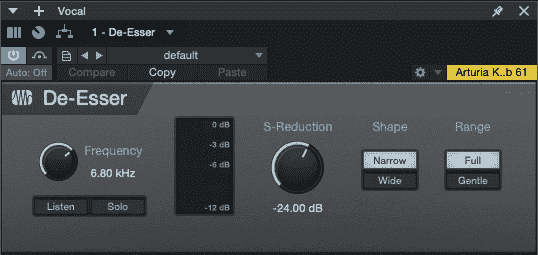

如果您觉得它无法捕捉素材中的齿音，可以按如下方式调整其设置：

1.  点击 `Listen`（试听）按钮。这将让您仅听到被选为衰减目标的频率。
2.  调整 `Frequency`（频率）旋钮以锁定齿音。

3. 再次点击 `Listen` 按钮以恢复正常操作。`De-Esser` 现在将开始针对您选择的频率范围进行处理。

4. 调整 `S-Reduction` 以设置一个阈值点，当超过该点时 `De-Esser` 将开始衰减所选频率。

虽然去嘶音器主要用于人声录音，但它们也可用于驯服其他乐器上的刺耳频率，所以请随意尝试。

## 多频段动态处理

`Multiband Dynamics` 是一款插件，它结合了五个独立可调的压缩器和扩展器单元，它们作用于专用的频段。该插件常用于母带处理阶段，我们将在 *第 15 章* 中详细讨论它。

## Tricomp

`Tricomp` 是 `Multiband Dynamics` 的一个简化替代品。它是一款三频段压缩器，大部分工作自动完成，几乎是“设置好即不管”的方式，并且在最终定型混音和增加冲击力方面表现卓越。当我们在 *第 15 章* 谈论母带处理时，将更仔细地研究它。

## Pro EQ3

`音频均衡器`，也称为 `EQ`，是一种允许您调整音频信号中频率平衡的设备。均衡器的目的是通过提升或削减特定频率范围，使音频听起来更平衡、更悦耳。

Studio One 自带 `Pro EQ3`，这是一款功能强大的均衡器插件，可让您使用八个独立可调的频段来调整音频信号的频率。其界面顶部有一个频谱显示，可帮助您直观地定位想要处理的频率：

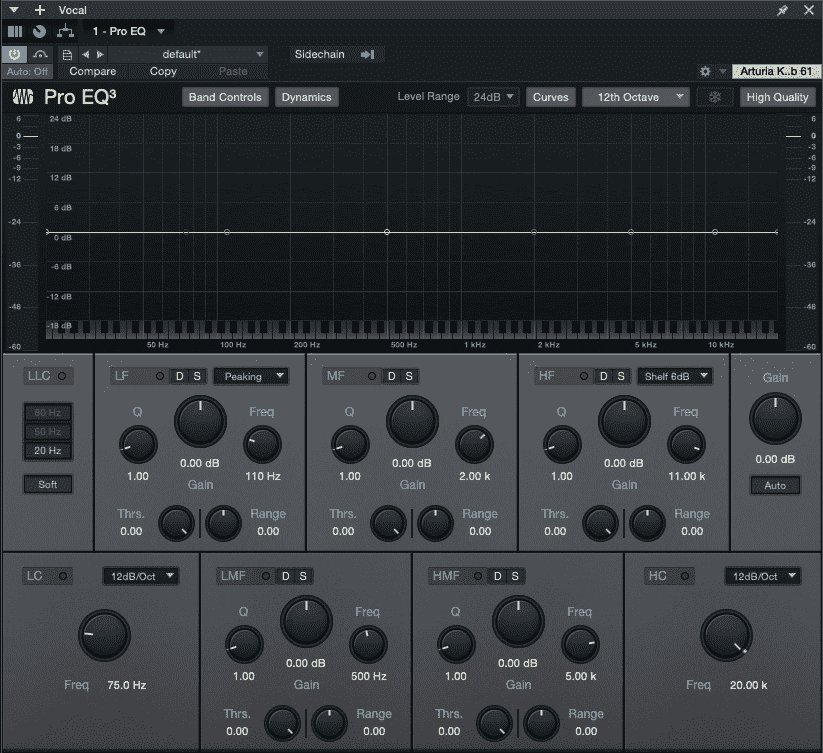

图 12.4：Pro EQ3

`Pro EQ3` 也可以设置为动态均衡器工作。`动态均衡器` 会在输入信号超过特定阈值时，动态地调整某个频率范围的电平。要使用此功能，请按以下步骤操作：

1. 点击频谱显示上方的 `Dynamics` 按钮，以显示所有频段的动态控制。

2. 然后，您可以通过点击任意单个频段上的 `D` 按钮来启用其动态均衡功能。

3. 使用频段上的 `Thrs.`（阈值）设置来确定该频段激活的信号电平。

4. 使用 `Range` 设置信号电平超过阈值后将应用多少调整量。

`Pro EQ3` 是一款非常强大的工具，能满足您所有的音色塑造需求。除非您在寻找一款模拟复古硬件设备模拟声音的插件，否则 `Pro EQ3` 是完美的全能解决方案。

动态处理器和均衡器是必不可少的工具，它们帮助您为混音打下坚实基础。接下来，我们将开始探索可用于添加艺术创意色彩、让混音生动起来的工具。

# 使用混响和延迟插件增加深度和空间感

混响和延迟插件赋予混音空间感、深度和立体感。Studio One 在这一类别中提供了大量可靠的选项，涵盖了所有基础需求。让我们先来探索混响插件。

## 混响插件

`混响插件` 是用于给音频录音添加人工混响的工具。`混响` 是声波在封闭空间中从表面反射时产生的声学效应，它产生一系列复杂的回声和反射，能赋予音频录音空间感和深度。

混响插件通常通过模拟不同类型空间（如音乐厅、录音室或小房间）的声学特性来工作。它们可用于为干声录音添加空间感，或调整录音中现有混响的数量和特性。

Studio One Pro 自带三款混响插件，我们现在来看看它们。

### Mixverb

`Mixverb` 简单易用，且与大多数混响插件不同，它对计算机资源的占用非常低。您可能不想在主唱轨道上使用它，但它非常适合为背景乐器增色，而不会给计算机处理器带来负担。

### Room Reverb

`Room Reverb` 是一款多功能插件，可让您以令人难以置信的细节创建虚拟声学环境。它从常见的参数（如房间大小和混响时间）入手，然后增加了一些我在其他平台的任何其他混响插件中都未见过的设置。您可以决定虚拟房间中有多少人，设置声源相对于听众的高度，甚至调整室内空气的湿度水平。这只是冰山一角！

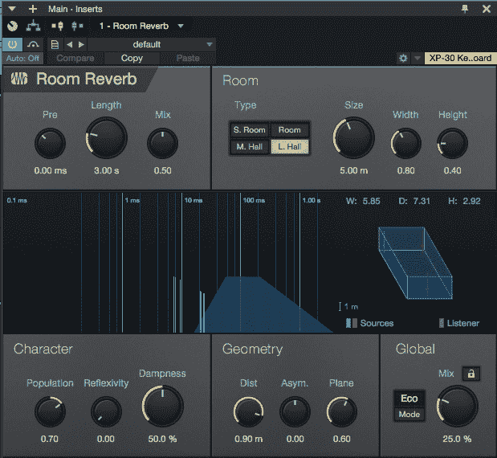

图 12.5：Room Reverb

虽然如此多的细节对于大多数音频制作工作来说有些大材小用，但您会发现自己在所有项目中都在使用 `Room Reverb`，因为它听起来实在太棒了。如果选项过多让您感到不知所措，只需关注这三个参数，您就能顺利为混音创建完美的声学环境：

* 使用 `Type` 按钮选择虚拟空间的大小和特性。选项包括小房间、房间、中型大厅和大型大厅。

* 使用 `Size` 旋钮进一步细化房间的尺寸。

* 使用 `Length` 设置调整混响持续的时间。

通常的做法是滚降混响插件产生的极高和极低频率，因为这能创造更平滑的混响尾音，并有助于实现混音的清晰度。有些混响插件为此内置了滤波器部分。`Room Reverb` 没有这样的滤波器部分，因此建议在 `Room Reverb` 后添加一个均衡器（如 `Pro EQ3`），并使用均衡器的高切和低切滤波器来滚降极高和极低频率。

### Open AIR

`Open AIR` 是一款使用卷积混响技术的高端混响插件。`卷积混响` 是一种音频处理类型，它使用脉冲响应来模拟真实空间（如音乐厅、录音室或大教堂）的声学特性。`脉冲响应` 是声波在特定空间中反射和衰减方式的数学表示，可以通过在空间中播放一段短促的声音（“脉冲”）并记录产生的反射（“响应”）来捕获。

`Open AIR` 利用这项技术，基于真实空间和复古硬件混响设备的建模，提供非常逼真的混响效果。要开始使用它，您必须首先将一个 `脉冲响应` (`IR`) 文件加载进去。Studio One Pro 自带多个 IR 文件。以下是下载和使用它们的方法：

1. 登录您的 [my.presonus.com](http://my.presonus.com) 账户并前往 **产品** 页面。

2. 在捆绑下载列表中找到 **Studio One Impulse Responses**：

图 12.6：下载脉冲响应

1. 点击 `Download` 按钮。

2. 下载完成后，将此文件从计算机的下载文件夹移动到一个更永久的位置。我们在 *第 2 章* 中讨论过文件位置。

3. 双击该文件。这将把文件中包含的所有脉冲响应注册到 `Open AIR` 中。

4. 在 `Open AIR` 的界面上，点击预设下拉菜单并从列表中选择一个脉冲响应：

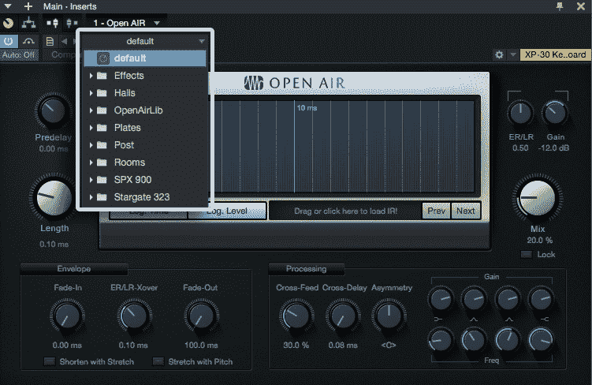

图 12.7：Open AIR 可用脉冲响应列表

**Open AIR** 是最先进的技术，但它也能出色地模拟复古混响设备及其古怪的音色特征，因此它也是为你的音轨增添低保真氛围的绝佳工具。

## 延迟效果器

**延迟** 是一种创建类似回声的声音重复的音频效果。延迟效果器是一种音频处理工具，可用于将此效果添加到音频信号中。这些效果器可用于广泛的应用场景，从创建微妙的空间效果到为混音添加复杂的节奏型。它们常用于电子音乐、氛围音乐和其他流派，在这些流派中，创造有趣且独特的声音景观是制作过程的关键部分。

Studio One 自带三款延迟效果器，每款都专注于不同风味的延迟，适用于各种场景。让我们逐一了解。

### 模拟延迟

**模拟延迟** 模拟了 20 世纪 60 年代和 70 年代广泛使用的基于磁带的模拟延迟设备。其有趣、简洁的界面让你能轻松调出那些让这类设备大受欢迎的古怪特性，使其成为为音轨增添复古氛围的绝佳工具。

使用 **Color（色彩）** 部分的控制器，赋予延迟声音更温暖、更饱和的特质。然后，使用 **Motor（马达）** 部分的控制器，添加老化磁带马达产生的独特抖动。你将能瞬间创造出迷幻、回响风格的延迟效果！

### 节拍延迟

**节拍延迟** 是一款通用延迟单元，能与项目的速度同步，并允许你从现有音乐素材中创建复杂且有趣的节奏型。此效果器中的 **Ping-Pong（乒乓）** 选项会在左、右声道之间来回反弹延迟信号，创建立体声效果，为原本静态的声音增添动感和宽度。

### 律动延迟

**律动延迟** 属于多点延迟家族。**多点延迟** 在一个单元中组合了多个可独立调节的延迟处理器，能创建错综复杂的节奏型和复杂的延迟。这种延迟常用于舞曲和电子音乐。

乍看界面可能令人生畏，让我们拆解一下：

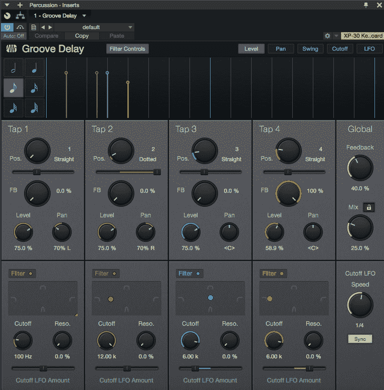

Figure 12.8: Groove Delay

**律动延迟** 由四个独立的延迟单元组成，称为 **点**，在界面上以列形式排列，标记为 **Tap 1** 到 **Tap 4**。以下是每个点可用控制器的概览：

*   **Pos.（位置）** 旋钮调整每个点的延迟时间。默认情况下，它以八分音符为增量。

*   位置旋钮下方的水平推子允许你偏移延迟时间。如果你希望该点的声音略早于或晚于节拍，这会很有用。如果将此控制器完全向右滑动，这相当于附点八分音符的长度。

*   **FB（反馈）** 设置决定该点重复的时长。当设为 **0 %** 时，你只会听到一次点击。这有时被称为 **拍回延迟**。当设为 **100 %** 时，延迟将无限持续。这有时被称为 **循环模式**，因为舞台上的音乐家用它来建立节奏背景，以便在其上叠加其他音乐素材。

*   **Level（电平）** 和 **Pan（声像）** 旋钮分别设置该点的音量和立体声定位。

*   每个点底部的 **Filter（滤波器）** 部分允许你添加高切、低切和带通滤波器来着色该点的声音。通过自动化这些滤波器设置，你可以从非常简单的节奏素材中获得真正动态、不断演变的型态。我们将在本章后面讨论效果自动化。

与大多数效果器一样，了解 **律动延迟** 功能的最佳方式是探索预设。打开预设菜单（标记为 **Default**），浏览预设，准备好享受乐趣吧！

混响和延迟效果器将你的混音置于三维环境中，赋予其生命力。下一组效果器将为你的声音调色板增添无限可能，并帮助你赋予音轨独特的个性。我们即将踏入混音最具创造力的领域！

# 使用效果器增添色彩与个性

如今，我们在杂志或广告牌上看到的几乎每一张照片，都在 Photoshop 或类似软件中经过大量修饰，以增强图像并强化其冲击力。音乐音轨也是如此。我们在音乐平台上听到的大多数素材，都通过特殊效果进行了增强，使其听起来更宏大、更有力。如果你打算在 Apple Music 或 Spotify 等音乐平台发布歌曲，你会希望确保你的音轨像其他作品一样经过打磨且引人入胜。庆幸的是，Studio One 提供了大量工具帮助你实现音轨所需的冲击力。在本节中，我们将仔细研究这些工具。

## 失真效果器

**失真效果** 是音乐制作中常用的工具，用于为声音增添粗糙感、温暖感和个性。失真效果器种类繁多，名称各异，如过载、模糊、饱和和降位。它们影响声音的范围非常广，从几乎难以察觉到彻底毁坏原音。

Studio One 在失真类别中有三款效果器。让我们了解一下每一款。

### Ampire

**Ampire** 是一款多功能效果器，模拟了你在吉他手设备中能找到的所有模拟硬件设备：效果踏板、放大器、音箱模拟器，以及用于录制这些音箱的麦克风。它提供广泛的音色可能性来塑造吉他声音——从干净的爵士音色到高度饱和的金属撕裂音机，以及介于两者之间的任何音色。虽然其主要目标是电吉他，但它对于给其他声音增添冲击力和咬合感也大有裨益。例如，试着用在主奏合成器音色上，让它更上一层楼。

界面庞大，甚至可能无法适应较小的屏幕。让我们看一看：

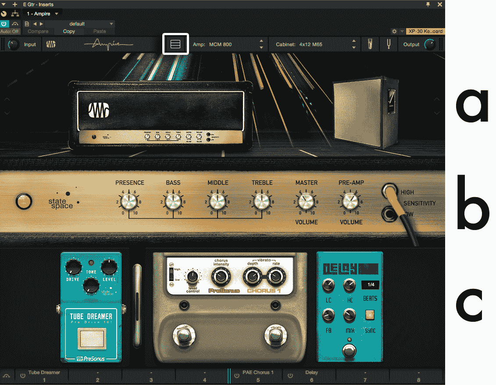

Figure 12.9: Ampire consists of three sections – stage (a), amp (b), and pedalboard (c)

界面由三个部分组成：舞台、放大器和踏板板。使用 *Figure 12.9* 中高亮显示的按钮来切换这些部分的可见性。让我们开始探索这项惊人技术置于你指尖的所有设备：

1.  使用窗口顶部的 **Amp（放大器）** 和 **Cabinet（音箱）** 选择器来选择你想使用的放大器和音箱。**Ampire** 自带基本的放大器和音箱选择，你可以从 Presonus 网站的 **Products（产品）** 页面（`https://www.presonus.com/products`）下载更多。

2.  一旦选择了放大器，其控制器将显示在窗口中间。像调节实体放大器一样调节这些控制器（所有控制器也都是仿照真实设备建模的！）。

3.  接下来，尝试添加一些效果踏板为声音增添更多色彩。窗口底部的虚拟踏板板有八个插槽可供插入不同的踏板。你只需点击窗口最底部的踏板选择器即可添加或移除踏板。

    请注意，踏板初次插入时处于旁路状态。你必须点击它们的虚拟脚踏开关来激活它们。一旦激活，其 LED 灯将变红。

4.  就像放大器一样，脚踏板上的控制器也经过了建模，因此这些虚拟脚踏板上的旋钮和开关将表现得就像其物理对应物上的控制器一样。随心所欲地调整它们，直到为你的乐器获得完美的音色。

5. 你可以在踏板板上拖动踏块以更改它们在信号链中的顺序。

`Ampire` 非常好玩，但它是 Studio One 武器库中较为消耗 CPU 资源的插件之一。考虑到引擎盖下的所有建模技术，这很容易理解。但如果你有多条吉他轨道且都在运行 `Ampire`，你可能需要留意性能指示器。如果你开始听到爆音和掉样，请增加 `Audio Dropout Protection` 设置，正如我们在 *第 11 章* 中讨论的那样。

### Bitcrusher

`Bitcrusher` 代表了失真频谱的极端一端。当你想要彻底摧毁声音时，这就是你会伸手去拿的插件。通过诸如 `Wreck` 之类的控制，它让你通过降低位深来指定想要降低音质的程度；以及 `Dirt`，它向高频引入不稳定性以产生侵略性的效果，你可以确信这东西绝不会温和。

### Red Light Distortion

`Red Light Distortion` 是一个非常灵活的插件，能够模拟具有极广泛风味的模拟失真。使用 `Type` 下拉菜单选择失真类型，并使用其他设置微调失真程度。`Red Light Distortion` 可以非常温和；用它来增加光彩，让沉闷的人声录音变得生动。它也可以非常强烈；用它让声音听起来仿佛来自一台坏掉的收音机。尽管大胆尝试，但尝试时请调低音量。失真可能会突然让声音变得非常大！

## 调制插件

`Modulation effects` 是音乐制作中用于创造声音动感、深度和趣味的一组音频效果。这些效果可应用于混音中的各种元素，包括乐器、人声和鼓。调制效果能帮助你创造独特且富有表现力的声音，让你的音乐脱颖而出。

Studio One Pro 自带七款调制效果插件。让我们逐一了解它们。

### Autofilter

`Autofilter` 拥有两个独立的频率滤波器，可以通过多种方式进行控制和编程。你可以手动调整滤波器，用内置的低频振荡器控制它们，用 16 步音序器编程，或者将它们锁定到工程节奏，以创建从 DJ 风格的滤波器扫频到复杂节奏型的任何效果。

它的学习曲线有点陡峭，但如果你制作 EDM 或类似流派，绝对值得投入精力。

### Chorus

`Chorus` 是一种通过复制信号并为其音高和时间添加细微变化来创造浑厚、丰富声音的效果。它可用于为声音增加温暖感和深度，以及创造空间感和动感。

Studio One 的 `Chorus` 插件拥有复古风格的界面，这反映了它实际上模拟了复古模拟合唱设备。它为声音增添了温暖的模拟色彩，并让你能快速拨出许多音乐流派中备受推崇的浑厚合唱音色。

### Flanger

`Flanger` 是一种类似于合唱的效果，但具有更明显的扫频声音。镶边器通过组合两个相同的、略微延迟的信号，并用滤波器对其进行调制，来创造旋转的、喷气般的声音。镶边效果最常用于电吉他，但在合成器轨道上同样如鱼得水。

镶边器是只有少数几个控制参数的简单设备，Studio One 的 `Flanger` 插件也不例外。值得一提的一个功能是它可以与工程节奏同步，这样你就可以设置其戏剧性的扫频声音，使其更具节奏感。

### Phaser

`phaser` 通过将信号分成两条路径，延迟其中一条路径，并用滤波器对其进行调制，在声音中创建一系列波谷和波峰。结果是一种独特的声音，能创造动感和深度，效果可以从微妙到迷幻。

Studio One 的 `Phaser` 插件是一个非常简单的设备，提供将其扫频锁定到工程节奏的功能。

### Rotor

`Rotor` 模拟了旋转音箱的声音特性。这些音箱传统上与 Hammond 电子管风琴搭配，造就了该乐器独特的声音，但拥有这个插件将让你能在任何东西上尝试它——例如，它在电吉他和合成器上听起来就很棒。

该插件是真实设备的精准模型，甚至能看到机柜内的虚拟扬声器在旋转，且它们的旋转速度会根据你的设置而变化。大胆玩玩这个插件吧。它非常好玩且听起来很棒。

### Vocoder

`vocoder` 分析并合成人声的频谱和时间特性，并将其应用到另一个音频信号上。其工作原理如下：声码器接收一个调制信号（通常是人声）和一个载波信号（通常是乐器），并将它们结合以创造独特的合成声音（通常听起来像唱歌的机器人）。声码器被广泛用于从电子音乐到嘻哈、电影音乐和声音设计等各种流派。

Studio One 的 `Vocoder` 插件是一个强大的工具，允许你创造一些非常有创意的声音和纹理。设置 `Vocoder` 与其他效果插件略有不同，所以让我们带你逐步了解：

1. 打开 `Browse` 面板并转到 `Effects` 选项卡。
2. 找到 `Vocoder`，然后将其拖放到你想要处理的轨道上。该轨道上的音频将成为 `Vocoder` 的调制信号。`Vocoder` 的样子如下：

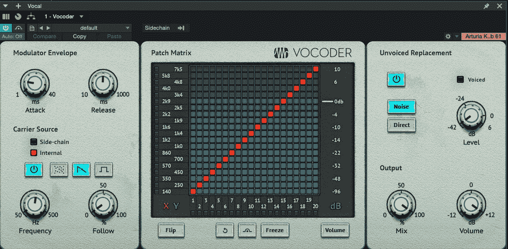

图 12.10：Vocoder

3. 现在，让我们处理载波信号。`Vocoder` 可以使用另一条轨道的音频作为载波，或使用其自身的振荡器创建载波信号。如果你想使用另一条轨道的音频，请点击 `Vocoder` 窗口顶部的 `Sidechain` 按钮，然后点击你想用作载波信号的轨道对应的 `Send` 栏：

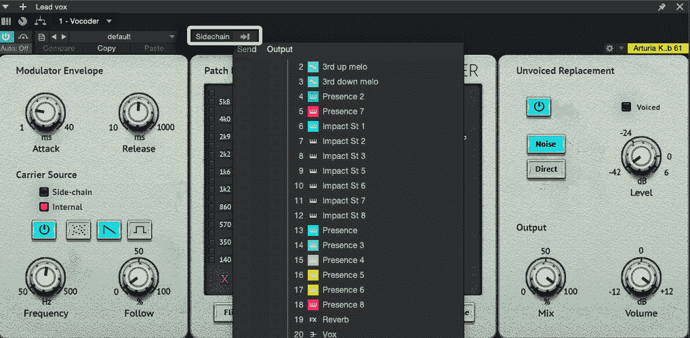

图 12.11：为 Vocoder 选择载波信号

4. 如果你想让 `Vocoder` 使用其自身的振荡器作为载波信号，请使用内部载波设置将振荡器设置为所需的波形和频率。
5. 现在该玩了！`Vocoder` 窗口中间的 `Patch Matrix` 部分设定了 `Vocoder` 分析器部分如何路由到其合成器部分。该路由由矩阵上的小红“针脚”显示。默认情况下，这些部分按顺序匹配，从而产生最清晰可辨的声码人声，但你可以改变针脚的位置以修改路由，创造出一些超现实的效果。你可以深究其背后的科学原理，但通过玩弄它来学习如何运作要快得多，也绝对更有趣。
6. 声码处理对元音效果最好。辅音表现不佳。窗口右侧的 `Unvoiced Replacement` 部分控制一个算法，该算法检测调制信号中的辅音并用其他信号替换它们，以提高语音清晰度。该算法的成败取决于素材，所以没有通用的配方。一如既往，实验是关键。

在所有效果插件中，`Vocoder` 可能是最具创意和趣味的。它允许你将两个声音融合为一个，创造出一种似乎会说话的乐器，或一种似乎被 MIDI 键盘控制的歌手。这里有大量等待发掘的创意潜力，绝对值得认真研究。

### X-Trem

`X-Trem` 是一种颤音效果。`Tremolo` 通过调制信号的音量来创造脉动的或有节奏的声音。它可用于增加动感或节奏感。

`X-Trem` 界面简洁明了。一个可能被忽视的酷炫功能隐藏在 `Mode` 按钮下：当你选择 `Trem` 模式时，插件会调制信号的音量；当它处于 `Pan` 模式时，会调制信号在左右声道之间的声像。

# 组合混音插件

此类别中的插件是我们之前讨论的效果类型的组合。那么，为什么它们被打包成不同的插件，我们为什么要使用它们？让我们逐一探索，找出答案。

## 通道条

音乐工作室中的大型硬件调音台乍看之下令人望而生畏。但仔细观察会发现，这些调音台的很大一部分实际上由几组相同的旋钮和按钮组成，分布在几条相同的条带上。这些被称为 `channel strips`（通道条）。每个通道条都包含处理单个音频通道所需的所有控制和处理工具。在典型的调音台上，这些工具包括一个简单的均衡器、一个噪声门和一个简单的压缩器。

Studio One 的 `Channel Strip` 插件基于同一理念。当你将此插件添加到音轨时，你会获得一个简单的压缩器、一个简单的均衡器和一个增益控制。虽然不花哨，但它能完成任务，而不会像专用的压缩器和均衡器插件那样占用大量计算机 CPU 资源。它非常适合只需要简单调整几下的音轨。

## Fat Channel XT

`Fat Channel XT` 与 `Channel Strip` 截然不同。当简单的压缩器和均衡器插件无法满足需求时，它就是首选插件。`Fat Channel XT` 提供了珍贵复古硬件压缩器和均衡器的精准建模，让你能将这些设备的声色添加到信号流中。

`Fat Channel XT` 包含五个部分：

*   `HPF`（高通滤波器）
*   `Gate`（噪声门）
*   `Compressor`（压缩器）
*   `Equalizer`（均衡器）
*   `Limiter`（限制器）

如果你看不到所有这些部分，请点击 `Stacked Mode`（堆叠模式）按钮切换它们的可见性：

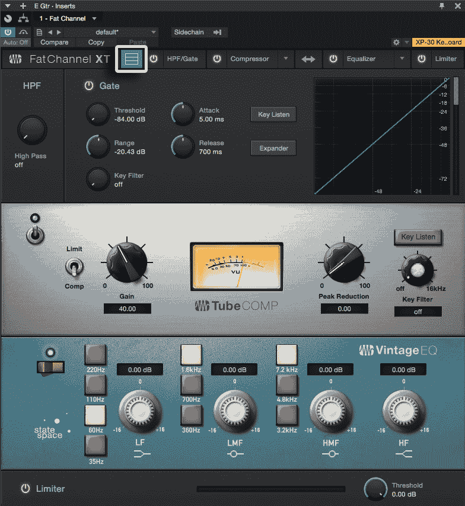

图 12.12：Fat Channel XT

默认情况下，所有这些部分均处于关闭状态。你需要使用各自的电源按钮将它们开启。

对于 `Compressor` 和 `Equalizer` 部分，你可以在不同复古设备的模拟之间进行选择。为此，请点击 `Stacked Mode` 按钮旁边的 `Compressor` 和 `Equalizer` 下拉菜单，然后选择你想使用的设备。

请注意，与 Studio One 自带的 `Compressor` 和 `Pro EQ3` 插件相比，这些建模插件消耗更多 CPU 资源，因此只有当你确实需要在音轨上获得那种模拟质感时，才建议使用 `Fat Channel XT`。

## Mix Engine FX

`Mix Engine FX` 是 Studio One 独有的功能，其运作方式与所有其他效果插件截然不同。它不是添加到单个音轨上，而是添加到整个混音控制台。`Mix Engine FX` 随后应用建模技术来复刻珍贵模拟调音台的声色和特性，包括通道串扰、噪声和饱和度等独特特征。根据 Studio One 用户手册，“它是数字技术所能达到的最接近模拟的效果。”

要向项目添加 `Mix Engine FX`，请打开 `Mix`（混音）窗口，然后点击 `Main`（主）通道顶部的 `Mix FX` 按钮：

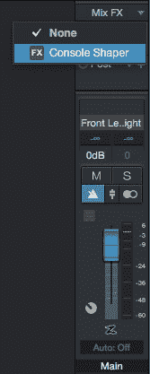

图 12.13：添加 Mix Engine FX

添加效果后，再次双击 `Mix FX` 按钮以打开效果界面并访问其参数。Presonus 网站上提供了多种 `Mix Engine FX` 选项（只需登录并访问 `Products` 页面），代表不同调音台的建模。如果你想在混音中获得低保真、复古的氛围，一定要试试这些效果。

到此为止，我们已经介绍了 Studio One 中所有可用的工具，它们将帮助你控制、润色和增强音轨。为了完成对 Studio One 插件的巡礼，我们只需要看看几个旨在辅助混音过程的实用工具。

# 使用特殊工具和分析插件

Studio One 武器库中的最后一组插件旨在执行特定的技术任务，并提供关于混音质量的可视化反馈。在音乐制作很大程度上已从商业工作室转移到家庭工作室的时代，我们越来越关注室内声学和监听音箱的准确性，因此这种可视化反馈对于确保混音处于最佳状态变得极其宝贵。

## 特殊工具

此类别中的插件是旨在帮助你执行特定任务的实用工具。除 `Tuner`（调音器）外，它们在典型的家庭工作室工作流中可能用处不大，但知道它们在需要时可用是件好事。让我们快速看看工具箱里有什么。

### 调音器

Studio One 内置了一个调音器（`Tuner`），可用于调校吉他、贝斯或任何需要调音的乐器。它速度快、可靠性高，可视化反馈比袖珍调音器上的微小显示屏好得多。它有一个 `Strobe`（频闪）模式，通常为乐器技师所青睐，以获得更高的准确性；你也可以将调音器设置为国际标准 440 Hz 以外的参考频率。

### Mixtool

`Mixtool` 是一个瑞士军刀：它可以交换立体声音轨的左右声道，反转左或右声道的相位，对 MS 信号与立体声音轨进行编码或解码，并阻挡直流偏移。如果这些术语对你来说很陌生，你仍然可以找到 `Mixtool` 的用处，因为它有一个 `Gain`（增益）旋钮。当你想精确控制两个没有增益控制的效果插件之间的信号电平时（许多插件都没有），这非常方便。只需在它们之间插入一个 `Mixtool` 实例，并根据需要调整增益即可。

### 音发生器

`Tone Generator`（音发生器）产生噪声和基本波形类型。这些通常用于测试和校准目的，但 `Modulation`（调制）和 `Wobble`（摆动）功能实际上可以将此插件变成电子音乐制作人的秘密武器，为丰富的滤波器扫频和音效敞开大门。

### IR Maker

`IR Maker` 允许你创建自己的脉冲响应文件。然后你可以在 `Open AIR` 或 `Ampire` 的箱体部分中使用这些脉冲响应。设置起来有点麻烦，但如果你想为声音设计创建自定义的三维环境，绝对值得。请参阅 Studio One 用户手册以获取详细说明。要查看手册，请转到顶部菜单的 `Help`（帮助）并选择 `Studio One Reference Manual`（Studio One 参考手册）。

## 分析工具

Studio One 提供了四个作为插件可用的分析工具。这些工具提供音频各方面的可视化反馈，让你即使因监听环境限制听不到问题，也能精准定位问题区域：

*   `Phase Meter`（相位计）用于可视化音频信号的立体声宽度。它是一个关键工具，帮助我们识别左右声道之间的任何相位相关性问题。这对于确保混音的立体声像在不同播放系统上保持一致非常重要。我们将在 *第 15 章* 中讨论相位相关性，届时我们将再次探讨 `Phase Meter`。
*   `Spectrum Meter`（频谱仪）显示音频信号的频率内容。它帮助你直观地定位问题区域，例如不需要的啸叫声。`Spectrum Meter` 还允许你将混音的频率内容与参考音轨的进行比较和匹配，正如我们在下一章将看到的那样。

## 效果器插件：电平表和示波器

**电平表** 显示音频信号的振幅，并提供信号感知响度的数值测量。这对于确保我们的最终混音符合数字音乐平台实施的响度标准非常有用。

**示波器** 的工作原理类似于硬件示波器，用于识别仅通过聆听信号可能无法察觉的音频问题。这些问题可能包括通道间的串扰、背景噪音或削波。

这结束了我们对 Studio One 自带效果器插件的介绍。请记住，通过 Pro+ 会员资格还可以下载更多插件。虽然界面和音色特质可能有所不同，但我们已经涵盖了所有主要插件类型，现在您可以自信地运用这些知识来确定哪种插件最适合实现您追求的声音。

## 摘要

在本章中，我们深入探讨了 Studio One 令人印象深刻的效果器插件阵容，并讨论了每个插件发挥作用的场景。

在下一章中，我们将通过探索多种将这些插件添加到混音会话的不同方法，将这些知识付诸实践。
