## 第 13 章：优化信号流程并提升您的混音

**混音** 对大多数人来说是一项令人生畏的任务，因此本章的标题可能看起来有点吓人。事实上，它只是另一种技能组合，将把您的音乐制作推向一个新的高度。虽然混音不应掉以轻心，但如今的技术使整个过程变得更加易于上手。凭借 Studio One 直观的设计，曾经难以理解甚至更难以实现的技术现在触手可及。

在本章中，我们将深入研究信号处理在 Studio One 中的工作原理，以及如何利用混音控制台的强大功能以最佳方式呈现您的歌曲。然后，我们将讨论一些专家级实践，使您的混音听起来更加润色和精致。最后，我们将讨论如何从歌曲中导出分轨和最终混音，以便您可以在音乐平台上分享它们。

我们将涵盖以下主题：

*   理解 Studio One 的信号流程
*   应用高级技巧
*   导出最终混音和分轨

## 技术要求

要学习本章内容，您需要在计算机上激活 Studio One。

## 理解 Studio One 的信号流程

**信号流程** 是指音频信号通过混音器及其组件（包括我们在 第 12 章 中讨论的插件效果）所走的路径。当今音乐制作软件中的典型信号流程路径高度灵活，允许制作人实施创造性和创新性的混音技术，但这也带来了更多复杂性。了解信号流程的拓扑结构对于充分利用这项多功能技术呈现的潜力非常重要，这也是我们将在本节中介绍的内容。

### 混音器通道的剖析

让我们从探索 **混音控制台** 上的一个通道开始。**编排** 窗口中的每个轨道在 **混音** 窗口中都有一个对应的通道，如下所示：

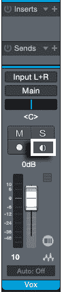

Figure 13.1: A channel on the Mix Console

让我们分解一下：

*   该通道的顶部包含两个标题为 **插入** 和 **发送** 的部分。在 Studio One 中，这两个部分统称为 **设备机架**。我们使用这些部分来添加效果器插件。
*   通道正中间是 **输入** 和 **输出** 选择器。我们在 第 5 章 中讨论过 **输入** 选择器，当时我们用它来选择音频接口上想要录制的物理输入。但现在我们处于混音阶段，所以我们希望该通道监听对应轨道上已录制的内容。为此，请确保 **监听** 按钮（图 13.1 中高亮显示）处于禁用状态。启用时（蓝色），该通道监听来自音频接口物理输入的信号。禁用时（灰色），该通道监听轨道上的录音，这正是我们想要的。
*   默认情况下，每个通道的输出都路由到混音控制台的 **主** 输出通道。**主** 输出通道是混音控制台上所有通道汇合的地方。它始终位于混音控制台的最右侧。
*   在通道底部，我们有推子，它控制通道的音量。

图 13.2 显示了我们迄今为止讨论的组件的信号流程：

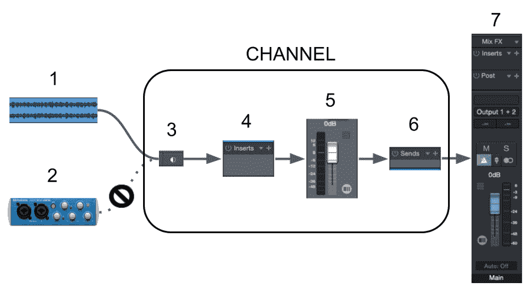

Figure 13.2: Signal flow on a mixer channel

现在，让我们分解图 13.2 中的组件：

1.  **音频事件**：这是您计算机硬盘上的录音。它在 **编排** 窗口中对应轨道上显示为一个音频事件。这段录音将成为我们混音会话的原始素材。
2.  **实时输入**：这是来自您音频接口的信号。我们用它来录制上述音频事件，但在混音会话期间不再需要它。
3.  **监听按钮**：这充当上述两个输入源（即音频事件和实时输入）之间的选择器。在其当前状态（灰色）下，它设置为允许来自音频事件的输入。
4.  **插入机架**：这是我们将用来向该通道插入效果器插件的部分。
5.  **推子**：我们将用它来设置该通道的音量。
6.  **发送机架**：我们将用此部分将信号从该通道发送到其他通道。
7.  **主通道**：这是整个信号流程中的最后一个元素，混音器上的所有通道在此合并为单个立体声输出。

图 13.2 中矩形内的所有内容都是通道的组成部分。现在，让我们仔细观察这些组件，以探索处理通过该通道音频的各种方法。

### 使用插入机架添加效果

**插入** 机架是信号流程中的关键组件。它是我们向通道添加效果器插件以处理音频的点。术语 **插入** 是指将插件直接插入链路的信号流程中以应用音频处理。为了说明，假设您有一条电吉他轨道，想要使用 **Ampire** 为其添加一些模拟失真效果。操作方法如下：

1.  打开 **浏览** 窗口并转到 **效果** 选项卡。您将看到系统上安装的所有插件列表：

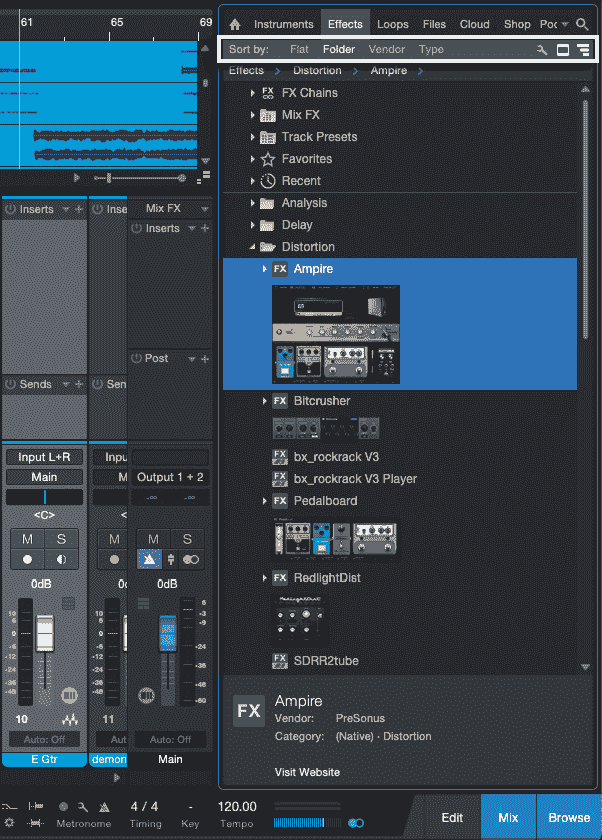

Figure 13.3: A list of effects plug-ins

1.  如果您知道要查找的插件名称，请单击 **浏览** 窗口右上角的放大镜图标以打开搜索框，然后输入名称。

    如果您不记得插件名称，或者想查看所有可用效果，请使用排序选项（图 13.3 中高亮显示）来组织列表。**文件夹** 根据效果类型对所有插件进行排序，类似于我们在 第 12 章 探索效果时使用的类别，而 **厂商** 则按制造商对它们进行排序。

2.  如果 **混音** 窗口尚未打开，请将其打开。找到您想要插入 Ampire 的通道。

3.  从 **浏览** 窗口拖动 **Ampire** 并将其放置在通道的 **插入** 机架上。

您可以使用此方法添加任意数量的插件。在这里，我在一个通道上插入了 **Ampire**、**Chorus** 和 **Pro EQ**：

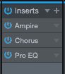

Figure 13.4: The Inserts rack holding multiple plug-ins

插件的顺序非常重要。信号在 `Inserts` 槽中从上至下流动 —— 本例中依次为 `Ampire`、`Chorus`，再到 `Pro EQ3`。如此排列插件，即先加失真再加合唱效果。这与先合唱后失真的听感截然不同。这在音频工程师间常引发“鸡生蛋蛋生鸡”式的争论，最好的办法是亲自尝试不同组合，听听哪种最合心意。你可以在 `Inserts` 槽中点击拖拽插件，轻松调整顺序。

现在，让我们在信号流程图中加入插入效果：

图 13.5：带插入效果的信号流程

插入插件后，双击 `Inserts` 槽中的插件名称即可打开其界面开始调整。要移除插件，右键点击其名称，从下拉菜单中选择 `Remove`。

## 使用 FX 通道

另一种给通道添加效果的方法是使用 `FX channel`。我们通过一个例子来说明。假设你在一轨上有鼓声录音。演奏细腻、细节丰富，但在混音中容易被其他乐器掩盖。你想压缩信号，因为压缩能增加冲击力、凸显细节。但同时你又不想压缩，因为压缩会缩小动态范围，抹去录音中的激情与表现力。该怎么办？

解决办法是将鼓声通道的信号分成两路 —— 一路直接送往 `Main` 输出，无任何处理，从而保留原演奏的表现力；另一路送往单独的通道，即 `FX channel`，该通道插入了压缩器，增加冲击力与细节。这样便两全其美。Figure 13.6 说明了其工作原理：

图 13.6：FX 通道的信号流程

在 Figure 13.6 中，上方通道是鼓声通道。该通道的 `Sends` 槽将信号分为两路。第一路继续流向 Mix Console 的 `Main` 通道，携带干声、未处理信号。第二路（虚线表示）送往 `FX channel`，经压缩器处理。处理后的信号再送往 `Main` 通道，与项目中所有其他通道混合。

了解 `FX channel` 的工作原理后，我们也给出定义 —— `FX channel` 是一个独立通道，不连接任何轨道作为输入源。我们通过其他通道的 `Sends` 槽向其发送信号。`FX channel` 通过自身 `Inserts` 槽上的效果器处理这些信号。

由于这种布局允许同一信号在两个并行通道中流动，有时被称为**并行处理**。我们刚才描述的配置 —— `FX channel` 上插入压缩器 —— 是一种极常用的技巧，甚至有专门名称：**并行压缩** 或 **纽约压缩**。混音师常用此法让鼓声在混音中更响亮、更饱满，得益于 Studio One 的拖放界面，实现起来非常容易。

下面介绍如何用 `FX channel` 法给通道添加效果。我们继续以鼓轨为例：

1.  打开 `Browse` 窗口，切换到 `Effects` 标签。你会看到系统安装的所有插件列表。找到 `Compressor` 插件。

2.  打开 `Mix` 窗口（若未打开），找到鼓声通道。

3.  从 `Browse` 窗口拖拽 `Compressor` 到鼓声通道的 `Sends` 槽。Studio One 会自动执行以下操作：

    *   创建一个新的 `FX channel`
    *   将 `Compressor` 放置在 `FX channel` 的 `Insert` 槽上
    *   在鼓轨的 `Sends` 槽上创建指向该 `FX channel` 的链接

    最终效果如下：

图 13.7：鼓声通道（左）向 FX 通道（中）发送信号。两者均路由至主输出（右）

4.  使用鼓声通道 `Sends` 槽中的小蓝色水平滑块，设置发送到 `FX channel` 的信号量。这实际上调节原始鼓声与处理后信号的平衡。

注意 Figure 13.7 正是 Figure 13.6 在现实中的样子 —— 鼓声通道的 `Sends` 槽指向 `FX channel`，后者的 `Inserts` 槽上插着 `Compressor` 插件。对比两图可更直观地理解信号流向。

`FX channel` 的一大便利是：你可以从任意数量的通道向其发送信号。例如项目有 60 轨，你想给其中 30 轨加混响，只需创建一个插有混响插件的 `FX channel`，让那 30 轨都发送信号给它。这比在每轨单独插混响插件好得多，因为：

*   降低 CPU 负载。混响插件尤为消耗资源。
*   简化操作。混音推进中若觉得混响过多或过少，只需调整 1 个插件，而非 30 个。
*   更符合物理与声学规律。现实中，同一演出里的所有乐器都处于同一混响环境，将所有通道送往同一混响器能获得更真实的效果。视流派与制作风格，这种真实感未必是目标，若不适用请忽略此点。

创建 `FX channel` 后，从其他通道发送信号很容易。点击任意通道 `Sends` 槽上的 `+` 按钮即可。回到 Figure 13.7 的例子，我们从 `E Gtr` 通道发送信号到 `FX channel`：

图 13.8：向现有 FX 通道发送信号

一首 Song 中可创建任意数量的 `FX channel`。既然 `FX channel` 自带 `Sends` 槽，你甚至可以在 `FX channel` 之间互发信号，从而实现极具创意潜力的多功能信号路由。

## 使用总线控制多个通道

`Bus` 是 Mix Console 上的一种通道，可合并多个其他通道。例如歌曲中有多条鼓轨，可将它们全部路由到一个 `Bus` 通道。然后用 `Bus` 通道的控制器统一处理所有鼓轨。这是简化混音流程的好方法。

按以下步骤将多个通道路由到 `Bus` 通道：

1.  打开 `Mix` 窗口。

2.  选中想合并到 `Bus` 通道的通道。按住 `Ctrl` (Windows) 或 `Cmd` (Mac) 点击可多选。

3.  右键点击任一选中通道。弹出菜单中选择 `Add Bus for Selected Channels`。这会在 `Main` 输出旁创建一个名为 `Bus 1` 的新 `Bus` 通道。所有选中通道会自动路由到这个新 `Bus` 通道：

## 使用总线通道

图 13.9：鼓通道已路由至总线通道

1. 双击新总线通道的名称，并为其指定一个描述性名称。

此通道配置的信号流向如下所示：

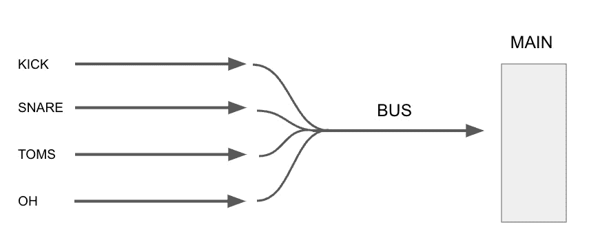

图 13.10：图 13.9 中通道配置的信号流向

现在，您可以使用此总线通道的推子来控制整个鼓组的电平，并使用其 `Inserts`（插入效果）和 `Sends`（发送）机架对所有鼓通道统一应用效果。请注意，您在单个鼓通道上应用的任何设置或效果仍然有效；总线通道在此基础上增加了一个额外的控制层。

### 提示

在某些硬件调音台（如 SSL）和某些其他音乐制作软件（如 Cubase）中，总线被称为组或组通道。如果您是从这些软件转到 Studio One 的，请注意术语的这一变化，因为在 Studio One 中 `group` 含义不同，我们将在*使用组以实现更快的工作流*一节中看到这一点。

将多个通道合并到单个总线中，可让您将它们视为单个通道处理。例如，您现在可以使用我们创建的总线，同时对所有四条鼓轨道应用纽约式压缩。只需从 `Browse`（浏览器）窗口拖动一个压缩器并将其放置在总线的 `Sends`（发送）机架上。最终结果将如下所示：

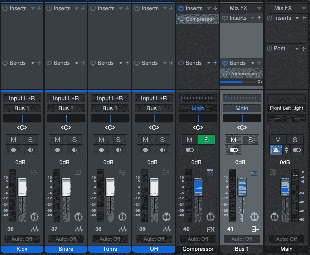

图 13.11：将效果通道应用于总线

上述配置的信号路由如下所示：

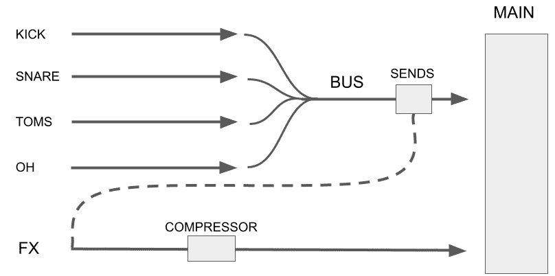

图 13.12：图 13.11 中通道配置的信号流向

您可以创建任意数量的总线，并将总线路由到其他总线。一旦您习惯了在混音中融入总线和效果通道，可能性就是无限的，这为一些非常有创意且节省时间的选项打开了大门。

## 使用 VCA 通道控制音量

`Voltage-Controlled Amplifier`（电压控制放大器，`VCA`）通道允许您控制一个或多个通道的电平。您可以将 `VCA` 通道视为总线通道的简化版。总线通道拥有 `Inserts`（插入效果）和 `Sends`（发送）机架以及推子，而 `VCA` 通道仅有一个推子。

要理解为什么 `VCA` 通道是一个绝妙的主意，让我们回到我们一直在处理的四个鼓通道和鼓总线通道。想象一下，在混音过程中，您在鼓总线的推子上添加了一些复杂的自动化，调整整个鼓组的电平以适应歌曲的流动。第二天，您用全新的耳朵聆听混音，发现鼓声实际上在整首歌中都盖过了混音。因此，您决定将鼓声整体降低几分贝。

通常，这意味着要编辑鼓总线推子上的自动化。虽然这当然可行，但这并不是一种实用或方便的方法，特别是如果您想在聆听混音时主动调整电平的话。

这就是 `VCA` 通道概念发挥作用的地方——它在信号路径上增加了第二个推子，可用于进一步调整鼓总线的电平。这样，您可以让鼓总线上的推子负责自动化，而使用 `VCA` 通道上的推子来微调鼓组的整体音量。

### 添加 VCA 推子

以下是向通道添加 `VCA` 推子的方法：

1. 选择您想要用 `VCA` 推子控制的通道。这可以是任意组合的通道——例如，如果您希望某些打击乐通道的音量随鼓通道以相同幅度变化，请同时选择单个打击乐通道和鼓总线。

2. 右键单击任一选定通道。从弹出菜单中选择 `Add VCA for Selected Channels`（为选定通道添加 VCA）。这将创建一个 `VCA` 通道，并将选定通道的推子路由到 `VCA` 通道上的推子。此路由将显示在受影响的推子下方：

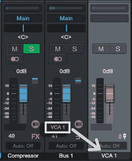

图 13.13：总线上的推子路由至 VCA 1

现在，您可以使用 `VCA` 通道的推子来控制所有路由至它的通道的电平。请注意，您甚至可以对 `VCA` 通道上的推子进行自动化，以增加额外的控制层。

恭喜！您现在拥有了大师级的信号路由技能。就信号流向而言，这是典型音乐混音会话中最复杂的情况了。掌握了这些知识，您现在已准备好有效应对项目中可能遇到的几乎任何信号处理挑战。在下一节中，我们将以此为基础，探索一些更复杂的混音技巧。

# 应用高级技巧

在本节中，我们将介绍一些在混音中操控声音的更具创新性的方法。虽然这些通常被视为高级技巧，但这并不意味着它们难以理解或执行。相反，这意味着只有在您掌握了前几节介绍的基本技巧后，才会发现它们有用。一旦达到那个程度，我们即将讨论的技巧实现起来相当容易。

让我们从所有这些高级技巧中最流行的一个开始。

## 侧链处理

`Sidechain processing`（侧链处理）（或称 `sidechaining` 侧链）是一种技术，其中一个音频源的信号被用来控制另一个音频源的处理。换句话说，侧链信号被用来触发目标音频信号上的特定处理效果。

侧链可用于无数种目的，范围从创意性到高度技术性。以下是一些可能的使用场景：

* 在现场表演中，应用半播放，以便当歌手对着麦克风唱歌时，我们听到实际表演，但当他们停止演唱时，伴奏自动启动。
* 在电子舞曲制作中，在踢鼓和贝斯轨道之间创造标志性的“泵感”效果。
* 在电视纪录片中，当旁白开始时，自动压低背景音乐。
* 在流行歌曲中，当踢鼓击打时自动降低贝斯轨道的音量，使踢鼓在混音中脱颖而出。

虽然这些是最常见的场景，但这只是侧链用途的冰山一角。

现在，让我们看看如何在混音中实现这一技巧。以此踢鼓和贝斯吉他轨道为例：

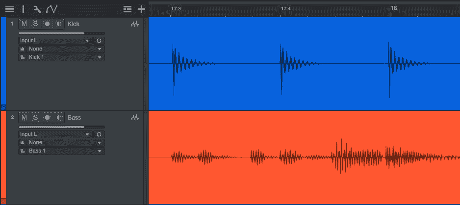

图 13.14：踢鼓轨道（上）和电贝斯轨道（下）

在大多数流行音乐流派中，踢鼓和贝斯吉他同时演奏。在*图 13.14*中，每个踢鼓击打都对应一个贝斯音符。混音时这会成为一个问题，因为在典型的流行混音中，我们希望这两种乐器都响亮且突出，而在它们一起演奏的时刻，它们的合成能量变得如此之大，以至于占用了主通道中大部分可用的动态余量，留给其他乐器的空间非常少。这可能导致主通道削波，迫使您降低整个混音的音量。

如果您仔细观察*图 13.14*，会注意到这两个声音的时间特征截然不同——踢鼓具有尖锐的起音，称为瞬态，并迅速衰减。而贝斯则具有较慢的起音并持续相当长的时间。这两种乐器之间的问题重叠仅发生在踢鼓声音的起音阶段，持续时间非常短，在毫秒级范围内。

# Studio One 中的音频处理技术

## 侧链压缩

如果我们能找到一种方法，仅在几毫秒内降低贝斯音量，问题就能解决。这可以通过侧链的一个特定版本轻松实现，称为 `sidechain compression`。基本上，我们会在贝斯轨道上插入一个压缩器，但该压缩器不会监听贝斯轨道，而是监听底鼓轨道，并在检测到底鼓轨道有信号时降低贝斯音量。

以下是基于底鼓和贝斯轨道示例实现侧链压缩的方法：

1. 如果 `Mix` 窗口尚未打开，请将其打开。
2. 在贝斯通道上插入一个压缩器。
3. 点击压缩器界面顶部的 `Sidechain` 按钮。这将打开一个弹出菜单，其中列出了项目中所有活动的通道：

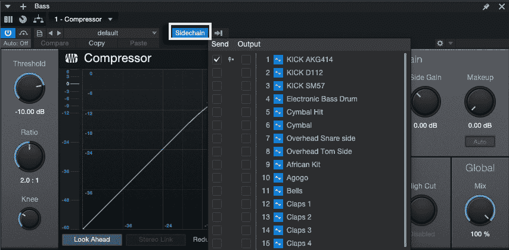

图 13.15：插件的侧链选项

4. 在此列表中，点击底鼓通道对应的 `Send` 复选框。
5. 我们希望压缩器在检测到底鼓通道有击打声时立即起作用，因此接下来，我们将压缩器的 `Attack` 参数设置为一个相当低的值：4 或 5 毫秒是一个不错的平均设置。Studio One 的压缩器可以比这快得多，但如此极端的 Attack 值可能会导致咔哒声。
6. 我们还希望压缩器在底鼓尖锐的攻击阶段结束后立即停止压缩。将 `Release` 时间设置在 50 毫秒左右，但如果你想创造电子舞曲中标志性的泵感贝斯声音，可以尝试更高的值。这里没有固定的数值；这取决于歌曲的速度和声音的时间特性，所以请不断尝试直到效果完美。
7. 你可以在压缩器的 `Ratio` 和 `Threshold` 设置上稍微激进一些，因为这种压缩发生在毫秒级的时间范围内。这里的目标是瞬间尽可能多地降低贝斯音量，同时不造成其音量的明显下降。

就这些！现在，虽然这个压缩器插在贝斯通道上，但它监听的是底鼓通道，并对底鼓的击打做出反应。信号流程如下所示：

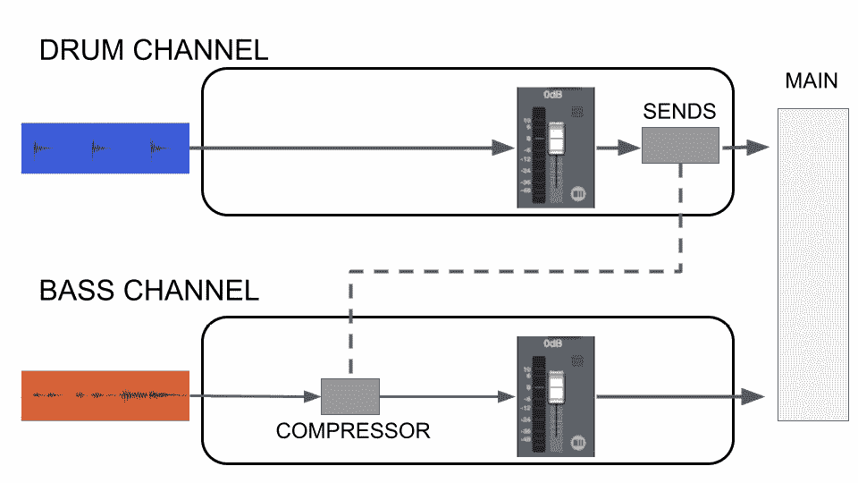

图 13.16：侧链压缩的信号流程

这个例子只是在项目中使用侧链处理的一种方式。并非所有效果插件都具备侧链功能，但每个新版本都会为更多插件添加此功能。下次打开插件时，检查它是否支持侧链，并思考如何利用该功能为你的混音添加富有创意的动态效果。

## 使用 Splitter 进行精准定位

`Splitter` 是一个实用工具插件，可让你将信号拆分为多条路径。然后你可以分别处理这些路径中的每一条，这为多功能且强大的声音处理选项打开了大门。以下是一些可能性：

* 将鼓循环拆分为两条相同的路径并压缩其中一条。这将在单个通道内有效地实现纽约压缩。
* 将声音的低频内容拆分到单独的路径并将其转换为单声道。此技术用于最大化混音的单声道兼容性，通常只能通过称为 `multiband imagers` 的高端插件来实现；然而，使用 Splitter，你仅凭 Studio One 的内置插件就能做到这一点。
* 将立体声轨道的左、右声道拆分并分别处理。这允许你想出一些非常有创意的声音设计点子，而如果用单个插件同时处理左右声道则无法实现。

迄今为止讨论的插件修改的是通过通道的声音，而 Splitter 修改的是信号路径本身，因此与其他插件相比，使用 Splitter 需要不同的方法。让我们逐步演示该过程：

1. 从 `Browse` 窗口拖动 `Splitter` 并将其放置在你要处理的通道的 `Inserts` 机架上。这将打开 `Routing` 窗口：

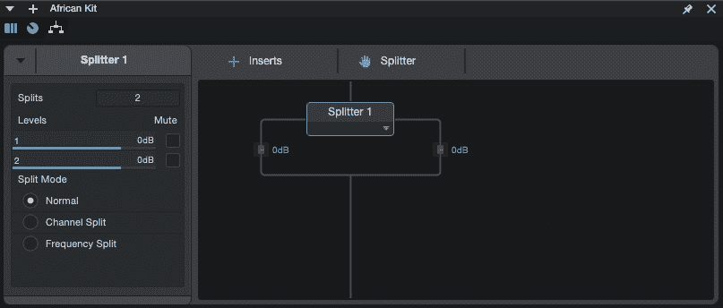

图 13.17：带有 Splitter 的 Routing 窗口

1. `Routing` 窗口的左侧显示我们刚插入的 Splitter 的设置。使用 `Splits` 选择要将信号拆分为多少条路径。在本例中，我们将使用两条路径。
2. 使用 `Levels` 设置每条路径的音量，使用 `Mute` 暂时静音路径。
3. `Split Mode` 设置拆分信号的依据。有三个选项：
    * `Normal` 将信号拆分为两个或多个相同的副本。这对于在单个轨道内应用并行处理很有用。
    * `Channel Split` 将立体声通道拆分为成对的单声道信号，允许你分别处理左、右声道。
    * `Frequency Split` 将信号拆分为频段，并将每个频段放置在单独的路径上。在图 13.18 中，我在 240 Hz 处拆分信号。你可以将其视为一个分频点；低于 240 Hz 的任何频率将路由到路径一，高于该频率的任何频率将路由到路径二。如果你需要将频率划分为更小的频段，请增加 `Splits` 设置以创建额外的路径，并根据需要调整它们各自的分频频率。

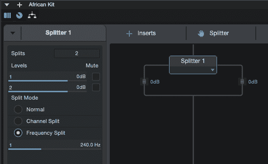

图 13.18：Splitter 上的 Frequency Split 模式

1. 拆分通道后，你可以从 `Browse` 窗口拖动效果插件并将其放置在要处理的路径上。在图 13.19 中，我让 `Autofilter` 插件处理左声道，让 `Beat Delay` 处理右声道。

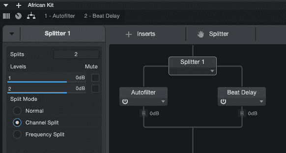

图 13.19：向 Splitter 的路径添加插件

你可以添加任意数量的 Splitter，在每个 Splitter 中创建任意数量的 Splits，并在每条路径上插入任意数量的插件。你还可以拖动 `Routing` 窗口中的每个项目来更改其在信号流中的位置，创建专属于你的精彩效果链。Splitter 真的是音频工程师的游乐场！

## 使用 Groups 加快工作流程

如果你有多个通道想要一起处理，可以使用 `Group` 功能链接它们的参数。在组内对任何通道执行的操作也将应用于其他通道。这是一个很棒的省时功能，有助于简化你的工作流程。

要将通道放入组中，请按以下步骤操作：

1. 在 `Mix` 窗口上，选择要分组的通道，然后右键点击其中任意一个。
2. 在弹出菜单中选择 `Group Selected Tracks`。这将打开一个对话框，你可以在其中为该组命名。
3. 给该组一个简短、描述性的名称，然后点击 `OK`。这将帮助你在处理大型项目时轻松识别各个组。

组中的通道将在其推子顶部标记一个组图标：

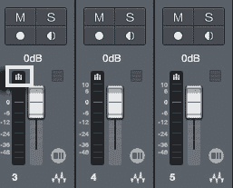

图 13.20：指示分组通道的组图标

默认情况下，将通道放入组会链接它们的推子、声像控制、Solo、Mute、Record Enable 和 Monitor 按钮，以及发送路由。要从组中排除这些参数中的任何一个，请执行以下操作：

1. 点击 `Mix` 窗口上的 `Show Groups` 按钮。这将打开 `Group Panel`：

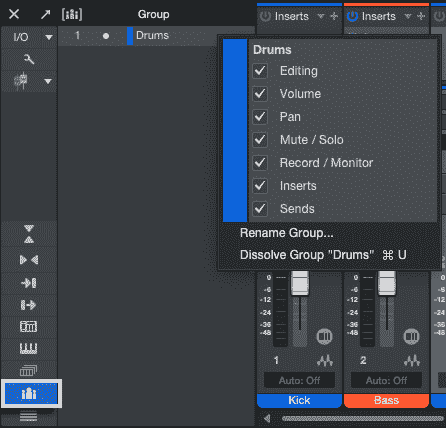

图 13.21：Mix 窗口的 Show Groups 按钮和 Groups 面板

1. 右键点击你想要修改的组的名称。

# 自定义插件

正如我们在*第 12 章*中所见，效果器插件种类繁多，使用方法也无穷无尽，但随着你混音能力的提升，你会发现自己建立了一份简短的、经过验证且值得信赖的插件清单，并且比其他插件更频繁地使用它们。你还会发现，在各个项目中，你对这些插件的设置几乎如出一辙。这并非坏事；相反，这是你独特制作风格的一部分。

Studio One 让你轻松整理常用插件，并按你想要的方式在项目中调用它们，从而节省时间并优化工作流。让我们来探索使这成为可能的功能。

## 添加到收藏夹

如果你发现自己经常使用某个插件，不妨将其添加到插件列表中的 `Favorites`（收藏夹）类别：

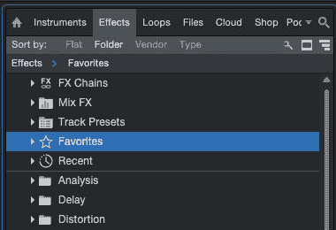

图 13.22：“浏览”面板上的插件列表

这会让插件更易查找，尤其是当你拥有大量插件时。具体操作如下：

1.  打开 `Browse`（浏览）面板，切换到 `Effects`（效果器）选项卡。
2.  在插件列表中，右键点击你想标记为收藏的插件。
3.  在弹出菜单中，选择 `Favorite`（收藏）。

`Favorites`（收藏夹）将出现在所有插件列表的顶部——包括 `Mix`（混音）窗口的 `Inserts`（插入）机架、`Inspector`（检查器）面板以及 `Browse`（浏览）窗口。你的常用插件始终触手可及。

## 创建效果器链

如果你发现自己使用相同的插件、相同的设置且排列顺序相同，可以将它们保存为 FX 链，以便在项目中即时调用。

例如，我喜欢使用 `Room Reverb`（房间混响），但由于它没有内置均衡器部分或滤波器，我在混响后添加 `ProEQ3` 以去除极端频率。然后，我添加 `Binaural Pan`（双耳声像）以给混响增加额外宽度，使混音更具立体感。这已经是我一段时间以来的首选混响设置。

我不必在每个项目中逐个添加这些插件并从头调整，而是可以为它们创建一个 FX 链，以便在未来的项目中调用。具体操作如下：

1.  在通道的 `Inserts`（插入）机架上排列好插件。
2.  打开每个插件并按你希望在下一个项目中看到的方式进行调整。Studio One 也会记住每个插件的设置。
3.  点击 `Inserts` 机架顶部的小三角形。这将打开 `FX Chain`（效果器链）菜单：

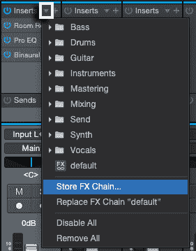

图 13.23：FX Chain 菜单

4.  在此菜单中，点击 `Store FX Chain`（存储效果器链）。这将打开一个对话框，提示你为新的 FX 链命名。
5.  为你的 FX 链起一个简短、描述性的名称（如 `main vocal reverb` 主唱混响），然后点击 `OK`。

下次你在任何项目的任何通道上打开 `FX Chain` 菜单时，这个 FX 链都会静候在那里，随时以完全相同的设置供你调用。多么省时啊！

## 为插件添加预设

如果你经常在插件上使用相同的设置，可以将其保存为预设，从而免去在每个项目中从头调整的麻烦。按以下步骤操作：

1.  将插件的所有参数设置为你想要存储在预设中的状态。
2.  点击插件界面上的微小页面图标以打开其预设菜单：

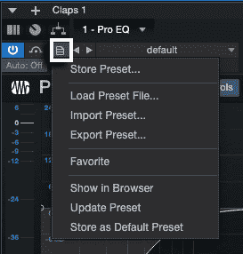

图 13.24：插件预设菜单

3.  点击 `Store Preset`（存储预设），为预设起一个描述性名称（如 `lead guitar delay` 主音吉他延迟），然后点击 `OK`。

现在，每当你在任何通道、任何项目中启动此插件时，该预设都将可用。

这结束了我们对 Studio One 混音台中高级混音技巧和工作流窍门的探索。接下来，我们将讨论如何从 Song 中导出最终混音或分轨，以便你发布或与合作者分享。

# 导出最终混音和分轨

一旦你对混音感到满意，就会想与全世界分享。然而，既然其他人无法打开我们的 Studio One 项目文件，你首先需要将混音转换为一种标准文件格式，以便大家能在媒体播放器中打开。这个过程称为**导出**。当你在 Studio One 中导出 `Song` 时，项目中的众多通道将被混缩为单个立体声通道，然后以全球通用的音频文件格式保存。

从 Studio One 导出 `Song` 有两种方法，用途各异。让我们从更常用的方法开始。

## 导出最终混音

从 `Song` 导出最终混音意味着将所有通道混缩为一个立体声通道，并将该立体声通道嵌入音频文件中。这听起来很复杂，但一旦你设置好几个参数，Studio One 就能优雅地完成这项任务。

按以下步骤导出 `Song` 的最终混音：

1.  在 `Arrange`（编排）窗口中设置左、右定位器，分别标记 `Song` 的开始和结束。默认情况下，Studio One 仅导出这两个定位器之间的时间线部分，所以请花时间正确放置它们。

> **重要提示**
>
> 建议在歌曲开头留出极短的静音（约半秒即可）。这可以防止消费级媒体播放器切掉歌曲的开头。
>
> 在歌曲结尾，确保所有混响尾音在右定位器之前完全衰减，以免播放时突然截断。

2.  转到顶部菜单，点击 `Song`（歌曲），然后点击 `Export Mixdown`（导出混音）。这将打开 `Export Mixdown` 窗口：

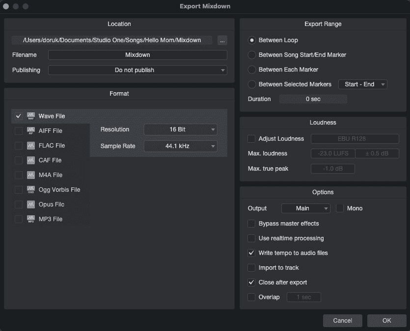

图 13.25：导出混音窗口

3.  在该窗口的 `Location`（位置）部分，选择即将创建的音频文件的文件夹和名称。
4.  在 `Format`（格式）部分，选择要创建的文件格式。你可以使用复选框选择多种文件类型。点击每种文件类型以访问其适用参数。虽然有多种文件类型可选，但以下是你最可能用到的两种：

    *   **Wave File**（波形文件）是行业标准，也被消费级媒体播放器普遍识别。Wave 文件以较大的文件体积换取高音质。使用此格式向发行网络、客户或母带工作室交付最终混音。以下是 Wave 文件的两个最常用参数：

        *   如果你导出的歌曲将发布到 Apple Music 或 Spotify 等音乐平台，请将 `Resolution`（分辨率）设为 `16 Bit`，`Sample Rate`（采样率）设为 `44.1 kHz`。这被称为 `CD standard`（CD 标准）。自 1980 年代以来，它一直是音乐发行的标准格式，至今仍被纯音乐平台使用。

## 第 13 章：导出混音和分轨（续）

## 导出最终混音

### 视频制作的音频格式设置
- 如果导出的波形文件将用于视频制作（作为背景音乐、音效等），请将 `Resolution` 设置为 `24 Bit`，将 `Sample Rate` 设置为 `48 kHz`。这是自 1990 年代以来一直沿用的 `DVD 标准`，视频平台仍要求使用该标准。它定义了视频文件音频部分的参数。虽然视频制作程序可以导入几乎任何分辨率和采样率的音频文件，但使用上述参数交付文件将提供最佳音质。

- `MP3 File` 是一种压缩文件格式，以牺牲音质为代价提供更小的文件体积。使用此格式通过电子邮件附件快速与朋友分享混音以获取第二意见。MP3 文件的重要设置是 `Bitrate`，以 `kilobits per second` (`kbps`) 表示。较高的比特率提供更好的音质，但会导致文件体积更大；`192 kbps` 是一个不错的折中方案。

### 导出范围
3. 窗口的 `Export Range` 部分允许您设置将导出时间轴的哪一部分。我们已在*步骤 1*中处理了此项，因此您可以保留其默认设置 – `Between Loop`。

### 响度标准化
4. 窗口的 `Loudness` 部分激活了一个极其有用的功能，该功能分析混音的电平并自动调整其以符合数字平台要求的响度标准。点击 `Adjust Loudness` 以激活一个下拉菜单，允许您调整歌曲的响度，符合从欧洲广播联盟到 YouTube 等任何平台实施的标准：

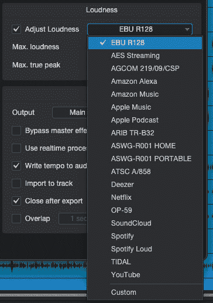

1. 您也可以使用 `Max. loudness` 和 `Max. true peak` 设置手动设置歌曲的响度。我们将在 `第 15 章` 中讨论这些设置，但下拉菜单中的预设选项足以应对几乎所有情况。

2. 如果您在 `Mix Console` 的 `Main channel` 上插入了效果插件，并将混音发送给母带处理室，请勾选 `Options` 部分中的 `Bypass master effects` 复选框。这将绕过这些效果，以免它们干扰母带处理阶段将要应用的效果。

3. 点击 `OK`。

Studio One 将导出混音、调整其响度电平，并创建您指定的文件，此时您可以喝一口当之无愧的咖啡。

## 导出分轨

`Stems` 是指构成歌曲的单个轨道或一组轨道。当歌曲被分成分轨时，每个轨道或一组轨道将作为单独的音频文件导出。根据预期用途，这些文件可能以原始、未处理的形式交付，也可能应用了后期制作中的所有效果和处理（如音高校正和音频量化）后交付。

通常将歌曲导出为分轨，以便他人对其进行工作或贡献。使用分轨的一些可能场景如下：

- 您希望让他人能够重混您的歌曲。拥有分轨使他们能够使用想要在重混中保留的歌曲部分，并用自己的素材替换其他所有内容。
- 您为电影创作音乐，并希望在混制电影最终原声带时给重录混音师更多自由。例如，如果您的配乐包含鼓、铜管乐器和合成器，将这些乐器组以单独的分轨交付将允许重录工程师降低掩盖对白的合成器电平，同时保持鼓的满音量。
- 您希望与他人合作，因此提供分轨作为他们可以改进的原始素材。

导出分轨的过程与导出视频的过程相似。您需要执行以下操作：

1. 在 `Arrange` 窗口上设置左、右定位器，如*导出最终混音*部分所述。
2. 转到顶部菜单，点击 `Song`，然后点击 `Export Stems`。这将打开 `Export Stems` 窗口：

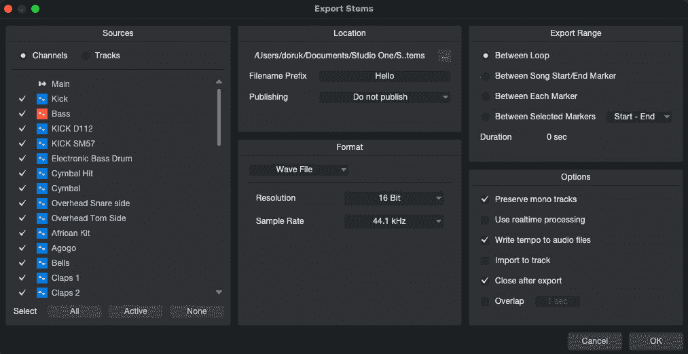

3. 在此窗口的 `Sources` 部分，选择要作为单独分轨导出的通道。
4. 在 `Location` 部分，选择一个文件夹用于存放即将创建的音频文件。
5. 默认情况下，分轨文件将以其对应的通道命名。如果您的歌曲中有一个名为 `Kick` 的通道，其对应的分轨文件将命名为 `Kick.wav`。由于您将把这些分轨发送给其他人，最好在文件名中添加前缀，以便接收文件的人知道这些文件来自哪首歌曲。您可以在 `Filename Prefix` 字段中设置此前缀。根据我在*图 13.27*中的设置，分轨将被命名为 `Hello_Kick.wav`、`Hello_Bass.wav` 等。
6. 其余参数与 `Export Mixdown` 窗口中的相同，请参考*导出最终混音*部分列出的步骤进行设置。
7. 点击 `OK`。

在本节中，您学习了如何导出最终混音或分轨，以便与粉丝、客户或合作者分享。这结束了我们关于 Studio One 混音过程的讨论。

## 摘要

在本章中，我们深入探讨了 Studio One 的信号流程，讨论了使用效果插件的各种方法，并学习了如何实现多种高级混音技术。掌握这些概念和技术将使您能够完全控制混音，开发更高效的工作流程，并促进混音中的创造力，帮助您实现艺术愿景。

在下一章中，我们将探索 Studio One 的环绕声功能，并学习如何利用它们打造沉浸式音频体验。
