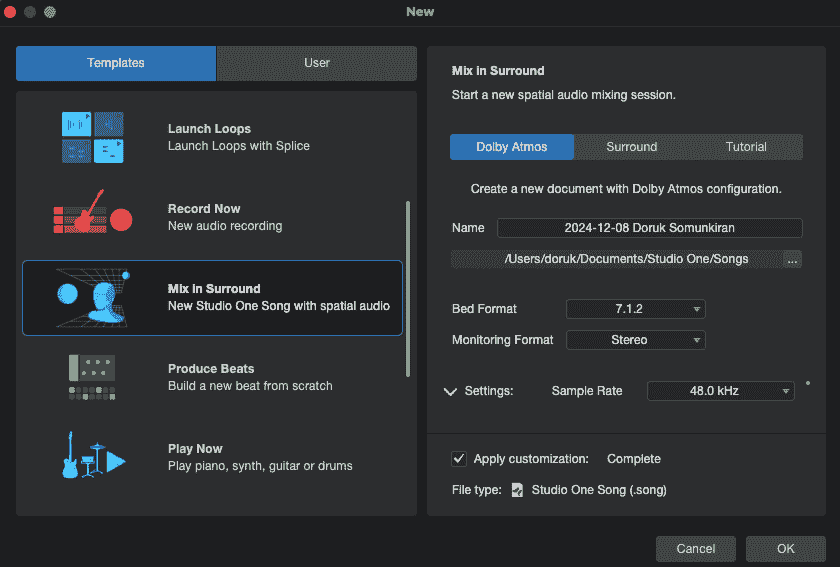
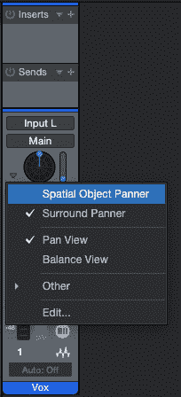
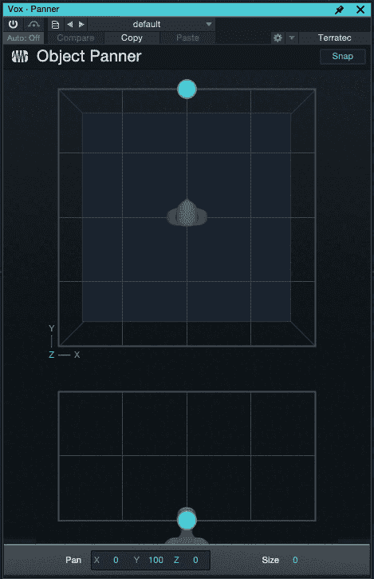
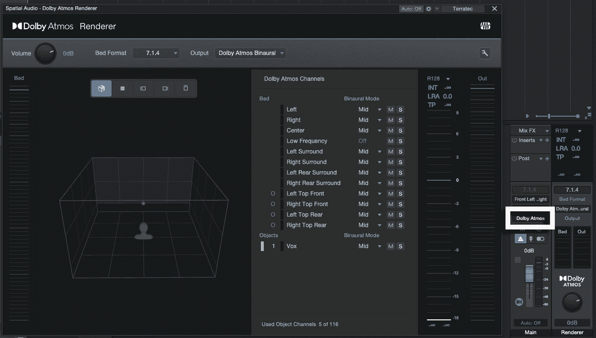
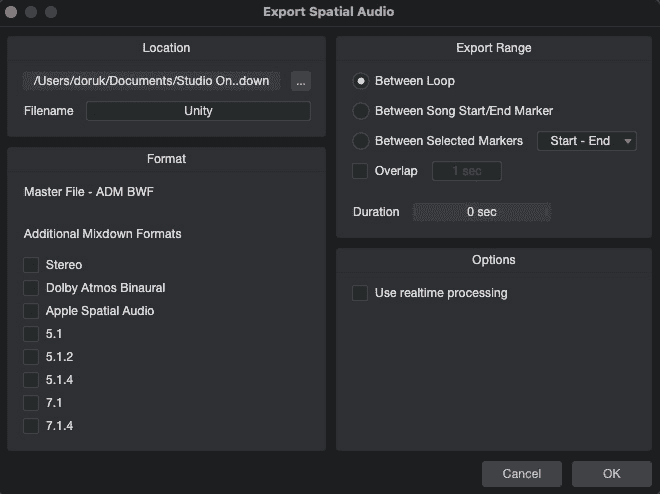

## 第 14 章：使用空间音频

`Spatial audio`（空间音频）彻底改变了我们感知和创造声音的方式，Studio One 的最新版本将这一令人兴奋的前沿领域直接引入您的工作流程。在本章中，我们将探索如何利用 Studio One 的沉浸式音频功能打造三维声学体验。无论您旨在制作空间感丰富的音乐、为游戏设计引人入胜的声景，还是为支持环绕声或空间音频格式的平台创作内容，本章都将指导您了解使之成为可能的工具和技术。

在整章中，我们将配置 Studio One 以进行空间音频制作，并介绍沉浸式格式混音的基本工作流程。您还将发现导出项目的实用技巧，以确保与各种播放系统和平台的兼容性。读完本章后，您将能够自信地驾驭沉浸式音频领域，并以传统立体声混音无法实现的方式将您的想法变为现实。

## 技术要求

要学习本章内容，您只需在计算机上安装并激活 Studio One。请注意，空间音频功能是在版本 7 中引入的。

## 开始使用空间音频

`Spatial audio`（空间音频），也称为 `immersive audio`（沉浸式音频），是一种多维的声音处理方法，能创造深度、空间感和临场感，超越传统立体声的局限。空间音频将声音置于听众周围的三维空间中。这可以包括来自 360 度球体内精确点的声音，增强真实感和情感投入。

### 本章涵盖的主题
- 开始使用空间音频
- 为空间音频创建新歌曲
- 混音和导出空间音频素材

这项技术被用于各种应用，从音乐和电影到**虚拟现实**（**VR**）、**增强现实**（**AR**）和游戏。沉浸式音频格式（如 Dolby Atmos、DTS:X 和 Ambisonics）旨在多种播放系统上提供空间动态音频体验，从专业设置到消费级耳机。通过模仿我们在现实世界中自然感知声音的方式，沉浸式音频让创作者能够打造更引人入胜、更逼真的声景，吸引听众并让他们身临其境。

从实际角度来看，空间音频是指输出声道超出传统双声道立体声的任何音频格式。这确实是一个宽泛的定义，所以让我们来细分一下。

# 了解不同类型的空间音频

Studio One 支持的空间音频格式包括以下内容：

*   `Surround` 是一个通用术语，指多声道音频配置，其中每个声音被分配到特定声道，并可使用该声道上的平衡控制将其定位在听众周围的任何位置。环绕音频格式（如 5.1 和 7.1 声道设置）常用于家庭影院、影院和游戏，旨在复现真实的声学效果。

*   `Dolby Atmos` 是由杜比实验室开发的一种专有空间音频格式。它采用更先进、更灵活的方法，允许将声音放置并移动到三维空间中的任何位置，包括头顶。Dolby Atmos 具有可扩展性，意味着它可以适应从拥有数百个扬声器的影院设置到音响条和耳机的各种系统。

*   `Binaural` 是一种携带空间信息的双声道音频信号，可用于在耳机上传达空间音频成像，而无需安装多扬声器系统。

除双耳格式外，这些格式在制作和播放期间都需要使用多个扬声器。一旦超越立体声（我们只需将扬声器命名为左和右），给扬声器命名就会变得棘手一些，所以在深入空间音频的深水区之前，让我们先解决这个问题。

## 扬声器配置的命名约定

空间音频扬声器配置描述了旨在创造沉浸式音频体验的设置中扬声器的位置和数量。这些配置以数字表示，如 5.1、7.1.2 等，指示扬声器、低音炮的分布，以及在某些情况下高度或顶置声道的存在。

以下是如何解读 7.1.2 这样的数字：

*   第一个数字是水平面上围绕听众放置的扬声器数量。这些通常位于前方、侧面和后方。

*   第二个数字显示专用于**低频效果**（**LFE**）的低音炮数量，如低音和轰鸣声。

*   第三个数字（如果存在）表示**高度**或顶置扬声器的数量，它们为音频提供垂直维度，这对 Dolby Atmos 等格式至关重要。

以下是一些常见配置及其典型用例：

*   **2.1**：两个主扬声器（左和右）和一个低音炮。这是一个带有额外低音支持的基本立体声设置，不提供环绕或高度声道。

*   **5.1**：五个主扬声器（前左、前右、中置、后左和后右）和一个低音炮。这是家庭影院中使用的标准环绕声设置。

*   **7.1**：在 5.1 设置的基础上增加两个额外扬声器（环绕左和环绕右），以实现听众周围更精确的声音定位。

*   **5.1.2**：带有两个高度扬声器的 5.1 设置，增加了顶置维度。适合入门级 Dolby Atmos 或 DTS:X 系统。

*   **7.1.2**：带有两个高度扬声器的 7.1 设置。此配置提供水平和垂直的沉浸感，适合高级空间音频体验。

*   **7.1.4**：在 7.1 配置基础上增加四个高度扬声器，提供更精确的垂直声音定位，带来高度沉浸式体验。

这些配置中提到的大量扬声器乍看之下可能令人望而生畏：你真的需要在家庭工作室放置那么多扬声器来进行空间音频工作吗？这取决于你的计划和目标受众。这将是我们在下一节讨论的内容。

## 空间音频的硬件要求

让我们从好消息开始——如果你要从事 Dolby Atmos 工作，除了现有的音频接口和耳机，不需要任何其他设备。Dolby Atmos 使用一种名为 `Dolby Atmos Renderer` 的专有算法，我们将在*混音和导出空间音频素材*一节中讨论它。目前只需知道，该渲染器会将你的 Dolby Atmos 素材向下混音并转换为双耳信号，以便你使用耳机工作，同时仍能体验空间音频。

现在是坏消息——如果你在使用任何其他空间音频格式（包括传统的环绕声格式，如 5.1），Dolby Atmos Renderer 将无法施展魔力。因此，你需要拥有与你的环绕声配置指示的同样数量的扬声器（例如，5.1 配置需要五个扬声器和一个低音炮）。此外，你还需要一个支持相同数量独立输出的音频接口（例如，5.1 配置总共需要六个输出）。

现在我们已经了解了空间音频格式及其各自的要求，我们准备好在 Studio One 中开始制作第一个沉浸式音频杰作，这正是我们在下一节要做的事情。

# 为空间音频创建新 Song

在 Studio One 中，空间音频仅在 `Song` 页面受支持。你将仅使用此页面来创建、编辑、混音和导出所有空间素材。让我们开始吧：

1.  在 Studio One 的启动页面上，点击 `New`。这将打开 `New` 文档窗口。

2.  在该窗口左侧的 `Templates` 列表中，点击标题为 `Mix in Surround` 的模板。窗口右侧现在将显示使用空间音频创建第一个 Song 的可用选项（*图 14.1*）。

图 14.1：为空间音频创建新 Song

1.  选择你想要使用的空间音频格式类型：`Dolby Atmos` 或 `Surround`。你也可以选择 `Tutorial` 进入交互式指南，旨在帮助你了解 Dolby Atmos 工作流。

你在 `New` 文档窗口右侧看到的选项将根据你选择 `Dolby Atmos` 和 `Surround` 而变化。让我们逐一过一遍。

创建 `Dolby Atmos` Song 的选项（如*图 14.1*所示）如下：

*   `Name`：为你的 Song 提供名称并选择位置。

*   `Bed Format`：在此选择目标扬声器配置。这是你的项目最终将在其上播放的扬声器配置。

*   `Monitoring Format`：这是你在制作工作中将使用的扬声器配置。还记得我们在*空间音频的硬件要求*一节中讨论的 Dolby Atmos Renderer 吗？该渲染器将获取你为 `Bed Format` 选择的配置，并将其向下混音为你在此处选择的任何扬声器配置。如果你只打算使用耳机工作，请在此字段中选择 `Stereo`。

*   `Sample Rate`：Dolby Atmos 仅支持 48 kHz 或 96 kHz 的采样率，这些是你将看到的选项。如果你的音频接口不支持 96 kHz，唯一可用的选项将是 **48 kHz**。

创建 `Surround` Song 的选项如下：

*   `Name`：为你的 Song 提供名称并选择位置。

- `Output Format`：选择您的目标扬声器配置。请注意，您在工作室中也需要有匹配的扬声器配置。
- `Sample Rate`：在 `44.1 kHz` 和 `192 kHz` 之间选择一个采样率。

您的新 `Song` 现已配置为空间音频。如果您稍后需要更改 `Song` 的配置，请转到顶部菜单上的 `Song` 并点击 `Spatial Audio…`。这将打开一个对话框，您可以在其中修改我们之前讨论的设置。

## 映射扬声器

在我们开始处理您的第一个空间音频 `Song` 之前，请确保 Studio One 已配置为将每个输出通道发送到正确的扬声器。此过程称为 `speaker mapping`，只要您使用相同的扬声器配置，只需执行一次即可。让我们开始吧：

1. 在顶部菜单上，点击 `Song`，然后点击 `Song Setup`。
2. 在 `Song Setup` 窗口中，点击 `Audio I/O Setup` 选项卡。
3. 点击 `Outputs`。
4. 现在，点击 `Main` 或 `Main Output` 右侧的字段，以显示可用输出格式的列表，如 `Figure 14.2` 所示：

图 14.2：为空间音频映射扬声器

1. 在此列表中，选择与您的 `Song` 目标格式匹配的选项。窗口现在将显示您所选格式的默认扬声器映射：

图 14.3：7.1.4 配置的默认扬声器映射

1. 将扬声器名称（`L`、`R`、`C` 等）拖动到音频接口上所需的输出。例如，如果您的低音炮连接到接口上的 `Line Out 8`，请点击 `LFE` 并将其拖动到 `Line Out 8`。
2. 将每个输出分配给正确的扬声器后，如果您希望 Studio One 为您未来的 `Songs` 记住此配置，请点击 `Make Default`。
3. 点击 `OK`。

如果您正在使用 Dolby Atmos 并希望仅使用耳机进行监听，`Main` 输出下方的 `Headphones` 部分（如 `Figure 14.3` 所示）可以满足您的需求。只需将耳机插入音频接口上的耳机插孔，即可开始工作。

太棒了！您刚刚配置 Studio One 以使用空间音频。现在，您已准备好为世界创建令人惊叹的三维体验。让我们直接开始吧。

## 为空间音频格式化音轨

进入新的 `Song` 后，创建制作的工作流程与前几章讨论的没有区别。您唯一需要注意的就是在创建新音轨时选择正确的配置。让我们现在就来处理这个问题：

1. 点击 `Add Tracks` 按钮或按 `Ctrl` + `T`/`Cmd` + `T`。这将打开 `Add Tracks` 对话框。
2. 点击 `Audio` 选项卡。
3. 使用 `Format` 下拉菜单，选择您想用于此音轨的格式。对于大多数用途，您会想选择 `Mono`（对话、人声、单一乐器等）或 `Stereo`（音效、环境音、背景音乐等）：

图 14.4：为空间音频创建新音轨

1. 点击 `OK`。

从现在开始，继续像往常一样使用 Studio One 进行工作。只有当您进入混音阶段时，工作流程才会发生变化，我们将在下一节中讨论。

# 混音和导出空间音频素材

传统的立体声混音涉及在两个音频通道（左和右）上创建声场。声音通过每个音轨或通道上的平移控制在左、右扬声器之间定位。这创造了深度的错觉，但仅限于单一维度。另一方面，空间音频混音涉及创建一个三维声场，声音可以在听众周围移动。声音被定位在一个 360 度的球体中，提供高度、深度和宽度。这需要更复杂的平移方法，我们将通过探索 Studio One 的空间平移功能来开始本节。

## 使用环绕声平移器

创建 `Song` 并按本章前面所述配置 Studio One 进行空间音频制作后，您会注意到 `Mix` 窗口上音轨和通道的平移控制看起来截然不同。这种新型平移控制称为 `Surround Panner`。双击任意通道的平移控制（在 `Figure 14.5` 中高亮显示）可在单独的窗口中打开 `Surround Panner`：

图 14.5：Surround Panner 窗口

`Surround Panner` 窗口的上半部分显示您制作的目标扬声器配置。在 `Figure 14.5` 中，我的目标扬声器配置是 `7.1.4`，如 `Surround Panner` 窗口左上角所示。因此，圆圈外放置了七个扬声器图标，代表收听环境中将使用的扬声器阵列。圆圈正中央站着一个人形，代表有幸欣赏我们作品的幸运儿。Studio One 的说明书亲切地称其为 `The Listener`，我们将延续这一传统，也这么称呼它。

要将某通道的音频平移到我们刚才提到的七个扬声器之间的任意点，您只需抓住箭头（目前从 `The Listener` 的鼻子延伸向圆圈顶部），并将其指向您希望该通道声音发出的位置。将箭头靠近或远离 `The Listener` 会影响信号的大小。如果您只想改变声音的位置而不改变其大小，可以使用右上角的 `Size` 锁定按钮（带挂锁图标）将大小锁定在当前设置。

您可以点击圆圈上的任意气泡（标记为 `L`、`R`、`Ls`、`Rs` 等）并拖动它们以更改通道上音频的扩散范围。将气泡靠近会使声音紧凑且聚焦，仿佛来自单一位置。将它们拉远会将声音分散到更宽的频谱上，使声音宏大且宽敞。

`Surround Panner` 窗口的下半部分仅在您的输出配置包含高度扬声器时可用。此部分用于控制通道上信号的 `elevation`（仰角）。您可以将声音放置在 `The Listener` 的耳朵高度、高度扬声器上，或两者之间的任何位置。只需点击气泡并拖动它们即可控制仰角。

`Surround Panner` 窗口上的所有内容都可以自动化。只需在窗口左上角选择您喜欢的自动化模式（当前标记为 `Auto: Off`），按下播放，然后发挥创意。我们在 `Chapter 11` 中讨论过自动化模式，您可能想回顾该章节以复习自动化技能。

`Surround Panner` 是处理空间音频时定位声音的基本工具，但如果您使用 Dolby Atmos，还有更多选项可用。我们将在接下来探索这些选项。

## 理解床和对象

Dolby Atmos 扩展了声音设计和混音的创作可能性，带来更引人入胜、更逼真的听觉体验。正如我们在本章开头提到的，部分原因是通过添加高度扬声器，创造完全沉浸式的体验，包括垂直维度。

Dolby Atmos 范式中的另一个关键点是引入了两个概念：床和对象。这些是革命性的概念，将改变您看待混音的方式，所以让我们来分解它们：

* `Beds`（床层/基础音轨）是静态音频通道（类似于传统的环绕声通道），用作混音的基础。这些通常用于处理不需要精确移动或定位的音频元素，例如背景音乐、环境音或其他非动态声音。

* `Objects`（对象）是可以在三维空间内精确定位和移动的单个音频元素。与传统的基于通道的音频不同，对象不绑定到特定的扬声器；相反，它们包含元数据，告诉播放系统它们在三维环境中的位置和移动。这使得 Dolby Atmos Renderer（杜比全景声渲染器）能够动态地将混音适配到任何扬声器配置，确保一致且身临其境的体验。对象非常适合需要动态空间化的声音，例如头顶飞过的直升机或听众周围移动的脚步声。

此时，你可能会想，既然我们可以在 `Surround Panner`（环绕声全景控制器）上自动化每一个移动，我们已经能让声音四处移动了，那么是什么让对象的概念如此革命性呢？让我来解释一下。理解传统环绕声全景控制与基于对象的运动之间的区别对于在 Dolby Atmos 中工作至关重要，所以让我们深入探讨一下。以下是对比：

* 在传统的环绕声混音中，声音被分配到特定的扬声器通道（例如左前方和右后方）。当自动化全景控制时，你本质上是在*控制声音在这些通道之间的电平分配*。如果播放系统发生变化（例如，你为 7.1 配置混音，但最终听众只有 5.1 设置），全景控制信息就会丢失，空间保真度也会下降。

* 在 Dolby Atmos 中，对象摆脱了固定通道的束缚。对象不绑定到特定扬声器，而是被赋予三维位置元数据，告诉播放系统*声音应该来自空间中的何处*。系统随后计算如何将声音分配到可用的扬声器（或耳机）上，以重现该位置。即使播放系统发生变化，对象也会被渲染以适应现有的播放系统，声音可以在听众周围的球体内无缝且令人信服地移动。

在 Studio One 中，当你创建一个新轨道时，默认情况下它被视为一个 Bed（床层/基础音轨）。Bed 的位置由 `Surround Panner` 控制，我们在上一节中探讨过。对象拥有自己的全景控制工具，这将是我们接下来的主题。

## 使用 Object Panner（对象全景控制器）

`Object Panner`（对象全景控制器），顾名思义，控制声音对象在三维空间中的位置。要使用 `Object Panner` 工具，我们必须首先让 Studio One 知道我们想将一个通道视为对象而不是 Bed。为此，只需右键单击该通道的全景控制旋钮，然后选择 `Spatial Object Panner`（空间对象全景控制器）：

Figure 14.6: Selecting the Object Panner tool

这将在 Dolby Atmos 术语中将该通道指定为对象，并打开 `Object Panner` 窗口：

Figure 14.7: The Object Panner window

`Object Panner` 看起来像是 `Surround Panner` 的简化版，看谁回来了——我们值得信赖的参考点，The Listener（听众），再次位于界面中心。

使用 `Object Panner` 工具非常简单：只需点击对象气泡并将其移动到你希望声音在三维空间中发出的位置。使用窗口的上半部分水平放置声音，使用下半部分垂直放置声音。

不言而喻，这个气泡的移动可以自动化，因此有很大的创作空间。

## The Dolby Atmos Renderer（杜比全景声渲染器）

The Dolby Atmos Renderer 是一个插件，让你能与 Dolby Atmos 算法进行交互。当你在 `New`（新建）文档窗口中选择 `Dolby Atmos` 时（正如我们在 *Figure 14.1* 中看到的），`Dolby Atmos Renderer` 会自动添加到 `Main`（主输出）通道的一个特殊插槽中。点击此插槽（在 *Figure 14.8* 中高亮显示）以打开 `Dolby Atmos Renderer` 界面，准备再次见到 The Listener：

Figure 14.8: The Dolby Atmos Renderer

我们在 *Creating a new Song for spatial audio*（为空间音频创建新 Song）一节中讨论的两个设置（`Bed Format` 和 `Output`）再次出现在窗口顶部。如果你打算使用耳机监听制作，请确保在 `Output` 下拉菜单中选择了 `Dolby Atmos Binaural`（杜比全景声双耳）。

窗口左侧的三维房间显示展示了你创建的对象的位置，正如我们在 *Using the Object Panner* 一节中讨论的那样。界面中心有一个 `Dolby Atmos Channels`（杜比全景声通道）列表，你可以使用各自的 `M`（静音）或 `S`（独奏）按钮来静音或独奏每个通道。最后，窗口右侧的计量部分提供通过渲染器的信号响度电平信息，以便你判断项目是否符合目标收听环境设定的响度标准。我们将在 *Chapter 15* 中讨论响度电平。

我们现在准备好进入空间音频工作流的最后一步。

## 导出空间音频素材

如果你的制作涉及传统的环绕声格式（如 5.1），请按以下方式导出最终音频文件：

1. 在顶部菜单中，转到 `Song` 并点击 `Export Mixdown…`（导出混音缩混……）。

2. 这将打开 `Export Mixdown` 窗口，我们在 *Chapter 13* 中探讨过。按其中所述设置此窗口中的选项。

3. 点击 `OK`。Studio One 将创建一个多通道 `.wav` 文件，遵循你所选格式中的离散通道数量（例如，5.1 配置为六个通道）。

如果你使用了 Dolby Atmos，请按以下步骤导出最终音频文件：

1. 在顶部菜单中，转到 `Song` 并点击 `Export Spatial Audio…`（导出空间音频……）。这将打开 `Export Spatial Audio` 窗口：

Figure 14.9: The Export Spatial Audio window

1. 调整 `Location`（位置）和 `Export Range`（导出范围）设置。这些与 `Export Mixdown` 窗口中的设置相同。

2. 一个 `ADM BWF` 文件（这是 Dolby Atmos 所需的文件格式）将自动创建。如果你想以不同格式创建额外文件，请在窗口的 `Format`（格式）部分选择它们。

3. 点击 `OK`。

这就是使用 Dolby Atmos 导出 Song 所需的全部操作。

## 总结

在本章中，我们讨论并比较了各种空间音频格式，并探索了 Studio One 的空间音频功能。你为制作环境和目标播放配置配置了 Studio One，然后创建了第一个用于空间音频工作的 Song。最后，我们讨论了如何使用 Studio One 内置的空间音频工具进行混音和导出制作。

在下一章中，我们将回到立体声素材的工作。我们将探索 `Project`（工程）页面；一个独特的环境，让你能对 Song 进行母带处理操作。
