## 15

### 导航 Project Page（工程页面）并制作最终母带

在音乐行业中，母带处理通常被视为艺术、科学和魔法的神秘混合体，只有少数拥有超自然听力和昂贵设备的杰出人士才能驾驭。虽然经验、一双训练有素的好耳朵和合适的设备确实会占据优势，但技术已经发展到这样一个地步：只要具备一些基础知识，任何人在简陋的家庭工作室中都能为数字音乐平台发布创作出完全合格的母带。

Studio One 凭借其 `Project` 页面，在让这项技术变得更加易用方面提高了标准，该页面是一个专门用于母带处理的环境。此页面上可用的工具让每位音乐人都能掌握母带处理流程，无论其经验水平如何。

在本章中，我们将探索 `Project` 页面，并学习如何制作符合数字音乐平台标准的最终母带。我们将涵盖以下主题：

*   创建新 Project 并浏览 `Project` 页面
*   掌握 `Project` 页面
*   渲染最终母带以供发布和交付

# 技术要求

为了学习本章内容，您需要在计算机上激活 Studio One。

**重要提示**

`Project` 页面上可用的大多数工具在 `Song` 页面上也可作为插件使用，因此本章介绍的大多数方法也可以在 `Song` 页面上执行。

# 创建新 Project 并浏览 Project 页面

`Mastering`（母带处理）是音乐制作过程的最后一步。它涉及为混音做准备和优化，以便在流媒体服务、CD、黑胶唱片或数字下载等各种平台上分发。

母带处理的目标是优化混音的声音，确保最终产品在各种播放系统上听起来都很棒，从高端录音室监听音箱到微小的入耳式耳机。这当然不是一项容易的任务，但 Studio One 凭借 `Project` 页面使整个流程尽可能流畅，这是一种创新方法，在撰写本文时，其他竞争音乐制作软件均不具备。

`Project` 页面是一个母带处理环境，它与 `Song` 页面紧密集成，创建了一个统一、高效的工作流，涵盖音乐制作的所有阶段，从录音到母带处理。它在许多方面与 `Song` 页面相似，因此一旦您开始使用它，大多数工具和功能都会很熟悉。

让我们首先创建一个新 Project 并探索 `Project` 页面界面。

## 创建新 Project

您可能想要创建新 Project 的场景有两种：

*   您有一首或多首之前已混音并渲染为立体声 `.wav` 文件的歌曲，并且想要处理这些文件以创建用于分发的最终母带
*   您有一首 Song（正在进行中的作品），您已在 Studio One 的 `Song` 页面上对其进行了混音，现在准备让它经历母带处理过程

针对这些场景创建新 Project 的程序各不相同。让我们逐一查看。

### 为现有 .wav 文件创建新 Project

如果您有一首或多首已经混音并渲染为 `.wav` 文件的歌曲，请按照以下步骤为它们创建一个新 Project：

1.  在 `Start`（开始）页面上，点击 `New…`（新建……）按钮，这将打开 `New`（新建）窗口：

图 15.1：新建窗口

1.  在该窗口的左侧，选择 `Master and Release`（母带与发行）。

2.  在窗口的右侧，输入名称并为即将创建的 Project 选择一个文件夹。

3.  如果您的最终母带将上传到流媒体服务和数字音乐平台，请将 `Sample Rate`（采样率）设置为 `44.1 kHz`。如果将用于视频后期制作，请将其设置为 `48 kHz`。

4.  打开 `Explorer`（Windows）或 `Finder`（Mac）并找到您想要处理的 `.wav` 文件。将这些文件拖放到标有 `Drop files here`（将文件拖至此处）的框中。

5.  点击 `OK`（确定）。

这将创建一个新 Project，您的 `.wav` 文件将铺排在 `Project` 窗口时间轴上。

### 从 Song 页面创建新 Project

如果您已在 `Song` 页面上完成了一首 Song 的混音，并准备开始母带处理，您可以直接从 `Song` 页面将其发送到 `Project` 页面。操作方法如下：

1.  在 `Song` 页面的顶部菜单中，转到 `Song` 并选择 `Add to Project`（添加到 Project）。系统将提示您使用 Song 的当前标题创建一个新 Project。在这里，我即将为我的名为 `Pole Star` 的 Song 创建一个新 Project：

图 15.2：在 Song 页面上创建新 Project

1.  点击提示以创建新 Project 后，您将进入 `New Project`（新建 Project）窗口：

图 15.3：新建 Project 窗口

1.  为您的 Project 文件命名并选择一个要保存它的文件夹。

2.  如果您的最终母带将上传到流媒体服务和数字音乐平台，请将 `Sample Rate` 设置为 `44.1 kHz`。如果将用于视频后期制作，请将其设置为 `48 kHz`。

3.  点击 `OK`。

Studio One 会自动将您的 Song 跳转为立体声文件，创建一个新 Project，并将跳转的文件放置在新 Project 的时间轴上。

现在，让我们探索 `Project` 页面并熟悉其母带工具集。

## 浏览 Project 页面

`Project` 页面看起来像是 `Song` 页面的精简版，所以它不应该太陌生：

图 15.4：Project 页面

让我们来分解一下：

*   `Track column`（轨道列）（*图 15.4* 中的 `a`）：此列列出了您添加到 Project 中的所有 Song。只需在该列表中上下拖动即可更改 Song 的顺序。
*   `Effects racks`（效果器机架）（`b`）：这些的工作方式就像 `Song` 窗口中的 `Inserts`（插入）机架一样，允许您向单个轨道或整个 Project 添加效果。我们将在下一节 *Adding effects plug-ins*（添加效果插件）下讨论效果的使用。
*   `Metering tools`（计量工具）（`c`）：此部分包含母带处理过程中必不可少的三个测量工具：`Spectrum meter`（频谱计）、`level/loudness meter`（电平/响度计）和 `phase meter`（相位计）。我们将在 *Using the metering tools*（使用计量工具）部分讨论这些工具。
*   `Track lane`（轨道通道）（`d`）：此部分显示 Project 中 Song 的波形，并允许您对它们执行基本编辑操作。

`Project` 页面和 `Song` 页面之间的相似性并非巧合。这两个页面之间存在紧密集成，这可能会永远改变您制作母带的方式。接下来，我们将探索这种集成，并了解它如何增强您的制作工作流。

## Song 页面与 Project 页面之间的集成

在传统的音乐制作工作流中，混音和母带处理是两个截然不同的过程：

*   您完成混音，将最终混音跳转为单个文件，然后开始对该文件进行母带处理
*   如果歌曲需要修改，您要返回混音，修改它，再次渲染文件，并将其带回您的母带处理环境

当您制作包含多首歌曲的专辑时，跟踪这些修改很快会变得难以应付。您可能会发现自己最终对歌曲的旧版本进行了母带处理，因为您忘记将更新后的版本带入母带处理会话中。

Studio One 通过在混音和母带处理工作流之间引入紧密集成来解决这个问题。`Song` 页面和 `Project` 页面能智能地相互感知，因此您在一个页面上所做的更改另一个页面也会知晓。这使得 Studio One 能够跟踪所有修订，并始终让您的母带处理 Project 保持为 Song 的最新版本，而无需您手动更新母带文件。

为了演示这种集成是如何工作的，让我们回到我的歌曲**《Pole Star》**。这是我在 `Song` 页面创建并混音的一首歌，正如你从*图 15.2*中记得的那样，我使用了 `Add to Project`（添加到项目）命令将这首歌添加到一个新的母带处理 Project 中。使用该命令使 Studio One 在 `Song` 页面和 `Project` 页面的两个版本的**《Pole Star》**之间建立了链接。

假设我在 `Project` 页面母带处理**《Pole Star》**进行到一半时，发现歌曲编排有点不对劲，决定回到 `Song` 页面进行修复。以下是轻松实现此操作的方法：

1. 在 `Track`（轨道）栏中，点击歌曲名称旁边的 `Edit`（编辑）按钮（由扳手图标标记）：

图 15.5：轨道栏上的编辑按钮

2. 这将自动打开**《Pole Star》**的 `Song` 页面，我可以在其中随心所欲地修改它。修改完成后，我保存并关闭 `Song` 页面。

3. 下次我打开 `Project` 页面继续母带处理**《Pole Star》**时，Studio One 会询问我是否要更新母带文件以反映我所做的修改：

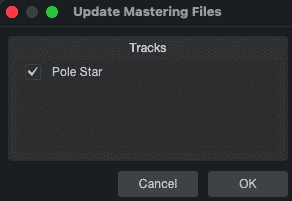

图 15.6：更新母带文件对话框

4. 当我在此框中点击 `OK` 时，Studio One 将打开**《Pole Star》**的 `Song` 页面，导出修订后的歌曲版本，并更新母带文件以反映我的修改。现在，我可以继续在 `Project` 窗口中工作，放心地知道我正在处理最新版本。

这种程度的集成简化了工作流程，免去了你跟踪歌曲不同版本的麻烦，让你能专注于真正重要的事情——以最佳方式呈现你的音乐。

现在我们了解了 `Project` 页面的基础知识，让我们深入其中，开始将我们的歌曲母带处理至完美。

# 掌握 Project 页面

一旦你将歌曲添加到 Project 中，它们将列在 `Track` 栏中，并作为事件显示在 `Track` 轨道上，正如我们在*图 15.4*中所见。现在，让我们从头到尾演练一下母带处理这些歌曲的过程。

## 输入元数据

`Metadata`（元数据）是关于音乐曲目的基本信息，包括（除其他外）其标题、艺人、专辑、流派和发行年份。此信息嵌入在最终音频文件中，帮助音乐分发平台正确分类和分发音乐。它还有助于版税收取，并确保艺人因其作品获得应有的署名。如果你打算发行你的歌曲，你肯定希望其中嵌入元数据，所以让我们在深入探讨更深层的话题之前先处理这个。

要为曲目输入元数据，请在 `Track` 栏中找到该曲目，然后点击其标题旁边的 `Show/hide more`（显示/隐藏更多）按钮（一个微小的白色三角形，在*图 15.7*中高亮显示）。这将打开该曲目的元数据窗口：

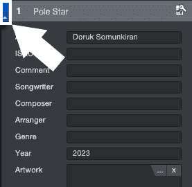

图 15.7：元数据窗口

填写此窗口中的字段，以便分发平台更好地了解你的歌曲。

如果你已经有了歌曲的**国际标准录音代码**（**ISRC**），请在此输入。ISRC 是由音乐出版商发布的唯一标识符。分发网络将使用它来追踪你的歌曲被流媒体播放或下载的次数。

你还可以为歌曲添加封面图，它将显示在音乐流媒体平台上的歌曲页面中（最大图像尺寸为 1,400 x 1,400 像素）。

完成所有适用字段后，再次点击 `Show/hide more` 按钮即可最小化此窗口。下次保存 Project 时，元数据将被保存。

## 排序曲目

当你向 Project 添加曲目时，它们会按照你添加的顺序出现在 `Track` 轨道和 `Track` 栏中。如果你打算单独导出它们以供流媒体平台使用，曲目的顺序并不重要，但如果你想将曲目作为专辑发行在 CD 上，顺序就很重要了。（还记得 CD 吗？是的，我们还在用！）

要更改曲目的顺序，只需在 `Track` 栏中将它们上下拖动以置于正确的顺序。你在此处所做的更改也将反映在 `Track` 轨道上。

当你在 CD 上收听专辑时，你会注意到从一首歌切换到另一首歌时通常会有一个短暂的停顿。如果你要在 CD 上发行专辑，并且也希望在曲目之间有那种类型的停顿，请按以下步骤操作：

1. 在 `Track` 栏中，点击 `Normal`（正常）按钮（**图 15.8** 中的 **a**）以展开曲目：

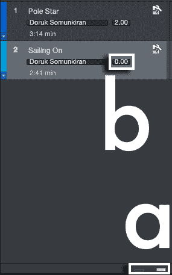

图 15.8：在曲目之间插入停顿

2. 使用停顿字段（**图 15.8** 中的 **b**）输入一个值（以秒为单位），作为你希望一首曲目与其前一首曲目之间停顿的长度。你可以将此值设置为 0 到 10 秒之间的任何值。两秒是常用值。如果你正在制作一张专辑，其中一首歌无缝过渡到下一首，请将此值设置为零秒。这样，播放将继续进行而没有任何停顿，但听众仍然可以使用媒体播放器上的控件跳转到曲目的开头。

现在，我们准备好深入母带处理的核心领域了。

## 在 Project 页面上编辑曲目

`Project` 页面允许你在最终交付打包之前编辑曲目。虽然可用的编辑工具集不如 `Song` 页面丰富，但操作模式相似，所以如果你略过了我们在第 7 章中对编辑工具的讨论，现在是仔细阅读该章以复习编辑技巧的好时机。

`Arrow`（箭头）工具是 `Project` 页面上唯一可用的编辑工具。按键盘上的 `1` 或点击 `Track` 轨道左侧的图标即可拾取它：

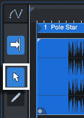

图 15.9：Project 页面上的工具

以下是你可以在 `Project` 页面上使用 `Arrow` 工具执行的编辑操作：

* 拖动曲目以在时间轴上移动它们。这对于安排曲目的顺序和定位很有用。
* 调整曲目大小以修剪其开头或结尾的静默间隙。为此，将鼠标悬停在曲目的左侧或右侧边缘；鼠标光标将变为双向箭头：

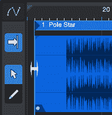

图 15.10：调整曲目大小

点击并拖动此双向箭头以调整曲目大小并修剪开头的静默间隙。
* 在曲目的开头和结尾执行淡入/淡出。这是发生在曲目结尾的一个淡出效果：

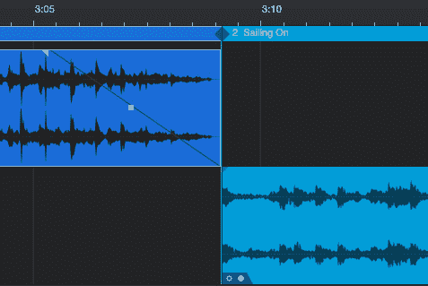

图 15.11：添加淡出

要在两首曲目之间执行自动 `crossfade`（交叉淡化），使一首淡出的同时另一首淡入，请执行以下操作：

1. 在时间轴上排列曲目，使第一首歌的结尾与第二首歌的开头重叠。（原文此处为 "the beginning of the first song"，根据上下文应为第二首歌，译文已修正）
2. 选择两首曲目。
3. 按键盘上的 `X`。这将添加交叉淡化：

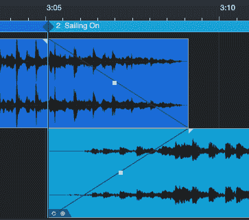

图 15.12：添加交叉淡化

虽然 `Split`（分割）工具在 `Project` 页面上不可用，但你仍然可以将一首曲目分割成两首独立的曲目。这对于对歌曲的不同部分应用不同的效果插件很有用。要分割曲目，只需将播放光标放置在你想要分割的位置，然后在键盘上按 `Alt` + `X` (Windows) 或 `Option` + `X` (Mac)。

现在我们已经编辑好音轨并按意愿排列好顺序，接下来准备对其进行润色，以确保它们在任何播放环境下听起来都很棒。我们将通过使用效果器插件来实现这一点。

## 添加效果器插件

在母带处理中使用效果器的目的是创作出一个听感极佳、准确还原原始混音的最终成品，同时提升其整体音质，使其对听众而言尽可能引人入胜且赏心悦目。效果器可用于修正混音中存在的问题，赋予其温暖感和特色，并确保其符合流媒体平台所需的规范。

以下是母带处理中效果器最常见的用途列表：

*   **均衡器**：用于调整歌曲的音调平衡。如果混音中的某些频率范围过于突出而另一些过弱，这将破坏歌曲的音调平衡，导致整个制作听起来不专业。动态均衡器（如 `Pro EQ3`）是母带处理中修复此类问题的绝佳工具，因为它们仅在达到特定阈值时才会介入，在歌曲的其余部分保持旁路状态。

*   **压缩器**：用于均衡歌曲的动态范围，使其更加一致。在母带处理中，通常首选模拟复古模拟压缩器的插件，因为它们较慢的响应时间使其动作更温和；过量的压缩会因夺走过多动态范围而吸干歌曲的生命力。`Fat Channel` 中的 `Tube`、`Everest C100A` 和 `Brit Comp` 等模拟压缩器仿真也会为歌曲添加一些高次谐波和其他伪影，这可能会使乐器融合得更好。用于实现这种融合效果的压缩器有时被称为 `胶水压缩器`。

*   **立体声成像**：立体声成像是指声音在立体声场中位置和宽度的感知。良好受控的立体声成像能创造出深度感、宽度感和分离感。使用成像插件来增强立体声图像，创造更具沉浸感的聆听体验。在 `项目` 页面上，这可以通过使用 `Binaural Pan`（双耳声像）插件来实现。

*   **限制器**：用于在不超过特定电平的前提下优化声音音量。`Limiter2` 非常适合此任务。

有关这些效果器的更多信息，请参阅 *第 12 章*。

在母带处理中使用效果器时，有一点重要的事项需要注意：你必须保持微妙。混音时，你可以在吉他轨道上插入一个均衡器，并将某个频率提升 10 dB（如果这服务于你的目的）。然而，如果你在母带处理中尝试提升这么多，最终会提升歌曲中所有乐器的该频率范围，听起来会很糟糕。因此，在混音时要大刀阔斧（使用宽泛的笔触），但在母带处理中只需施以微小的润色修饰。同样的逻辑也适用于所有其他插件。

现在，让我们看看在 Studio One 中为歌曲进行母带处理时如何添加效果器。`项目` 页面上的 `效果器` 机架分为两部分：

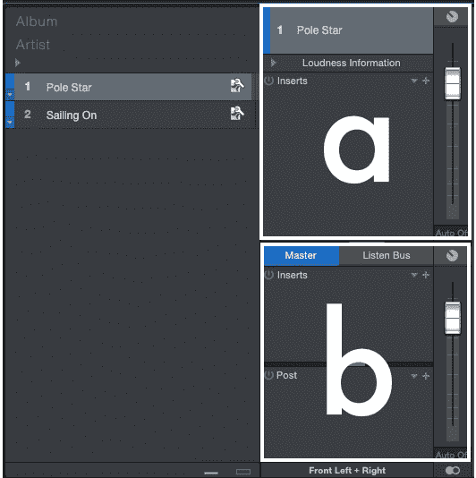

Figure 15.13: 项目页面上的效果器机架

第一个机架（*Figure 15.13* 中的 **a**）称为 `轨道设备` 机架，允许你为左侧 `轨道` 栏中当前选中的歌曲添加效果器。你可以使用 `轨道设备` 机架按歌曲添加效果器；这在你为专辑母带处理多首歌曲时特别有用，因为你还有保持歌曲之间一致性的额外目标。

例如，如果某首歌曲听起来比其他歌曲更明亮，且你觉得这会偏离你试图在专辑中实现的整体 *声音* ，请在 `轨道` 栏中选择该歌曲，在 `轨道设备` 机架中插入一个均衡器，并驯服那些有问题的频率。该均衡器将仅应用于该歌曲，使其与其他歌曲更加一致。

第二个机架（*Figure 15.13* 中的 **b**）称为 `主设备` 机架。你在此处插入的效果器将全局应用于项目中的所有轨道。请将此机架用于旨在为所有歌曲添加整体声音特色的效果器（如添加模拟色彩和饱和度的插件），以及用于优化和控制整张专辑整体响度的效果器（如 `Limiter2`）。

`轨道设备` 机架和 `主设备` 机架都是插入式机架，就像我们在 `歌曲` 页面的混音台上看到的一样。向这些机架添加插件的方式相同——只需从 `浏览` 窗口拖动一个插件并将其放置到你想要使用的机架上。

再次值得一提的是，这些插件的顺序很重要。将信号视为从每个机架的顶部流向底部。插件之前的内容将显著改变其响应方式，因此在创建信号链时请记住这一点。你可以点击并拖动机架内的插件来更改其顺序。

## 使用计量工具

`计量工具` 是用于测量和显示音频信号各个方面的音频分析工具。母带处理中包含这些工具，是因为它们帮助我们做出准确且明智的决策，最终产出更高质量的成品。

在典型的家庭工作室中，声学条件往往不理想，仅凭耳朵进行混音和母带处理可能会产生误导。在这种情况下，拥有准确的计量工具是一大优势，因为这些工具提供视觉反馈，并提供关于音频信号的精确详细信息。

计量工具占据了 `项目` 页面上大部分空间（标记为 *Figure 15.4* 中的 **c**），这并不奇怪。此页面上有三个计量工具，并提供多种自定义选项以适应不同的使用场景。让我们逐一探讨。

### 频谱仪

`频谱仪` 显示歌曲的频率内容。它帮助你识别任何需要解决的频率不平衡或问题，例如共振频率或过量的低频。如果你正在为专辑母带处理多首曲目，也可以使用频谱仪比较它们之间的频率分布。例如，如果你的家庭工作室只有微型音箱，听不清太多低频，频谱仪会让你知道某首歌曲的低频含量是否比其他歌曲多得多。

频谱仪界面底部有多个选项，允许你微调其显示格式以满足需求：

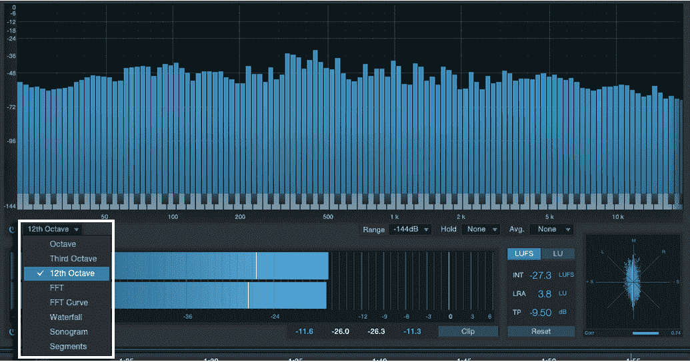

Figure 15.14: 频谱仪

让我们看看其中一些选项：

*   左下角的 `显示模式` 选择器（在 *Figure 15.14* 中高亮显示）提供多种不同的显示模式。讨论这些模式远超出了本书的范围；不过，我们可以列出一个你最可能用到的选项简表：

    *   如果你有音乐家背景，且音乐音符比以赫兹表示的频率更容易让你理解，则使用 `12th Octave`（十二分之一八度）选项。选择此选项时，钢琴键盘将叠加在频谱显示下方，让你能看到所有频段对应的音乐音符。

    *   如果你想获得歌曲频率分布更详细、响应更灵敏的反馈，请使用 `FFT`（`快速傅里叶变换`）选项。这是一种非常精确的频率分析模式，能帮助你一眼锁定问题频率。

*   使用 `保持` 选项可保持每个频段的峰值，这样当你眨眼的瞬间也不会错过瞬态峰值。

使用 `Avg.`（`average`，平均值）设置可添加一条连续线，显示每个频段的信号平均电平。这条连续线显示的是频段的感知响度，而频谱显示中快速移动的条形图则显示瞬时值。

如果你刚开始使用频谱仪，只需向 `Project page`（项目页面）添加几首参考曲目，播放它们，并观察 `Spectrum Meter`（频谱仪）的显示情况。（参考曲目是指经过专业混音和制作的音乐作品。）选择你熟悉的曲目。这样，你很快就能学会如何读懂 `Spectrum Meter`。

### 电平/响度表

`level/loudness meter`（电平/响度表）显示歌曲的振幅和感知响度，帮助你确保歌曲处于适当的电平，且没有失真或削波。它还有几种显示选项，位于左下角：

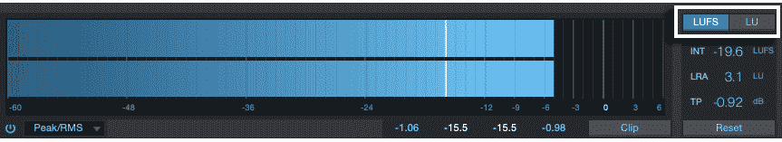

Figure 15.15: The level/loudness meter

对于绝大多数音乐制作，你可以保持默认值 `Peak/RMS`（峰值/均方根）不变。

在电平/响度表的右侧，你会看到 `loudness display`（响度显示），它提供关键信息，将影响你的歌曲如何呈现给听众。让我们弄清此显示中所示的两个关键读数：

*   `INT` 是 `Integrated LUFS` 的缩写，后者是 `Loudness Units Full Scale`（满量程响度单位）的缩写。这是在一段时间内音频信号平均响度的度量。简单来说，它是歌曲感知整体响度的度量。
*   `TP` 代表 `True Peak`（真峰值）。这仅仅是音频信号在整首歌曲中达到的最高电平，以分贝为单位。

我们将在 `Creating final masters for digital release`（创建用于数字发行的最终母带）一节中讨论如何处理这些读数。

### 相位表

`phase meter`（相位表）显示混音中左右声道之间的相位关系。这对于检测相位相关问题（如相位抵消）非常重要。

让我们用一个例子来说明。在 `Figure 15.16`（图 15.16）中，左声道的信号与右声道的信号完全相同。波形的峰值和谷值完美对齐；用专业术语来说，这两个声道是 `in phase`（同相位）。

Figure 15.16: The two channels are in phase

现在，如果我们将其中一个声道稍微推移一点点，这就会改变两个声道之间的相位关系。在 `Figure 15.17`（图 15.17）中，右声道被推移了一小段距离。现在，一个声道的谷值与另一个声道的峰值对齐，反之亦然；这两个声道现在是 `out of phase`（反相位）：

Figure 15.17: The two channels are out of phase

这是一个大问题，因为这两个声道现在在完全相同的频率下朝相反方向运动。它们的振动会相互抵消。这称为 `phase cancellation`（相位抵消）。当它发生在你的混音中时，你的歌曲听起来会变单薄。在极端情况下，某些声音可能会完全消失。

相位表允许我们发现这些问题。最简单的使用方法是留意其界面底部的 `Corr`（相关性）指示器：

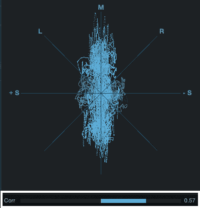

Figure 15.18: The phase meter

当左右声道同相位且完全相同时，如 `Figure 15.16`（图 15.16）所示，`Corr` 指示器将显示 `+1`。在立体声混音中，左右声道并不相同，因此 `Corr` 指示器会在 `+1` 和 `0` 之间波动。这完全正常。

当左右声道反相位时，`Corr` 指示器将开始显示负值：

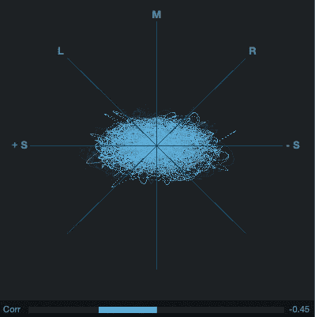

Figure 15.19: The phase meter indicating phase problems

这是一个危险信号，警告你混音中正在发生相位抵消。相位抵消可能由多种原因引起。最常见的原因如下：

*   录音时麦克风摆放位置错误。假设你用两个麦克风录制木吉他。如果吉他的声音到达一个麦克风的时间比到达另一个麦克风稍晚，你最终会得到如 `Figure 15.17`（图 15.17）所示的情况。
*   过度使用立体声拓宽效果；这些效果往往会引入相位问题作为伪影。

每个项目都是独特的，因此你需要自行追踪问题的根源。如果是立体声拓宽效果导致的，通常可以通过降低其设置来解决问题。如果是麦克风摆放位置导致的，返回混音界面，尝试在有问题的声道之一上插入 `Mixtool` 插件。使用 `Mixtool` 上的 `Phase Invert`（相位反转）按钮；这应该能解决问题。

## 在项目页面上使用自动化

`Project`（项目）页面上的几乎所有参数都可以自动化。我们在 `Chapter 11`（第 11 章）中讨论过自动化，应用自动化的过程类似，因此你可能想回顾该章节，以复习 Studio One 中自动化的工作原理。

要开始在 `Project`（项目）页面上使用自动化，请单击 `Figure 15.20`（图 15.20）中高亮显示的 `Automation`（自动化）按钮。

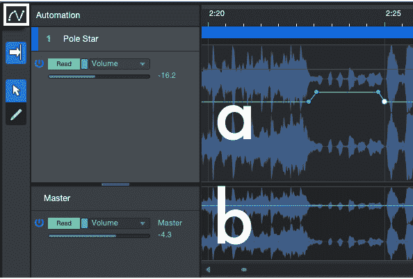

Figure 15.20: Using automation on the Project page

`Project`（项目）页面有两个独立的自动化通道：

*   顶部的自动化通道称为 `Track Automation`（轨道自动化）通道（`Figure 15.20` 中的 `a`）。此通道允许你为 `Track Device`（轨道设备）机架中的插件设置自动化。
*   底部的自动化通道称为 `Master Automation`（母带自动化）通道（`Figure 15.20` 中的 `b`）。此通道允许你为 `Master Device`（母带设备）机架中的插件设置自动化。

同时运行这两个独立的自动化层使你拥有更大的控制权，并允许你在母带处理过程中发挥创意。

在本节中，你学习了如何使用 `Project`（项目）页面通过将曲目编辑至完美并应用最终母带效果来为曲目添加最后的润色。你的歌曲现在已准备好被世界发现，在下一节中，你将学习如何导出歌曲的最终母带，以便将其交付给听众。

# 渲染用于发布和交付的最终母带

让许多人感到畏惧的母带处理过程的一部分原因，是交付格式繁多以及与之相关的标准。数字发行网络、流媒体服务和 CD 生产工厂都有独特的标准，它们要求你在交付最终母带时遵守这些标准。如果你未能遵守这些标准，在最好的情况下，你会被要求使用正确的设置重新提交母带。在最坏的情况下，你的歌曲将原样发布，导致音质不佳。

幸运的是，`Project`（项目）页面使创建符合所有适用标准的最终母带变得容易，即使你没有任何母带处理经验或技术知识。使用 `Project`（项目）页面，你可以为以下格式创建歌曲的最终母带：

*   **数字发行**：这是发布音乐最流行的渠道。此方法允许听众流式传输和下载你的歌曲。
*   **CD**：尽管受欢迎程度有所下降，CD 仍在音乐市场占有一席之地，特别是当多首歌曲以专辑形式一起呈现时。

现在，让我们看看如何为这些格式中的每一种渲染最终母带。

## 创建用于数字发行的最终母带

## 导出以进行数字发行

您可以直接从 `Project` 页面导出歌曲的最终母带，随后将其上传至 `DistroKid`、`TuneCore` 或 `CD Baby` 等平台进行分发。具体操作步骤如下：

1. 在 `Project` 页面顶部，点击 `Digital Release` 按钮。这将打开 `Digital Release` 窗口：

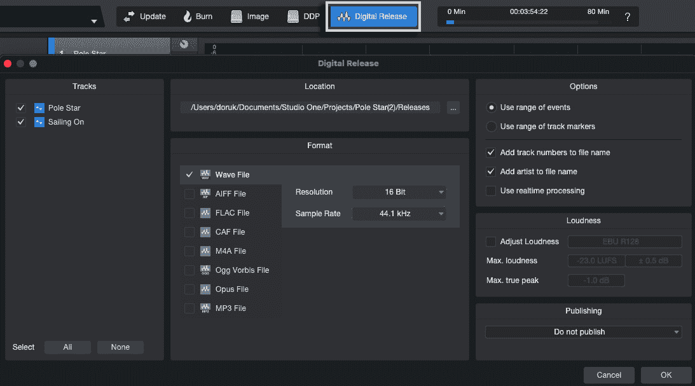

图 15.21：数字发行窗口

1. 在该窗口左侧，选择您想要导出为最终母带的歌曲。请注意，即使您在 `Project` 页面有多首歌曲并希望将它们合并为一张专辑，这些歌曲仍会被导出为单独的独立文件。随后您需将这些文件上传至分发平台，并使用该平台自带的工具将它们合并为专辑。

2. 在窗口的 `Location` 部分，选择文件导出的目标文件夹。

3. 在窗口的 `Format` 部分，选择您想要导出的文件格式。对于音乐分发平台，建议选择 `Wave File`，并将 `Resolution` 设置为 `16 Bit`，`Sample Rate` 设置为 `44.1 kHz`。有关这些设置的更多信息，请参阅第 13 章。

4. 在窗口的 `Loudness` 部分，勾选 `Adjust Loudness`。这将激活该复选框旁边的下拉菜单。使用该菜单选择您想要发布音乐的平台。Studio One 将分析歌曲的响度，并对其进行优化，以符合您在此处选择的平台所要求的响度标准。在图 15.22 中，我选择了 `Apple Music` 作为目标平台，该窗口部分的所有字段均已自动填充，以反映 Apple Music 的响度标准。

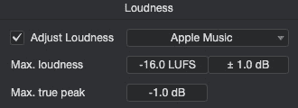

图 15.22：调整响度设置

即使您没有处理平台标准的经验或技术背景，这也是为数字平台优化歌曲的绝佳方式。

1. 点击 `OK`。

`Project` 页面上的每首歌曲都将作为单独的文件渲染到您刚才选择的文件夹中，等待上传以进行最终发行。

## 创建用于 CD 发行的最终母带

虽然数字分发更为普及，但 CD 在音乐行业中仍占据稳固的市场份额，因此您可能需要考虑以这种格式发行歌曲。该过程稍显复杂——您需要创建一个包含所有 CD 曲目单的 `Disc Description Protocol` (`DDP`) 文件，且该文件必须符合 20 世纪 80 年代制定的 `Red Book` 标准，该标准对音频 CD 的制作有着非常具体的规定。

感到困惑？这完全可以理解。您会很高兴地知道，在 `Project` 页面上，只需两次点击即可创建符合 Red Book 标准的 DDP 镜像。操作方法如下：

1. 在 `Project` 页面顶部，点击 `DDP`。这将打开一个简单的对话框，询问您是否真的要创建 DDP 镜像：

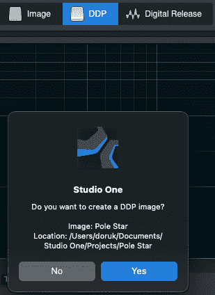

图 15.23：创建 DDP 镜像

1. 点击 `Yes`。Studio One 将创建一个 DDP 镜像，并将其放置在一个名称后附加了 `DDP` 的文件夹中。下面是图 15.23 中 Project 所创建的文件夹：

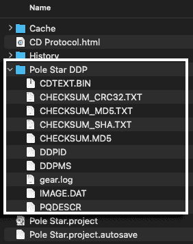

图 15.24：包含 DDP 镜像的文件夹

1. 现在，您只需将该文件夹及其所有内容发送给 CD 压片厂，其余工作将由他们完成。

在本节中，您学习了如何导出歌曲的最终母带，以便上传至数字平台或发送给 CD 压片厂。这标志着我们对音乐制作流程的探讨告一段落；您的歌曲现已准备好与听众见面。

# 总结

在本章中，我们探索了 `Project` 页面——Studio One 专为音频母带处理打造的独特环境。我们讨论了 `Song` 页面与 `Project` 页面之间的集成，并探讨了如何利用这种集成来最大化您的制作工作流。随后，我们了解了如何在 `Project` 页面上编辑和润色歌曲，以添加最后的修饰。最后，我们探讨了如何导出母带以最终交付给听众。

这是我们对音乐制作流程覆盖的最后一步，从最初的录音一直到最终的交付。在下一章中，我们将介绍 Studio One 中不属于标准音乐制作流程步骤，但能提供额外价值和功能的特性，它们可能成为您工作流中不可或缺的补充。
