## 第 16 章：使用 Studio One 的附加功能

到目前为止，本书对 Studio One 可用功能的介绍一直遵循典型的音乐制作工作流步骤。我们从创建新项目开始，一路讲解到导出最终母带。然而，Studio One 中还有一些功能不属于这一经典工作流，但值得专门介绍。这就是本章的内容。

在本章中，我们将探索三项通过扩展 Studio One 已有强大功能列表而增加额外价值的功能。通过学习如何使用这些功能，您将能够将 Studio One 的声音处理能力带入现场表演，使用乐谱记谱表达创意，并利用强大的声音设计技术创作属于您自己的独特声音。

我们将涵盖以下主题：

* 使用 `Show` 页面进行现场表演
* 使用乐谱编辑器
* 使用 SampleOne XT 创建和处理采样

## 技术要求

为了跟随本章的操作，您需要在计算机上激活 Studio One。

## 使用 Show 页面进行现场表演

`Show 页面` 是一个专用的现场表演环境，允许您直接从计算机利用 Studio One 的强大功能运行现场演出。如果您有一个乐队或独奏表演，可以使用 `Show` 页面提前准备和组织整场音乐会所需的所有音频素材。演出时，Studio One 将在后台处理所有技术细节，而您可以专注于表演。这就像在您的电脑里内置了一位现场音响工程师。

在开始设置您的下一场演出之前，让我们先澄清几个将在 `Show` 页面上使用的重要术语：

* `Show` 是指包含并组织整场音乐会、活动或表演所有音频资源的文档。就像我们创建新 Song 以在 `Song` 页面工作一样，我们创建新 Show 以在 `Show` 页面工作。
* `Setlist` 是您在 Show 中将要演奏的所有歌曲的列表。
* `backing track` 是您将用于支持现场表演的预录制音乐伴奏。

现在，我们准备好为您的下一场音乐会做准备了。

### 创建您的第一个 Show

要开始使用 `Show` 页面，我们必须首先创建一个新的 Show。操作步骤如下：

1. 前往 Studio One 的 `Start` 页面，点击 `New…` 按钮。这将打开 `New` 窗口：

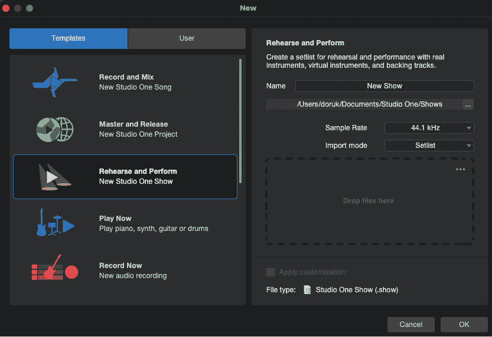

图 16.1：创建新 Show

1. 在该窗口左侧，选择 `Rehearse and Perform`。

2. 在窗口右侧，为您即将创建的 Show 输入一个名称。

## 3. 导入伴奏轨道

如果您已准备好想要演奏的歌曲的伴奏轨道，请从资源管理器（Windows）或访达（macOS）中将它们拖拽至音频放置区（标题为 `Drop files here`）。如果伴奏轨道尚未准备好，也不必担心；您稍后随时可以添加。

## 4. 确认创建

点击 `OK`。

这将在 Studio One 中创建您的第一个 `Show` 并带您进入 `Show` 页面，这正是我们接下来要探索的内容。

# 探索 Show 页面

`Show` 页面外观类似于 `Song` 页面的简化版，因此不会太陌生。

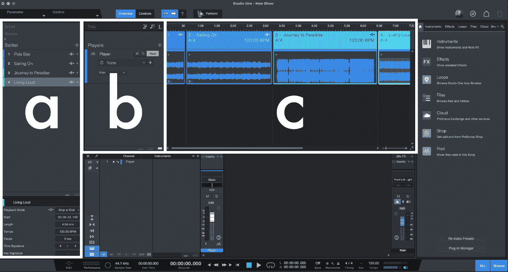

Figure 16.2: The Show page

`Show` 页面有三个独有的区域。让我们逐一了解：

*   **Setlist**（图 16.2 中的 **a**）：该区域包含您在现场 `Show` 中将要演奏的所有歌曲列表。如果您使用图 16.1 中的音频放置区导入了伴奏轨道，它们将显示在此窗口中。现场演出时，歌曲将按此处显示的顺序依次播放。您可以通过在列表中上下拖拽歌曲来轻松重新排序。

*   **Players** 栏（图 16.2 中的 **b**）：该栏包含您的 `Show` 中将处于激活状态的所有 `Player` 列表。我们将在 *使用 Player* 部分稍作介绍。

*   **Overview** 窗口（图 16.2 中的 **c**）：`Setlist` 中的歌曲在 `Overview` 窗口中以事件的形式水平排列。我们将使用此窗口来设置和组织您的 `Show`。

现在，我们准备深入 `Show` 页面，学习如何将其设置为运行您的下一场现场演出。

# 使用 Player

一场音乐会中演奏的歌曲可能包含多个音乐元素：

*   歌手
*   演奏实体乐器（如吉他和鼓）的乐手
*   演奏虚拟乐器（如 Studio One 的 `Presence`）的乐手
*   补充表演的伴奏轨道

在 `Show` 页面中，每个元素由一个称为 `Player` 的相应设备表示。正如我们在 `Song` 页面上为每个乐器设置不同的轨道一样，在 `Show` 页面上我们为每个乐器设置不同的 `Player`。共有三种类型的 `Player`：

*   `Backing Track Player`（伴奏轨道播放器）
*   `Real Instrument Player`（实体乐器播放器）
*   `Virtual Instrument Player`（虚拟乐器播放器）

现在，让我们探索每种播放器类型，并了解如何添加播放器以丰富您的 `Show`。

## 添加伴奏轨道播放器

`Backing Track Player` 仅播放音频文件，就像 `Song` 页面上的音频轨道一样。现场演出时，`Backing Track Player` 将播放您想用于伴奏的任何预录音频文件。

在图 16.1 创建新 `Show` 时，我将四个音频文件拖放到了音频放置区。Studio One 创建了一个 `Backing Track Player` 并将这些文件首尾相连地放置在该播放器上，如下所示：

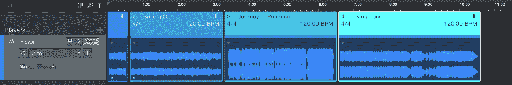

Figure 16.3: Backing Track Player

如果我想在音乐会上演奏更多歌曲，需要执行以下操作：

1.  在资源管理器（Windows）或访达（macOS）中找到新歌曲的伴奏轨道。
2.  将新的伴奏轨道拖拽并放置在 `Backing Track Player` 右侧的空白处：

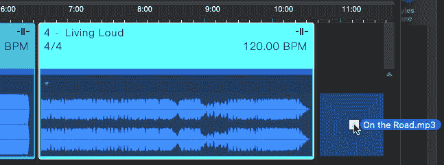

Figure 16.4: Adding new files to a Backing Track Player

3.  添加新轨道后，我可以通过在 `Overview` 窗口或 `Setlist` 中拖拽它们来轻松重新排序。

您可能还希望在演出中的某首歌曲里让多个音频文件同时播放。例如，您可能想以分轨形式导入歌曲的各个元素——一轨鼓、一轨吉他等——并在现场演出时分别控制这些分轨。为此，只需将音频文件从资源管理器（Windows）或访达（macOS）拖拽并放置在 `Backing Track Player` 下方的空白处。Studio One 将为每个音频文件创建一个新播放器，并将它们置于同一歌曲下方：

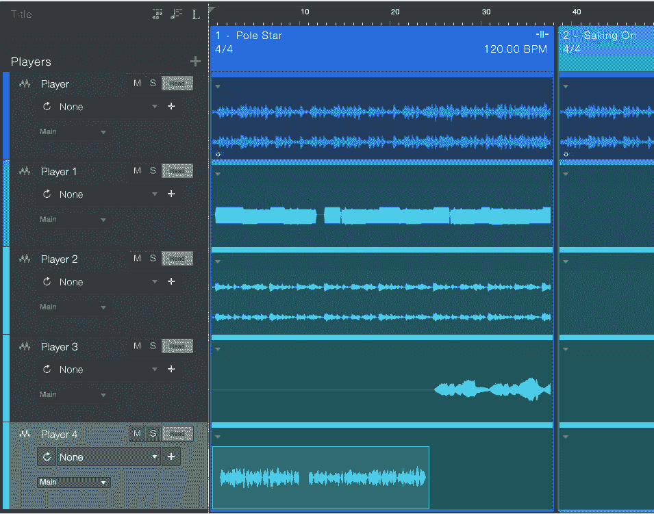

Figure 16.5: Adding new files to a song

这种灵活的设置允许您在更精细的层面上控制伴奏轨道，例如为歌曲的不同元素应用不同的效果插件。

## 添加实体乐器播放器

如果您或乐队成员将在音乐会上演奏实体乐器或进行人声表演，您可以使用 `Real Instrument Player` 将它们添加到您的 `Show` 中。这允许您使用 Studio One 的效果插件实时处理这些乐器或人声的声音。

要添加 `Real Instrument Player`，请按以下步骤操作：

1.  点击 `Players` 栏中的 `Add Player` 按钮。这将打开 `Add Player` 窗口：

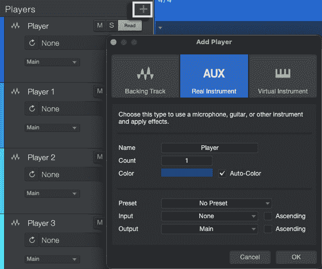

Figure 16.6: The Add Player window

2.  点击 `AUX` 选项卡。
3.  为即将创建的播放器起一个简短、描述性的名称，以便在 `Players` 栏中轻松识别。
4.  在 `Input` 字段中，选择该播放器将连接到的音频设备上的物理输入。例如，如果您为电吉他创建 `Real Instrument Player`，且该吉他连接到音频设备的输入 2，请在此处选择 `Input 2`。
5.  点击 `OK`。

您需要为乐队中的每位表演者创建一个 `Real Instrument Player`，以便通过为每个播放器应用不同的效果来分别处理它们。

## 添加虚拟乐器播放器

`Virtual Instrument Player` 允许您将虚拟乐器（如 `Presence`）添加到 `Show` 中并在现场演出时演奏。如果您希望虚拟乐器的声音在歌曲之间发生变化，您可以预先编排这些变化，让 Studio One 在音乐会期间自动实现切换，而您只需专注于演奏。

要向 `Show` 添加 `Virtual Instrument Player`，请执行以下操作：

1.  打开 `Browse` 窗口并选择 `Instruments` 选项卡。
2.  找到您想添加到 `Show` 的虚拟乐器。
3.  点击虚拟乐器名称左侧的小三角形。这将打开该乐器可用预设的列表：

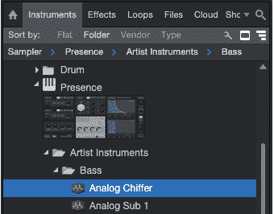

Figure 16.7: List of presets for Presence

4.  将您想使用的预设拖拽并放置到 `Overview` 窗口中。这将创建一个新的 `Virtual Instrument Player` 并加载您选择的预设：

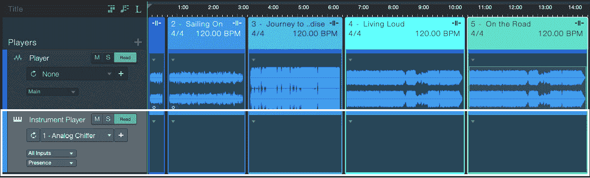

Figure 16.8: A Virtual Instrument Player

5.  您现在可以使用 MIDI 键盘演奏该虚拟乐器。

图 16.8 中的 `Show` 有五首歌曲，如 `Overview` 窗口顶部所示。目前，我们创建的 `Virtual Instrument Player` 将在所有五首歌曲中播放相同的预设。但大多数情况下，您会希望每首歌曲使用不同的声音——第一首用原声钢琴，第二首用电钢琴，第三首用管风琴，以此类推。为此，只需将您想为每首歌曲使用的预设拖拽并放置到 `Virtual Instrument Player` 上对应的槽位中。在图 16.9 中，我为每首歌曲加载了不同的预设。您可以看到它们的名称显示在各自的槽位上：

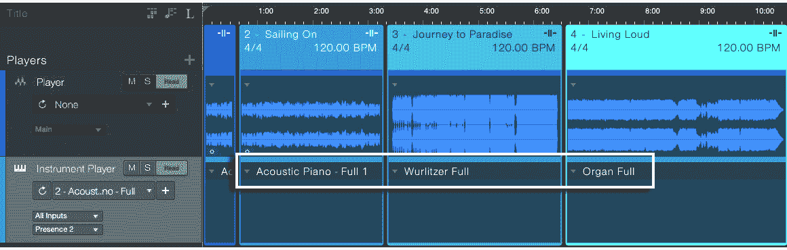

Figure 16.9: Adding a different preset for each song

现在，在现场演出时，当您从一首歌切换到下一首时，Studio One 将自动从一种声音切换到另一种。登台演出时，您少了一件烦心事！

## 为现场表演添加效果器

既然我们已经添加了伴奏轨道和乐器，接下来我们想要使用效果器插件来润色它们。这将使我们能够在现场表演中使用 Studio One 的声音处理功能。

忠于 Studio One 的拖放式界面设计，添加效果器插件简单至极。让我们来看看：

1. 打开 **“浏览”** 窗口并转到 **“效果器”** 选项卡：

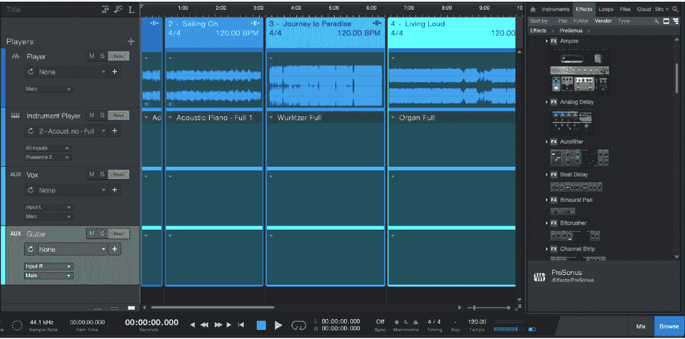

图 16.10：向 Show 添加效果器插件

1. 将想要使用的效果器拖动并放置到 **“概览”** 窗口中的一个插槽上。

此方法允许您在颗粒度层面上添加效果器组合。例如，*图 16.11* 展示了我为电吉他创建的一个真实乐器演奏者。我将 **Ampire** 插件添加到了对应第一首歌的插槽中，因为我想要该歌曲的失真吉他音色。对于下一首歌，我添加了 **Analog Delay**，对于第三首，我添加了 **Room Reverb**。在现场表演过程中，当时间线从一首歌移动到下一首歌时，Studio One 会自动从一个效果器插件切换到另一个，我的吉他音色将随时准备就绪，等待我演奏。

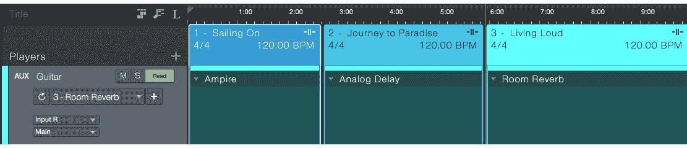

图 16.11：向演奏者添加不同的效果器

您可以在每个插槽中添加任意数量的效果器插件，从而为每首歌构建复杂的效果器链。

## 使用编曲轨道定义歌曲片段

到目前为止，我们已经为音乐会创建了路线图，并明确告诉 Studio One 在每首歌期间该做什么。演出时，我们将 Studio One 设为自动驾驶模式，它将为我们处理所有技术细节。这种严格的规划在您登台时可能会带来安全感，但也会剥夺我们将现场表演与即兴发挥联系在一起的乐趣与刺激。如果您发现观众非常享受您的吉他独奏，只想比原计划多演奏一会儿，该怎么办？难道您必须结束独奏并继续下一部分，仅仅因为 **“Show”** 页面上的时间线不知道观众的反应，只是一味地向前推进吗？

幸运的是，答案是否定的。您可以将歌单中的歌曲分割成片段，然后自由地在片段之间跳转、重复某个片段，或者完全跳过它。我们通过使用 **编曲轨道** 来实现这一点，我们已经在 **“Song”** 页面上见过它了。

以下是如何使用编曲轨道将歌曲分割成更小的片段：

1. 点击 **“演奏者”** 栏顶部的 **“打开编曲轨道”** 按钮。这将显示编曲轨道：

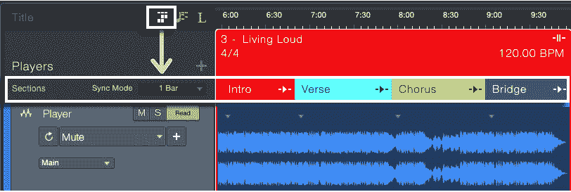

图 16.12：Show 页面上的编曲轨道

1. 双击编曲轨道以创建一个新片段。Studio One 会自动为每个片段命名。

2. 右键单击某个片段以更改其名称和颜色。

3. 拖动片段的左右边缘，使其精确对齐到轨道上对应片段的开始和结束位置。

您可以看到，我在 *图 16.12* 中为我的歌曲添加了四个片段。现在，Studio One 知道每个片段的开始和结束位置。这在我们登台表演时将派上用场，这将是我们接下来的主题。

## 使用 Show 页面进行现场表演

现在，我们准备好表演了！信不信由你，此时您只需按下键盘上的空格键即可开始 Show，Studio One 将处理运行 Show 的所有细节，让您和您的乐队成员能够专注于表演。

虽然您可以在表演期间使用 **“Show”** 页面，但 Studio One 提供了一个单独的环境，称为 **“表演视图”**，该视图针对舞台使用进行了优化。表演视图是一个简单的界面，仅包含您在表演期间所需的基本控件。所有内容都很大且易于查看，因此您只需一眼就能找到所需内容，即使您在灯光昏暗的舞台上使用一台小型笔记本电脑。

要切换到表演视图，请点击 **“Show”** 页面顶部的 **“表演”** 按钮：

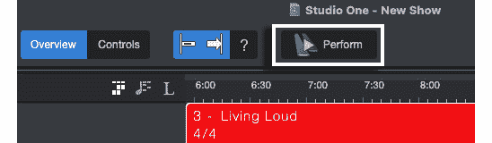

图 16.13：“表演”按钮

这将打开表演视图：

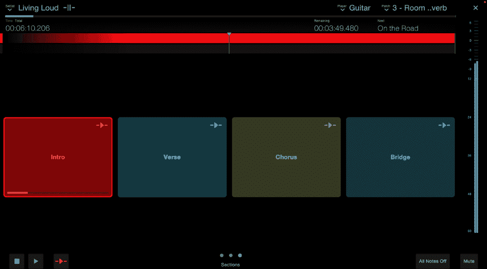

图 16.14：表演视图

表演视图简单至极。让我们快速浏览一下：

* 窗口顶部显示您在时间线上的位置。

* 窗口中心显示我们之前在编曲轨道上创建的片段。如果观众喜欢某个片段且您想重复它，只需点击该片段。如果您想跳转到另一个片段，只需点击那个片段。

* 右下角有两个按钮，用于紧急情况：

    * 有时虚拟乐器在演奏音符时会卡住，即使您松开 MIDI 键盘上的琴键，它们仍会继续播放。在这种情况下，点击 **“所有音符关闭”** 按钮将向所有虚拟乐器发送 `NOTE OFF` 命令，强制它们停止当前正在播放的任何内容。点击此按钮不会影响伴奏轨道的播放，因此不会出现尴尬的沉默，您可以立即恢复演奏虚拟乐器。通常，卡音问题只是一个简单的故障，不会重复发生。

    * 说到尴尬的沉默，**“静音”** 按钮保留用于事态失控、唯一解决方案是关闭所有音频的极端情况。这对于保护人们的耳朵免受舞台上有时会发生的那种讨厌的啸叫反馈声的伤害特别方便。

恭喜！您的第一个 Show 现已准备就绪。演出时间到来时，您只需点击 **“播放”**，Studio One 将处理其余一切。

现在，让我们来看看 **乐谱编辑器**，Studio One 的另一个强大功能。

# 使用乐谱编辑器

**乐谱编辑器** 允许您以乐谱符号的形式查看和编辑 MIDI 数据。这对于不习惯使用我们在 *第 9 章* 中讨论的标准钢琴卷帘式 MIDI 编辑器的人来说非常棒。当您需要打印项目的乐谱与其他音乐家分享时，乐谱编辑器也非常方便。

## 打开乐谱编辑器

要开始使用乐谱编辑器，请执行以下步骤：

1. 创建一个乐器轨道，正如我们在 *第 6 章* 中讨论的那样。

2. 双击乐器轨道以创建一个空的 MIDI 事件。

3. 双击 MIDI 事件以在 **“编辑”** 窗口中将其打开。

4. 在 **“编辑”** 窗口的左侧，点击 **“乐谱视图”** 按钮（标记为高音谱号图标）：

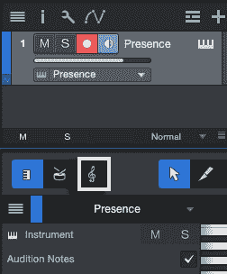

图 16.15：编辑窗口上的乐谱视图按钮

这将把 **“编辑”** 窗口切换为显示乐谱编辑器。

## 探索乐谱编辑器

默认情况下，乐谱编辑器显示一个使用高音谱号的空五线谱：

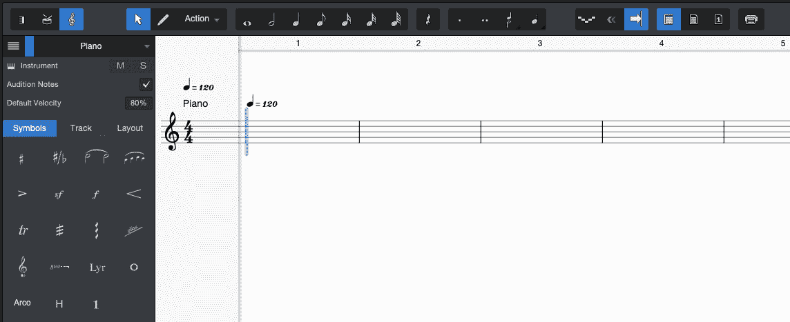

图 16.16：乐谱编辑器

乐谱编辑器顶部是 **乐谱编辑器** 工具栏，允许您在五线谱上输入和编辑音符。

窗口左侧是 **乐谱编辑器检查器**，允许您为音符添加表情标记并更改显示五线谱的格式。

## 在乐谱编辑器中输入音符

您可以使用以下任意方法在乐谱编辑器中输入音符：

* 使用 MIDI 键盘实时演奏音符

* 使用 **“步进输入”** 通过 MIDI 键盘逐个输入音符

* 使用 **“画笔”** 工具输入音符

我们在*第 6 章*中讨论了这些方法，前两种方法在乐谱编辑器中的工作方式完全相同。因此，在本节中，我们将只关注第三种方法。

## 使用画笔工具输入音符

请按照以下步骤，在乐谱编辑器中使用**画笔**工具输入音符：

1. 在乐谱编辑器中，按键盘上的 *2* 以拾取**画笔**工具。
2. 转到**乐谱编辑器**工具栏，选择要输入的音符时值。您可以选择全音符到 64 分音符之间的任何时值。
3. 现在，当您将鼠标悬停在五线谱上时，光标将变为铅笔形状，并跟随一个灰色的音符轮廓：

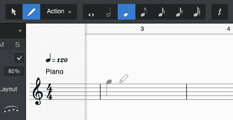

图 16.17：使用画笔工具输入音符

4. 将灰色音符移动到五线谱上的所需位置，然后左键单击以放置音符。
5. 要添加休止符，请单击**乐谱编辑器**工具栏上的**休止符**按钮。

请注意，如果您学会音符时值的键盘快捷键，工作速度会快得多。以下是您需要的键盘快捷键：

* *1* 选择**箭头**工具
* *2* 选择**画笔**工具
* *3* 选择全音符
* *4* 选择二分音符
* *5* 选择四分音符
* *6* 选择八分音符
* *7* 选择十六分音符
* *8* 选择三十二分音符
* *9* 选择六十四分音符

有了这些快捷键，您只需使用鼠标和电脑键盘，即可在极短时间内填满乐谱。

## 在乐谱编辑器中编辑音符

输入音符后，您可以使用**箭头**工具轻松编辑它们。操作方法如下：

1. 按键盘上的 *1* 以拾取**箭头**工具。
2. 要更改音符的音高，请左键单击该音符并向上或向下拖动，直到找到正确的音高。当您向上或向下拖动时，Studio One 会播放该音符，帮助您找到想要的音高。
3. 要更改音符的时长，请在**乐谱编辑器**工具栏中选择所需的音符时值，然后左键单击该音符。

请注意，乐谱编辑器和钢琴编辑器是动态链接的；在一个窗口中所做的任何更改都会反映在另一个窗口中。

## 添加表情标记和排版乐谱

乐谱编辑器检查器可帮助您微调乐谱的外观，以便更清晰地传达您的音乐构思。乐谱编辑器检查器上有三个选项卡，每个选项卡专门处理乐谱的不同部分。让我们逐一探索。

### 符号选项卡

**符号**选项卡可让您为音符添加变化记号和表情标记。要应用此选项卡上的任何表情标记，请选择该表情标记，然后单击要应用它的音符或音符组。

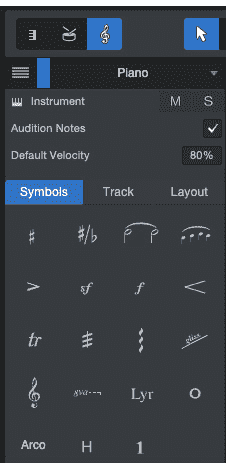

图 16.18：乐谱编辑器检查器的符号选项卡

当您将鼠标悬停在该选项卡上的大多数按钮上时，它们的右下角会显示一个小三角形。单击这些三角形将打开弹出窗口，显示更多选项。例如，这是**力度**按钮的弹出菜单：

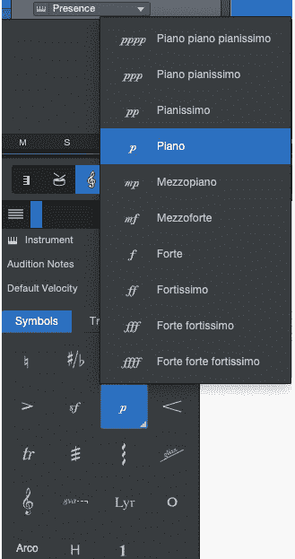

图 16.19：力度按钮的选项

这些选项允许您向乐谱添加各种表情标记，帮助您清晰地传达音乐构思。

### 轨道选项卡

**轨道**选项卡可帮助您为乐器选择合适的五线谱类型。打开**五线谱类型**下拉菜单，然后选择要使用的五线谱类型：

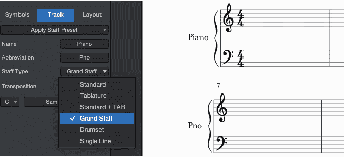

图 16.20：选择五线谱类型

使用此选项卡上的**名称**和**缩写**字段为您的乐器指定一个描述性名称。**名称**字段用于乐谱开头；您在**缩写**字段中输入的内容用于标记所有后续行。

### 布局选项卡

**布局**选项卡可让您调整乐谱打印时的外观。您可以钻研细节并调整每一个微小细节，但 Studio One 在将乐谱排版以适应页面方面做得相当不错，因此默认值在大多数情况下应该都没问题。

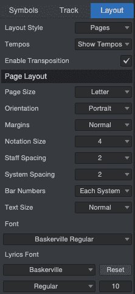

图 16.21：乐谱编辑器检查器的布局选项卡

在此，只需确保**布局样式**选择了**页面**；这将指示 Studio One 将您的乐谱整齐地分成所需的任意页数。

## 完成并打印乐谱

在我们打印乐谱与世界分享之前，让我们确保乐谱正确标注了版权信息。当您首次打开乐谱编辑器时，Studio One 会用歌曲文件名填充乐谱的**标题**字段，用您的姓名填充**艺术家**字段。如果您想更改这些信息或提供更多信息，只需单击歌曲标题。这将打开**歌曲设置**菜单：

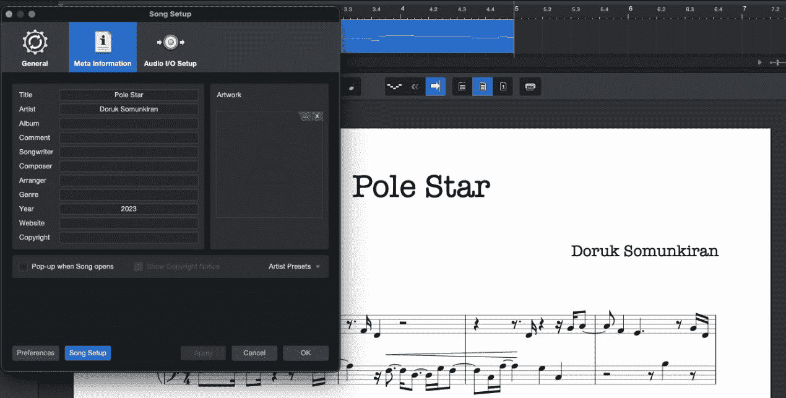

图 16.22：输入歌曲信息

在此，您可以根据需要更改歌曲信息。

当您对乐谱满意后，单击**乐谱编辑器**工具栏上的**打印**按钮。这将打开操作系统的标准打印对话框，您可以在其中选择打印机并进行打印。

这结束了我们对乐谱编辑器的介绍。现在，让我们继续了解 Studio One 工具箱中一个非常有趣的功能：SampleOne XT。

# 使用 SampleOne XT 创建和处理采样

**SampleOne XT** 是随 Studio One 附带的全功能采样器。**采样器**是一种可以录制和处理音频采样的设备或软件。**采样**是一段简短的声音录音，例如鼓击、吉他和弦或人声短语。

简单来说，SampleOne XT 是一款非常有趣的软件，它允许您利用任何您能弄到的声音创建专属的虚拟乐器——您狗的叫声、阁楼上那台坏掉的玩具钢琴……随您所愿。只要您能录制下来，SampleOne XT 就能将其变成可演奏的乐器。

要开始使用 SampleOne XT，您需要将其实例添加到歌曲中。请按以下步骤操作：

1. 打开**浏览**窗口，转到**乐器**选项卡。
2. 将 **SampleOne XT** 拖放到**编排**窗口中。
3. 与 SampleOne XT 打个招呼：

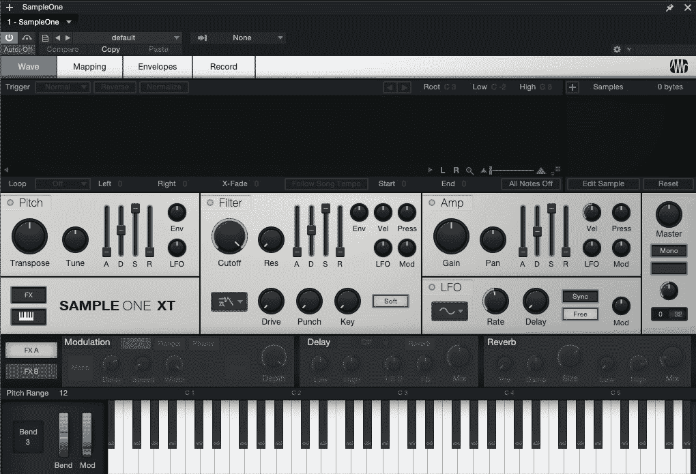

图 16.23：SampleOne XT

如果界面看起来令人望而生畏，那是有理由的。SampleOne XT 是一款强大的工具，允许您深入创意声音设计的核心领域。但别担心，我们会让您迅速上手基础知识！

## 添加采样

现在，我们需要给 SampleOne XT 提供一个采样供其处理。向 SampleOne XT 添加采样有两种方法：

* 如果您已有录制好的采样，格式为 **.wav** 或 **.mp3** 文件，您可以将其从**编排**窗口、**浏览**窗口、资源管理器 (Windows) 或访达 (macOS) 中拖放到 SampleOne XT 上。
* 如果您还没有录制采样，可以直接录制到 SampleOne XT 中。操作方法如下：

    1. 单击 SampleOne XT 界面顶部的**录制**选项卡。这将打开**录制**视图：

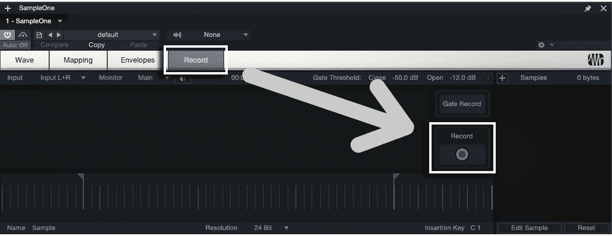

图 16.24：录制到 SampleOne XT

    2. 单击此视图中的**录制**按钮。
    3. 再次单击同一按钮以停止录制。

现在我们已将采样加载到 SampleOne XT 中，有趣的部分来了！

## 编辑采样

在 MIDI 键盘上弹奏任意音符，或点击 SampleOne XT 界面上的虚拟键盘上的任意音符。你将听到刚才添加的采样。SampleOne XT 会自动将采样转调到你正在演奏的音符，这样你就可以像演奏乐器一样演奏你的采样了。但让我们更进一步。

如果你直接将采样录制到 SampleOne XT 中，采样开头可能会有一段静默间隙，所以弹奏音符后可能需要等待片刻。让我们来修复这个问题：

1. 点击 SampleOne XT 界面顶部的 **Wave** 选项卡。这将打开 **Wave** 视图：

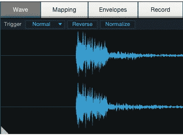

图 16.25：采样开头的间隙

1. 在 *图 16.25* 中，你可以看到采样开头有一个间隙。抓住窗口左下角的小三角形并向右拖动，直到采样的开头。这将裁剪掉间隙：

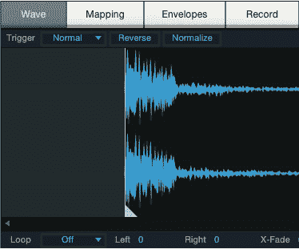

图 16.26：采样开头无间隙

现在你的采样将更加灵敏；当你在 MIDI 键盘上弹奏音符的那一刻，它就会被触发。

## 选择触发模式

**Trigger** 设置决定了当你在 MIDI 键盘上弹奏音符时 SampleOne XT 如何播放采样。有三个可用选项，可通过点击下拉菜单访问：

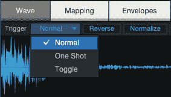

图 16.27：触发模式

让我们来探索这些选项：

* **Normal**：当你在 MIDI 键盘上弹奏音符时，采样将播放。当你松开音符时，采样将停止。
* **One Shot**：当你在 MIDI 键盘上弹奏音符时，采样将播放并持续播放直到采样结束，无论你何时松开音符。这是鼓和打击乐采样的首选 **Trigger** 方法；如果你过早松开音符，不希望它们听起来被切断。
* **Toggle**：当你在 MIDI 键盘上弹奏音符时，采样将播放，当你再次弹奏同一个音符时，它将停止。这是长采样（如音效、垫音或持续音）的首选 **Trigger** 方法。

为你的采样选择正确的 **Trigger** 模式将让你更好地控制采样，使你的新虚拟乐器更加好演奏且更令人愉悦。

将 SampleOne XT 集成到你的制作工作流中将开启全新层面的创造力，让你设计专属的声音和乐器。这是在音乐中开发你标志性声音的门户。

# 总结

在本章中，我们介绍了 Studio One 中三个超出标准音乐制作工作流的重要功能。首先，我们深入探讨了 **Show** 页面，并讨论了如何利用 Studio One 的力量增强现场表演。然后，我们探索了乐谱编辑器，它为习惯使用乐谱记谱的人提供了更直观的界面。最后，我们了解了 SampleOne XT，这是一款具有深度声音设计能力的强大采样器，为无限的创作可能性敞开了大门。

随着本章的结束，本书也接近尾声。通过这些页面，我希望为你提供了一份使用 Studio One 的综合指南。音乐制作是一个不断发展的领域，需要技术、创造力和激情的结合。无论你是刚入门还是已经制作音乐多年，总有新东西值得学习和探索。

迈出去吧，学习、创作，并与世界分享你的音乐！
