# 附录

## 自定义 Studio One 并遵循最佳实践

正如你现在所知，Studio One 通过简化工作流使音乐制作尽可能简单。在本附录中，我们将进一步讨论几种自定义 Studio One 的方法，以便你避免重复性任务。我们还将探索 Studio One 的文件管理系统，并讨论如何优化工作流以避免一些常见问题。最后，我们将谈论与他人共享项目以进行协作的最佳实践。

遵循我们将在此讨论的方法将使你的整体音乐制作体验更加顺畅。

我们将涵盖以下主题：

* 自定义 Studio One
* 理解文件和文件夹系统
* 与他人共享文件

## 技术要求

为了跟随本节内容，你需要在电脑上激活 Studio One。

## 自定义 Studio One

当你从一个项目转到另一个项目时，某些流程会变成肌肉记忆，你会发现自己反复做这些事情。也许你有一组特殊的效果插件组合，能让你的人声产生神奇的效果。又或者你通过叠加三个虚拟乐器创造了一个绝妙的声音，这个声音已经成为你声音标志的一部分，以至于你想在所有项目中使用它。

如果你发现自己频繁加载相同的插件或虚拟乐器，将它们保存为模板和预设是个好主意。这将让你直接进入创作过程，而无需每次都花时间设置相同的元素。

Studio One 提供了多种方法让你自定义工作流以提高效率和一致性。在本节中，我们将详细探讨这些方法。

### 创建你自己的智能模板

在 Studio One 中，**智能模板** 是一个预配置的 Song 文件，包含设置、预加载的虚拟乐器、效果和其他元素，可用于快速启动新项目。模板为新项目创建一致的起点，并通过消除每次创建 Song 文件时配置相同元素的需要来节省时间。模板还可以在协作者之间共享，从而实现标准化的音乐制作方法。

如果你发现自己为每个项目都添加相同的乐器和效果、创建相同的路由和混音器配置，你可以轻松创建自己的智能模板，在下一个项目中跳过这些步骤，直接开始创作。具体步骤如下：

1. 打开一个包含你常规添加到项目中的元素的典型 Song 文件。
2. 调整所有效果和乐器，并按你希望在创建下一个 Song 文件时看到的方式设置它们。
3. 配置所有路由设置和混音器配置以最适合你的工作流；这包括设置 FX 通道、创建总线以及在通道间应用侧链。
4. 自定义用户界面，仅包含与你相关的内容，如 *第 3 章* 所述。
5. 删除 **Arrange** 窗口内的所有内容——你不想在模板中保存内容。
6. 现在，转到顶部菜单，点击 `File`，然后选择 `Save As Template…`，这将打开 **Save As Template** 对话框：

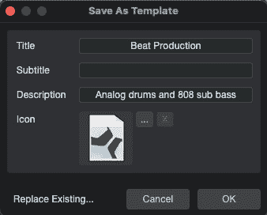

图 A.1：另存为模板对话框

1. 在 **Title** 字段中为你的模板起一个简短的名称。
2. 在 **Description** 字段中提供模板的简短描述。随着你创建越来越多的模板，这将帮助你记住该模板的用途。
3. 点击 `OK`。

现在，下次启动 Studio One 时，你的新模板将已准备就绪，等待你开始新 Song 的创作。你可以按以下方式打开它：

1. 在 **Start** 页面，点击 `New…` 按钮。这将打开 **New** 文档窗口。
2. 点击 **User** 选项卡。

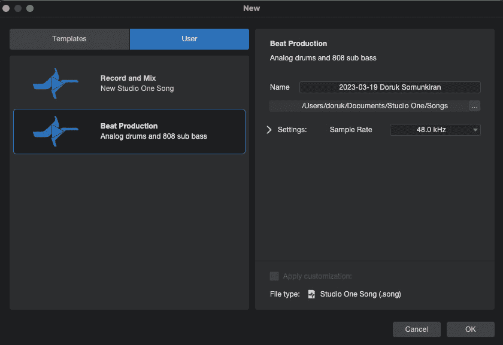

图 A.2：打开用户模板

1. 选择你的模板。
2. 点击 `OK`。

根据各种工作流场景的需要，创建任意数量的智能模板。这将释放原本用于音乐制作机械操作的精力带宽。

## 使用轨道预设

**轨道预设**允许您保存和调用常用的轨道配置，这样您就不必每次创建新轨道时都重新设置这些参数。

轨道预设会保存和调用与轨道相关的每一个参数。例如，假设我为每个新 Song 都这样设置我的主音电吉他轨道：

*   将轨道命名为 **E Gtr Lead**。
*   将轨道颜色设为红色。
*   在轨道上插入 **Ampire**，并使用我自己的自定义设置。
*   使用轨道的 **发送** 槽架以 -9 dB 将信号发送到一个 FX 通道，并加载 **Room Reverb** 和 **Pro EQ**。
*   将轨道路由到名为 **E Guitars** 的总线。

我不必在每个新项目中都创建一个具有上述设置的轨道，而是可以将该配置保存为轨道预设，然后在下一个项目中调用它。Studio One 将自动重建相同的组合，为我节省时间并简化工作流程。操作非常简单：

1.  在现有的 Song 中，按您想要的方式设置轨道：
    1.  给它命名。
    2.  分配轨道颜色。
    3.  插入任何效果插件并按您想要的方式调整它们。
    4.  创建一个 FX 通道，并使用 **发送** 槽架添加任何额外效果（可选）。
    5.  创建一个新的总线通道，并将轨道的输出路由到该总线（可选）。

这是我刚才描述的主音电吉他轨道配置：

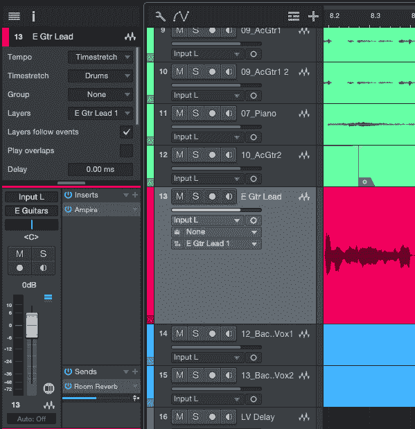

图 A.3：为轨道预设准备轨道

1.  右键单击轨道并选择 **存储轨道预设…**，这将打开 **存储预设** 对话框：

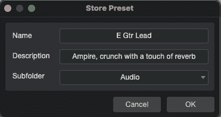

图 A.4：存储预设对话框

1.  为您的预设输入名称和描述。在此提供详细的描述将帮助您记住该预设的用途。
2.  单击 **确定**。

现在，让我们看看如何在下一个项目中调用此轨道预设：

1.  单击 **添加轨道** 按钮。这将打开 **添加轨道** 对话框：

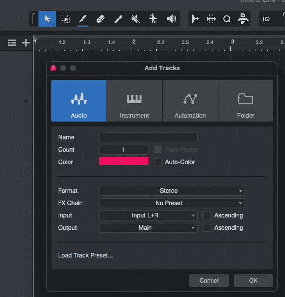

图 A.5：添加轨道对话框

1.  单击 **加载轨道预设…**。这将打开 **加载轨道预设** 窗口：

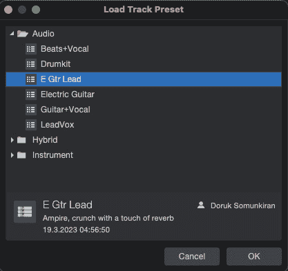

图 A.6：加载轨道预设窗口

1.  找到您的预设并单击 **确定**。

在 *图 A.7* 中，我在一个空项目中加载了我的 **E Gtr Lead** 轨道预设。请注意，FX 通道和总线通道已自动创建，所有路由也已自动建立，就像 *图 A.3* 中原始轨道的配置一样。

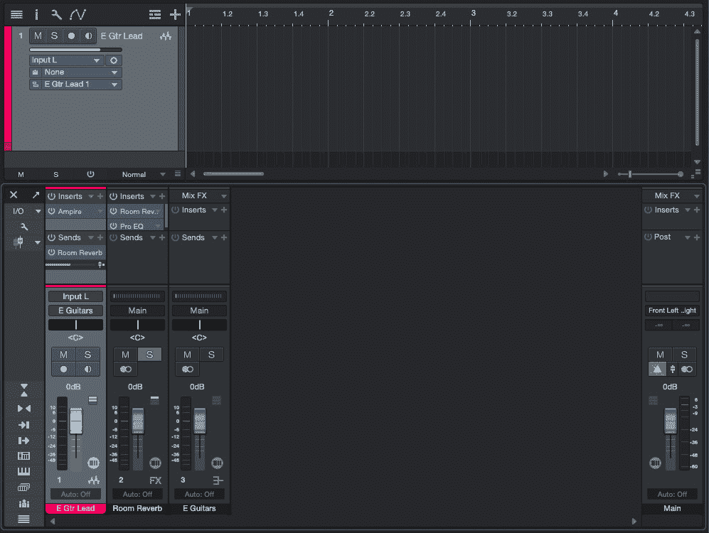

图 A.7：通过调用轨道预设创建的一个轨道、一个 FX 通道和一个总线通道

Studio One 自带多个预配置的轨道预设，更多预设可在 PreSonus Exchange 免费下载（我们在 *第 2 章* 中讨论过）。请随意探索这些预设，了解其他人是如何设置他们的轨道的。这就像在同行制作人的肩后观看他们工作一样，将是一次极佳的学习体验。

## 使用效果链

**效果链** 在 Studio One 中也称为 **FX Chain**，是一系列按顺序应用于音频信号的音频效果。通过按特定顺序组合多个效果插件，您可以创建独特且鲜明的声音，可用于提升音质或实现特定的艺术效果。

如果您在项目中经常使用相同的效果序列，可以将它们保存为 FX Chain，然后在未来的项目中单击一下即可调用，所有效果参数都将按您想要的方式设置。操作方法如下：

1.  在轨道的 **插入** 槽架上设置您的 FX Chain。将所有效果参数调整为您想要的状态。
2.  单击 **插入** 标签旁边的小三角形。这将打开 **FX Chain** 菜单：

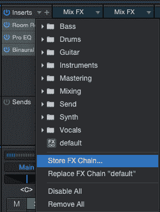

图 A.8：FX Chain 菜单

1.  选择 **存储 FX Chain…**。这将打开 **存储预设** 对话框：

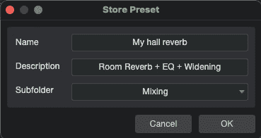

图 A.9：存储预设对话框

1.  为您的 FX Chain 输入名称并添加简短描述。
2.  Studio One 尝试通过将 FX Chain 分组到文件夹中来保持其有序。选择该 FX Chain 应列在其下的子文件夹。
3.  单击 **确定**。

在未来的项目中，当您想要调用您的 FX Chain 时，请按如下步骤操作：

1.  转到您想要加载 FX Chain 的轨道的 **插入** 槽架。
2.  单击 **插入** 标签旁边的小三角形。
3.  在您保存 FX Chain 的文件夹中找到它，然后单击以加载。

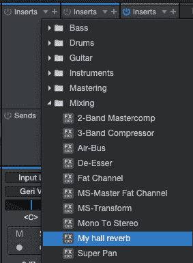

图 A.10：加载 FX Chain

就像轨道预设一样，Studio One 自带大量 FX Chain，更多可从 PreSonus Exchange 下载。请随意探索它们，看看同行制作人在不同塑声场景中使用什么。

在本节中，您学习了如何通过创建模板和预设来自动化重复性任务，从而节省时间并简化工作流程。在下一节中，我们将讨论最佳实践，帮助您充分利用 Studio One 的文件管理系统。

# 理解文件和文件夹系统

当灵感来袭，您想创作下一首热门单曲时，您可以随心所欲地从各种不同来源引入素材——从早期项目中获取音频文件、使用外部驱动器上的循环、从 YouTube 视频中提取音频作为采样……应有尽有。

在后台，Studio One 出色地跟踪这些音频资产，让您能够专心创作而不受干扰。对于中小型项目，Studio One 的文件管理能力绰绰有余；但是，随着项目规模扩大，总会有那么时候，Studio One 需要您稍加协助，以保持井井有条、运行顺畅。这正是本节的目标。

让我们首先讨论 Studio One 如何处理文件和文件夹。

## 探索 Studio One 的文件管理系统

当您在计算机上安装 Studio One 时，它会创建三个文件夹，分别作为您未来的 Song、Project 和 Show 的存放位置。以下是我电脑上 Studio One 安装的这些文件夹：

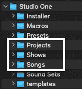

图 A.11：Studio One 用户数据文件夹

这三个文件夹统称为 **用户数据**，我们在 *第 2 章* 中讨论了如何自定义这些文件夹的位置。

当您开始创建新的 Project、Show 和 Song 时，Studio One 会在各自的文件夹下为每个项目创建单独的子文件夹。这是我的一个 Song 的子文件夹：

图 A.12：Song 子文件夹的内容

当我创建 Song 时，Studio One 创建了带有 `.song` 扩展名的文件。随着我继续处理 Song，所有其他文件夹都由 Studio One 自动创建并填充内容。使用 Studio One 的妙处就在于此：它在后台完成所有杂务，让您专注于创作。您不必知道这些文件夹里有什么；甚至不必知道这些文件夹的存在……直到您需要知道的时候。

## 定位和复制丢失的文件

让我们回到那个您心情愉悦、正在创作新 Song 的美好时刻。您工作了几个小时，听起来已经像首热门单曲了。于是您收工关机。然而，第二天您回到 Song 时，却收到如下消息：

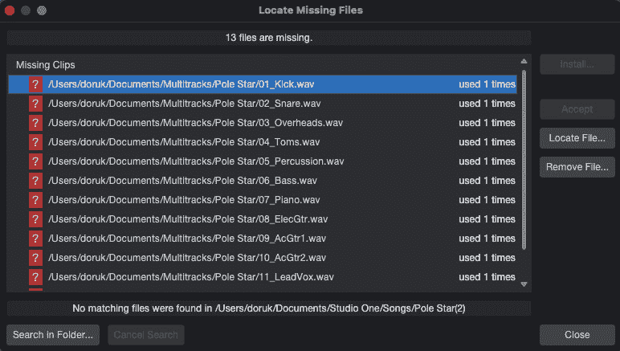

图 A.13：定位丢失文件对话框

## 处理外部驱动器丢失的文件

请记住你拖入 Song 的那个来自可移动驱动器的音频文件？现在该驱动器未连接到你的电脑，因此 Studio One 找不到该音频文件。

快速解决方法是连接该驱动器，点击此窗口上的 `Locate File…`，并指引 Studio One 到文件所在位置。然而，这只是临时修复；下次打开此 Song 时，除非外部驱动器始终保持连接，否则你会遇到同样的问题。

永久解决方案是通过将所有此类外部文件复制到该 Song 自身的文件夹下，将它们“带回家”，这非常容易操作：

1.  确保 Song 中使用的所有外部驱动器均已连接。
2.  打开该 Song。
3.  在顶部菜单中，转到 `Song` 并选择 `Copy External Files`。

Studio One 会将所有外部文件复制到 Song 文件夹内各自对应的位置。你将不再收到缺失文件警告，也不再需要去其他驱动器上搜寻文件。

## 移除未使用的文件

在制作 Song 的过程中，你会创建大量最终未被使用的文件。例如，如果你录制了多遍人声表演，最终只采用了一遍，其他遍的文件仍会留在你的驱动器上，占用宝贵的存储空间。

Studio One 可以自动检测这些未使用的文件并为你删除它们。仅需三次点击：

1.  打开该 Song。
2.  转到顶部菜单上的 `Song`。
3.  选择 `Remove Unused Files`。

养成在 Song 完成后执行此命令的习惯是个好主意。如果你进行大量录音，你会惊讶地发现未使用的素材浪费了多少存储空间。

不过请注意，如果你在其他 Song 中也使用了这些素材，删除它们将导致那些其他 Song 也无法使用这些素材。因此，这里有一个最佳实践——先在所有 Song 上运行 `Copy External Files`，然后再选择 `Remove Unused Files`。这样可以消除误删已用文件的风险。

## 使用自动保存和恢复

默认情况下，Studio One 每五分钟会自动保存一次你的 Song。这些自动保存的文件存储在 Song 主文件夹的 `History` 子文件夹中。这是一大福音，因为如果由于某些原因（系统崩溃、断电等）你无法保存 Song，你最多只会丢失五分钟的工作成果。

当你尝试打开一个之前崩溃过的 Song 文件时，Studio One 会询问你是否要继续使用最近的自动保存版本。点击 `OK`，你就可以像从未发生崩溃一样继续工作。

不过，如果你频繁遇到崩溃，可能该进行一些故障排除了。Studio One 有一个 `Studio One Safety` 窗口，可能通过一些尝试和错误来帮助诊断崩溃原因。

当 Studio One 崩溃时，下次启动程序时 `Studio One Safety` 窗口会自动打开。你也可以在启动 Studio One 时按住键盘上的 `Shift` 键强制打开它。

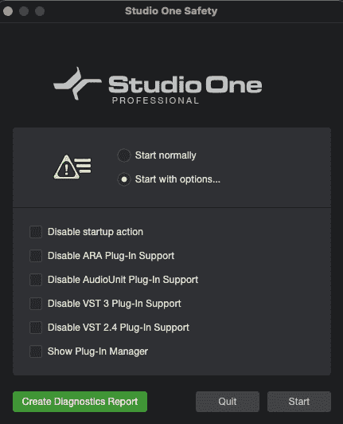

Figure A.14: The Safety window

通常，崩溃是由于与第三方插件冲突引起的，尤其是较旧的插件。使用 `Studio One Safety` 窗口，你可以暂时禁用特定类型的插件，启动 Studio One，并查看是否解决了问题。这将帮助你通过尝试和错误缩小嫌疑范围。一旦找到罪魁祸首，你可以尝试更新它，或用一个与 Studio One 兼容良好的替代品来替换它。

## 保存增量版本

这里有一个能让你省去很多麻烦的最佳实践——每隔半小时左右用不同的版本名称保存文件。最简单的方法是在文件名末尾添加一个数字，并随每个版本递增，如下所示：

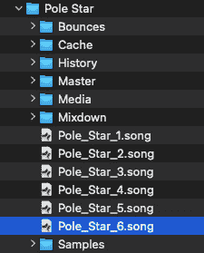

Figure A.15: Saving a Song file with incremental versions

当你在制作 Song 时，特别是如果你已经辛苦工作了一段时间且感到疲惫，你可能会发现最新的操作反而削弱了 Song 的质量而非提升它。你可能会想：“这行不通。我真希望能回到过去。” Studio One 确实有 `Undo`（撤销）功能，但就像现实生活中一样，有些举动就是无法撤销的。

在这种情况下，拥有一个半小时前保存的 Song 版本（那时一切尚属完好）简直是救命稻草。只需关闭当前版本，打开之前的版本，即可获得第二次机会把事情做对。

Studio One 让这很容易实现。以下是设置方法：

1.  在 Song 界面中，转到顶部菜单的 `File` 并选择 `Save New Version…`。这将打开一个对话框：

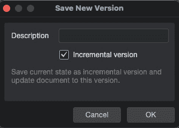

Figure A.16: The Save New Version dialog box

2.  勾选 `Incremental version`。
3.  点击 `OK`。

现在 `Incremental version` 复选框已选中，你无需再打开此对话框即可保存新版本。下次想要创建新版本时，只需使用 `Save New Version…` 命令的键盘快捷键——`Ctrl` + `Alt` + `S` (Windows) 或 `Option` + `Cmd` + `S` (Mac)——Studio One 就会自动创建一个新版本。

在本节中，我们探讨了 Studio One 如何处理构成 Song 的所有文件，并讨论了多项最佳实践，以保持文件系统有序、避免缺失文件警告、排查崩溃故障以及回退到 Song 的先前版本。接下来，我们将讨论与他人共享 Studio One 文件以进行协作的最佳实践。

# 与他人共享你的文件

无论你是与其他制作人合作、与乐队成员交换想法，还是将音轨发送给混音室，共享你在 Studio One 中创建的文件都是一项重要的技能，且伴随着自己的最佳实践。

在本节中，我们将探讨不同的共享文件场景，考虑每种场景下最有效的共享方法。

## 与拥有 Studio One 的合作者共享

如果你与一位也拥有 Studio One 的制作人合作，共享你的 Song 文件夹将获得最佳体验。这样，你的合作者可以直接在文档上工作并发回给你，无需任何转换或渲染。

要与合作者共享 Song 文件夹，请执行以下操作：

1.  打开你的 Song。
2.  在顶部菜单中，转到 `File` 并选择 `Copy External Files`。这将确保你的 Song 中使用的所有文件在共享时都包含在其文件夹内，防止出现任何关于缺失文件的提示。
3.  再次在顶部菜单中，转到 `File` 并选择 `Remove Unused Files`。这将消除不再需要的文件造成的杂乱，减小文件夹大小，使其更易于通过互联网共享。
4.  找到你的 Song 文件夹并将其共享给合作者。

如果你仅共享带有 `.song` 扩展名的文件，你的合作者将无法加载媒体文件，因此共享整个文件夹至关重要。

Studio One 版本向后兼容，因此 Studio One 7 可以打开 Studio One 6 创建的 Song 文件。但反之不行；如果你使用 Studio One 7 而合作者使用 Studio One 6，他们将无法打开你的 Song。

此外，如果你在 Song 中使用了第三方插件而合作者没有这些插件，Song 文件虽然能在他们的电脑上正常打开，但他们将无法听到这些插件创建的效果。如果这些效果在协作阶段不可或缺，请在共享文件夹前渲染音频文件（如 `Chapter 13` 所述）。

## 与没有 Studio One 的合作者共享

## 将歌曲作为 MIDI 文件共享

如果你要与没有 Studio One 的合作者共享歌曲，最好的办法是共享 MIDI 文件。MIDI 文件可以在任何 `digital audio workstation` (`DAW`) 软件中打开，因此你的合作者只需将文件拖入他们正在使用的任何程序中即可继续工作。

要从项目创建 MIDI 文件，请执行以下操作：

1. 打开你的歌曲。
2. 转到顶部菜单上的 `File`，悬停在 `Convert To` 上，然后选择 `MIDI File…`。
3. 在对话框中，为你的 MIDI 文件命名。
4. 点击 `OK`。

MIDI 文件还有一个额外优势，即体积极小，因此即使在移动设备之间也能轻松共享。

## 共享音轨以进行混音

如果你聘请混音工程师为你的歌曲混音，你需要将歌曲的各个单独音轨发送给他们。以下是一些最佳实践，可为你和混音工程师节省时间：

1. 打开你的歌曲并禁用所有效果插件，除了那些构成乐器特征声音的必要组件。例如，如果你通过使用 `Ampire` 或类似插件获得了独特的吉他音色，请保留它开启。禁用你添加到歌曲中的所有其他插件；这些现在是混音工程师的责任。

2. 使用 `Export Stems` 命令导出歌曲中的所有音轨，正如我们在 *第 13 章* 中讨论的那样。

3. 进入包含音轨文件的文件夹，并给它们起简短、描述性的名称。不要添加冗长的前缀，例如 `MySongTrack07_Bass`。所有 DAW 软件的混音台仅显示音轨名称的前几个字母，如果所有音轨文件名都有相同的前缀，混音工程师在混音器的每个通道上看到的将是相同的内容。

4. 创建一个文本文件，其中包含你的姓名、联系方式、歌曲名称、导出音轨的采样率和位深，以及歌曲的速度。

5. 将所有音轨文件和文本文件合并到一个 ZIP 文件夹中。

6. 将 ZIP 文件夹重命名为包含你的姓名和歌曲名称。

遵循这些最佳实践将使混音工程师能够立即开始处理你的歌曲，而无需进行任何额外工作或致电询问你问题。

# 概要

在本节中，我们讨论了几种自定义 Studio One 以匹配并加速你工作流程的方法。然后，我们探索了 Studio One 的文件管理系统，以帮助你跟踪歌曲中的各种素材。随着时间的推移，这将变得越来越重要，因为你需要对电脑进行整理、减少杂乱并归档完成的歌曲。最后，我们探讨了与同事和合作者共享已完成和未完成歌曲的各种方法。遵循这些最佳实践将使你和团队中的其他人的生活更轻松。
